# What zakihussa1n's chess.com games say

Every rated and casual live game from August 2021 to October 2026, every position checked by Stockfish, and every number below backed by a table you can open. Start with the takeaways, then skim the charts of whichever question interests you.

## How to read this page

- Each question is split into sub-questions; each sub-question has one chart, a few bullets and a **Data** line.
- Each bullet holds one fact; its numbers are in the CSV linked on the Data line (checked by `analysis/check_presentation.py`).
- **Blue is you, grey is your opponents**, always in the same games.
- Whiskers and shaded bands are 95% confidence intervals (CI): the range the true value most likely sits in.
- "No clear difference" means the CI includes zero: the data cannot tell the two apart. It does not mean there is no difference.
- **Score vs expectation** is your actual score (win 1, draw ½, loss 0) minus what was expected, from the ratings (Elo) or from the win-chance model; it comes with an **Elo-equivalent**, the rating gap that would produce the same difference.
- **Expected points lost per move** is how much a move lowered the mover's chances (win chance plus half the draw chance), judged by a model trained on these games (see [appendix A](#a-how-good-is-the-win-chance-model-behind-every-number)). A blunder in a won position costs a lot; the same move in a hopeless position costs almost nothing.
- **Centipawns** (100 = one pawn) are Stockfish's measure of the position, given alongside as the familiar unit.
- Results are split by **exact time control** (bullet 1+0, 1+1, 2+1; blitz 3+0, 3+2, 5+0, 5+2, 5+5; rapid 10+0), because a 1+1 game on a low clock is a different game from 1+0.
- Controls with fewer than 50 games (bullet 0.5+0: 19 games; rapid 30+0: 1 game) are left out.
- Cells resting on too few games are marked "too few games" or left out of the charts, and flagged `thin` in the CSVs.
- **Clock buffer** is the clock minus one increment: in 1+1, 4 s on the clock is a 3 s buffer. In controls without increment it equals the clock.

## Contents

- [Top takeaways](#top-takeaways)
- [1. Where are points won and lost: do you make fewer mistakes than your opponents?](#1-where-are-points-won-and-lost-do-you-make-fewer-mistakes-than-your-opponents)
- [2. How did your rating move, and what changed in your play as it rose?](#2-how-did-your-rating-move-and-what-changed-in-your-play-as-it-rose)
- [3. How does time pressure affect your play?](#3-how-does-time-pressure-affect-your-play)
- [4. How do you use your clock, and what do losses on time cost you?](#4-how-do-you-use-your-clock-and-what-do-losses-on-time-cost-you)
- [5. How do your playing sessions shape your results?](#5-how-do-your-playing-sessions-shape-your-results)
- [6. Does the time of day or the day of the week matter?](#6-does-the-time-of-day-or-the-day-of-the-week-matter)
- [7. Does resigning cost you points?](#7-does-resigning-cost-you-points)
- [8. Which openings work for you, and how well do you play them?](#8-which-openings-work-for-you-and-how-well-do-you-play-them)
- [9. What kinds of blunders do you make, and which do you miss?](#9-what-kinds-of-blunders-do-you-make-and-which-do-you-miss)
- [10. How well do you play endgames?](#10-how-well-do-you-play-endgames)
- [12. Can a model pick out your games, and what gives you away?](#12-can-a-model-pick-out-your-games-and-what-gives-you-away)
- [A. How good is the win-chance model behind every number?](#a-how-good-is-the-win-chance-model-behind-every-number)
- [Where everything lives](#where-everything-lives)
- [Recovering the old long-form reports](#recovering-the-old-long-form-reports)

## Top takeaways

### What the data say, one fact at a time

- In 1+0 you convert winning positions better than your opponents: +0.041 in score from positions the model rated at least 80% to win (CI +0.018 to +0.063). [→ 1.5](#15-how-often-do-you-convert-a-winning-position)
- Against opponents more than 100 points stronger you score +0.139 above the Elo expectation (CI +0.083 to +0.205), about +112 Elo. [→ 2.5](#25-how-do-you-score-against-stronger-and-weaker-players)
- In 5+0 you drop under 10 s in 23.3% of games; your opponents in 6.7%. [→ 3.2](#32-how-often-do-you-drop-under-10-seconds-in-a-game)
- In 1+0 losses on time are a net gain for you: 0.032 expected points per game (CI 0.020 to 0.042), about +22 Elo. [→ 4.5](#45-how-many-games-do-you-lose-on-time-and-from-what-positions)
- You stop after 33% of your losses but only 17% of your wins. [→ 5.2](#52-do-you-stop-after-losses)
- In the game after a loss you score −0.054 less than after a win (CI −0.083 to −0.027), about −38 Elo. [→ 5.5](#55-what-happens-in-the-game-after-a-loss)
- The hour of the day makes no clear difference across all games: shuffling hours between sessions gives effects as large as yours (p = 0.41). [→ 6.4](#64-does-any-effect-survive-accounting-for-sessions-rating-and-year)
- Resigning costs you most in rapid 10+0: a net −4.0 expected points per 100 games (CI −6.3 to −2.4). [→ 7.5](#75-how-much-has-resigning-cost-you)
- In 1+0 you blunder into a forced mate 0.81 times per 100 moves; your opponents 0.51. [→ 9.5](#95-how-often-do-you-allow-mate)
- In 1+0, 36 of every 100 of your won endings ended on the clock without a single wrong move; for your opponents 21. [→ 10.5](#105-how-did-failed-wins-end-a-wrong-move-or-the-clock)

Data: [1: 5b_conversion_diff.csv](data/01_decomposition/5b_conversion_diff.csv) · [2: 5_score_vs_gap.csv](data/02_trajectory/5_score_vs_gap.csv) · [3: 2_games_under_line.csv](data/03_time_pressure/2_games_under_line.csv) · [4: 5d_clock_cost_per_game.csv](data/04_clock_allocation/5d_clock_cost_per_game.csv) · [5: 2_stop_by_result.csv](data/05_sessions/2_stop_by_result.csv) · [5: 5b_after_loss_minus_after_win.csv](data/05_sessions/5b_after_loss_minus_after_win.csv) · [6: 4b_permutation.csv](data/06_time_of_day/4b_permutation.csv) · [7: 5b_net.csv](data/07_resignation/5b_net.csv) · [9: 5_allowed_mate.csv](data/09_blunder_anatomy/5_allowed_mate.csv) · [10: 5_failed_conversions.csv](data/10_endgames/5_failed_conversions.csv)

## 1. Where are points won and lost: do you make fewer mistakes than your opponents?

**Short answer:** You and your opponents give away almost the same amount per game through mistakes; your edge comes once a position is decided, because in 1+0, 3+2 and 10+0 you convert winning positions and save lost ones more often than your opponents, while in 1+0 and 10+0 more of your losses come while you still had chances (in 10+0 mostly by resigning).

### 1.1 How many points does each side give away per game?

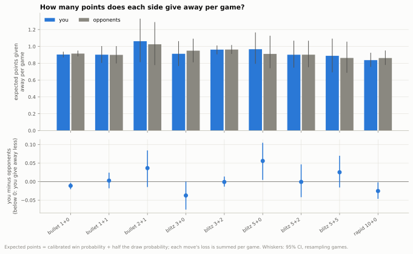

- In every time control each side gives away close to one expected point per game through its mistakes (between 0.84 and 1.06 for you).
- In 1+0 you gave away 0.904 per game and your opponents 0.915: 0.011 less (CI 0.003 to 0.021), about +8 Elo (CI +2 to +14).
- In 10+0 you gave away 0.025 less per game (CI 0.002 to 0.046), about +18 Elo (CI +1 to +32).
- In 3+2 there is no clear difference (-0.001, CI -0.013 to +0.014); 5+0 is the one control where you gave away more, +0.056 (CI +0.005 to +0.105), from only 90 games.

Data: [1_points_per_game.csv](data/01_decomposition/1_points_per_game.csv) · [1b_score_budget.csv](data/01_decomposition/1b_score_budget.csv) · [all tables](data/01_decomposition/_index.csv) · [script](../analysis/01_decomposition.py) · source: [games_decomposed.parquet](../data/zakihussa1n/games_decomposed.parquet)

### 1.2 How much of the damage comes from a few big mistakes?

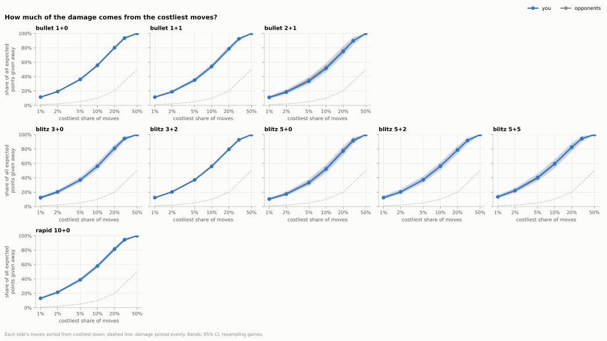

- In every control the costliest 10% of moves carry more than half of all the expected points given away: 55% of yours in 1+0, 56% in 3+2, 58% in 10+0.
- The single costliest 1% of moves alone carry 10% to 14% of the total.
- Moves losing at least 0.1 expected points are rare, 8.8 in every 100 of your moves in 1+0, yet they carry 51% of what you give away.
- Your curve and your opponents' nearly coincide in every control; the small clear gaps go both ways: in 1+0 your costliest 10% carry slightly less of your total (55.4% against 56.1%), in 10+0 your costliest 20% slightly more (81.8% against 81.0%).

Data: [2_concentration.csv](data/01_decomposition/2_concentration.csv) · [2b_big_errors.csv](data/01_decomposition/2b_big_errors.csv) · [all tables](data/01_decomposition/_index.csv) · [script](../analysis/01_decomposition.py) · source: [moves_analysed.parquet](../data/zakihussa1n/moves_analysed.parquet)

### 1.3 How often does one move decide a lost game?

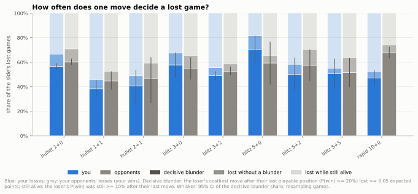

- When a game was lost on the board, one costly move of the loser can be named in 81% to 92% of games, for you and your opponents alike, in every control with enough such games.
- In 1+0, 57% of your losses were decided by one identifiable blunder of yours (CI 54% to 59%), against 60% of your opponents' losses (CI 58% to 63%); most of the rest were lost while you still had chances (see the last sub-question).
- In 10+0 the gap is large: 47% of your losses came from one decisive blunder against 68% of your opponents', 20.6 percentage points fewer (CI 12.0 to 28.5).
- In 1+0 the decisive blunder came with about 21 seconds left for both sides (21.0 against 21.4, no clear difference); in 3+2 yours came with 80 seconds left (78 beyond the increment) against 95 for your opponents, 14.8 seconds less (CI 7.3 to 22.0).

Data: [3_decisive.csv](data/01_decomposition/3_decisive.csv) · [3c_decisive_clock.csv](data/01_decomposition/3c_decisive_clock.csv) · [3b_decisive_profile.csv](data/01_decomposition/3b_decisive_profile.csv) · [all tables](data/01_decomposition/_index.csv) · [script](../analysis/01_decomposition.py) · source: [games_decomposed.parquet](../data/zakihussa1n/games_decomposed.parquet)

### 1.4 In which phase do you give away the most?

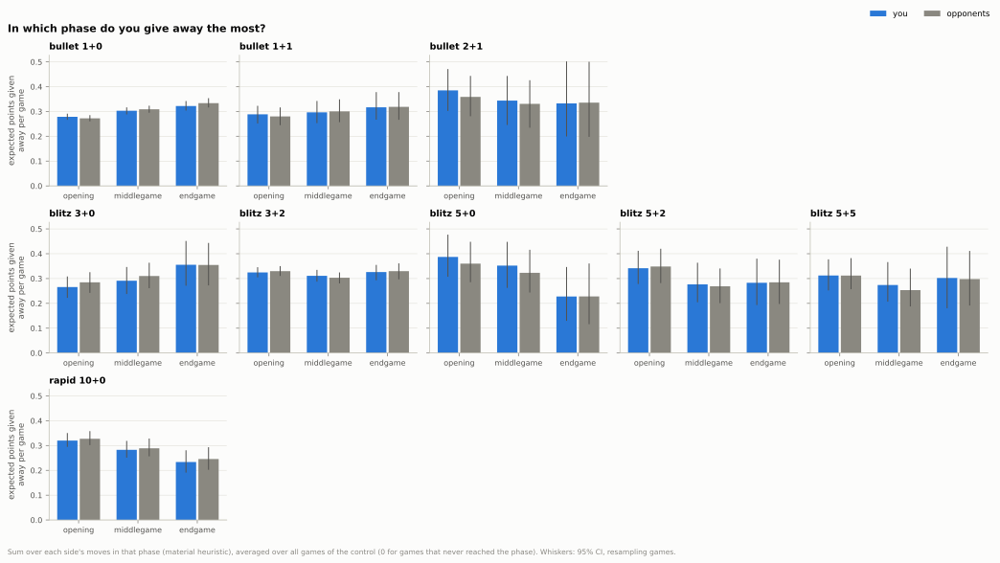

- In 1+0 the endgame costs the most per game, 0.322 expected points for you and 0.334 for your opponents: you give away 0.012 less (CI 0.006 to 0.017).
- In 1+0 you give away slightly more than your opponents in the opening: +0.006 per game (CI +0.002 to +0.011).
- In 10+0 the opening costs the most (0.320 per game) and the endgame the least (0.234); there you give away 0.012 less than your opponents, a borderline difference (CI 0.000 to 0.025).
- Per move, the middlegame is your most expensive phase in every control (narrowly in 3+0): in 1+0 you lose 0.032 expected points per middlegame move against 0.026 per opening move.

Data: [4_phase.csv](data/01_decomposition/4_phase.csv) · [4b_phase_per_move.csv](data/01_decomposition/4b_phase_per_move.csv) · [all tables](data/01_decomposition/_index.csv) · [script](../analysis/01_decomposition.py) · source: [games_decomposed.parquet](../data/zakihussa1n/games_decomposed.parquet)

### 1.5 How often do you convert a winning position?

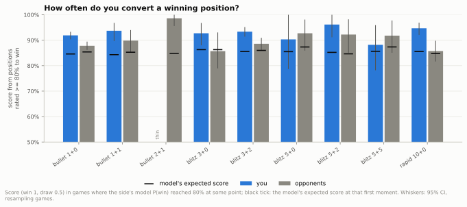

- In 1+0, from positions the model rated at least 80% to win, you scored 0.919 where it expected 0.846: +0.073 (CI +0.058 to +0.087), about +126 Elo (CI +93 to +162).
- Your opponents scored 0.878 where the model expected 0.854, +0.024, about +36 Elo (CI +12 to +65), so in 1+0 you convert better by +0.041 in score (CI +0.018 to +0.063).
- The edge is also clear in 3+2, +0.048 (CI +0.013 to +0.079), and in 10+0, +0.089 (CI +0.042 to +0.137); in the smaller controls the CIs include zero.
- Both sides beat the model from winning positions because it is cautious there: over all games, from positions it rates 80% to 90%, you won 95.8% and your opponents 92.0%.

Data: [5_conversion.csv](data/01_decomposition/5_conversion.csv) · [5b_conversion_diff.csv](data/01_decomposition/5b_conversion_diff.csv) · [5d_model_by_side.csv](data/01_decomposition/5d_model_by_side.csv) · [all tables](data/01_decomposition/_index.csv) · [script](../analysis/01_decomposition.py) · source: [expected_points.parquet](../data/zakihussa1n/expected_points.parquet)

### 1.6 How often do you save a lost position, and how?

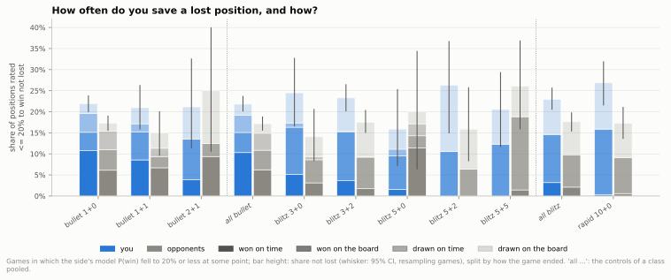

- From positions the model rated nearly lost you avoid losing more often than your opponents in 1+0 (21.9% against 17.3%, 4.6 percentage points more, CI 2.1 to 7.1), 3+2 (5.8 more, CI 1.9 to 9.8) and 10+0 (9.6 more, CI 3.7 to 16.0).
- Both sides score below the model from such positions: in 1+0 you scored 0.185 where it expected 0.212, about -30 Elo (CI -49 to -10), your opponents about -90 Elo (CI -112 to -70); your edge is losing less than the model expects, not beating it.
- In 1+0, 49% of your saves were wins on time and 20% draws on time (your opponent ran out of time but you had too little material to win), against 35% and 25% of your opponents' saves.
- In longer games saves mostly come on the board: 50% of your blitz saves and 58% in 10+0, with only 14% (blitz) and 1% (10+0) won on time.

Data: [5_conversion.csv](data/01_decomposition/5_conversion.csv) · [5b_conversion_diff.csv](data/01_decomposition/5b_conversion_diff.csv) · [6_saves_how.csv](data/01_decomposition/6_saves_how.csv) · [all tables](data/01_decomposition/_index.csv) · [script](../analysis/01_decomposition.py) · source: [games_decomposed.parquet](../data/zakihussa1n/games_decomposed.parquet)

### 1.7 How many of your losses came while you still had chances?

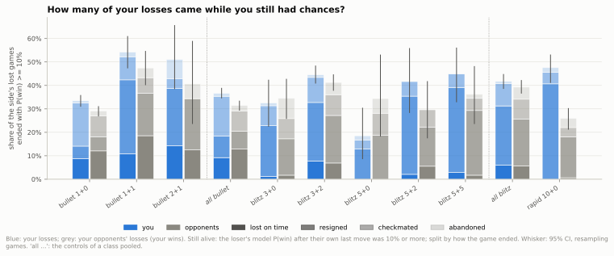

- In 1+0, 34% of your losses (CI 31% to 36%) ended while the model still gave you real chances after your last move, against 29% of your opponents' losses: 4.4 percentage points more (CI 1.1 to 7.5).
- In 1+0 the difference is checkmates delivered while the clock still gave the loser chances: 18.5% of your losses against 9.0% of your opponents'; you lose on time with chances less often (8.8% against 12.1%).
- In 10+0, 48% of your losses came while you still had chances, against 26% of your opponents', almost all resignations: 41% of your losses against 17%.
- The same resignation pattern shows in 1+1 (32% of your losses against 18%, 13.5 percentage points more, CI 4.9 to 21.9) and across blitz (25.3% against 19.9%).

Data: [7_lost_with_chances.csv](data/01_decomposition/7_lost_with_chances.csv) · [all tables](data/01_decomposition/_index.csv) · [script](../analysis/01_decomposition.py) · source: [games_decomposed.parquet](../data/zakihussa1n/games_decomposed.parquet)

<details><summary>Method and caveats</summary>

- Games: every standard live game with at least one move in a time control with at least 50 games, 6,007 games in nine controls (counts per control, results and moves in `8_data.csv`); 0.5+0 (19 games) and 30+0 (1 game) are too thin and left out.
- Expected points (win probability plus half the draw probability) come from the calibrated model in `expected_points.parquet`, which knows both pre-game ratings, the clocks and the time control; a move's loss is the drop in the mover's expected points, floored at 0, against Stockfish 17.1 at 1M nodes, so a "loss" can be a move no human would find.
- You and your opponents are always compared in the same games; differences are you minus opponents (1.1 reports "less" when yours is lower) and their CIs come from resampling whole games (500 resamples, 300 for the concentration curve), so both sides move together.
- Score vs expectation comes with its Elo-equivalent: the rating gap that turns the expected score into the actual one, applied to each CI end; for per-game point differences (1.1) the expected score is an even 0.5, as pairings are rating-matched (median gap 12 to 79 points per control in `8_data.csv`; in 2+1 and 5+0 your opponents averaged 42 and 63 points stronger).
- The per-game sums do not add up exactly to the result: score = expected score at move 1 - your losses + your opponents' losses + a residual (resignations, flags, end-of-game model error, the floor at 0). The residual is small (`1b_score_budget.csv`), and the net difference tracks the score closely (correlation 0.61 to 0.82 per control; by bin in `1c_net_ep_check.csv`).
- Decisive blunder (1.3): judged on the loser's own moves only. A game is lost on the board if the loser's model win chance after their last own move was below 10%; the final slide starts at their last move from a playable position (win chance at least 20%), and the decisive blunder is their costliest move from there, counted if it lost at least 0.05 expected points. A plain "last crossing below 10%" rule was rejected because the model's win chance decays gradually in bullet. A stricter pair (lost below 15%, playable from 30%) is in `3_decisive.csv` as a sensitivity check.
- "Still had chances" (1.7) = the loser's model win chance after their own last move was 10% or more. The bullet model keeps a real flag chance alive even in a mating position when the winner is short of time, which is why checkmates appear there.
- Conversion (1.5) = games in which the side's model win chance reached 80% at some point (the start or after any move); save (1.6) = it fell to 20% or less. The expected score is the model's at the first such moment. Other thresholds (60% to 90%) are in `5c_threshold_sensitivity.csv`.
- The model is pooled over both sides and under-confident at the extremes in both directions: from winning positions both sides score above it, from lost positions both score below it. From every probability band you win more often than your opponents (`5d_model_by_side.csv`), the same fact as the conversion and save gaps. Absolute conversion and save rates are model-relative; the you-vs-opponents gap is the robust part.
- Elo-equivalents of a score within 0.001 of 0 or 1 are unbounded (a CI end at a score of 1.0 in 2+1, 5+0 or 5+2 would map to 900 or more Elo), so those cells are left blank in `5_conversion.csv`; the small controls' Elo CIs are not meaningful anyway.
- Phase (1.4) is the material heuristic from the enrichment step; "opening" includes many moves beyond book. Per-game phase totals count games that never reached a phase as 0.
- Thin cells: a share resting on fewer than 30 cases (losses, winning or lost positions) or a phase played in fewer than 30 games is flagged `thin` and not drawn (labelled "thin" in the bar charts); bullet 2+1, blitz 5+0 and 5+2 have under 60 losses per side, so their per-control CIs are wide.
- Endings by termination (1.6, 1.7) are also pooled by time class (rows "all bullet", "all blitz" in the tables; italic bars after a dotted divider in the charts, not extra controls) because most per-control termination cells are thin outside 1+0, 3+2 and 10+0; the pools cover only the reported controls.
- In `6_saves_how.csv`, `thin` refers to the lost positions behind `share_of_lost_positions`; `share_of_saves` rests on the saves themselves, often under 30 outside 1+0, 3+2, 10+0 and the pools (`thin_share_of_saves`).
- Differences of two shares are given in percentage points (`*_pp` columns).
- The decisive blunder's clock is reported in seconds left, beyond one increment, and as a share of the base time; `3c_decisive_clock.csv` compares the sides on the same resampled games (your decisive blunders in your losses against your opponents' in your wins).
- The script also writes `data/zakihussa1n/games_decomposed.parquet` (one row per game, unchanged by this split), which Q2, Q5, Q6, Q7 and Q8 read.
- The old long-form report is archived; see [where everything lives](#where-everything-lives).

</details>

## 2. How did your rating move, and what changed in your play as it rose?

**Short answer:** Your rating rose in every pool (bullet has since fallen back from its 1300 peak), but your opponents' play improved in step with yours; what was yours was losing on time less often in 1+0, getting faster than the field in several longer controls, and scoring well above expectation against much stronger players (about +112 Elo), at low and high ratings alike.

### 2.1 How did your rating move over time?

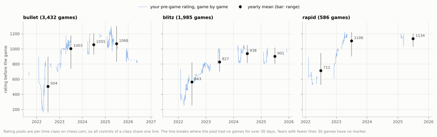

- Bullet went from 695 (Aug 2021) to a peak of 1300 (Apr 2025) and has since fallen 493 points, to 807.
- Blitz went from 800 (Aug 2021) to a peak of 1050 (Feb 2024) and stands at 956.
- Rapid climbed 590 points, from 616 (Feb 2022) to 1206, close to its 1222 peak (Apr 2023).
- Each rating line mixes controls: in 2025, 17% of your bullet games were 1+1, and in blitz 3+0 replaced 3+2 as the main control (66% of the year's games).

Data: [1_rating_by_year.csv](data/02_trajectory/1_rating_by_year.csv) · [1b_rating_milestones.csv](data/02_trajectory/1b_rating_milestones.csv) · [1c_games_by_year.csv](data/02_trajectory/1c_games_by_year.csv) · [all tables](data/02_trajectory/_index.csv) · [script](../analysis/02_trajectory.py) · source: [my_games.parquet](../data/zakihussa1n/my_games.parquet)

### 2.2 Did your move quality improve faster than your opponents'?

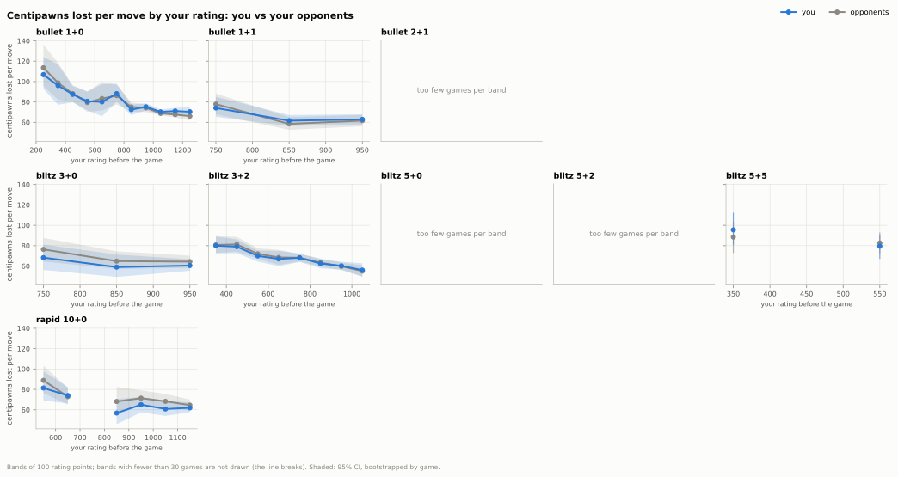

- In 1+0, from your lowest-rated third of games (168 to 982) to your highest (1085 to 1300), you lost 9.7 fewer centipawns per move (CI 6.6 to 13.3).
- Your opponents in those games improved more, by 13.6 centipawns per move (CI 10.0 to 17.5): the field gained 3.9 per move on you (CI 1.4 to 6.3).
- In expected points lost per move (the main measure, which already allows for both ratings) your change in 1+0 matched the field's: difference +0.0007 (CI -0.0002 to +0.0014), no clear difference.
- In 3+2 and 10+0 the centipawn gap also leans towards the field (2.1 and 3.5 per move), but both CIs include zero (-1.2 to 5.5; -1.6 to 9.5).

Data: [2_quality_by_band.csv](data/02_trajectory/2_quality_by_band.csv) · [2c_quality_change.csv](data/02_trajectory/2c_quality_change.csv) · [all tables](data/02_trajectory/_index.csv) · [script](../analysis/02_trajectory.py) · source: [games_decomposed.parquet](../data/zakihussa1n/games_decomposed.parquet)

### 2.3 Did you get faster?

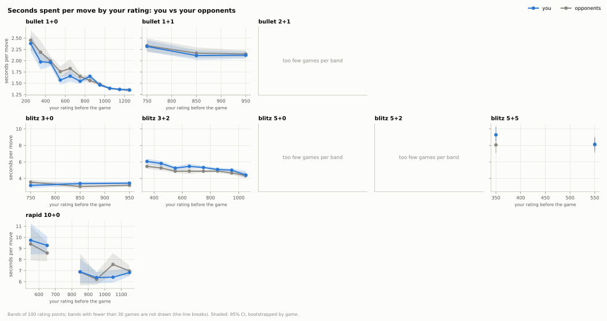

- In 1+0 you went from 1.66 to 1.36 seconds per move between your lowest- and highest-rated thirds of games, and your opponents sped up by about the same (no clear difference: 0.03 s, CI 0.00 to 0.06).
- You sped up more than your opponents in 3+2 (0.21 s per move more, CI 0.02 to 0.44), 5+2 (0.86, CI 0.04 to 1.70), 5+5 (2.14, CI 1.18 to 3.16) and 10+0 (0.73, CI 0.15 to 1.34); in 1+1, 3+0 and 5+0 there is no clear difference.
- Playing faster did not mean living on the clock: in 3+2 your share of moves with under 10 s beyond the increment fell from 5.1% to 2.3%.
- Even within a single year, games where you spent less of your clock per move go with a higher rating: about 28 rating points per standard deviation in 1+0 (CI 5 to 43) and 25 in 3+2 (CI 1 to 39).

Data: [3_speed_by_band.csv](data/02_trajectory/3_speed_by_band.csv) · [3c_speed_change.csv](data/02_trajectory/3c_speed_change.csv) · [3d_rating_regression.csv](data/02_trajectory/3d_rating_regression.csv) · [all tables](data/02_trajectory/_index.csv) · [script](../analysis/02_trajectory.py) · source: [moves_enriched.parquet](../data/zakihussa1n/moves_enriched.parquet)

### 2.4 Did you lose on time less often?

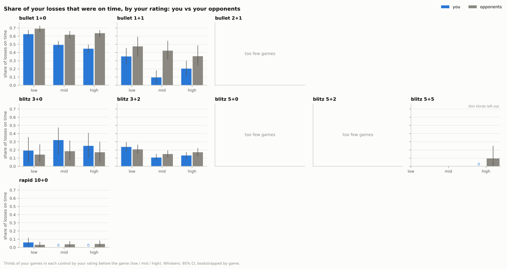

- In 1+0, 62% of your losses in your lowest-rated third of games were on time, and 45% in your highest-rated third.
- Your opponents' share stayed between 62% and 69%, so your drop is larger than theirs by 12 percentage points (CI 3 to 21).
- In 10+0 none of your losses in the middle and top thirds were on time (6% in the lowest), but your opponents lost only 3% to 4% of theirs on time at every level, so your change is not clearly different from theirs (CI -14 to 0 percentage points).
- In 3+2 (24% to 13%) and 1+1 (35% to 20%) your share fell too, but the difference from your opponents' change is not clear.

Data: [4_time_losses.csv](data/02_trajectory/4_time_losses.csv) · [4b_time_losses_change.csv](data/02_trajectory/4b_time_losses_change.csv) · [all tables](data/02_trajectory/_index.csv) · [script](../analysis/02_trajectory.py) · source: [games_decomposed.parquet](../data/zakihussa1n/games_decomposed.parquet)

### 2.5 How do you score against stronger and weaker players?

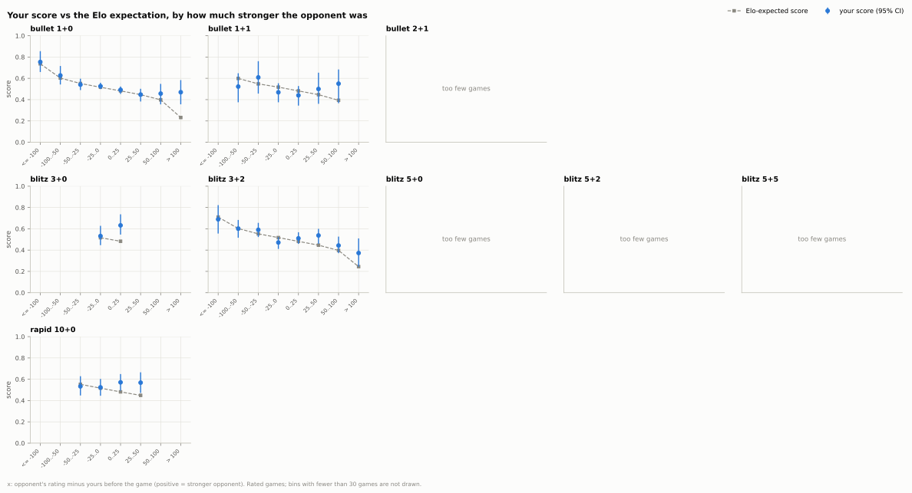

- Against opponents more than 100 points stronger you scored 0.393 where Elo expects 0.254: +0.139 (CI +0.083 to +0.205), about +112 Elo (CI +70 to +159), over all rated games.
- The excess is clearest in 1+0, +0.238 (CI +0.125 to +0.349), about +187 Elo (CI +106 to +265) from 66 games, and in 3+2, +0.128 (CI +0.005 to +0.240), about +105 Elo (CI +5 to +185).
- Against opponents 100 or more points weaker, over all rated games, you scored 0.699 where Elo expects 0.723: -0.023 (CI -0.092 to +0.038), about -20 Elo (CI -73 to +34), no clear difference.
- Splitting the 197 games against much stronger opponents at their median rating gives the same excess in both halves: +0.137 (CI +0.050 to +0.231) in the lower half and +0.141 (CI +0.057 to +0.234) in the upper, about +110 and +113 Elo.

Data: [5_score_vs_gap.csv](data/02_trajectory/5_score_vs_gap.csv) · [5b_score_vs_gap_pooled.csv](data/02_trajectory/5b_score_vs_gap_pooled.csv) · [5d_level_split.csv](data/02_trajectory/5d_level_split.csv) · [all tables](data/02_trajectory/_index.csv) · [script](../analysis/02_trajectory.py) · source: [my_games.parquet](../data/zakihussa1n/my_games.parquet)

### 2.6 How do upsets happen?

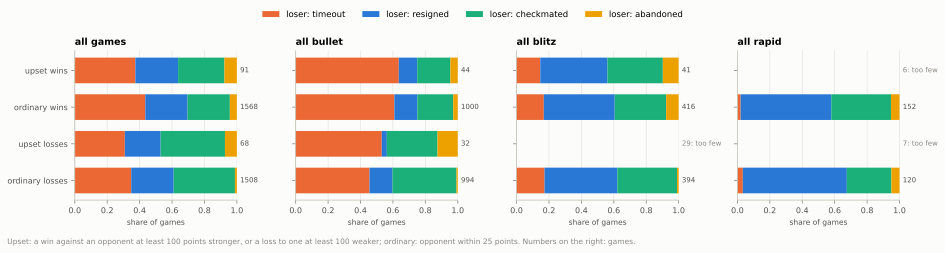

- Upsets are rare: 91 wins against opponents at least 100 points stronger and 68 losses to opponents at least 100 weaker, against 1568 ordinary wins and 1508 ordinary losses.
- Upset wins look like ordinary wins: the stronger opponent lost 0.038 expected points per move to your 0.029, much as opponents do in your ordinary wins (0.031 to your 0.024).
- Upset losses are your worst games: you lost 0.050 expected points per move (CI 0.039 to 0.063), against 0.032 in ordinary losses.
- They end the usual way for the time class: in bullet, 64% of upset wins came on time, as did 61% of ordinary wins.

Data: [6_upsets.csv](data/02_trajectory/6_upsets.csv) · [all tables](data/02_trajectory/_index.csv) · [script](../analysis/02_trajectory.py) · source: [games_decomposed.parquet](../data/zakihussa1n/games_decomposed.parquet)

<details><summary>Method and caveats</summary>

- Games: 6,003 standard live games with at least one move and a pre-game rating (the first game in each pool has none), Aug 2021 to Oct 2026; counts in `7_data.csv`.
- Each exact time control is its own group; 0.5+0 (19 games) and 30+0 (1 game) have fewer than 50 games and are left out.
- Rating pools on chess.com are per time class, not per control, so the rating line (2.1) is per class (bullet, blitz, rapid); every other result is per exact control.
- "Your lowest / highest-rated third of games" splits each control's games into thirds by your rating before the game; the change from the low to the high third is computed for you and for your opponents in the same games, and their difference is bootstrapped on the same resampled games.
- Because chess.com pairs you with opponents of nearly your rating, your opponents' numbers are the field at your level: a change you share with them is a property of the level, a difference is yours.
- Expected points lost per move comes from a win-probability model that knows both ratings, so it is close to flat across rating by construction; centipawns lost per move is the absolute measure. Both are in the tables.
- Low clock is reported three ways: under 10 s on the clock, under 10 s beyond one increment (the same as the clock in no-increment games, so 1+0 and 1+1 compare), and under 10% of the base time.
- All CIs are 95% from 400 bootstrap resamples of whole games, seeded by the set of games so identical game sets give identical intervals; the rating regression resamples calendar months instead, because a rating barely moves within a month.
- Thin cells (fewer than 30 games, or fewer than 20 cases for shares of losses, wins or winning positions) are flagged in every table and not drawn in the charts; outside 1+0, 3+2 and 10+0 most cells by third, band and rating gap are thin.
- Score against rating gap is also pooled by time class and over all rated games (`5b_score_vs_gap_pooled.csv`, with its own chart), because the outer gap bins are thin in every control but 1+0 and 3+2.
- The opponent's rating before the game is reconstructed as their post-game rating plus your rating change (rated games); it is approximate under Glicko. Elo expectation is the standard logistic; the Elo-equivalent is the rating gap that turns the expected score into the actual one, applied to each CI end.
- The reconstruction's bias runs against the result: a high-deviation opponent loses more points than you gain, so wins drift into the "weaker" bins and losses into the "stronger" bins, which would show under-performance against stronger players, not the excess seen.
- Checks on the score-vs-gap result: in unrated games, where the opponent's rating is exact, no non-thin gap bin shows a clear excess (`5e_unrated.csv`); your rating gain for a win scales with the gap in the direction Elo predicts, more steeply (1.91 times the even-bin gain against much stronger opponents, where Elo predicts 1.44; `5f_rating_change_check.csv`), so the outer-bin opponents were not mainly provisional accounts.
- The level check (`5d_level_split.csv`) splits each gap bin two ways, pooled by time class: at the median rating of that bin's own games (equal halves, so neither is thin), and by whether you were within 100 points of your peak so far in the pool or further below it.
- Against much stronger opponents the excess holds both near your peak so far (+0.175, CI +0.069 to +0.297, 62 games) and while recovering from a fall of more than 100 points (+0.123, CI +0.049 to +0.211, 135 games); 138 of the 197 such games are from 2022, the year of the bullet crash and recovery (`7_data.csv`).
- 66 games were played after more than 7 days away from the pool; recomputing every low-to-high change without them keeps the sign of all 52 changes whose CI excluded zero, and 47 keep a CI excluding zero (`2d_change_without_breaks.csv`).
- The rating regression (`3d_rating_regression.csv`) is descriptive, standardised per control, with and without year dummies; only 1+0 and 3+2 have enough games (200) and months (20) to read; habits that rarely depart from their usual value (e.g. moves under 10 s in 10+0) are left out of a control's model.
- Upsets: a win against an opponent at least 100 points stronger, or a loss to one at least 100 weaker; ordinary results are within 25 points. Rated and unrated games both count; 28% of upset losses were unrated, and you abandoned 7% of them.
- The upsets chart is pooled by time class because upset cells are thin in every control but 1+0; per-control rows are in `6_upsets.csv`.
- Charts: the rating line breaks where a pool had no games for more than 30 days; band lines break at a thin or empty band; a zero bar is labelled 0.
- The old long-form report is archived; see [where everything lives](#where-everything-lives).

</details>

## 3. How does time pressure affect your play?

**Short answer:** In bullet 1+0 you run short of time about as often as your opponents and lose no more expected points than them when you do (though slightly more centipawns under 5 s); the controls where the clock costs you are blitz 3+0 and 5+0, where you get low far more often than your opponents.

### 3.1 How often are you short of time?

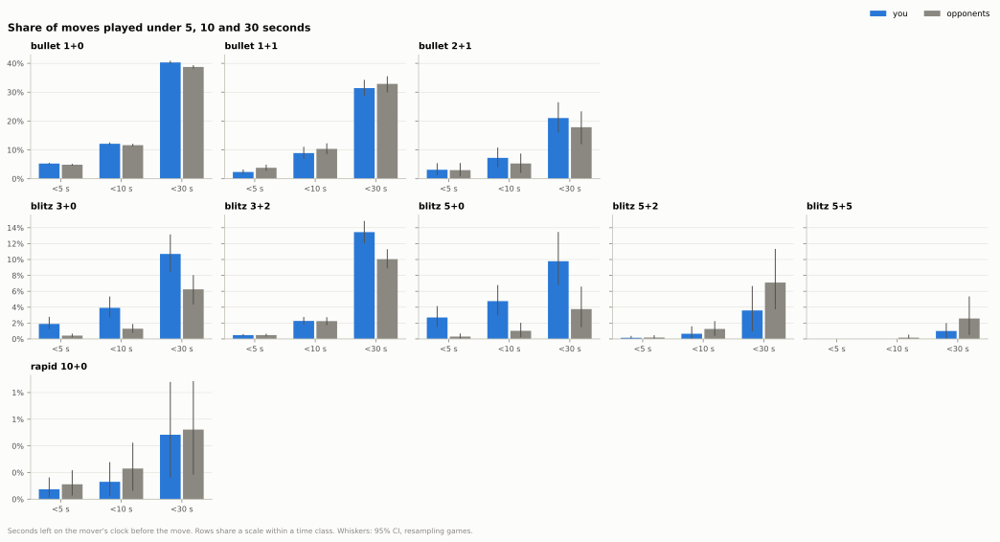

- In 1+0, 12.1% of your moves are played with under 10 s left; your opponents' share is 11.6%.
- In 3+0 you play 3.9% of your moves under 10 s and your opponents 1.3% (difference 2.6% of moves, CI 1.2% to 4.2%).
- In 1+1, counting the increment out, 10.3% of your moves have under 10 s of buffer, against 8.9% with under 10 s on the clock.
- In rapid 10+0 it almost never happens: 0.1% of your moves.

Data: [1_low_clock_share.csv](data/03_time_pressure/1_low_clock_share.csv) · [all tables](data/03_time_pressure/_index.csv) · [script](../analysis/03_time_pressure.py) · source: [moves_analysed.parquet](../data/zakihussa1n/moves_analysed.parquet)

### 3.2 How often do you drop under 10 seconds in a game?

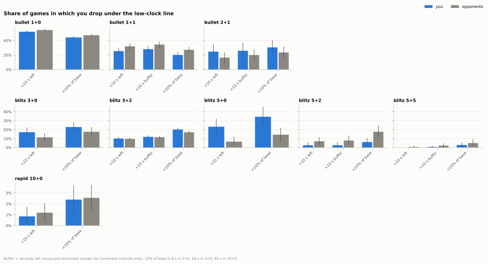

- In 1+0 you drop under 10 s in 52.2% of games, your opponents in 54.4% (difference CI -4.3% to -0.2%).
- In 1+1 it is 25.5% of games for you and 32.0% for your opponents (difference CI -11.2% to -1.0%).
- In 5+0 you drop under 10 s in 23.3% of games, your opponents in only 6.7%.
- In 3+0 you get low in 17.2% of games against 11.5%, but the CI of the difference (-0.7% to 11.5%) includes zero.

Data: [2_games_under_line.csv](data/03_time_pressure/2_games_under_line.csv) · [all tables](data/03_time_pressure/_index.csv) · [script](../analysis/03_time_pressure.py) · source: [moves_analysed.parquet](../data/zakihussa1n/moves_analysed.parquet)

### 3.3 How does move quality change as the clock runs down?

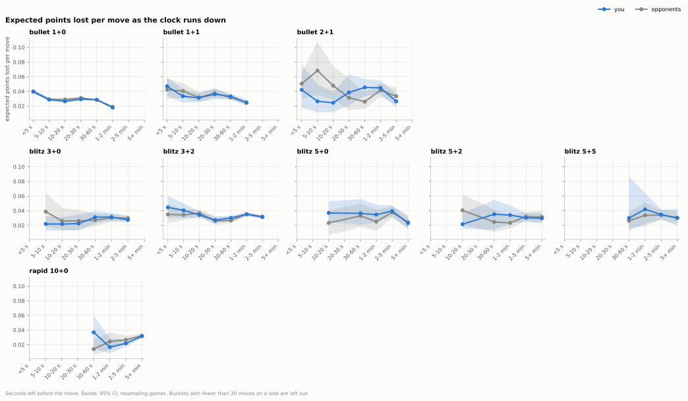

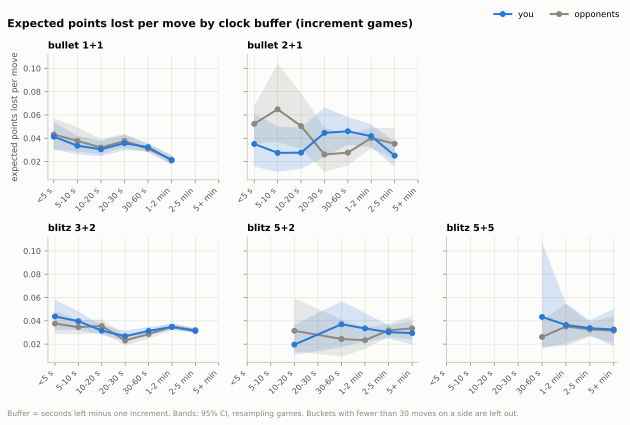

- In 1+0, expected points lost per move rise from 0.029 with 30-60 s left to 0.040 under 5 s, the same for you and your opponents (difference under 5 s -0.0001, CI -0.0035 to 0.0026).
- In 3+2, under 5 s you lose 0.045 per move and your opponents 0.035, but the CI of the difference (-0.009 to 0.032) includes zero.
- Counting the increment out changes little: in 1+1, under 5 s of buffer you lose 0.041 per move and your opponents 0.043, no clear difference (CI -0.015 to 0.012).
- Part of the rise is the position, not the clock: in 1+0, 94.6% of moves under 5 s are endgame moves, against 9.5% with 30 s or more.

Data: [3_quality_by_clock.csv](data/03_time_pressure/3_quality_by_clock.csv) · [3b_quality_by_buffer.csv](data/03_time_pressure/3b_quality_by_buffer.csv) · [3e_low_clock_positions.csv](data/03_time_pressure/3e_low_clock_positions.csv) · [all tables](data/03_time_pressure/_index.csv) · [script](../analysis/03_time_pressure.py) · source: [expected_points.parquet](../data/zakihussa1n/expected_points.parquet)

### 3.4 Are you worse than your opponents under pressure, once the position's stakes are held fixed?

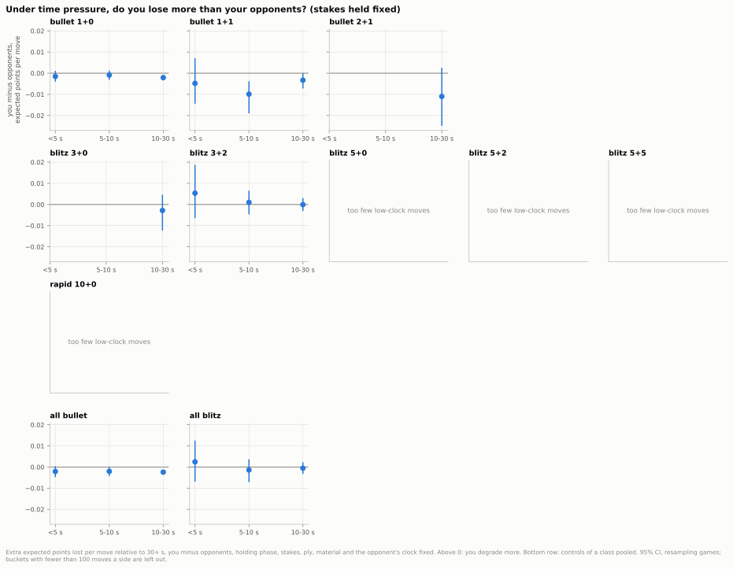

- In 1+0 under 5 s, with stakes, phase, material and the opponent's clock held fixed, the gap between you and your opponents is -0.0015 expected points per move (CI -0.0040 to 0.0011): no clear difference.
- In centipawns you do lose more there: 8.6 more per move than your opponents under 5 s in 1+0 (CI 1.1 to 15.9).
- In 1+1 with 5-10 s left you hold up better than your opponents: 0.0099 fewer expected points lost per move (CI 0.0038 to 0.0190).
- Except 3+2, blitz controls have too few low-clock moves on their own; pooled, the gap under 5 s is 0.0025 (CI -0.0069 to 0.0125): no clear difference.

Data: [4_adjusted_gap.csv](data/03_time_pressure/4_adjusted_gap.csv) · [all tables](data/03_time_pressure/_index.csv) · [script](../analysis/03_time_pressure.py) · source: [expected_points.parquet](../data/zakihussa1n/expected_points.parquet)

### 3.5 What rating do you play like at each clock level?

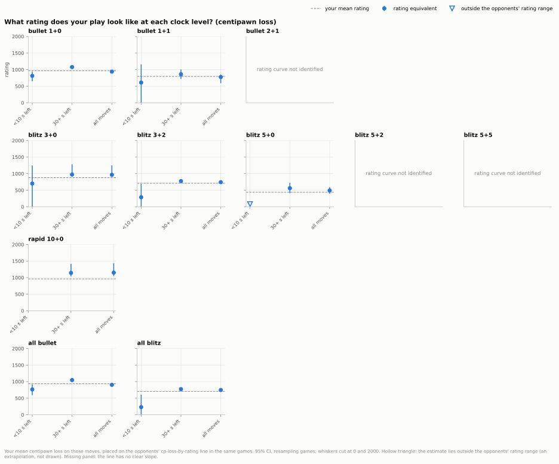

- In 1+0, your moves under 10 s look like those of a 813-rated player (CI 649 to 941); your mean rating there is 968.
- Your 1+0 moves with 30 s or more look like a 1078 player (CI 1035 to 1130).
- In 3+2 your moves under 10 s look like a 287 player, but the CI is very wide (up to 687, just below your mean of 709); with 30 s or more, 775.
- In the other controls there is either no estimate (the opponents' rating line has no clear slope, or there are too few low-clock moves) or its CI spans several hundred rating points.

Data: [5_rating_equivalent.csv](data/03_time_pressure/5_rating_equivalent.csv) · [all tables](data/03_time_pressure/_index.csv) · [script](../analysis/03_time_pressure.py) · source: [moves_analysed.parquet](../data/zakihussa1n/moves_analysed.parquet)

### 3.6 How many points do low-clock moves cost per game?

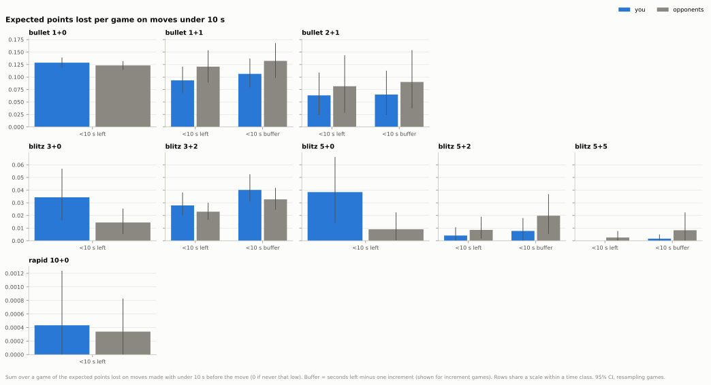

- In 1+0, moves under 10 s cost you 0.129 expected points per game and your opponents 0.123: no clear difference (about -3.8 Elo, CI -9.2 to 1.8).
- That is 14.2% of all the expected points you lose in 1+0 (CI 13.4% to 15.1%).
- In 3+0 they cost you 0.034 per game against 0.014 for your opponents: about -14 Elo (CI -30 to -1).
- In 5+0 it is 0.038 against 0.009: about -20 Elo (CI -39 to -4).

Data: [6_low_clock_cost.csv](data/03_time_pressure/6_low_clock_cost.csv) · [6b_low_clock_share_of_losses.csv](data/03_time_pressure/6b_low_clock_share_of_losses.csv) · [all tables](data/03_time_pressure/_index.csv) · [script](../analysis/03_time_pressure.py) · source: [expected_points.parquet](../data/zakihussa1n/expected_points.parquet)

<details><summary>Method and caveats</summary>

- Games: every standard live game, split by exact time control; controls with fewer than 50 games (bullet 0.5+0: 19 games, rapid 30+0: 1 game) are left out. Daily games have no clocks.
- Every number for you is paired with your opponents' number from the same games; CIs are 95% bootstrap intervals that resample whole games (500 to 1000 resamples for means and shares, 400 for regressions and rating curves).
- The clock is read before the move. "Seconds left" is what the player sees; "buffer" is seconds left minus one increment, so 10 s in 1+1 is 9 s of buffer. Without an increment the two are the same, so the buffer rows, bars and curves exist only for the controls with an increment (1+1, 2+1, 3+2, 5+2, 5+5).
- "Under 10% of base" (6 s in 1+0, 18 s in 3+0, 60 s in 10+0) puts every control on the same footing; it is in the tables next to the seconds.
- Clock buckets: under 5 s (a scramble), 5-10 s, 10-20 s, 20-30 s, 30-60 s, 1-2 min, 2-5 min, 5+ min. A bucket is drawn only with at least 30 moves on each side; blitz and rapid have few low-clock moves (rapid 10+0: 30 moves under 5 s for both sides), so their low end is mostly left out and the share-of-base table is the better view there.
- The regression (3.4) is fitted per control and pooled per time class (with the control as a fixed effect): move quality ~ clock bucket x side + phase + stakes (gap between the best and second-best move) + ply band + piece count + the opponent's clock bucket; the reference is 30 s or more. A bucket needs 100 moves on each side to be shown.
- Holding the stakes fixed changes the picture: without that control, low-clock moves lose clearly more expected points for both sides; with it, the clock's own effect in expected points is close to zero or negative, because the win model already discounts a position whose owner is about to flag. Both versions are in the table (`stakes_control`), as are fits within endgames and earlier phases only.
- Expected points lost come from a win model that uses both clocks, so a blunder with 2 s left costs fewer expected points than the same blunder with 30 s. Centipawns lost are clock-free and are reported alongside.
- The rating equivalent (3.5) places your mean centipawn loss on a straight line fitted to your opponents' centipawn loss against their pre-game rating (reconstructed from the post-game rating and your rating change) in the same games; opponents rated under 100 are left out. It is shown only where the line's slope CI excludes zero; an estimate outside the range of opponents' ratings in that control is an extrapolation of the line, flagged `extrapolated` in the table and drawn as a hollow triangle at the chart's edge (only 5+0 under 10 s); it compares your low-clock moves (nearly all endgame moves) with opponents' moves at all clocks, so it is indicative. Expected points cannot be mapped to a rating because the win model already conditions on rating.
- Elo-equivalents of a per-game difference are taken around an even score (0.5).
- Who gets low on the clock, and in which games, is not random, so none of these comparisons is a controlled experiment.

</details>

## 4. How do you use your clock, and what do losses on time cost you?

**Short answer:** In bullet 1+0 your clock keeps pace with your opponents' and losses on time are a net gain for you, in blitz 3+2 and 5+0 you spend more time in the opening and fall behind by move 20, but only in 5+0 does that turn into clearly more losses on time; your long thinks end no better than your opponents'.

### 4.1 How does your clock compare with your opponent's through the game?

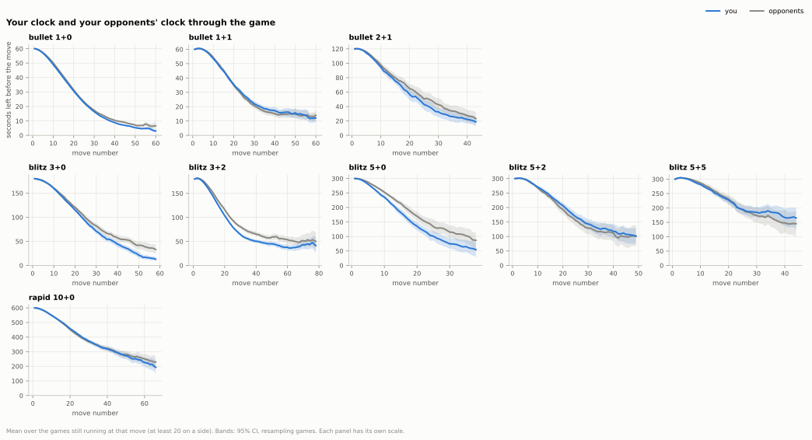

- In 1+0 the two clocks run level: before move 20 you are 0.2 s ahead on average (CI -0.1 to 0.5).
- In 3+2 you fall behind early: 10.0 s behind at move 20 (CI 7.5 to 12.5), and more than 5% of the base time behind in 51.5% of games.
- In 5+0 you are 31.3 s behind at move 20 (CI 17.4 to 46.6).
- In 5+2 it is the other way round: you are 19.0 s ahead at move 20 (CI 7.0 to 28.6).

Data: [1b_clock_gap.csv](data/04_clock_allocation/1b_clock_gap.csv) · [1_clock_by_move.csv](data/04_clock_allocation/1_clock_by_move.csv) · [all tables](data/04_clock_allocation/_index.csv) · [script](../analysis/04_clock_allocation.py) · source: [moves_enriched.parquet](../data/zakihussa1n/moves_enriched.parquet)

### 4.2 Where do you spend your time?

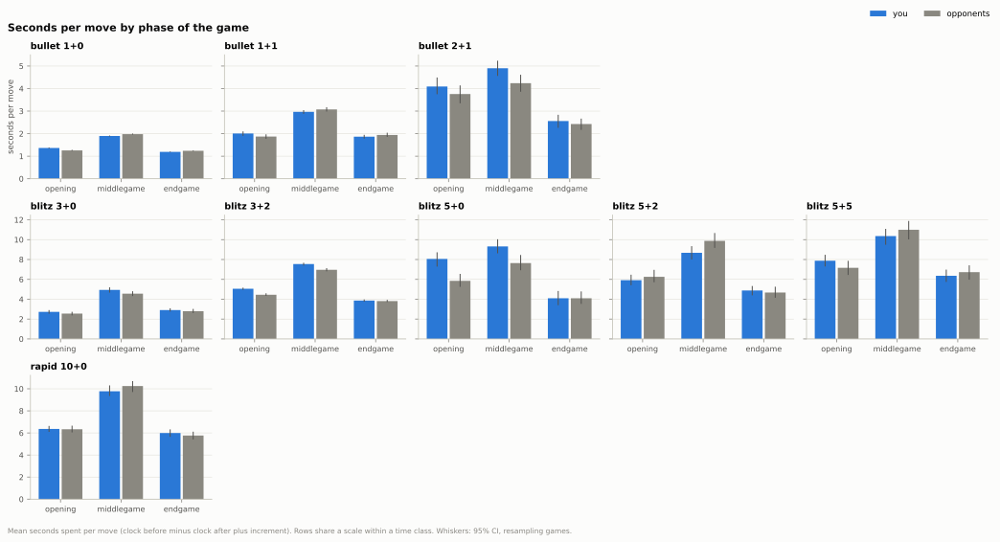

- In 3+2 you spend 5.06 s per opening move and your opponents 4.45 s (difference 0.60, CI 0.47 to 0.72).
- In 5+0 the opening gap is larger: 8.06 s against 5.85 s per move.
- In 1+0 the gap is small: 1.36 s against 1.26 s per opening move.
- Priced by the win model, your slower pace in 3+2 costs you 0.034 expected points per game more than your opponents' pace costs them (CI 0.018 to 0.053).

Data: [2_time_by_phase.csv](data/04_clock_allocation/2_time_by_phase.csv) · [4d_clock_charge.csv](data/04_clock_allocation/4d_clock_charge.csv) · [all tables](data/04_clock_allocation/_index.csv) · [script](../analysis/04_clock_allocation.py) · source: [moves_enriched.parquet](../data/zakihussa1n/moves_enriched.parquet), [expected_points.parquet](../data/zakihussa1n/expected_points.parquet)

### 4.3 Do you spend more time when it matters?

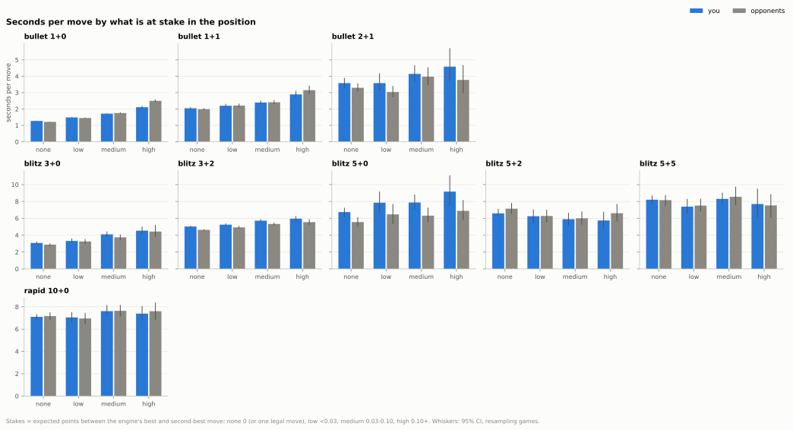

- In 1+0 you spend 2.11 s on a high-stakes move, your opponents 2.50 s (difference CI -0.48 to -0.30).
- Your 1+0 time follows the stakes less than theirs: you take 1.66 times as long on a high-stakes position as on a no-stakes one, your opponents 2.05 times.
- In 3+2 you snap (play in under 1.6 s) 23.6% of high-stakes positions, your opponents 30.3%.
- In 10+0 there is no clear sign that either side takes longer when the stakes are high: your ratio is 1.04 (CI 0.95 to 1.14).

Data: [3_time_by_stakes.csv](data/04_clock_allocation/3_time_by_stakes.csv) · [3b_allocation_ratio.csv](data/04_clock_allocation/3b_allocation_ratio.csv) · [3c_misallocation.csv](data/04_clock_allocation/3c_misallocation.csv) · [all tables](data/04_clock_allocation/_index.csv) · [script](../analysis/04_clock_allocation.py) · source: [expected_points.parquet](../data/zakihussa1n/expected_points.parquet)

### 4.4 Do longer thinks produce better moves?

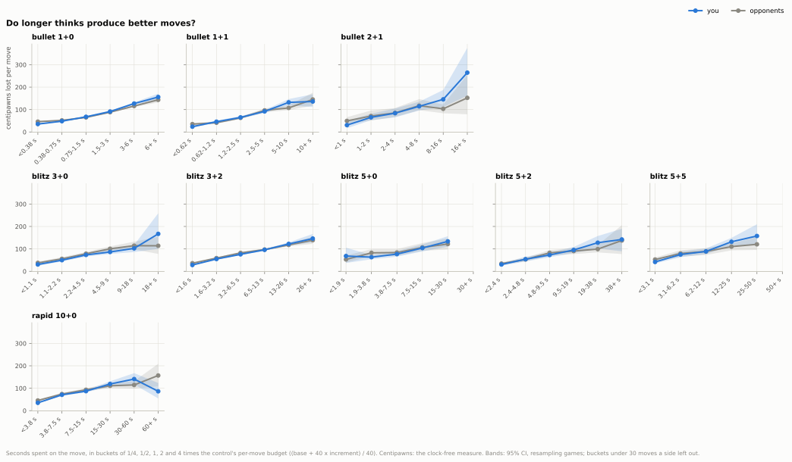

- For both sides, the longer the think the worse the move, because time goes to hard positions: in 1+0, 35 centipawns lost on moves under 0.38 s against 156 on thinks of 6 s or more.
- Your quick moves are cleaner than your opponents': in 1+0, 10.7 fewer centipawns lost per move under 0.38 s (CI 7.3 to 13.7).
- Your move quality falls off faster with thinking time than theirs: with the position held fixed and relative to each side's own quick moves, your 1+0 thinks of 6 s or more lose 31.6 centipawns more (CI 13.7 to 48.5).
- On the long thinks themselves the gap is clear at 3-6 s (+11.1 centipawns, CI 5.6 to 16.1) but not at 6 s or more (+12.5, CI -4.1 to 28.8).

Data: [4b_cp_loss_by_think.csv](data/04_clock_allocation/4b_cp_loss_by_think.csv) · [4c_adjusted_think_gradient.csv](data/04_clock_allocation/4c_adjusted_think_gradient.csv) · [all tables](data/04_clock_allocation/_index.csv) · [script](../analysis/04_clock_allocation.py) · source: [moves_analysed.parquet](../data/zakihussa1n/moves_analysed.parquet)

### 4.5 How many games do you lose on time, and from what positions?

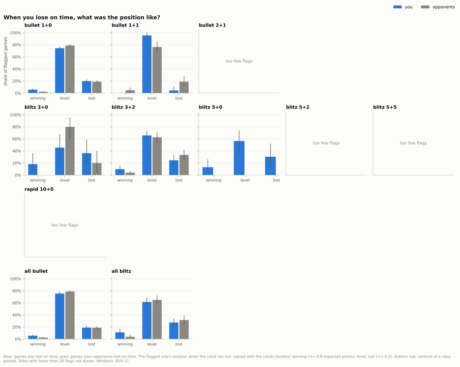

- In 1+0 you lost 705 games on time, 52.1% of your losses; your opponents lost 946 (64.9% of theirs).
- Most flags fall in positions that were still open: 74.4% of your 1+0 flags, with only 5.7% from winning positions.
- Net, the clock gives you 0.032 expected points per 1+0 game (CI 0.020 to 0.042), about +22 Elo (CI +14 to +29).
- In 5+0 it runs the other way: 22 losses on time against 4 for your opponents, about -44 Elo (CI -76 to -11), from only 90 games and only 4 opponent flags.

Data: [5b_flag_counts.csv](data/04_clock_allocation/5b_flag_counts.csv) · [5_flag_board_state.csv](data/04_clock_allocation/5_flag_board_state.csv) · [5d_clock_cost_per_game.csv](data/04_clock_allocation/5d_clock_cost_per_game.csv) · [all tables](data/04_clock_allocation/_index.csv) · [script](../analysis/04_clock_allocation.py) · source: [expected_points.parquet](../data/zakihussa1n/expected_points.parquet)

### 4.6 Can you see a flag coming early?

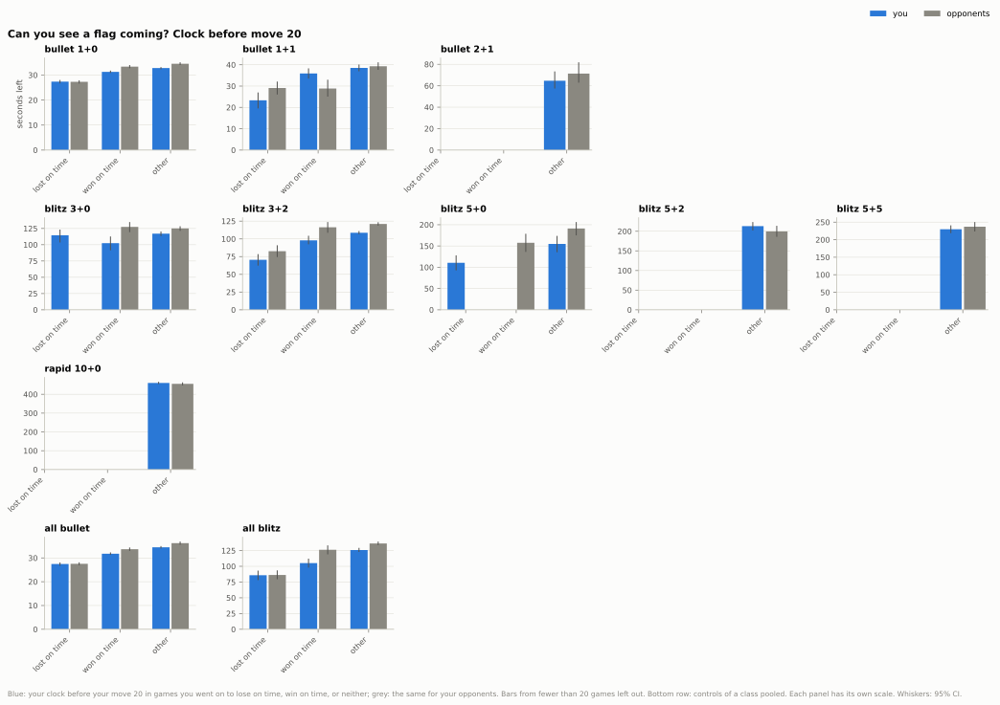

- In 1+0, before move 20 you have 27.4 s in games you go on to lose on time, against 32.8 s in games the clock does not decide.
- Your opponents show the same pattern: 27.3 s against 34.5 s.
- In 3+2 the gap is wider: 70.5 s against 108.6 s at move 20.
- In 3+0 there is no clear early sign (20 games): 114.5 s against 117.0 s.

Data: [6_clock_before_flag.csv](data/04_clock_allocation/6_clock_before_flag.csv) · [all tables](data/04_clock_allocation/_index.csv) · [script](../analysis/04_clock_allocation.py) · source: [moves_enriched.parquet](../data/zakihussa1n/moves_enriched.parquet)

<details><summary>Method and caveats</summary>

- Games: every standard live game, split by exact time control; controls with fewer than 50 games (bullet 0.5+0: 19 games, rapid 30+0: 1 game) are left out. Daily games have no clocks.
- Every number for you is paired with your opponents' number from the same games; CIs are 95% bootstrap intervals that resample whole games (400 resamples; 200 for the clock-by-move curves).
- Time spent on a move = the mover's clock before the move minus the clock after it plus the increment; it undercounts lag. A pre-move is charged 0.1 s.
- Clock gap: your clock minus the opponent's before your move 10, 20 and 30, in games that reached that move; "behind" is by more than 3 s, or by more than 5% of the base time (3 s in 1+0, 9 s in 3+0, 30 s in 10+0). A point of the clock curve needs 20 games on each side.
- Stakes of a position: the expected-points gap between the engine's best and second-best move: none (0, or one legal move), low (under 0.03), medium (0.03 to 0.10), high (0.10 or more). "None" means the two best moves are equally good, not that every move is safe.
- Seconds-spent buckets are multiples of each control's per-move budget, (base + 40 x increment) / 40 (chess.com's game-length estimate): under 1/4, 1/4 to 1/2, 1/2 to 1, 1 to 2, 2 to 4, and 4 or more times the budget, so a "long think" means the same thing in 1+0 and 10+0; the chart labels them in seconds.
- Long thinks and snap moves are relative to the control: at or above the 90th percentile of seconds per move (both sides pooled), and below the 25th.
- Time spent is confounded with difficulty, so no time-spent number is the causal value of a second. The adjusted gradient (4.4) holds phase, stakes, ply band, piece count, both clocks, legal moves, check and the size of the evaluation fixed, and compares your gradient with your opponents'; positive coefficients for both sides show the controls do not capture all the difficulty. In expected points the adjusted 1+0 gap at 6 s or more is not clear (table 4c), partly because the win model charges long thinks for the clock they use.
- The win model is refitted inside the script (same features, same seed; it reproduces the stored expected points to within 0.00005). The clock charge (4.2) re-values the position after each move as if the move had taken no time; it is the model's price of the seconds, not an additive part of expected points lost.
- Pre-moves (table 3d) are compared in expected points and in centipawns; the centipawn version is the clock-free one, since the win model charges a pre-move almost nothing for time.
- Losses on time: the position valued is the one on the board when the clock ran out (in every timeout the last recorded move is the winner's). Three valuations from the flagged side's view: as played (the model with the real clocks; a floor), with level clocks (the flagged side's clock set to the winner's; the headline), and Stockfish's board-only model (a ceiling). Winning means 0.8 expected points or more, lost 0.2 or less. A flag draw (timeout against insufficient material) counts as 0.5.
- Points lost to the clock = valuation minus the actual score, summed per game (0 in games not decided by the clock); the net to you is your opponents' flag cost minus yours, with its Elo-equivalent around an even score (0.5).
- Flags are thin outside 1+0, 1+1, 3+0 and 3+2 (rapid 10+0: 5 by you, 11 by your opponents), so the flag tables and charts are also pooled by time class ("all bullet", "all blitz"); a side with fewer than 20 flagged games is marked thin and not drawn.
- The clock at move 20 conditions on how the game ended; it describes the games that flagged, it does not estimate what spending less time would have done. Abandoned games are not counted as losses on time.

</details>

## 5. How do your playing sessions shape your results?

**Short answer:** Your sessions are short (a median of 3 games) and you stop far more often after a loss; once that stopping habit is accounted for there is no sign of fatigue or a slow start, and the one real effect is a dip in the game right after a loss (about −38 Elo across all games).

### 5.1 How long are your sessions?

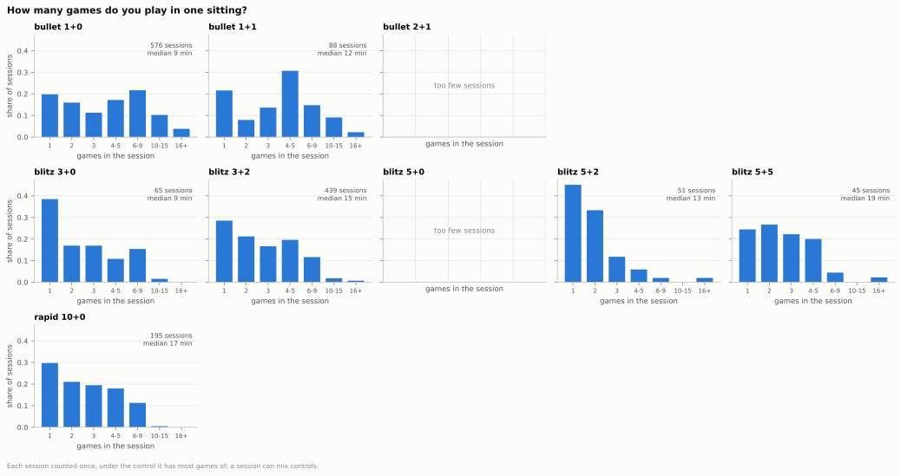

- A typical session is 3 games and 13 minutes; a quarter (25%) are a single game.
- 1+0 and 1+1 sessions are the longest in games (median 4), and 14% of 1+0 sessions reach 10 games or more.
- Slower controls make shorter sittings in games: a median of 3 games over 15 minutes in 3+2, 2 games over 17 minutes in 10+0.
- 16% of your games sit in a session that mixes time controls.

Data: [1_session_length.csv](data/05_sessions/1_session_length.csv) · [1b_games_per_session.csv](data/05_sessions/1b_games_per_session.csv) · [1c_session_minutes.csv](data/05_sessions/1c_session_minutes.csv) · [all tables](data/05_sessions/_index.csv) · [script](../analysis/05_sessions.py) · source: [games_decomposed.parquet](../data/zakihussa1n/games_decomposed.parquet)

### 5.2 Do you stop after losses?

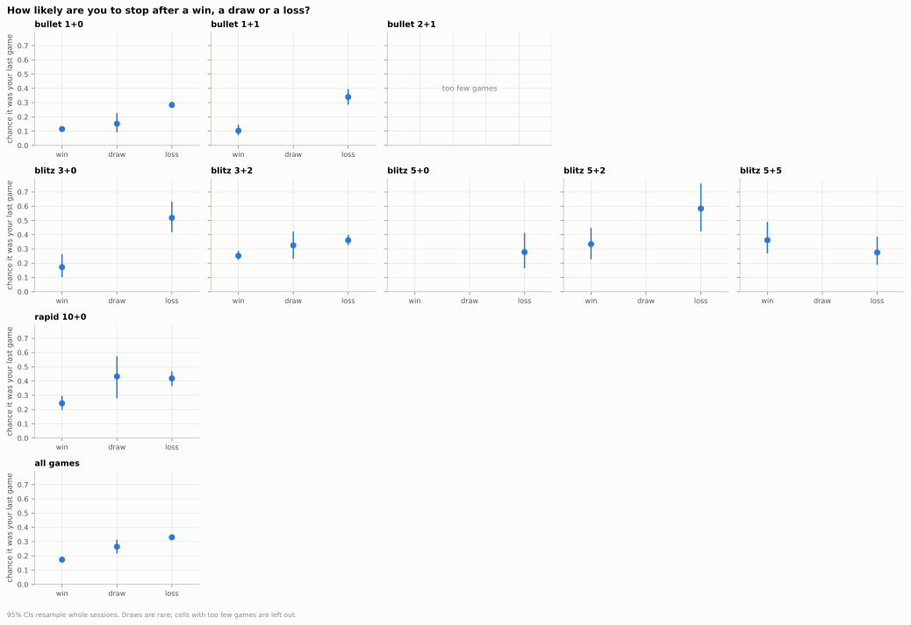

- Across all games you stop after 33% of losses but only 17% of wins: a gap of 0.157 (CI 0.135 to 0.181) in the chance of stopping.
- The gap is clear in 1+0, 1+1, 3+0, 3+2, 5+2 and 10+0; it is largest in 3+0, where you stop after 52% of losses.
- In 5+5 there is no clear difference (−0.087, CI −0.242 to +0.070), and 2+1 and 5+0 have too few sessions to tell.
- Because of this habit, the game you stop after scores −0.183 below your other games (CI −0.208 to −0.155), about −134 Elo (CI −155 to −112): any curve by game number has to allow for it.

Data: [2_stop_by_result.csv](data/05_sessions/2_stop_by_result.csv) · [2b_stop_loss_minus_win.csv](data/05_sessions/2b_stop_loss_minus_win.csv) · [2d_last_game_minus_others.csv](data/05_sessions/2d_last_game_minus_others.csv) · [all tables](data/05_sessions/_index.csv) · [script](../analysis/05_sessions.py) · source: [games_decomposed.parquet](../data/zakihussa1n/games_decomposed.parquet)

### 5.3 Do you get worse as a session goes on?

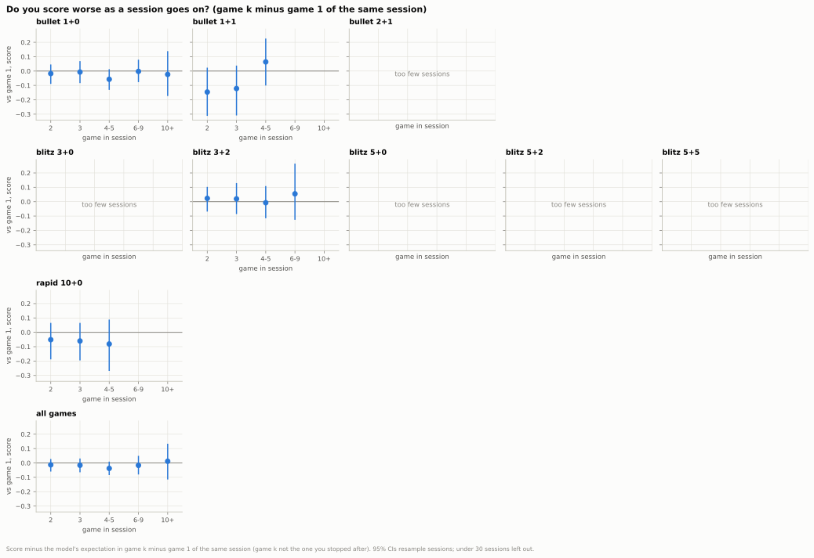

- At first sight you get better: across all games, games 6-9 score +0.038 above expectation (CI +0.006 to +0.071), about +26 Elo (CI +4 to +49), against +0.010 in game 1.
- Against game 1 of the same session, no later game number differs clearly in any control with enough sessions; across all games, games 6-9 minus game 1 is −0.017 (CI −0.080 to +0.049), about −12 Elo (CI −56 to +34).
- The regression agrees: comparing sessions with each other, score rises +0.041 per doubling of the game number (CI +0.018 to +0.065), but within the same session the change is −0.002 (CI −0.024 to +0.024).
- Your move quality does not drift: within a session, your expected points lost per move change by −0.0010 per doubling of the game number (CI −0.0027 to +0.0006).

Data: [3_minus_game1.csv](data/05_sessions/3_minus_game1.csv) · [3b_game_number.csv](data/05_sessions/3b_game_number.csv) · [3c_regression.csv](data/05_sessions/3c_regression.csv) · [all tables](data/05_sessions/_index.csv) · [script](../analysis/05_sessions.py) · source: [games_decomposed.parquet](../data/zakihussa1n/games_decomposed.parquet)

### 5.4 Is there a warm-up effect?

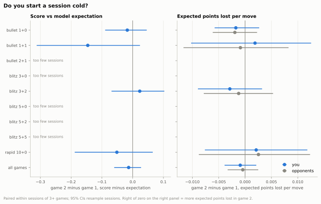

- Across all games, game 2 scores −0.013 against game 1 of the same session (CI −0.060 to +0.027), about −9 Elo (CI −42 to +19): no clear difference.
- Your expected points lost per move change by −0.0009 from game 1 to game 2 (CI −0.0039 to +0.0021), much like your opponents' −0.0004: you do not start cold.
- In 1+1 game 2 looks worse, −0.146 (CI −0.312 to +0.024), about −103 Elo (CI −246 to +17), but the interval includes zero.
- 2+1, 3+0, 5+0, 5+2 and 5+5 have too few sessions of 3+ games to tell.

Data: [4_warmup.csv](data/05_sessions/4_warmup.csv) · [all tables](data/05_sessions/_index.csv) · [script](../analysis/05_sessions.py) · source: [games_decomposed.parquet](../data/zakihussa1n/games_decomposed.parquet)

### 5.5 What happens in the game after a loss?

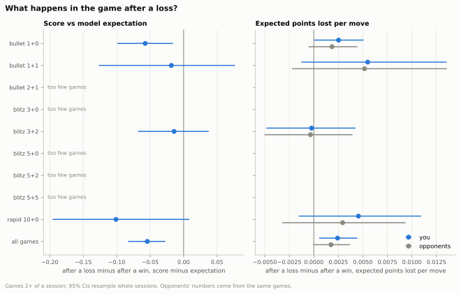

- Across all games you score −0.054 less after a loss than after a win (CI −0.083 to −0.027), about −38 Elo (CI −58 to −19): +0.041 above expectation after a win, −0.014 after a loss.
- In 1+0 the dip is −0.057 (CI −0.099 to −0.016), about −40 Elo (CI −70 to −11).
- Blitz splits: in 3+2 there is no clear difference (−0.014, CI −0.068 to +0.038, about −10 Elo, CI −48 to +26); in 3+0 the dip looks far larger (−0.211, about −157 Elo, CI −344 to −15) but rests on only 39 games after a loss, too few sessions for a firm reading.
- After a loss you lose +0.0024 more expected points per move (CI +0.0006 to +0.0044), and your opponents in those games +0.0018 (CI −0.0001 to +0.0037): the games get messier for both sides, slightly more for you.

Data: [5b_after_loss_minus_after_win.csv](data/05_sessions/5b_after_loss_minus_after_win.csv) · [5_after_result.csv](data/05_sessions/5_after_result.csv) · [all tables](data/05_sessions/_index.csv) · [script](../analysis/05_sessions.py) · source: [games_decomposed.parquet](../data/zakihussa1n/games_decomposed.parquet)

### 5.6 What about after a losing streak?

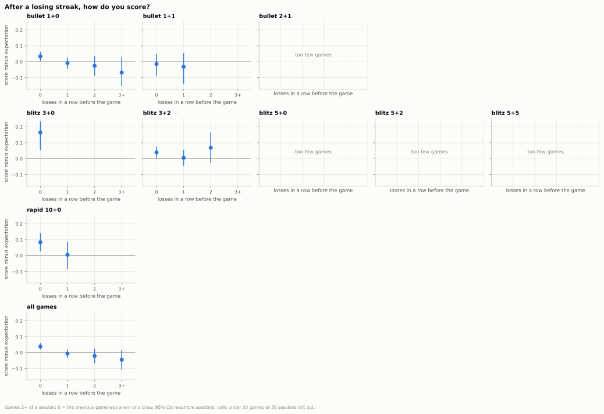

- Across all games, after 3 or more losses in a row you score −0.083 less than when the previous game was not a loss (CI −0.153 to −0.019), about −59 Elo (CI −112 to −14).
- In 1+0, the only control with enough streaks of 3+, the gap is −0.102 (CI −0.191 to −0.011), about −73 Elo (CI −144 to −7).
- The streak does not clearly deepen the dip: 3+ losses against a single loss is −0.038 (CI −0.109 to +0.036), about −27 Elo (CI −78 to +25).
- Winning streaks run the other way: after 3+ wins you score +0.092 more than after none (CI +0.040 to +0.136), about +65 Elo (CI +28 to +98).

Data: [6d_streak_contrasts.csv](data/05_sessions/6d_streak_contrasts.csv) · [6_loss_streak.csv](data/05_sessions/6_loss_streak.csv) · [6b_win_streak.csv](data/05_sessions/6b_win_streak.csv) · [all tables](data/05_sessions/_index.csv) · [script](../analysis/05_sessions.py) · source: [games_decomposed.parquet](../data/zakihussa1n/games_decomposed.parquet)

### 5.7 Does a long break between games matter?

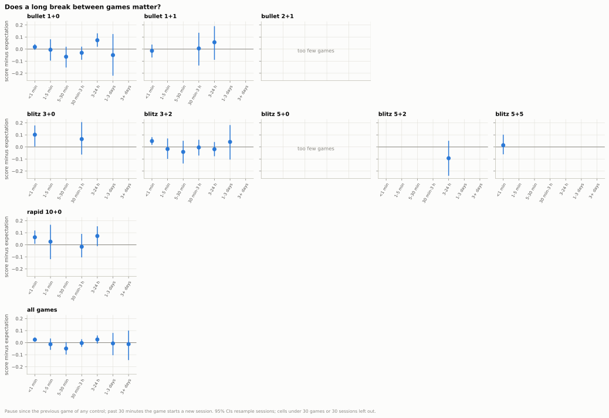

- Straight re-queues (under a minute) score +0.025 above expectation across all games (CI +0.008 to +0.044), about +17 Elo (CI +6 to +30).
- After a 5-30 minute pause you score −0.049 (CI −0.098 to +0.004), about −34 Elo (CI −69 to +3): the lowest of the bins, but no clear difference from zero.
- That pause partly reflects the previous result: 58% of those games follow a loss, against 40% of instant re-queues.
- Breaks of a day or more show no clear difference where there are enough games (all games, 1+0, 3+2; all games after 1-3 days: −0.006, CI −0.104 to +0.081); the other controls are too thin.
- After a loss you still start the next game within a minute 83% of the time (87% after a win).

Data: [7_break_before.csv](data/05_sessions/7_break_before.csv) · [7b_requeue_speed.csv](data/05_sessions/7b_requeue_speed.csv) · [all tables](data/05_sessions/_index.csv) · [script](../analysis/05_sessions.py) · source: [games_decomposed.parquet](../data/zakihussa1n/games_decomposed.parquet)

<details><summary>Method and caveats</summary>

- Games: every standard live game with at least one move, split by its exact time control; the "all games" rows pool the nine reported controls. 0.5+0 (19 games) and 30+0 (1 game) are too thin to report and are left out of every table, but they still count as part of a sitting.
- A session is a run of games with no pause longer than 30 minutes (the configured `session_gap_minutes`) between one game's end and the next game's start, recomputed over standard live games only.
- Game-level results (stopping, game number, tilt, streaks, breaks) use each game's own control; the game number counts every game of the session whatever its control. Session-level descriptions (5.1) put each session under its main control: the control with most games in it, ties going to the one played first.
- Paired comparisons (game k vs game 1, game 2 vs game 1) only use sessions where both games are in the same control.
- Score vs expectation is the result minus the calibration model's pre-game expected score (it knows both pre-game ratings and the time control). The Elo-equivalent is the rating gap that would turn the expected score into the actual one, applied to the estimate and to each CI end; for a difference it is taken at the first group's expected score. 5_after_result also has the score minus the plain Elo-formula expectation (with its own Elo-equivalent) as a check.
- Move quality is expected points lost per move (calibrated), as a ratio of sums over the games of a cell; paired session comparisons average per-game rates.
- All CIs are 95% bootstrap intervals with 500 resamples of whole sessions, because the games of a session share a mood, an hour and a pool of opponents.
- The stopping rule bends every curve by game number, so 5.3 rests on three corrections: game k against game 1 of the same session (the chart), a regression that compares games across sessions ("pooled") or only within a session ("within", session-demeaned), and a fixed set of sessions — sessions of 6+ games, compared over their games 1 to 5, none of which is the last ([3d_fixed_sessions.csv](data/05_sessions/3d_fixed_sessions.csv)). The previous-result terms are only in the pooled model: a demeaned lagged result in sessions this short is badly biased.
- The uncorrected curve ([3b_game_number.csv](data/05_sessions/3b_game_number.csv)) also has a version without the game you stopped after. Leaving that game out raises every bin (it is more often a loss), so only comparisons between bins of that version mean anything.
- Even the corrected curves keep a milder selection: reaching game 8 at all means the session went well. Small late-session gains should be read as "no fatigue", not as improvement.
- Tilt is measured on the games you chose to play after a loss; a common cause (a bad day, a stronger pool at that hour) could also produce it. The opponents' move quality from the same games is the control for the pool.
- Thin cells: a cell with under 30 games or under 30 sessions is computed but flagged `thin` and not drawn; the sessions floor is there because every CI resamples sessions, and a bootstrap over fewer clusters gives unreliable intervals. Paired comparisons need 30 sessions. Regressions are flagged thin under 10 games per coefficient or 30 sessions.
- The session definition does not drive the results: with a 15- or 60-minute gap the stopping gap, the after-loss dip and the (absent) fatigue effect barely move ([0_gap_sensitivity.csv](data/05_sessions/0_gap_sensitivity.csv)).
- Per-game quality and the expected score come from Q1's `games_decomposed.parquet` and inherit its caveats (engine-perfect baseline, pooled calibration).

</details>

## 6. Does the time of day or the day of the week matter?

**Short answer:** Mostly no: across all games the better and worse hours look like chance (shuffle test p = 0.41) and do not repeat between 2021-2023 and 2024-2026; the exceptions are a late-evening dip in 1+0 and an hour pattern in 3+0, a small control, that chance does not easily explain.

### 6.1 Do you score better at some hours?

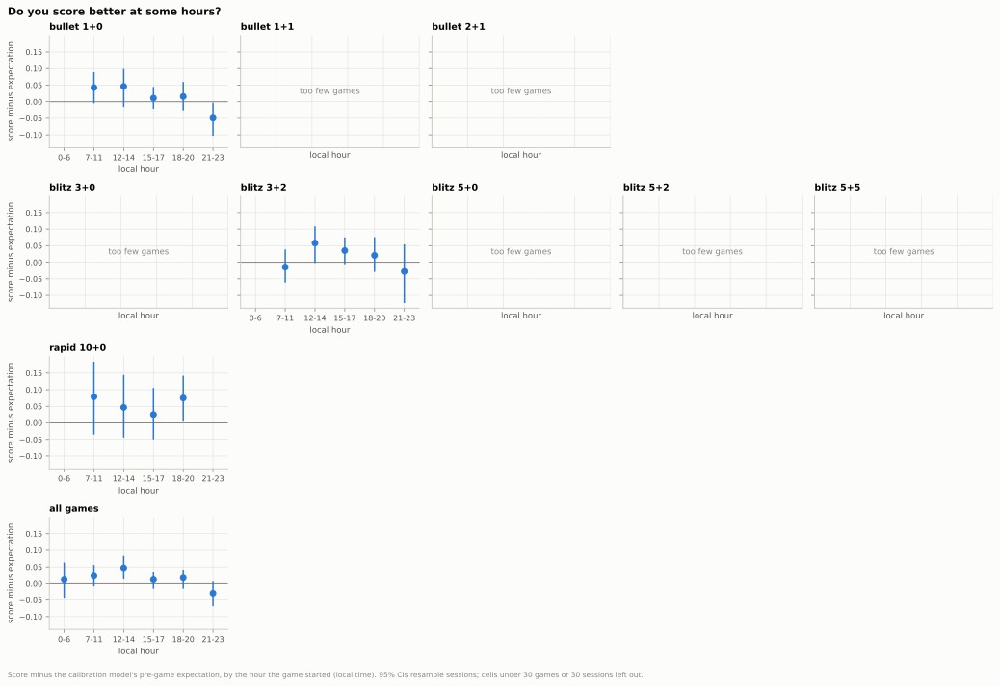

- Across all games, midday (12-14) is your best band, +0.047 above expectation (CI +0.013 to +0.083), about +33 Elo (CI +9 to +58), and late evening (21-23) the lowest, −0.029 (CI −0.069 to +0.006): no clear difference from zero there.
- In 1+0 the late band is clearly below expectation: −0.049 (CI −0.103 to −0.003), about −35 Elo (CI −73 to −2).
- Your move quality and your opponents' move together hour by hour: across all games the gap between you never exceeds 0.0009 expected points per move in any band.
- Only 14 control-by-band cells have enough games and sessions to read; 2 of them have an interval clear of zero (1+0 late, 10+0 evening), against 0.7 expected by chance.

Data: [1_hour_band.csv](data/06_time_of_day/1_hour_band.csv) · [1e_clear_cells.csv](data/06_time_of_day/1e_clear_cells.csv) · [1b_hour.csv](data/06_time_of_day/1b_hour.csv) · [all tables](data/06_time_of_day/_index.csv) · [script](../analysis/06_time_of_day.py) · source: [games_decomposed.parquet](../data/zakihussa1n/games_decomposed.parquet)

### 6.2 Do you score better on some days?

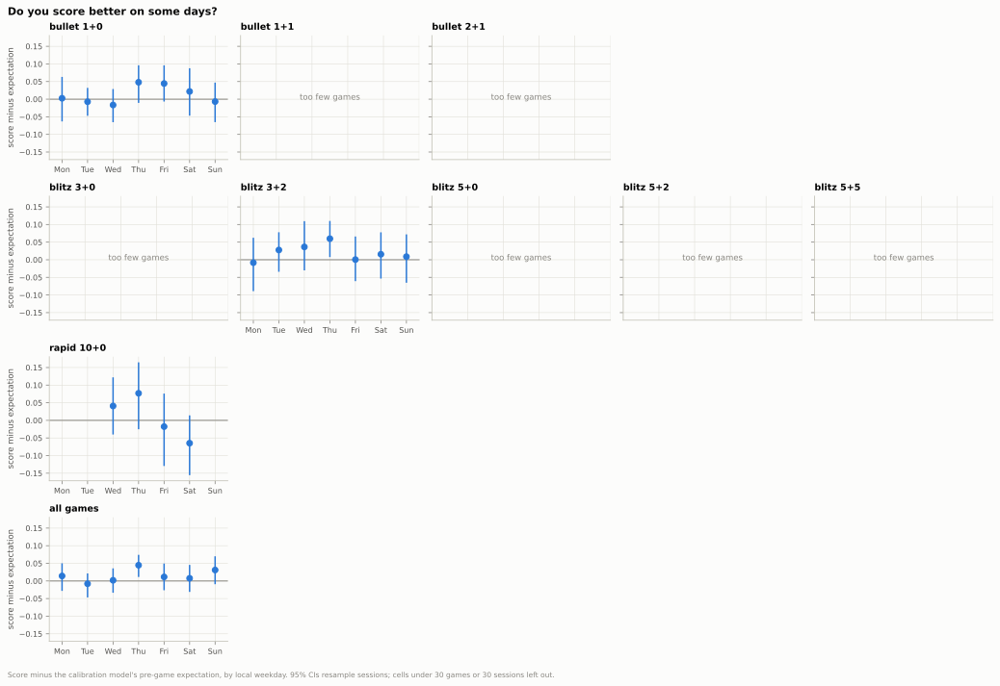

- Across all games, Thursday is your best day: +0.045 above expectation (CI +0.011 to +0.074), about +31 Elo (CI +8 to +52).
- Weekends against weekdays: +0.007 (CI −0.024 to +0.038), about +5 Elo (CI −17 to +26): no clear difference, and none in 1+0, 1+1, 3+2 or 10+0 either.
- 3+0's weekend edge, +0.149 (about +107 Elo, CI +3 to +215), rests on 79 weekend games in too few sessions to trust.
- Of the 18 control-by-day cells with enough games and sessions, 1 has an interval clear of zero (3+2 Thursday, +0.060), against 0.9 expected by chance.

Data: [2_weekday.csv](data/06_time_of_day/2_weekday.csv) · [2b_weekend_minus_weekday.csv](data/06_time_of_day/2b_weekend_minus_weekday.csv) · [2c_clear_cells.csv](data/06_time_of_day/2c_clear_cells.csv) · [all tables](data/06_time_of_day/_index.csv) · [script](../analysis/06_time_of_day.py) · source: [games_decomposed.parquet](../data/zakihussa1n/games_decomposed.parquet)

### 6.3 Is there a best hour on a particular day?

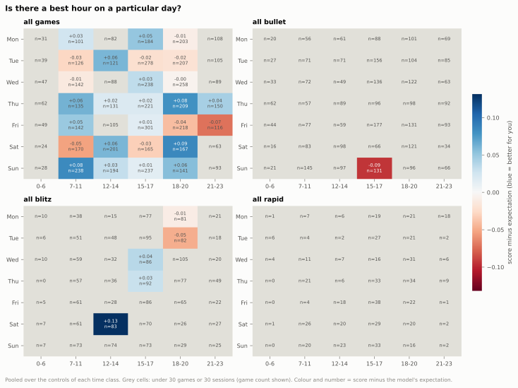

- Per control almost every hour-by-day cell is thin, so the grid pools controls by time class and over all games.
- Even pooled, few cells are readable: 1 of 42 in bullet, 5 in blitz and none in rapid have at least 30 games and 30 sessions.
- Across all games, 3 of the 27 usable cells have an interval clear of zero, where chance alone would give about 1.35.
- Those three (Thursday evening, Saturday evening, Sunday morning, each about +0.08) are scattered, not a block of neighbouring hours or days.

Data: [3_band_weekday.csv](data/06_time_of_day/3_band_weekday.csv) · [3b_grid_summary.csv](data/06_time_of_day/3b_grid_summary.csv) · [all tables](data/06_time_of_day/_index.csv) · [script](../analysis/06_time_of_day.py) · source: [games_decomposed.parquet](../data/zakihussa1n/games_decomposed.parquet)

### 6.4 Does any effect survive accounting for sessions, rating and year?

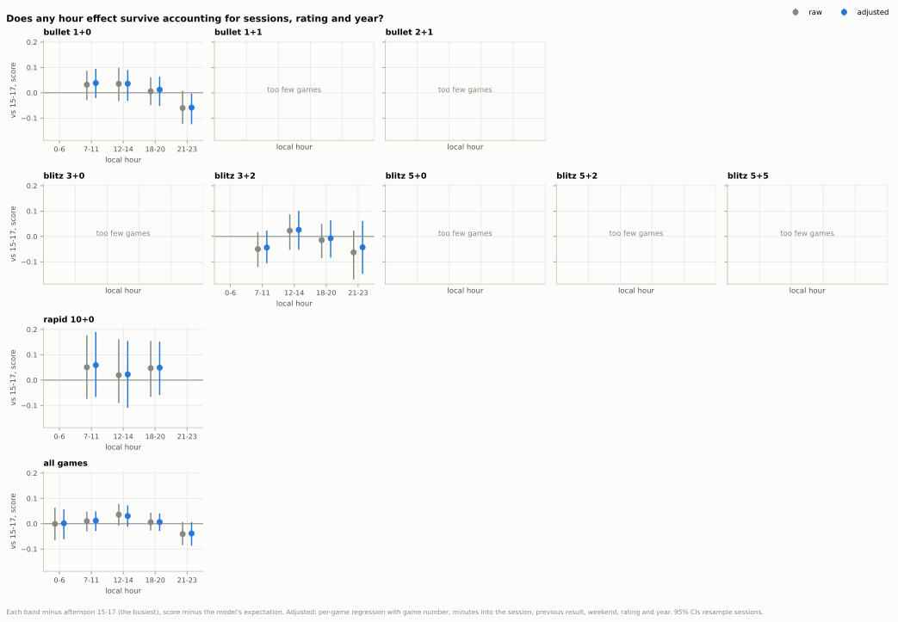

- Across all games, adjusting barely moves the bands against the afternoon: late evening is −0.041 raw and −0.038 adjusted (CI −0.087 to +0.006), about −27 Elo (CI −61 to +4); midday +0.036 raw and +0.031 adjusted (CI −0.012 to +0.073).
- In 1+0 late evening stays below the afternoon after adjustment: −0.058 (CI −0.124 to −0.003), about −41 Elo (CI −88 to −2).
- Shuffling the hour band between whole sessions often gives band effects as large as yours: p = 0.41 across all games, 0.47 in 1+0, 0.55 in 3+2 and 0.09 in 10+0.
- 3+0 is the exception: p = 0.007 on 208 games in 73 sessions (about 0.06 after allowing for the nine controls tested), but each of its bands has under 30 sessions, so which hours drive it cannot be read.

Data: [4_raw_vs_adjusted.csv](data/06_time_of_day/4_raw_vs_adjusted.csv) · [4b_permutation.csv](data/06_time_of_day/4b_permutation.csv) · [4c_regression.csv](data/06_time_of_day/4c_regression.csv) · [all tables](data/06_time_of_day/_index.csv) · [script](../analysis/06_time_of_day.py) · source: [games_decomposed.parquet](../data/zakihussa1n/games_decomposed.parquet)

### 6.5 Does any effect repeat across years?

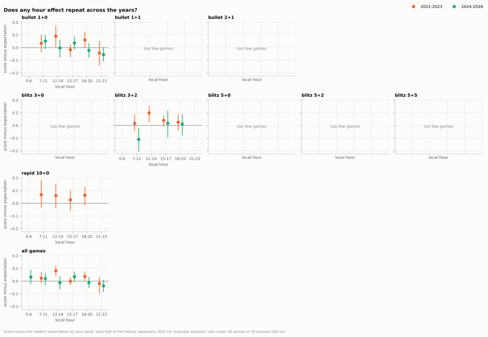

- The midday edge belongs to 2021-2023 only: +0.082 (CI +0.038 to +0.124), about +58 Elo (CI +27 to +88), then −0.012 (CI −0.066 to +0.038), about −9 Elo (CI −46 to +26), in 2024-2026.
- Across all games only 2 of the 5 comparable bands keep the same sign in both periods, and none is clearly above or below zero in both.
- Late evening is below zero in both periods (−0.020, then −0.037) but clearly so in neither.
- 1+0 tells the same story (2 of 5 bands keep their sign); 3+2 has 3 comparable bands and the other controls are too thin to split in two.

Data: [5_halves.csv](data/06_time_of_day/5_halves.csv) · [5b_sign_agreement.csv](data/06_time_of_day/5b_sign_agreement.csv) · [all tables](data/06_time_of_day/_index.csv) · [script](../analysis/06_time_of_day.py) · source: [games_decomposed.parquet](../data/zakihussa1n/games_decomposed.parquet)

### 6.6 Do you lose on time more late at night?

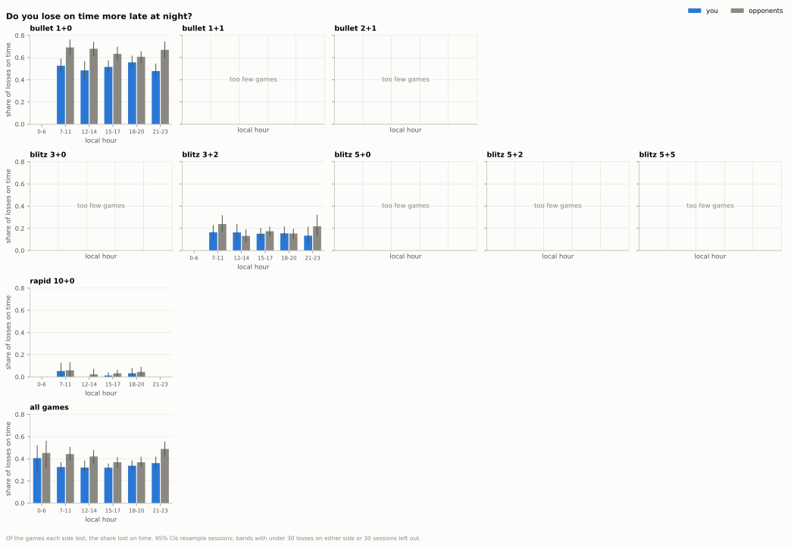

- Of the games you lost from 21:00 to 06:59, +0.046 more were on time than at other hours (CI −0.004 to +0.108): no clear difference.
- Of your opponents' losses at those hours, +0.083 more were on time (CI +0.018 to +0.151).
- Counting all games, you lose +0.038 more of them on time late (CI +0.008 to +0.072), but 72% of late games are bullet against 54% of the rest: mostly the mix of games.
- Within 1+0 there is no clear difference: +0.031 more games lost on time late (CI −0.014 to +0.081).

Data: [6_flags_by_band.csv](data/06_time_of_day/6_flags_by_band.csv) · [6b_late_minus_rest.csv](data/06_time_of_day/6b_late_minus_rest.csv) · [all tables](data/06_time_of_day/_index.csv) · [script](../analysis/06_time_of_day.py) · source: [games_decomposed.parquet](../data/zakihussa1n/games_decomposed.parquet)

<details><summary>Method and caveats</summary>

- Games: every standard live game with at least one move, split by its exact time control; "all games" pools the nine reported controls, and the hour-by-day grid also pools by time class ("all bullet", "all blitz", "all rapid") because per control nearly every one of its 42 cells is thin. Even pooled by class most grid cells stay thin, so the all-games grid is the one to read. 0.5+0 (19 games) and 30+0 (1 game) are left out.
- Hours and weekdays are the local start time in the configured timezone (Europe/London); travel would mislabel them. Each game carries the band of its own start, even when its session crosses into the next band.
- Bands: night 0-6 (hours 1 to 6 hold under 60 games each, so they are merged with midnight), morning 7-11, midday 12-14, afternoon 15-17, evening 18-20, late 21-23. "Late at night" in 6.6 is 21:00 to 06:59. The busiest band, the afternoon, is the reference in 6.4.
- Score vs expectation is the result minus the calibration model's pre-game expected score (it knows both pre-game ratings and the time control, so a weaker pool at some hour is not mistaken for better play). The Elo-equivalent is the rating gap that would turn the expected score into the actual one, applied to the estimate and each CI end.
- CIs are 95% bootstrap intervals with 500 resamples of whole sessions (sessions as in Q5: no pause over 30 minutes), since the games of a session share an hour, a mood and a pool.
- 6.4's adjusted numbers come from a per-game regression of score vs expectation on the hour band, weekend, previous result, log2 of the game number, minutes into the session, pre-game rating and year (and the control, in the pool). Rows with no pre-game rating (the first rated game of a pool) are dropped there.
- "Last game of the session" is deliberately not a control: you stop because of a game's result (Q5), so it is part of the outcome, and late evenings hold the most last games; controlling for it would pull the late band towards zero for no real reason.
- The shuffle test labels every game with its session's band (the band of the session's first game), in the observed fit and in each of 300 shuffles of those labels across whole sessions, refits, and reports p = (1 + shuffles with band effects at least as large as observed) / 301, for the largest band and for the sum of squares (the draft quotes the largest band, and the sum of squares for 3+0). The Bonferroni columns multiply a control's p by the nine controls tested.
- The regression controls what is measured; it cannot control why you were still playing at 23:00. Bands also differ in era: 72% of night games are from 2024-2026.
- Many cells are tested (6 bands or 7 days in 10 groups, 168 grid cells), so isolated intervals that clear zero are expected; [1e_clear_cells.csv](data/06_time_of_day/1e_clear_cells.csv), [2c_clear_cells.csv](data/06_time_of_day/2c_clear_cells.csv) and [3b_grid_summary.csv](data/06_time_of_day/3b_grid_summary.csv) count them against chance, and the shuffle test and the split by years are the checks that matter.
- Thin cells: under 30 games or under 30 sessions (under 30 losses on either side for the flag shares) are flagged `thin` and not drawn; the sessions floor is there because every CI resamples sessions, and a bootstrap over fewer clusters gives unreliable intervals. Regressions are flagged under 10 games per coefficient or 30 sessions.
- Per-game quality and the expected score come from Q1's `games_decomposed.parquet`; the session machinery is shared with Q5 (`chess_analysis.sessions`).

</details>

## 7. Does resigning cost you points?

**Short answer:** A little overall: your resignations gave away about 2.2 expected points per 100 games (about 15 Elo), more than your opponents' resignations handed back; the net cost sits in 1+1 and rapid 10+0, where you resign more of your losses than your opponents do, and in 1+0 an opponent short of time turns even lost positions into real chances.

### 7.1 How often do you resign compared with your opponents?

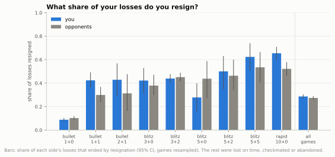

- Across all games you resign 29% of your losses and your opponents 27%: no clear difference (+0.012, CI −0.010 to +0.036).
- The control matters far more than the side: in 1+0 you resign only 9% of your losses (52% are lost on time), in rapid 10+0 65%.
- You resign clearly more of your losses than your opponents in 1+1 (42% against 30%, +0.125, CI +0.035 to +0.219) and in 10+0 (65% against 52%, +0.133, CI +0.050 to +0.222).
- In 1+0 and 3+2 there is no clear difference: −0.014 (CI −0.038 to +0.008) and −0.012 (CI −0.070 to +0.039).

Data: [1_resign_share.csv](data/07_resignation/1_resign_share.csv) · [1b_loss_endings.csv](data/07_resignation/1b_loss_endings.csv) · [all tables](data/07_resignation/_index.csv) · [script](../analysis/07_resignation.py) · source: [moves_analysed.parquet](../data/zakihussa1n/moves_analysed.parquet)

### 7.2 From what positions do you resign?

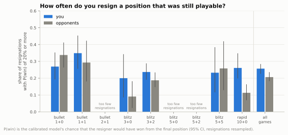

- Across all games 26% of your resignations came while the model still gave you a 0.2 chance or better to win; for your opponents 21% (difference +0.050, CI +0.005 to +0.086).
- In rapid 10+0 the gap is large: 26% of yours against 11% of theirs, +0.148 (CI +0.066 to +0.241).
- In 1+0 there is no clear difference, if anything the other way: −0.069 (CI −0.185 to +0.047).
- A typical resignation of yours comes at about 6.4 pawns down by the engine (your opponents': 7.7).
- These "still playable" resignations are 26% of yours but carry 65% of what resigning cost you.

Data: [2_resign_position.csv](data/07_resignation/2_resign_position.csv) · [2b_resign_position_detail.csv](data/07_resignation/2b_resign_position_detail.csv) · [2c_resign_class.csv](data/07_resignation/2c_resign_class.csv) · [all tables](data/07_resignation/_index.csv) · [script](../analysis/07_resignation.py) · source: [expected_points.parquet](../data/zakihussa1n/expected_points.parquet)

### 7.3 What happens when positions like that are played out?

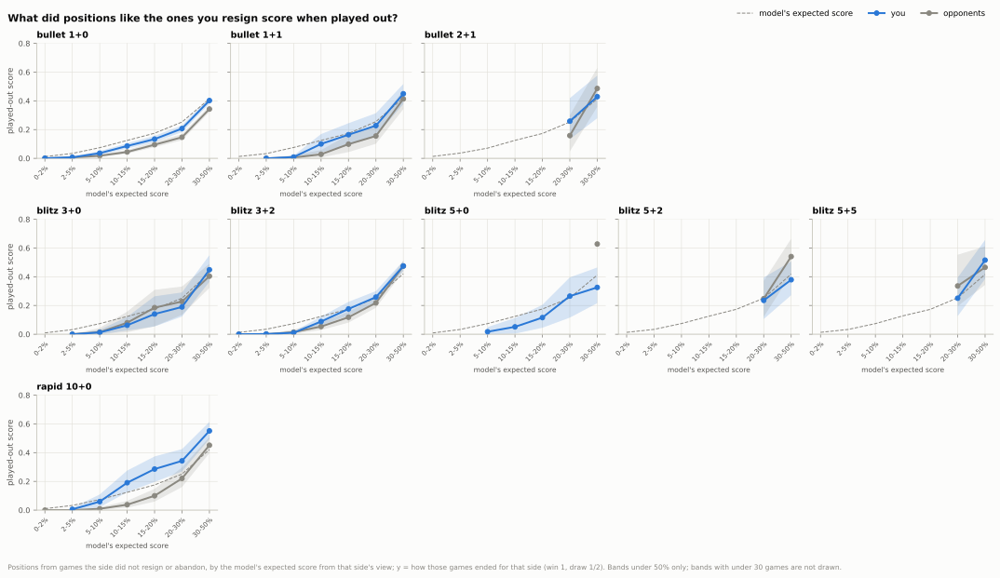

- At a 2-5% expected score almost nothing comes back: played on, such positions scored 0.007 for you in 1+0 and 0.002 in 3+2.
- In 1+0 the bands where people resign (up to 20-30%) scored less than the model's estimate: at 10-15%, 0.086 for you (CI 0.068 to 0.105) and 0.044 for your opponents, against the model's 0.125.
- Rapid 10+0 is the exception for you: from 15-20% you scored 0.286 (CI 0.196 to 0.374), well above the model's 0.175 and your opponents' 0.100.
- In engine terms nothing is hopeless: in 1+0 your positions at mate or 20+ pawns down still scored 0.212 (CI 0.183 to 0.242), and 5-10 pawns down 0.372.

Data: [3_played_out_by_ev.csv](data/07_resignation/3_played_out_by_ev.csv) · [3b_played_out_by_eval.csv](data/07_resignation/3b_played_out_by_eval.csv) · [all tables](data/07_resignation/_index.csv) · [script](../analysis/07_resignation.py) · source: [expected_points.parquet](../data/zakihussa1n/expected_points.parquet)

### 7.4 Does the opponent's clock change that?

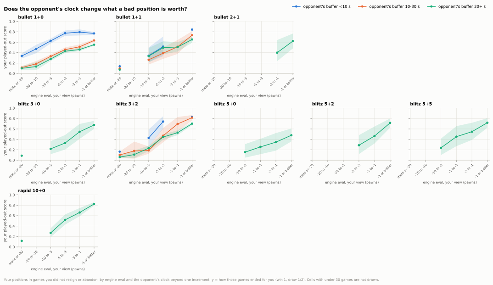

- In 1+0, with your opponent under 10 s, your positions at mate or 20+ pawns down scored 0.335 when played on (CI 0.287 to 0.386), against 0.098 with your opponent on 30+ s.
- In 1+1 the increment takes most of that away: with your opponent under 10 s beyond the increment the same lost positions scored 0.139 (CI 0.052 to 0.240).
- You rarely resign into a short clock: in 1+0, 77% of your resignations came with your opponent on 30+ s, and in blitz 97%.
- The model's expected score already allows for the clock: in 1+0 at 10-15% your positions scored 0.089 with the opponent under 10 s and 0.082 with 30+ s.

Data: [4_clock_by_eval.csv](data/07_resignation/4_clock_by_eval.csv) · [4b_clock_by_ev.csv](data/07_resignation/4b_clock_by_ev.csv) · [4c_resign_clock.csv](data/07_resignation/4c_resign_clock.csv) · [all tables](data/07_resignation/_index.csv) · [script](../analysis/07_resignation.py) · source: [moves_analysed.parquet](../data/zakihussa1n/moves_analysed.parquet)

### 7.5 How much has resigning cost you?

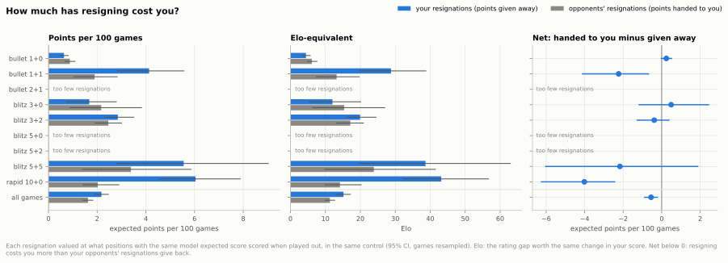

- Across all games your resignations gave away 2.2 expected points per 100 games (CI 1.9 to 2.5), about 15 Elo (CI 13 to 17).
- Your opponents' resignations handed you 1.6 per 100 games, so resigning nets you −0.55 per 100 games (CI −0.92 to −0.19), about −4 Elo (CI −6 to −1).
- The net is clearly negative only in rapid 10+0, −4.0 (CI −6.3 to −2.4), and 1+1, −2.2 (CI −4.1 to −0.6): there your resignations cost 6.0 per 100 games (about 43 Elo) and 4.1 (about 29 Elo).
- In 5+5 the cost is as high, 5.6 per 100 games (CI 2.8 to 9.0), about 39 Elo, but the net is unclear: −2.2 (CI −6.1 to +1.9).
- In 1+0 the cost is small, 0.64 per 100 games (about 4 Elo), about what your opponents' resignations hand you (0.88): no clear net effect (+0.24, CI −0.05 to +0.54).

Data: [5_cost.csv](data/07_resignation/5_cost.csv) · [5b_net.csv](data/07_resignation/5b_net.csv) · [all tables](data/07_resignation/_index.csv) · [script](../analysis/07_resignation.py) · source: [games_decomposed.parquet](../data/zakihussa1n/games_decomposed.parquet)

### 7.6 When is resigning safe?

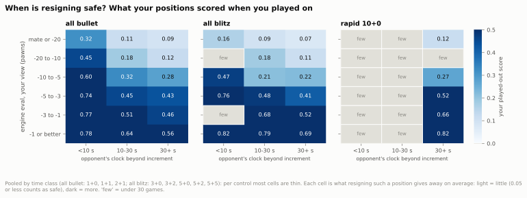

- By engine eval, no band is safe anywhere: even at mate or 20+ pawns down with the opponent on 30+ s, your positions scored 0.091 in bullet (CI 0.059 to 0.129), 0.071 in blitz and 0.116 in rapid.
- With the opponent under 10 s, bullet positions at mate or 20+ pawns down scored 0.316 and at 5-10 pawns down 0.598; that is mostly 1+0, and in 1+1 the first cell is only 0.139, as the previous chart shows.
- By the model's expected score, resigning gives away at most 0.05 per resignation only up to the 2-5% band in 1+0 and 10+0, and up to 5-10% in 1+1 and 3+2.
- Per control most cells are too thin for a map; the bullet and blitz panels are mostly 1+0 and 3+2, and 1+1 differs, as the previous chart shows.

Data: [6_safe_map.csv](data/07_resignation/6_safe_map.csv) · [6b_safe_threshold.csv](data/07_resignation/6b_safe_threshold.csv) · [4_clock_by_eval.csv](data/07_resignation/4_clock_by_eval.csv) · [all tables](data/07_resignation/_index.csv) · [script](../analysis/07_resignation.py) · source: [moves_analysed.parquet](../data/zakihussa1n/moves_analysed.parquet)

<details><summary>Method and caveats</summary>

- Games: standard live games in each time control with at least 50 games (bullet 1+0 to rapid 10+0); bullet 0.5+0 (19 games) and rapid 30+0 (1 game) are too thin and left out. Two games ended before the first move and have no resignation position.
- The resignation position is the position after the last move of the game, seen from the resigner; the time between that move and the resignation is not recorded.
- Win chance is the calibrated model's P(win) and expected score is P(win) + ½P(draw) (see [appendix A](#a-how-good-is-the-win-chance-model-behind-every-number)); the model uses both clocks and both pre-game ratings, so it already allows for time trouble.
- "Played out": every position after a move in games the side under study did not resign or abandon, scored by how that game ended for that side (win 1, draw ½, loss 0). Final positions of games that ended on the board are left out.
- Each resignation is valued at the played-out score of its expected-score band in its own time control; a band with no played-out positions falls back to the model's value.
- The played-out games are themselves selected (people play on when they see a reason: the opponent's clock, a trick), so this is an upper-ish bound; the model's own value is shown alongside, and an all-positions version (resigned games' positions counted as losses) is a lower bound.
- CIs: 500 resamples of whole games. For the cost, one game-level bootstrap per control resamples the band scores and the resignations together, both sides on the same draws (so the net has its own CI); pooled rows add up the controls' draws.
- Elo-equivalent: the rating gap that moves your actual score in that control by the same amount (for your opponents' resignations, from your score without them).
- Clock bands: under 10 s, 10-30 s, 30+ s on the other side's clock, as plain seconds left and as the buffer beyond one increment (in 1+1 an opponent on 5 s still gets a second back each move); the charts use the buffer, both are in the tables.
- Thin cells: a played-out score from under 30 games, or a share from under 30 resignations or losses, is kept in the CSVs with `thin` = True and not drawn. Eval band × clock × side cells are thin outside 1+0 and 3+2, so the map and the clock tables are also pooled by time class ("all bullet" = 1+0, 1+1, 2+1; "all blitz" = 3+0, 3+2, 5+0, 5+2, 5+5).
- "Still playable" = P(win) of at least 0.2 at the resignation; "had to go" (table 2d) = still playable, at least a quarter of the base time left and a quick last own move; it is a proxy, and a session ended in frustration looks the same as one ended by an interruption.
- Played-out scores are averaged over positions, not games: a long slide through a band counts once per move, so long games weigh more (the CIs still resample whole games).
- The calibrated model was fitted on all games, resigned ones included (their positions enter it as the resigner's loss), so the model valuation in table 5_cost is relative to that model; the played-out valuation is the one the conclusions use.
- Abandoned games count as not played out (left out of the comparison set) but are not counted as resignations.
- Opponents who are ahead may play differently against someone who never resigns; the comparison cannot separate that.

</details>

## 8. Which openings work for you, and how well do you play them?

**Short answer:** Your openings decide little: most opening families score no clearly different from your average with that colour (2 of 17 as White and 4 of 24 as Black clearly differ, against 0.85 and 1.2 expected by chance), staying longer in known lines does not clearly help, and your opening moves lose about as much as your opponents' (slightly more as Black); your costliest repeated move, 6. Qf3 in the Italian Game (66 times), is one you have nearly stopped playing.

### 8.1 What do you play as White and as Black?

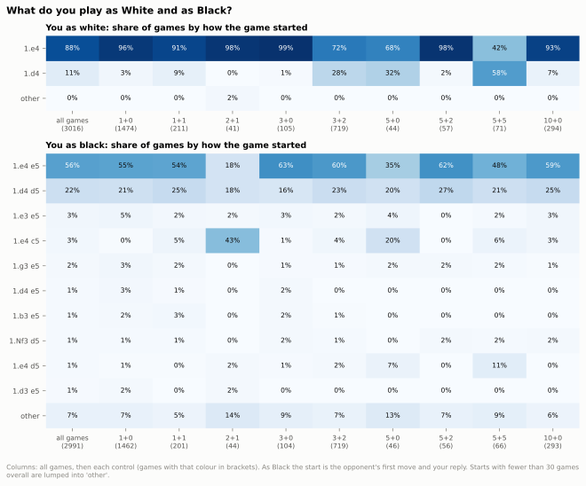

- As White you open 1.e4 in 88% of your games and 1.d4 in 11%.
- 1.d4 shows up in some blitz controls: 28% of your White games in 3+2, 32% in 5+0 and 58% in 5+5, but 1-3% in 1+0, 3+0 and 5+2.
- As Black you meet 1.e4 with 1...e5 (56% of your Black games) and 1.d4 with 1...d5 (22%).
- Your most played family is the Italian Game as White (688 games, 23% of your White games); as Black it is the Queen's Pawn Game (414) and the Italian Game (372).

Data: [1_line_starts.csv](data/08_openings/1_line_starts.csv) · [1b_families.csv](data/08_openings/1b_families.csv) · [all tables](data/08_openings/_index.csv) · [script](../analysis/08_openings.py) · source: [moves_analysed.parquet](../data/zakihussa1n/moves_analysed.parquet)

### 8.2 Which openings score above or below expectation?

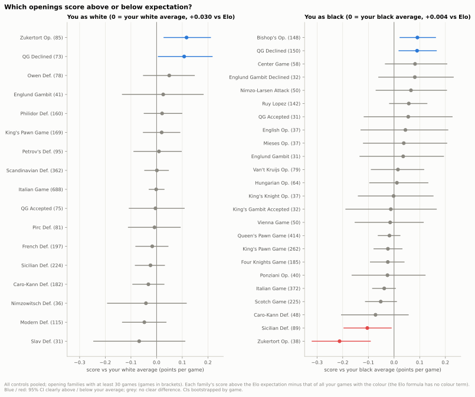

- Over all your White games you score +0.030 above the Elo expectation (CI +0.012 to +0.048), about +21 Elo (CI +8 to +33); as Black +0.004, no clear difference.
- Part of that White +0.030 is just the first move, which the Elo formula ignores, so each family is compared with your own average for its colour (the chart's zero).
- As White, two families are clearly above your White average: the Zukertort Opening, +0.117 (CI +0.027 to +0.212), about +85 Elo (CI +19 to +165), and, only just, the Queen's Gambit Declined, +0.107 (CI +0.005 to +0.218).
- As Black, the Bishop's Opening (+0.091, CI +0.022 to +0.163) and the Queen's Gambit Declined (+0.090, CI +0.018 to +0.166) are clearly above your Black average; the Sicilian (−0.104, CI −0.197 to −0.009) and the Zukertort (−0.212, CI −0.321 to −0.091) are clearly below.

Data: [2_family_score.csv](data/08_openings/2_family_score.csv) · [2c_colour_score.csv](data/08_openings/2c_colour_score.csv) · [2e_chance_check.csv](data/08_openings/2e_chance_check.csv) · [2b_family_score_by_class.csv](data/08_openings/2b_family_score_by_class.csv) · [all tables](data/08_openings/_index.csv) · [script](../analysis/08_openings.py) · source: [games_decomposed.parquet](../data/zakihussa1n/games_decomposed.parquet)

### 8.3 Are you still playing the openings that work?

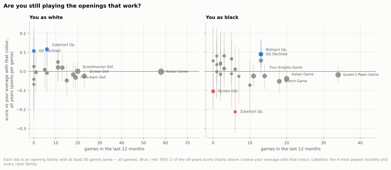

- As White, about as rarely as before: the two clearly better families were 3% of your 212 recent White games against 5% earlier; the Zukertort holds its 3%, and the Queen's Gambit Declined has not been played in the last 12 months.
- As Black, a little more than before: 13% of your 205 recent Black games were in the two clearly better families, against 10% earlier (as Black your opponent picks most of the family).
- Of the two clearly worse Black families, the Sicilian has gone (no games in the last 12 months), but the Zukertort now comes up more often: 3% of recent Black games against 1% before (only 6 games).
- Weighting each family's long-run score above the Elo expectation by how often you play it now gives about the same edge as before: +0.027 against +0.032 as White, −0.002 against −0.001 as Black.

Data: [3_recency.csv](data/08_openings/3_recency.csv) · [3b_recency_summary.csv](data/08_openings/3b_recency_summary.csv) · [all tables](data/08_openings/_index.csv) · [script](../analysis/08_openings.py) · source: [games_decomposed.parquet](../data/zakihussa1n/games_decomposed.parquet)

### 8.4 Who leaves the known lines first, and does it cost?

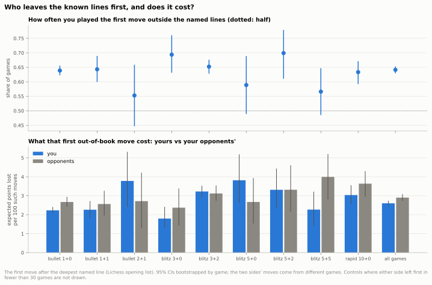

- You play the first move outside the named lines in 64% of games (CI 63% to 65%); every control is between 55% (2+1) and 70% (5+2).
- That move costs you less than it costs your opponents when they leave first: 2.60 against 2.90 expected points per 100 such moves (difference −0.30, CI −0.54 to −0.05).
- The saving is clearest in 1+0, −0.44 per 100 (CI −0.74 to −0.14), and also clear in 5+5 (−1.73, CI −3.23 to −0.33); in 3+2 there is no clear difference (+0.10, CI −0.40 to +0.59).
- Who leaves first does not change the result: your score above expectation differs by −0.001 (CI −0.025 to +0.024), about −1 Elo (CI −17 to +17).

Data: [4_deviation.csv](data/08_openings/4_deviation.csv) · [4c_deviation_score_diff.csv](data/08_openings/4c_deviation_score_diff.csv) · [4b_deviation_score.csv](data/08_openings/4b_deviation_score.csv) · [all tables](data/08_openings/_index.csv) · [script](../analysis/08_openings.py) · source: [moves_analysed.parquet](../data/zakihussa1n/moves_analysed.parquet)

### 8.5 Does going deeper into known lines help?

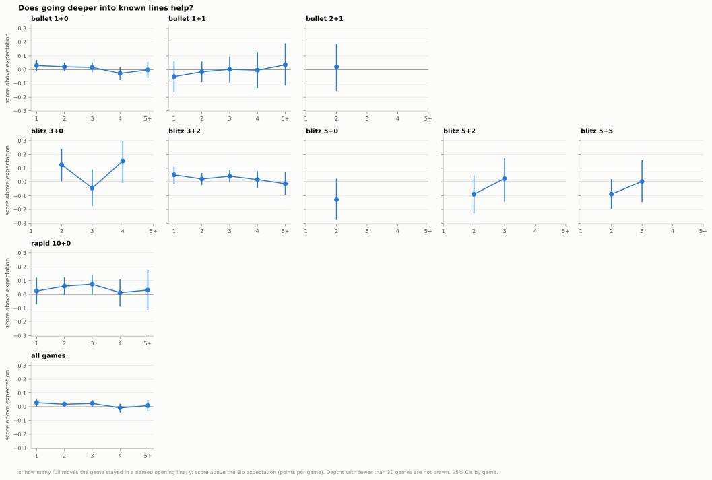

- No clear effect: across all games each extra move of named line changes your score above expectation by −0.007 (CI −0.017 to +0.003), and by −0.006 with your colour held fixed.
- Games that leave the list after one move score +0.029 above expectation (CI +0.001 to +0.060); games that stay 5+ moves score +0.008 (CI −0.033 to +0.050).
- The big controls agree: −0.012 per move in 1+0 (CI −0.027 to +0.002) and −0.011 in 3+2 (CI −0.032 to +0.010); no control with enough games shows a clear trend.
- Deep lines are mostly your Black games (23% White at 5+ moves against 60% at one move), which is why the colour-adjusted slope matters.

Data: [5_book_depth.csv](data/08_openings/5_book_depth.csv) · [5b_book_depth_slope.csv](data/08_openings/5b_book_depth_slope.csv) · [all tables](data/08_openings/_index.csv) · [script](../analysis/08_openings.py) · source: [games_decomposed.parquet](../data/zakihussa1n/games_decomposed.parquet)

### 8.6 How does your opening play compare with your opponents'?


- As White there is no clear difference from your opponents: 2.75 against 2.78 expected points per 100 opening moves (difference −0.03, CI −0.08 to +0.02).
- As Black you lose slightly more, +0.08 per 100 moves (CI +0.03 to +0.13), clearest in 1+0: +0.12 (CI +0.06 to +0.19).
- Over all games your first five moves as White lose less than your opponents' (−0.10 per 100, CI −0.15 to −0.05), and as Black your moves six to ten lose more (+0.11 per 100, CI +0.02 to +0.20); the largest single-control gap is 10+0 as White, first five moves, −0.34 per 100.
- In centipawns your White opening moves lose clearly less than your opponents': −5.8 per move (CI −7.1 to −4.4).

Data: [6_opening_quality.csv](data/08_openings/6_opening_quality.csv) · [6b_opening_cp_loss.csv](data/08_openings/6b_opening_cp_loss.csv) · [6c_opening_by_ply.csv](data/08_openings/6c_opening_by_ply.csv) · [all tables](data/08_openings/_index.csv) · [script](../analysis/08_openings.py) · source: [moves_analysed.parquet](../data/zakihussa1n/moves_analysed.parquet)

### 8.7 What are your costliest repeated moves?


- 6. Qf3 in the Italian Game as White costs most: 66 times, 0.063 expected points each (CI 0.048 to 0.077), 4.1 in total; the engine plays Nxf7.
- You have nearly dropped it: once in the last 12 months.
- Two repeated Black blunders cost most per move: 6... Ke8 in the Scotch Game (8 times, 0.414 each; you lost all 8 games against an expected 0.50) and 3... Nf6 in the Bishop's Opening (6 times, 0.391 each).
- Your opponents' costliest repeated move against you is 7. Ke1 in the Italian Game: 16 times, 0.260 each; you scored 0.94 against an expected 0.50 in those games (only 16 games).

Data: [7_costly_moves.csv](data/08_openings/7_costly_moves.csv) · [7b_costly_moves_opponents.csv](data/08_openings/7b_costly_moves_opponents.csv) · [all tables](data/08_openings/_index.csv) · [script](../analysis/08_openings.py) · source: [moves_analysed.parquet](../data/zakihussa1n/moves_analysed.parquet)

<details><summary>Method and caveats</summary>

- Games: 6,007 standard live games with at least one move in the nine reported controls; 2 games without moves are dropped, and the thin controls 0.5+0 (19 games) and 30+0 (1 game) are left out of everything (counts in 8_data.csv).
- What is pooled: the repertoire (8.1 shares), family and line scores (8.2), recency (8.3) and the repeated moves (8.7) pool every reported control, because an opening is a repertoire choice and family x colour x control is almost always under 30 games; 2b_family_score_by_class.csv splits the family scores by time class as a secondary view (most cells thin). Who leaves the book (8.4), book depth (8.5) and opening move quality (8.6) are per control, because the clock changes how you play; each also has an "all games" row.
- Opening names come from the Lichess opening list (deepest named line reached); a family is the name before the colon. Names follow positions, not move orders: the White "Zukertort Opening" is mostly 1.e4 d5 2.Nf3 dxe4 (53 of 85 games, the Tennison Gambit), see 1c_family_move_order.csv.
- 1.d4 as White is almost all from before the last 12 months (1 of 346 games is recent), so its share per control in 8.1 may partly reflect when you played those controls rather than the control itself.
- Expected score is the Elo formula on your pre-game rating and the opponent's pre-game rating reconstructed as their post-game rating plus your rating change (unrated: post-game rating); 4 games without a usable rating (below chess.com's floor of 100) are left out of the score columns. The Elo formula has no colour term, so at equal ratings everyone scores above it as White and below it as Black (chess.com's Glicko ratings also make it approximate).
- Families are therefore compared with your own average for that colour (excess_vs_colour: the family's score above expectation minus that of all your games with the colour). Its CI comes from one bootstrap of all the colour's games, so the family and the average are resampled together; its Elo-equivalent is relative to the score you would make at that average. "Clearly above / below" in 8.2, 8.3 and the chart colours means this CI is clear of zero; 2_family_score.csv also keeps the plain score above the Elo expectation with its own CI.
- The Elo-equivalent is the rating gap that turns the expected score into the actual one, applied to the estimate and to each CI end. For "who left first" (4c) it is taken relative to the score in the games your opponent left first.
- CIs are 95% from 1,000 bootstrap resamples of games. You-vs-opponent opening quality (8.6) is a paired bootstrap within the same games; the out-of-book moves and the scores by who left first come from two disjoint sets of games and use independent bootstraps.
- Thin: a family, line or cell with fewer than 30 games is computed, flagged `thin` and not drawn (a score from 30 games has a CI of about +-0.18). In the repeated-move tables most moves are thin by this rule: their per-move losses are solid (the same position each time) but the scores in those games are anecdotes. In the "who left first" table a control is thin when either side left first in fewer than 30 games; in the depth slope when it has fewer than 30 games per depth bin on average (2+1, 5+0, 5+2, 5+5).
- 8.2 tests 41 families: with 95% CIs about 2 would clear your colour average by chance alone; 2e_chance_check.csv counts them against your average and against zero, per colour, per time class and for the named lines.
- Recency: the last 12 months are 2025-10-31 to 2026-10-31, only 417 games, so most families have too few recent games to score on their own (`thin_recent`); 8.3 therefore uses each family's all-years score against your colour average and asks how much of the recent repertoire falls in clearly better or worse families.
- Book depth is the depth of the deepest named line in full moves (two plies, rounded up), 5+ for 9 plies or more. It is a joint property of both players: a game leaves the list when either side plays an unnamed move. The slope is a least-squares fit of score above expectation on depth (capped at 5), raw and with a White dummy, because deep lines are mostly your Black games.
- "Opening moves" are those in the material-heuristic opening phase (roughly the first 10 to 12 moves, well beyond book); 6c splits the first 30 plies into blocks of 10.
- Expected points lost come from the calibrated model, which knows both clocks, so a move can lose expected points through time spent alone; centipawn loss is in the tables alongside.
- Repeated moves are the same move in the same position (exact FEN, so transpositions count together) in the opening phase, played at least 5 times with an average loss of at least 0.05 expected points (about 1.7 times the average move) and at least 50 centipawns (the inaccuracy floor, so the loss is the move and not the clock), never the engine's own move, ranked by total loss; the engine move is Stockfish 17.1 at 1M nodes, one good move, not the only one. Times per time class are in the table.
- As Black the family is mostly your opponent's choice (1.e4 e5 2.Bc4 is the Bishop's Opening whatever you do), so the Black family scores describe what you face as much as what you choose.
- Opponents are matched to your rating, so "their" numbers describe players at your level in the same games, not an absolute standard.

</details>

## 9. What kinds of blunders do you make, and which do you miss?

**Short answer:** You blunder about as often as your opponents and mostly in the same ways; the differences are that you blunder into a forced mate more often in 1+0, 1+1 and 3+2, the last seconds of the clock cost you more than them in 1+0, compared with your opponents your blunders more often miss a quiet move and less often miss a free capture, and with a big lead you blunder less than they do.

### 9.1 How often do you blunder?


- In 1+0 you blunder 6.18 times per 100 moves and your opponents 6.04: no clear difference (you minus them +0.14, CI -0.02 to +0.29).
- In 3+0 you blunder less than your opponents, 4.74 against 5.64 per 100 moves (difference -0.90, CI -1.43 to -0.39); in every other control the difference is not clear.
- A blunder costs more in slower games: 0.125 expected points in 1+0, 0.181 in 3+2 and 0.185 in 10+0, the same for you and your opponents.
- Counting big errors in expected points instead (a move that gives away at least 0.2 points), in 1+0 you make fewer than your opponents: 1.88 against 2.05 per 100 moves (difference -0.16, CI -0.26 to -0.07).
- The 3+0 result is one clear difference among nine controls in a group of 209 games, so it may be chance.
- In bullet your blunder rate fell from 7.89 per 100 moves in 2021-22 to 5.42 in 2025-26, and your opponents' fell just as much (7.73 to 5.29).

Data: [1_blunder_rate.csv](data/09_blunder_anatomy/1_blunder_rate.csv) · [9_data.csv](data/09_blunder_anatomy/9_data.csv) · [1b_blunder_cost.csv](data/09_blunder_anatomy/1b_blunder_cost.csv) · [1c_blunders_by_year.csv](data/09_blunder_anatomy/1c_blunders_by_year.csv) · [all tables](data/09_blunder_anatomy/_index.csv) · [script](../analysis/09_blunder_anatomy.py) · source: [moves_analysed.parquet](../data/zakihussa1n/moves_analysed.parquet)

### 9.2 In which phase do your blunders happen?


- The middlegame is the dangerous phase for both of you: in 1+0 you blunder 8.77 times per 100 middlegame moves (your opponents 8.25) against 4.03 per 100 opening moves (4.29); in 3+2 8.83 (8.45) against 3.67 (4.00); in 10+0 8.25 (8.03) against 3.98 (4.37).
- In 1+0 you blunder a little more than your opponents in the middlegame (+0.52 per 100 moves, CI +0.17 to +0.86) and a little less in the opening (-0.26, CI -0.51 to -0.07).
- In 3+0 you blunder less than your opponents in the middlegame (5.59 against 7.61 per 100 moves), so 51% of your blunders there come in the endgame, against 42% of theirs.
- In 1+0 your extra allowed mates come in the middlegame (1.16 against 0.71 per 100 moves) and the endgame (0.98 against 0.63); in 3+2 only in the middlegame (1.31 against 0.79; endgame difference +0.12, CI -0.11 to +0.35).

Data: [2_blunders_by_phase.csv](data/09_blunder_anatomy/2_blunders_by_phase.csv) · [2b_families_by_phase.csv](data/09_blunder_anatomy/2b_families_by_phase.csv) · [all tables](data/09_blunder_anatomy/_index.csv) · [script](../analysis/09_blunder_anatomy.py) · source: [moves_analysed.parquet](../data/zakihussa1n/moves_analysed.parquet)

### 9.3 What kinds of blunder?


- Leaving material to be taken is the biggest family for both sides: 46% of your blunders in 1+0 (46% of your opponents'), 36% in 3+2 (38%) and 37% in 10+0 (38%).
- In 1+0 you move a piece to a square where it is taken for free more often than your opponents: 1.10 against 0.94 per 100 moves (difference +0.16, CI +0.07 to +0.25).
- In 3+2 you walk into check tactics (forks, skewers, mating attacks) more often: 0.87 against 0.63 per 100 moves (difference +0.23, CI +0.10 to +0.36).
- Only about a third of blunders can be followed on the board (the punisher kept playing the engine's best move; 66% of yours in 1+0 cannot); of those, 69% of yours lost material on the very next move in 1+0 (74% of your opponents'), 57% in 3+2 (65%) and 61% in 10+0 (61%).

Data: [3_what_played.csv](data/09_blunder_anatomy/3_what_played.csv) · [3b_families.csv](data/09_blunder_anatomy/3b_families.csv) · [3d_refutation_depth.csv](data/09_blunder_anatomy/3d_refutation_depth.csv) · [all tables](data/09_blunder_anatomy/_index.csv) · [script](../analysis/09_blunder_anatomy.py) · source: [moves_analysed.parquet](../data/zakihussa1n/moves_analysed.parquet)

### 9.4 Which pieces do you hang?


- In 1+0 you hang your queen 14.37 times and a rook 16.59 times per 100 games, about as often as your opponents (15.84 and 17.44).
- Knights are your weak spot in 1+0: 22.41 knight hangs per 100 games against your opponents' 18.77 (difference +3.64, CI +1.34 to +5.74).
- In blitz you hang your queen less often than your opponents: 8.96 against 11.58 per 100 games, all blitz controls together (difference -2.62, CI -4.63 to -0.86).
- A hung queen costs you 0.170 expected points in 1+0 and 0.254 in 3+2 (your opponents 0.169 and 0.266), against 0.111 and 0.165 for a hung pawn (0.112 and 0.162).

Data: [4_pieces_hung.csv](data/09_blunder_anatomy/4_pieces_hung.csv) · [all tables](data/09_blunder_anatomy/_index.csv) · [script](../analysis/09_blunder_anatomy.py) · source: [moves_analysed.parquet](../data/zakihussa1n/moves_analysed.parquet)

### 9.5 How often do you allow mate?


- In 1+0 you blunder into a forced mate 0.81 times per 100 moves, your opponents 0.51 (difference +0.29, CI +0.21 to +0.38); the gap is also clear in 1+1 (+0.31, CI +0.10 to +0.54) and 3+2 (+0.18, CI +0.05 to +0.32).
- It is not because you are losing more often: in balanced positions in 1+0 you allow mate 0.50 times per 100 moves against your opponents' 0.22 (difference +0.28, CI +0.21 to +0.37).
- Counting every move that allows a forced mate, including moves in already-lost positions, the 1+0 gap shrinks to +0.16 per 100 moves (CI -0.00 to +0.33), no clear difference.
- When you have a forced mate you let it slip about as often as your opponents: in 19% of such positions in 1+0, against 18% (no clear difference, +0.012, CI -0.008 to +0.034).

Data: [5_allowed_mate.csv](data/09_blunder_anatomy/5_allowed_mate.csv) · [5b_allowed_mate_by_distance.csv](data/09_blunder_anatomy/5b_allowed_mate_by_distance.csv) · [5c_mate_slipped.csv](data/09_blunder_anatomy/5c_mate_slipped.csv) · [all tables](data/09_blunder_anatomy/_index.csv) · [script](../analysis/09_blunder_anatomy.py) · source: [moves_analysed.parquet](../data/zakihussa1n/moves_analysed.parquet)

### 9.6 Do you miss what is on offer or what is coming?


- Your blunders are less often a missed free capture: 1.14 against 1.37 per 100 moves in 1+0 (difference -0.23, CI -0.33 to -0.13), and 0.67 against 0.95 in 3+2.
- They are more often a missed quiet move (a retreat, a defensive move, a deeper idea): 2.37 against 1.96 per 100 moves in 1+0 (difference +0.41, CI +0.28 to +0.54), 2.45 against 2.05 in 3+2.
- Hung material is punished less often when you hang it: in 10+0 your opponents take 70% of what you hang and you take 80% of what they hang (difference -0.10, CI -0.17 to -0.04); in 3+2 66% against 73% (difference -0.07, CI -0.12 to -0.03).
- Rescuing an attacked piece shows no consistent difference: you miss it slightly more in 1+0 (1.48 against 1.37 per 100 moves, CI of the difference +0.02 to +0.23) and about as often in 3+2 (1.32 against 1.34).

Data: [6_what_missed.csv](data/09_blunder_anatomy/6_what_missed.csv) · [6b_punished.csv](data/09_blunder_anatomy/6b_punished.csv) · [all tables](data/09_blunder_anatomy/_index.csv) · [script](../analysis/09_blunder_anatomy.py) · source: [moves_analysed.parquet](../data/zakihussa1n/moves_analysed.parquet)

### 9.7 Does the clock change your blunder rate?


- In 1+0, with under 5 seconds left you blunder 5.8 more times per 100 moves than with 30 seconds or more, in the same phase and kind of position (CI 4.4 to 7.2); your opponents 3.3 more (CI 1.9 to 4.4).
- So the scramble costs you more than it costs them in 1+0: the difference is +2.5 per 100 moves (CI +1.1 to +4.1).
- In 3+2, with under 5 seconds beyond the increment you blunder 5.3 more times per 100 moves (CI 2.5 to 10.4) and your opponents 3.9 more (CI 0.9 to 8.0); no clear difference between you (+1.3, CI -3.5 to +6.8).
- All blitz controls pooled tell the same story: under 5 seconds beyond the increment adds 5.8 blunders per 100 moves for you and 3.7 for your opponents, no clear difference (+2.1, CI -2.8 to +6.3).
- In 2+1, 3+0, 5+0, 5+2, 5+5 and 10+0 too few moves are played with under 30 seconds beyond the increment to tell (3+0 only has the 10 to 30 second bucket).

Data: [7_clock_adjusted.csv](data/09_blunder_anatomy/7_clock_adjusted.csv) · [7b_blunders_by_clock.csv](data/09_blunder_anatomy/7b_blunders_by_clock.csv) · [all tables](data/09_blunder_anatomy/_index.csv) · [script](../analysis/09_blunder_anatomy.py) · source: [moves_analysed.parquet](../data/zakihussa1n/moves_analysed.parquet)

### 9.8 How often do you blunder from a winning position?


- Over all moves played at least 300 centipawns up you blunder less than your opponents: 8.56 against 9.81 per 100 such moves in 1+0, 7.34 against 9.83 in 3+2 and 6.87 against 10.36 in 10+0.
- Part of that is that you are more often far ahead, where blunders are rarer: in 10+0, 16.7% of your moves are played 600 or more centipawns up, against 8.2% of theirs.
- With a modest lead (300 to 600 centipawns) there is no clear difference in 1+0 (11.70 against 12.53, difference -0.83, CI -1.96 to +0.23) or 10+0 (-1.46, CI -3.65 to +0.51); in 3+2 you still blunder less (9.26 against 12.19).
- With a big lead (600 or more) you throw the win away less often: in 10+0 1.71 times per 100 moves, your opponents 5.28 (difference -3.57, CI -5.31 to -1.90).
- In 1+0 you give a winning position away at least once in 58% of the games where you reach one, about as often as your opponents (57%; no clear difference).
- Blunders from a winning position cost the most, for both of you: 0.150 expected points each for you in 1+0 (your opponents 0.144) and 0.219 in 3+2 (0.212), against 0.110 (0.110) and 0.179 (0.176) from a balanced position.

Data: [8_winning_blunders.csv](data/09_blunder_anatomy/8_winning_blunders.csv) · [8b_cost_by_eval_band.csv](data/09_blunder_anatomy/8b_cost_by_eval_band.csv) · [8c_after_giving_away.csv](data/09_blunder_anatomy/8c_after_giving_away.csv) · [all tables](data/09_blunder_anatomy/_index.csv) · [script](../analysis/09_blunder_anatomy.py) · source: [moves_analysed.parquet](../data/zakihussa1n/moves_analysed.parquet)

<details><summary>Method and caveats</summary>

- Games: every standard live game in the nine time controls with at least 50 games (counts in `9_data.csv`); 0.5+0 (19 games) and 30+0 (1 game) are too few and left out, and so are their moves from the pooled "all bullet" / "all rapid" rows.
- A blunder is a move that loses at least 300 centipawns (the project's label, on evaluations clipped to plus or minus 1000, so errors in already-decided positions are under-counted); `1b_blunder_cost.csv` and `3e_taxonomy_ep_definition.csv` repeat the key numbers with "loses at least 0.2 expected points" instead; pooled per time class, no share of your blunders moves by more than about 4 percentage points between the two definitions.
- Each blunder is classified by replaying the position with python-chess: the played move, the engine's best move, and the engine's best reply (the stored best move of the next position), with a static exchange evaluation (pieces 1/3/3/5/9) to decide whether material was free. Categories are assigned in a fixed order of precedence (allowed mate, then the four "hung material" kinds, check tactic, combination, quiet refutation); "quiet refutation / deeper" is a residual, described in `3c_quiet_residual.csv`.
- The static exchange evaluation ignores pins beyond legality, promotions other than to a queen and tactics longer than one capture sequence; "what was missed" is Stockfish 17.1's preference at 1M nodes, not a unique truth.
- Every number about you is paired with the same number for your opponents in the same games; CIs are 95% from 500 bootstrap resamples of whole games, and the you-minus-them difference is computed on the same resamples. Rates are per 100 moves of the side in question (per 100 games for hung pieces).
- Thin cells are flagged in every table (`thin`) and left out of the charts: below 300 moves per side for a blunder rate, 2,000 moves for a single kind of blunder (a kind seen about 0.5 times per 100 moves needs that many to be seen 10 times), 100 blunders per side for shares of blunders, 200 games for hung pieces, 100 positions for forced mates.
- Hung pieces (9.4) are also pooled per time class ("all bullet", "all blitz", "all rapid"), because 2+1, 5+0, 5+2 and 5+5 have too few games for a per-piece rate; the year trend (`1c_blunders_by_year.csv`) is per time class only, because the mix of controls changed from year to year and most control-by-year cells are thin. Years with under 100 games are merged into the neighbouring year (2021 into 2022, 2026 into 2025).
- Allowed mate (9.5) counts blunders whose position after the move has a forced mate for the opponent, split by the evaluation before the move (losing below -300 centipawns, winning from +300), so that a side that is losing more often is not penalised for it; the share of each side's moves in each band is in the table. The stored missed-mate flag does not count a move that delivers mate.
- The clock (9.7) is the mover's clock before the move, in plain seconds left and in seconds beyond one increment (the same in games without increment), plus as a share of the base time in `7b_blunders_by_clock.csv`. The chart shows seconds beyond the increment (the table has both). It is a linear probability model per time control (blunder x 100 on clock bucket, with phase, evaluation band and 10-move bands as controls; reference: 30 seconds or more), because the raw rates mix the clock with the phase: full-clock moves are mostly opening moves, where blunders are rare. Its CIs come from 200 game resamples, so they are quoted to one decimal. Because most single controls have too few low-clock moves, bullet and blitz are also fitted pooled ("all bullet", "all blitz"), with a fixed effect per control; rapid has only 10+0.
- Winning (9.8) means at least 300 centipawns up before the move; at this level that is far from won (the calibrated model gives a winning position about 0.6 to 0.85 expected points on average, column `mean_ep_before_*`). A win is "given away" when the blunder leaves the mover below +300. The table and the chart split the lead at 600 centipawns, because the sides differ in how often they are far ahead and blunders are rarer with a big lead; with a lead under 600 every blunder gives the win away, so that bar is drawn once.
- "Punished" (9.6) means the reply to a blunder lost less than 100 centipawns of the gift; the refutation depth (9.3) follows the game while the punishing side kept playing the engine's best move, so about two thirds of blunders cannot be resolved that way.

</details>

## 10. How well do you play endgames?

**Short answer:** In the simplest endings you spoil wins less often than your opponents and convert about as well, but in 1+0 the clock costs you: 36 of every 100 of your won endings (your opponents: 21) ended on the clock without a single wrong move.

### 10.1 Which endgames do you reach?


- 7.8% of your games reach a position with five pieces or fewer (where the tablebase knows the exact result): 5.5% in 1+0, 12% in 3+2.
- At that point you are winning 44.8% of them, drawn in 13.0% and losing in 42.2%.
- The commonest endings are a rook (25.6%) or a queen (22.0%) against pawns or a bare king, then pawn endings (19.8%).
- Rook endings are mostly drawn: 29 of 52 entered as a tablebase draw.

Data: [1_endgames_reached.csv](data/10_endgames/1_endgames_reached.csv) · [1b_tablebase_reach.csv](data/10_endgames/1b_tablebase_reach.csv) · [all tables](data/10_endgames/_index.csv) · [script](../analysis/10_endgames.py) · source: [tablebase.parquet](../data/zakihussa1n/tablebase.parquet)

### 10.2 How often do you win a won ending?


- Across all games you won 75.7% of your tablebase-won endings (CI 69.5% to 81.9%) and your opponents 72.2% of theirs: no clear difference.
- The control matters more than the side: in 1+0 you converted 59.7% (CI 49.4% to 70.1%), in 3+2 89.0% (CI 80.8% to 95.9%).
- Across all games, against the model's expectation at entry (it knows both clocks), you scored +0.035 (CI +0.010 to +0.060), about +44 Elo (CI +12 to +81); your opponents −0.018 (CI −0.045 to +0.008).
- In 1+0 you scored +0.035 above that expectation (CI −0.012 to +0.083), about +30 Elo (CI −10 to +77): no clear difference, so the low 1+0 conversion is about what your clock and position at entry predict.
- Move by move, across all games, you spoil a win less often: 1.40 moves in 100 turn a win into a draw, against 2.81 for your opponents (−1.40, CI −2.58 to −0.33).

Data: [2_conversion.csv](data/10_endgames/2_conversion.csv) · [2b_errors_by_kind.csv](data/10_endgames/2b_errors_by_kind.csv) · [all tables](data/10_endgames/_index.csv) · [script](../analysis/10_endgames.py) · source: [moves_analysed.parquet](../data/zakihussa1n/moves_analysed.parquet)

### 10.3 How often do you hold a drawn ending?


- Only 61 games entered a drawn tablebase ending; you avoided losing 80.3% of them, your opponents 86.9%: no clear difference (−0.066, CI −0.213 to +0.066).
- In 1+0 you lost 6 of 15 drawn endings and your opponents 2 (difference −0.267, CI −0.600 to +0.067); per move that is 12.84 against 1.98 draw-to-loss errors per 100 moves, but from only 24 games, too few to be sure.
- In 3+2, no clear difference: 4.95 against 4.81 per 100 moves (difference CI −4.67 to +5.09).
- Across all games, pawn endings are where you let draws slip: 5.26 per 100 moves from drawn pawn endings against 1.11 for your opponents (+4.15, CI +0.55 to +8.70).

Data: [3_hold.csv](data/10_endgames/3_hold.csv) · [2b_errors_by_kind.csv](data/10_endgames/2b_errors_by_kind.csv) · [4b_errors_by_material_kind.csv](data/10_endgames/4b_errors_by_material_kind.csv) · [all tables](data/10_endgames/_index.csv) · [script](../analysis/10_endgames.py) · source: [moves_analysed.parquet](../data/zakihussa1n/moves_analysed.parquet)

### 10.4 Which endings produce the most errors?


- Rook endings are the hardest for both sides: 12.95 errors per 100 at-risk moves for you and 13.64 for your opponents, against 2.97 and 3.53 in pawn endings.
- A rook or queen against pawns or a bare king almost never goes wrong: 0.40 and 0.74 errors per 100 of your moves.
- The balance with the most errors is rook against rook and pawn: as the defender you erred 13 times in 54 moves, your opponents 16 times in 60.
- Beyond five pieces there is no clear difference in rook endings (0.0267 against 0.0270 expected points lost per move); across all endings there you make slightly fewer big mistakes (8.99 against 9.23 per 100 moves, CI −0.46 to −0.03).

Data: [4_errors_by_material.csv](data/10_endgames/4_errors_by_material.csv) · [4c_exact_material.csv](data/10_endgames/4c_exact_material.csv) · [4e_big_endgames_ep_loss.csv](data/10_endgames/4e_big_endgames_ep_loss.csv) · [4f_big_mistakes.csv](data/10_endgames/4f_big_mistakes.csv) · [all tables](data/10_endgames/_index.csv) · [script](../analysis/10_endgames.py) · source: [moves_analysed.parquet](../data/zakihussa1n/moves_analysed.parquet)

### 10.5 How did failed wins end: a wrong move or the clock?


- In 1+0, 36 of every 100 of your won endings (CI 26 to 47) ended on the clock without a single wrong move; for your opponents 21 (difference +15, CI +2 to +30).
- Most were draws: your flag fell but your opponent had too little material to mate (21 of your 31 failed 1+0 conversions).
- You arrive with less time: in 1+0 your median clock at entry was 6.2 s, your opponents' 8.7 s; from under 5 s, 16 of your 25 and 10 of your opponents' 19 won endings ended on the clock (both small groups).
- For you the increment nearly removes it: 1 of your 16 won endings in bullet with increment ended on the clock, 30 per 100 fewer than in 1+0 (CI 6 to 42); for your opponents no clear difference (21 against 17 per 100), and both rest on few endings.
- A wrong move spoiled only 3.9 of every 100 of your 1+0 won endings, against 12.7 for your opponents.

Data: [5_failed_conversions.csv](data/10_endgames/5_failed_conversions.csv) · [5b_increment_contrast.csv](data/10_endgames/5b_increment_contrast.csv) · [5d_entry_clock.csv](data/10_endgames/5d_entry_clock.csv) · [2_conversion.csv](data/10_endgames/2_conversion.csv) · [all tables](data/10_endgames/_index.csv) · [script](../analysis/10_endgames.py) · source: [moves_analysed.parquet](../data/zakihussa1n/moves_analysed.parquet)

<details><summary>Method and caveats</summary>

- Games: standard live games in each time control with at least 50 games (bullet 1+0 to rapid 10+0); bullet 0.5+0 (19 games) and rapid 30+0 (1 game) are too thin and left out.
- Tablebase range is five pieces or fewer, kings included (Syzygy 3-4-5): the exact result (win, draw, loss) is known before and after every move. A game's first position in range fixes its theoretical result for the rest of the game, because pieces only leave the board.
- A won ending is converted when the game was won; a drawn ending is held when it was not lost. Your conversions and your opponents' come from different games (each side's own won endings), so their difference resamples both sets; hold rates come from the same games and are compared game by game.
- The expected score at entry is the calibrated model's (see [appendix A](#a-how-good-is-the-win-chance-model-behind-every-number)); it knows both clocks and pre-game ratings, so a short clock already lowers it. The Elo-equivalent is the rating gap that moves that expectation by the same amount.
- A tablebase error is a move that turns a win into a draw or loss, or a draw into a loss. Error rates are per 100 at-risk moves (moves from won or drawn positions: a lost position cannot get worse), you against your opponents in the same games, with the difference resampled by game.
- A failed conversion counts as a wrong move when the winning side made at least one tablebase error; otherwise it is classed by how the game ended: lost on time, drawn on time against a side that could not mate (chess.com's timeout vs insufficient material), or other (repetition, agreement).
- Clock bands are under 5 s, 5-15 s, 15-60 s and 60+ s, both as seconds left and as the buffer beyond one increment; in controls without increment they are the same. They are in the tables (5c, 5d); error rates per move show no clear relation to the clock.
- Tablebase data are small: 9,898 moves in 469 games with 160 errors. Only 1+0 and 3+2 have enough endings for their own estimates, so every table also has pools per time class ("all bullet"), by increment within a class ("bullet with increment" = 1+1 and 2+1; "blitz no increment" = 3+0 and 5+0), and all games; the charts of material classes show the time-class pools and all games.
- Thin flags: a share from fewer than 30 endings is thin; a per-move error rate is thin with fewer than 100 at-risk moves on a side, fewer than 30 games, or fewer than 5 errors on both sides together (beyond five pieces the move minimum is 200 a side). Thin cells stay in the CSVs with `thin` = True and are not drawn.
- The 1+0 draw-to-loss rate is thin by that rule (24 games, 15 drawn endings): one or two games with several errors each can carry it, and it was one of about 60 view-by-kind cells, so read it as a hint.
- A side with no events in a cell gets a bootstrap CI of 0 to 0; that is not certainty, just too few events (such cells are flagged thin when both sides together have fewer than 5).
- The increment comparison (5b) also gives score intervals (Wilson for each rate, Newcombe for the difference), which the bullet quotes: with one clock failure in 16 endings the bootstrap CI is too narrow.
- Exact material balances (4c) are pooled over all games: per control they hold one or two errors each. They are ranked by total errors, not by rate.
- Time class and increment of each control come from the data (the games' time class and increment), not from the label text.
- Beyond five pieces, "endgame" is the enrichment's material heuristic and the material class is the piece types on the board, whatever side has them; quality is expected points lost per move (calibrated) with centipawn loss alongside (tables 4e and 4f); a big mistake loses at least 0.10 expected points.
- The tablebase gives win, draw or loss only, without the 50-move rule's cursed wins; DTZ (moves to the next capture or pawn move that keeps the win) and time spent per move in won positions are in tables 5e and 5f.
- CIs: 1,000 resamples of whole games for game-level rates, 500 for per-move cells; fixed seeds.

</details>

## 12. Can a model pick out your games, and what gives you away?

**Short answer:** Yes: in 1+0 a model picks out which side of the board was you in 91% of games, mostly from your opening choices, but you are no easier to recognise than a typical stranger of your rating (in 3+2 and 10+0 harder), so having a fingerprint is normal rather than special.

### 12.1 How well can a model tell your games from your opponents'?


- In 1+0 the model picks out which side was you in 91% of games (AUC 0.949, CI 0.943 to 0.955; 0.5 would be guessing).
- In 1+1, 3+0, 3+2 and 10+0 it is less sure but still clear: AUC 0.844 to 0.855.
- On a year it never trained on, 1+0 holds up (AUC 0.929) but 3+2 drops to 0.708, largely because 830 of its 1,344 games are from 2022, the odd year out (see below).
- Against strangers of your rating playing the same control it still works: AUC 0.919 in 1+0, and 0.781 to 0.823 in 1+1, 3+0, 3+2 and 10+0.

Data: [1_auc.csv](data/12_fingerprint/1_auc.csv) · [1b_vs_strangers.csv](data/12_fingerprint/1b_vs_strangers.csv) · [5_unseen_year.csv](data/12_fingerprint/5_unseen_year.csv) · [all tables](data/12_fingerprint/_index.csv) · [script](../analysis/12_fingerprint.py) · source: [moves_analysed.parquet](../data/zakihussa1n/moves_analysed.parquet), [fingerprint_features.parquet](../data/opponents/fingerprint_features.parquet)

### 12.2 What gives you away?


- Your opening choices are the biggest tell: leaving them out costs 0.131 AUC in 1+0 (CI 0.120 to 0.141), and 0.127 to 0.145 in 1+1, 3+2 and 10+0.
- 3+0 is the exception: there your move habits (captures, castling, piece use) give away more than your openings (0.078 against 0.047 AUC lost).
- Your mistakes say almost nothing about who you are: leaving out the engine-based error profile makes no clear difference in any control, and on its own it scores 0.521 in 1+0 (CI 0.507 to 0.537), barely above guessing.
- The clock looks like a tell in blitz mostly because of the increment: leaving it out costs 0.075 AUC (CI 0.059 to 0.090) against strangers matched on rating alone, but 0.024 (CI 0.013 to 0.036) when they also play the same control.

Data: [2_drop_group.csv](data/12_fingerprint/2_drop_group.csv) · [2b_drop_group_strangers.csv](data/12_fingerprint/2b_drop_group_strangers.csv) · [all tables](data/12_fingerprint/_index.csv) · [script](../analysis/12_fingerprint.py) · source: [moves_analysed.parquet](../data/zakihussa1n/moves_analysed.parquet), [fingerprint_features.parquet](../data/opponents/fingerprint_features.parquet)

### 12.3 Are you more recognisable than a typical player of your rating?


- In 1+0 you are a typical player: 55% of strangers (CI 44% to 66%) are less distinctive than you against the rest of the pool.
- In 3+2 and 10+0 you are less distinctive than most: only 15% (CI 7% to 27%) and 20% (CI 13% to 27%) of strangers are less distinctive than you.
- One stranger at a time, there is no clear difference in 1+0 between telling you apart and telling two strangers apart (paired by stranger: +0.013, CI −0.008 to +0.033).
- In 3+0 you are slightly harder to tell from any one stranger than strangers are from each other (−0.029, CI −0.058 to −0.002).

Data: [3_vs_rest.csv](data/12_fingerprint/3_vs_rest.csv) · [3c_per_pair.csv](data/12_fingerprint/3c_per_pair.csv) · [all tables](data/12_fingerprint/_index.csv) · [script](../analysis/12_fingerprint.py) · source: [fingerprint_features.parquet](../data/opponents/fingerprint_features.parquet)

### 12.4 Which habits set you apart?


- Against 1.e4 you almost always reply 1...e5 or 1...c5: in bullet another reply comes in 1.3% of your Black games against 1.e4, against 68% for strangers of your rating.
- As White you open 1.e4 or 1.d4: another first move in 0.2% of your bullet White games, against 31% for strangers.
- You castle one to two moves earlier: on your move 9.0 against 10.9 for strangers in bullet, 9.9 against 11.1 in blitz, 9.8 against 11.9 in rapid.
- Instant moves go opposite ways: in bullet 32.0% of your moves take under 1 second against 36.0% for strangers, in rapid 10.0% against 8.1%.

Data: [4_habits.csv](data/12_fingerprint/4_habits.csv) · [all tables](data/12_fingerprint/_index.csv) · [script](../analysis/12_fingerprint.py) · source: [fingerprint_features.parquet](../data/opponents/fingerprint_features.parquet)

### 12.5 Has your style stayed the same over the years?


- 2022 is the odd year out: trained on the other years, the model recognises your 2022 games with AUC 0.782 in 1+0 and 0.640 in 3+2.
- In 1+0 and 3+2 the years from 2023 on look alike: on a year it never saw, the model scores 0.957 to 0.967 in 1+0 and 0.846 to 0.910 in 3+2.
- In 1+1 (2025: 0.689) and 10+0 (2023: 0.777) the unseen-year score stays below the same-years score (0.844 and 0.850).
- In 1+0 in 2022 you castled later (on your move 13.4, against 9.3 in 2023 and 8.5 in 2025) and played fewer instant moves (26.2% under 1 second, against 35.8% in 2023).

Data: [5_unseen_year.csv](data/12_fingerprint/5_unseen_year.csv) · [5b_habits_by_year.csv](data/12_fingerprint/5b_habits_by_year.csv) · [all tables](data/12_fingerprint/_index.csv) · [script](../analysis/12_fingerprint.py) · source: [moves_analysed.parquet](../data/zakihussa1n/moves_analysed.parquet)

<details><summary>Method and caveats</summary>

- Games: your standard live games in the nine reported controls where both sides made at least 8 moves (5,696 games: 1+0 2,839, 1+1 380, 2+1 75, 3+0 203, 3+2 1,344, 5+0 87, 5+2 106, 5+5 127, 10+0 535; see 0_sample.csv). The thin controls 0.5+0 (19 games) and 30+0 (1 game) are left out of everything.
- Thin controls: a model fit needs at least 150 games (MIN_FIT_GAMES). Below that the training folds hold fewer than 120 games and every control scored 0.48 to 0.71 against 0.84 or more above it, which says the model is short of data, not that you play differently there. 2+1 (75 games, AUC 0.48: no better than guessing), 5+0 (87), 5+2 (106) and 5+5 (127) are marked thin in the tables and not drawn; they still count in "all bullet" and "all blitz".
- Features: one row per player and game, 51 in four groups. Clock: time per move by phase, its spread and maximum, clock left after your 10th, 20th and 40th move and at the end, share of moves started under 10 s and played under 1 s. Moves: game length, capture and check rates, whether, when and which side you castled, share of moves by piece, promotions, en passant, early queen moves. Opening: first move as White, reply as Black, ECO letter and depth of the deepest named line, who left the named lines first. Engine (your games only): mean expected points and centipawns lost, shares of large losses, share of engine-best moves. Never the result, ratings, names, colour or time control.
- The feature thresholds (10 s, 1 s, own moves 10/20/40, early queen within 10 moves, losses of 0.1 and 0.2 expected points or 300 centipawns) are named constants in the script and must stay fixed: the committed strangers' table was built with them.
- "Under 10 s" and "under 1 s" are plain seconds: in 1+1 and 3+2 the clock includes the increment. A version counting the clock beyond one increment is in 4c_habits_vs_opponents.csv (under10_buffer, you vs your opponents only); putting it into the models needs --rebuild-features from archives that are not committed.
- 12.1, 12.2, 12.5 (you vs your opponents): both rows of a game go into the same cross-validation fold (5 folds grouped by game), so the model never sees the other half of a test game. AUC is the chance that a random row of yours scores above a random opponent row; "picks out which side was you" is the share of games where your row scores higher (pairwise accuracy). CIs: 500 bootstrap resamples of games. Drop-one-group CIs are paired (same resamples for both fits).
- You vs your opponents is not the honest test of a fingerprint: game length, ECO letter and book depth are identical for both rows of a game, so they can help only through interactions, and the opponent side mixes hundreds of people (one of them about 200 of your games). The comparison with strangers of your rating (12.1 last bullet, 12.2, 12.3, 12.4) is the stricter one.
- Models: gradient boosting (scikit-learn HistGradientBoosting, 200 trees, 15 leaves, single-threaded) is the headline; regularised logistic regression is in every table as a check and gives the same picture a few hundredths lower.
- Unseen year: train on all other years, test on one; a test year needs at least 50 games in the control and the other years at least 100 games to train on. Only 1+0, 1+1, 3+2 and 10+0 have such years, so the chart also shows bullet and blitz with all their controls pooled ("all bullet", "all blitz" in the tables); within-game comparisons are not confounded by mixing controls, because both rows of a game share the control.
- Strangers: games of your 200 most frequent opponents against third parties (games against you excluded), up to 120 per time class per person, sampled once from their whole history and stored in data/opponents/fingerprint_features.parquet (rebuilt only with --rebuild-features from archives that are not committed). They are replayed with a light python-chess pass that reproduces the stored enrichment exactly on 300 of your games (0_self_check.csv). Engine features do not exist for them, so every comparison with strangers is engine-free for you too.
- Matching: your games and the strangers' are matched in 100-point rating bands (your pre-game rating; the strangers' post-game rating in their own game, as pre-game ratings are not in their archives). A control gets its own fit when it has at least 150 matched games on each side: 1+0, 1+1, 3+0, 3+2 and 10+0. 2+1, 5+0, 5+2 and 5+5 are covered by their time class with every game matched on band and exact control (tc_group "all bullet"/"all blitz", matching "band and control"); 0_sample.csv says which fit answers for each control (strangers_fit_group). Strangers have only 30 games in 5+2.
- Clock features are confounded by increment: with an increment players can spend more time per move and their clock stays higher (clock features are fractions of the base time), so in a fit that mixes controls a clock "tell" can just mean "plays 3+2 rather than 3+0". Matched on rating band alone, 84.6% of your blitz games have an increment against 31.5% of the strangers' (2c_increment.csv). The band-only fits (matching "band only" in 1b, 2b, 2c, 2d) are kept to show the size of this effect; every habit and every other "vs strangers" number comes from fits matched on exact control.
- Pooled you-vs-strangers fits keep each stranger's games in one fold (a test stranger is never seen in training); their CIs resample strangers as clusters and your games individually. A fit with fewer than 20 strangers would be marked thin in 1b (none is).
- "Vs the rest" (12.3): each stranger with at least 30 games in the fit against everyone else in it (up to 3 rest games per own game, same bands), and 20 random subsamples of your games of the median stranger's size against the same pool; logistic regression, engine-free features. Your interval in the chart and table is the 2.5-97.5% range of the 20 draws: it shows only which of your games were drawn, not how sure we are about you as a player. The share of strangers less distinctive than you is bootstrapped over strangers and your draws, treating the overlapping draws as independent, so its CI is somewhat too narrow.
- Per-pair test (12.3, 3c): you vs each stranger and each stranger vs two random other strangers, same matching, sizes (at least 30 games a side) and 5-fold procedure; the difference is paired by stranger (your AUC against a stranger minus that stranger's mean AUC against its partners). 1+1 has only 10 paired strangers and is marked thin. The per-pair test and "vs the rest" answer different questions: almost any two people can be told apart, while being unusual against a whole pool takes rare habits; common habits held very consistently (yours) make you easy to tell from any one person but not an outlier.
- Your features are stored at the same float32 precision as the strangers' before fitting: mixing float64 and float32 values lets boosting split on rounding noise and inflated the AUC against strangers by about 0.05 in a first run.
- Habits (12.4) are per game in plain units: seconds, share of moves, own move number; colour-specific habits are measured only on the games where they apply (replies to 1.e4 only in Black games where White played 1.e4). The chart shows the 8 features with the best mean importance rank (boosting permutation importance on a held-out fold) across the three time-class fits matched on control; every feature is in 4_habits.csv, ranks in 4b_importance.csv, you vs your opponents in 4c_habits_vs_opponents.csv. Your habits by year (12.5) are quoted for 1+0 alone, because the mix of bullet controls changed between years.
- Limits: the "reply to 1.e4" features on Black rows also encode what White played; strangers' games span their whole chess.com history (often 5 to 10 years), so era effects (fashions, site changes) can separate strangers too; the opponent pool is people you met, not a random sample of chess.com; correlated clock features share importance; a fingerprint describes habits, it says nothing about what wins.

</details>

## A. How good is the win-chance model behind every number?

**Short answer:** Good enough to lean on: it predicts game results better than the Lichess eval curve, Stockfish's own win chances or ratings alone (an error score of 0.179 against 0.216, 0.267 and 0.228), its 70% means close to 70% in every time control you play, and its edge is largest in fast controls without an increment (1+0, 5+0).

### A.1 How well does it predict results overall, compared with simpler models?


- Over 365,561 positions from 6,045 games, the model's Brier score (mean squared gap between predicted and actual score) is 0.179 (CI 0.176 to 0.182).
- The Lichess eval curve scores 0.216, ratings alone 0.228 and Stockfish's win/draw/loss model 0.267: all clearly worse.
- The model removes 17% of the Lichess curve's error (0.037 less, CI 0.033 to 0.040).
- By mean absolute error Stockfish looks as good (0.365 vs 0.367), but that measure rewards over-confident guesses; the Brier score does not.

Data: [1_overall.csv](data/00_calibration/1_overall.csv) · [all tables](data/00_calibration/_index.csv) · [script](../src/chess_analysis/calibrate.py) · source: [moves_analysed.parquet](../data/zakihussa1n/moves_analysed.parquet)

### A.2 Is it calibrated (does 70% mean 70%)?


- Yes: in every tenth of positions the model's prediction is within 0.017 of the actual score; when it says 0.648, players score 0.642.
- On average players score +0.0013 more than it predicts (CI +0.0004 to +0.0022), about +0.9 Elo (CI +0.3 to +1.5): tiny, but not zero.
- Its largest miss is at the bottom: positions it gives 0.076 end up scoring 0.093, so lost-looking positions are saved a little more often than it expects.
- The simpler models are over-confident: where the Lichess curve predicts 0.968 players score 0.833, and positions Stockfish calls certain wins (exactly 1) score only 0.716 (CI 0.706 to 0.727).

Data: [2_reliability.csv](data/00_calibration/2_reliability.csv) · [1_overall.csv](data/00_calibration/1_overall.csv) · [all tables](data/00_calibration/_index.csv) · [script](../src/chess_analysis/calibrate.py) · source: [moves_analysed.parquet](../data/zakihussa1n/moves_analysed.parquet)

### A.3 Is it as good for every time control?


- In every reported control its average prediction is within about 0.005 of the actual score (at most 3.5 Elo, in 5+5); the CIs in the thinner 5+0 and 5+5 reach up to 8.7 Elo.
- Its edge over the Lichess curve is biggest without an increment: in 1+0 it removes 26% of the curve's error (Brier 0.182 vs 0.245), in 5+0 24%, in 3+0 14%.
- With an increment the edge is small (1+1 6%, 3+2 3.5%), and in 2+1, 5+2, 5+5 and 10+0 there is no clear difference (10+0: 0.0015, CI −0.0045 to +0.0084).
- Within controls the misses are small; the clearest is 3+2's middle range, slightly too confident: positions it gives 0.577 score 0.543, and 0.430 score 0.461 (second chart).

Data: [3_by_tc.csv](data/00_calibration/3_by_tc.csv) · [3b_reliability_by_tc.csv](data/00_calibration/3b_reliability_by_tc.csv) ([chart](figures/00_calibration/3b_reliability_by_tc.svg)) · [3c_metrics_by_tc.csv](data/00_calibration/3c_metrics_by_tc.csv) · [all tables](data/00_calibration/_index.csv) · [script](../src/chess_analysis/calibrate.py) · source: [moves_analysed.parquet](../data/zakihussa1n/moves_analysed.parquet)

<details><summary>Method and caveats</summary>

- What is predicted: for every position of every standard game (both sides, every move, including daily games and the thin controls), the final game score of the side to move (1 win, 0.5 draw, 0 loss).
- The model: gradient boosting on the Stockfish eval (clipped to ±1000 cp, mate flags), ply, phase, pieces, material balance, both clocks, clock share and difference, base time, increment, time class, the mover's pre-game rating and the rating gap. Expected points are monotone in the eval by construction.
- Ratings are pre-game: post-game ratings already contain the result and made the model look far better than it is. The opponent's pre-game rating is estimated as their post-game rating plus your rating change.
- That estimate can carry a small trace of the result, because Glicko rating changes are not exactly symmetric between the two players; the effect on these scores is expected to be small.
- Every number here is out-of-fold: 5-fold cross-validation grouped by game, so no position is scored by a model that saw its game. The expected points used in the other questions come from the same model refitted on all games (`expected_points.parquet`), so these numbers describe the method, not that exact fit.
- One model covers all controls; the time control enters as features (base, increment, class), not as separate models, so thin controls borrow strength from the big ones.
- CIs: 95%, 1,000 bootstrap resamples of whole games. Differences between predictors (Brier minus the model's) are paired: computed per position, then resampled by game.
- Positions are weighted equally, so long games count for more than short ones.
- Predictors compared: the Lichess curve 1/(1+exp(−0.00368208·cp)), which counts draws as half and is also scored as a P(win), as Lichess presents it; Stockfish 17.1's own win/draw/loss model at 1M nodes, turned into expected points; and the Elo formula on the pre-game rating gap alone (0.5 when a rating is unknown, the first game in a pool), which ignores the board.
- Brier score (mean squared error) is the main measure because it is a proper score: it is lowest for honest probabilities. Mean absolute error is shown too but favours predictions pushed towards 0 or 1.
- Reliability: positions cut into equal-count bins of each predictor's own prediction: deciles overall and for controls with at least 300 games, quintiles below that (`DECILE_MIN_GAMES`), so each point still rests on many games. A bin whose positions come from fewer than 30 games is flagged thin and left off the per-control chart.
- A single prediction value shared by at least half a bin's positions and straddling a bin edge gets a point of its own (`TIE_MIN_SHARE_OF_BIN`): Stockfish says exactly 0 or exactly 1 for about half of all positions, and splitting those ties by row order would only sort them by game date. So Stockfish has 8 points instead of 10; smaller ties are split by row order.
- The per-control reliability chart plots the gap (actual minus predicted) rather than actual against predicted, so misses of a few hundredths are visible.
- Elo equivalents of a gap use the mean prediction as the expected score; near 0 or 1 they blow up (Stockfish's bins reach ±1,000 Elo) and should be ignored there.
- 2+1, 3+0, 5+0, 5+2 and 5+5 have 85 to 209 games each: their reliability points are quintiles with wide intervals, and a single point off the line there (such as 5+0's second quintile) is within what chance allows across that many points.
- Controls with fewer than 50 games are in the fit and in the tables but flagged thin and not charted: bullet 0.5+0 (19 games), rapid 30+0 (1 game) and daily (18 games).

</details>

## Where everything lives

- **This page** is written by hand from the data; `analysis/check_presentation.py` checks that every number in its bullets is in the CSV it links and that every link works.
- **Chart data:** `presentation/data/<question>/`, one CSV per table, with `_index.csv` describing every table and its columns.
- **Charts:** `presentation/figures/<question>/`, SVG, made by the same scripts.
- **Scripts:** `analysis/<nn>_<slug>.py`, one per question; each rewrites its own CSVs and charts and nothing else (`analysis/README.md` has the conventions).
- **Shared code:** `src/chess_analysis/` (`toolkit.py` statistics and output, `charts.py` chart style, `clocks.py` and `sessions.py` shared by two questions each).
- **Game data:** `data/zakihussa1n/raw/` holds the monthly archives exactly as chess.com returns them; the Parquet tables beside them (games, moves, Stockfish evaluations, tablebase results, expected points) are built from those by `chess-analysis build`, `analyse`, `tablebase` and `calibrate`.
- **The model check** in appendix A is written by `chess-analysis calibrate` to `presentation/data/00_calibration/`.
- **Rerunning:** after new games are fetched and the pipeline rerun, run the question scripts, update the bullets here where the numbers moved, and rerun the checker until it reports 0 problems.

## Recovering the old long-form reports

- The previous per-question reports (`reports/`), their PNG figures and the hand-copied findings table (`analysis/findings/`, `analysis/13_findings.py`, `data/zakihussa1n/findings.parquet`) were removed when this page replaced them.
- They split results by bullet, blitz and rapid only, not by exact time control.
- They are kept in git history, in commit `73c6c53` on `main`.
- To restore them into a working copy:

```bash
git checkout 73c6c53 -- reports analysis/findings analysis/13_findings.py data/zakihussa1n/findings.parquet tests/test_findings.py
```

- The same commit is tagged `reports-archive-2026-11` in the session that made this change; to publish that tag from a clone that has it:

```bash
git push origin reports-archive-2026-11
```

- Or create the tag yourself from any clone:

```bash
git tag -a reports-archive-2026-11 73c6c53 -m "Last commit with the original long-form reports" && git push origin reports-archive-2026-11
```
