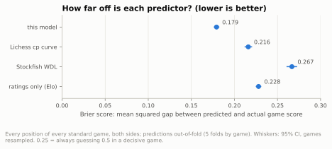
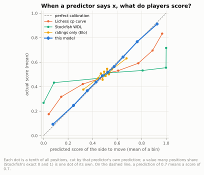
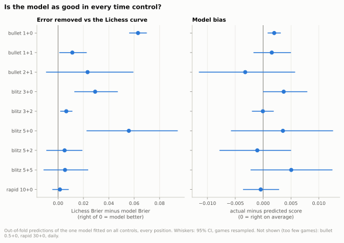

## A. How good is the win-chance model behind every number?

**Short answer:** Good enough to lean on: it predicts game results better than the Lichess eval curve, Stockfish's own win chances or ratings alone (an error score of 0.179 against 0.216, 0.267 and 0.228), its 70% means close to 70% in every time control you play, and its edge is largest in fast controls without an increment (1+0, 5+0).

### A.1 How well does it predict results overall, compared with simpler models?

- Over 365,561 positions from 6,045 games, the model's Brier score (mean squared gap between predicted and actual score) is 0.179 (CI 0.176 to 0.182).
- The Lichess eval curve scores 0.216, ratings alone 0.228 and Stockfish's win/draw/loss model 0.267: all clearly worse.
- The model removes 17% of the Lichess curve's error (0.037 less, CI 0.033 to 0.040).
- By mean absolute error Stockfish looks as good (0.365 vs 0.367), but that measure rewards over-confident guesses; the Brier score does not.

Data: [1_overall.csv](data/00_calibration/1_overall.csv) · [all tables](data/00_calibration/_index.csv) · [script](../src/chess_analysis/calibrate.py) · source: [moves_analysed.parquet](../data/zakihussa1n/moves_analysed.parquet)

### A.2 Is it calibrated (does 70% mean 70%)?

- Yes: in every tenth of positions the model's prediction is within 0.017 of the actual score; when it says 0.648, players score 0.642.
- On average players score +0.0013 more than it predicts (CI +0.0004 to +0.0022), about +0.9 Elo (CI +0.3 to +1.5): tiny, but not zero.
- Its largest miss is at the bottom: positions it gives 0.076 end up scoring 0.093, so lost-looking positions are saved a little more often than it expects.
- The simpler models are over-confident: where the Lichess curve predicts 0.968 players score 0.833, and positions Stockfish calls certain wins (exactly 1) score only 0.716 (CI 0.706 to 0.727).

Data: [2_reliability.csv](data/00_calibration/2_reliability.csv) · [1_overall.csv](data/00_calibration/1_overall.csv) · [all tables](data/00_calibration/_index.csv) · [script](../src/chess_analysis/calibrate.py) · source: [moves_analysed.parquet](../data/zakihussa1n/moves_analysed.parquet)

### A.3 Is it as good for every time control?

- In every reported control its average prediction is within about 0.005 of the actual score (at most 3.5 Elo, in 5+5); the CIs in the thinner 5+0 and 5+5 reach up to 8.7 Elo.
- Its edge over the Lichess curve is biggest without an increment: in 1+0 it removes 26% of the curve's error (Brier 0.182 vs 0.245), in 5+0 24%, in 3+0 14%.
- With an increment the edge is small (1+1 6%, 3+2 3.5%), and in 2+1, 5+2, 5+5 and 10+0 there is no clear difference (10+0: 0.0015, CI −0.0045 to +0.0084).
- Within controls the misses are small; the clearest is 3+2's middle range, slightly too confident: positions it gives 0.577 score 0.543, and 0.430 score 0.461 (second chart).

Data: [3_by_tc.csv](data/00_calibration/3_by_tc.csv) · [3b_reliability_by_tc.csv](data/00_calibration/3b_reliability_by_tc.csv) ([chart](figures/00_calibration/3b_reliability_by_tc.svg)) · [3c_metrics_by_tc.csv](data/00_calibration/3c_metrics_by_tc.csv) · [all tables](data/00_calibration/_index.csv) · [script](../src/chess_analysis/calibrate.py) · source: [moves_analysed.parquet](../data/zakihussa1n/moves_analysed.parquet)

Method and caveats

- What is predicted: for every position of every standard game (both sides, every move, including daily games and the thin controls), the final game score of the side to move (1 win, 0.5 draw, 0 loss).
- The model: gradient boosting on the Stockfish eval (clipped to ±1000 cp, mate flags), ply, phase, pieces, material balance, both clocks, clock share and difference, base time, increment, time class, the mover's pre-game rating and the rating gap. Expected points are monotone in the eval by construction.
- Ratings are pre-game: post-game ratings already contain the result and made the model look far better than it is. The opponent's pre-game rating is estimated as their post-game rating plus your rating change.
- That estimate can carry a small trace of the result, because Glicko rating changes are not exactly symmetric between the two players; the effect on these scores is expected to be small.
- Every number here is out-of-fold: 5-fold cross-validation grouped by game, so no position is scored by a model that saw its game. The expected points used in the other questions come from the same model refitted on all games (`expected_points.parquet`), so these numbers describe the method, not that exact fit.
- One model covers all controls; the time control enters as features (base, increment, class), not as separate models, so thin controls borrow strength from the big ones.
- CIs: 95%, 1,000 bootstrap resamples of whole games. Differences between predictors (Brier minus the model's) are paired: computed per position, then resampled by game.
- Positions are weighted equally, so long games count for more than short ones.
- Predictors compared: the Lichess curve 1/(1+exp(−0.00368208·cp)), which counts draws as half and is also scored as a P(win), as Lichess presents it; Stockfish 17.1's own win/draw/loss model at 1M nodes, turned into expected points; and the Elo formula on the pre-game rating gap alone (0.5 when a rating is unknown, the first game in a pool), which ignores the board.
- Brier score (mean squared error) is the main measure because it is a proper score: it is lowest for honest probabilities. Mean absolute error is shown too but favours predictions pushed towards 0 or 1.
- Reliability: positions cut into equal-count bins of each predictor's own prediction: deciles overall and for controls with at least 300 games, quintiles below that (`DECILE_MIN_GAMES`), so each point still rests on many games. A bin whose positions come from fewer than 30 games is flagged thin and left off the per-control chart.
- A single prediction value shared by at least half a bin's positions and straddling a bin edge gets a point of its own (`TIE_MIN_SHARE_OF_BIN`): Stockfish says exactly 0 or exactly 1 for about half of all positions, and splitting those ties by row order would only sort them by game date. So Stockfish has 8 points instead of 10; smaller ties are split by row order.
- The per-control reliability chart plots the gap (actual minus predicted) rather than actual against predicted, so misses of a few hundredths are visible.
- Elo equivalents of a gap use the mean prediction as the expected score; near 0 or 1 they blow up (Stockfish's bins reach ±1,000 Elo) and should be ignored there.
- 2+1, 3+0, 5+0, 5+2 and 5+5 have 85 to 209 games each: their reliability points are quintiles with wide intervals, and a single point off the line there (such as 5+0's second quintile) is within what chance allows across that many points.
- Controls with fewer than 50 games are in the fit and in the tables but flagged thin and not charted: bullet 0.5+0 (19 games), rapid 30+0 (1 game) and daily (18 games).

