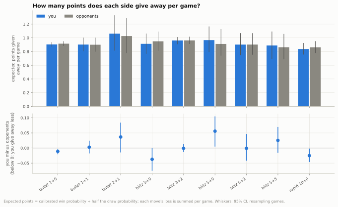
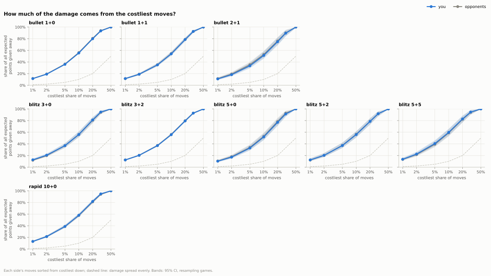
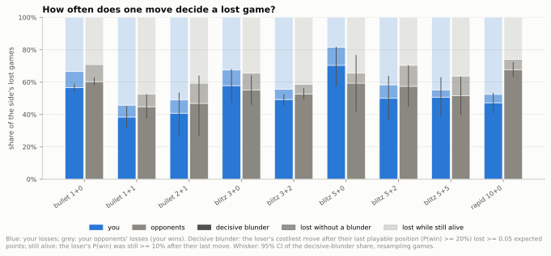
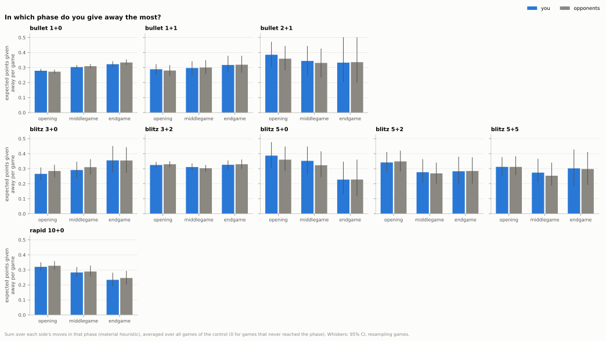
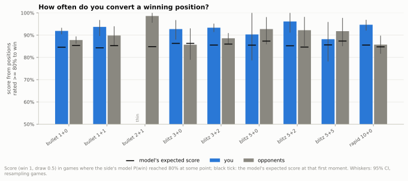
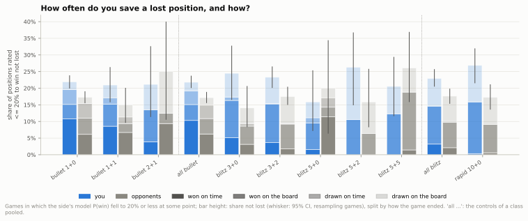
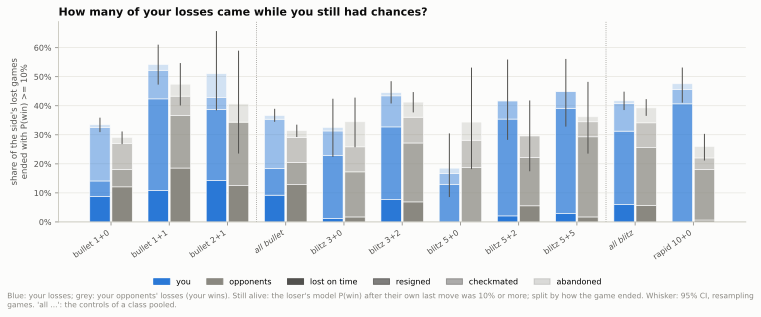

## 1. Where are points won and lost: do you make fewer mistakes than your opponents?

**Short answer:** You and your opponents give away almost the same amount per game through mistakes; your edge comes once a position is decided, because in 1+0, 3+2 and 10+0 you convert winning positions and save lost ones more often than your opponents, while in 1+0 and 10+0 more of your losses come while you still had chances (in 10+0 mostly by resigning).

### 1.1 How many points does each side give away per game?

- In every time control each side gives away close to one expected point per game through its mistakes (between 0.84 and 1.06 for you).
- In 1+0 you gave away 0.904 per game and your opponents 0.915: 0.011 less (CI 0.003 to 0.021), about +8 Elo (CI +2 to +14).
- In 10+0 you gave away 0.025 less per game (CI 0.002 to 0.046), about +18 Elo (CI +1 to +32).
- In 3+2 there is no clear difference (-0.001, CI -0.013 to +0.014); 5+0 is the one control where you gave away more, +0.056 (CI +0.005 to +0.105), from only 90 games.

Data: [1_points_per_game.csv](data/01_decomposition/1_points_per_game.csv) · [1b_score_budget.csv](data/01_decomposition/1b_score_budget.csv) · [all tables](data/01_decomposition/_index.csv) · [script](../analysis/01_decomposition.py) · source: [games_decomposed.parquet](../data/zakihussa1n/games_decomposed.parquet)

### 1.2 How much of the damage comes from a few big mistakes?

- In every control the costliest 10% of moves carry more than half of all the expected points given away: 55% of yours in 1+0, 56% in 3+2, 58% in 10+0.
- The single costliest 1% of moves alone carry 10% to 14% of the total.
- Moves losing at least 0.1 expected points are rare, 8.8 in every 100 of your moves in 1+0, yet they carry 51% of what you give away.
- Your curve and your opponents' nearly coincide in every control; the small clear gaps go both ways: in 1+0 your costliest 10% carry slightly less of your total (55.4% against 56.1%), in 10+0 your costliest 20% slightly more (81.8% against 81.0%).

Data: [2_concentration.csv](data/01_decomposition/2_concentration.csv) · [2b_big_errors.csv](data/01_decomposition/2b_big_errors.csv) · [all tables](data/01_decomposition/_index.csv) · [script](../analysis/01_decomposition.py) · source: [moves_analysed.parquet](../data/zakihussa1n/moves_analysed.parquet)

### 1.3 How often does one move decide a lost game?

- When a game was lost on the board, one costly move of the loser can be named in 81% to 92% of games, for you and your opponents alike, in every control with enough such games.
- In 1+0, 57% of your losses were decided by one identifiable blunder of yours (CI 54% to 59%), against 60% of your opponents' losses (CI 58% to 63%); most of the rest were lost while you still had chances (see the last sub-question).
- In 10+0 the gap is large: 47% of your losses came from one decisive blunder against 68% of your opponents', 20.6 percentage points fewer (CI 12.0 to 28.5).
- In 1+0 the decisive blunder came with about 21 seconds left for both sides (21.0 against 21.4, no clear difference); in 3+2 yours came with 80 seconds left (78 beyond the increment) against 95 for your opponents, 14.8 seconds less (CI 7.3 to 22.0).

Data: [3_decisive.csv](data/01_decomposition/3_decisive.csv) · [3c_decisive_clock.csv](data/01_decomposition/3c_decisive_clock.csv) · [3b_decisive_profile.csv](data/01_decomposition/3b_decisive_profile.csv) · [all tables](data/01_decomposition/_index.csv) · [script](../analysis/01_decomposition.py) · source: [games_decomposed.parquet](../data/zakihussa1n/games_decomposed.parquet)

### 1.4 In which phase do you give away the most?

- In 1+0 the endgame costs the most per game, 0.322 expected points for you and 0.334 for your opponents: you give away 0.012 less (CI 0.006 to 0.017).
- In 1+0 you give away slightly more than your opponents in the opening: +0.006 per game (CI +0.002 to +0.011).
- In 10+0 the opening costs the most (0.320 per game) and the endgame the least (0.234); there you give away 0.012 less than your opponents, a borderline difference (CI 0.000 to 0.025).
- Per move, the middlegame is your most expensive phase in every control (narrowly in 3+0): in 1+0 you lose 0.032 expected points per middlegame move against 0.026 per opening move.

Data: [4_phase.csv](data/01_decomposition/4_phase.csv) · [4b_phase_per_move.csv](data/01_decomposition/4b_phase_per_move.csv) · [all tables](data/01_decomposition/_index.csv) · [script](../analysis/01_decomposition.py) · source: [games_decomposed.parquet](../data/zakihussa1n/games_decomposed.parquet)

### 1.5 How often do you convert a winning position?

- In 1+0, from positions the model rated at least 80% to win, you scored 0.919 where it expected 0.846: +0.073 (CI +0.058 to +0.087), about +126 Elo (CI +93 to +162).
- Your opponents scored 0.878 where the model expected 0.854, +0.024, about +36 Elo (CI +12 to +65), so in 1+0 you convert better by +0.041 in score (CI +0.018 to +0.063).
- The edge is also clear in 3+2, +0.048 (CI +0.013 to +0.079), and in 10+0, +0.089 (CI +0.042 to +0.137); in the smaller controls the CIs include zero.
- Both sides beat the model from winning positions because it is cautious there: over all games, from positions it rates 80% to 90%, you won 95.8% and your opponents 92.0%.

Data: [5_conversion.csv](data/01_decomposition/5_conversion.csv) · [5b_conversion_diff.csv](data/01_decomposition/5b_conversion_diff.csv) · [5d_model_by_side.csv](data/01_decomposition/5d_model_by_side.csv) · [all tables](data/01_decomposition/_index.csv) · [script](../analysis/01_decomposition.py) · source: [expected_points.parquet](../data/zakihussa1n/expected_points.parquet)

### 1.6 How often do you save a lost position, and how?

- From positions the model rated nearly lost you avoid losing more often than your opponents in 1+0 (21.9% against 17.3%, 4.6 percentage points more, CI 2.1 to 7.1), 3+2 (5.8 more, CI 1.9 to 9.8) and 10+0 (9.6 more, CI 3.7 to 16.0).
- Both sides score below the model from such positions: in 1+0 you scored 0.185 where it expected 0.212, about -30 Elo (CI -49 to -10), your opponents about -90 Elo (CI -112 to -70); your edge is losing less than the model expects, not beating it.
- In 1+0, 49% of your saves were wins on time and 20% draws on time (your opponent ran out of time but you had too little material to win), against 35% and 25% of your opponents' saves.
- In longer games saves mostly come on the board: 50% of your blitz saves and 58% in 10+0, with only 14% (blitz) and 1% (10+0) won on time.

Data: [5_conversion.csv](data/01_decomposition/5_conversion.csv) · [5b_conversion_diff.csv](data/01_decomposition/5b_conversion_diff.csv) · [6_saves_how.csv](data/01_decomposition/6_saves_how.csv) · [all tables](data/01_decomposition/_index.csv) · [script](../analysis/01_decomposition.py) · source: [games_decomposed.parquet](../data/zakihussa1n/games_decomposed.parquet)

### 1.7 How many of your losses came while you still had chances?

- In 1+0, 34% of your losses (CI 31% to 36%) ended while the model still gave you real chances after your last move, against 29% of your opponents' losses: 4.4 percentage points more (CI 1.1 to 7.5).
- In 1+0 the difference is checkmates delivered while the clock still gave the loser chances: 18.5% of your losses against 9.0% of your opponents'; you lose on time with chances less often (8.8% against 12.1%).
- In 10+0, 48% of your losses came while you still had chances, against 26% of your opponents', almost all resignations: 41% of your losses against 17%.
- The same resignation pattern shows in 1+1 (32% of your losses against 18%, 13.5 percentage points more, CI 4.9 to 21.9) and across blitz (25.3% against 19.9%).

Data: [7_lost_with_chances.csv](data/01_decomposition/7_lost_with_chances.csv) · [all tables](data/01_decomposition/_index.csv) · [script](../analysis/01_decomposition.py) · source: [games_decomposed.parquet](../data/zakihussa1n/games_decomposed.parquet)

Method and caveats

- Games: every standard live game with at least one move in a time control with at least 50 games, 6,007 games in nine controls (counts per control, results and moves in `8_data.csv`); 0.5+0 (19 games) and 30+0 (1 game) are too thin and left out.
- Expected points (win probability plus half the draw probability) come from the calibrated model in `expected_points.parquet`, which knows both pre-game ratings, the clocks and the time control; a move's loss is the drop in the mover's expected points, floored at 0, against Stockfish 17.1 at 1M nodes, so a "loss" can be a move no human would find.
- You and your opponents are always compared in the same games; differences are you minus opponents (1.1 reports "less" when yours is lower) and their CIs come from resampling whole games (500 resamples, 300 for the concentration curve), so both sides move together.
- Score vs expectation comes with its Elo-equivalent: the rating gap that turns the expected score into the actual one, applied to each CI end; for per-game point differences (1.1) the expected score is an even 0.5, as pairings are rating-matched (median gap 12 to 79 points per control in `8_data.csv`; in 2+1 and 5+0 your opponents averaged 42 and 63 points stronger).
- The per-game sums do not add up exactly to the result: score = expected score at move 1 - your losses + your opponents' losses + a residual (resignations, flags, end-of-game model error, the floor at 0). The residual is small (`1b_score_budget.csv`), and the net difference tracks the score closely (correlation 0.61 to 0.82 per control; by bin in `1c_net_ep_check.csv`).
- Decisive blunder (1.3): judged on the loser's own moves only. A game is lost on the board if the loser's model win chance after their last own move was below 10%; the final slide starts at their last move from a playable position (win chance at least 20%), and the decisive blunder is their costliest move from there, counted if it lost at least 0.05 expected points. A plain "last crossing below 10%" rule was rejected because the model's win chance decays gradually in bullet. A stricter pair (lost below 15%, playable from 30%) is in `3_decisive.csv` as a sensitivity check.
- "Still had chances" (1.7) = the loser's model win chance after their own last move was 10% or more. The bullet model keeps a real flag chance alive even in a mating position when the winner is short of time, which is why checkmates appear there.
- Conversion (1.5) = games in which the side's model win chance reached 80% at some point (the start or after any move); save (1.6) = it fell to 20% or less. The expected score is the model's at the first such moment. Other thresholds (60% to 90%) are in `5c_threshold_sensitivity.csv`.
- The model is pooled over both sides and under-confident at the extremes in both directions: from winning positions both sides score above it, from lost positions both score below it. From every probability band you win more often than your opponents (`5d_model_by_side.csv`), the same fact as the conversion and save gaps. Absolute conversion and save rates are model-relative; the you-vs-opponents gap is the robust part.
- Elo-equivalents of a score within 0.001 of 0 or 1 are unbounded (a CI end at a score of 1.0 in 2+1, 5+0 or 5+2 would map to 900 or more Elo), so those cells are left blank in `5_conversion.csv`; the small controls' Elo CIs are not meaningful anyway.
- Phase (1.4) is the material heuristic from the enrichment step; "opening" includes many moves beyond book. Per-game phase totals count games that never reached a phase as 0.
- Thin cells: a share resting on fewer than 30 cases (losses, winning or lost positions) or a phase played in fewer than 30 games is flagged `thin` and not drawn (labelled "thin" in the bar charts); bullet 2+1, blitz 5+0 and 5+2 have under 60 losses per side, so their per-control CIs are wide.
- Endings by termination (1.6, 1.7) are also pooled by time class (rows "all bullet", "all blitz" in the tables; italic bars after a dotted divider in the charts, not extra controls) because most per-control termination cells are thin outside 1+0, 3+2 and 10+0; the pools cover only the reported controls.
- In `6_saves_how.csv`, `thin` refers to the lost positions behind `share_of_lost_positions`; `share_of_saves` rests on the saves themselves, often under 30 outside 1+0, 3+2, 10+0 and the pools (`thin_share_of_saves`).
- Differences of two shares are given in percentage points (`*_pp` columns).
- The decisive blunder's clock is reported in seconds left, beyond one increment, and as a share of the base time; `3c_decisive_clock.csv` compares the sides on the same resampled games (your decisive blunders in your losses against your opponents' in your wins).
- The script also writes `data/zakihussa1n/games_decomposed.parquet` (one row per game, unchanged by this split), which Q2, Q5, Q6, Q7 and Q8 read.
- Old report kept in git history: `reports/01_decomposition.md`.

