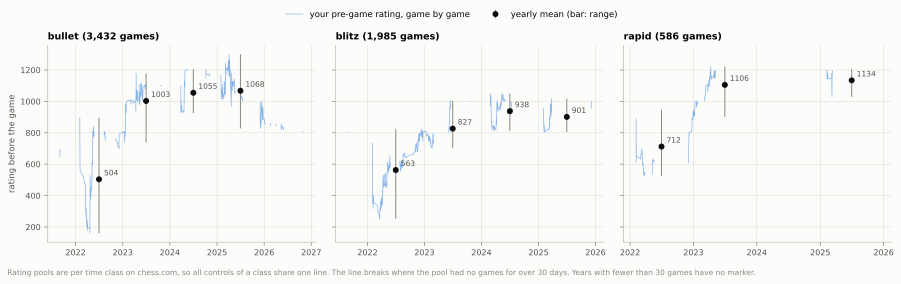
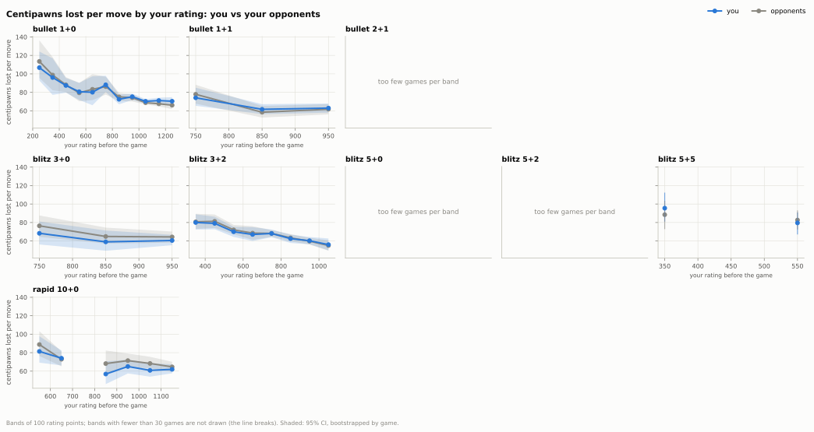
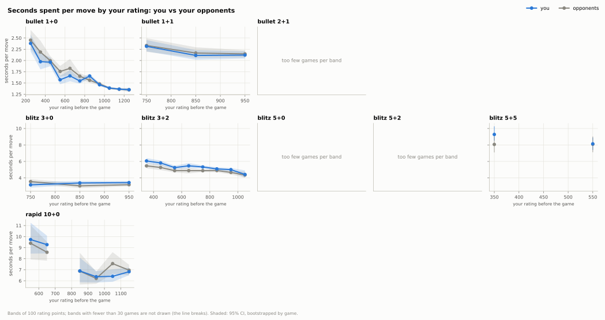
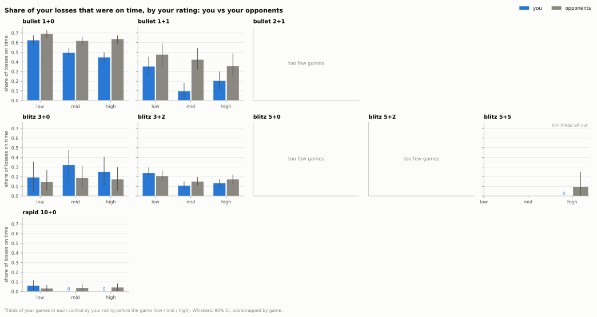
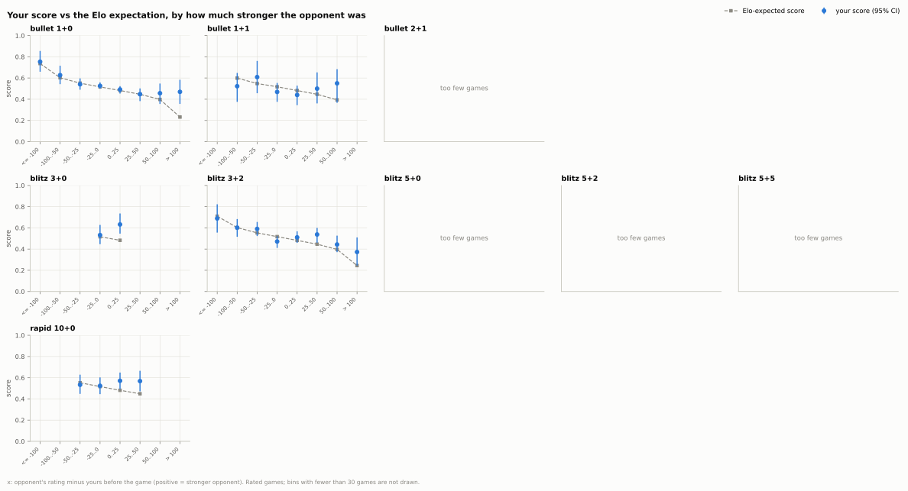
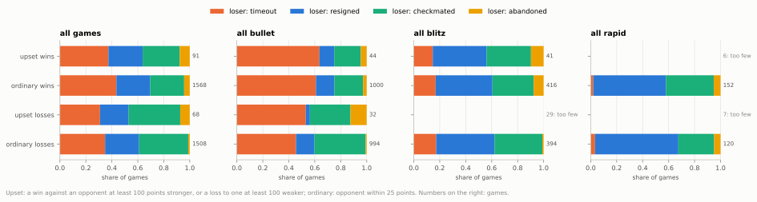

## 2. How did your rating move, and what changed in your play as it rose?

**Short answer:** Your rating rose in every pool (bullet has since fallen back from its 1300 peak), but your opponents' play improved in step with yours; what was yours was losing on time less often in 1+0, getting faster than the field in several longer controls, and scoring well above expectation against much stronger players (about +112 Elo), at low and high ratings alike.

### 2.1 How did your rating move over time?

- Bullet went from 695 (Aug 2021) to a peak of 1300 (Apr 2025) and has since fallen 493 points, to 807.
- Blitz went from 800 (Aug 2021) to a peak of 1050 (Feb 2024) and stands at 956.
- Rapid climbed 590 points, from 616 (Feb 2022) to 1206, close to its 1222 peak (Apr 2023).
- Each rating line mixes controls: in 2025, 17% of your bullet games were 1+1, and in blitz 3+0 replaced 3+2 as the main control (66% of the year's games).

Data: [1_rating_by_year.csv](data/02_trajectory/1_rating_by_year.csv) · [1b_rating_milestones.csv](data/02_trajectory/1b_rating_milestones.csv) · [1c_games_by_year.csv](data/02_trajectory/1c_games_by_year.csv) · [all tables](data/02_trajectory/_index.csv) · [script](../analysis/02_trajectory.py) · source: [my_games.parquet](../data/zakihussa1n/my_games.parquet)

### 2.2 Did your move quality improve faster than your opponents'?

- In 1+0, from your lowest-rated third of games (168 to 982) to your highest (1085 to 1300), you lost 9.7 fewer centipawns per move (CI 6.6 to 13.3).
- Your opponents in those games improved more, by 13.6 centipawns per move (CI 10.0 to 17.5): the field gained 3.9 per move on you (CI 1.4 to 6.3).
- In expected points lost per move (the main measure, which already allows for both ratings) your change in 1+0 matched the field's: difference +0.0007 (CI -0.0002 to +0.0014), no clear difference.
- In 3+2 and 10+0 the centipawn gap also leans towards the field (2.1 and 3.5 per move), but both CIs include zero (-1.2 to 5.5; -1.6 to 9.5).

Data: [2_quality_by_band.csv](data/02_trajectory/2_quality_by_band.csv) · [2c_quality_change.csv](data/02_trajectory/2c_quality_change.csv) · [all tables](data/02_trajectory/_index.csv) · [script](../analysis/02_trajectory.py) · source: [games_decomposed.parquet](../data/zakihussa1n/games_decomposed.parquet)

### 2.3 Did you get faster?

- In 1+0 you went from 1.66 to 1.36 seconds per move between your lowest- and highest-rated thirds of games, and your opponents sped up by about the same (no clear difference: 0.03 s, CI 0.00 to 0.06).
- You sped up more than your opponents in 3+2 (0.21 s per move more, CI 0.02 to 0.44), 5+2 (0.86, CI 0.04 to 1.70), 5+5 (2.14, CI 1.18 to 3.16) and 10+0 (0.73, CI 0.15 to 1.34); in 1+1, 3+0 and 5+0 there is no clear difference.
- Playing faster did not mean living on the clock: in 3+2 your share of moves with under 10 s beyond the increment fell from 5.1% to 2.3%.
- Even within a single year, games where you spent less of your clock per move go with a higher rating: about 28 rating points per standard deviation in 1+0 (CI 5 to 43) and 25 in 3+2 (CI 1 to 39).

Data: [3_speed_by_band.csv](data/02_trajectory/3_speed_by_band.csv) · [3c_speed_change.csv](data/02_trajectory/3c_speed_change.csv) · [3d_rating_regression.csv](data/02_trajectory/3d_rating_regression.csv) · [all tables](data/02_trajectory/_index.csv) · [script](../analysis/02_trajectory.py) · source: [moves_enriched.parquet](../data/zakihussa1n/moves_enriched.parquet)

### 2.4 Did you lose on time less often?

- In 1+0, 62% of your losses in your lowest-rated third of games were on time, and 45% in your highest-rated third.
- Your opponents' share stayed between 62% and 69%, so your drop is larger than theirs by 12 percentage points (CI 3 to 21).
- In 10+0 none of your losses in the middle and top thirds were on time (6% in the lowest), but your opponents lost only 3% to 4% of theirs on time at every level, so your change is not clearly different from theirs (CI -14 to 0 percentage points).
- In 3+2 (24% to 13%) and 1+1 (35% to 20%) your share fell too, but the difference from your opponents' change is not clear.

Data: [4_time_losses.csv](data/02_trajectory/4_time_losses.csv) · [4b_time_losses_change.csv](data/02_trajectory/4b_time_losses_change.csv) · [all tables](data/02_trajectory/_index.csv) · [script](../analysis/02_trajectory.py) · source: [games_decomposed.parquet](../data/zakihussa1n/games_decomposed.parquet)

### 2.5 How do you score against stronger and weaker players?

- Against opponents more than 100 points stronger you scored 0.393 where Elo expects 0.254: +0.139 (CI +0.083 to +0.205), about +112 Elo (CI +70 to +159), over all rated games.
- The excess is clearest in 1+0, +0.238 (CI +0.125 to +0.349), about +187 Elo (CI +106 to +265) from 66 games, and in 3+2, +0.128 (CI +0.005 to +0.240), about +105 Elo (CI +5 to +185).
- Against opponents 100 or more points weaker, over all rated games, you scored 0.699 where Elo expects 0.723: -0.023 (CI -0.092 to +0.038), about -20 Elo (CI -73 to +34), no clear difference.
- Splitting the 197 games against much stronger opponents at their median rating gives the same excess in both halves: +0.137 (CI +0.050 to +0.231) in the lower half and +0.141 (CI +0.057 to +0.234) in the upper, about +110 and +113 Elo.

Data: [5_score_vs_gap.csv](data/02_trajectory/5_score_vs_gap.csv) · [5b_score_vs_gap_pooled.csv](data/02_trajectory/5b_score_vs_gap_pooled.csv) · [5d_level_split.csv](data/02_trajectory/5d_level_split.csv) · [all tables](data/02_trajectory/_index.csv) · [script](../analysis/02_trajectory.py) · source: [my_games.parquet](../data/zakihussa1n/my_games.parquet)

### 2.6 How do upsets happen?

- Upsets are rare: 91 wins against opponents at least 100 points stronger and 68 losses to opponents at least 100 weaker, against 1568 ordinary wins and 1508 ordinary losses.
- Upset wins look like ordinary wins: the stronger opponent lost 0.038 expected points per move to your 0.029, much as opponents do in your ordinary wins (0.031 to your 0.024).
- Upset losses are your worst games: you lost 0.050 expected points per move (CI 0.039 to 0.063), against 0.032 in ordinary losses.
- They end the usual way for the time class: in bullet, 64% of upset wins came on time, as did 61% of ordinary wins.

Data: [6_upsets.csv](data/02_trajectory/6_upsets.csv) · [all tables](data/02_trajectory/_index.csv) · [script](../analysis/02_trajectory.py) · source: [games_decomposed.parquet](../data/zakihussa1n/games_decomposed.parquet)

Method and caveats

- Games: 6,003 standard live games with at least one move and a pre-game rating (the first game in each pool has none), Aug 2021 to Oct 2026; counts in `7_data.csv`.
- Each exact time control is its own group; 0.5+0 (19 games) and 30+0 (1 game) have fewer than 50 games and are left out.
- Rating pools on chess.com are per time class, not per control, so the rating line (2.1) is per class (bullet, blitz, rapid); every other result is per exact control.
- "Your lowest / highest-rated third of games" splits each control's games into thirds by your rating before the game; the change from the low to the high third is computed for you and for your opponents in the same games, and their difference is bootstrapped on the same resampled games.
- Because chess.com pairs you with opponents of nearly your rating, your opponents' numbers are the field at your level: a change you share with them is a property of the level, a difference is yours.
- Expected points lost per move comes from a win-probability model that knows both ratings, so it is close to flat across rating by construction; centipawns lost per move is the absolute measure. Both are in the tables.
- Low clock is reported three ways: under 10 s on the clock, under 10 s beyond one increment (the same as the clock in no-increment games, so 1+0 and 1+1 compare), and under 10% of the base time.
- All CIs are 95% from 400 bootstrap resamples of whole games, seeded by the set of games so identical game sets give identical intervals; the rating regression resamples calendar months instead, because a rating barely moves within a month.
- Thin cells (fewer than 30 games, or fewer than 20 cases for shares of losses, wins or winning positions) are flagged in every table and not drawn in the charts; outside 1+0, 3+2 and 10+0 most cells by third, band and rating gap are thin.
- Score against rating gap is also pooled by time class and over all rated games (`5b_score_vs_gap_pooled.csv`, with its own chart), because the outer gap bins are thin in every control but 1+0 and 3+2.
- The opponent's rating before the game is reconstructed as their post-game rating plus your rating change (rated games); it is approximate under Glicko. Elo expectation is the standard logistic; the Elo-equivalent is the rating gap that turns the expected score into the actual one, applied to each CI end.
- The reconstruction's bias runs against the result: a high-deviation opponent loses more points than you gain, so wins drift into the "weaker" bins and losses into the "stronger" bins, which would show under-performance against stronger players, not the excess seen.
- Checks on the score-vs-gap result: in unrated games, where the opponent's rating is exact, no non-thin gap bin shows a clear excess (`5e_unrated.csv`); your rating gain for a win scales with the gap in the direction Elo predicts, more steeply (1.91 times the even-bin gain against much stronger opponents, where Elo predicts 1.44; `5f_rating_change_check.csv`), so the outer-bin opponents were not mainly provisional accounts.
- The level check (`5d_level_split.csv`) splits each gap bin two ways, pooled by time class: at the median rating of that bin's own games (equal halves, so neither is thin), and by whether you were within 100 points of your peak so far in the pool or further below it.
- Against much stronger opponents the excess holds both near your peak so far (+0.175, CI +0.069 to +0.297, 62 games) and while recovering from a fall of more than 100 points (+0.123, CI +0.049 to +0.211, 135 games); 138 of the 197 such games are from 2022, the year of the bullet crash and recovery (`7_data.csv`).
- 66 games were played after more than 7 days away from the pool; recomputing every low-to-high change without them keeps the sign of all 52 changes whose CI excluded zero, and 47 keep a CI excluding zero (`2d_change_without_breaks.csv`).
- The rating regression (`3d_rating_regression.csv`) is descriptive, standardised per control, with and without year dummies; only 1+0 and 3+2 have enough games (200) and months (20) to read; habits that rarely depart from their usual value (e.g. moves under 10 s in 10+0) are left out of a control's model.
- Upsets: a win against an opponent at least 100 points stronger, or a loss to one at least 100 weaker; ordinary results are within 25 points. Rated and unrated games both count; 28% of upset losses were unrated, and you abandoned 7% of them.
- The upsets chart is pooled by time class because upset cells are thin in every control but 1+0; per-control rows are in `6_upsets.csv`.
- Charts: the rating line breaks where a pool had no games for more than 30 days; band lines break at a thin or empty band; a zero bar is labelled 0.
- Old report kept in git history: `reports/02_trajectory.md`.

