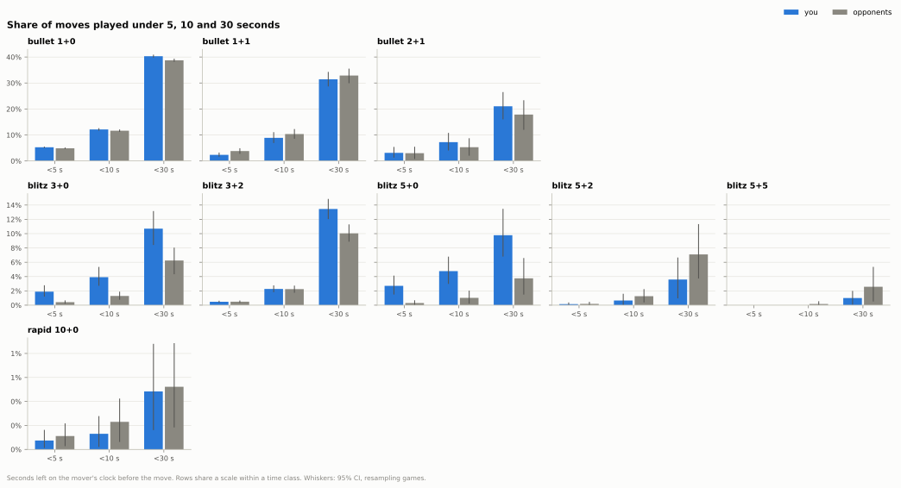
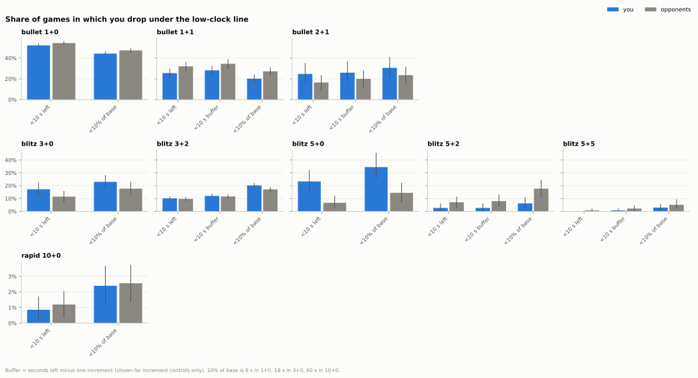
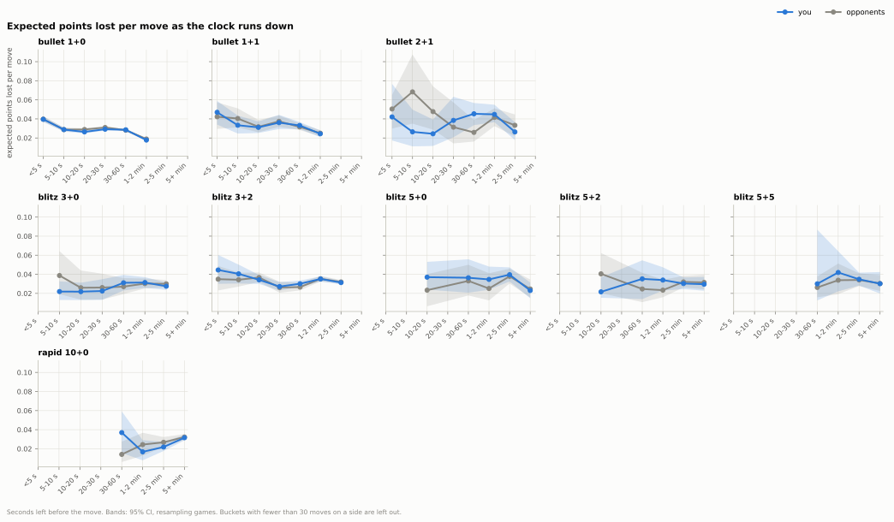
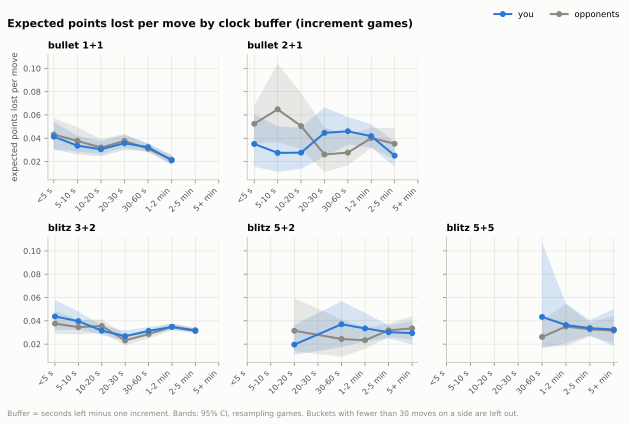
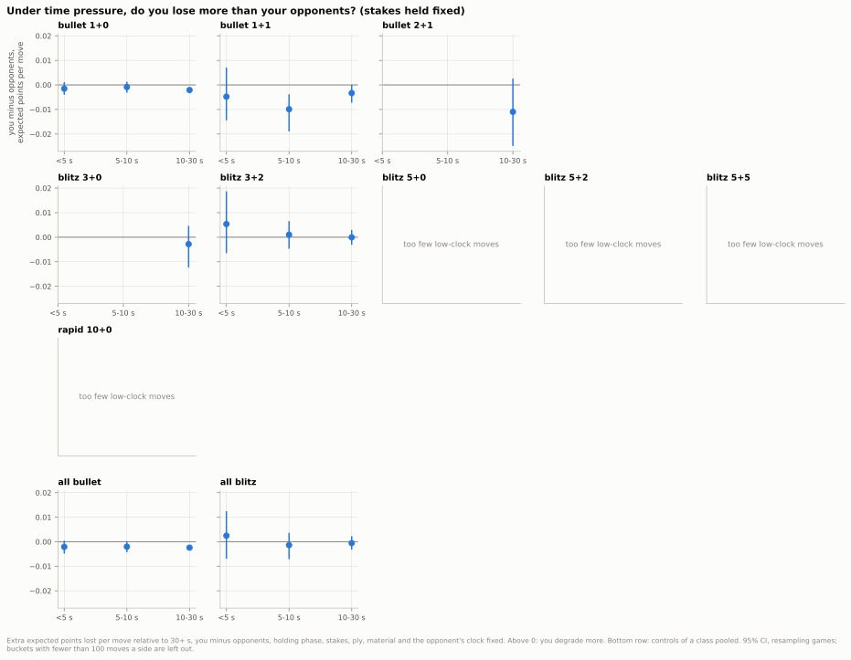
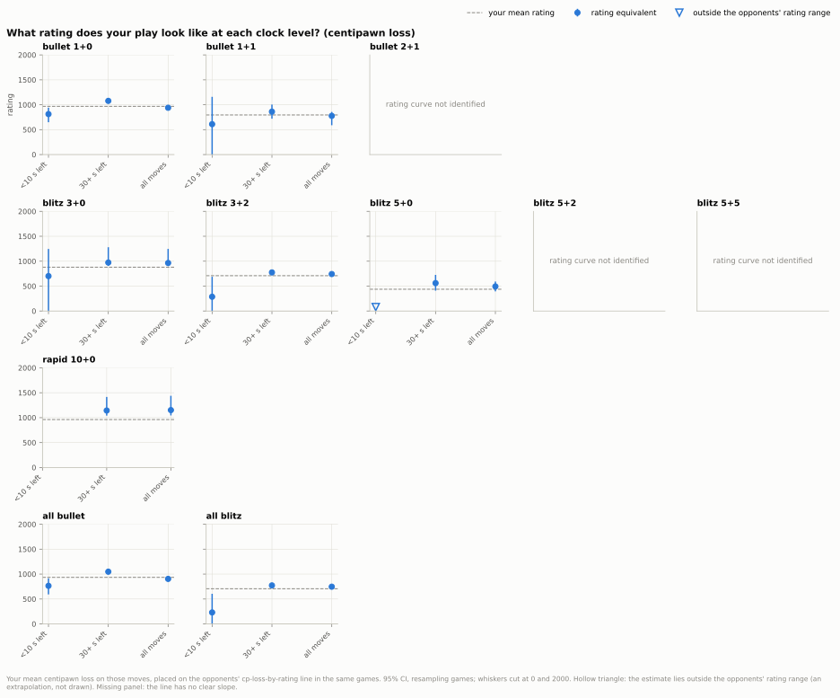
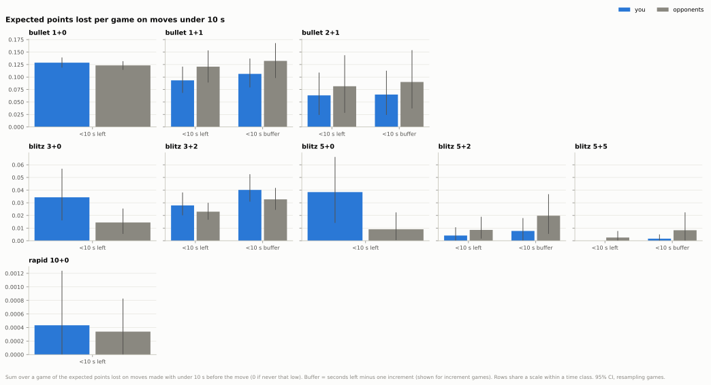

## 3. How does time pressure affect your play?

**Short answer:** In bullet 1+0 you run short of time about as often as your opponents and lose no more expected points than them when you do (though slightly more centipawns under 5 s); the controls where the clock costs you are blitz 3+0 and 5+0, where you get low far more often than your opponents.

### 3.1 How often are you short of time?

- In 1+0, 12.1% of your moves are played with under 10 s left; your opponents' share is 11.6%.
- In 3+0 you play 3.9% of your moves under 10 s and your opponents 1.3% (difference 2.6% of moves, CI 1.2% to 4.2%).
- In 1+1, counting the increment out, 10.3% of your moves have under 10 s of buffer, against 8.9% with under 10 s on the clock.
- In rapid 10+0 it almost never happens: 0.1% of your moves.

Data: [1_low_clock_share.csv](data/03_time_pressure/1_low_clock_share.csv) · [all tables](data/03_time_pressure/_index.csv) · [script](../analysis/03_time_pressure.py) · source: [moves_analysed.parquet](../data/zakihussa1n/moves_analysed.parquet)

### 3.2 How often do you drop under 10 seconds in a game?

- In 1+0 you drop under 10 s in 52.2% of games, your opponents in 54.4% (difference CI -4.3% to -0.2%).
- In 1+1 it is 25.5% of games for you and 32.0% for your opponents (difference CI -11.2% to -1.0%).
- In 5+0 you drop under 10 s in 23.3% of games, your opponents in only 6.7%.
- In 3+0 you get low in 17.2% of games against 11.5%, but the CI of the difference (-0.7% to 11.5%) includes zero.

Data: [2_games_under_line.csv](data/03_time_pressure/2_games_under_line.csv) · [all tables](data/03_time_pressure/_index.csv) · [script](../analysis/03_time_pressure.py) · source: [moves_analysed.parquet](../data/zakihussa1n/moves_analysed.parquet)

### 3.3 How does move quality change as the clock runs down?

- In 1+0, expected points lost per move rise from 0.029 with 30-60 s left to 0.040 under 5 s, the same for you and your opponents (difference under 5 s -0.0001, CI -0.0035 to 0.0026).
- In 3+2, under 5 s you lose 0.045 per move and your opponents 0.035, but the CI of the difference (-0.009 to 0.032) includes zero.
- Counting the increment out changes little: in 1+1, under 5 s of buffer you lose 0.041 per move and your opponents 0.043, no clear difference (CI -0.015 to 0.012).
- Part of the rise is the position, not the clock: in 1+0, 94.6% of moves under 5 s are endgame moves, against 9.5% with 30 s or more.

Data: [3_quality_by_clock.csv](data/03_time_pressure/3_quality_by_clock.csv) · [3b_quality_by_buffer.csv](data/03_time_pressure/3b_quality_by_buffer.csv) · [3e_low_clock_positions.csv](data/03_time_pressure/3e_low_clock_positions.csv) · [all tables](data/03_time_pressure/_index.csv) · [script](../analysis/03_time_pressure.py) · source: [expected_points.parquet](../data/zakihussa1n/expected_points.parquet)

### 3.4 Are you worse than your opponents under pressure, once the position's stakes are held fixed?

- In 1+0 under 5 s, with stakes, phase, material and the opponent's clock held fixed, the gap between you and your opponents is -0.0015 expected points per move (CI -0.0040 to 0.0011): no clear difference.
- In centipawns you do lose more there: 8.6 more per move than your opponents under 5 s in 1+0 (CI 1.1 to 15.9).
- In 1+1 with 5-10 s left you hold up better than your opponents: 0.0099 fewer expected points lost per move (CI 0.0038 to 0.0190).
- Except 3+2, blitz controls have too few low-clock moves on their own; pooled, the gap under 5 s is 0.0025 (CI -0.0069 to 0.0125): no clear difference.

Data: [4_adjusted_gap.csv](data/03_time_pressure/4_adjusted_gap.csv) · [all tables](data/03_time_pressure/_index.csv) · [script](../analysis/03_time_pressure.py) · source: [expected_points.parquet](../data/zakihussa1n/expected_points.parquet)

### 3.5 What rating do you play like at each clock level?

- In 1+0, your moves under 10 s look like those of a 813-rated player (CI 649 to 941); your mean rating there is 968.
- Your 1+0 moves with 30 s or more look like a 1078 player (CI 1035 to 1130).
- In 3+2 your moves under 10 s look like a 287 player, but the CI is very wide (up to 687, just below your mean of 709); with 30 s or more, 775.
- In the other controls there is either no estimate (the opponents' rating line has no clear slope, or there are too few low-clock moves) or its CI spans several hundred rating points.

Data: [5_rating_equivalent.csv](data/03_time_pressure/5_rating_equivalent.csv) · [all tables](data/03_time_pressure/_index.csv) · [script](../analysis/03_time_pressure.py) · source: [moves_analysed.parquet](../data/zakihussa1n/moves_analysed.parquet)

### 3.6 How many points do low-clock moves cost per game?

- In 1+0, moves under 10 s cost you 0.129 expected points per game and your opponents 0.123: no clear difference (about -3.8 Elo, CI -9.2 to 1.8).
- That is 14.2% of all the expected points you lose in 1+0 (CI 13.4% to 15.1%).
- In 3+0 they cost you 0.034 per game against 0.014 for your opponents: about -14 Elo (CI -30 to -1).
- In 5+0 it is 0.038 against 0.009: about -20 Elo (CI -39 to -4).

Data: [6_low_clock_cost.csv](data/03_time_pressure/6_low_clock_cost.csv) · [6b_low_clock_share_of_losses.csv](data/03_time_pressure/6b_low_clock_share_of_losses.csv) · [all tables](data/03_time_pressure/_index.csv) · [script](../analysis/03_time_pressure.py) · source: [expected_points.parquet](../data/zakihussa1n/expected_points.parquet)

Method and caveats

- Games: every standard live game, split by exact time control; controls with fewer than 50 games (bullet 0.5+0: 19 games, rapid 30+0: 1 game) are left out. Daily games have no clocks.
- Every number for you is paired with your opponents' number from the same games; CIs are 95% bootstrap intervals that resample whole games (500 to 1000 resamples for means and shares, 400 for regressions and rating curves).
- The clock is read before the move. "Seconds left" is what the player sees; "buffer" is seconds left minus one increment, so 10 s in 1+1 is 9 s of buffer. Without an increment the two are the same, so the buffer rows, bars and curves exist only for the controls with an increment (1+1, 2+1, 3+2, 5+2, 5+5).
- "Under 10% of base" (6 s in 1+0, 18 s in 3+0, 60 s in 10+0) puts every control on the same footing; it is in the tables next to the seconds.
- Clock buckets: under 5 s (a scramble), 5-10 s, 10-20 s, 20-30 s, 30-60 s, 1-2 min, 2-5 min, 5+ min. A bucket is drawn only with at least 30 moves on each side; blitz and rapid have few low-clock moves (rapid 10+0: 30 moves under 5 s for both sides), so their low end is mostly left out and the share-of-base table is the better view there.
- The regression (3.4) is fitted per control and pooled per time class (with the control as a fixed effect): move quality ~ clock bucket x side + phase + stakes (gap between the best and second-best move) + ply band + piece count + the opponent's clock bucket; the reference is 30 s or more. A bucket needs 100 moves on each side to be shown.
- Holding the stakes fixed changes the picture: without that control, low-clock moves lose clearly more expected points for both sides; with it, the clock's own effect in expected points is close to zero or negative, because the win model already discounts a position whose owner is about to flag. Both versions are in the table (`stakes_control`), as are fits within endgames and earlier phases only.
- Expected points lost come from a win model that uses both clocks, so a blunder with 2 s left costs fewer expected points than the same blunder with 30 s. Centipawns lost are clock-free and are reported alongside.
- The rating equivalent (3.5) places your mean centipawn loss on a straight line fitted to your opponents' centipawn loss against their pre-game rating (reconstructed from the post-game rating and your rating change) in the same games; opponents rated under 100 are left out. It is shown only where the line's slope CI excludes zero; an estimate outside the range of opponents' ratings in that control is an extrapolation of the line, flagged `extrapolated` in the table and drawn as a hollow triangle at the chart's edge (only 5+0 under 10 s); it compares your low-clock moves (nearly all endgame moves) with opponents' moves at all clocks, so it is indicative. Expected points cannot be mapped to a rating because the win model already conditions on rating.
- Elo-equivalents of a per-game difference are taken around an even score (0.5).
- Who gets low on the clock, and in which games, is not random, so none of these comparisons is a controlled experiment.

