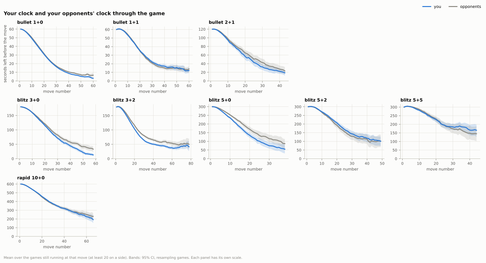
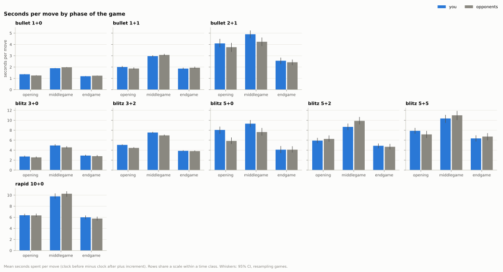
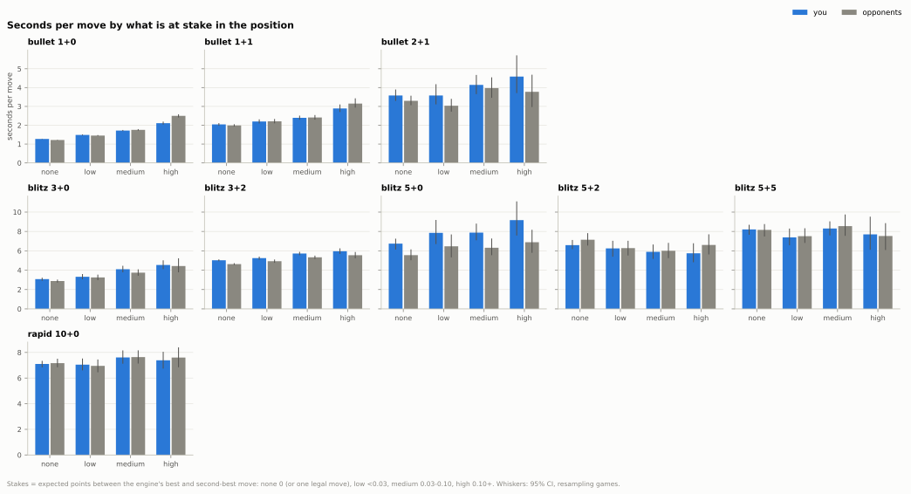
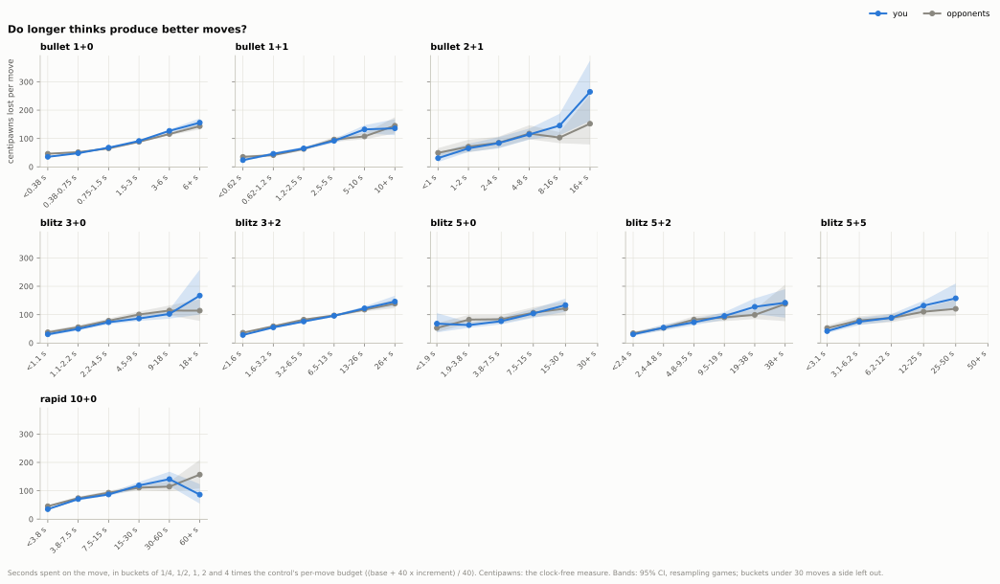
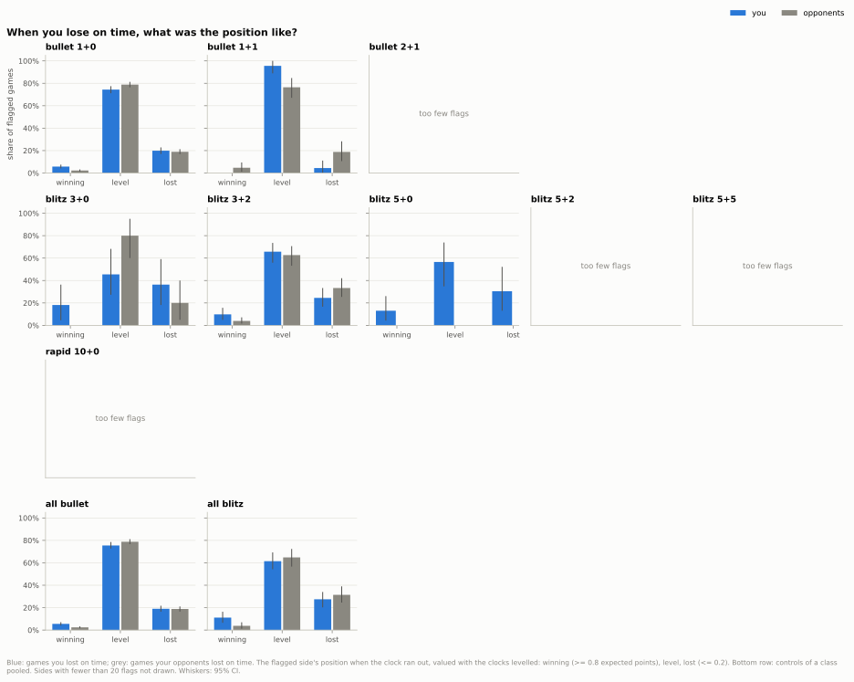
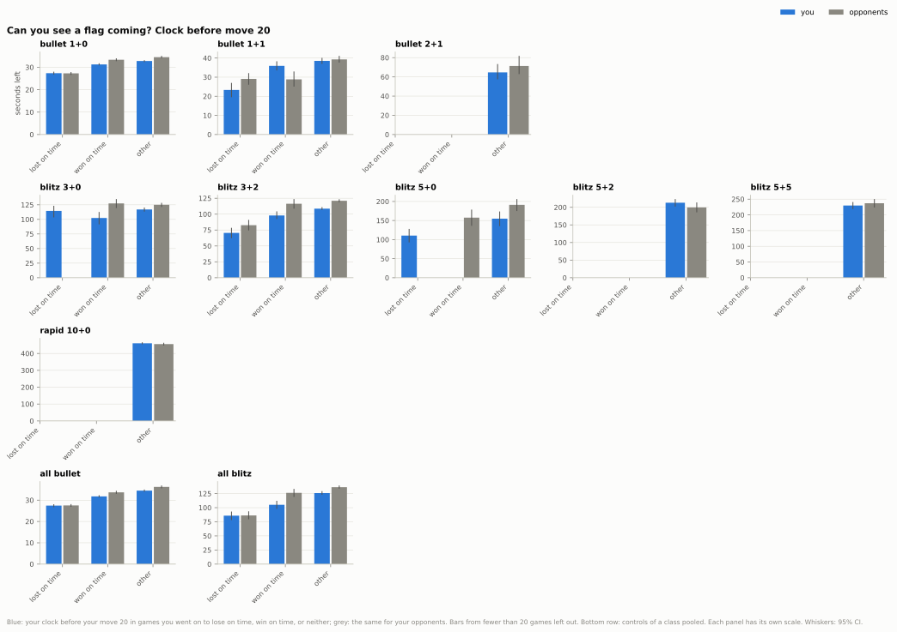

## 4. How do you use your clock, and what do losses on time cost you?

**Short answer:** In bullet 1+0 your clock keeps pace with your opponents' and losses on time are a net gain for you, in blitz 3+2 and 5+0 you spend more time in the opening and fall behind by move 20, but only in 5+0 does that turn into clearly more losses on time; your long thinks end no better than your opponents'.

### 4.1 How does your clock compare with your opponent's through the game?

- In 1+0 the two clocks run level: before move 20 you are 0.2 s ahead on average (CI -0.1 to 0.5).
- In 3+2 you fall behind early: 10.0 s behind at move 20 (CI 7.5 to 12.5), and more than 5% of the base time behind in 51.5% of games.
- In 5+0 you are 31.3 s behind at move 20 (CI 17.4 to 46.6).
- In 5+2 it is the other way round: you are 19.0 s ahead at move 20 (CI 7.0 to 28.6).

Data: [1b_clock_gap.csv](data/04_clock_allocation/1b_clock_gap.csv) · [1_clock_by_move.csv](data/04_clock_allocation/1_clock_by_move.csv) · [all tables](data/04_clock_allocation/_index.csv) · [script](../analysis/04_clock_allocation.py) · source: [moves_enriched.parquet](../data/zakihussa1n/moves_enriched.parquet)

### 4.2 Where do you spend your time?

- In 3+2 you spend 5.06 s per opening move and your opponents 4.45 s (difference 0.60, CI 0.47 to 0.72).
- In 5+0 the opening gap is larger: 8.06 s against 5.85 s per move.
- In 1+0 the gap is small: 1.36 s against 1.26 s per opening move.
- Priced by the win model, your slower pace in 3+2 costs you 0.034 expected points per game more than your opponents' pace costs them (CI 0.018 to 0.053).

Data: [2_time_by_phase.csv](data/04_clock_allocation/2_time_by_phase.csv) · [4d_clock_charge.csv](data/04_clock_allocation/4d_clock_charge.csv) · [all tables](data/04_clock_allocation/_index.csv) · [script](../analysis/04_clock_allocation.py) · source: [moves_enriched.parquet](../data/zakihussa1n/moves_enriched.parquet), [expected_points.parquet](../data/zakihussa1n/expected_points.parquet)

### 4.3 Do you spend more time when it matters?

- In 1+0 you spend 2.11 s on a high-stakes move, your opponents 2.50 s (difference CI -0.48 to -0.30).
- Your 1+0 time follows the stakes less than theirs: you take 1.66 times as long on a high-stakes position as on a no-stakes one, your opponents 2.05 times.
- In 3+2 you snap (play in under 1.6 s) 23.6% of high-stakes positions, your opponents 30.3%.
- In 10+0 there is no clear sign that either side takes longer when the stakes are high: your ratio is 1.04 (CI 0.95 to 1.14).

Data: [3_time_by_stakes.csv](data/04_clock_allocation/3_time_by_stakes.csv) · [3b_allocation_ratio.csv](data/04_clock_allocation/3b_allocation_ratio.csv) · [3c_misallocation.csv](data/04_clock_allocation/3c_misallocation.csv) · [all tables](data/04_clock_allocation/_index.csv) · [script](../analysis/04_clock_allocation.py) · source: [expected_points.parquet](../data/zakihussa1n/expected_points.parquet)

### 4.4 Do longer thinks produce better moves?

- For both sides, the longer the think the worse the move, because time goes to hard positions: in 1+0, 35 centipawns lost on moves under 0.38 s against 156 on thinks of 6 s or more.
- Your quick moves are cleaner than your opponents': in 1+0, 10.7 fewer centipawns lost per move under 0.38 s (CI 7.3 to 13.7).
- Your move quality falls off faster with thinking time than theirs: with the position held fixed and relative to each side's own quick moves, your 1+0 thinks of 6 s or more lose 31.6 centipawns more (CI 13.7 to 48.5).
- On the long thinks themselves the gap is clear at 3-6 s (+11.1 centipawns, CI 5.6 to 16.1) but not at 6 s or more (+12.5, CI -4.1 to 28.8).

Data: [4b_cp_loss_by_think.csv](data/04_clock_allocation/4b_cp_loss_by_think.csv) · [4c_adjusted_think_gradient.csv](data/04_clock_allocation/4c_adjusted_think_gradient.csv) · [all tables](data/04_clock_allocation/_index.csv) · [script](../analysis/04_clock_allocation.py) · source: [moves_analysed.parquet](../data/zakihussa1n/moves_analysed.parquet)

### 4.5 How many games do you lose on time, and from what positions?

- In 1+0 you lost 705 games on time, 52.1% of your losses; your opponents lost 946 (64.9% of theirs).
- Most flags fall in positions that were still open: 74.4% of your 1+0 flags, with only 5.7% from winning positions.
- Net, the clock gives you 0.032 expected points per 1+0 game (CI 0.020 to 0.042), about +22 Elo (CI +14 to +29).
- In 5+0 it runs the other way: 22 losses on time against 4 for your opponents, about -44 Elo (CI -76 to -11), from only 90 games and only 4 opponent flags.

Data: [5b_flag_counts.csv](data/04_clock_allocation/5b_flag_counts.csv) · [5_flag_board_state.csv](data/04_clock_allocation/5_flag_board_state.csv) · [5d_clock_cost_per_game.csv](data/04_clock_allocation/5d_clock_cost_per_game.csv) · [all tables](data/04_clock_allocation/_index.csv) · [script](../analysis/04_clock_allocation.py) · source: [expected_points.parquet](../data/zakihussa1n/expected_points.parquet)

### 4.6 Can you see a flag coming early?

- In 1+0, before move 20 you have 27.4 s in games you go on to lose on time, against 32.8 s in games the clock does not decide.
- Your opponents show the same pattern: 27.3 s against 34.5 s.
- In 3+2 the gap is wider: 70.5 s against 108.6 s at move 20.
- In 3+0 there is no clear early sign (20 games): 114.5 s against 117.0 s.

Data: [6_clock_before_flag.csv](data/04_clock_allocation/6_clock_before_flag.csv) · [all tables](data/04_clock_allocation/_index.csv) · [script](../analysis/04_clock_allocation.py) · source: [moves_enriched.parquet](../data/zakihussa1n/moves_enriched.parquet)

Method and caveats

- Games: every standard live game, split by exact time control; controls with fewer than 50 games (bullet 0.5+0: 19 games, rapid 30+0: 1 game) are left out. Daily games have no clocks.
- Every number for you is paired with your opponents' number from the same games; CIs are 95% bootstrap intervals that resample whole games (400 resamples; 200 for the clock-by-move curves).
- Time spent on a move = the mover's clock before the move minus the clock after it plus the increment; it undercounts lag. A pre-move is charged 0.1 s.
- Clock gap: your clock minus the opponent's before your move 10, 20 and 30, in games that reached that move; "behind" is by more than 3 s, or by more than 5% of the base time (3 s in 1+0, 9 s in 3+0, 30 s in 10+0). A point of the clock curve needs 20 games on each side.
- Stakes of a position: the expected-points gap between the engine's best and second-best move: none (0, or one legal move), low (under 0.03), medium (0.03 to 0.10), high (0.10 or more). "None" means the two best moves are equally good, not that every move is safe.
- Seconds-spent buckets are multiples of each control's per-move budget, (base + 40 x increment) / 40 (chess.com's game-length estimate): under 1/4, 1/4 to 1/2, 1/2 to 1, 1 to 2, 2 to 4, and 4 or more times the budget, so a "long think" means the same thing in 1+0 and 10+0; the chart labels them in seconds.
- Long thinks and snap moves are relative to the control: at or above the 90th percentile of seconds per move (both sides pooled), and below the 25th.
- Time spent is confounded with difficulty, so no time-spent number is the causal value of a second. The adjusted gradient (4.4) holds phase, stakes, ply band, piece count, both clocks, legal moves, check and the size of the evaluation fixed, and compares your gradient with your opponents'; positive coefficients for both sides show the controls do not capture all the difficulty. In expected points the adjusted 1+0 gap at 6 s or more is not clear (table 4c), partly because the win model charges long thinks for the clock they use.
- The win model is refitted inside the script (same features, same seed; it reproduces the stored expected points to within 0.00005). The clock charge (4.2) re-values the position after each move as if the move had taken no time; it is the model's price of the seconds, not an additive part of expected points lost.
- Pre-moves (table 3d) are compared in expected points and in centipawns; the centipawn version is the clock-free one, since the win model charges a pre-move almost nothing for time.
- Losses on time: the position valued is the one on the board when the clock ran out (in every timeout the last recorded move is the winner's). Three valuations from the flagged side's view: as played (the model with the real clocks; a floor), with level clocks (the flagged side's clock set to the winner's; the headline), and Stockfish's board-only model (a ceiling). Winning means 0.8 expected points or more, lost 0.2 or less. A flag draw (timeout against insufficient material) counts as 0.5.
- Points lost to the clock = valuation minus the actual score, summed per game (0 in games not decided by the clock); the net to you is your opponents' flag cost minus yours, with its Elo-equivalent around an even score (0.5).
- Flags are thin outside 1+0, 1+1, 3+0 and 3+2 (rapid 10+0: 5 by you, 11 by your opponents), so the flag tables and charts are also pooled by time class ("all bullet", "all blitz"); a side with fewer than 20 flagged games is marked thin and not drawn.
- The clock at move 20 conditions on how the game ended; it describes the games that flagged, it does not estimate what spending less time would have done. Abandoned games are not counted as losses on time.

