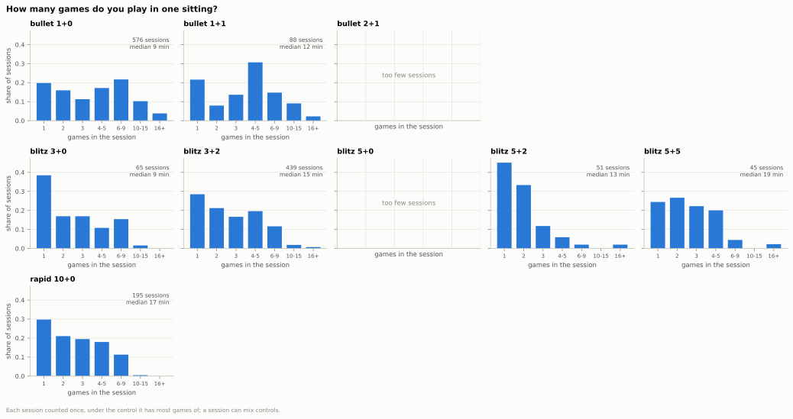
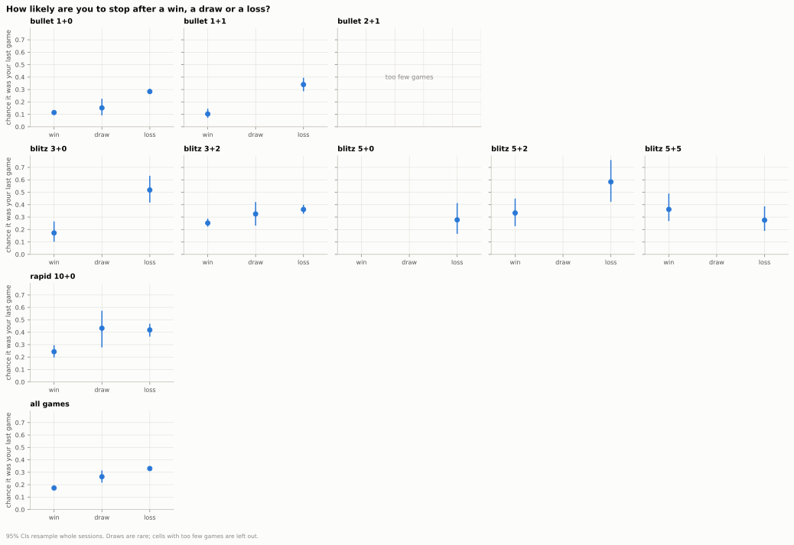
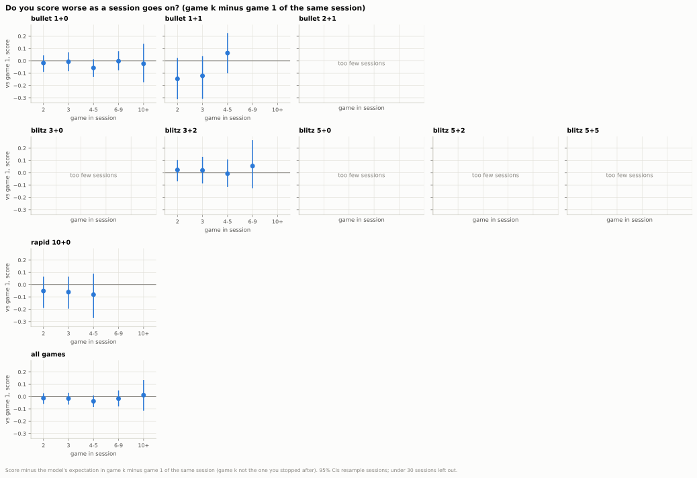
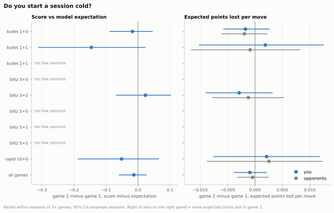
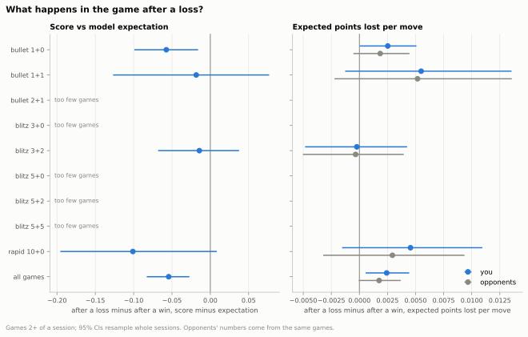
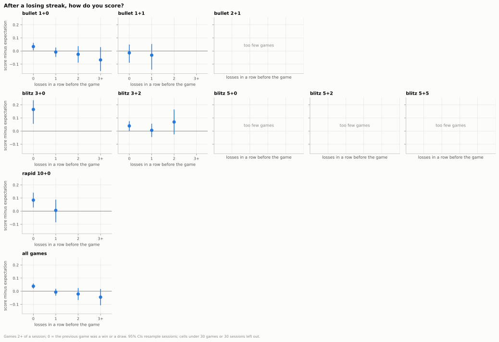
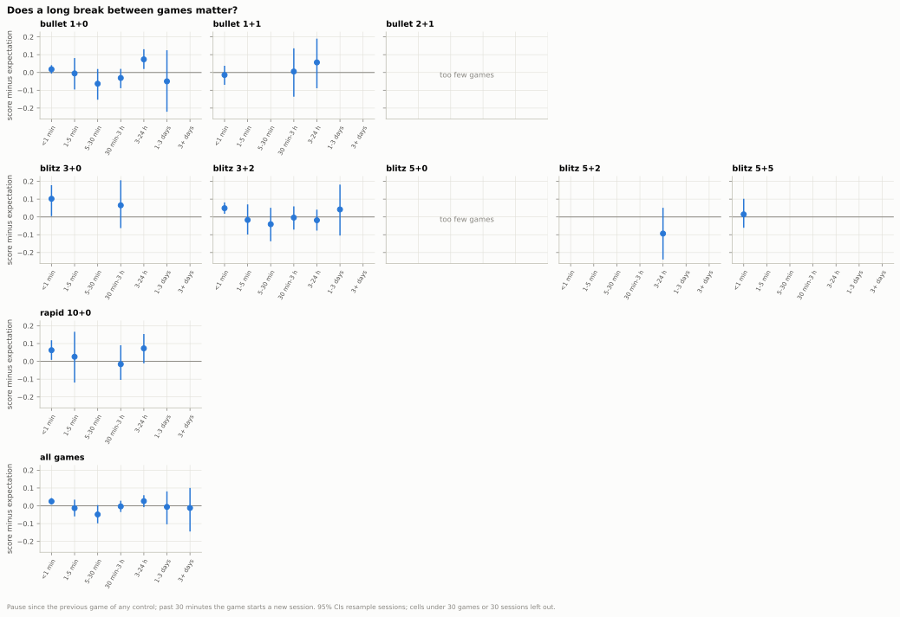

## 5. How do your playing sessions shape your results?

**Short answer:** Your sessions are short (a median of 3 games) and you stop far more often after a loss; once that stopping habit is accounted for there is no sign of fatigue or a slow start, and the one real effect is a dip in the game right after a loss (about −38 Elo across all games).

### 5.1 How long are your sessions?

- A typical session is 3 games and 13 minutes; a quarter (25%) are a single game.
- 1+0 and 1+1 sessions are the longest in games (median 4), and 14% of 1+0 sessions reach 10 games or more.
- Slower controls make shorter sittings in games: a median of 3 games over 15 minutes in 3+2, 2 games over 17 minutes in 10+0.
- 16% of your games sit in a session that mixes time controls.

Data: [1_session_length.csv](data/05_sessions/1_session_length.csv) · [1b_games_per_session.csv](data/05_sessions/1b_games_per_session.csv) · [1c_session_minutes.csv](data/05_sessions/1c_session_minutes.csv) · [all tables](data/05_sessions/_index.csv) · [script](../analysis/05_sessions.py) · source: [games_decomposed.parquet](../data/zakihussa1n/games_decomposed.parquet)

### 5.2 Do you stop after losses?

- Across all games you stop after 33% of losses but only 17% of wins: a gap of 0.157 (CI 0.135 to 0.181) in the chance of stopping.
- The gap is clear in 1+0, 1+1, 3+0, 3+2, 5+2 and 10+0; it is largest in 3+0, where you stop after 52% of losses.
- In 5+5 there is no clear difference (−0.087, CI −0.242 to +0.070), and 2+1 and 5+0 have too few sessions to tell.
- Because of this habit, the game you stop after scores −0.183 below your other games (CI −0.208 to −0.155), about −134 Elo (CI −155 to −112): any curve by game number has to allow for it.

Data: [2_stop_by_result.csv](data/05_sessions/2_stop_by_result.csv) · [2b_stop_loss_minus_win.csv](data/05_sessions/2b_stop_loss_minus_win.csv) · [2d_last_game_minus_others.csv](data/05_sessions/2d_last_game_minus_others.csv) · [all tables](data/05_sessions/_index.csv) · [script](../analysis/05_sessions.py) · source: [games_decomposed.parquet](../data/zakihussa1n/games_decomposed.parquet)

### 5.3 Do you get worse as a session goes on?

- At first sight you get better: across all games, games 6-9 score +0.038 above expectation (CI +0.006 to +0.071), about +26 Elo (CI +4 to +49), against +0.010 in game 1.
- Against game 1 of the same session, no later game number differs clearly in any control with enough sessions; across all games, games 6-9 minus game 1 is −0.017 (CI −0.080 to +0.049), about −12 Elo (CI −56 to +34).
- The regression agrees: comparing sessions with each other, score rises +0.041 per doubling of the game number (CI +0.018 to +0.065), but within the same session the change is −0.002 (CI −0.024 to +0.024).
- Your move quality does not drift: within a session, your expected points lost per move change by −0.0010 per doubling of the game number (CI −0.0027 to +0.0006).

Data: [3_minus_game1.csv](data/05_sessions/3_minus_game1.csv) · [3b_game_number.csv](data/05_sessions/3b_game_number.csv) · [3c_regression.csv](data/05_sessions/3c_regression.csv) · [all tables](data/05_sessions/_index.csv) · [script](../analysis/05_sessions.py) · source: [games_decomposed.parquet](../data/zakihussa1n/games_decomposed.parquet)

### 5.4 Is there a warm-up effect?

- Across all games, game 2 scores −0.013 against game 1 of the same session (CI −0.060 to +0.027), about −9 Elo (CI −42 to +19): no clear difference.
- Your expected points lost per move change by −0.0009 from game 1 to game 2 (CI −0.0039 to +0.0021), much like your opponents' −0.0004: you do not start cold.
- In 1+1 game 2 looks worse, −0.146 (CI −0.312 to +0.024), about −103 Elo (CI −246 to +17), but the interval includes zero.
- 2+1, 3+0, 5+0, 5+2 and 5+5 have too few sessions of 3+ games to tell.

Data: [4_warmup.csv](data/05_sessions/4_warmup.csv) · [all tables](data/05_sessions/_index.csv) · [script](../analysis/05_sessions.py) · source: [games_decomposed.parquet](../data/zakihussa1n/games_decomposed.parquet)

### 5.5 What happens in the game after a loss?

- Across all games you score −0.054 less after a loss than after a win (CI −0.083 to −0.027), about −38 Elo (CI −58 to −19): +0.041 above expectation after a win, −0.014 after a loss.
- In 1+0 the dip is −0.057 (CI −0.099 to −0.016), about −40 Elo (CI −70 to −11).
- Blitz splits: in 3+2 there is no clear difference (−0.014, CI −0.068 to +0.038, about −10 Elo, CI −48 to +26); in 3+0 the dip looks far larger (−0.211, about −157 Elo, CI −344 to −15) but rests on only 39 games after a loss, too few sessions for a firm reading.
- After a loss you lose +0.0024 more expected points per move (CI +0.0006 to +0.0044), and your opponents in those games +0.0018 (CI −0.0001 to +0.0037): the games get messier for both sides, slightly more for you.

Data: [5b_after_loss_minus_after_win.csv](data/05_sessions/5b_after_loss_minus_after_win.csv) · [5_after_result.csv](data/05_sessions/5_after_result.csv) · [all tables](data/05_sessions/_index.csv) · [script](../analysis/05_sessions.py) · source: [games_decomposed.parquet](../data/zakihussa1n/games_decomposed.parquet)

### 5.6 What about after a losing streak?

- Across all games, after 3 or more losses in a row you score −0.083 less than when the previous game was not a loss (CI −0.153 to −0.019), about −59 Elo (CI −112 to −14).
- In 1+0, the only control with enough streaks of 3+, the gap is −0.102 (CI −0.191 to −0.011), about −73 Elo (CI −144 to −7).
- The streak does not clearly deepen the dip: 3+ losses against a single loss is −0.038 (CI −0.109 to +0.036), about −27 Elo (CI −78 to +25).
- Winning streaks run the other way: after 3+ wins you score +0.092 more than after none (CI +0.040 to +0.136), about +65 Elo (CI +28 to +98).

Data: [6d_streak_contrasts.csv](data/05_sessions/6d_streak_contrasts.csv) · [6_loss_streak.csv](data/05_sessions/6_loss_streak.csv) · [6b_win_streak.csv](data/05_sessions/6b_win_streak.csv) · [all tables](data/05_sessions/_index.csv) · [script](../analysis/05_sessions.py) · source: [games_decomposed.parquet](../data/zakihussa1n/games_decomposed.parquet)

### 5.7 Does a long break between games matter?

- Straight re-queues (under a minute) score +0.025 above expectation across all games (CI +0.008 to +0.044), about +17 Elo (CI +6 to +30).
- After a 5-30 minute pause you score −0.049 (CI −0.098 to +0.004), about −34 Elo (CI −69 to +3): the lowest of the bins, but no clear difference from zero.
- That pause partly reflects the previous result: 58% of those games follow a loss, against 40% of instant re-queues.
- Breaks of a day or more show no clear difference where there are enough games (all games, 1+0, 3+2; all games after 1-3 days: −0.006, CI −0.104 to +0.081); the other controls are too thin.
- After a loss you still start the next game within a minute 83% of the time (87% after a win).

Data: [7_break_before.csv](data/05_sessions/7_break_before.csv) · [7b_requeue_speed.csv](data/05_sessions/7b_requeue_speed.csv) · [all tables](data/05_sessions/_index.csv) · [script](../analysis/05_sessions.py) · source: [games_decomposed.parquet](../data/zakihussa1n/games_decomposed.parquet)

Method and caveats

- Games: every standard live game with at least one move, split by its exact time control; the "all games" rows pool the nine reported controls. 0.5+0 (19 games) and 30+0 (1 game) are too thin to report and are left out of every table, but they still count as part of a sitting.
- A session is a run of games with no pause longer than 30 minutes (the configured `session_gap_minutes`) between one game's end and the next game's start, recomputed over standard live games only.
- Game-level results (stopping, game number, tilt, streaks, breaks) use each game's own control; the game number counts every game of the session whatever its control. Session-level descriptions (5.1) put each session under its main control: the control with most games in it, ties going to the one played first.
- Paired comparisons (game k vs game 1, game 2 vs game 1) only use sessions where both games are in the same control.
- Score vs expectation is the result minus the calibration model's pre-game expected score (it knows both pre-game ratings and the time control). The Elo-equivalent is the rating gap that would turn the expected score into the actual one, applied to the estimate and to each CI end; for a difference it is taken at the first group's expected score. 5_after_result also has the score minus the plain Elo-formula expectation (with its own Elo-equivalent) as a check.
- Move quality is expected points lost per move (calibrated), as a ratio of sums over the games of a cell; paired session comparisons average per-game rates.
- All CIs are 95% bootstrap intervals with 500 resamples of whole sessions, because the games of a session share a mood, an hour and a pool of opponents.
- The stopping rule bends every curve by game number, so 5.3 rests on three corrections: game k against game 1 of the same session (the chart), a regression that compares games across sessions ("pooled") or only within a session ("within", session-demeaned), and a fixed set of sessions — sessions of 6+ games, compared over their games 1 to 5, none of which is the last ([3d_fixed_sessions.csv](data/05_sessions/3d_fixed_sessions.csv)). The previous-result terms are only in the pooled model: a demeaned lagged result in sessions this short is badly biased.
- The uncorrected curve ([3b_game_number.csv](data/05_sessions/3b_game_number.csv)) also has a version without the game you stopped after. Leaving that game out raises every bin (it is more often a loss), so only comparisons between bins of that version mean anything.
- Even the corrected curves keep a milder selection: reaching game 8 at all means the session went well. Small late-session gains should be read as "no fatigue", not as improvement.
- Tilt is measured on the games you chose to play after a loss; a common cause (a bad day, a stronger pool at that hour) could also produce it. The opponents' move quality from the same games is the control for the pool.
- Thin cells: a cell with under 30 games or under 30 sessions is computed but flagged `thin` and not drawn; the sessions floor is there because every CI resamples sessions, and a bootstrap over fewer clusters gives unreliable intervals. Paired comparisons need 30 sessions. Regressions are flagged thin under 10 games per coefficient or 30 sessions.
- The session definition does not drive the results: with a 15- or 60-minute gap the stopping gap, the after-loss dip and the (absent) fatigue effect barely move ([0_gap_sensitivity.csv](data/05_sessions/0_gap_sensitivity.csv)).
- Per-game quality and the expected score come from Q1's `games_decomposed.parquet` and inherit its caveats (engine-perfect baseline, pooled calibration).

