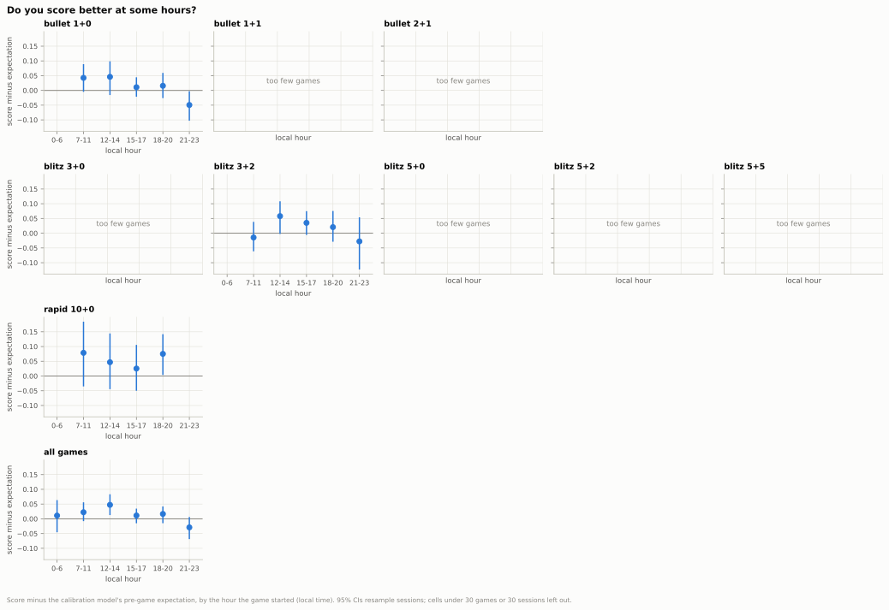
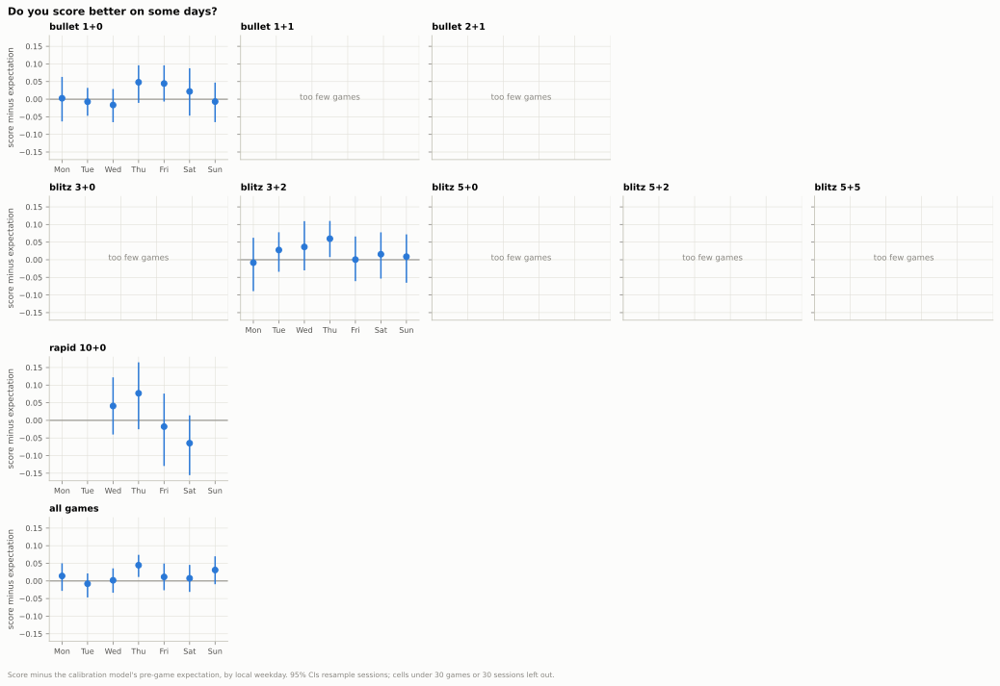
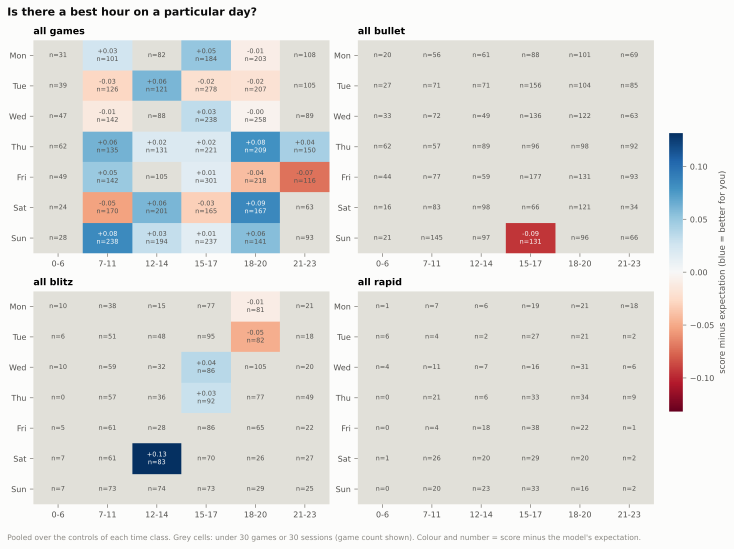
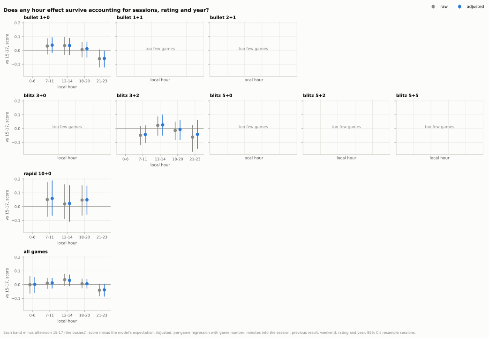
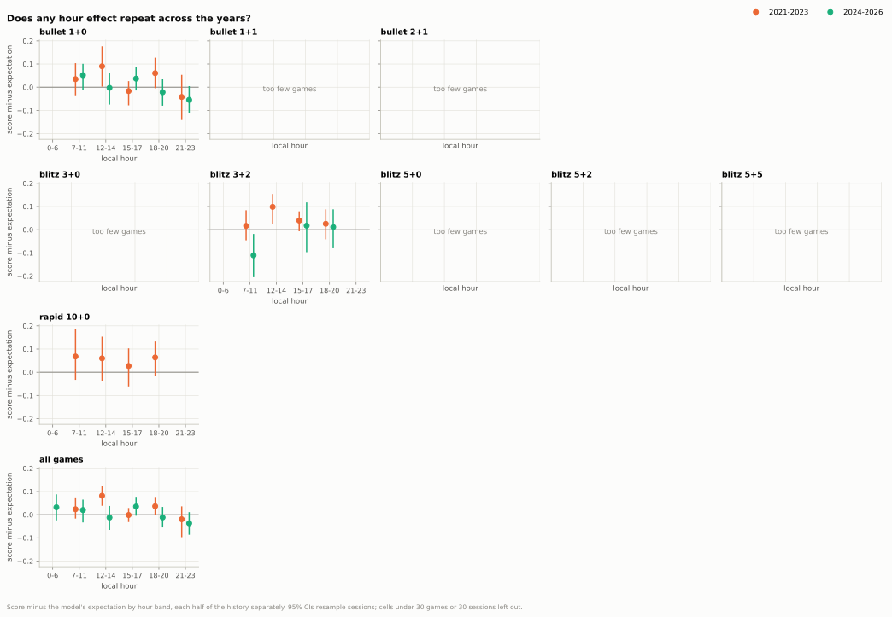
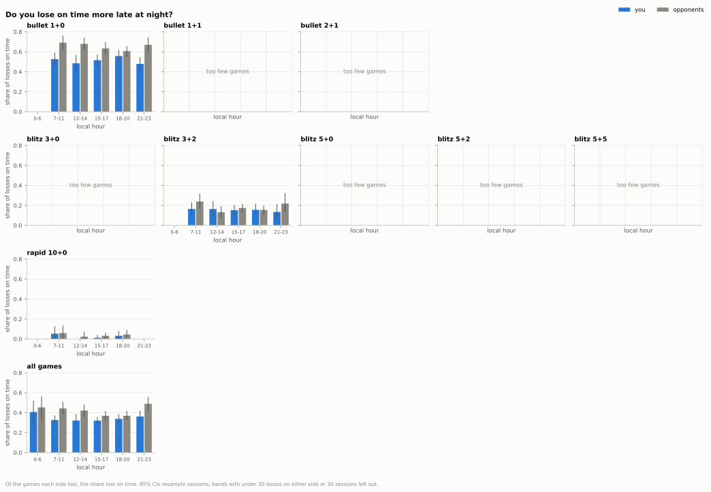

## 6. Does the time of day or the day of the week matter?

**Short answer:** Mostly no: across all games the better and worse hours look like chance (shuffle test p = 0.41) and do not repeat between 2021-2023 and 2024-2026; the exceptions are a late-evening dip in 1+0 and an hour pattern in 3+0, a small control, that chance does not easily explain.

### 6.1 Do you score better at some hours?

- Across all games, midday (12-14) is your best band, +0.047 above expectation (CI +0.013 to +0.083), about +33 Elo (CI +9 to +58), and late evening (21-23) the lowest, −0.029 (CI −0.069 to +0.006): no clear difference from zero there.
- In 1+0 the late band is clearly below expectation: −0.049 (CI −0.103 to −0.003), about −35 Elo (CI −73 to −2).
- Your move quality and your opponents' move together hour by hour: across all games the gap between you never exceeds 0.0009 expected points per move in any band.
- Only 14 control-by-band cells have enough games and sessions to read; 2 of them have an interval clear of zero (1+0 late, 10+0 evening), against 0.7 expected by chance.

Data: [1_hour_band.csv](data/06_time_of_day/1_hour_band.csv) · [1e_clear_cells.csv](data/06_time_of_day/1e_clear_cells.csv) · [1b_hour.csv](data/06_time_of_day/1b_hour.csv) · [all tables](data/06_time_of_day/_index.csv) · [script](../analysis/06_time_of_day.py) · source: [games_decomposed.parquet](../data/zakihussa1n/games_decomposed.parquet)

### 6.2 Do you score better on some days?

- Across all games, Thursday is your best day: +0.045 above expectation (CI +0.011 to +0.074), about +31 Elo (CI +8 to +52).
- Weekends against weekdays: +0.007 (CI −0.024 to +0.038), about +5 Elo (CI −17 to +26): no clear difference, and none in 1+0, 1+1, 3+2 or 10+0 either.
- 3+0's weekend edge, +0.149 (about +107 Elo, CI +3 to +215), rests on 79 weekend games in too few sessions to trust.
- Of the 18 control-by-day cells with enough games and sessions, 1 has an interval clear of zero (3+2 Thursday, +0.060), against 0.9 expected by chance.

Data: [2_weekday.csv](data/06_time_of_day/2_weekday.csv) · [2b_weekend_minus_weekday.csv](data/06_time_of_day/2b_weekend_minus_weekday.csv) · [2c_clear_cells.csv](data/06_time_of_day/2c_clear_cells.csv) · [all tables](data/06_time_of_day/_index.csv) · [script](../analysis/06_time_of_day.py) · source: [games_decomposed.parquet](../data/zakihussa1n/games_decomposed.parquet)

### 6.3 Is there a best hour on a particular day?

- Per control almost every hour-by-day cell is thin, so the grid pools controls by time class and over all games.
- Even pooled, few cells are readable: 1 of 42 in bullet, 5 in blitz and none in rapid have at least 30 games and 30 sessions.
- Across all games, 3 of the 27 usable cells have an interval clear of zero, where chance alone would give about 1.35.
- Those three (Thursday evening, Saturday evening, Sunday morning, each about +0.08) are scattered, not a block of neighbouring hours or days.

Data: [3_band_weekday.csv](data/06_time_of_day/3_band_weekday.csv) · [3b_grid_summary.csv](data/06_time_of_day/3b_grid_summary.csv) · [all tables](data/06_time_of_day/_index.csv) · [script](../analysis/06_time_of_day.py) · source: [games_decomposed.parquet](../data/zakihussa1n/games_decomposed.parquet)

### 6.4 Does any effect survive accounting for sessions, rating and year?

- Across all games, adjusting barely moves the bands against the afternoon: late evening is −0.041 raw and −0.038 adjusted (CI −0.087 to +0.006), about −27 Elo (CI −61 to +4); midday +0.036 raw and +0.031 adjusted (CI −0.012 to +0.073).
- In 1+0 late evening stays below the afternoon after adjustment: −0.058 (CI −0.124 to −0.003), about −41 Elo (CI −88 to −2).
- Shuffling the hour band between whole sessions often gives band effects as large as yours: p = 0.41 across all games, 0.47 in 1+0, 0.55 in 3+2 and 0.09 in 10+0.
- 3+0 is the exception: p = 0.007 on 208 games in 73 sessions (about 0.06 after allowing for the nine controls tested), but each of its bands has under 30 sessions, so which hours drive it cannot be read.

Data: [4_raw_vs_adjusted.csv](data/06_time_of_day/4_raw_vs_adjusted.csv) · [4b_permutation.csv](data/06_time_of_day/4b_permutation.csv) · [4c_regression.csv](data/06_time_of_day/4c_regression.csv) · [all tables](data/06_time_of_day/_index.csv) · [script](../analysis/06_time_of_day.py) · source: [games_decomposed.parquet](../data/zakihussa1n/games_decomposed.parquet)

### 6.5 Does any effect repeat across years?

- The midday edge belongs to 2021-2023 only: +0.082 (CI +0.038 to +0.124), about +58 Elo (CI +27 to +88), then −0.012 (CI −0.066 to +0.038), about −9 Elo (CI −46 to +26), in 2024-2026.
- Across all games only 2 of the 5 comparable bands keep the same sign in both periods, and none is clearly above or below zero in both.
- Late evening is below zero in both periods (−0.020, then −0.037) but clearly so in neither.
- 1+0 tells the same story (2 of 5 bands keep their sign); 3+2 has 3 comparable bands and the other controls are too thin to split in two.

Data: [5_halves.csv](data/06_time_of_day/5_halves.csv) · [5b_sign_agreement.csv](data/06_time_of_day/5b_sign_agreement.csv) · [all tables](data/06_time_of_day/_index.csv) · [script](../analysis/06_time_of_day.py) · source: [games_decomposed.parquet](../data/zakihussa1n/games_decomposed.parquet)

### 6.6 Do you lose on time more late at night?

- Of the games you lost from 21:00 to 06:59, +0.046 more were on time than at other hours (CI −0.004 to +0.108): no clear difference.
- Of your opponents' losses at those hours, +0.083 more were on time (CI +0.018 to +0.151).
- Counting all games, you lose +0.038 more of them on time late (CI +0.008 to +0.072), but 72% of late games are bullet against 54% of the rest: mostly the mix of games.
- Within 1+0 there is no clear difference: +0.031 more games lost on time late (CI −0.014 to +0.081).

Data: [6_flags_by_band.csv](data/06_time_of_day/6_flags_by_band.csv) · [6b_late_minus_rest.csv](data/06_time_of_day/6b_late_minus_rest.csv) · [all tables](data/06_time_of_day/_index.csv) · [script](../analysis/06_time_of_day.py) · source: [games_decomposed.parquet](../data/zakihussa1n/games_decomposed.parquet)

Method and caveats

- Games: every standard live game with at least one move, split by its exact time control; "all games" pools the nine reported controls, and the hour-by-day grid also pools by time class ("all bullet", "all blitz", "all rapid") because per control nearly every one of its 42 cells is thin. Even pooled by class most grid cells stay thin, so the all-games grid is the one to read. 0.5+0 (19 games) and 30+0 (1 game) are left out.
- Hours and weekdays are the local start time in the configured timezone (Europe/London); travel would mislabel them. Each game carries the band of its own start, even when its session crosses into the next band.
- Bands: night 0-6 (hours 1 to 6 hold under 60 games each, so they are merged with midnight), morning 7-11, midday 12-14, afternoon 15-17, evening 18-20, late 21-23. "Late at night" in 6.6 is 21:00 to 06:59. The busiest band, the afternoon, is the reference in 6.4.
- Score vs expectation is the result minus the calibration model's pre-game expected score (it knows both pre-game ratings and the time control, so a weaker pool at some hour is not mistaken for better play). The Elo-equivalent is the rating gap that would turn the expected score into the actual one, applied to the estimate and each CI end.
- CIs are 95% bootstrap intervals with 500 resamples of whole sessions (sessions as in Q5: no pause over 30 minutes), since the games of a session share an hour, a mood and a pool.
- 6.4's adjusted numbers come from a per-game regression of score vs expectation on the hour band, weekend, previous result, log2 of the game number, minutes into the session, pre-game rating and year (and the control, in the pool). Rows with no pre-game rating (the first rated game of a pool) are dropped there.
- "Last game of the session" is deliberately not a control: you stop because of a game's result (Q5), so it is part of the outcome, and late evenings hold the most last games; controlling for it would pull the late band towards zero for no real reason.
- The shuffle test labels every game with its session's band (the band of the session's first game), in the observed fit and in each of 300 shuffles of those labels across whole sessions, refits, and reports p = (1 + shuffles with band effects at least as large as observed) / 301, for the largest band and for the sum of squares (the draft quotes the largest band, and the sum of squares for 3+0). The Bonferroni columns multiply a control's p by the nine controls tested.
- The regression controls what is measured; it cannot control why you were still playing at 23:00. Bands also differ in era: 72% of night games are from 2024-2026.
- Many cells are tested (6 bands or 7 days in 10 groups, 168 grid cells), so isolated intervals that clear zero are expected; [1e_clear_cells.csv](data/06_time_of_day/1e_clear_cells.csv), [2c_clear_cells.csv](data/06_time_of_day/2c_clear_cells.csv) and [3b_grid_summary.csv](data/06_time_of_day/3b_grid_summary.csv) count them against chance, and the shuffle test and the split by years are the checks that matter.
- Thin cells: under 30 games or under 30 sessions (under 30 losses on either side for the flag shares) are flagged `thin` and not drawn; the sessions floor is there because every CI resamples sessions, and a bootstrap over fewer clusters gives unreliable intervals. Regressions are flagged under 10 games per coefficient or 30 sessions.
- Per-game quality and the expected score come from Q1's `games_decomposed.parquet`; the session machinery is shared with Q5 (`chess_analysis.sessions`).

