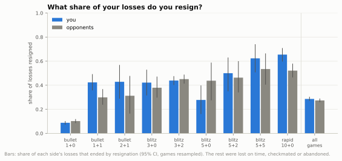
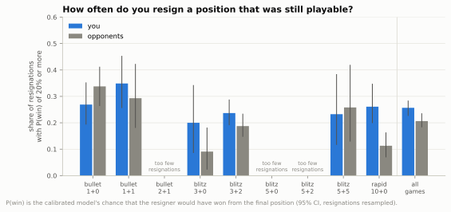
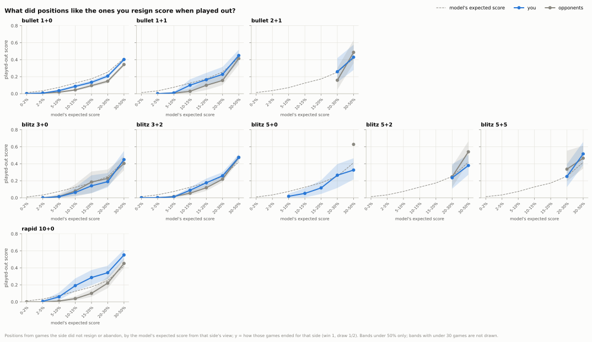
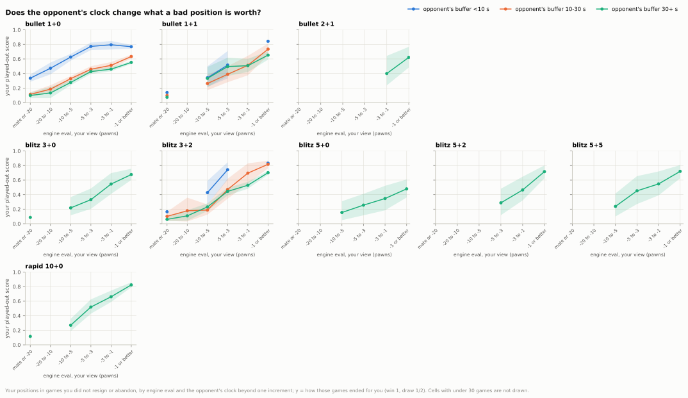
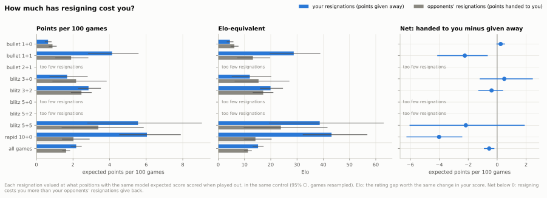
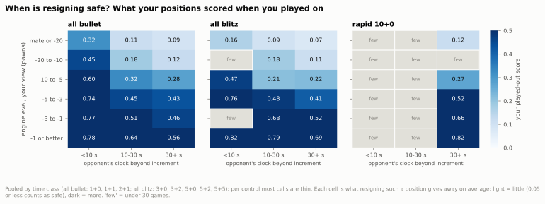

## 7. Does resigning cost you points?

**Short answer:** A little overall: your resignations gave away about 2.2 expected points per 100 games (about 15 Elo), more than your opponents' resignations handed back; the net cost sits in 1+1 and rapid 10+0, where you resign more of your losses than your opponents do, and in 1+0 an opponent short of time turns even lost positions into real chances.

### 7.1 How often do you resign compared with your opponents?

- Across all games you resign 29% of your losses and your opponents 27%: no clear difference (+0.012, CI −0.010 to +0.036).
- The control matters far more than the side: in 1+0 you resign only 9% of your losses (52% are lost on time), in rapid 10+0 65%.
- You resign clearly more of your losses than your opponents in 1+1 (42% against 30%, +0.125, CI +0.035 to +0.219) and in 10+0 (65% against 52%, +0.133, CI +0.050 to +0.222).
- In 1+0 and 3+2 there is no clear difference: −0.014 (CI −0.038 to +0.008) and −0.012 (CI −0.070 to +0.039).

Data: [1_resign_share.csv](data/07_resignation/1_resign_share.csv) · [1b_loss_endings.csv](data/07_resignation/1b_loss_endings.csv) · [all tables](data/07_resignation/_index.csv) · [script](../analysis/07_resignation.py) · source: [moves_analysed.parquet](../data/zakihussa1n/moves_analysed.parquet)

### 7.2 From what positions do you resign?

- Across all games 26% of your resignations came while the model still gave you a 0.2 chance or better to win; for your opponents 21% (difference +0.050, CI +0.005 to +0.086).
- In rapid 10+0 the gap is large: 26% of yours against 11% of theirs, +0.148 (CI +0.066 to +0.241).
- In 1+0 there is no clear difference, if anything the other way: −0.069 (CI −0.185 to +0.047).
- A typical resignation of yours comes at about 6.4 pawns down by the engine (your opponents': 7.7).
- These "still playable" resignations are 26% of yours but carry 65% of what resigning cost you.

Data: [2_resign_position.csv](data/07_resignation/2_resign_position.csv) · [2b_resign_position_detail.csv](data/07_resignation/2b_resign_position_detail.csv) · [2c_resign_class.csv](data/07_resignation/2c_resign_class.csv) · [all tables](data/07_resignation/_index.csv) · [script](../analysis/07_resignation.py) · source: [expected_points.parquet](../data/zakihussa1n/expected_points.parquet)

### 7.3 What happens when positions like that are played out?

- At a 2-5% expected score almost nothing comes back: played on, such positions scored 0.007 for you in 1+0 and 0.002 in 3+2.
- In 1+0 the bands where people resign (up to 20-30%) scored less than the model's estimate: at 10-15%, 0.086 for you (CI 0.068 to 0.105) and 0.044 for your opponents, against the model's 0.125.
- Rapid 10+0 is the exception for you: from 15-20% you scored 0.286 (CI 0.196 to 0.374), well above the model's 0.175 and your opponents' 0.100.
- In engine terms nothing is hopeless: in 1+0 your positions at mate or 20+ pawns down still scored 0.212 (CI 0.183 to 0.242), and 5-10 pawns down 0.372.

Data: [3_played_out_by_ev.csv](data/07_resignation/3_played_out_by_ev.csv) · [3b_played_out_by_eval.csv](data/07_resignation/3b_played_out_by_eval.csv) · [all tables](data/07_resignation/_index.csv) · [script](../analysis/07_resignation.py) · source: [expected_points.parquet](../data/zakihussa1n/expected_points.parquet)

### 7.4 Does the opponent's clock change that?

- In 1+0, with your opponent under 10 s, your positions at mate or 20+ pawns down scored 0.335 when played on (CI 0.287 to 0.386), against 0.098 with your opponent on 30+ s.
- In 1+1 the increment takes most of that away: with your opponent under 10 s beyond the increment the same lost positions scored 0.139 (CI 0.052 to 0.240).
- You rarely resign into a short clock: in 1+0, 77% of your resignations came with your opponent on 30+ s, and in blitz 97%.
- The model's expected score already allows for the clock: in 1+0 at 10-15% your positions scored 0.089 with the opponent under 10 s and 0.082 with 30+ s.

Data: [4_clock_by_eval.csv](data/07_resignation/4_clock_by_eval.csv) · [4b_clock_by_ev.csv](data/07_resignation/4b_clock_by_ev.csv) · [4c_resign_clock.csv](data/07_resignation/4c_resign_clock.csv) · [all tables](data/07_resignation/_index.csv) · [script](../analysis/07_resignation.py) · source: [moves_analysed.parquet](../data/zakihussa1n/moves_analysed.parquet)

### 7.5 How much has resigning cost you?

- Across all games your resignations gave away 2.2 expected points per 100 games (CI 1.9 to 2.5), about 15 Elo (CI 13 to 17).
- Your opponents' resignations handed you 1.6 per 100 games, so resigning nets you −0.55 per 100 games (CI −0.92 to −0.19), about −4 Elo (CI −6 to −1).
- The net is clearly negative only in rapid 10+0, −4.0 (CI −6.3 to −2.4), and 1+1, −2.2 (CI −4.1 to −0.6): there your resignations cost 6.0 per 100 games (about 43 Elo) and 4.1 (about 29 Elo).
- In 5+5 the cost is as high, 5.6 per 100 games (CI 2.8 to 9.0), about 39 Elo, but the net is unclear: −2.2 (CI −6.1 to +1.9).
- In 1+0 the cost is small, 0.64 per 100 games (about 4 Elo), about what your opponents' resignations hand you (0.88): no clear net effect (+0.24, CI −0.05 to +0.54).

Data: [5_cost.csv](data/07_resignation/5_cost.csv) · [5b_net.csv](data/07_resignation/5b_net.csv) · [all tables](data/07_resignation/_index.csv) · [script](../analysis/07_resignation.py) · source: [games_decomposed.parquet](../data/zakihussa1n/games_decomposed.parquet)

### 7.6 When is resigning safe?

- By engine eval, no band is safe anywhere: even at mate or 20+ pawns down with the opponent on 30+ s, your positions scored 0.091 in bullet (CI 0.059 to 0.129), 0.071 in blitz and 0.116 in rapid.
- With the opponent under 10 s, bullet positions at mate or 20+ pawns down scored 0.316 and at 5-10 pawns down 0.598; that is mostly 1+0, and in 1+1 the first cell is only 0.139, as the previous chart shows.
- By the model's expected score, resigning gives away at most 0.05 per resignation only up to the 2-5% band in 1+0 and 10+0, and up to 5-10% in 1+1 and 3+2.
- Per control most cells are too thin for a map; the bullet and blitz panels are mostly 1+0 and 3+2, and 1+1 differs, as the previous chart shows.

Data: [6_safe_map.csv](data/07_resignation/6_safe_map.csv) · [6b_safe_threshold.csv](data/07_resignation/6b_safe_threshold.csv) · [4_clock_by_eval.csv](data/07_resignation/4_clock_by_eval.csv) · [all tables](data/07_resignation/_index.csv) · [script](../analysis/07_resignation.py) · source: [moves_analysed.parquet](../data/zakihussa1n/moves_analysed.parquet)

Method and caveats

- Games: standard live games in each time control with at least 50 games (bullet 1+0 to rapid 10+0); bullet 0.5+0 (19 games) and rapid 30+0 (1 game) are too thin and left out. Two games ended before the first move and have no resignation position.
- The resignation position is the position after the last move of the game, seen from the resigner; the time between that move and the resignation is not recorded.
- Win chance is the calibrated model's P(win) and expected score is P(win) + ½P(draw) (see `reports/calibration.md`); the model uses both clocks and both pre-game ratings, so it already allows for time trouble.
- "Played out": every position after a move in games the side under study did not resign or abandon, scored by how that game ended for that side (win 1, draw ½, loss 0). Final positions of games that ended on the board are left out.
- Each resignation is valued at the played-out score of its expected-score band in its own time control; a band with no played-out positions falls back to the model's value.
- The played-out games are themselves selected (people play on when they see a reason: the opponent's clock, a trick), so this is an upper-ish bound; the model's own value is shown alongside, and an all-positions version (resigned games' positions counted as losses) is a lower bound.
- CIs: 500 resamples of whole games. For the cost, one game-level bootstrap per control resamples the band scores and the resignations together, both sides on the same draws (so the net has its own CI); pooled rows add up the controls' draws.
- Elo-equivalent: the rating gap that moves your actual score in that control by the same amount (for your opponents' resignations, from your score without them).
- Clock bands: under 10 s, 10-30 s, 30+ s on the other side's clock, as plain seconds left and as the buffer beyond one increment (in 1+1 an opponent on 5 s still gets a second back each move); the charts use the buffer, both are in the tables.
- Thin cells: a played-out score from under 30 games, or a share from under 30 resignations or losses, is kept in the CSVs with `thin` = True and not drawn. Eval band × clock × side cells are thin outside 1+0 and 3+2, so the map and the clock tables are also pooled by time class ("all bullet" = 1+0, 1+1, 2+1; "all blitz" = 3+0, 3+2, 5+0, 5+2, 5+5).
- "Still playable" = P(win) of at least 0.2 at the resignation; "had to go" (table 2d) = still playable, at least a quarter of the base time left and a quick last own move; it is a proxy, and a session ended in frustration looks the same as one ended by an interruption.
- Played-out scores are averaged over positions, not games: a long slide through a band counts once per move, so long games weigh more (the CIs still resample whole games).
- The calibrated model was fitted on all games, resigned ones included (their positions enter it as the resigner's loss), so the model valuation in table 5_cost is relative to that model; the played-out valuation is the one the conclusions use.
- Abandoned games count as not played out (left out of the comparison set) but are not counted as resignations.
- Opponents who are ahead may play differently against someone who never resigns; the comparison cannot separate that.

