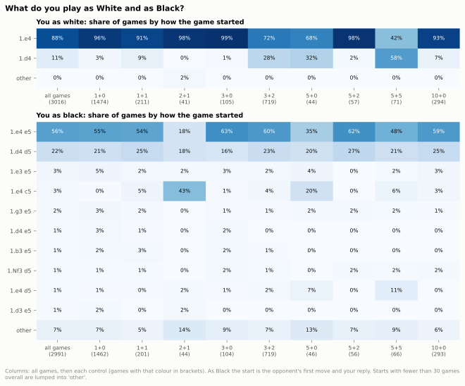
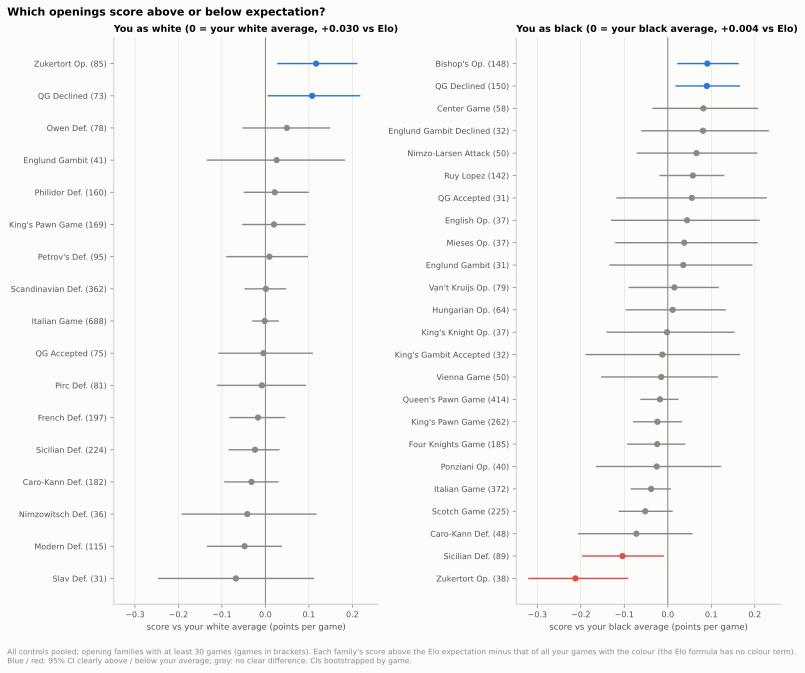
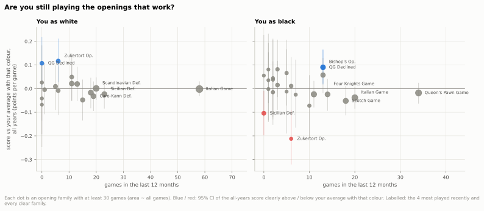
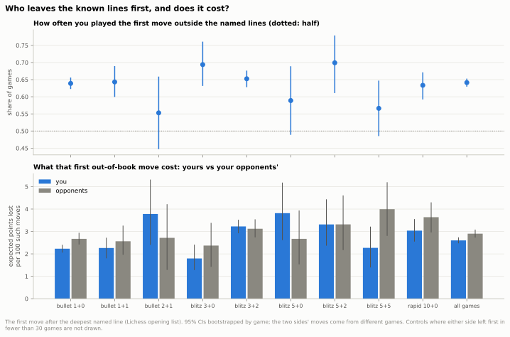
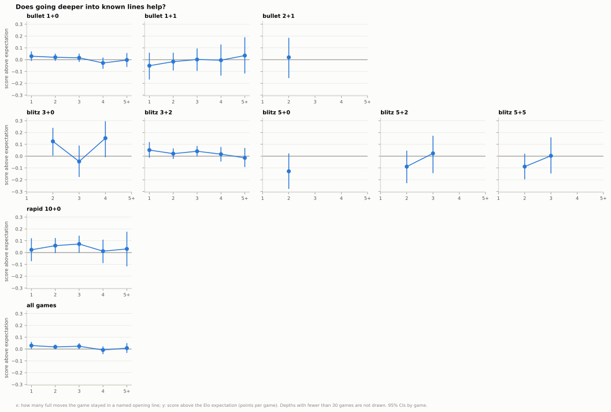
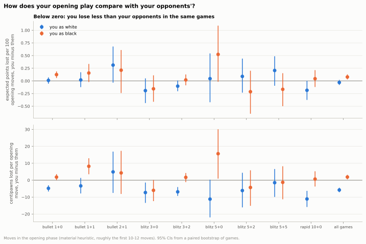
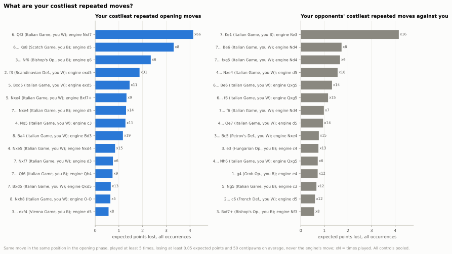

## 8. Which openings work for you, and how well do you play them?

**Short answer:** Your openings decide little: most opening families score no clearly different from your average with that colour (2 of 17 as White and 4 of 24 as Black clearly differ, against 0.85 and 1.2 expected by chance), staying longer in known lines does not clearly help, and your opening moves lose about as much as your opponents' (slightly more as Black); your costliest repeated move, 6. Qf3 in the Italian Game (66 times), is one you have nearly stopped playing.

### 8.1 What do you play as White and as Black?

- As White you open 1.e4 in 88% of your games and 1.d4 in 11%.
- 1.d4 shows up in some blitz controls: 28% of your White games in 3+2, 32% in 5+0 and 58% in 5+5, but 1-3% in 1+0, 3+0 and 5+2.
- As Black you meet 1.e4 with 1...e5 (56% of your Black games) and 1.d4 with 1...d5 (22%).
- Your most played family is the Italian Game as White (688 games, 23% of your White games); as Black it is the Queen's Pawn Game (414) and the Italian Game (372).

Data: [1_line_starts.csv](data/08_openings/1_line_starts.csv) · [1b_families.csv](data/08_openings/1b_families.csv) · [all tables](data/08_openings/_index.csv) · [script](../analysis/08_openings.py) · source: [moves_analysed.parquet](../data/zakihussa1n/moves_analysed.parquet)

### 8.2 Which openings score above or below expectation?

- Over all your White games you score +0.030 above the Elo expectation (CI +0.012 to +0.048), about +21 Elo (CI +8 to +33); as Black +0.004, no clear difference.
- Part of that White +0.030 is just the first move, which the Elo formula ignores, so each family is compared with your own average for its colour (the chart's zero).
- As White, two families are clearly above your White average: the Zukertort Opening, +0.117 (CI +0.027 to +0.212), about +85 Elo (CI +19 to +165), and, only just, the Queen's Gambit Declined, +0.107 (CI +0.005 to +0.218).
- As Black, the Bishop's Opening (+0.091, CI +0.022 to +0.163) and the Queen's Gambit Declined (+0.090, CI +0.018 to +0.166) are clearly above your Black average; the Sicilian (−0.104, CI −0.197 to −0.009) and the Zukertort (−0.212, CI −0.321 to −0.091) are clearly below.

Data: [2_family_score.csv](data/08_openings/2_family_score.csv) · [2c_colour_score.csv](data/08_openings/2c_colour_score.csv) · [2e_chance_check.csv](data/08_openings/2e_chance_check.csv) · [2b_family_score_by_class.csv](data/08_openings/2b_family_score_by_class.csv) · [all tables](data/08_openings/_index.csv) · [script](../analysis/08_openings.py) · source: [games_decomposed.parquet](../data/zakihussa1n/games_decomposed.parquet)

### 8.3 Are you still playing the openings that work?

- As White, about as rarely as before: the two clearly better families were 3% of your 212 recent White games against 5% earlier; the Zukertort holds its 3%, and the Queen's Gambit Declined has not been played in the last 12 months.
- As Black, a little more than before: 13% of your 205 recent Black games were in the two clearly better families, against 10% earlier (as Black your opponent picks most of the family).
- Of the two clearly worse Black families, the Sicilian has gone (no games in the last 12 months), but the Zukertort now comes up more often: 3% of recent Black games against 1% before (only 6 games).
- Weighting each family's long-run score above the Elo expectation by how often you play it now gives about the same edge as before: +0.027 against +0.032 as White, −0.002 against −0.001 as Black.

Data: [3_recency.csv](data/08_openings/3_recency.csv) · [3b_recency_summary.csv](data/08_openings/3b_recency_summary.csv) · [all tables](data/08_openings/_index.csv) · [script](../analysis/08_openings.py) · source: [games_decomposed.parquet](../data/zakihussa1n/games_decomposed.parquet)

### 8.4 Who leaves the known lines first, and does it cost?

- You play the first move outside the named lines in 64% of games (CI 63% to 65%); every control is between 55% (2+1) and 70% (5+2).
- That move costs you less than it costs your opponents when they leave first: 2.60 against 2.90 expected points per 100 such moves (difference −0.30, CI −0.54 to −0.05).
- The saving is clearest in 1+0, −0.44 per 100 (CI −0.74 to −0.14), and also clear in 5+5 (−1.73, CI −3.23 to −0.33); in 3+2 there is no clear difference (+0.10, CI −0.40 to +0.59).
- Who leaves first does not change the result: your score above expectation differs by −0.001 (CI −0.025 to +0.024), about −1 Elo (CI −17 to +17).

Data: [4_deviation.csv](data/08_openings/4_deviation.csv) · [4c_deviation_score_diff.csv](data/08_openings/4c_deviation_score_diff.csv) · [4b_deviation_score.csv](data/08_openings/4b_deviation_score.csv) · [all tables](data/08_openings/_index.csv) · [script](../analysis/08_openings.py) · source: [moves_analysed.parquet](../data/zakihussa1n/moves_analysed.parquet)

### 8.5 Does going deeper into known lines help?

- No clear effect: across all games each extra move of named line changes your score above expectation by −0.007 (CI −0.017 to +0.003), and by −0.006 with your colour held fixed.
- Games that leave the list after one move score +0.029 above expectation (CI +0.001 to +0.060); games that stay 5+ moves score +0.008 (CI −0.033 to +0.050).
- The big controls agree: −0.012 per move in 1+0 (CI −0.027 to +0.002) and −0.011 in 3+2 (CI −0.032 to +0.010); no control with enough games shows a clear trend.
- Deep lines are mostly your Black games (23% White at 5+ moves against 60% at one move), which is why the colour-adjusted slope matters.

Data: [5_book_depth.csv](data/08_openings/5_book_depth.csv) · [5b_book_depth_slope.csv](data/08_openings/5b_book_depth_slope.csv) · [all tables](data/08_openings/_index.csv) · [script](../analysis/08_openings.py) · source: [games_decomposed.parquet](../data/zakihussa1n/games_decomposed.parquet)

### 8.6 How does your opening play compare with your opponents'?

- As White there is no clear difference from your opponents: 2.75 against 2.78 expected points per 100 opening moves (difference −0.03, CI −0.08 to +0.02).
- As Black you lose slightly more, +0.08 per 100 moves (CI +0.03 to +0.13), clearest in 1+0: +0.12 (CI +0.06 to +0.19).
- Over all games your first five moves as White lose less than your opponents' (−0.10 per 100, CI −0.15 to −0.05), and as Black your moves six to ten lose more (+0.11 per 100, CI +0.02 to +0.20); the largest single-control gap is 10+0 as White, first five moves, −0.34 per 100.
- In centipawns your White opening moves lose clearly less than your opponents': −5.8 per move (CI −7.1 to −4.4).

Data: [6_opening_quality.csv](data/08_openings/6_opening_quality.csv) · [6b_opening_cp_loss.csv](data/08_openings/6b_opening_cp_loss.csv) · [6c_opening_by_ply.csv](data/08_openings/6c_opening_by_ply.csv) · [all tables](data/08_openings/_index.csv) · [script](../analysis/08_openings.py) · source: [moves_analysed.parquet](../data/zakihussa1n/moves_analysed.parquet)

### 8.7 What are your costliest repeated moves?

- 6. Qf3 in the Italian Game as White costs most: 66 times, 0.063 expected points each (CI 0.048 to 0.077), 4.1 in total; the engine plays Nxf7.
- You have nearly dropped it: once in the last 12 months.
- Two repeated Black blunders cost most per move: 6... Ke8 in the Scotch Game (8 times, 0.414 each; you lost all 8 games against an expected 0.50) and 3... Nf6 in the Bishop's Opening (6 times, 0.391 each).
- Your opponents' costliest repeated move against you is 7. Ke1 in the Italian Game: 16 times, 0.260 each; you scored 0.94 against an expected 0.50 in those games (only 16 games).

Data: [7_costly_moves.csv](data/08_openings/7_costly_moves.csv) · [7b_costly_moves_opponents.csv](data/08_openings/7b_costly_moves_opponents.csv) · [all tables](data/08_openings/_index.csv) · [script](../analysis/08_openings.py) · source: [moves_analysed.parquet](../data/zakihussa1n/moves_analysed.parquet)

Method and caveats

- Games: 6,007 standard live games with at least one move in the nine reported controls; 2 games without moves are dropped, and the thin controls 0.5+0 (19 games) and 30+0 (1 game) are left out of everything (counts in 8_data.csv).
- What is pooled: the repertoire (8.1 shares), family and line scores (8.2), recency (8.3) and the repeated moves (8.7) pool every reported control, because an opening is a repertoire choice and family x colour x control is almost always under 30 games; 2b_family_score_by_class.csv splits the family scores by time class as a secondary view (most cells thin). Who leaves the book (8.4), book depth (8.5) and opening move quality (8.6) are per control, because the clock changes how you play; each also has an "all games" row.
- Opening names come from the Lichess opening list (deepest named line reached); a family is the name before the colon. Names follow positions, not move orders: the White "Zukertort Opening" is mostly 1.e4 d5 2.Nf3 dxe4 (53 of 85 games, the Tennison Gambit), see 1c_family_move_order.csv.
- 1.d4 as White is almost all from before the last 12 months (1 of 346 games is recent), so its share per control in 8.1 may partly reflect when you played those controls rather than the control itself.
- Expected score is the Elo formula on your pre-game rating and the opponent's pre-game rating reconstructed as their post-game rating plus your rating change (unrated: post-game rating); 4 games without a usable rating (below chess.com's floor of 100) are left out of the score columns. The Elo formula has no colour term, so at equal ratings everyone scores above it as White and below it as Black (chess.com's Glicko ratings also make it approximate).
- Families are therefore compared with your own average for that colour (excess_vs_colour: the family's score above expectation minus that of all your games with the colour). Its CI comes from one bootstrap of all the colour's games, so the family and the average are resampled together; its Elo-equivalent is relative to the score you would make at that average. "Clearly above / below" in 8.2, 8.3 and the chart colours means this CI is clear of zero; 2_family_score.csv also keeps the plain score above the Elo expectation with its own CI.
- The Elo-equivalent is the rating gap that turns the expected score into the actual one, applied to the estimate and to each CI end. For "who left first" (4c) it is taken relative to the score in the games your opponent left first.
- CIs are 95% from 1,000 bootstrap resamples of games. You-vs-opponent opening quality (8.6) is a paired bootstrap within the same games; the out-of-book moves and the scores by who left first come from two disjoint sets of games and use independent bootstraps.
- Thin: a family, line or cell with fewer than 30 games is computed, flagged `thin` and not drawn (a score from 30 games has a CI of about +-0.18). In the repeated-move tables most moves are thin by this rule: their per-move losses are solid (the same position each time) but the scores in those games are anecdotes. In the "who left first" table a control is thin when either side left first in fewer than 30 games; in the depth slope when it has fewer than 30 games per depth bin on average (2+1, 5+0, 5+2, 5+5).
- 8.2 tests 41 families: with 95% CIs about 2 would clear your colour average by chance alone; 2e_chance_check.csv counts them against your average and against zero, per colour, per time class and for the named lines.
- Recency: the last 12 months are 2025-10-31 to 2026-10-31, only 417 games, so most families have too few recent games to score on their own (`thin_recent`); 8.3 therefore uses each family's all-years score against your colour average and asks how much of the recent repertoire falls in clearly better or worse families.
- Book depth is the depth of the deepest named line in full moves (two plies, rounded up), 5+ for 9 plies or more. It is a joint property of both players: a game leaves the list when either side plays an unnamed move. The slope is a least-squares fit of score above expectation on depth (capped at 5), raw and with a White dummy, because deep lines are mostly your Black games.
- "Opening moves" are those in the material-heuristic opening phase (roughly the first 10 to 12 moves, well beyond book); 6c splits the first 30 plies into blocks of 10.
- Expected points lost come from the calibrated model, which knows both clocks, so a move can lose expected points through time spent alone; centipawn loss is in the tables alongside.
- Repeated moves are the same move in the same position (exact FEN, so transpositions count together) in the opening phase, played at least 5 times with an average loss of at least 0.05 expected points (about 1.7 times the average move) and at least 50 centipawns (the inaccuracy floor, so the loss is the move and not the clock), never the engine's own move, ranked by total loss; the engine move is Stockfish 17.1 at 1M nodes, one good move, not the only one. Times per time class are in the table.
- As Black the family is mostly your opponent's choice (1.e4 e5 2.Bc4 is the Bishop's Opening whatever you do), so the Black family scores describe what you face as much as what you choose.
- Opponents are matched to your rating, so "their" numbers describe players at your level in the same games, not an absolute standard.

