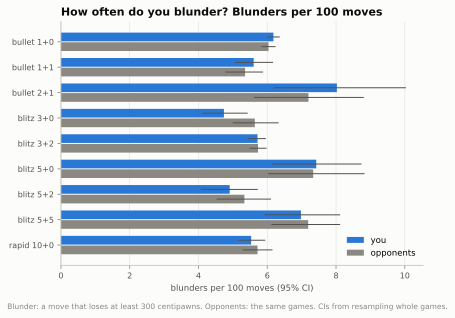
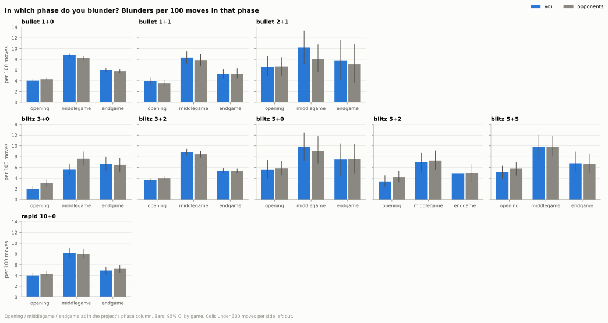
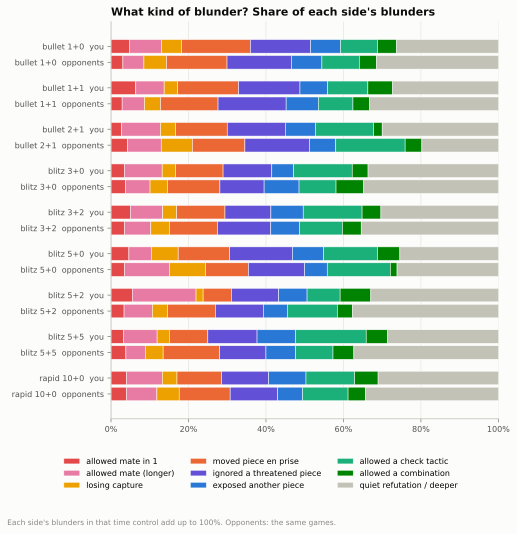
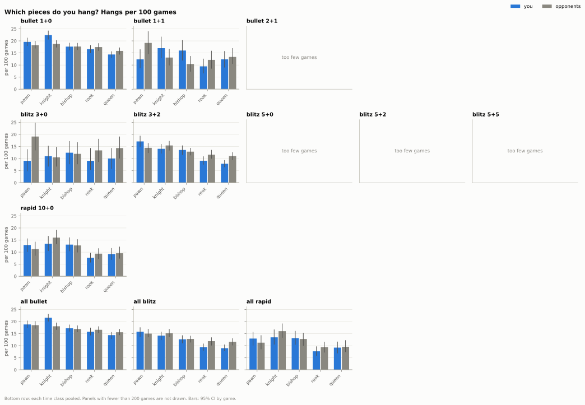
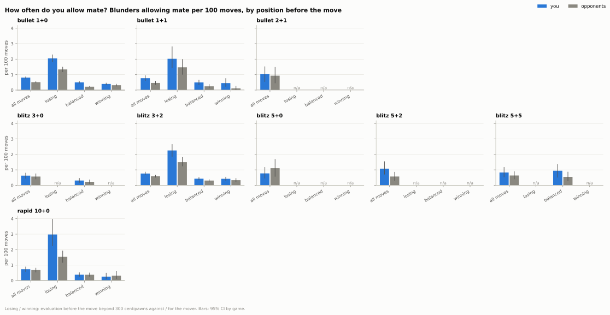
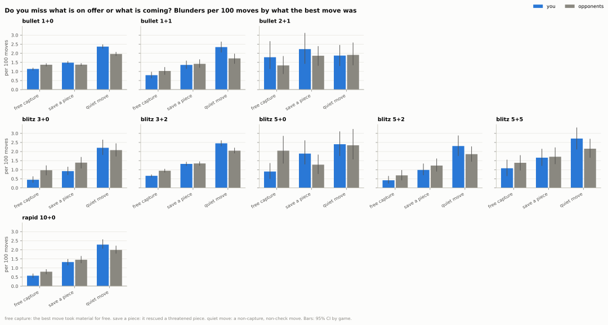
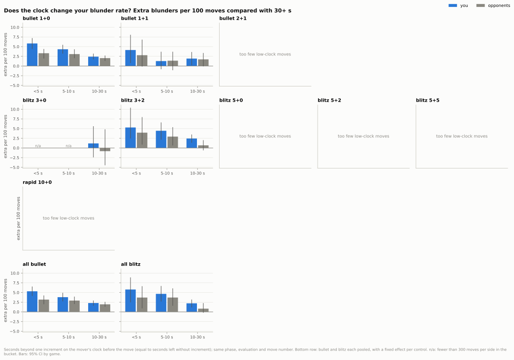
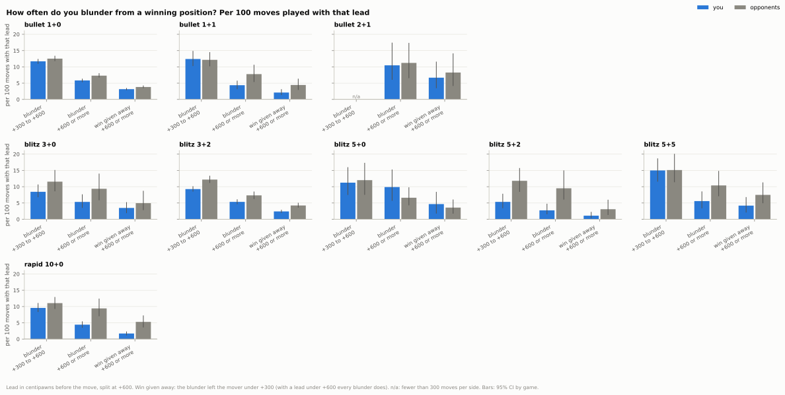

## 9. What kinds of blunders do you make, and which do you miss?

**Short answer:** You blunder about as often as your opponents and mostly in the same ways; the differences are that you blunder into a forced mate more often in 1+0, 1+1 and 3+2, the last seconds of the clock cost you more than them in 1+0, compared with your opponents your blunders more often miss a quiet move and less often miss a free capture, and with a big lead you blunder less than they do.

### 9.1 How often do you blunder?

- In 1+0 you blunder 6.18 times per 100 moves and your opponents 6.04: no clear difference (you minus them +0.14, CI -0.02 to +0.29).
- In 3+0 you blunder less than your opponents, 4.74 against 5.64 per 100 moves (difference -0.90, CI -1.43 to -0.39); in every other control the difference is not clear.
- A blunder costs more in slower games: 0.125 expected points in 1+0, 0.181 in 3+2 and 0.185 in 10+0, the same for you and your opponents.
- Counting big errors in expected points instead (a move that gives away at least 0.2 points), in 1+0 you make fewer than your opponents: 1.88 against 2.05 per 100 moves (difference -0.16, CI -0.26 to -0.07).
- The 3+0 result is one clear difference among nine controls in a group of 209 games, so it may be chance.
- In bullet your blunder rate fell from 7.89 per 100 moves in 2021-22 to 5.42 in 2025-26, and your opponents' fell just as much (7.73 to 5.29).

Data: [1_blunder_rate.csv](data/09_blunder_anatomy/1_blunder_rate.csv) · [9_data.csv](data/09_blunder_anatomy/9_data.csv) · [1b_blunder_cost.csv](data/09_blunder_anatomy/1b_blunder_cost.csv) · [1c_blunders_by_year.csv](data/09_blunder_anatomy/1c_blunders_by_year.csv) · [all tables](data/09_blunder_anatomy/_index.csv) · [script](../analysis/09_blunder_anatomy.py) · source: [moves_analysed.parquet](../data/zakihussa1n/moves_analysed.parquet)

### 9.2 In which phase do your blunders happen?

- The middlegame is the dangerous phase for both of you: in 1+0 you blunder 8.77 times per 100 middlegame moves (your opponents 8.25) against 4.03 per 100 opening moves (4.29); in 3+2 8.83 (8.45) against 3.67 (4.00); in 10+0 8.25 (8.03) against 3.98 (4.37).
- In 1+0 you blunder a little more than your opponents in the middlegame (+0.52 per 100 moves, CI +0.17 to +0.86) and a little less in the opening (-0.26, CI -0.51 to -0.07).
- In 3+0 you blunder less than your opponents in the middlegame (5.59 against 7.61 per 100 moves), so 51% of your blunders there come in the endgame, against 42% of theirs.
- In 1+0 your extra allowed mates come in the middlegame (1.16 against 0.71 per 100 moves) and the endgame (0.98 against 0.63); in 3+2 only in the middlegame (1.31 against 0.79; endgame difference +0.12, CI -0.11 to +0.35).

Data: [2_blunders_by_phase.csv](data/09_blunder_anatomy/2_blunders_by_phase.csv) · [2b_families_by_phase.csv](data/09_blunder_anatomy/2b_families_by_phase.csv) · [all tables](data/09_blunder_anatomy/_index.csv) · [script](../analysis/09_blunder_anatomy.py) · source: [moves_analysed.parquet](../data/zakihussa1n/moves_analysed.parquet)

### 9.3 What kinds of blunder?

- Leaving material to be taken is the biggest family for both sides: 46% of your blunders in 1+0 (46% of your opponents'), 36% in 3+2 (38%) and 37% in 10+0 (38%).
- In 1+0 you move a piece to a square where it is taken for free more often than your opponents: 1.10 against 0.94 per 100 moves (difference +0.16, CI +0.07 to +0.25).
- In 3+2 you walk into check tactics (forks, skewers, mating attacks) more often: 0.87 against 0.63 per 100 moves (difference +0.23, CI +0.10 to +0.36).
- Only about a third of blunders can be followed on the board (the punisher kept playing the engine's best move; 66% of yours in 1+0 cannot); of those, 69% of yours lost material on the very next move in 1+0 (74% of your opponents'), 57% in 3+2 (65%) and 61% in 10+0 (61%).

Data: [3_what_played.csv](data/09_blunder_anatomy/3_what_played.csv) · [3b_families.csv](data/09_blunder_anatomy/3b_families.csv) · [3d_refutation_depth.csv](data/09_blunder_anatomy/3d_refutation_depth.csv) · [all tables](data/09_blunder_anatomy/_index.csv) · [script](../analysis/09_blunder_anatomy.py) · source: [moves_analysed.parquet](../data/zakihussa1n/moves_analysed.parquet)

### 9.4 Which pieces do you hang?

- In 1+0 you hang your queen 14.37 times and a rook 16.59 times per 100 games, about as often as your opponents (15.84 and 17.44).
- Knights are your weak spot in 1+0: 22.41 knight hangs per 100 games against your opponents' 18.77 (difference +3.64, CI +1.34 to +5.74).
- In blitz you hang your queen less often than your opponents: 8.96 against 11.58 per 100 games, all blitz controls together (difference -2.62, CI -4.63 to -0.86).
- A hung queen costs you 0.170 expected points in 1+0 and 0.254 in 3+2 (your opponents 0.169 and 0.266), against 0.111 and 0.165 for a hung pawn (0.112 and 0.162).

Data: [4_pieces_hung.csv](data/09_blunder_anatomy/4_pieces_hung.csv) · [all tables](data/09_blunder_anatomy/_index.csv) · [script](../analysis/09_blunder_anatomy.py) · source: [moves_analysed.parquet](../data/zakihussa1n/moves_analysed.parquet)

### 9.5 How often do you allow mate?

- In 1+0 you blunder into a forced mate 0.81 times per 100 moves, your opponents 0.51 (difference +0.29, CI +0.21 to +0.38); the gap is also clear in 1+1 (+0.31, CI +0.10 to +0.54) and 3+2 (+0.18, CI +0.05 to +0.32).
- It is not because you are losing more often: in balanced positions in 1+0 you allow mate 0.50 times per 100 moves against your opponents' 0.22 (difference +0.28, CI +0.21 to +0.37).
- Counting every move that allows a forced mate, including moves in already-lost positions, the 1+0 gap shrinks to +0.16 per 100 moves (CI -0.00 to +0.33), no clear difference.
- When you have a forced mate you let it slip about as often as your opponents: in 19% of such positions in 1+0, against 18% (no clear difference, +0.012, CI -0.008 to +0.034).

Data: [5_allowed_mate.csv](data/09_blunder_anatomy/5_allowed_mate.csv) · [5b_allowed_mate_by_distance.csv](data/09_blunder_anatomy/5b_allowed_mate_by_distance.csv) · [5c_mate_slipped.csv](data/09_blunder_anatomy/5c_mate_slipped.csv) · [all tables](data/09_blunder_anatomy/_index.csv) · [script](../analysis/09_blunder_anatomy.py) · source: [moves_analysed.parquet](../data/zakihussa1n/moves_analysed.parquet)

### 9.6 Do you miss what is on offer or what is coming?

- Your blunders are less often a missed free capture: 1.14 against 1.37 per 100 moves in 1+0 (difference -0.23, CI -0.33 to -0.13), and 0.67 against 0.95 in 3+2.
- They are more often a missed quiet move (a retreat, a defensive move, a deeper idea): 2.37 against 1.96 per 100 moves in 1+0 (difference +0.41, CI +0.28 to +0.54), 2.45 against 2.05 in 3+2.
- Hung material is punished less often when you hang it: in 10+0 your opponents take 70% of what you hang and you take 80% of what they hang (difference -0.10, CI -0.17 to -0.04); in 3+2 66% against 73% (difference -0.07, CI -0.12 to -0.03).
- Rescuing an attacked piece shows no consistent difference: you miss it slightly more in 1+0 (1.48 against 1.37 per 100 moves, CI of the difference +0.02 to +0.23) and about as often in 3+2 (1.32 against 1.34).

Data: [6_what_missed.csv](data/09_blunder_anatomy/6_what_missed.csv) · [6b_punished.csv](data/09_blunder_anatomy/6b_punished.csv) · [all tables](data/09_blunder_anatomy/_index.csv) · [script](../analysis/09_blunder_anatomy.py) · source: [moves_analysed.parquet](../data/zakihussa1n/moves_analysed.parquet)

### 9.7 Does the clock change your blunder rate?

- In 1+0, with under 5 seconds left you blunder 5.8 more times per 100 moves than with 30 seconds or more, in the same phase and kind of position (CI 4.4 to 7.2); your opponents 3.3 more (CI 1.9 to 4.4).
- So the scramble costs you more than it costs them in 1+0: the difference is +2.5 per 100 moves (CI +1.1 to +4.1).
- In 3+2, with under 5 seconds beyond the increment you blunder 5.3 more times per 100 moves (CI 2.5 to 10.4) and your opponents 3.9 more (CI 0.9 to 8.0); no clear difference between you (+1.3, CI -3.5 to +6.8).
- All blitz controls pooled tell the same story: under 5 seconds beyond the increment adds 5.8 blunders per 100 moves for you and 3.7 for your opponents, no clear difference (+2.1, CI -2.8 to +6.3).
- In 2+1, 3+0, 5+0, 5+2, 5+5 and 10+0 too few moves are played with under 30 seconds beyond the increment to tell (3+0 only has the 10 to 30 second bucket).

Data: [7_clock_adjusted.csv](data/09_blunder_anatomy/7_clock_adjusted.csv) · [7b_blunders_by_clock.csv](data/09_blunder_anatomy/7b_blunders_by_clock.csv) · [all tables](data/09_blunder_anatomy/_index.csv) · [script](../analysis/09_blunder_anatomy.py) · source: [moves_analysed.parquet](../data/zakihussa1n/moves_analysed.parquet)

### 9.8 How often do you blunder from a winning position?

- Over all moves played at least 300 centipawns up you blunder less than your opponents: 8.56 against 9.81 per 100 such moves in 1+0, 7.34 against 9.83 in 3+2 and 6.87 against 10.36 in 10+0.
- Part of that is that you are more often far ahead, where blunders are rarer: in 10+0, 16.7% of your moves are played 600 or more centipawns up, against 8.2% of theirs.
- With a modest lead (300 to 600 centipawns) there is no clear difference in 1+0 (11.70 against 12.53, difference -0.83, CI -1.96 to +0.23) or 10+0 (-1.46, CI -3.65 to +0.51); in 3+2 you still blunder less (9.26 against 12.19).
- With a big lead (600 or more) you throw the win away less often: in 10+0 1.71 times per 100 moves, your opponents 5.28 (difference -3.57, CI -5.31 to -1.90).
- In 1+0 you give a winning position away at least once in 58% of the games where you reach one, about as often as your opponents (57%; no clear difference).
- Blunders from a winning position cost the most, for both of you: 0.150 expected points each for you in 1+0 (your opponents 0.144) and 0.219 in 3+2 (0.212), against 0.110 (0.110) and 0.179 (0.176) from a balanced position.

Data: [8_winning_blunders.csv](data/09_blunder_anatomy/8_winning_blunders.csv) · [8b_cost_by_eval_band.csv](data/09_blunder_anatomy/8b_cost_by_eval_band.csv) · [8c_after_giving_away.csv](data/09_blunder_anatomy/8c_after_giving_away.csv) · [all tables](data/09_blunder_anatomy/_index.csv) · [script](../analysis/09_blunder_anatomy.py) · source: [moves_analysed.parquet](../data/zakihussa1n/moves_analysed.parquet)

Method and caveats

- Games: every standard live game in the nine time controls with at least 50 games (counts in `9_data.csv`); 0.5+0 (19 games) and 30+0 (1 game) are too few and left out, and so are their moves from the pooled "all bullet" / "all rapid" rows.
- A blunder is a move that loses at least 300 centipawns (the project's label, on evaluations clipped to plus or minus 1000, so errors in already-decided positions are under-counted); `1b_blunder_cost.csv` and `3e_taxonomy_ep_definition.csv` repeat the key numbers with "loses at least 0.2 expected points" instead; pooled per time class, no share of your blunders moves by more than about 4 percentage points between the two definitions.
- Each blunder is classified by replaying the position with python-chess: the played move, the engine's best move, and the engine's best reply (the stored best move of the next position), with a static exchange evaluation (pieces 1/3/3/5/9) to decide whether material was free. Categories are assigned in a fixed order of precedence (allowed mate, then the four "hung material" kinds, check tactic, combination, quiet refutation); "quiet refutation / deeper" is a residual, described in `3c_quiet_residual.csv`.
- The static exchange evaluation ignores pins beyond legality, promotions other than to a queen and tactics longer than one capture sequence; "what was missed" is Stockfish 17.1's preference at 1M nodes, not a unique truth.
- Every number about you is paired with the same number for your opponents in the same games; CIs are 95% from 500 bootstrap resamples of whole games, and the you-minus-them difference is computed on the same resamples. Rates are per 100 moves of the side in question (per 100 games for hung pieces).
- Thin cells are flagged in every table (`thin`) and left out of the charts: below 300 moves per side for a blunder rate, 2,000 moves for a single kind of blunder (a kind seen about 0.5 times per 100 moves needs that many to be seen 10 times), 100 blunders per side for shares of blunders, 200 games for hung pieces, 100 positions for forced mates.
- Hung pieces (9.4) are also pooled per time class ("all bullet", "all blitz", "all rapid"), because 2+1, 5+0, 5+2 and 5+5 have too few games for a per-piece rate; the year trend (`1c_blunders_by_year.csv`) is per time class only, because the mix of controls changed from year to year and most control-by-year cells are thin. Years with under 100 games are merged into the neighbouring year (2021 into 2022, 2026 into 2025).
- Allowed mate (9.5) counts blunders whose position after the move has a forced mate for the opponent, split by the evaluation before the move (losing below -300 centipawns, winning from +300), so that a side that is losing more often is not penalised for it; the share of each side's moves in each band is in the table. The stored missed-mate flag does not count a move that delivers mate.
- The clock (9.7) is the mover's clock before the move, in plain seconds left and in seconds beyond one increment (the same in games without increment), plus as a share of the base time in `7b_blunders_by_clock.csv`. The chart shows seconds beyond the increment (the table has both). It is a linear probability model per time control (blunder x 100 on clock bucket, with phase, evaluation band and 10-move bands as controls; reference: 30 seconds or more), because the raw rates mix the clock with the phase: full-clock moves are mostly opening moves, where blunders are rare. Its CIs come from 200 game resamples, so they are quoted to one decimal. Because most single controls have too few low-clock moves, bullet and blitz are also fitted pooled ("all bullet", "all blitz"), with a fixed effect per control; rapid has only 10+0.
- Winning (9.8) means at least 300 centipawns up before the move; at this level that is far from won (the calibrated model gives a winning position about 0.6 to 0.85 expected points on average, column `mean_ep_before_*`). A win is "given away" when the blunder leaves the mover below +300. The table and the chart split the lead at 600 centipawns, because the sides differ in how often they are far ahead and blunders are rarer with a big lead; with a lead under 600 every blunder gives the win away, so that bar is drawn once.
- "Punished" (9.6) means the reply to a blunder lost less than 100 centipawns of the gift; the refutation depth (9.3) follows the game while the punishing side kept playing the engine's best move, so about two thirds of blunders cannot be resolved that way.

