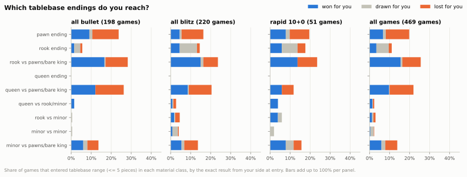
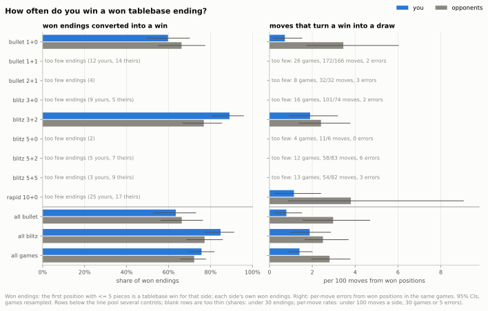
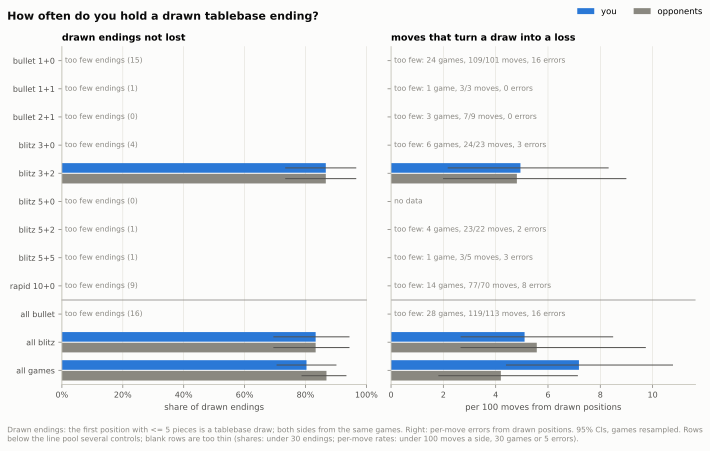
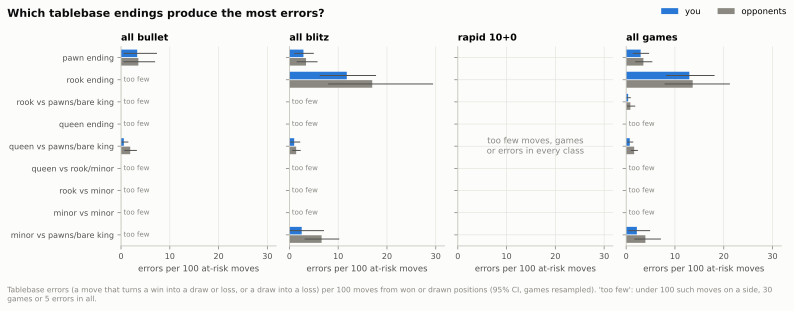
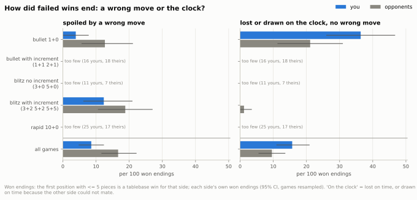

## 10. How well do you play endgames?

**Short answer:** In the simplest endings you spoil wins less often than your opponents and convert about as well, but in 1+0 the clock costs you: 36 of every 100 of your won endings (your opponents: 21) ended on the clock without a single wrong move.

### 10.1 Which endgames do you reach?

- 7.8% of your games reach a position with five pieces or fewer (where the tablebase knows the exact result): 5.5% in 1+0, 12% in 3+2.
- At that point you are winning 44.8% of them, drawn in 13.0% and losing in 42.2%.
- The commonest endings are a rook (25.6%) or a queen (22.0%) against pawns or a bare king, then pawn endings (19.8%).
- Rook endings are mostly drawn: 29 of 52 entered as a tablebase draw.

Data: [1_endgames_reached.csv](data/10_endgames/1_endgames_reached.csv) · [1b_tablebase_reach.csv](data/10_endgames/1b_tablebase_reach.csv) · [all tables](data/10_endgames/_index.csv) · [script](../analysis/10_endgames.py) · source: [tablebase.parquet](../data/zakihussa1n/tablebase.parquet)

### 10.2 How often do you win a won ending?

- Across all games you won 75.7% of your tablebase-won endings (CI 69.5% to 81.9%) and your opponents 72.2% of theirs: no clear difference.
- The control matters more than the side: in 1+0 you converted 59.7% (CI 49.4% to 70.1%), in 3+2 89.0% (CI 80.8% to 95.9%).
- Across all games, against the model's expectation at entry (it knows both clocks), you scored +0.035 (CI +0.010 to +0.060), about +44 Elo (CI +12 to +81); your opponents −0.018 (CI −0.045 to +0.008).
- In 1+0 you scored +0.035 above that expectation (CI −0.012 to +0.083), about +30 Elo (CI −10 to +77): no clear difference, so the low 1+0 conversion is about what your clock and position at entry predict.
- Move by move, across all games, you spoil a win less often: 1.40 moves in 100 turn a win into a draw, against 2.81 for your opponents (−1.40, CI −2.58 to −0.33).

Data: [2_conversion.csv](data/10_endgames/2_conversion.csv) · [2b_errors_by_kind.csv](data/10_endgames/2b_errors_by_kind.csv) · [all tables](data/10_endgames/_index.csv) · [script](../analysis/10_endgames.py) · source: [moves_analysed.parquet](../data/zakihussa1n/moves_analysed.parquet)

### 10.3 How often do you hold a drawn ending?

- Only 61 games entered a drawn tablebase ending; you avoided losing 80.3% of them, your opponents 86.9%: no clear difference (−0.066, CI −0.213 to +0.066).
- In 1+0 you lost 6 of 15 drawn endings and your opponents 2 (difference −0.267, CI −0.600 to +0.067); per move that is 12.84 against 1.98 draw-to-loss errors per 100 moves, but from only 24 games, too few to be sure.
- In 3+2, no clear difference: 4.95 against 4.81 per 100 moves (difference CI −4.67 to +5.09).
- Across all games, pawn endings are where you let draws slip: 5.26 per 100 moves from drawn pawn endings against 1.11 for your opponents (+4.15, CI +0.55 to +8.70).

Data: [3_hold.csv](data/10_endgames/3_hold.csv) · [2b_errors_by_kind.csv](data/10_endgames/2b_errors_by_kind.csv) · [4b_errors_by_material_kind.csv](data/10_endgames/4b_errors_by_material_kind.csv) · [all tables](data/10_endgames/_index.csv) · [script](../analysis/10_endgames.py) · source: [moves_analysed.parquet](../data/zakihussa1n/moves_analysed.parquet)

### 10.4 Which endings produce the most errors?

- Rook endings are the hardest for both sides: 12.95 errors per 100 at-risk moves for you and 13.64 for your opponents, against 2.97 and 3.53 in pawn endings.
- A rook or queen against pawns or a bare king almost never goes wrong: 0.40 and 0.74 errors per 100 of your moves.
- The balance with the most errors is rook against rook and pawn: as the defender you erred 13 times in 54 moves, your opponents 16 times in 60.
- Beyond five pieces there is no clear difference in rook endings (0.0267 against 0.0270 expected points lost per move); across all endings there you make slightly fewer big mistakes (8.99 against 9.23 per 100 moves, CI −0.46 to −0.03).

Data: [4_errors_by_material.csv](data/10_endgames/4_errors_by_material.csv) · [4c_exact_material.csv](data/10_endgames/4c_exact_material.csv) · [4e_big_endgames_ep_loss.csv](data/10_endgames/4e_big_endgames_ep_loss.csv) · [4f_big_mistakes.csv](data/10_endgames/4f_big_mistakes.csv) · [all tables](data/10_endgames/_index.csv) · [script](../analysis/10_endgames.py) · source: [moves_analysed.parquet](../data/zakihussa1n/moves_analysed.parquet)

### 10.5 How did failed wins end: a wrong move or the clock?

- In 1+0, 36 of every 100 of your won endings (CI 26 to 47) ended on the clock without a single wrong move; for your opponents 21 (difference +15, CI +2 to +30).
- Most were draws: your flag fell but your opponent had too little material to mate (21 of your 31 failed 1+0 conversions).
- You arrive with less time: in 1+0 your median clock at entry was 6.2 s, your opponents' 8.7 s; from under 5 s, 16 of your 25 and 10 of your opponents' 19 won endings ended on the clock (both small groups).
- For you the increment nearly removes it: 1 of your 16 won endings in bullet with increment ended on the clock, 30 per 100 fewer than in 1+0 (CI 6 to 42); for your opponents no clear difference (21 against 17 per 100), and both rest on few endings.
- A wrong move spoiled only 3.9 of every 100 of your 1+0 won endings, against 12.7 for your opponents.

Data: [5_failed_conversions.csv](data/10_endgames/5_failed_conversions.csv) · [5b_increment_contrast.csv](data/10_endgames/5b_increment_contrast.csv) · [5d_entry_clock.csv](data/10_endgames/5d_entry_clock.csv) · [2_conversion.csv](data/10_endgames/2_conversion.csv) · [all tables](data/10_endgames/_index.csv) · [script](../analysis/10_endgames.py) · source: [moves_analysed.parquet](../data/zakihussa1n/moves_analysed.parquet)

Method and caveats

- Games: standard live games in each time control with at least 50 games (bullet 1+0 to rapid 10+0); bullet 0.5+0 (19 games) and rapid 30+0 (1 game) are too thin and left out.
- Tablebase range is five pieces or fewer, kings included (Syzygy 3-4-5): the exact result (win, draw, loss) is known before and after every move. A game's first position in range fixes its theoretical result for the rest of the game, because pieces only leave the board.
- A won ending is converted when the game was won; a drawn ending is held when it was not lost. Your conversions and your opponents' come from different games (each side's own won endings), so their difference resamples both sets; hold rates come from the same games and are compared game by game.
- The expected score at entry is the calibrated model's (see `reports/calibration.md`); it knows both clocks and pre-game ratings, so a short clock already lowers it. The Elo-equivalent is the rating gap that moves that expectation by the same amount.
- A tablebase error is a move that turns a win into a draw or loss, or a draw into a loss. Error rates are per 100 at-risk moves (moves from won or drawn positions: a lost position cannot get worse), you against your opponents in the same games, with the difference resampled by game.
- A failed conversion counts as a wrong move when the winning side made at least one tablebase error; otherwise it is classed by how the game ended: lost on time, drawn on time against a side that could not mate (chess.com's timeout vs insufficient material), or other (repetition, agreement).
- Clock bands are under 5 s, 5-15 s, 15-60 s and 60+ s, both as seconds left and as the buffer beyond one increment; in controls without increment they are the same. They are in the tables (5c, 5d); error rates per move show no clear relation to the clock.
- Tablebase data are small: 9,898 moves in 469 games with 160 errors. Only 1+0 and 3+2 have enough endings for their own estimates, so every table also has pools per time class ("all bullet"), by increment within a class ("bullet with increment" = 1+1 and 2+1; "blitz no increment" = 3+0 and 5+0), and all games; the charts of material classes show the time-class pools and all games.
- Thin flags: a share from fewer than 30 endings is thin; a per-move error rate is thin with fewer than 100 at-risk moves on a side, fewer than 30 games, or fewer than 5 errors on both sides together (beyond five pieces the move minimum is 200 a side). Thin cells stay in the CSVs with `thin` = True and are not drawn.
- The 1+0 draw-to-loss rate is thin by that rule (24 games, 15 drawn endings): one or two games with several errors each can carry it, and it was one of about 60 view-by-kind cells, so read it as a hint.
- A side with no events in a cell gets a bootstrap CI of 0 to 0; that is not certainty, just too few events (such cells are flagged thin when both sides together have fewer than 5).
- The increment comparison (5b) also gives score intervals (Wilson for each rate, Newcombe for the difference), which the bullet quotes: with one clock failure in 16 endings the bootstrap CI is too narrow.
- Exact material balances (4c) are pooled over all games: per control they hold one or two errors each. They are ranked by total errors, not by rate.
- Time class and increment of each control come from the data (the games' time class and increment), not from the label text.
- Beyond five pieces, "endgame" is the enrichment's material heuristic and the material class is the piece types on the board, whatever side has them; quality is expected points lost per move (calibrated) with centipawn loss alongside (tables 4e and 4f); a big mistake loses at least 0.10 expected points.
- The tablebase gives win, draw or loss only, without the 50-move rule's cursed wins; DTZ (moves to the next capture or pawn move that keeps the win) and time spent per move in won positions are in tables 5e and 5f.
- CIs: 1,000 resamples of whole games for game-level rates, 500 for per-move cells; fixed seeds.

