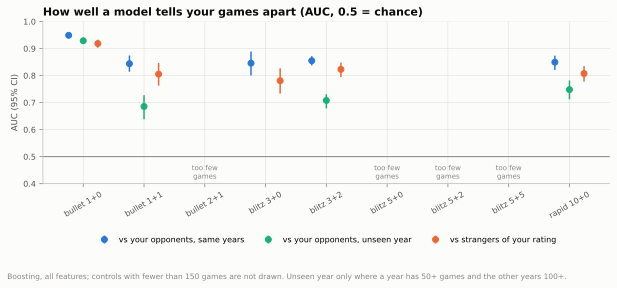
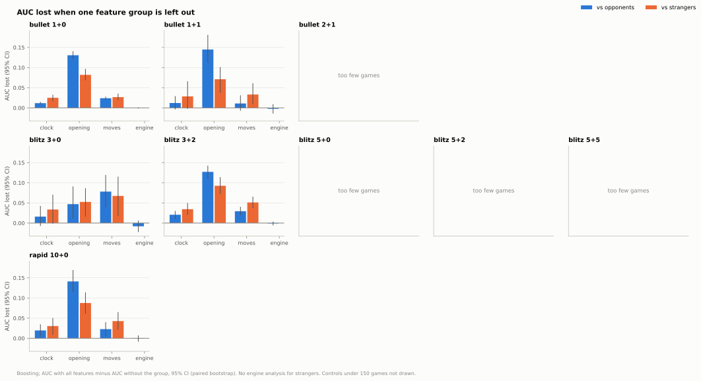
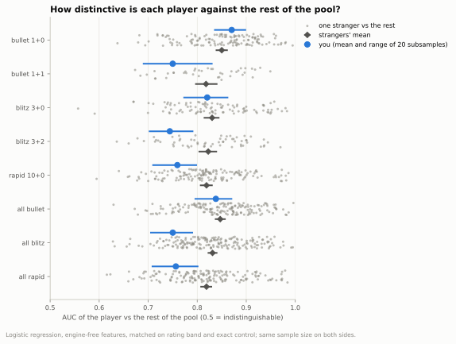
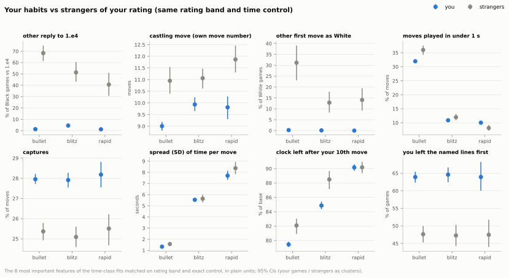
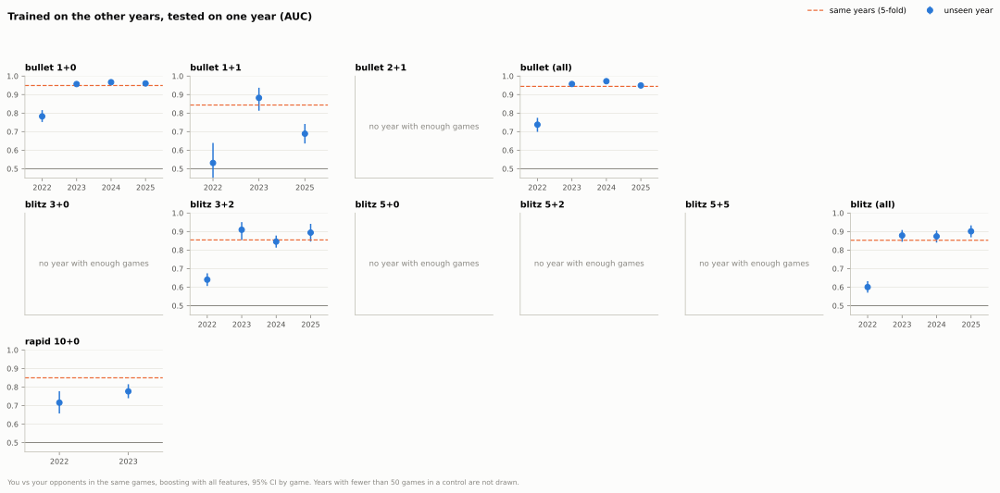

## 12. Can a model pick out your games, and what gives you away?

**Short answer:** Yes: in 1+0 a model picks out which side of the board was you in 91% of games, mostly from your opening choices, but you are no easier to recognise than a typical stranger of your rating (in 3+2 and 10+0 harder), so having a fingerprint is normal rather than special.

### 12.1 How well can a model tell your games from your opponents'?

- In 1+0 the model picks out which side was you in 91% of games (AUC 0.949, CI 0.943 to 0.955; 0.5 would be guessing).
- In 1+1, 3+0, 3+2 and 10+0 it is less sure but still clear: AUC 0.844 to 0.855.
- On a year it never trained on, 1+0 holds up (AUC 0.929) but 3+2 drops to 0.708, largely because 830 of its 1,344 games are from 2022, the odd year out (see below).
- Against strangers of your rating playing the same control it still works: AUC 0.919 in 1+0, and 0.781 to 0.823 in 1+1, 3+0, 3+2 and 10+0.

Data: [1_auc.csv](data/12_fingerprint/1_auc.csv) · [1b_vs_strangers.csv](data/12_fingerprint/1b_vs_strangers.csv) · [5_unseen_year.csv](data/12_fingerprint/5_unseen_year.csv) · [all tables](data/12_fingerprint/_index.csv) · [script](../analysis/12_fingerprint.py) · source: [moves_analysed.parquet](../data/zakihussa1n/moves_analysed.parquet), [fingerprint_features.parquet](../data/opponents/fingerprint_features.parquet)

### 12.2 What gives you away?

- Your opening choices are the biggest tell: leaving them out costs 0.131 AUC in 1+0 (CI 0.120 to 0.141), and 0.127 to 0.145 in 1+1, 3+2 and 10+0.
- 3+0 is the exception: there your move habits (captures, castling, piece use) give away more than your openings (0.078 against 0.047 AUC lost).
- Your mistakes say almost nothing about who you are: leaving out the engine-based error profile makes no clear difference in any control, and on its own it scores 0.521 in 1+0 (CI 0.507 to 0.537), barely above guessing.
- The clock looks like a tell in blitz mostly because of the increment: leaving it out costs 0.075 AUC (CI 0.059 to 0.090) against strangers matched on rating alone, but 0.024 (CI 0.013 to 0.036) when they also play the same control.

Data: [2_drop_group.csv](data/12_fingerprint/2_drop_group.csv) · [2b_drop_group_strangers.csv](data/12_fingerprint/2b_drop_group_strangers.csv) · [all tables](data/12_fingerprint/_index.csv) · [script](../analysis/12_fingerprint.py) · source: [moves_analysed.parquet](../data/zakihussa1n/moves_analysed.parquet), [fingerprint_features.parquet](../data/opponents/fingerprint_features.parquet)

### 12.3 Are you more recognisable than a typical player of your rating?

- In 1+0 you are a typical player: 55% of strangers (CI 44% to 66%) are less distinctive than you against the rest of the pool.
- In 3+2 and 10+0 you are less distinctive than most: only 15% (CI 7% to 27%) and 20% (CI 13% to 27%) of strangers are less distinctive than you.
- One stranger at a time, there is no clear difference in 1+0 between telling you apart and telling two strangers apart (paired by stranger: +0.013, CI −0.008 to +0.033).
- In 3+0 you are slightly harder to tell from any one stranger than strangers are from each other (−0.029, CI −0.058 to −0.002).

Data: [3_vs_rest.csv](data/12_fingerprint/3_vs_rest.csv) · [3c_per_pair.csv](data/12_fingerprint/3c_per_pair.csv) · [all tables](data/12_fingerprint/_index.csv) · [script](../analysis/12_fingerprint.py) · source: [fingerprint_features.parquet](../data/opponents/fingerprint_features.parquet)

### 12.4 Which habits set you apart?

- Against 1.e4 you almost always reply 1...e5 or 1...c5: in bullet another reply comes in 1.3% of your Black games against 1.e4, against 68% for strangers of your rating.
- As White you open 1.e4 or 1.d4: another first move in 0.2% of your bullet White games, against 31% for strangers.
- You castle one to two moves earlier: on your move 9.0 against 10.9 for strangers in bullet, 9.9 against 11.1 in blitz, 9.8 against 11.9 in rapid.
- Instant moves go opposite ways: in bullet 32.0% of your moves take under 1 second against 36.0% for strangers, in rapid 10.0% against 8.1%.

Data: [4_habits.csv](data/12_fingerprint/4_habits.csv) · [all tables](data/12_fingerprint/_index.csv) · [script](../analysis/12_fingerprint.py) · source: [fingerprint_features.parquet](../data/opponents/fingerprint_features.parquet)

### 12.5 Has your style stayed the same over the years?

- 2022 is the odd year out: trained on the other years, the model recognises your 2022 games with AUC 0.782 in 1+0 and 0.640 in 3+2.
- In 1+0 and 3+2 the years from 2023 on look alike: on a year it never saw, the model scores 0.957 to 0.967 in 1+0 and 0.846 to 0.910 in 3+2.
- In 1+1 (2025: 0.689) and 10+0 (2023: 0.777) the unseen-year score stays below the same-years score (0.844 and 0.850).
- In 1+0 in 2022 you castled later (on your move 13.4, against 9.3 in 2023 and 8.5 in 2025) and played fewer instant moves (26.2% under 1 second, against 35.8% in 2023).

Data: [5_unseen_year.csv](data/12_fingerprint/5_unseen_year.csv) · [5b_habits_by_year.csv](data/12_fingerprint/5b_habits_by_year.csv) · [all tables](data/12_fingerprint/_index.csv) · [script](../analysis/12_fingerprint.py) · source: [moves_analysed.parquet](../data/zakihussa1n/moves_analysed.parquet)

Method and caveats

- Games: your standard live games in the nine reported controls where both sides made at least 8 moves (5,696 games: 1+0 2,839, 1+1 380, 2+1 75, 3+0 203, 3+2 1,344, 5+0 87, 5+2 106, 5+5 127, 10+0 535; see 0_sample.csv). The thin controls 0.5+0 (19 games) and 30+0 (1 game) are left out of everything.
- Thin controls: a model fit needs at least 150 games (MIN_FIT_GAMES). Below that the training folds hold fewer than 120 games and every control scored 0.48 to 0.71 against 0.84 or more above it, which says the model is short of data, not that you play differently there. 2+1 (75 games, AUC 0.48: no better than guessing), 5+0 (87), 5+2 (106) and 5+5 (127) are marked thin in the tables and not drawn; they still count in "all bullet" and "all blitz".
- Features: one row per player and game, 51 in four groups. Clock: time per move by phase, its spread and maximum, clock left after your 10th, 20th and 40th move and at the end, share of moves started under 10 s and played under 1 s. Moves: game length, capture and check rates, whether, when and which side you castled, share of moves by piece, promotions, en passant, early queen moves. Opening: first move as White, reply as Black, ECO letter and depth of the deepest named line, who left the named lines first. Engine (your games only): mean expected points and centipawns lost, shares of large losses, share of engine-best moves. Never the result, ratings, names, colour or time control.
- The feature thresholds (10 s, 1 s, own moves 10/20/40, early queen within 10 moves, losses of 0.1 and 0.2 expected points or 300 centipawns) are named constants in the script and must stay fixed: the committed strangers' table was built with them.
- "Under 10 s" and "under 1 s" are plain seconds: in 1+1 and 3+2 the clock includes the increment. A version counting the clock beyond one increment is in 4c_habits_vs_opponents.csv (under10_buffer, you vs your opponents only); putting it into the models needs --rebuild-features from archives that are not committed.
- 12.1, 12.2, 12.5 (you vs your opponents): both rows of a game go into the same cross-validation fold (5 folds grouped by game), so the model never sees the other half of a test game. AUC is the chance that a random row of yours scores above a random opponent row; "picks out which side was you" is the share of games where your row scores higher (pairwise accuracy). CIs: 500 bootstrap resamples of games. Drop-one-group CIs are paired (same resamples for both fits).
- You vs your opponents is not the honest test of a fingerprint: game length, ECO letter and book depth are identical for both rows of a game, so they can help only through interactions, and the opponent side mixes hundreds of people (one of them about 200 of your games). The comparison with strangers of your rating (12.1 last bullet, 12.2, 12.3, 12.4) is the stricter one.
- Models: gradient boosting (scikit-learn HistGradientBoosting, 200 trees, 15 leaves, single-threaded) is the headline; regularised logistic regression is in every table as a check and gives the same picture a few hundredths lower.
- Unseen year: train on all other years, test on one; a test year needs at least 50 games in the control and the other years at least 100 games to train on. Only 1+0, 1+1, 3+2 and 10+0 have such years, so the chart also shows bullet and blitz with all their controls pooled ("all bullet", "all blitz" in the tables); within-game comparisons are not confounded by mixing controls, because both rows of a game share the control.
- Strangers: games of your 200 most frequent opponents against third parties (games against you excluded), up to 120 per time class per person, sampled once from their whole history and stored in data/opponents/fingerprint_features.parquet (rebuilt only with --rebuild-features from archives that are not committed). They are replayed with a light python-chess pass that reproduces the stored enrichment exactly on 300 of your games (0_self_check.csv). Engine features do not exist for them, so every comparison with strangers is engine-free for you too.
- Matching: your games and the strangers' are matched in 100-point rating bands (your pre-game rating; the strangers' post-game rating in their own game, as pre-game ratings are not in their archives). A control gets its own fit when it has at least 150 matched games on each side: 1+0, 1+1, 3+0, 3+2 and 10+0. 2+1, 5+0, 5+2 and 5+5 are covered by their time class with every game matched on band and exact control (tc_group "all bullet"/"all blitz", matching "band and control"); 0_sample.csv says which fit answers for each control (strangers_fit_group). Strangers have only 30 games in 5+2.
- Clock features are confounded by increment: with an increment players can spend more time per move and their clock stays higher (clock features are fractions of the base time), so in a fit that mixes controls a clock "tell" can just mean "plays 3+2 rather than 3+0". Matched on rating band alone, 84.6% of your blitz games have an increment against 31.5% of the strangers' (2c_increment.csv). The band-only fits (matching "band only" in 1b, 2b, 2c, 2d) are kept to show the size of this effect; every habit and every other "vs strangers" number comes from fits matched on exact control.
- Pooled you-vs-strangers fits keep each stranger's games in one fold (a test stranger is never seen in training); their CIs resample strangers as clusters and your games individually. A fit with fewer than 20 strangers would be marked thin in 1b (none is).
- "Vs the rest" (12.3): each stranger with at least 30 games in the fit against everyone else in it (up to 3 rest games per own game, same bands), and 20 random subsamples of your games of the median stranger's size against the same pool; logistic regression, engine-free features. Your interval in the chart and table is the 2.5-97.5% range of the 20 draws: it shows only which of your games were drawn, not how sure we are about you as a player. The share of strangers less distinctive than you is bootstrapped over strangers and your draws, treating the overlapping draws as independent, so its CI is somewhat too narrow.
- Per-pair test (12.3, 3c): you vs each stranger and each stranger vs two random other strangers, same matching, sizes (at least 30 games a side) and 5-fold procedure; the difference is paired by stranger (your AUC against a stranger minus that stranger's mean AUC against its partners). 1+1 has only 10 paired strangers and is marked thin. The per-pair test and "vs the rest" answer different questions: almost any two people can be told apart, while being unusual against a whole pool takes rare habits; common habits held very consistently (yours) make you easy to tell from any one person but not an outlier.
- Your features are stored at the same float32 precision as the strangers' before fitting: mixing float64 and float32 values lets boosting split on rounding noise and inflated the AUC against strangers by about 0.05 in a first run.
- Habits (12.4) are per game in plain units: seconds, share of moves, own move number; colour-specific habits are measured only on the games where they apply (replies to 1.e4 only in Black games where White played 1.e4). The chart shows the 8 features with the best mean importance rank (boosting permutation importance on a held-out fold) across the three time-class fits matched on control; every feature is in 4_habits.csv, ranks in 4b_importance.csv, you vs your opponents in 4c_habits_vs_opponents.csv. Your habits by year (12.5) are quoted for 1+0 alone, because the mix of bullet controls changed between years.
- Limits: the "reply to 1.e4" features on Black rows also encode what White played; strangers' games span their whole chess.com history (often 5 to 10 years), so era effects (fashions, site changes) can separate strangers too; the opponent pool is people you met, not a random sample of chess.com; correlated clock features share importance; a fingerprint describes habits, it says nothing about what wins.

