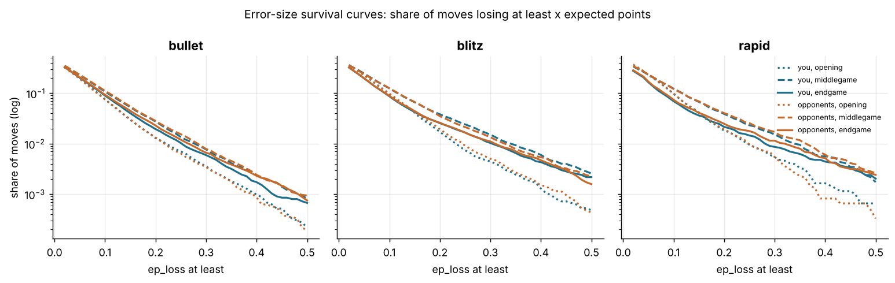
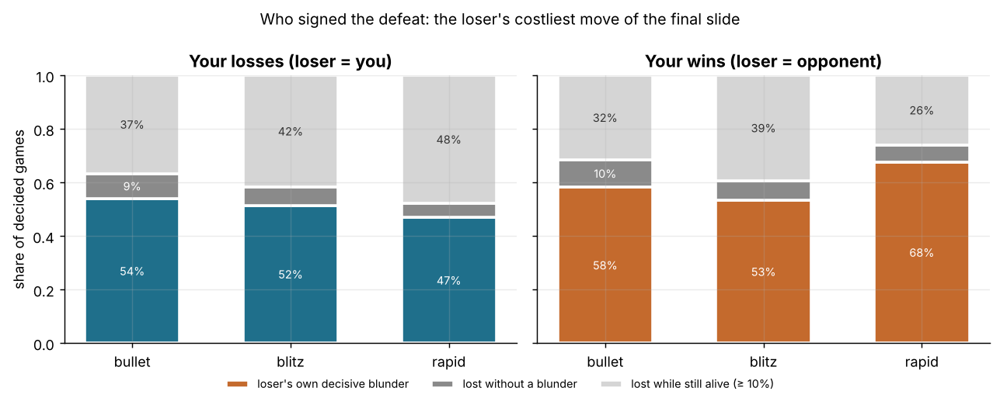
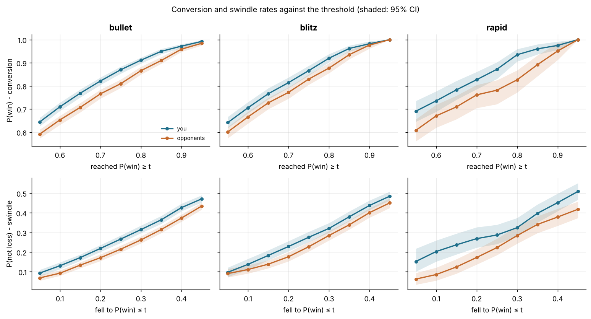

# Where points are won and lost: your mistakes vs your opponents'

Data: 6,027 standard live games with at least one move (3,452 bullet, 1,987 blitz, 588 rapid) and 364,685 analysed moves (182,422 yours), player zakihussa1n. Numbers are estimate [95% CI], CIs bootstrapped by game (500 resamples). `ep_loss` is the calibrated expected points a move gives away; `cp_loss` is the secondary measure. Every number about you sits next to the opponents' number from the same games.

## 1. The expected-points budget per game

For every game, the expected points (calibrated win probability + half the draw probability) each side gave away is the sum of its moves' `ep_loss`. The per-game numbers below are means over games (CIs bootstrapped by game); the difference is paired within the same games (opponents minus you; positive = opponents gave away more). Totals are the sums over all games of that time class, i.e. points handed over in total.

| time class | games | your ep lost / game | their ep lost / game | theirs − yours | your total | their total | your cp lost / game | their cp lost / game |
|---|---|---|---|---|---|---|---|---|
| bullet | 3452 | 0.906 [0.875, 0.941] | 0.914 [0.883, 0.950] | 0.009 [0.000, 0.017] | 3127 | 3156 | 2279 [2240, 2328] | 2227 [2185, 2272] |
| blitz | 1987 | 0.948 [0.899, 0.994] | 0.949 [0.902, 0.996] | 0.000 [-0.011, 0.013] | 1884 | 1885 | 2011 [1947, 2075] | 2037 [1979, 2101] |
| rapid | 588 | 0.835 [0.755, 0.912] | 0.861 [0.784, 0.936] | 0.025 [0.003, 0.048] | 491 | 506 | 1772 [1679, 1874] | 1882 [1783, 1993] |

Where the score comes from. Your score in a game is approximately `my_ep_start − my_ep_lost + opp_ep_lost + residual`, where `my_ep_start` is the model's expectation at move 1 (it knows both pre-game ratings and the time control), and the residual collects what the engine-based decomposition cannot see: the result of resignations, flag falls, the model's end-of-game error, and small 'gains' where the engine's deeper search after a move rates the position better than before it (`*_ep_gained`, stored separately; they roughly cancel between the sides). Means per game:

| time class | score | ep at move 1 | score − ep at move 1 | − your ep lost | + their ep lost | residual | score − ep at last move |
|---|---|---|---|---|---|---|---|
| bullet | 0.512 [0.495, 0.528] | 0.504 [0.501, 0.507] | 0.008 [-0.008, 0.024] | 0.906 [0.875, 0.941] | 0.914 [0.883, 0.950] | -0.000 [-0.012, 0.011] | 0.010 [0.002, 0.018] |
| blitz | 0.518 [0.496, 0.538] | 0.498 [0.494, 0.503] | 0.019 [-0.001, 0.039] | 0.948 [0.899, 0.994] | 0.949 [0.902, 0.996] | 0.019 [0.008, 0.031] | 0.010 [0.001, 0.018] |
| rapid | 0.548 [0.505, 0.590] | 0.505 [0.497, 0.513] | 0.044 [0.004, 0.082] | 0.835 [0.755, 0.912] | 0.861 [0.784, 0.936] | 0.018 [-0.004, 0.042] | -0.005 [-0.019, 0.009] |

Read: in every time class you and your opponents each give away close to a full point per game (a ~0.03 ep loss per move over ~30 moves each); the net difference is a few hundredths of a point, and your score exceeds the model's move-1 expectation by about one to four hundredths. The residual is small and, where it is positive, reflects games that ended (resignation, flag, abandonment) before the board said so, plus the clipping of `ep_loss` at zero.

## 2. Error sizes: you vs your opponents, by phase

Mean `ep_loss` per move (both sides lose ~0.03), then the share of moves that lose at least 0.1, 0.2 and 0.3 expected points (the tail where games are decided). Differences are you minus opponents in the same games; negative = you err less. `cp_loss` means and blunder rates (cp_loss ≥ 300) are the secondary measures.

### Mean ep_loss per move

| time_class | phase | you | opponents | you − them | games | n |
|---|---|---|---|---|---|---|
| bullet | opening | 0.0266 [0.0254, 0.0277] | 0.0259 [0.0248, 0.0270] | 0.0007 [0.0003, 0.0011] | 3452 | 73402 |
| bullet | middlegame | 0.0326 [0.0313, 0.0339] | 0.0332 [0.0319, 0.0345] | -0.0006 [-0.0012, -0.0000] | 3179 | 64109 |
| bullet | endgame | 0.0285 [0.0273, 0.0299] | 0.0295 [0.0284, 0.0308] | -0.0010 [-0.0015, -0.0005] | 2376 | 77397 |
| blitz | opening | 0.0306 [0.0291, 0.0321] | 0.0310 [0.0295, 0.0325] | -0.0004 [-0.0011, 0.0002] | 1987 | 41750 |
| blitz | middlegame | 0.0372 [0.0352, 0.0392] | 0.0364 [0.0342, 0.0383] | 0.0008 [-0.0002, 0.0017] | 1706 | 32707 |
| blitz | endgame | 0.0295 [0.0275, 0.0316] | 0.0298 [0.0281, 0.0320] | -0.0003 [-0.0010, 0.0004] | 1108 | 43094 |
| rapid | opening | 0.0309 [0.0281, 0.0334] | 0.0315 [0.0285, 0.0343] | -0.0006 [-0.0019, 0.0005] | 588 | 12183 |
| rapid | middlegame | 0.0360 [0.0321, 0.0399] | 0.0368 [0.0329, 0.0408] | -0.0009 [-0.0026, 0.0008] | 477 | 9224 |
| rapid | endgame | 0.0253 [0.0218, 0.0292] | 0.0268 [0.0234, 0.0308] | -0.0015 [-0.0027, -0.0001] | 284 | 10819 |

### Share of moves losing ≥ 0.1 expected points

| time_class | phase | you | opponents | you − them | games | n |
|---|---|---|---|---|---|---|
| bullet | opening | 0.076 [0.071, 0.081] | 0.075 [0.070, 0.081] | 0.001 [-0.002, 0.003] | 3452 | 73402 |
| bullet | middlegame | 0.108 [0.102, 0.114] | 0.112 [0.105, 0.118] | -0.003 [-0.007, 0.000] | 3179 | 64109 |
| bullet | endgame | 0.090 [0.084, 0.097] | 0.093 [0.088, 0.099] | -0.003 [-0.006, -0.001] | 2376 | 77397 |
| blitz | opening | 0.097 [0.089, 0.105] | 0.098 [0.090, 0.107] | -0.001 [-0.005, 0.002] | 1987 | 41750 |
| blitz | middlegame | 0.125 [0.117, 0.134] | 0.126 [0.117, 0.135] | -0.001 [-0.006, 0.004] | 1706 | 32707 |
| blitz | endgame | 0.087 [0.079, 0.096] | 0.089 [0.081, 0.098] | -0.002 [-0.005, 0.001] | 1108 | 43094 |
| rapid | opening | 0.098 [0.085, 0.111] | 0.098 [0.085, 0.111] | -0.000 [-0.007, 0.007] | 588 | 12183 |
| rapid | middlegame | 0.123 [0.106, 0.141] | 0.122 [0.105, 0.138] | 0.002 [-0.007, 0.011] | 477 | 9224 |
| rapid | endgame | 0.069 [0.054, 0.087] | 0.074 [0.060, 0.091] | -0.005 [-0.010, 0.001] | 284 | 10819 |

### Share of moves losing ≥ 0.2

| time_class | phase | you | opponents | you − them | games | n |
|---|---|---|---|---|---|---|
| bullet | opening | 0.013 [0.011, 0.015] | 0.013 [0.012, 0.015] | -0.000 [-0.002, 0.001] | 3452 | 73402 |
| bullet | middlegame | 0.028 [0.025, 0.030] | 0.028 [0.026, 0.031] | -0.001 [-0.003, 0.001] | 3179 | 64109 |
| bullet | endgame | 0.019 [0.018, 0.021] | 0.023 [0.021, 0.025] | -0.003 [-0.005, -0.002] | 2376 | 77397 |
| blitz | opening | 0.017 [0.015, 0.020] | 0.019 [0.017, 0.022] | -0.002 [-0.004, -0.000] | 1987 | 41750 |
| blitz | middlegame | 0.038 [0.035, 0.042] | 0.035 [0.032, 0.038] | 0.003 [-0.000, 0.006] | 1706 | 32707 |
| blitz | endgame | 0.026 [0.023, 0.028] | 0.026 [0.024, 0.029] | -0.001 [-0.003, 0.001] | 1108 | 43094 |
| rapid | opening | 0.018 [0.015, 0.021] | 0.019 [0.016, 0.023] | -0.001 [-0.005, 0.002] | 588 | 12183 |
| rapid | middlegame | 0.039 [0.032, 0.046] | 0.040 [0.033, 0.047] | -0.001 [-0.007, 0.004] | 477 | 9224 |
| rapid | endgame | 0.022 [0.017, 0.026] | 0.025 [0.020, 0.029] | -0.003 [-0.007, 0.001] | 284 | 10819 |

### Share of moves losing ≥ 0.3

| time_class | phase | you | opponents | you − them | games | n |
|---|---|---|---|---|---|---|
| bullet | opening | 0.0036 [0.0027, 0.0046] | 0.0035 [0.0027, 0.0044] | 0.0001 [-0.0005, 0.0008] | 3452 | 73402 |
| bullet | middlegame | 0.0077 [0.0066, 0.0088] | 0.0079 [0.0068, 0.0089] | -0.0002 [-0.0014, 0.0010] | 3179 | 64109 |
| bullet | endgame | 0.0059 [0.0051, 0.0069] | 0.0066 [0.0056, 0.0076] | -0.0007 [-0.0017, 0.0002] | 2376 | 77397 |
| blitz | opening | 0.0045 [0.0035, 0.0055] | 0.0050 [0.0040, 0.0062] | -0.0006 [-0.0018, 0.0006] | 1987 | 41750 |
| blitz | middlegame | 0.0151 [0.0130, 0.0172] | 0.0135 [0.0115, 0.0155] | 0.0016 [-0.0003, 0.0035] | 1706 | 32707 |
| blitz | endgame | 0.0103 [0.0089, 0.0118] | 0.0111 [0.0096, 0.0127] | -0.0008 [-0.0024, 0.0006] | 1108 | 43094 |
| rapid | opening | 0.0054 [0.0038, 0.0073] | 0.0054 [0.0036, 0.0073] | 0.0000 [-0.0021, 0.0024] | 588 | 12183 |
| rapid | middlegame | 0.0152 [0.0116, 0.0195] | 0.0171 [0.0127, 0.0215] | -0.0020 [-0.0055, 0.0016] | 477 | 9224 |
| rapid | endgame | 0.0087 [0.0060, 0.0113] | 0.0115 [0.0087, 0.0145] | -0.0028 [-0.0060, -0.0001] | 284 | 10819 |

### Mean cp_loss per move (secondary)

| time_class | phase | you | opponents | you − them | games | n |
|---|---|---|---|---|---|---|
| bullet | opening | 57.6 [56.3, 59.1] | 58.7 [57.3, 60.1] | -1.1 [-2.3, 0.2] | 3452 | 73402 |
| bullet | middlegame | 96.7 [94.0, 99.1] | 91.9 [89.5, 94.5] | 4.8 [2.9, 6.7] | 3179 | 64109 |
| bullet | endgame | 68.5 [66.2, 70.8] | 67.0 [64.8, 69.3] | 1.5 [-0.0, 2.9] | 2376 | 77397 |
| blitz | opening | 54.6 [52.9, 56.5] | 57.5 [55.8, 59.4] | -2.9 [-4.6, -1.4] | 1987 | 41750 |
| blitz | middlegame | 93.6 [90.1, 97.0] | 91.8 [88.6, 94.7] | 1.8 [-0.9, 4.5] | 1706 | 32707 |
| blitz | endgame | 61.4 [58.4, 64.4] | 62.6 [59.4, 65.6] | -1.2 [-3.2, 0.9] | 1108 | 43094 |
| rapid | opening | 54.5 [51.7, 57.4] | 59.7 [56.6, 63.0] | -5.2 [-8.3, -2.1] | 588 | 12183 |
| rapid | middlegame | 89.8 [83.7, 97.0] | 91.9 [86.0, 98.2] | -2.0 [-6.9, 3.0] | 477 | 9224 |
| rapid | endgame | 54.4 [49.6, 58.8] | 59.3 [54.3, 63.8] | -4.9 [-8.9, -1.1] | 284 | 10819 |

### Blunder rate (cp_loss ≥ 300, secondary)

| time_class | phase | you | opponents | you − them | games | n |
|---|---|---|---|---|---|---|
| bullet | opening | 0.041 [0.039, 0.044] | 0.043 [0.041, 0.045] | -0.002 [-0.004, 0.000] | 3452 | 73402 |
| bullet | middlegame | 0.087 [0.084, 0.091] | 0.082 [0.078, 0.086] | 0.005 [0.002, 0.008] | 3179 | 64109 |
| bullet | endgame | 0.060 [0.056, 0.063] | 0.058 [0.055, 0.061] | 0.002 [-0.000, 0.004] | 2376 | 77397 |
| blitz | opening | 0.037 [0.034, 0.039] | 0.041 [0.039, 0.044] | -0.005 [-0.008, -0.002] | 1987 | 41750 |
| blitz | middlegame | 0.084 [0.079, 0.090] | 0.084 [0.079, 0.089] | 0.000 [-0.004, 0.005] | 1706 | 32707 |
| blitz | endgame | 0.056 [0.052, 0.060] | 0.056 [0.052, 0.060] | 0.000 [-0.003, 0.003] | 1108 | 43094 |
| rapid | opening | 0.040 [0.034, 0.044] | 0.044 [0.039, 0.049] | -0.004 [-0.010, 0.001] | 588 | 12183 |
| rapid | middlegame | 0.083 [0.073, 0.091] | 0.080 [0.072, 0.089] | 0.002 [-0.005, 0.011] | 477 | 9224 |
| rapid | endgame | 0.050 [0.043, 0.056] | 0.053 [0.045, 0.059] | -0.003 [-0.009, 0.003] | 284 | 10819 |

Reading across the tables: the differences are at most a thousandth of a point per move. Your bullet endgames are the one cell that is cleaner than the opponents' on every measure (mean ep_loss, ≥0.1, ≥0.2); your bullet openings lose slightly more (mean ep_loss) and your blitz middlegames have a slightly fatter tail (≥0.2 and ≥0.3, CIs touching zero). In cp terms you lose more centipawns than opponents in bullet middlegames but not more expected points: those are big swings in positions already decided.

### How concentrated the damage is

Share of all expected points given away that came from moves losing at least 0.1, next to the share of moves those were (descriptive ratios over the whole class, no CI).

| time class | you: share of ep lost from moves ≥ 0.1 | you: share of moves ≥ 0.1 | opponents: share of ep lost from moves ≥ 0.1 | opponents: share of moves ≥ 0.1 |
|---|---|---|---|---|
| bullet | 0.52 | 0.091 | 0.53 | 0.092 |
| blitz | 0.56 | 0.101 | 0.57 | 0.103 |
| rapid | 0.57 | 0.096 | 0.57 | 0.097 |

*Share of moves losing at least x expected points, by phase (line style) and side (colour). Log scale.*

## 3. The decisive mistake: the loser's costliest move of the final slide

Who made the decisive mistake is answered over the loser's own moves only: by construction the decisive move is always the loser's (`decisive_by` is the loser's side), so the winner's moves never count as 'decisive', and the question becomes whether the loser signed their own defeat with an identifiable move or lost without one. For every decided game, the loser's P(win) is read before and after each of the loser's own moves. A game counts as lost on the board if the loser's P(win) after their last own move was below 10%. The final slide starts at the last move the loser made from a playable position (P(win) ≥ 20% before the move); the decisive mistake is the loser's costliest move from there to the end, and it counts as a blunder if it lost at least 0.05 expected points. (A plain 'last crossing below 10%' rule was tried first: the model's P(win) decays gradually in bullet and a quarter of games were 'decided' by the winner's routine recapture nudging the loser from 12% to 7%, so the crossing move was not the mistake.) 'Lost without a blunder' means the loser slid from the last playable position to a lost one without any single move costing 0.05. 'Lost while still alive' means the loser's last own move still left P(win) ≥ 10%: the game ended by flag, resignation, abandonment or a mate the model still gave chances against (in bullet the model keeps a real flag chance alive even at +10). The stricter pair (playable ≥ 30%, lost < 15%) is a sensitivity check.

| time class | loser | games | loser's own decisive blunder | lost without a blunder | lost while still alive (≥ 10%) | own decisive blunder, strict |
|---|---|---|---|---|---|---|
| bullet | you | 1612 | 0.539 [0.518, 0.563] | 0.095 [0.081, 0.110] | 0.366 [0.345, 0.388] | 0.676 [0.653, 0.698] |
| bullet | opponents | 1696 | 0.583 [0.560, 0.604] | 0.102 [0.088, 0.115] | 0.315 [0.294, 0.337] | 0.693 [0.672, 0.714] |
| blitz | you | 899 | 0.515 [0.484, 0.548] | 0.068 [0.052, 0.082] | 0.417 [0.383, 0.449] | 0.663 [0.632, 0.691] |
| blitz | opponents | 970 | 0.534 [0.504, 0.566] | 0.073 [0.057, 0.089] | 0.393 [0.360, 0.422] | 0.680 [0.653, 0.709] |
| rapid | you | 247 | 0.470 [0.409, 0.530] | 0.053 [0.024, 0.085] | 0.478 [0.417, 0.537] | 0.644 [0.581, 0.704] |
| rapid | opponents | 304 | 0.678 [0.625, 0.730] | 0.062 [0.039, 0.092] | 0.260 [0.207, 0.309] | 0.809 [0.763, 0.852] |

'Loser = you' are your losses; 'loser = opponents' are your wins. Each pair of rows compares the same thing from both sides: how often the losing side signs its own defeat with an identifiable move.

### Games lost while still alive, by how they ended

Share of decided games in which the loser's P(win) after their last own move was still ≥ 10%, split by the loser's termination, with the loser's P(win) after that last move in those games. Cells resting on fewer than 20 games are left blank (n shown). A checkmate counted as 'still alive' is not a contradiction: the bullet model's clock term keeps a real flag chance alive for the side about to be mated (even at −10 with the opponent short of time), so in bullet almost half the mated losers were still 'alive' by the model's reckoning.

| time class | loser | games | checkmated: share of games | checkmated: still alive | timeout: share of games | timeout: still alive | resigned: share of games | resigned: still alive | abandoned: share of games | abandoned: still alive | loser's P(win) after last own move, when alive |
|---|---|---|---|---|---|---|---|---|---|---|---|
| bullet | you | 1612 | 0.37 | 0.46 [0.42, 0.50] | 0.48 | 0.19 [0.17, 0.22] | 0.14 | 0.65 [0.59, 0.71] | 0.01 | 0.95 [0.84, 1.00] | 0.24 [0.23, 0.26] |
| bullet | opponents | 1696 | 0.23 | 0.38 [0.33, 0.43] | 0.62 | 0.21 [0.19, 0.24] | 0.13 | 0.60 [0.53, 0.66] | 0.03 | 0.83 [0.73, 0.94] | 0.27 [0.26, 0.28] |
| blitz | you | 899 | 0.37 | 0.25 [0.21, 0.30] | 0.17 | 0.36 [0.27, 0.43] | 0.44 | 0.57 [0.52, 0.61] | 0.01 | — (n=12) | 0.23 [0.21, 0.24] |
| blitz | opponents | 970 | 0.31 | 0.27 [0.22, 0.32] | 0.16 | 0.35 [0.27, 0.42] | 0.45 | 0.44 [0.40, 0.49] | 0.08 | 0.68 [0.57, 0.80] | 0.25 [0.23, 0.27] |
| rapid | you | 247 | 0.30 | 0.16 [0.09, 0.27] | 0.02 | — (n=5) | 0.66 | 0.62 [0.55, 0.70] | 0.03 | — (n=7) | 0.23 [0.21, 0.25] |
| rapid | opponents | 304 | 0.36 | 0.11 [0.06, 0.17] | 0.04 | — (n=11) | 0.52 | 0.33 [0.26, 0.41] | 0.08 | 0.50 [0.30, 0.69] | 0.24 [0.21, 0.27] |

### What the decisive blunders look like

Only games with a loser's own decisive blunder. Yours (in your losses) vs the opponents' (in your wins). 'P(win) before/after' are the loser's around the decisive move; 'from last playable' is the share where the decisive move is the very move played from the last playable position (the rest came later in the slide).

| time class | decisive blunder by | games | ep_loss of the move | P(win) before | P(win) after | from last playable | plies before the end | clock before (s) | opening | middlegame | endgame |
|---|---|---|---|---|---|---|---|---|---|---|---|
| bullet | you | 869 | 0.181 [0.174, 0.187] | 0.22 [0.21, 0.23] | 0.10 [0.10, 0.11] | 0.54 [0.51, 0.57] | 18.2 [17.0, 19.4] | 23 [22, 24] | 0.11 [0.09, 0.13] | 0.34 [0.31, 0.38] | 0.55 [0.52, 0.58] |
| bullet | opponents | 988 | 0.178 [0.172, 0.185] | 0.24 [0.23, 0.25] | 0.10 [0.10, 0.11] | 0.59 [0.55, 0.61] | 17.6 [16.6, 18.7] | 22 [21, 23] | 0.11 [0.09, 0.13] | 0.35 [0.32, 0.38] | 0.54 [0.52, 0.57] |
| blitz | you | 463 | 0.228 [0.216, 0.240] | 0.27 [0.25, 0.28] | 0.10 [0.10, 0.11] | 0.62 [0.58, 0.67] | 21.6 [19.5, 23.6] | 99 [93, 106] | 0.13 [0.10, 0.16] | 0.34 [0.30, 0.38] | 0.53 [0.48, 0.57] |
| blitz | opponents | 518 | 0.221 [0.209, 0.235] | 0.26 [0.25, 0.28] | 0.10 [0.10, 0.11] | 0.64 [0.59, 0.67] | 21.1 [19.3, 22.9] | 112 [105, 119] | 0.15 [0.12, 0.18] | 0.30 [0.26, 0.35] | 0.55 [0.51, 0.59] |
| rapid | you | 116 | 0.267 [0.239, 0.295] | 0.31 [0.28, 0.34] | 0.10 [0.09, 0.11] | 0.77 [0.68, 0.84] | 19.1 [14.7, 23.9] | 428 [407, 450] | 0.21 [0.14, 0.29] | 0.41 [0.32, 0.51] | 0.38 [0.28, 0.48] |
| rapid | opponents | 206 | 0.244 [0.224, 0.263] | 0.31 [0.28, 0.33] | 0.10 [0.10, 0.11] | 0.74 [0.68, 0.80] | 24.2 [21.2, 27.9] | 436 [420, 450] | 0.19 [0.14, 0.24] | 0.43 [0.36, 0.50] | 0.38 [0.32, 0.45] |

The phase columns are the share of decisive blunders made in that phase (material heuristic). The profile is the same for you and for your opponents: the decisive blunder is mostly an endgame move in bullet and blitz, costs about 0.18–0.27 expected points on average, and comes some 20 plies before the end.

*Share of decided games with a loser's own decisive blunder, by time class, in your losses (left, blue = you) and wins (right, orange = opponents).*

## 4. Converting winning positions and swindling lost ones

Conversion rate = P(you win | your P(win) reached ≥ 80% at some point); swindle rate = P(you did not lose | your P(win) fell to ≤ 20% at some point). The opponents' rates are the same quantities from their side in the same games (their P(win) is your P(loss)). Differences are you minus opponents, bootstrapped over games. Also shown: how often each side reached those positions at all.

| time class | games | you reached ≥80% | they reached ≥80% | your conversion | their conversion | conv. you − them | your swindle | their swindle | swindle you − them |
|---|---|---|---|---|---|---|---|---|---|
| bullet | 3452 | 0.440 [0.423, 0.459] | 0.452 [0.435, 0.468] | 0.911 [0.897, 0.923] (n=1520) | 0.866 [0.849, 0.883] (n=1559) | 0.045 [0.021, 0.066] | 0.219 [0.201, 0.236] (n=1871) | 0.171 [0.155, 0.188] (n=1823) | 0.047 [0.024, 0.071] |
| blitz | 1987 | 0.446 [0.425, 0.468] | 0.434 [0.413, 0.454] | 0.920 [0.902, 0.938] (n=887) | 0.877 [0.855, 0.898] (n=863) | 0.043 [0.016, 0.073] | 0.229 [0.205, 0.257] (n=1038) | 0.176 [0.153, 0.199] (n=1044) | 0.053 [0.023, 0.088] |
| rapid | 588 | 0.497 [0.457, 0.538] | 0.412 [0.373, 0.449] | 0.935 [0.906, 0.959] (n=292) | 0.826 [0.772, 0.868] (n=242) | 0.108 [0.055, 0.173] | 0.269 [0.223, 0.327] (n=283) | 0.173 [0.137, 0.214] (n=342) | 0.096 [0.034, 0.159] |

### How the swindles ended

Among games where a side fell to ≤ 20% and did not lose (the swindles): how the game ended, as shares of all swindles (descriptive, n given). 'Won on time' is the share of the swindle *wins* in which the other side flagged (with a game-bootstrap CI, since the headline paragraph quotes it); 'won on time, share of all swindles' is the same games as a share of every swindle.

| time class | swindler | n | won | won on time (share of swindle wins) | won on time, share of all swindles | draw by timeout vs insufficient | stalemate | repetition/agreed/insufficient |
|---|---|---|---|---|---|---|---|---|
| bullet | you | 409 | 0.69 | 0.69 [0.62, 0.74] (n=284) | 0.48 | 0.19 | 0.06 | 0.06 |
| bullet | opponents | 312 | 0.63 | 0.58 [0.51, 0.64] (n=198) | 0.37 | 0.23 | 0.08 | 0.05 |
| blitz | you | 238 | 0.63 | 0.22 [0.16, 0.29] (n=151) | 0.14 | 0.01 | 0.13 | 0.22 |
| blitz | opponents | 184 | 0.55 | 0.22 [0.14, 0.30] (n=102) | 0.12 | 0.02 | 0.18 | 0.25 |
| rapid | you | 76 | 0.59 | 0.02 [0.00, 0.07] (n=45) | 0.01 | 0.00 | 0.05 | 0.36 |
| rapid | opponents | 59 | 0.53 | 0.06 [0.00, 0.15] (n=31) | 0.03 | 0.00 | 0.07 | 0.41 |

*Conversion (top) and swindle (bottom) rates as a function of the threshold, you vs opponents, per time class.*

## 5. Sanity checks

The decomposition should predict results: your score by `net_ep` bin (their ep lost minus yours), all time classes together, with the model's expectation at move 1 and after the last move.

| net ep (them − you) | games | your score | ep at move 1 | ep at last move |
|---|---|---|---|---|
| −1 to −0.5 | 107 | 0.051 [0.014, 0.093] | 0.527 [0.506, 0.547] | 0.055 [0.041, 0.070] |
| −0.5 to −0.2 | 1345 | 0.064 [0.053, 0.076] | 0.480 [0.476, 0.485] | 0.112 [0.106, 0.119] |
| −0.2 to 0 | 1510 | 0.247 [0.228, 0.267] | 0.477 [0.472, 0.483] | 0.289 [0.275, 0.302] |
| 0 to 0.2 | 1525 | 0.782 [0.761, 0.802] | 0.529 [0.523, 0.535] | 0.719 [0.706, 0.733] |
| 0.2 to 0.5 | 1412 | 0.951 [0.940, 0.961] | 0.521 [0.517, 0.525] | 0.892 [0.885, 0.900] |
| 0.5 to 1 | 128 | 0.930 [0.887, 0.965] | 0.484 [0.469, 0.500] | 0.939 [0.920, 0.955] |

Bins '< −1', '> 1' hold no games (net ep ranges from -0.86 to 0.90) and are not shown. Correlation between `net_ep` and your score over all 6,027 games: 0.71; monotone and steep, as it should be if `ep_loss` measures what matters.

### Is the P(win) model even-handed between you and your opponents?

The thresholds in sections 3 and 4 are model probabilities. Here every position after a move is binned by the model's P(win) for one side, and the observed win rate of that side is shown (CIs by game; all time classes pooled, standard live games). If the model were symmetric and perfectly calibrated, both observed columns would equal the bin centre. Two things show: the model is under-confident at the extremes (a model 80–90% is observed above 90%), and in every bin you win more often than opponents do from positions the model rates the same, which is the same fact as the conversion and swindle gaps in section 4.

| model P(win) after the move | you: positions | you: observed win rate | opponents: positions | opponents: observed win rate |
|---|---|---|---|---|
| 0.0–0.1 | 39985 | 0.013 [0.010, 0.018] | 44750 | 0.005 [0.004, 0.008] |
| 0.1–0.2 | 25340 | 0.093 [0.081, 0.106] | 25638 | 0.056 [0.047, 0.065] |
| 0.2–0.3 | 30582 | 0.174 [0.160, 0.188] | 29282 | 0.132 [0.118, 0.144] |
| 0.3–0.4 | 47450 | 0.287 [0.273, 0.303] | 46151 | 0.244 [0.231, 0.259] |
| 0.4–0.5 | 67970 | 0.471 [0.452, 0.485] | 68092 | 0.415 [0.396, 0.430] |
| 0.5–0.6 | 52798 | 0.644 [0.628, 0.660] | 53016 | 0.594 [0.578, 0.612] |
| 0.6–0.7 | 30066 | 0.779 [0.762, 0.795] | 31976 | 0.724 [0.705, 0.744] |
| 0.7–0.8 | 21267 | 0.880 [0.867, 0.894] | 21720 | 0.819 [0.801, 0.837] |
| 0.8–0.9 | 22984 | 0.958 [0.948, 0.966] | 20915 | 0.920 [0.907, 0.931] |
| 0.9–1.0 | 26243 | 0.994 [0.991, 0.997] | 23145 | 0.990 [0.986, 0.993] |

## Output table

`data/zakihussa1n/games_decomposed.parquet`: one row per standard live game (6,029 rows, same order as `load_data().games`), keyed by `uuid`. Columns: `n_plies`; `my_ep_start`/`my_ep_end`/`my_p_win_start`/`my_p_win_end` (your expected points and P(win) before move 1 and after the last move); per side (`my_`/`opp_`): `ep_lost`, `cp_lost`, `ep_gained`, `moves`, `blunders`, `mistakes`, `inaccuracies`, `errors_ge_10/20/30` (moves with ep_loss ≥ 0.1/0.2/0.3), `ep_lost_opening/middlegame/endgame`, `max_ep_loss`, `p_win_max`, `p_win_min`; `net_ep` = opp_ep_lost − my_ep_lost; `reached_winning`/`reached_losing`/`opp_reached_winning`/`opp_reached_losing` (P(win) ≥ 0.8 / ≤ 0.2 at some point); decided games only (null for draws): `loser_last_p_win` (loser's P(win) after their last own move); for games that ended lost on the board (< 0.1): `slide_start_ply` (last own move from P(win) ≥ 0.2), `decisive_ply` (the loser's costliest move from there to the end), `decisive_found` (that move lost ≥ 0.05 ep), `lost_without_blunder` (it did not), `decisive_is_last_playable`, `decisive_by` (the loser's side: player/opponent), `decisive_ep_loss`, `decisive_cp_loss`, `decisive_label`, `decisive_phase`, `decisive_p_win_before`/`decisive_p_win_after` (loser's P(win) around it), `decisive_clock_before` (mover's clock, s), `decisive_plies_from_end`, and the stricter (playable ≥ 0.3, lost < 0.15) versions `decisive_strict_found/ply/ep_loss/phase`. Games lost while still alive have `decisive_found` and `lost_without_blunder` both False with outcome win/loss and null decisive columns.

## What this means for the player

At this level games are not won by playing better than the opponent on average: both sides leak about a point of expected score per game and the paired difference is a few hundredths (bullet 0.009 [0.000, 0.017], blitz 0.000 [-0.011, 0.013], rapid 0.025 [0.003, 0.048] in your favour). Games are decided by the tail: the ~10% of moves that lose 0.1 or more carry more than half the damage, and in 85%–92% of games lost on the board a single move of the loser costing 0.05 or more can be named, typically an endgame move costing 0.18–0.27. Your edge over the field is not fewer mistakes; it is what happens after the position is clear: from positions the model rates the same you convert more (bullet 91% vs 87% from ≥ 80%) and escape more (bullet 22% vs 17% from ≤ 20%), largely by winning on time: 69% of your bullet swindle wins came by the opponent flagging, against 58% of theirs (blitz 22% vs 22%). The cell where your own big errors are most frequent relative to opponents is blitz middlegame moves losing ≥ 0.2 (0.038 vs 0.035 per move, difference 0.003 [-0.000, 0.006]); your bullet endgames are your cleanest phase relative to the field. The other visible leak is games lost while the model still gave you chances (37% / 42% / 48% of your bullet / blitz / rapid losses, against 32% / 39% / 26% for opponents): flags, resignations and mates the clock might have averted, which Q4 and Q7 take up.

## Caveats

- The baseline is engine-perfect play (Stockfish 17.1, 1M nodes): `ep_loss` is relative to the best move, so a 'loss' can be a move no human would find.
- `ep_loss` is clipped at zero and each position is evaluated separately, so per-game sums do not telescope exactly to the result; the residual in section 1 absorbs resignations, flag falls and end-of-game model error.
- P(win) comes from a model calibrated on these same games (cross-validated expected-points Brier 0.179, see `reports/calibration.md`) that is under-confident at the extremes (section 5): 'reached ≥ 80%' positions are won about 90–95% of the time, and 'lost while still alive' is judged by a model that keeps flag chances alive in bullet even at +10. The strict column in section 3 shows how the shares move with the thresholds.
- The P(win) model is pooled over both sides; you out-perform it in every probability bin and opponents under-perform it, so absolute conversion rates are model-relative; the you-vs-them comparison is the robust part.
- The decisive-mistake rule credits a game to one move: the costliest of the loser's final slide from the last playable (≥ 20%) position; slides with several comparable mistakes are credited to the largest, and slides with no move costing 0.05 are counted separately. Only the loser's moves are candidates, so 'who made it' is always the loser.
- Phase is the material heuristic; 'opening' includes many moves beyond book.
- Opponents are matched by rating: reconstructing the opponent's pre-game rating as their post-game rating plus your rating change (a rough descriptor, not used as a predictor anywhere), the gap to your pre-game rating has median |gap| 23 points, mean |gap| 48, mean signed gap +0.4, so you-vs-them differences describe how you differ from the field at your level, not an absolute standard. Rapid has only 588 games.
- 2 standard live game(s) ended before the first move and are excluded from the report (they are in the table with null decomposition); draws (299) have no decisive mistake by construction.
- Bootstrap CIs use 500 resamples by game; per-game numbers treat each game as one cluster.
