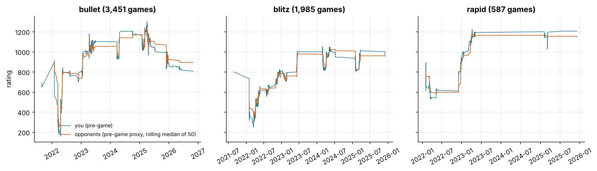
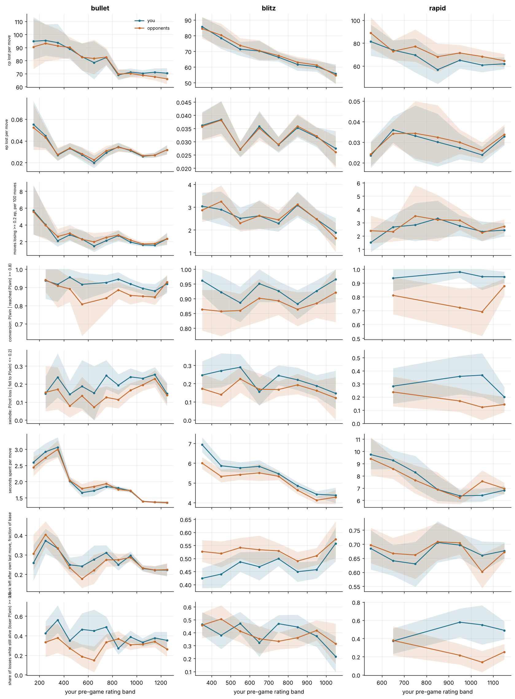
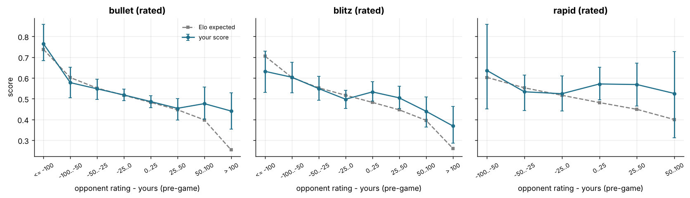

# Rating trajectory: what changed as you improved (and performance vs opponent rating)

Data: 6,023 standard live games with at least one move and a real pre-game rating (the first game in each pool has none; 1 game(s) with a rating of 0 dropped) (3,451 bullet, 1,985 blitz, 587 rapid), 364,488 analysed moves (182,324 yours), player zakihussa1n, Aug 2021 to Oct 2026. Per-game metrics come from Q1's decomposition (`games_decomposed.parquet`) joined on `uuid`; clock and phase-count metrics are computed here from the moves. Numbers are estimate [95% CI], bootstrapped by game (400 resamples); every number about you sits next to the opponents' number from the same games, and differences are paired. `ep_loss` (calibrated expected points) first, `cp_loss` second.

## 1. The trajectory itself

Pre-game rating from the first to the last game in each pool: bullet: 695 (Aug 2021) to 807 (Oct 2026), low 160 (Apr 2022), peak 1300 (Apr 2025); blitz: 800 (Aug 2021) to 956 (Dec 2025), low 252 (Mar 2022), peak 1050 (Feb 2024); rapid: 616 (Feb 2022) to 1206 (Dec 2025), low 526 (Mar 2022), peak 1222 (Apr 2023). The figure shows that the climb was not monotone: bands below the current rating hold games from the climb and, where the rating fell back, from the descent. Games by year and rating band, with the mean pre-game rating and your score:

| time class | year | games | rated | mean pre-game rating | rating range | score | main time control | share main tc | after a break (> 7 d) |
|---|---|---|---|---|---|---|---|---|---|
| blitz | 2021 | 2 | 0.00 | 800 | 800-800 | 0.000 [0.000, 0.000] | 300+0 | 1.00 | 0 |
| blitz | 2022 | 1117 | 0.87 | 563 | 252-824 | 0.509 [0.483, 0.533] | 180+2 | 0.81 | 7 |
| blitz | 2023 | 280 | 0.93 | 827 | 701-1003 | 0.571 [0.520, 0.625] | 180+2 | 0.44 | 3 |
| blitz | 2024 | 327 | 0.99 | 938 | 812-1050 | 0.491 [0.439, 0.546] | 180+2 | 1.00 | 6 |
| blitz | 2025 | 259 | 0.96 | 901 | 804-1018 | 0.539 [0.475, 0.598] | 180+0 | 0.66 | 3 |
| bullet | 2021 | 2 | 1.00 | 672 | 648-695 | 0.500 [0.000, 1.000] | 60+0 | 1.00 | 0 |
| bullet | 2022 | 704 | 0.87 | 503 | 160-896 | 0.509 [0.469, 0.541] | 60+0 | 0.75 | 9 |
| bullet | 2023 | 956 | 0.98 | 1003 | 738-1178 | 0.531 [0.497, 0.561] | 60+0 | 0.92 | 10 |
| bullet | 2024 | 312 | 0.97 | 1055 | 926-1206 | 0.529 [0.476, 0.585] | 60+0 | 1.00 | 5 |
| bullet | 2025 | 1454 | 0.98 | 1068 | 828-1300 | 0.502 [0.478, 0.526] | 60+0 | 0.83 | 4 |
| bullet | 2026 | 23 | 1.00 | 849 | 807-886 | 0.304 [0.130, 0.478] | 60+1 | 0.78 | 6 |
| rapid | 2022 | 218 | 0.91 | 712 | 526-946 | 0.525 [0.456, 0.580] | 600+0 | 1.00 | 5 |
| rapid | 2023 | 334 | 0.98 | 1106 | 902-1222 | 0.555 [0.501, 0.611] | 600+0 | 1.00 | 4 |
| rapid | 2025 | 35 | 0.86 | 1134 | 1029-1206 | 0.643 [0.500, 0.786] | 600+0 | 1.00 | 4 |

*Your pre-game rating over time in each pool, with the opponents' reconstructed pre-game rating (rolling median).*

Games per 100-point band of your pre-game rating (bands with fewer than 20 games are left out of every table below):

| time_class | 100-199 | 200-299 | 300-399 | 400-499 | 500-599 | 600-699 | 700-799 | 800-899 | 900-999 | 1000-1099 | 1100-1199 | 1200-1299 | 1300-1399 |
|---|---|---|---|---|---|---|---|---|---|---|---|---|---|
| bullet | 33 | 103 | 87 | 165 | 79 | 47 | 207 | 316 | 556 | 1021 | 594 | 242 | 1 |
| blitz | 0 | 18 | 224 | 163 | 282 | 134 | 443 | 288 | 355 | 78 | 0 | 0 | 0 |
| rapid | 0 | 0 | 0 | 0 | 41 | 87 | 29 | 33 | 94 | 62 | 223 | 18 | 0 |

## 2. Metrics by rating band: you vs the opponents you were matched with

Each band holds the games you played with a pre-game rating in that band. Opponents are matched to within a few dozen points, so the opponents' column is the field at that level and the trend across bands is the ladder: what changes with level for everyone. Your column minus theirs is what distinguished you from the field at each level (differences are paired within the same resampled games). `ep` is calibrated expected points lost (the main measure; the calibration knows both ratings, so ep per move is close to flat in rating by construction and measures how much of the game you give away *at that level*); `cp` is centipawns lost (the absolute, level-free measure). Cells with fewer than 20 games or 30 moves are blank.

### bullet

*Accuracy in expected points (main measure)*

| band | games | ep lost per move: you | ep lost per move: them | ep lost per move: you - them | moves losing >= 0.2 ep, per 100 moves: you | moves losing >= 0.2 ep, per 100 moves: them | moves losing >= 0.2 ep, per 100 moves: you - them |
|---|---|---|---|---|---|---|---|
| 100-199 | 33 | 0.0552 [0.0350, 0.0765] | 0.0522 [0.0318, 0.0737] | 0.0030 [-0.0016, 0.0090] | 5.70 [2.85, 8.72] | 5.56 [2.84, 8.68] | 0.14 [-1.27, 1.54] |
| 200-299 | 103 | 0.0448 [0.0333, 0.0551] | 0.0432 [0.0319, 0.0526] | 0.0016 [-0.0007, 0.0043] | 4.02 [2.43, 5.77] | 3.94 [2.26, 5.92] | 0.07 [-0.63, 1.03] |
| 300-399 | 87 | 0.0268 [0.0218, 0.0329] | 0.0274 [0.0220, 0.0338] | -0.0006 [-0.0025, 0.0014] | 2.09 [1.40, 2.97] | 2.60 [1.82, 3.51] | -0.51 [-1.34, 0.31] |
| 400-499 | 165 | 0.0331 [0.0281, 0.0379] | 0.0334 [0.0286, 0.0382] | -0.0003 [-0.0022, 0.0015] | 2.80 [2.13, 3.56] | 2.99 [2.18, 4.00] | -0.19 [-0.81, 0.32] |
| 500-599 | 79 | 0.0272 [0.0217, 0.0337] | 0.0281 [0.0234, 0.0343] | -0.0010 [-0.0031, 0.0012] | 2.30 [1.51, 3.41] | 2.26 [1.46, 3.25] | 0.03 [-0.56, 0.63] |
| 600-699 | 47 | 0.0199 [0.0151, 0.0265] | 0.0225 [0.0173, 0.0286] | -0.0025 [-0.0056, 0.0008] | 1.47 [0.76, 2.53] | 1.97 [0.98, 3.04] | -0.49 [-1.44, 0.57] |
| 700-799 | 207 | 0.0291 [0.0252, 0.0333] | 0.0309 [0.0262, 0.0354] | -0.0017 [-0.0030, -0.0005] | 2.10 [1.55, 2.74] | 2.50 [1.94, 3.14] | -0.40 [-0.74, -0.07] |
| 800-899 | 316 | 0.0346 [0.0308, 0.0386] | 0.0341 [0.0299, 0.0380] | 0.0005 [-0.0005, 0.0015] | 2.72 [2.07, 3.34] | 2.77 [2.16, 3.37] | -0.06 [-0.42, 0.29] |
| 900-999 | 556 | 0.0311 [0.0290, 0.0334] | 0.0316 [0.0295, 0.0342] | -0.0006 [-0.0012, 0.0002] | 1.92 [1.67, 2.20] | 2.17 [1.93, 2.48] | -0.25 [-0.49, -0.02] |
| 1000-1099 | 1021 | 0.0259 [0.0242, 0.0275] | 0.0264 [0.0247, 0.0281] | -0.0005 [-0.0010, -0.0000] | 1.60 [1.42, 1.80] | 1.72 [1.56, 1.93] | -0.12 [-0.26, 0.05] |
| 1100-1199 | 594 | 0.0270 [0.0248, 0.0293] | 0.0268 [0.0247, 0.0292] | 0.0001 [-0.0004, 0.0007] | 1.57 [1.33, 1.80] | 1.76 [1.50, 2.03] | -0.20 [-0.39, -0.01] |
| 1200-1299 | 242 | 0.0318 [0.0277, 0.0362] | 0.0318 [0.0276, 0.0359] | -0.0000 [-0.0010, 0.0008] | 2.32 [1.60, 3.09] | 2.33 [1.68, 2.98] | -0.01 [-0.37, 0.35] |

*Accuracy in centipawns (secondary)*

| band | games | cp lost per move: you | cp lost per move: them | cp lost per move: you - them | blunders (cp_loss >= 300), per 100 moves: you | blunders (cp_loss >= 300), per 100 moves: them | blunders (cp_loss >= 300), per 100 moves: you - them |
|---|---|---|---|---|---|---|---|
| 100-199 | 33 | 94.8 [80.9, 113.3] | 90.5 [73.7, 111.9] | 4.3 [-7.8, 18.0] | 8.69 [6.91, 11.07] | 7.98 [5.42, 10.43] | 0.71 [-0.95, 2.46] |
| 200-299 | 103 | 95.4 [83.8, 107.8] | 93.2 [79.5, 107.9] | 2.3 [-5.2, 9.5] | 8.09 [6.47, 9.81] | 7.94 [6.31, 9.69] | 0.15 [-1.11, 1.27] |
| 300-399 | 87 | 93.8 [82.6, 108.2] | 91.3 [80.9, 104.3] | 2.5 [-3.8, 10.0] | 8.96 [7.33, 11.02] | 8.98 [7.22, 10.72] | -0.02 [-1.26, 1.33] |
| 400-499 | 165 | 89.0 [81.1, 96.1] | 90.1 [82.3, 98.0] | -1.2 [-6.7, 4.4] | 8.27 [7.19, 9.28] | 8.46 [7.28, 9.64] | -0.19 [-1.17, 0.73] |
| 500-599 | 79 | 83.0 [72.8, 93.3] | 82.6 [72.4, 93.2] | 0.4 [-5.9, 7.2] | 7.12 [5.59, 8.49] | 6.75 [5.55, 8.03] | 0.37 [-0.79, 1.54] |
| 600-699 | 47 | 78.5 [65.8, 95.0] | 81.6 [69.7, 96.0] | -3.2 [-11.9, 6.0] | 6.47 [4.82, 8.73] | 7.21 [5.57, 9.18] | -0.74 [-2.05, 0.81] |
| 700-799 | 207 | 82.3 [76.3, 88.5] | 82.7 [76.9, 89.5] | -0.4 [-4.1, 3.0] | 7.06 [6.25, 7.87] | 7.13 [6.36, 8.05] | -0.07 [-0.75, 0.56] |
| 800-899 | 316 | 69.0 [65.2, 72.9] | 69.8 [66.0, 73.5] | -0.8 [-3.5, 2.1] | 5.57 [4.99, 6.10] | 5.70 [5.19, 6.23] | -0.13 [-0.62, 0.37] |
| 900-999 | 556 | 71.2 [67.8, 74.1] | 70.2 [67.2, 72.8] | 1.0 [-1.0, 3.0] | 6.07 [5.66, 6.50] | 5.91 [5.48, 6.29] | 0.17 [-0.18, 0.51] |
| 1000-1099 | 1021 | 70.3 [68.2, 72.7] | 68.8 [66.7, 71.0] | 1.5 [0.0, 3.0] | 5.82 [5.54, 6.18] | 5.71 [5.45, 6.04] | 0.11 [-0.12, 0.35] |
| 1100-1199 | 594 | 71.1 [68.2, 74.2] | 67.6 [64.9, 70.7] | 3.5 [1.6, 5.7] | 5.89 [5.51, 6.33] | 5.48 [5.01, 5.93] | 0.40 [0.09, 0.74] |
| 1200-1299 | 242 | 70.4 [66.5, 74.3] | 66.1 [62.2, 70.3] | 4.3 [1.2, 7.2] | 5.88 [5.26, 6.53] | 5.40 [4.84, 5.90] | 0.49 [-0.00, 0.97] |

*Phases (ep lost per move in the phase)*

| band | games | opening ep lost per move: you | opening ep lost per move: them | opening ep lost per move: you - them | middlegame ep lost per move: you | middlegame ep lost per move: them | middlegame ep lost per move: you - them | endgame ep lost per move: you | endgame ep lost per move: them | endgame ep lost per move: you - them |
|---|---|---|---|---|---|---|---|---|---|---|
| 100-199 | 33 | 0.0590 [0.0387, 0.0797] | 0.0559 [0.0375, 0.0744] | 0.0031 [-0.0027, 0.0103] | 0.0578 [0.0385, 0.0777] | 0.0530 [0.0332, 0.0736] | 0.0048 [-0.0028, 0.0133] | 0.0420 [0.0077, 0.1028] | 0.0420 [0.0073, 0.1047] | -0.0000 [-0.0045, 0.0068] |
| 200-299 | 103 | 0.0482 [0.0377, 0.0574] | 0.0448 [0.0343, 0.0529] | 0.0034 [-0.0003, 0.0069] | 0.0434 [0.0320, 0.0560] | 0.0453 [0.0346, 0.0556] | -0.0019 [-0.0072, 0.0027] | 0.0380 [0.0171, 0.0664] | 0.0362 [0.0159, 0.0648] | 0.0018 [-0.0017, 0.0056] |
| 300-399 | 87 | 0.0253 [0.0197, 0.0314] | 0.0272 [0.0212, 0.0335] | -0.0019 [-0.0050, 0.0014] | 0.0308 [0.0238, 0.0390] | 0.0300 [0.0229, 0.0383] | 0.0008 [-0.0025, 0.0043] | 0.0242 [0.0133, 0.0368] | 0.0243 [0.0142, 0.0374] | -0.0001 [-0.0038, 0.0037] |
| 400-499 | 165 | 0.0328 [0.0272, 0.0385] | 0.0314 [0.0266, 0.0365] | 0.0014 [-0.0017, 0.0040] | 0.0337 [0.0272, 0.0407] | 0.0357 [0.0284, 0.0439] | -0.0020 [-0.0052, 0.0014] | 0.0327 [0.0262, 0.0396] | 0.0340 [0.0272, 0.0414] | -0.0013 [-0.0051, 0.0023] |
| 500-599 | 79 | 0.0243 [0.0189, 0.0310] | 0.0239 [0.0182, 0.0308] | 0.0004 [-0.0029, 0.0035] | 0.0346 [0.0268, 0.0430] | 0.0384 [0.0305, 0.0481] | -0.0038 [-0.0082, 0.0008] | 0.0238 [0.0170, 0.0333] | 0.0240 [0.0174, 0.0324] | -0.0002 [-0.0038, 0.0034] |
| 600-699 | 47 | 0.0219 [0.0155, 0.0295] | 0.0236 [0.0175, 0.0310] | -0.0017 [-0.0066, 0.0029] | 0.0212 [0.0144, 0.0290] | 0.0223 [0.0161, 0.0289] | -0.0011 [-0.0057, 0.0035] | 0.0163 [0.0108, 0.0252] | 0.0212 [0.0144, 0.0298] | -0.0049 [-0.0107, 0.0001] |
| 700-799 | 207 | 0.0291 [0.0248, 0.0333] | 0.0293 [0.0251, 0.0335] | -0.0002 [-0.0022, 0.0018] | 0.0322 [0.0263, 0.0383] | 0.0346 [0.0289, 0.0408] | -0.0024 [-0.0049, 0.0001] | 0.0266 [0.0213, 0.0313] | 0.0293 [0.0235, 0.0351] | -0.0027 [-0.0052, -0.0005] |
| 800-899 | 316 | 0.0322 [0.0278, 0.0366] | 0.0304 [0.0256, 0.0345] | 0.0019 [0.0004, 0.0033] | 0.0389 [0.0338, 0.0436] | 0.0391 [0.0337, 0.0438] | -0.0001 [-0.0022, 0.0019] | 0.0330 [0.0280, 0.0389] | 0.0334 [0.0284, 0.0396] | -0.0004 [-0.0021, 0.0013] |
| 900-999 | 556 | 0.0272 [0.0247, 0.0297] | 0.0267 [0.0243, 0.0292] | 0.0006 [-0.0004, 0.0016] | 0.0369 [0.0338, 0.0402] | 0.0375 [0.0341, 0.0409] | -0.0006 [-0.0022, 0.0010] | 0.0299 [0.0265, 0.0334] | 0.0315 [0.0280, 0.0349] | -0.0017 [-0.0030, -0.0004] |
| 1000-1099 | 1021 | 0.0216 [0.0200, 0.0234] | 0.0213 [0.0197, 0.0231] | 0.0003 [-0.0004, 0.0009] | 0.0293 [0.0273, 0.0314] | 0.0300 [0.0281, 0.0320] | -0.0007 [-0.0017, 0.0004] | 0.0268 [0.0246, 0.0290] | 0.0278 [0.0258, 0.0303] | -0.0011 [-0.0019, -0.0003] |
| 1100-1199 | 594 | 0.0221 [0.0199, 0.0246] | 0.0213 [0.0191, 0.0237] | 0.0008 [-0.0000, 0.0016] | 0.0303 [0.0275, 0.0328] | 0.0303 [0.0272, 0.0333] | -0.0001 [-0.0016, 0.0013] | 0.0285 [0.0258, 0.0314] | 0.0287 [0.0260, 0.0317] | -0.0002 [-0.0014, 0.0008] |
| 1200-1299 | 242 | 0.0332 [0.0276, 0.0391] | 0.0323 [0.0270, 0.0382] | 0.0008 [-0.0003, 0.0020] | 0.0321 [0.0273, 0.0373] | 0.0321 [0.0272, 0.0375] | -0.0000 [-0.0023, 0.0018] | 0.0304 [0.0245, 0.0354] | 0.0311 [0.0256, 0.0360] | -0.0007 [-0.0024, 0.0008] |

*Winning and losing positions*

| band | games | share of games reaching P(win) >= 0.8: you | share of games reaching P(win) >= 0.8: them | share of games reaching P(win) >= 0.8: you - them | conversion: P(win | reached P(win) >= 0.8): you | conversion: P(win | reached P(win) >= 0.8): them | conversion: P(win | reached P(win) >= 0.8): you - them | swindle: P(not loss | fell to P(win) <= 0.2): you | swindle: P(not loss | fell to P(win) <= 0.2): them | swindle: P(not loss | fell to P(win) <= 0.2): you - them |
|---|---|---|---|---|---|---|---|---|---|---|
| 100-199 | 33 | 0.273 [0.121, 0.394] | 0.606 [0.455, 0.788] | -0.333 [-0.606, -0.091] |  |  |  |  |  |  |
| 200-299 | 103 | 0.311 [0.223, 0.398] | 0.495 [0.398, 0.592] | -0.184 [-0.340, -0.019] | 0.938 [0.838, 1.000] | 0.941 [0.875, 1.000] | -0.004 [-0.125, 0.098] | 0.148 [0.064, 0.242] | 0.154 [0.049, 0.300] | -0.006 [-0.162, 0.118] |
| 300-399 | 87 | 0.414 [0.322, 0.517] | 0.379 [0.287, 0.494] | 0.034 [-0.138, 0.207] | 0.917 [0.821, 1.000] | 0.909 [0.789, 1.000] | 0.008 [-0.132, 0.162] | 0.238 [0.125, 0.371] | 0.171 [0.059, 0.294] | 0.067 [-0.098, 0.245] |
| 400-499 | 165 | 0.412 [0.345, 0.485] | 0.503 [0.424, 0.576] | -0.091 [-0.224, 0.030] | 0.956 [0.904, 1.000] | 0.892 [0.819, 0.955] | 0.064 [-0.018, 0.153] | 0.143 [0.076, 0.217] | 0.078 [0.014, 0.143] | 0.065 [-0.032, 0.168] |
| 500-599 | 79 | 0.608 [0.506, 0.709] | 0.329 [0.215, 0.430] | 0.278 [0.101, 0.481] | 0.917 [0.830, 0.980] | 0.808 [0.633, 0.952] | 0.109 [-0.074, 0.308] | 0.188 [0.064, 0.333] | 0.135 [0.054, 0.241] | 0.053 [-0.093, 0.219] |
| 600-699 | 47 | 0.553 [0.404, 0.681] | 0.404 [0.277, 0.554] | 0.149 [-0.128, 0.404] |  |  |  | 0.150 [0.000, 0.300] | 0.071 [0.000, 0.174] | 0.079 [-0.105, 0.252] |
| 700-799 | 207 | 0.527 [0.464, 0.599] | 0.396 [0.329, 0.459] | 0.130 [0.005, 0.261] | 0.927 [0.873, 0.969] | 0.841 [0.768, 0.915] | 0.085 [-0.002, 0.185] | 0.247 [0.172, 0.333] | 0.126 [0.075, 0.188] | 0.121 [0.029, 0.227] |
| 800-899 | 316 | 0.405 [0.354, 0.459] | 0.528 [0.472, 0.582] | -0.123 [-0.218, -0.019] | 0.945 [0.902, 0.983] | 0.886 [0.837, 0.930] | 0.059 [-0.010, 0.135] | 0.194 [0.142, 0.255] | 0.113 [0.065, 0.169] | 0.080 [0.001, 0.163] |
| 900-999 | 556 | 0.442 [0.399, 0.482] | 0.424 [0.383, 0.466] | 0.018 [-0.061, 0.097] | 0.919 [0.884, 0.947] | 0.856 [0.807, 0.903] | 0.063 [0.006, 0.124] | 0.240 [0.196, 0.288] | 0.166 [0.125, 0.206] | 0.074 [0.011, 0.135] |
| 1000-1099 | 1021 | 0.447 [0.415, 0.477] | 0.436 [0.403, 0.466] | 0.011 [-0.044, 0.071] | 0.895 [0.865, 0.923] | 0.852 [0.822, 0.886] | 0.043 [0.002, 0.089] | 0.232 [0.193, 0.265] | 0.195 [0.163, 0.228] | 0.036 [-0.015, 0.082] |
| 1100-1199 | 594 | 0.421 [0.377, 0.463] | 0.473 [0.433, 0.519] | -0.052 [-0.133, 0.015] | 0.880 [0.836, 0.919] | 0.847 [0.805, 0.888] | 0.033 [-0.027, 0.088] | 0.253 [0.206, 0.294] | 0.230 [0.183, 0.277] | 0.023 [-0.040, 0.081] |
| 1200-1299 | 242 | 0.463 [0.401, 0.525] | 0.471 [0.409, 0.521] | -0.008 [-0.108, 0.103] | 0.920 [0.869, 0.963] | 0.930 [0.879, 0.971] | -0.010 [-0.073, 0.062] | 0.147 [0.089, 0.208] | 0.138 [0.078, 0.202] | 0.009 [-0.075, 0.086] |

*How losses end*

| band | games | share of losses while still alive (loser P(win) >= 0.1): you | share of losses while still alive (loser P(win) >= 0.1): them | share of losses on time: you | share of losses on time: them |
|---|---|---|---|---|---|
| 100-199 | 33 |  |  |  |  |
| 200-299 | 103 | 0.426 [0.312, 0.547] | 0.333 [0.184, 0.500] | 0.459 [0.333, 0.579] | 0.487 [0.342, 0.649] |
| 300-399 | 87 | 0.561 [0.428, 0.711] | 0.378 [0.225, 0.522] | 0.415 [0.269, 0.561] | 0.622 [0.489, 0.775] |
| 400-499 | 165 | 0.349 [0.256, 0.457] | 0.272 [0.174, 0.365] | 0.735 [0.638, 0.833] | 0.778 [0.684, 0.868] |
| 500-599 | 79 | 0.464 [0.286, 0.630] | 0.188 [0.087, 0.311] | 0.571 [0.389, 0.760] | 0.792 [0.660, 0.898] |
| 600-699 | 47 | 0.450 [0.240, 0.667] | 0.148 [0.028, 0.292] | 0.550 [0.333, 0.750] | 0.667 [0.480, 0.850] |
| 700-799 | 207 | 0.488 [0.390, 0.595] | 0.333 [0.257, 0.417] | 0.477 [0.376, 0.583] | 0.675 [0.585, 0.754] |
| 800-899 | 316 | 0.271 [0.208, 0.347] | 0.368 [0.296, 0.446] | 0.542 [0.474, 0.623] | 0.497 [0.413, 0.570] |
| 900-999 | 556 | 0.387 [0.332, 0.453] | 0.307 [0.256, 0.366] | 0.379 [0.316, 0.430] | 0.556 [0.502, 0.618] |
| 1000-1099 | 1021 | 0.332 [0.288, 0.374] | 0.313 [0.276, 0.353] | 0.496 [0.445, 0.539] | 0.626 [0.586, 0.667] |
| 1100-1199 | 594 | 0.376 [0.318, 0.440] | 0.339 [0.282, 0.393] | 0.429 [0.367, 0.486] | 0.631 [0.570, 0.685] |
| 1200-1299 | 242 | 0.353 [0.262, 0.439] | 0.263 [0.188, 0.346] | 0.445 [0.358, 0.528] | 0.653 [0.566, 0.732] |

*Clock use*

| band | games | seconds spent per move: you | seconds spent per move: them | % of base time spent per move: you | % of base time spent per move: them | clock left after own last move, fraction of base: you | clock left after own last move, fraction of base: them | % of own moves played under 10 s: you | % of own moves played under 10 s: them |
|---|---|---|---|---|---|---|---|---|---|
| 100-199 | 33 | 2.60 [2.33, 2.91] | 2.45 [2.17, 2.77] | 4.14 [3.78, 4.61] | 3.92 [3.49, 4.47] | 0.258 [0.167, 0.351] | 0.305 [0.219, 0.404] | 14.96 [8.05, 22.80] | 10.54 [4.83, 16.14] |
| 200-299 | 103 | 2.92 [2.66, 3.19] | 2.74 [2.55, 2.94] | 3.97 [3.70, 4.30] | 3.75 [3.48, 4.00] | 0.372 [0.306, 0.433] | 0.404 [0.341, 0.471] | 9.13 [6.62, 11.53] | 9.03 [4.76, 14.02] |
| 300-399 | 87 | 3.06 [2.77, 3.37] | 3.00 [2.74, 3.28] | 3.59 [3.31, 3.87] | 3.59 [3.31, 3.91] | 0.332 [0.273, 0.389] | 0.334 [0.267, 0.396] | 7.84 [4.89, 10.99] | 11.89 [7.64, 16.20] |
| 400-499 | 165 | 2.02 [1.91, 2.14] | 2.03 [1.94, 2.15] | 3.37 [3.21, 3.53] | 3.43 [3.26, 3.60] | 0.248 [0.213, 0.286] | 0.234 [0.193, 0.272] | 11.02 [9.09, 12.71] | 11.13 [9.30, 12.84] |
| 500-599 | 79 | 1.66 [1.52, 1.81] | 1.78 [1.65, 1.93] | 2.72 [2.54, 2.92] | 2.97 [2.77, 3.19] | 0.241 [0.190, 0.295] | 0.176 [0.129, 0.237] | 8.51 [6.67, 10.82] | 11.50 [9.21, 13.82] |
| 600-699 | 47 | 1.72 [1.56, 1.88] | 1.85 [1.68, 2.04] | 2.86 [2.60, 3.14] | 3.08 [2.81, 3.40] | 0.276 [0.203, 0.348] | 0.221 [0.152, 0.301] | 9.25 [6.12, 12.61] | 13.11 [8.72, 17.27] |
| 700-799 | 207 | 1.85 [1.77, 1.94] | 1.94 [1.85, 2.03] | 3.07 [2.94, 3.21] | 3.20 [3.07, 3.35] | 0.310 [0.274, 0.349] | 0.274 [0.238, 0.317] | 9.38 [7.73, 11.19] | 11.74 [9.89, 13.74] |
| 800-899 | 316 | 1.80 [1.75, 1.86] | 1.75 [1.69, 1.81] | 3.00 [2.91, 3.09] | 2.92 [2.82, 3.02] | 0.249 [0.220, 0.280] | 0.274 [0.243, 0.306] | 13.30 [11.49, 15.00] | 9.49 [8.18, 11.06] |
| 900-999 | 556 | 1.71 [1.67, 1.76] | 1.72 [1.67, 1.77] | 2.77 [2.71, 2.84] | 2.80 [2.72, 2.88] | 0.296 [0.275, 0.317] | 0.286 [0.265, 0.308] | 10.69 [9.32, 11.95] | 10.73 [9.66, 11.85] |
| 1000-1099 | 1021 | 1.39 [1.37, 1.41] | 1.39 [1.36, 1.41] | 2.31 [2.29, 2.35] | 2.31 [2.27, 2.34] | 0.230 [0.215, 0.245] | 0.232 [0.217, 0.248] | 11.85 [11.19, 12.59] | 11.44 [10.75, 12.18] |
| 1100-1199 | 594 | 1.36 [1.34, 1.39] | 1.36 [1.33, 1.39] | 2.27 [2.23, 2.31] | 2.27 [2.22, 2.32] | 0.221 [0.202, 0.242] | 0.222 [0.200, 0.243] | 13.06 [11.94, 13.98] | 12.51 [11.49, 13.63] |
| 1200-1299 | 242 | 1.35 [1.32, 1.38] | 1.35 [1.30, 1.39] | 2.25 [2.20, 2.31] | 2.25 [2.17, 2.32] | 0.221 [0.190, 0.254] | 0.224 [0.193, 0.257] | 12.35 [10.76, 14.02] | 11.94 [10.50, 13.46] |

*Game shape*

| band | games | game length (plies) | book depth (plies in a named line) |
|---|---|---|---|
| 100-199 | 33 | 42.5 [35.3, 50.2] | 3.70 [3.09, 4.42] |
| 200-299 | 103 | 37.3 [32.9, 42.1] | 3.62 [3.29, 3.92] |
| 300-399 | 87 | 45.1 [39.7, 50.7] | 3.93 [3.62, 4.30] |
| 400-499 | 165 | 45.4 [42.5, 48.2] | 4.39 [4.04, 4.74] |
| 500-599 | 79 | 56.1 [51.5, 61.2] | 4.86 [4.29, 5.43] |
| 600-699 | 47 | 51.9 [45.2, 58.9] | 4.72 [4.13, 5.40] |
| 700-799 | 207 | 56.9 [53.8, 60.3] | 4.57 [4.26, 4.86] |
| 800-899 | 316 | 60.8 [58.0, 63.8] | 4.96 [4.69, 5.23] |
| 900-999 | 556 | 62.8 [60.4, 65.0] | 4.86 [4.67, 5.07] |
| 1000-1099 | 1021 | 66.6 [65.0, 68.1] | 5.03 [4.89, 5.18] |
| 1100-1199 | 594 | 68.5 [66.5, 70.8] | 4.95 [4.75, 5.14] |
| 1200-1299 | 242 | 69.1 [66.0, 72.4] | 4.61 [4.30, 4.91] |

### blitz

*Accuracy in expected points (main measure)*

| band | games | ep lost per move: you | ep lost per move: them | ep lost per move: you - them | moves losing >= 0.2 ep, per 100 moves: you | moves losing >= 0.2 ep, per 100 moves: them | moves losing >= 0.2 ep, per 100 moves: you - them |
|---|---|---|---|---|---|---|---|
| 300-399 | 224 | 0.0362 [0.0308, 0.0412] | 0.0357 [0.0304, 0.0409] | 0.0004 [-0.0008, 0.0015] | 3.04 [2.47, 3.64] | 2.86 [2.35, 3.48] | 0.18 [-0.22, 0.59] |
| 400-499 | 163 | 0.0384 [0.0331, 0.0453] | 0.0381 [0.0322, 0.0452] | 0.0002 [-0.0015, 0.0018] | 2.90 [2.23, 3.69] | 3.25 [2.55, 3.97] | -0.36 [-0.89, 0.21] |
| 500-599 | 282 | 0.0270 [0.0241, 0.0299] | 0.0271 [0.0244, 0.0301] | -0.0002 [-0.0012, 0.0009] | 2.51 [2.02, 2.99] | 2.30 [1.93, 2.69] | 0.21 [-0.13, 0.57] |
| 600-699 | 134 | 0.0358 [0.0317, 0.0416] | 0.0351 [0.0306, 0.0411] | 0.0007 [-0.0010, 0.0026] | 2.62 [2.05, 3.28] | 2.62 [2.04, 3.32] | -0.00 [-0.49, 0.46] |
| 700-799 | 443 | 0.0288 [0.0258, 0.0319] | 0.0289 [0.0263, 0.0318] | -0.0001 [-0.0010, 0.0008] | 2.29 [1.93, 2.72] | 2.44 [2.09, 2.87] | -0.16 [-0.40, 0.12] |
| 800-899 | 288 | 0.0353 [0.0316, 0.0401] | 0.0359 [0.0322, 0.0405] | -0.0006 [-0.0016, 0.0005] | 3.09 [2.56, 3.69] | 3.12 [2.65, 3.65] | -0.03 [-0.34, 0.34] |
| 900-999 | 355 | 0.0318 [0.0280, 0.0354] | 0.0321 [0.0286, 0.0356] | -0.0004 [-0.0014, 0.0005] | 2.47 [2.07, 2.91] | 2.47 [2.17, 2.88] | -0.00 [-0.31, 0.27] |
| 1000-1099 | 78 | 0.0275 [0.0209, 0.0340] | 0.0260 [0.0201, 0.0322] | 0.0014 [-0.0009, 0.0033] | 1.89 [1.30, 2.52] | 1.64 [1.03, 2.31] | 0.24 [-0.31, 0.80] |

*Accuracy in centipawns (secondary)*

| band | games | cp lost per move: you | cp lost per move: them | cp lost per move: you - them | blunders (cp_loss >= 300), per 100 moves: you | blunders (cp_loss >= 300), per 100 moves: them | blunders (cp_loss >= 300), per 100 moves: you - them |
|---|---|---|---|---|---|---|---|
| 300-399 | 224 | 85.8 [79.4, 91.8] | 84.5 [78.2, 91.7] | 1.3 [-2.6, 5.0] | 7.59 [6.62, 8.51] | 7.58 [6.79, 8.43] | 0.01 [-0.66, 0.69] |
| 400-499 | 163 | 78.4 [71.6, 85.9] | 80.3 [72.8, 87.6] | -1.9 [-6.9, 2.5] | 6.91 [5.97, 7.97] | 7.18 [6.10, 8.27] | -0.27 [-0.97, 0.46] |
| 500-599 | 282 | 71.3 [67.1, 76.1] | 73.7 [69.7, 78.5] | -2.4 [-5.3, 0.9] | 6.12 [5.47, 6.76] | 6.44 [5.91, 7.08] | -0.32 [-0.86, 0.18] |
| 600-699 | 134 | 70.3 [64.1, 76.8] | 70.5 [64.6, 77.1] | -0.2 [-4.5, 4.4] | 6.02 [5.24, 6.87] | 6.09 [5.33, 7.06] | -0.08 [-0.86, 0.68] |
| 700-799 | 443 | 66.3 [63.6, 69.5] | 67.3 [64.7, 70.0] | -1.0 [-3.6, 1.4] | 5.58 [5.17, 6.03] | 5.64 [5.22, 6.07] | -0.06 [-0.46, 0.33] |
| 800-899 | 288 | 61.7 [57.8, 65.6] | 63.1 [59.6, 66.5] | -1.4 [-4.3, 1.3] | 5.04 [4.45, 5.59] | 5.10 [4.57, 5.62] | -0.07 [-0.47, 0.39] |
| 900-999 | 355 | 60.3 [57.1, 63.8] | 61.3 [58.4, 64.8] | -1.0 [-3.8, 1.7] | 4.77 [4.33, 5.25] | 4.94 [4.47, 5.47] | -0.17 [-0.60, 0.26] |
| 1000-1099 | 78 | 55.8 [49.5, 61.8] | 54.8 [49.3, 60.8] | 1.0 [-5.0, 5.9] | 4.13 [3.26, 5.03] | 4.61 [3.61, 5.78] | -0.47 [-1.53, 0.51] |

*Phases (ep lost per move in the phase)*

| band | games | opening ep lost per move: you | opening ep lost per move: them | opening ep lost per move: you - them | middlegame ep lost per move: you | middlegame ep lost per move: them | middlegame ep lost per move: you - them | endgame ep lost per move: you | endgame ep lost per move: them | endgame ep lost per move: you - them |
|---|---|---|---|---|---|---|---|---|---|---|
| 300-399 | 224 | 0.0309 [0.0269, 0.0352] | 0.0306 [0.0264, 0.0350] | 0.0004 [-0.0018, 0.0024] | 0.0409 [0.0343, 0.0477] | 0.0411 [0.0344, 0.0483] | -0.0002 [-0.0034, 0.0025] | 0.0384 [0.0295, 0.0474] | 0.0374 [0.0284, 0.0462] | 0.0010 [-0.0008, 0.0029] |
| 400-499 | 163 | 0.0408 [0.0345, 0.0483] | 0.0411 [0.0346, 0.0492] | -0.0003 [-0.0033, 0.0027] | 0.0411 [0.0338, 0.0485] | 0.0413 [0.0341, 0.0499] | -0.0002 [-0.0049, 0.0041] | 0.0338 [0.0245, 0.0435] | 0.0327 [0.0229, 0.0430] | 0.0010 [-0.0015, 0.0037] |
| 500-599 | 282 | 0.0266 [0.0227, 0.0308] | 0.0270 [0.0234, 0.0307] | -0.0004 [-0.0021, 0.0013] | 0.0338 [0.0288, 0.0390] | 0.0322 [0.0273, 0.0369] | 0.0016 [-0.0003, 0.0037] | 0.0229 [0.0190, 0.0271] | 0.0240 [0.0202, 0.0279] | -0.0011 [-0.0028, 0.0005] |
| 600-699 | 134 | 0.0334 [0.0284, 0.0401] | 0.0330 [0.0278, 0.0400] | 0.0004 [-0.0022, 0.0033] | 0.0420 [0.0362, 0.0492] | 0.0401 [0.0339, 0.0475] | 0.0018 [-0.0020, 0.0056] | 0.0338 [0.0281, 0.0407] | 0.0336 [0.0284, 0.0400] | 0.0002 [-0.0028, 0.0030] |
| 700-799 | 443 | 0.0274 [0.0246, 0.0308] | 0.0281 [0.0251, 0.0313] | -0.0006 [-0.0019, 0.0007] | 0.0345 [0.0300, 0.0392] | 0.0336 [0.0292, 0.0380] | 0.0009 [-0.0011, 0.0032] | 0.0254 [0.0220, 0.0294] | 0.0259 [0.0224, 0.0298] | -0.0005 [-0.0025, 0.0012] |
| 800-899 | 288 | 0.0329 [0.0284, 0.0379] | 0.0339 [0.0291, 0.0388] | -0.0010 [-0.0026, 0.0006] | 0.0409 [0.0359, 0.0474] | 0.0393 [0.0341, 0.0452] | 0.0016 [-0.0009, 0.0040] | 0.0331 [0.0284, 0.0385] | 0.0351 [0.0305, 0.0410] | -0.0019 [-0.0036, -0.0002] |
| 900-999 | 355 | 0.0295 [0.0256, 0.0334] | 0.0310 [0.0272, 0.0351] | -0.0014 [-0.0028, 0.0000] | 0.0360 [0.0321, 0.0409] | 0.0360 [0.0323, 0.0399] | 0.0000 [-0.0021, 0.0022] | 0.0305 [0.0261, 0.0353] | 0.0301 [0.0257, 0.0347] | 0.0004 [-0.0014, 0.0020] |
| 1000-1099 | 78 | 0.0293 [0.0219, 0.0374] | 0.0270 [0.0202, 0.0352] | 0.0023 [-0.0005, 0.0053] | 0.0314 [0.0233, 0.0400] | 0.0305 [0.0237, 0.0378] | 0.0009 [-0.0038, 0.0052] | 0.0238 [0.0157, 0.0326] | 0.0227 [0.0147, 0.0308] | 0.0011 [-0.0020, 0.0036] |

*Winning and losing positions*

| band | games | share of games reaching P(win) >= 0.8: you | share of games reaching P(win) >= 0.8: them | share of games reaching P(win) >= 0.8: you - them | conversion: P(win | reached P(win) >= 0.8): you | conversion: P(win | reached P(win) >= 0.8): them | conversion: P(win | reached P(win) >= 0.8): you - them | swindle: P(not loss | fell to P(win) <= 0.2): you | swindle: P(not loss | fell to P(win) <= 0.2): them | swindle: P(not loss | fell to P(win) <= 0.2): you - them |
|---|---|---|---|---|---|---|---|---|---|---|
| 300-399 | 224 | 0.348 [0.290, 0.415] | 0.491 [0.424, 0.558] | -0.143 [-0.254, -0.022] | 0.962 [0.915, 1.000] | 0.864 [0.792, 0.930] | 0.098 [0.020, 0.174] | 0.246 [0.173, 0.322] | 0.172 [0.092, 0.253] | 0.074 [-0.030, 0.184] |
| 400-499 | 163 | 0.472 [0.387, 0.558] | 0.429 [0.356, 0.515] | 0.043 [-0.104, 0.190] | 0.922 [0.853, 0.976] | 0.857 [0.773, 0.930] | 0.065 [-0.039, 0.167] | 0.271 [0.180, 0.367] | 0.140 [0.070, 0.215] | 0.131 [0.022, 0.247] |
| 500-599 | 282 | 0.436 [0.379, 0.493] | 0.379 [0.323, 0.443] | 0.057 [-0.043, 0.153] | 0.886 [0.821, 0.941] | 0.860 [0.802, 0.917] | 0.026 [-0.065, 0.112] | 0.290 [0.219, 0.361] | 0.226 [0.150, 0.290] | 0.064 [-0.042, 0.163] |
| 600-699 | 134 | 0.455 [0.366, 0.537] | 0.455 [0.381, 0.537] | 0.000 [-0.149, 0.142] | 0.951 [0.889, 1.000] | 0.902 [0.822, 0.967] | 0.049 [-0.051, 0.144] | 0.155 [0.079, 0.235] | 0.169 [0.083, 0.256] | -0.014 [-0.135, 0.099] |
| 700-799 | 443 | 0.460 [0.418, 0.506] | 0.400 [0.361, 0.440] | 0.061 [-0.014, 0.142] | 0.926 [0.888, 0.959] | 0.893 [0.845, 0.933] | 0.034 [-0.025, 0.092] | 0.244 [0.192, 0.301] | 0.167 [0.131, 0.213] | 0.077 [0.012, 0.145] |
| 800-899 | 288 | 0.500 [0.444, 0.556] | 0.434 [0.375, 0.490] | 0.066 [-0.042, 0.170] | 0.882 [0.831, 0.929] | 0.864 [0.807, 0.922] | 0.018 [-0.067, 0.095] | 0.221 [0.164, 0.288] | 0.193 [0.142, 0.255] | 0.028 [-0.044, 0.104] |
| 900-999 | 355 | 0.459 [0.408, 0.513] | 0.462 [0.408, 0.515] | -0.003 [-0.093, 0.093] | 0.926 [0.880, 0.962] | 0.884 [0.834, 0.926] | 0.042 [-0.020, 0.106] | 0.188 [0.129, 0.247] | 0.161 [0.112, 0.216] | 0.027 [-0.052, 0.099] |
| 1000-1099 | 78 | 0.372 [0.269, 0.487] | 0.487 [0.372, 0.603] | -0.115 [-0.270, 0.103] | 0.966 [0.889, 1.000] | 0.921 [0.821, 1.000] | 0.044 [-0.067, 0.171] | 0.146 [0.061, 0.271] | 0.121 [0.000, 0.235] | 0.025 [-0.101, 0.174] |

*How losses end*

| band | games | share of losses while still alive (loser P(win) >= 0.1): you | share of losses while still alive (loser P(win) >= 0.1): them | share of losses on time: you | share of losses on time: them |
|---|---|---|---|---|---|
| 300-399 | 224 | 0.466 [0.383, 0.559] | 0.458 [0.359, 0.554] | 0.319 [0.231, 0.402] | 0.188 [0.109, 0.275] |
| 400-499 | 163 | 0.380 [0.274, 0.492] | 0.506 [0.384, 0.612] | 0.254 [0.169, 0.364] | 0.230 [0.143, 0.325] |
| 500-599 | 282 | 0.471 [0.393, 0.562] | 0.412 [0.326, 0.489] | 0.182 [0.117, 0.248] | 0.125 [0.068, 0.181] |
| 600-699 | 134 | 0.323 [0.214, 0.443] | 0.353 [0.239, 0.453] | 0.177 [0.085, 0.274] | 0.176 [0.094, 0.270] |
| 700-799 | 443 | 0.470 [0.407, 0.537] | 0.333 [0.271, 0.402] | 0.066 [0.036, 0.104] | 0.128 [0.086, 0.174] |
| 800-899 | 288 | 0.444 [0.344, 0.539] | 0.361 [0.283, 0.444] | 0.103 [0.053, 0.155] | 0.167 [0.106, 0.232] |
| 900-999 | 355 | 0.373 [0.292, 0.445] | 0.417 [0.341, 0.497] | 0.190 [0.132, 0.247] | 0.177 [0.123, 0.233] |
| 1000-1099 | 78 | 0.216 [0.095, 0.371] | 0.314 [0.158, 0.471] | 0.162 [0.054, 0.303] | 0.171 [0.069, 0.303] |

*Clock use*

| band | games | seconds spent per move: you | seconds spent per move: them | % of base time spent per move: you | % of base time spent per move: them | clock left after own last move, fraction of base: you | clock left after own last move, fraction of base: them | % of own moves played under 10 s: you | % of own moves played under 10 s: them |
|---|---|---|---|---|---|---|---|---|---|
| 300-399 | 224 | 6.93 [6.55, 7.31] | 6.00 [5.70, 6.30] | 3.16 [3.01, 3.31] | 2.76 [2.63, 2.90] | 0.424 [0.386, 0.464] | 0.527 [0.487, 0.571] | 4.97 [2.97, 7.17] | 1.94 [0.95, 3.03] |
| 400-499 | 163 | 5.87 [5.58, 6.19] | 5.33 [5.03, 5.68] | 3.21 [3.04, 3.38] | 2.91 [2.75, 3.10] | 0.440 [0.388, 0.487] | 0.519 [0.467, 0.566] | 4.13 [2.57, 6.14] | 3.39 [1.66, 5.60] |
| 500-599 | 282 | 5.76 [5.53, 6.05] | 5.42 [5.16, 5.73] | 2.83 [2.74, 2.94] | 2.66 [2.56, 2.78] | 0.487 [0.449, 0.524] | 0.541 [0.499, 0.579] | 1.71 [0.98, 2.47] | 2.58 [1.41, 3.92] |
| 600-699 | 134 | 5.84 [5.56, 6.15] | 5.51 [5.10, 5.97] | 2.88 [2.74, 3.04] | 2.67 [2.50, 2.83] | 0.468 [0.416, 0.526] | 0.533 [0.474, 0.588] | 1.87 [0.60, 3.31] | 1.87 [0.89, 3.11] |
| 700-799 | 443 | 5.47 [5.32, 5.63] | 5.34 [5.14, 5.54] | 2.64 [2.57, 2.73] | 2.54 [2.46, 2.62] | 0.499 [0.471, 0.526] | 0.529 [0.501, 0.559] | 1.41 [0.70, 2.18] | 1.61 [0.91, 2.40] |
| 800-899 | 288 | 4.85 [4.68, 5.04] | 4.63 [4.43, 4.86] | 2.66 [2.56, 2.75] | 2.54 [2.42, 2.64] | 0.449 [0.411, 0.486] | 0.490 [0.457, 0.525] | 1.91 [1.10, 2.82] | 1.66 [1.01, 2.40] |
| 900-999 | 355 | 4.42 [4.26, 4.58] | 4.12 [3.95, 4.30] | 2.45 [2.36, 2.54] | 2.28 [2.19, 2.38] | 0.457 [0.424, 0.490] | 0.510 [0.475, 0.540] | 2.50 [1.70, 3.36] | 1.74 [1.07, 2.60] |
| 1000-1099 | 78 | 4.37 [3.99, 4.76] | 4.28 [3.93, 4.64] | 2.43 [2.22, 2.65] | 2.38 [2.18, 2.58] | 0.557 [0.489, 0.619] | 0.574 [0.502, 0.642] | 1.81 [0.69, 3.40] | 0.28 [0.00, 0.67] |

*Game shape*

| band | games | game length (plies) | book depth (plies in a named line) |
|---|---|---|---|
| 300-399 | 224 | 52.0 [47.3, 56.0] | 3.74 [3.52, 3.95] |
| 400-499 | 163 | 52.5 [47.6, 58.3] | 4.66 [4.36, 4.94] |
| 500-599 | 282 | 60.5 [56.9, 64.8] | 4.74 [4.50, 4.99] |
| 600-699 | 134 | 61.5 [56.0, 67.3] | 5.25 [4.83, 5.69] |
| 700-799 | 443 | 58.4 [55.3, 61.4] | 5.38 [5.16, 5.58] |
| 800-899 | 288 | 63.8 [60.0, 68.1] | 5.89 [5.61, 6.18] |
| 900-999 | 355 | 62.0 [59.1, 65.2] | 5.44 [5.19, 5.69] |
| 1000-1099 | 78 | 63.9 [55.7, 72.4] | 5.13 [4.61, 5.77] |

### rapid

*Accuracy in expected points (main measure)*

| band | games | ep lost per move: you | ep lost per move: them | ep lost per move: you - them | moves losing >= 0.2 ep, per 100 moves: you | moves losing >= 0.2 ep, per 100 moves: them | moves losing >= 0.2 ep, per 100 moves: you - them |
|---|---|---|---|---|---|---|---|
| 500-599 | 41 | 0.0235 [0.0175, 0.0304] | 0.0242 [0.0184, 0.0298] | -0.0007 [-0.0045, 0.0030] | 1.51 [0.79, 2.44] | 2.39 [1.44, 3.52] | -0.89 [-2.36, 0.48] |
| 600-699 | 87 | 0.0360 [0.0297, 0.0426] | 0.0342 [0.0287, 0.0401] | 0.0018 [-0.0006, 0.0044] | 2.67 [1.89, 3.59] | 2.32 [1.58, 3.05] | 0.35 [-0.37, 1.05] |
| 700-799 | 29 | 0.0330 [0.0212, 0.0479] | 0.0343 [0.0220, 0.0499] | -0.0013 [-0.0046, 0.0025] | 2.83 [1.61, 4.48] | 3.50 [1.75, 5.82] | -0.67 [-1.72, 0.45] |
| 800-899 | 33 | 0.0301 [0.0182, 0.0438] | 0.0324 [0.0199, 0.0480] | -0.0023 [-0.0062, 0.0012] | 3.31 [1.83, 4.66] | 3.21 [1.59, 5.09] | 0.10 [-1.24, 1.54] |
| 900-999 | 94 | 0.0272 [0.0216, 0.0341] | 0.0299 [0.0243, 0.0362] | -0.0027 [-0.0045, -0.0006] | 2.76 [2.02, 3.55] | 3.17 [2.45, 4.07] | -0.42 [-0.98, 0.15] |
| 1000-1099 | 62 | 0.0238 [0.0198, 0.0278] | 0.0258 [0.0219, 0.0299] | -0.0021 [-0.0041, 0.0002] | 2.33 [1.62, 3.10] | 2.24 [1.62, 2.86] | 0.09 [-0.61, 0.77] |
| 1100-1199 | 223 | 0.0328 [0.0285, 0.0376] | 0.0337 [0.0290, 0.0385] | -0.0010 [-0.0023, 0.0003] | 2.44 [1.97, 2.94] | 2.73 [2.25, 3.24] | -0.29 [-0.72, 0.14] |

*Accuracy in centipawns (secondary)*

| band | games | cp lost per move: you | cp lost per move: them | cp lost per move: you - them | blunders (cp_loss >= 300), per 100 moves: you | blunders (cp_loss >= 300), per 100 moves: them | blunders (cp_loss >= 300), per 100 moves: you - them |
|---|---|---|---|---|---|---|---|
| 500-599 | 41 | 81.4 [69.0, 96.2] | 88.8 [75.6, 102.7] | -7.5 [-19.8, 6.2] | 6.90 [5.25, 8.84] | 7.56 [6.01, 9.17] | -0.66 [-2.40, 1.36] |
| 600-699 | 87 | 73.9 [65.5, 82.5] | 72.9 [65.2, 82.4] | 1.1 [-6.1, 8.1] | 6.23 [4.90, 7.49] | 5.82 [4.64, 7.09] | 0.41 [-0.78, 1.57] |
| 700-799 | 29 | 69.5 [54.4, 84.0] | 77.1 [63.7, 92.0] | -7.6 [-15.7, 3.5] | 5.66 [3.76, 7.69] | 5.97 [4.31, 7.67] | -0.31 [-1.91, 1.36] |
| 800-899 | 33 | 56.9 [44.4, 70.6] | 68.2 [54.8, 79.7] | -11.3 [-20.8, -0.6] | 4.62 [2.77, 6.62] | 5.00 [3.08, 6.56] | -0.38 [-1.54, 1.08] |
| 900-999 | 94 | 65.0 [57.8, 72.1] | 71.4 [65.0, 78.5] | -6.4 [-11.5, -1.0] | 5.73 [4.75, 6.87] | 6.31 [5.35, 7.30] | -0.57 [-1.59, 0.35] |
| 1000-1099 | 62 | 60.8 [54.7, 67.7] | 68.3 [62.6, 74.1] | -7.5 [-12.8, -1.7] | 5.22 [4.17, 6.57] | 5.97 [4.96, 6.95] | -0.75 [-1.84, 0.42] |
| 1100-1199 | 223 | 61.9 [57.5, 67.6] | 64.6 [59.3, 70.5] | -2.7 [-6.3, 1.2] | 5.30 [4.64, 5.97] | 5.34 [4.69, 6.05] | -0.04 [-0.65, 0.50] |

*Phases (ep lost per move in the phase)*

| band | games | opening ep lost per move: you | opening ep lost per move: them | opening ep lost per move: you - them | middlegame ep lost per move: you | middlegame ep lost per move: them | middlegame ep lost per move: you - them | endgame ep lost per move: you | endgame ep lost per move: them | endgame ep lost per move: you - them |
|---|---|---|---|---|---|---|---|---|---|---|
| 500-599 | 41 | 0.0262 [0.0196, 0.0334] | 0.0292 [0.0218, 0.0361] | -0.0030 [-0.0074, 0.0020] | 0.0209 [0.0116, 0.0324] | 0.0215 [0.0130, 0.0314] | -0.0006 [-0.0076, 0.0081] | 0.0204 [0.0069, 0.0390] | 0.0143 [0.0021, 0.0285] | 0.0061 [0.0010, 0.0279] |
| 600-699 | 87 | 0.0358 [0.0297, 0.0428] | 0.0336 [0.0280, 0.0398] | 0.0022 [-0.0017, 0.0067] | 0.0459 [0.0366, 0.0560] | 0.0432 [0.0333, 0.0517] | 0.0028 [-0.0028, 0.0079] | 0.0267 [0.0171, 0.0360] | 0.0263 [0.0176, 0.0346] | 0.0004 [-0.0033, 0.0037] |
| 700-799 | 29 | 0.0323 [0.0188, 0.0470] | 0.0319 [0.0187, 0.0467] | 0.0004 [-0.0038, 0.0049] | 0.0458 [0.0250, 0.0735] | 0.0435 [0.0236, 0.0687] | 0.0022 [-0.0048, 0.0090] | 0.0201 [0.0116, 0.0306] | 0.0273 [0.0158, 0.0411] | -0.0072 [-0.0171, 0.0009] |
| 800-899 | 33 | 0.0363 [0.0213, 0.0520] | 0.0456 [0.0287, 0.0622] | -0.0093 [-0.0150, -0.0042] | 0.0340 [0.0144, 0.0526] | 0.0273 [0.0120, 0.0453] | 0.0067 [-0.0017, 0.0181] | 0.0198 [0.0093, 0.0336] | 0.0209 [0.0093, 0.0338] | -0.0011 [-0.0034, 0.0020] |
| 900-999 | 94 | 0.0277 [0.0213, 0.0356] | 0.0290 [0.0226, 0.0371] | -0.0013 [-0.0043, 0.0019] | 0.0316 [0.0229, 0.0425] | 0.0342 [0.0255, 0.0451] | -0.0026 [-0.0075, 0.0029] | 0.0238 [0.0164, 0.0323] | 0.0279 [0.0200, 0.0359] | -0.0041 [-0.0075, -0.0007] |
| 1000-1099 | 62 | 0.0237 [0.0182, 0.0293] | 0.0252 [0.0202, 0.0300] | -0.0014 [-0.0049, 0.0022] | 0.0270 [0.0203, 0.0334] | 0.0300 [0.0232, 0.0365] | -0.0029 [-0.0065, 0.0013] | 0.0209 [0.0146, 0.0264] | 0.0228 [0.0163, 0.0283] | -0.0019 [-0.0049, 0.0010] |
| 1100-1199 | 223 | 0.0318 [0.0273, 0.0360] | 0.0316 [0.0274, 0.0361] | 0.0001 [-0.0019, 0.0021] | 0.0386 [0.0327, 0.0451] | 0.0406 [0.0342, 0.0481] | -0.0020 [-0.0051, 0.0006] | 0.0287 [0.0224, 0.0360] | 0.0300 [0.0233, 0.0375] | -0.0013 [-0.0035, 0.0010] |

*Winning and losing positions*

| band | games | share of games reaching P(win) >= 0.8: you | share of games reaching P(win) >= 0.8: them | share of games reaching P(win) >= 0.8: you - them | conversion: P(win | reached P(win) >= 0.8): you | conversion: P(win | reached P(win) >= 0.8): them | conversion: P(win | reached P(win) >= 0.8): you - them | swindle: P(not loss | fell to P(win) <= 0.2): you | swindle: P(not loss | fell to P(win) <= 0.2): them | swindle: P(not loss | fell to P(win) <= 0.2): you - them |
|---|---|---|---|---|---|---|---|---|---|---|
| 500-599 | 41 | 0.488 [0.341, 0.659] | 0.341 [0.195, 0.464] | 0.146 [-0.122, 0.439] |  |  |  |  |  |  |
| 600-699 | 87 | 0.356 [0.264, 0.460] | 0.425 [0.322, 0.529] | -0.069 [-0.253, 0.126] | 0.935 [0.842, 1.000] | 0.811 [0.674, 0.941] | 0.125 [-0.033, 0.268] | 0.283 [0.150, 0.420] | 0.238 [0.128, 0.356] | 0.045 [-0.109, 0.201] |
| 700-799 | 29 | 0.483 [0.310, 0.655] | 0.310 [0.172, 0.483] | 0.172 [-0.138, 0.448] |  |  |  |  |  |  |
| 800-899 | 33 | 0.636 [0.455, 0.818] | 0.364 [0.212, 0.515] | 0.273 [0.030, 0.545] |  |  |  |  |  |  |
| 900-999 | 94 | 0.532 [0.426, 0.628] | 0.383 [0.287, 0.489] | 0.149 [-0.032, 0.319] | 0.980 [0.937, 1.000] | 0.722 [0.566, 0.862] | 0.258 [0.101, 0.419] | 0.357 [0.220, 0.513] | 0.169 [0.086, 0.268] | 0.188 [0.007, 0.361] |
| 1000-1099 | 62 | 0.597 [0.483, 0.710] | 0.419 [0.306, 0.548] | 0.177 [-0.065, 0.371] | 0.946 [0.850, 1.000] | 0.692 [0.517, 0.870] | 0.254 [0.062, 0.469] | 0.367 [0.200, 0.533] | 0.122 [0.024, 0.225] | 0.245 [0.081, 0.416] |
| 1100-1199 | 223 | 0.489 [0.417, 0.552] | 0.444 [0.390, 0.511] | 0.045 [-0.076, 0.157] | 0.945 [0.902, 0.982] | 0.879 [0.811, 0.933] | 0.066 [-0.007, 0.147] | 0.200 [0.131, 0.275] | 0.143 [0.085, 0.203] | 0.057 [-0.041, 0.146] |

*How losses end*

| band | games | share of losses while still alive (loser P(win) >= 0.1): you | share of losses while still alive (loser P(win) >= 0.1): them | share of losses on time: you | share of losses on time: them |
|---|---|---|---|---|---|
| 500-599 | 41 |  |  |  |  |
| 600-699 | 87 | 0.372 [0.233, 0.511] | 0.378 [0.214, 0.534] | 0.070 [0.000, 0.160] | 0.054 [0.000, 0.132] |
| 700-799 | 29 |  |  |  |  |
| 800-899 | 33 |  |  |  |  |
| 900-999 | 94 | 0.579 [0.414, 0.730] | 0.216 [0.114, 0.340] | 0.000 [0.000, 0.000] | 0.020 [0.000, 0.071] |
| 1000-1099 | 62 | 0.550 [0.333, 0.765] | 0.139 [0.030, 0.263] | 0.000 [0.000, 0.000] | 0.111 [0.026, 0.216] |
| 1100-1199 | 223 | 0.490 [0.390, 0.589] | 0.252 [0.171, 0.339] | 0.000 [0.000, 0.000] | 0.035 [0.008, 0.072] |

*Clock use*

| band | games | seconds spent per move: you | seconds spent per move: them | % of base time spent per move: you | % of base time spent per move: them | clock left after own last move, fraction of base: you | clock left after own last move, fraction of base: them | % of own moves played under 10 s: you | % of own moves played under 10 s: them |
|---|---|---|---|---|---|---|---|---|---|
| 500-599 | 41 | 9.73 [8.53, 11.06] | 9.40 [8.03, 11.15] | 1.62 [1.42, 1.84] | 1.57 [1.34, 1.86] | 0.685 [0.610, 0.750] | 0.697 [0.632, 0.758] | 0.00 [0.00, 0.00] | 0.00 [0.00, 0.00] |
| 600-699 | 87 | 9.26 [8.56, 10.07] | 8.58 [7.74, 9.49] | 1.54 [1.43, 1.68] | 1.43 [1.29, 1.58] | 0.641 [0.588, 0.697] | 0.667 [0.606, 0.723] | 0.54 [0.00, 1.34] | 0.25 [0.00, 0.69] |
| 700-799 | 29 | 8.28 [6.98, 9.62] | 7.64 [6.55, 8.86] | 1.38 [1.16, 1.60] | 1.27 [1.09, 1.48] | 0.630 [0.549, 0.708] | 0.662 [0.576, 0.747] | 0.39 [0.00, 1.21] | 0.00 [0.00, 0.00] |
| 800-899 | 33 | 6.89 [5.96, 8.03] | 6.88 [5.76, 8.29] | 1.15 [0.99, 1.34] | 1.15 [0.96, 1.38] | 0.706 [0.635, 0.781] | 0.708 [0.642, 0.776] | 0.00 [0.00, 0.00] | 0.00 [0.00, 0.00] |
| 900-999 | 94 | 6.37 [5.84, 6.90] | 6.21 [5.69, 6.80] | 1.06 [0.97, 1.15] | 1.04 [0.95, 1.13] | 0.697 [0.651, 0.738] | 0.705 [0.663, 0.742] | 0.00 [0.00, 0.00] | 0.00 [0.00, 0.00] |
| 1000-1099 | 62 | 6.41 [5.88, 6.94] | 7.56 [6.68, 8.45] | 1.07 [0.98, 1.16] | 1.26 [1.11, 1.41] | 0.660 [0.603, 0.710] | 0.602 [0.544, 0.665] | 0.35 [0.00, 1.08] | 0.97 [0.00, 2.10] |
| 1100-1199 | 223 | 6.82 [6.53, 7.18] | 6.96 [6.49, 7.43] | 1.14 [1.09, 1.20] | 1.16 [1.08, 1.24] | 0.676 [0.650, 0.707] | 0.672 [0.644, 0.703] | 0.00 [0.00, 0.00] | 0.21 [0.00, 0.56] |

*Game shape*

| band | games | game length (plies) | book depth (plies in a named line) |
|---|---|---|---|
| 500-599 | 41 | 38.8 [30.0, 47.8] | 3.90 [3.37, 4.41] |
| 600-699 | 87 | 46.6 [40.0, 54.0] | 3.77 [3.44, 4.13] |
| 700-799 | 29 | 53.4 [42.7, 64.9] | 3.83 [3.17, 4.45] |
| 800-899 | 33 | 51.1 [39.1, 62.8] | 4.42 [3.73, 5.18] |
| 900-999 | 94 | 57.1 [49.6, 64.7] | 4.98 [4.62, 5.36] |
| 1000-1099 | 62 | 63.5 [55.4, 71.6] | 4.94 [4.44, 5.50] |
| 1100-1199 | 223 | 56.7 [52.2, 61.1] | 5.48 [5.20, 5.76] |

*Key metrics by your rating band, you (blue) vs opponents in the same games (orange), shaded 95% CIs.*

## 3. The same metrics by year

Calendar years (games per year: 2021: 4, 2022: 2,039, 2023: 1,570, 2024: 639, 2025: 1,748, 2026: 23). Years with fewer than 20 games in a time class are left out; the mean pre-game rating of the year is in section 1.

### bullet

*Accuracy in expected points (main measure)*

| year | games | ep lost per move: you | ep lost per move: them | ep lost per move: you - them | moves losing >= 0.2 ep, per 100 moves: you | moves losing >= 0.2 ep, per 100 moves: them | moves losing >= 0.2 ep, per 100 moves: you - them |
|---|---|---|---|---|---|---|---|
| 2022 | 704 | 0.0323 [0.0295, 0.0351] | 0.0327 [0.0300, 0.0353] | -0.0004 [-0.0011, 0.0004] | 2.81 [2.38, 3.26] | 2.99 [2.57, 3.40] | -0.19 [-0.42, 0.05] |
| 2023 | 956 | 0.0302 [0.0282, 0.0322] | 0.0310 [0.0289, 0.0329] | -0.0008 [-0.0013, -0.0003] | 1.99 [1.78, 2.20] | 2.17 [1.94, 2.37] | -0.18 [-0.36, -0.00] |
| 2024 | 312 | 0.0266 [0.0238, 0.0297] | 0.0272 [0.0241, 0.0305] | -0.0005 [-0.0014, 0.0003] | 1.54 [1.26, 1.82] | 1.84 [1.50, 2.23] | -0.30 [-0.58, -0.02] |
| 2025 | 1454 | 0.0276 [0.0261, 0.0292] | 0.0276 [0.0263, 0.0291] | 0.0000 [-0.0004, 0.0004] | 1.72 [1.53, 1.94] | 1.85 [1.69, 2.05] | -0.13 [-0.26, 0.01] |
| 2026 | 23 | 0.0403 [0.0273, 0.0561] | 0.0363 [0.0246, 0.0507] | 0.0040 [-0.0000, 0.0087] | 3.26 [1.52, 5.78] | 2.07 [0.84, 3.64] | 1.19 [-0.17, 3.00] |

*Accuracy in centipawns (secondary)*

| year | games | cp lost per move: you | cp lost per move: them | cp lost per move: you - them | blunders (cp_loss >= 300), per 100 moves: you | blunders (cp_loss >= 300), per 100 moves: them | blunders (cp_loss >= 300), per 100 moves: you - them |
|---|---|---|---|---|---|---|---|
| 2022 | 704 | 88.7 [84.8, 92.7] | 87.7 [83.6, 92.2] | 1.0 [-1.5, 3.3] | 7.90 [7.32, 8.52] | 7.78 [7.22, 8.34] | 0.12 [-0.31, 0.48] |
| 2023 | 956 | 75.2 [72.8, 77.9] | 73.6 [71.2, 76.1] | 1.6 [0.0, 3.4] | 6.44 [6.06, 6.84] | 6.35 [6.01, 6.70] | 0.09 [-0.16, 0.36] |
| 2024 | 312 | 71.4 [67.9, 75.2] | 68.7 [65.3, 72.2] | 2.7 [0.0, 5.5] | 5.99 [5.51, 6.51] | 5.41 [4.95, 5.85] | 0.59 [0.19, 1.00] |
| 2025 | 1454 | 66.8 [65.1, 68.6] | 65.4 [63.7, 67.1] | 1.4 [0.2, 2.6] | 5.39 [5.14, 5.65] | 5.30 [5.05, 5.52] | 0.10 [-0.10, 0.29] |
| 2026 | 23 | 72.8 [62.8, 85.9] | 59.3 [47.1, 71.2] | 13.5 [2.1, 26.2] | 6.97 [4.80, 9.97] | 4.73 [3.06, 6.46] | 2.24 [0.51, 4.34] |

*Phases (ep lost per move in the phase)*

| year | games | opening ep lost per move: you | opening ep lost per move: them | middlegame ep lost per move: you | middlegame ep lost per move: them | endgame ep lost per move: you | endgame ep lost per move: them |
|---|---|---|---|---|---|---|---|
| 2022 | 704 | 0.0331 [0.0300, 0.0358] | 0.0321 [0.0295, 0.0346] | 0.0351 [0.0313, 0.0389] | 0.0363 [0.0326, 0.0400] | 0.0282 [0.0247, 0.0325] | 0.0296 [0.0260, 0.0340] |
| 2023 | 956 | 0.0277 [0.0255, 0.0298] | 0.0274 [0.0251, 0.0295] | 0.0349 [0.0321, 0.0376] | 0.0363 [0.0334, 0.0390] | 0.0288 [0.0265, 0.0313] | 0.0300 [0.0277, 0.0325] |
| 2024 | 312 | 0.0229 [0.0197, 0.0261] | 0.0218 [0.0186, 0.0254] | 0.0286 [0.0250, 0.0322] | 0.0294 [0.0253, 0.0334] | 0.0281 [0.0239, 0.0321] | 0.0298 [0.0253, 0.0341] |
| 2025 | 1454 | 0.0236 [0.0219, 0.0253] | 0.0229 [0.0213, 0.0246] | 0.0311 [0.0292, 0.0329] | 0.0310 [0.0292, 0.0331] | 0.0284 [0.0265, 0.0302] | 0.0290 [0.0271, 0.0308] |
| 2026 | 23 | 0.0358 [0.0186, 0.0570] | 0.0319 [0.0181, 0.0516] | 0.0458 [0.0302, 0.0601] | 0.0426 [0.0270, 0.0561] | 0.0406 [0.0259, 0.0620] | 0.0359 [0.0203, 0.0520] |

*Positions, conversion and clock*

| year | games | share of games reaching P(win) >= 0.8: you | share of games reaching P(win) >= 0.8: them | conversion: P(win | reached P(win) >= 0.8): you | conversion: P(win | reached P(win) >= 0.8): them | swindle: P(not loss | fell to P(win) <= 0.2): you | swindle: P(not loss | fell to P(win) <= 0.2): them | share of losses while still alive (loser P(win) >= 0.1): you | share of losses while still alive (loser P(win) >= 0.1): them | seconds spent per move: you | seconds spent per move: them | clock left after own last move, fraction of base: you | clock left after own last move, fraction of base: them |
|---|---|---|---|---|---|---|---|---|---|---|---|---|---|
| 2022 | 704 | 0.440 [0.406, 0.474] | 0.459 [0.422, 0.497] | 0.932 [0.906, 0.958] | 0.873 [0.833, 0.909] | 0.187 [0.146, 0.233] | 0.128 [0.096, 0.164] | 0.411 [0.357, 0.460] | 0.291 [0.242, 0.337] | 2.09 [2.03, 2.17] | 2.10 [2.04, 2.17] | 0.281 [0.258, 0.301] | 0.268 [0.245, 0.289] |
| 2023 | 956 | 0.478 [0.449, 0.509] | 0.404 [0.372, 0.436] | 0.891 [0.860, 0.921] | 0.881 [0.850, 0.912] | 0.217 [0.179, 0.251] | 0.185 [0.151, 0.220] | 0.396 [0.348, 0.436] | 0.294 [0.253, 0.333] | 1.48 [1.45, 1.52] | 1.51 [1.47, 1.54] | 0.266 [0.250, 0.281] | 0.251 [0.235, 0.269] |
| 2024 | 312 | 0.471 [0.420, 0.526] | 0.462 [0.404, 0.523] | 0.912 [0.864, 0.951] | 0.812 [0.739, 0.868] | 0.288 [0.225, 0.352] | 0.196 [0.143, 0.260] | 0.328 [0.248, 0.411] | 0.239 [0.167, 0.309] | 1.36 [1.33, 1.39] | 1.41 [1.36, 1.45] | 0.221 [0.194, 0.247] | 0.198 [0.173, 0.224] |
| 2025 | 1454 | 0.412 [0.389, 0.437] | 0.472 [0.448, 0.499] | 0.915 [0.893, 0.935] | 0.864 [0.839, 0.891] | 0.220 [0.192, 0.246] | 0.177 [0.153, 0.202] | 0.337 [0.304, 0.375] | 0.356 [0.322, 0.390] | 1.53 [1.50, 1.55] | 1.50 [1.47, 1.52] | 0.238 [0.226, 0.252] | 0.254 [0.241, 0.269] |
| 2026 | 23 | 0.261 [0.087, 0.435] | 0.739 [0.522, 0.913] |  |  |  |  |  |  | 2.09 [1.95, 2.27] | 2.06 [1.91, 2.20] | 0.377 [0.276, 0.481] | 0.395 [0.258, 0.533] |

### blitz

*Accuracy in expected points (main measure)*

| year | games | ep lost per move: you | ep lost per move: them | ep lost per move: you - them | moves losing >= 0.2 ep, per 100 moves: you | moves losing >= 0.2 ep, per 100 moves: them | moves losing >= 0.2 ep, per 100 moves: you - them |
|---|---|---|---|---|---|---|---|
| 2022 | 1117 | 0.0320 [0.0301, 0.0338] | 0.0318 [0.0299, 0.0335] | 0.0002 [-0.0003, 0.0008] | 2.67 [2.40, 2.90] | 2.65 [2.40, 2.89] | 0.02 [-0.16, 0.21] |
| 2023 | 280 | 0.0297 [0.0263, 0.0334] | 0.0309 [0.0273, 0.0345] | -0.0013 [-0.0023, 0.0000] | 2.17 [1.75, 2.74] | 2.48 [2.06, 2.99] | -0.30 [-0.64, 0.03] |
| 2024 | 327 | 0.0331 [0.0300, 0.0365] | 0.0327 [0.0295, 0.0361] | 0.0004 [-0.0006, 0.0014] | 2.89 [2.49, 3.32] | 2.58 [2.20, 2.95] | 0.30 [-0.02, 0.60] |
| 2025 | 259 | 0.0330 [0.0295, 0.0368] | 0.0335 [0.0299, 0.0375] | -0.0005 [-0.0017, 0.0006] | 2.46 [2.07, 2.86] | 2.69 [2.19, 3.09] | -0.22 [-0.55, 0.08] |

*Accuracy in centipawns (secondary)*

| year | games | cp lost per move: you | cp lost per move: them | cp lost per move: you - them | blunders (cp_loss >= 300), per 100 moves: you | blunders (cp_loss >= 300), per 100 moves: them | blunders (cp_loss >= 300), per 100 moves: you - them |
|---|---|---|---|---|---|---|---|
| 2022 | 1117 | 74.1 [72.1, 76.4] | 74.6 [72.5, 76.8] | -0.5 [-1.9, 1.0] | 6.43 [6.12, 6.73] | 6.49 [6.21, 6.78] | -0.05 [-0.30, 0.21] |
| 2023 | 280 | 61.6 [57.8, 65.8] | 65.7 [62.2, 69.3] | -4.0 [-7.1, -0.7] | 4.96 [4.40, 5.52] | 5.49 [4.93, 6.03] | -0.53 [-1.02, 0.01] |
| 2024 | 327 | 59.8 [56.5, 62.9] | 58.8 [56.0, 61.6] | 1.0 [-1.6, 3.8] | 4.66 [4.20, 5.13] | 4.63 [4.17, 5.08] | 0.03 [-0.41, 0.46] |
| 2025 | 259 | 61.0 [57.2, 65.1] | 63.4 [59.8, 67.0] | -2.4 [-5.3, 1.0] | 4.94 [4.32, 5.51] | 5.35 [4.79, 5.91] | -0.41 [-0.89, 0.08] |

*Phases (ep lost per move in the phase)*

| year | games | opening ep lost per move: you | opening ep lost per move: them | middlegame ep lost per move: you | middlegame ep lost per move: them | endgame ep lost per move: you | endgame ep lost per move: them |
|---|---|---|---|---|---|---|---|
| 2022 | 1117 | 0.0305 [0.0285, 0.0326] | 0.0306 [0.0285, 0.0325] | 0.0377 [0.0353, 0.0406] | 0.0368 [0.0341, 0.0395] | 0.0293 [0.0265, 0.0319] | 0.0293 [0.0264, 0.0316] |
| 2023 | 280 | 0.0308 [0.0265, 0.0351] | 0.0327 [0.0286, 0.0365] | 0.0345 [0.0294, 0.0401] | 0.0344 [0.0296, 0.0392] | 0.0240 [0.0190, 0.0290] | 0.0257 [0.0205, 0.0307] |
| 2024 | 327 | 0.0328 [0.0290, 0.0371] | 0.0332 [0.0297, 0.0375] | 0.0385 [0.0342, 0.0436] | 0.0364 [0.0325, 0.0406] | 0.0295 [0.0252, 0.0338] | 0.0295 [0.0257, 0.0339] |
| 2025 | 259 | 0.0275 [0.0229, 0.0315] | 0.0282 [0.0237, 0.0325] | 0.0366 [0.0312, 0.0420] | 0.0368 [0.0315, 0.0421] | 0.0351 [0.0304, 0.0398] | 0.0355 [0.0308, 0.0400] |

*Positions, conversion and clock*

| year | games | share of games reaching P(win) >= 0.8: you | share of games reaching P(win) >= 0.8: them | conversion: P(win | reached P(win) >= 0.8): you | conversion: P(win | reached P(win) >= 0.8): them | swindle: P(not loss | fell to P(win) <= 0.2): you | swindle: P(not loss | fell to P(win) <= 0.2): them | share of losses while still alive (loser P(win) >= 0.1): you | share of losses while still alive (loser P(win) >= 0.1): them | seconds spent per move: you | seconds spent per move: them | clock left after own last move, fraction of base: you | clock left after own last move, fraction of base: them |
|---|---|---|---|---|---|---|---|---|---|---|---|---|---|
| 2022 | 1117 | 0.425 [0.397, 0.449] | 0.432 [0.405, 0.460] | 0.920 [0.896, 0.940] | 0.870 [0.839, 0.900] | 0.246 [0.213, 0.281] | 0.186 [0.158, 0.220] | 0.442 [0.396, 0.482] | 0.415 [0.380, 0.454] | 5.90 [5.76, 6.04] | 5.40 [5.27, 5.54] | 0.459 [0.441, 0.476] | 0.531 [0.513, 0.550] |
| 2023 | 280 | 0.511 [0.453, 0.564] | 0.364 [0.311, 0.418] | 0.944 [0.906, 0.979] | 0.882 [0.816, 0.947] | 0.242 [0.162, 0.317] | 0.112 [0.063, 0.158] | 0.441 [0.340, 0.530] | 0.344 [0.271, 0.416] | 5.39 [5.14, 5.63] | 5.67 [5.39, 5.95] | 0.588 [0.550, 0.616] | 0.561 [0.521, 0.595] |
| 2024 | 327 | 0.419 [0.364, 0.471] | 0.480 [0.422, 0.538] | 0.927 [0.879, 0.969] | 0.911 [0.863, 0.952] | 0.166 [0.119, 0.220] | 0.204 [0.140, 0.265] | 0.387 [0.311, 0.464] | 0.389 [0.311, 0.457] | 4.95 [4.79, 5.13] | 4.59 [4.42, 4.75] | 0.474 [0.438, 0.510] | 0.539 [0.507, 0.574] |
| 2025 | 259 | 0.506 [0.444, 0.568] | 0.456 [0.398, 0.517] | 0.885 [0.822, 0.932] | 0.856 [0.789, 0.923] | 0.231 [0.160, 0.302] | 0.173 [0.116, 0.240] | 0.330 [0.248, 0.417] | 0.364 [0.281, 0.458] | 4.01 [3.83, 4.19] | 3.79 [3.58, 3.98] | 0.391 [0.359, 0.427] | 0.434 [0.403, 0.473] |

### rapid

*Accuracy in expected points (main measure)*

| year | games | ep lost per move: you | ep lost per move: them | ep lost per move: you - them | moves losing >= 0.2 ep, per 100 moves: you | moves losing >= 0.2 ep, per 100 moves: them | moves losing >= 0.2 ep, per 100 moves: you - them |
|---|---|---|---|---|---|---|---|
| 2022 | 218 | 0.0299 [0.0257, 0.0347] | 0.0300 [0.0258, 0.0346] | -0.0002 [-0.0016, 0.0015] | 2.51 [2.01, 3.08] | 2.63 [2.10, 3.20] | -0.12 [-0.59, 0.32] |
| 2023 | 334 | 0.0308 [0.0270, 0.0346] | 0.0322 [0.0287, 0.0361] | -0.0014 [-0.0025, -0.0003] | 2.48 [2.10, 2.85] | 2.71 [2.33, 3.12] | -0.23 [-0.55, 0.14] |
| 2025 | 35 | 0.0298 [0.0205, 0.0411] | 0.0317 [0.0224, 0.0427] | -0.0020 [-0.0046, 0.0003] | 2.81 [1.67, 4.10] | 3.24 [1.91, 4.50] | -0.43 [-1.20, 0.32] |

*Accuracy in centipawns (secondary)*

| year | games | cp lost per move: you | cp lost per move: them | cp lost per move: you - them | blunders (cp_loss >= 300), per 100 moves: you | blunders (cp_loss >= 300), per 100 moves: them | blunders (cp_loss >= 300), per 100 moves: you - them |
|---|---|---|---|---|---|---|---|
| 2022 | 218 | 69.7 [64.3, 75.1] | 73.9 [68.4, 79.2] | -4.2 [-8.0, 0.5] | 5.79 [4.99, 6.60] | 5.81 [5.06, 6.40] | -0.01 [-0.68, 0.67] |
| 2023 | 334 | 61.6 [58.2, 65.1] | 65.7 [62.2, 69.2] | -4.1 [-7.1, -1.2] | 5.29 [4.79, 5.85] | 5.59 [5.07, 6.14] | -0.30 [-0.83, 0.20] |
| 2025 | 35 | 65.5 [53.3, 84.0] | 71.1 [58.5, 91.5] | -5.6 [-13.6, 1.8] | 6.20 [4.67, 7.96] | 6.31 [4.44, 8.34] | -0.11 [-1.19, 0.90] |

*Phases (ep lost per move in the phase)*

| year | games | opening ep lost per move: you | opening ep lost per move: them | middlegame ep lost per move: you | middlegame ep lost per move: them | endgame ep lost per move: you | endgame ep lost per move: them |
|---|---|---|---|---|---|---|---|
| 2022 | 218 | 0.0310 [0.0265, 0.0356] | 0.0320 [0.0271, 0.0370] | 0.0366 [0.0300, 0.0448] | 0.0351 [0.0286, 0.0421] | 0.0221 [0.0174, 0.0284] | 0.0227 [0.0177, 0.0286] |
| 2023 | 334 | 0.0313 [0.0275, 0.0356] | 0.0315 [0.0279, 0.0354] | 0.0354 [0.0304, 0.0407] | 0.0377 [0.0325, 0.0429] | 0.0265 [0.0212, 0.0319] | 0.0283 [0.0229, 0.0342] |
| 2025 | 35 | 0.0253 [0.0159, 0.0367] | 0.0283 [0.0196, 0.0392] | 0.0377 [0.0249, 0.0547] | 0.0375 [0.0241, 0.0528] | 0.0276 [0.0160, 0.0442] | 0.0302 [0.0195, 0.0461] |

*Positions, conversion and clock*

| year | games | share of games reaching P(win) >= 0.8: you | share of games reaching P(win) >= 0.8: them | conversion: P(win | reached P(win) >= 0.8): you | conversion: P(win | reached P(win) >= 0.8): them | swindle: P(not loss | fell to P(win) <= 0.2): you | swindle: P(not loss | fell to P(win) <= 0.2): them | share of losses while still alive (loser P(win) >= 0.1): you | share of losses while still alive (loser P(win) >= 0.1): them | seconds spent per move: you | seconds spent per move: them | clock left after own last move, fraction of base: you | clock left after own last move, fraction of base: them |
|---|---|---|---|---|---|---|---|---|---|---|---|---|---|
| 2022 | 218 | 0.459 [0.390, 0.518] | 0.376 [0.317, 0.445] | 0.910 [0.848, 0.963] | 0.841 [0.763, 0.913] | 0.318 [0.241, 0.400] | 0.228 [0.157, 0.315] | 0.438 [0.337, 0.527] | 0.355 [0.269, 0.433] | 8.26 [7.71, 8.79] | 7.82 [7.29, 8.34] | 0.663 [0.629, 0.694] | 0.682 [0.647, 0.713] |
| 2023 | 334 | 0.518 [0.464, 0.572] | 0.428 [0.374, 0.485] | 0.948 [0.916, 0.976] | 0.839 [0.782, 0.896] | 0.217 [0.152, 0.281] | 0.134 [0.091, 0.183] | 0.511 [0.433, 0.597] | 0.193 [0.135, 0.252] | 6.76 [6.47, 7.02] | 6.97 [6.60, 7.30] | 0.675 [0.649, 0.697] | 0.667 [0.641, 0.692] |
| 2025 | 35 | 0.543 [0.371, 0.714] | 0.457 [0.286, 0.629] |  |  |  |  |  |  | 6.25 [5.44, 7.18] | 7.18 [6.24, 8.35] | 0.640 [0.567, 0.718] | 0.589 [0.511, 0.675] |

## 4. What moved: low third vs high third of your games by rating, ranked

Games of each time class are split into thirds by your pre-game rating. For every metric: your value in the low and the high third, your change (high minus low, CI from a game bootstrap), the field's change over the same games (the opponents' value in the same thirds: the ladder), and your change minus the field's (negative for a 'lower is better' metric means you improved *more* than the level you were playing at). Ranked by the significance (|z|) of your change. A metric that moved for both you and the field in step is a property of the level; one that moved for you but not for the field is yours.

### bullet: low third 160-937 (1151 games) vs high third 1069-1300 (1150 games)

| metric | better | you: low third | you: high third | your change | field's change (opponents, same games) | your change - field's |
|---|---|---|---|---|---|---|
| % of base time spent per move | n/a | 3.18 | 2.27 | -0.91 [-0.97, -0.85] | -0.95 [-1.02, -0.87] | 0.04 [-0.02, 0.09] |
| seconds spent per move | n/a | 2.01 | 1.36 | -0.64 [-0.69, -0.60] | -0.65 [-0.70, -0.60] | 0.01 [-0.02, 0.05] |
| game length (plies) | n/a | 53.2 | 68.6 | 15.4 [13.6, 17.4] |  |  |
| clock left after own last move, fraction of base | higher | 0.291 | 0.221 | -0.070 [-0.091, -0.050] | -0.060 [-0.083, -0.038] | -0.009 [-0.024, 0.005] |
| opening ep lost per move | lower | 0.0323 | 0.0246 | -0.0077 [-0.0106, -0.0049] | -0.0075 [-0.0103, -0.0047] | -0.0003 [-0.0013, 0.0007] |
| moves losing >= 0.2 ep, per 100 moves | lower | 2.65 | 1.69 | -0.96 [-1.32, -0.59] | -0.96 [-1.31, -0.58] | -0.00 [-0.23, 0.22] |
| cp lost per move | lower | 79.3 | 70.4 | -8.9 [-12.0, -5.1] | -12.6 [-15.9, -8.9] | 3.7 [1.5, 5.5] |
| ep lost per move | lower | 0.0330 | 0.0277 | -0.0053 [-0.0076, -0.0028] | -0.0055 [-0.0080, -0.0032] | 0.0002 [-0.0004, 0.0008] |
| middlegame ep lost per move | lower | 0.0371 | 0.0301 | -0.0070 [-0.0103, -0.0033] | -0.0077 [-0.0106, -0.0044] | 0.0006 [-0.0009, 0.0021] |
| blunders (cp_loss >= 300), per 100 moves | lower | 6.81 | 5.87 | -0.94 [-1.43, -0.41] | -1.40 [-1.83, -0.94] | 0.46 [0.07, 0.77] |
| book depth (plies in a named line) | higher | 4.58 | 4.93 | 0.35 [0.14, 0.54] |  |  |
| % of own moves played under 10 s | lower | 10.92 | 12.63 | 1.71 [0.50, 2.86] | 1.60 [0.55, 2.81] | 0.12 [-1.26, 1.66] |
| share of losses on time | lower | 0.530 | 0.447 | -0.084 [-0.137, -0.021] | 0.018 [-0.040, 0.078] | -0.102 [-0.180, -0.018] |
| conversion: P(win | reached P(win) >= 0.8) | higher | 0.937 | 0.895 | -0.042 [-0.073, -0.005] | -0.008 [-0.047, 0.029] | -0.034 [-0.084, 0.023] |
| share of losses while still alive (loser P(win) >= 0.1) | lower | 0.392 | 0.345 | -0.047 [-0.103, 0.007] | -0.006 [-0.060, 0.051] | -0.041 [-0.116, 0.034] |
| swindle: P(not loss | fell to P(win) <= 0.2) | higher | 0.194 | 0.217 | 0.023 [-0.020, 0.062] | 0.079 [0.036, 0.119] | -0.056 [-0.110, 0.003] |
| largest single ep loss in the game | lower | 0.179 | 0.175 | -0.004 [-0.014, 0.004] | -0.004 [-0.013, 0.006] | -0.000 [-0.010, 0.008] |
| endgame ep lost per move | lower | 0.0298 | 0.0285 | -0.0013 [-0.0045, 0.0018] | -0.0020 [-0.0055, 0.0013] | 0.0007 [-0.0006, 0.0021] |
| share of games reaching P(win) >= 0.8 | higher | 0.442 | 0.431 | -0.011 [-0.051, 0.026] | 0.020 [-0.018, 0.060] | -0.031 [-0.098, 0.037] |

### blitz: low third 252-595 (662 games) vs high third 821-1050 (662 games)

| metric | better | you: low third | you: high third | your change | field's change (opponents, same games) | your change - field's |
|---|---|---|---|---|---|---|
| seconds spent per move | n/a | 6.22 | 4.56 | -1.67 [-1.88, -1.43] | -1.34 [-1.57, -1.12] | -0.32 [-0.50, -0.17] |
| book depth (plies in a named line) | higher | 4.33 | 5.58 | 1.24 [1.03, 1.48] |  |  |
| % of base time spent per move | n/a | 3.04 | 2.53 | -0.51 [-0.61, -0.41] | -0.38 [-0.48, -0.28] | -0.13 [-0.21, -0.05] |
| cp lost per move | lower | 77.6 | 60.6 | -17.0 [-20.9, -12.7] | -17.3 [-21.2, -13.5] | 0.2 [-2.8, 2.9] |
| blunders (cp_loss >= 300), per 100 moves | lower | 6.75 | 4.83 | -1.92 [-2.54, -1.22] | -1.94 [-2.44, -1.37] | 0.02 [-0.44, 0.47] |
| game length (plies) | n/a | 55.5 | 62.4 | 6.9 [3.3, 10.5] |  |  |
| share of losses on time | lower | 0.250 | 0.160 | -0.090 [-0.150, -0.032] | -0.001 [-0.058, 0.063] | -0.089 [-0.178, -0.004] |
| swindle: P(not loss | fell to P(win) <= 0.2) | higher | 0.266 | 0.193 | -0.073 [-0.126, -0.008] | -0.017 [-0.072, 0.045] | -0.056 [-0.135, 0.025] |
| largest single ep loss in the game | lower | 0.191 | 0.205 | 0.014 [0.000, 0.027] | 0.011 [-0.006, 0.025] | 0.004 [-0.012, 0.019] |
| % of own moves played under 10 s | lower | 3.32 | 2.19 | -1.13 [-2.29, -0.01] | -1.09 [-2.01, -0.15] | -0.04 [-1.50, 1.32] |
| share of games reaching P(win) >= 0.8 | higher | 0.421 | 0.465 | 0.044 [-0.006, 0.097] | 0.018 [-0.036, 0.071] | 0.026 [-0.070, 0.127] |
| share of losses while still alive (loser P(win) >= 0.1) | lower | 0.441 | 0.384 | -0.056 [-0.132, 0.020] | -0.054 [-0.137, 0.017] | -0.002 [-0.105, 0.098] |
| clock left after own last move, fraction of base | higher | 0.451 | 0.464 | 0.012 [-0.020, 0.045] | -0.019 [-0.052, 0.015] | 0.031 [0.008, 0.056] |
| opening ep lost per move | lower | 0.0318 | 0.0305 | -0.0013 [-0.0054, 0.0027] | -0.0005 [-0.0050, 0.0033] | -0.0008 [-0.0024, 0.0007] |
| conversion: P(win | reached P(win) >= 0.8) | higher | 0.921 | 0.912 | -0.009 [-0.054, 0.035] | 0.033 [-0.025, 0.088] | -0.041 [-0.116, 0.038] |
| endgame ep lost per move | lower | 0.0295 | 0.0304 | 0.0009 [-0.0041, 0.0059] | 0.0010 [-0.0034, 0.0056] | -0.0000 [-0.0018, 0.0015] |
| moves losing >= 0.2 ep, per 100 moves | lower | 2.75 | 2.71 | -0.04 [-0.51, 0.41] | -0.04 [-0.45, 0.35] | -0.00 [-0.33, 0.33] |
| middlegame ep lost per move | lower | 0.0377 | 0.0375 | -0.0002 [-0.0052, 0.0046] | -0.0005 [-0.0053, 0.0039] | 0.0003 [-0.0022, 0.0025] |
| ep lost per move | lower | 0.0326 | 0.0325 | -0.0001 [-0.0036, 0.0033] | 0.0001 [-0.0034, 0.0035] | -0.0002 [-0.0013, 0.0008] |

### rapid: low third 526-909 (196 games) vs high third 1140-1222 (196 games)

| metric | better | you: low third | you: high third | your change | field's change (opponents, same games) | your change - field's |
|---|---|---|---|---|---|---|
| book depth (plies in a named line) | higher | 3.94 | 5.34 | 1.40 [1.03, 1.76] |  |  |
| seconds spent per move | n/a | 8.57 | 6.74 | -1.83 [-2.48, -1.19] | -1.13 [-1.86, -0.33] | -0.70 [-1.31, -0.10] |
| % of base time spent per move | n/a | 1.43 | 1.12 | -0.30 [-0.41, -0.20] | -0.19 [-0.31, -0.05] | -0.12 [-0.22, -0.02] |
| game length (plies) | n/a | 47.6 | 59.7 | 12.1 [5.5, 19.0] |  |  |
| cp lost per move | lower | 69.5 | 60.6 | -8.9 [-16.5, -1.7] | -12.4 [-19.3, -5.4] | 3.6 [-1.8, 9.2] |
| share of losses on time | lower | 0.060 | 0.000 | -0.060 [-0.114, -0.012] | 0.010 [-0.042, 0.067] | -0.070 [-0.147, -0.004] |
| swindle: P(not loss | fell to P(win) <= 0.2) | higher | 0.301 | 0.180 | -0.121 [-0.239, -0.014] | -0.085 [-0.180, 0.021] | -0.036 [-0.193, 0.097] |
| % of own moves played under 10 s | lower | 0.30 | 0.00 | -0.30 [-0.65, 0.00] | 0.11 [-0.19, 0.51] | -0.41 [-0.90, 0.05] |
| largest single ep loss in the game | lower | 0.178 | 0.197 | 0.020 [-0.007, 0.044] | 0.014 [-0.014, 0.042] | 0.006 [-0.022, 0.033] |
| endgame ep lost per move | lower | 0.0226 | 0.0284 | 0.0058 [-0.0039, 0.0154] | 0.0059 [-0.0029, 0.0152] | -0.0001 [-0.0031, 0.0029] |
| conversion: P(win | reached P(win) >= 0.8) | higher | 0.901 | 0.946 | 0.045 [-0.042, 0.122] | 0.045 [-0.059, 0.161] | -0.000 [-0.143, 0.136] |
| blunders (cp_loss >= 300), per 100 moves | lower | 5.69 | 5.31 | -0.38 [-1.51, 0.59] | -0.81 [-1.74, 0.22] | 0.43 [-0.40, 1.31] |
| opening ep lost per move | lower | 0.0336 | 0.0314 | -0.0021 [-0.0092, 0.0045] | -0.0041 [-0.0114, 0.0025] | 0.0019 [-0.0013, 0.0050] |
| moves losing >= 0.2 ep, per 100 moves | lower | 2.55 | 2.37 | -0.17 [-0.91, 0.52] | -0.06 [-0.84, 0.65] | -0.11 [-0.75, 0.55] |
| share of losses while still alive (loser P(win) >= 0.1) | lower | 0.429 | 0.461 | 0.032 [-0.102, 0.181] | -0.153 [-0.280, -0.036] | 0.185 [-0.007, 0.396] |
| ep lost per move | lower | 0.0316 | 0.0323 | 0.0008 [-0.0055, 0.0073] | 0.0010 [-0.0055, 0.0080] | -0.0003 [-0.0021, 0.0019] |
| share of games reaching P(win) >= 0.8 | higher | 0.464 | 0.469 | 0.005 [-0.082, 0.097] | 0.097 [0.005, 0.189] | -0.092 [-0.265, 0.066] |
| middlegame ep lost per move | lower | 0.0378 | 0.0382 | 0.0004 [-0.0097, 0.0097] | 0.0040 [-0.0051, 0.0131] | -0.0036 [-0.0079, 0.0007] |
| clock left after own last move, fraction of base | higher | 0.660 | 0.661 | 0.001 [-0.048, 0.046] | -0.025 [-0.075, 0.024] | 0.027 [-0.001, 0.054] |

Reliability and time-control controls. Ratings are less reliable right after a break (`days_since_last_in_pool` > 7 days), and the time controls played changed between bands (section 1), so the table was recomputed excluding games after a break (5,957 games): of the 31 'your change' estimates whose CI excludes zero, 31 keep their sign and 30 keep a CI excluding zero (lost: blitz largest single ep loss in the game); the largest shift of any estimate is 0.11 CI widths (rapid largest single ep loss in the game: 0.020 becomes 0.014); main time control only (60+0 / 180+2 / 600+0) (4,959 games): of the 31 'your change' estimates whose CI excludes zero, 31 keep their sign and 27 keep a CI excluding zero (lost: blitz game length (plies), bullet conversion: P(win | reached P(win) >= 0.8), bullet clock left after own last move, fraction of base, bullet % of own moves played under 10 s); the largest shift of any estimate is 3.68 CI widths (bullet seconds spent per move: -0.64 becomes -0.30). The clock metrics are the ones that depend on the time control: read their bullet changes from the main-time-control version.

## 5. Partial dependence of rating on your per-game metrics (clustered regression)

A linear regression of your pre-game rating on your own per-game metrics, all standardised within the time class, plus controls for the time control (dummies) and for rating reliability (log of days since your last game in the pool). Each coefficient is the rating difference, in points, associated with one standard deviation of the metric holding the others fixed (a game-level description of which habits go with a higher rating, not a causal effect: rating moves slowly, metrics vary game to game, so coefficients are small relative to the span of the trajectory). CIs from a bootstrap over games (one row = one game). The second column adds year dummies, which absorb the trajectory itself and leave only within-year variation; a coefficient that survives is a metric that also distinguishes your better-rated games within a year. Metrics are your own moves and results only; `ep` per move overall is left out because it is the sum of the three phase terms.

### bullet (3,451 games; R2 0.34 without year, 0.81 with year dummies)

| metric | rating points per 1 SD | same, with year dummies |
|---|---|---|
| % of base time spent per move | -91 [-127, -60] | -31 [-47, -20] |
| game length (plies) | 34 [0, 67] | 19 [5, 30] |
| largest single ep loss in the game | 27 [16, 39] | 3 [-3, 9] |
| book depth (plies in a named line) | 22 [15, 28] | 7 [3, 10] |
| % of own moves played under 10 s | -21 [-30, -12] | -14 [-19, -9] |
| opening ep lost per move | -20 [-31, -10] | -4 [-10, 2] |
| cp lost per move | -20 [-30, -9] | 8 [2, 14] |
| swindled (fell to <= 0.2, did not lose) | -10 [-16, -3] | -4 [-7, 0] |
| clock left after own last move, fraction of base | -7 [-44, 25] | -0 [-15, 13] |
| middlegame ep lost per move | 6 [-4, 15] | 2 [-3, 7] |
| spoiled a winning position (reached >= 0.8, did not win) | 1 [-5, 7] | 3 [-0, 6] |
| endgame ep lost per move | 1 [-7, 10] | 0 [-4, 5] |
| moves losing >= 0.2 ep, per 100 moves | 1 [-17, 15] | -2 [-12, 6] |

### blitz (1,985 games; R2 0.32 without year, 0.70 with year dummies)

| metric | rating points per 1 SD | same, with year dummies |
|---|---|---|
| % of base time spent per move | -52 [-70, -35] | -21 [-32, -10] |
| cp lost per move | -40 [-51, -29] | -22 [-29, -14] |
| largest single ep loss in the game | 37 [25, 49] | 24 [16, 31] |
| book depth (plies in a named line) | 32 [25, 40] | 18 [12, 23] |
| swindled (fell to <= 0.2, did not lose) | -22 [-31, -13] | -10 [-16, -5] |
| clock left after own last move, fraction of base | -21 [-41, -2] | -10 [-24, 4] |
| game length (plies) | -17 [-35, -0] | -10 [-21, -0] |
| % of own moves played under 10 s | -15 [-23, -7] | -11 [-16, -6] |
| moves losing >= 0.2 ep, per 100 moves | 12 [3, 23] | 3 [-5, 10] |
| middlegame ep lost per move | -10 [-19, -2] | -8 [-13, -3] |
| opening ep lost per move | -9 [-19, 1] | -9 [-16, -2] |
| spoiled a winning position (reached >= 0.8, did not win) | 2 [-4, 9] | 1 [-3, 6] |
| endgame ep lost per move | -2 [-9, 6] | -1 [-7, 5] |

### rapid (587 games; R2 0.24 without year, 0.79 with year dummies)

| metric | rating points per 1 SD | same, with year dummies |
|---|---|---|
| % of base time spent per move | -97 [-128, -70] | -23 [-41, -7] |
| clock left after own last move, fraction of base | -78 [-126, -35] | -17 [-42, 9] |
| book depth (plies in a named line) | 50 [34, 64] | 9 [1, 19] |
| largest single ep loss in the game | 41 [18, 65] | 22 [7, 38] |
| swindled (fell to <= 0.2, did not lose) | -39 [-57, -19] | -12 [-20, -1] |
| game length (plies) | -34 [-77, 7] | -8 [-31, 16] |
| cp lost per move | -29 [-59, -1] | -18 [-30, -5] |
| % of own moves played under 10 s | -24 [-40, -13] | -6 [-17, 6] |
| opening ep lost per move | -11 [-29, 6] | -7 [-17, 3] |
| spoiled a winning position (reached >= 0.8, did not win) | -7 [-24, 11] | 1 [-8, 9] |
| endgame ep lost per move | -7 [-19, 17] | -2 [-9, 11] |
| moves losing >= 0.2 ep, per 100 moves | 6 [-18, 27] | 1 [-13, 17] |
| middlegame ep lost per move | -5 [-26, 9] | -2 [-12, 8] |

## 6. Performance vs opponent rating and upsets (question 11)

The opponent's pre-game rating is reconstructed as their post-game rating plus your rating change in rated games (the two changes are approximately opposite under Glicko; exact only when both rating deviations are equal) and as the post-game rating itself in unrated games, where ratings do not move. Rating difference = opponent minus you (positive = stronger opponent). In the 5,650 rated games the median |difference| is 22 points and 81.6% of games are within 50 points: the pairing is tight, so the outer bins are small. Expected score is the Elo logistic 1/(1+10^(diff/400)) (chess.com uses Glicko; the logistic is the standard approximation). 'score - expected' is the mean over games of your score minus that expectation, CI from a game bootstrap. Error rates are per move for both sides in the same games.

### All rated games, by rating difference

| diff_bin | games | mean diff | score | Elo expected | score - expected | wins/draws/losses | rating change per win / loss | ep lost per move: you | ep lost per move: them | cp lost per move: you | cp lost per move: them | moves losing >= 0.2 ep, per 100 moves: you | moves losing >= 0.2 ep, per 100 moves: them | conversion: you | conversion: them |
|---|---|---|---|---|---|---|---|---|---|---|---|---|---|---|---|
| <= -100 | 179 | -176 | 0.704 [0.637, 0.765] | 0.724 | -0.020 [-0.087, 0.040] | 123/6/50 | +5.1 / -18.8 | 0.0360 [0.0308, 0.0420] | 0.0364 [0.0314, 0.0424] | 65.1 [60.0, 70.8] | 76.7 [71.5, 82.3] | 3.09 [2.45, 3.86] | 3.00 [2.44, 3.66] | 0.919 [0.866, 0.962] | 0.905 [0.812, 0.976] |
| -100..-50 | 345 | -72 | 0.593 [0.542, 0.643] | 0.602 | -0.009 [-0.061, 0.040] | 198/13/134 | +6.7 / -13.0 | 0.0349 [0.0313, 0.0383] | 0.0346 [0.0311, 0.0382] | 68.1 [63.9, 72.4] | 71.7 [67.9, 75.2] | 2.67 [2.24, 3.06] | 2.59 [2.20, 2.99] | 0.951 [0.916, 0.979] | 0.922 [0.869, 0.964] |
| -50..-25 | 751 | -36 | 0.546 [0.513, 0.586] | 0.552 | -0.006 [-0.039, 0.035] | 392/36/323 | +7.2 / -10.5 | 0.0319 [0.0297, 0.0341] | 0.0322 [0.0301, 0.0345] | 71.3 [68.4, 74.1] | 73.6 [70.9, 76.4] | 2.39 [2.10, 2.73] | 2.42 [2.16, 2.73] | 0.924 [0.898, 0.950] | 0.879 [0.840, 0.912] |
| -25..0 | 1580 | -11 | 0.513 [0.490, 0.536] | 0.517 | -0.003 [-0.027, 0.019] | 774/74/732 | +8.2 / -8.8 | 0.0275 [0.0263, 0.0288] | 0.0278 [0.0266, 0.0291] | 69.8 [68.1, 71.9] | 69.1 [67.5, 71.0] | 1.96 [1.79, 2.15] | 2.12 [1.97, 2.34] | 0.912 [0.893, 0.932] | 0.868 [0.841, 0.891] |
| 0..25 | 1585 | 12 | 0.506 [0.482, 0.532] | 0.482 | 0.024 [-0.001, 0.050] | 755/95/735 | +8.8 / -8.3 | 0.0282 [0.0267, 0.0293] | 0.0286 [0.0270, 0.0297] | 69.2 [67.5, 71.1] | 67.8 [66.0, 69.5] | 2.00 [1.82, 2.16] | 2.12 [1.92, 2.27] | 0.914 [0.891, 0.934] | 0.845 [0.822, 0.872] |
| 25..50 | 675 | 37 | 0.487 [0.449, 0.520] | 0.447 | 0.040 [0.002, 0.074] | 315/27/333 | +9.4 / -7.3 | 0.0327 [0.0302, 0.0356] | 0.0333 [0.0307, 0.0360] | 74.7 [71.7, 78.2] | 72.9 [69.9, 76.1] | 2.47 [2.18, 2.83] | 2.83 [2.49, 3.20] | 0.913 [0.878, 0.941] | 0.848 [0.812, 0.887] |
| 50..100 | 333 | 73 | 0.461 [0.407, 0.520] | 0.397 | 0.064 [0.010, 0.121] | 146/15/172 | +11.2 / -7.0 | 0.0335 [0.0298, 0.0369] | 0.0333 [0.0295, 0.0369] | 73.3 [69.8, 77.7] | 68.2 [64.3, 72.4] | 2.34 [1.89, 2.90] | 2.54 [2.06, 3.18] | 0.957 [0.912, 0.991] | 0.900 [0.859, 0.943] |
| > 100 | 202 | 215 | 0.403 [0.344, 0.470] | 0.256 | 0.148 [0.087, 0.210] | 78/7/117 | +16.4 / -4.7 | 0.0376 [0.0324, 0.0429] | 0.0380 [0.0324, 0.0436] | 82.7 [75.5, 89.3] | 75.1 [68.4, 81.5] | 3.26 [2.53, 4.12] | 3.42 [2.66, 4.26] | 0.952 [0.903, 1.000] | 0.856 [0.793, 0.913] |

The same excess split by your own level at the time (below / from 700, all time classes), since wide pairings were more common when you were low-rated and climbing fast:

| diff_bin | games, your rating < 700 | score - expected, your rating < 700 | games, your rating >= 700 | score - expected, your rating >= 700 |
|---|---|---|---|---|
| <= -100 | 72 | 0.007 [-0.103, 0.105] | 107 | -0.037 [-0.110, 0.043] |
| -100..-50 | 126 | 0.036 [-0.048, 0.115] | 219 | -0.035 [-0.098, 0.028] |
| -50..-25 | 157 | -0.030 [-0.097, 0.040] | 594 | 0.001 [-0.038, 0.037] |
| -25..0 | 183 | -0.005 [-0.075, 0.066] | 1397 | -0.003 [-0.029, 0.021] |
| 0..25 | 228 | 0.016 [-0.047, 0.076] | 1357 | 0.025 [0.000, 0.052] |
| 25..50 | 167 | 0.072 [0.000, 0.143] | 508 | 0.029 [-0.012, 0.074] |
| 50..100 | 157 | 0.055 [-0.018, 0.123] | 176 | 0.072 [0.005, 0.143] |
| > 100 | 123 | 0.150 [0.063, 0.232] | 79 | 0.144 [0.049, 0.244] |

Check on the reconstruction: with a fixed K factor, Elo predicts the gain for a win to scale with 1 − expected score. Your mean gain for a win was +8.8 against even opponents (0..25), +16.4 against opponents more than 100 points stronger (Elo ratio 1.44, observed 1.88) and +5.1 against opponents more than 100 points weaker (Elo ratio 0.53, observed 0.58); losses cost -8.3 / -4.7 / -18.8. Changes that scale roughly as Elo predicts mean the outer-bin opponents were not, on the whole, provisional accounts with inflated or deflated ratings (where your change would be much smaller than Elo's). Note also the direction of the reconstruction bias: a high-deviation opponent loses more than you gain, which would push wins into the 'weaker' bins and losses into the 'stronger' bins, i.e. towards *under*-performance against stronger opponents, so an excess against stronger opponents is not an artefact of it.

### bullet, rated games

| diff_bin | games | mean diff | score | Elo expected | score - expected | ep lost per move: you | ep lost per move: them | moves losing >= 0.2 ep, per 100 moves: you | moves losing >= 0.2 ep, per 100 moves: them |
|---|---|---|---|---|---|---|---|---|---|
| <= -100 | 85 | -188 | 0.765 [0.676, 0.853] | 0.737 | 0.027 [-0.055, 0.120] | 0.0329 [0.0261, 0.0408] | 0.0350 [0.0280, 0.0426] | 1.94 [1.18, 2.92] | 2.10 [1.43, 3.00] |
| -100..-50 | 168 | -72 | 0.577 [0.503, 0.652] | 0.602 | -0.024 [-0.098, 0.049] | 0.0349 [0.0294, 0.0414] | 0.0348 [0.0292, 0.0410] | 2.49 [1.94, 3.16] | 2.48 [1.82, 3.11] |
| -50..-25 | 399 | -36 | 0.548 [0.497, 0.594] | 0.551 | -0.003 [-0.054, 0.043] | 0.0311 [0.0281, 0.0339] | 0.0318 [0.0287, 0.0345] | 2.01 [1.66, 2.42] | 2.34 [1.95, 2.76] |
| -25..0 | 1028 | -11 | 0.518 [0.490, 0.546] | 0.516 | 0.002 [-0.026, 0.030] | 0.0270 [0.0253, 0.0285] | 0.0273 [0.0256, 0.0288] | 1.78 [1.54, 2.00] | 1.97 [1.76, 2.21] |
| 0..25 | 1016 | 12 | 0.486 [0.457, 0.514] | 0.482 | 0.004 [-0.025, 0.032] | 0.0273 [0.0258, 0.0290] | 0.0275 [0.0262, 0.0292] | 1.77 [1.56, 2.00] | 1.87 [1.68, 2.08] |
| 25..50 | 346 | 37 | 0.454 [0.399, 0.501] | 0.447 | 0.007 [-0.049, 0.054] | 0.0338 [0.0303, 0.0375] | 0.0342 [0.0308, 0.0384] | 2.55 [2.08, 3.03] | 2.85 [2.40, 3.42] |
| 50..100 | 147 | 72 | 0.476 [0.401, 0.554] | 0.398 | 0.078 [0.002, 0.157] | 0.0330 [0.0286, 0.0381] | 0.0328 [0.0285, 0.0381] | 2.02 [1.45, 2.62] | 2.07 [1.60, 2.56] |
| > 100 | 101 | 208 | 0.441 [0.351, 0.535] | 0.254 | 0.187 [0.099, 0.275] | 0.0383 [0.0302, 0.0468] | 0.0396 [0.0314, 0.0484] | 3.29 [2.07, 4.74] | 3.84 [2.56, 5.53] |

### blitz, rated games

| diff_bin | games | mean diff | score | Elo expected | score - expected | ep lost per move: you | ep lost per move: them | moves losing >= 0.2 ep, per 100 moves: you | moves losing >= 0.2 ep, per 100 moves: them |
|---|---|---|---|---|---|---|---|---|---|
| <= -100 | 76 | -158 | 0.632 [0.533, 0.730] | 0.704 | -0.073 [-0.174, 0.025] | 0.0423 [0.0327, 0.0547] | 0.0414 [0.0325, 0.0534] | 4.32 [3.14, 5.83] | 4.15 [2.86, 5.64] |
| -100..-50 | 155 | -72 | 0.603 [0.529, 0.674] | 0.602 | 0.001 [-0.074, 0.073] | 0.0348 [0.0300, 0.0405] | 0.0341 [0.0292, 0.0398] | 2.83 [2.18, 3.58] | 2.70 [2.02, 3.39] |
| -50..-25 | 247 | -37 | 0.549 [0.494, 0.607] | 0.552 | -0.004 [-0.059, 0.056] | 0.0341 [0.0300, 0.0382] | 0.0336 [0.0295, 0.0373] | 2.95 [2.35, 3.47] | 2.52 [2.05, 2.95] |
| -25..0 | 406 | -12 | 0.498 [0.453, 0.541] | 0.517 | -0.019 [-0.064, 0.024] | 0.0267 [0.0245, 0.0291] | 0.0266 [0.0245, 0.0291] | 2.19 [1.90, 2.48] | 2.17 [1.91, 2.43] |
| 0..25 | 428 | 12 | 0.533 [0.489, 0.582] | 0.482 | 0.050 [0.007, 0.099] | 0.0308 [0.0277, 0.0340] | 0.0312 [0.0282, 0.0343] | 2.45 [2.11, 2.84] | 2.54 [2.17, 2.93] |
| 25..50 | 241 | 37 | 0.504 [0.452, 0.560] | 0.446 | 0.058 [0.007, 0.114] | 0.0341 [0.0297, 0.0384] | 0.0349 [0.0306, 0.0396] | 2.56 [2.01, 3.22] | 3.07 [2.50, 3.64] |
| 50..100 | 166 | 73 | 0.440 [0.364, 0.506] | 0.396 | 0.044 [-0.032, 0.111] | 0.0340 [0.0278, 0.0402] | 0.0336 [0.0272, 0.0398] | 2.63 [1.85, 3.49] | 2.92 [2.04, 3.87] |
| > 100 | 84 | 225 | 0.369 [0.280, 0.464] | 0.261 | 0.108 [0.024, 0.201] | 0.0386 [0.0312, 0.0459] | 0.0384 [0.0314, 0.0452] | 3.40 [2.43, 4.36] | 3.28 [2.47, 4.13] |

### rapid, rated games

| diff_bin | games | mean diff | score | Elo expected | score - expected | ep lost per move: you | ep lost per move: them | moves losing >= 0.2 ep, per 100 moves: you | moves losing >= 0.2 ep, per 100 moves: them |
|---|---|---|---|---|---|---|---|---|---|
| -100..-50 | 22 | -73 | 0.636 [0.455, 0.864] | 0.603 | 0.034 [-0.151, 0.255] | 0.0351 [0.0230, 0.0472] | 0.0360 [0.0253, 0.0470] | 2.79 [1.69, 4.10] | 2.67 [1.55, 3.90] |
| -50..-25 | 105 | -37 | 0.533 [0.443, 0.614] | 0.552 | -0.019 [-0.109, 0.062] | 0.0296 [0.0235, 0.0361] | 0.0305 [0.0246, 0.0369] | 2.61 [1.88, 3.43] | 2.48 [1.78, 3.25] |
| -25..0 | 146 | -11 | 0.524 [0.442, 0.610] | 0.516 | 0.008 [-0.075, 0.094] | 0.0347 [0.0297, 0.0401] | 0.0361 [0.0309, 0.0417] | 2.75 [2.13, 3.35] | 3.31 [2.66, 4.02] |
| 0..25 | 141 | 13 | 0.571 [0.493, 0.653] | 0.481 | 0.089 [0.012, 0.170] | 0.0275 [0.0235, 0.0319] | 0.0292 [0.0247, 0.0335] | 2.37 [1.79, 2.95] | 2.82 [2.27, 3.44] |
| 25..50 | 88 | 36 | 0.568 [0.466, 0.670] | 0.449 | 0.119 [0.017, 0.222] | 0.0230 [0.0183, 0.0286] | 0.0244 [0.0193, 0.0302] | 1.88 [1.36, 2.47] | 2.06 [1.41, 2.82] |
| 50..100 | 20 | 71 | 0.525 [0.300, 0.725] | 0.399 | 0.126 [-0.088, 0.328] | 0.0322 [0.0204, 0.0446] | 0.0330 [0.0213, 0.0469] | 2.26 [1.29, 3.18] | 2.93 [1.44, 4.64] |

### Unrated games (opponent's rating exact, no reconstruction)

373 unrated games, coarse bins because the pairing is loose there (median |difference| 104):

| coarse | games | mean diff | score | Elo expected | score - expected | wins/draws/losses | ep lost per move: you | ep lost per move: them |
|---|---|---|---|---|---|---|---|---|
| <= -100 | 128 | -307 | 0.824 [0.758, 0.883] | 0.816 | 0.008 [-0.061, 0.070] | 103/5/20 | 0.0265 [0.0205, 0.0330] | 0.0277 [0.0223, 0.0338] |
| -100..0 | 37 | -57 | 0.581 [0.432, 0.730] | 0.581 | 0.000 [-0.143, 0.152] | 20/3/14 | 0.0245 [0.0148, 0.0371] | 0.0257 [0.0160, 0.0379] |
| 0..100 | 138 | 56 | 0.406 [0.322, 0.489] | 0.421 | -0.015 [-0.097, 0.068] | 51/10/77 | 0.0355 [0.0305, 0.0408] | 0.0347 [0.0295, 0.0400] |
| > 100 | 70 | 360 | 0.257 [0.164, 0.364] | 0.190 | 0.067 [-0.039, 0.174] | 14/8/48 | 0.0268 [0.0209, 0.0339] | 0.0254 [0.0197, 0.0328] |

*Your score vs the Elo expectation by rating-difference bin, rated games (error bars: CI of score - expected, centred on the score).*

### Upsets: wins against opponents at least 100 points stronger, losses against opponents at least 100 weaker

How the upsets happened, next to ordinary wins and losses against evenly matched opponents (all games, rated and unrated; 'loser' is the opponent in the win rows and you in the loss rows):

| games | n | rated | bullet/blitz/rapid | loser flagged | loser resigned | loser was still alive (P(win) >= 0.1) | loser's decisive blunder found | your ep lost per move | their ep lost per move | your cp lost per move | their cp lost per move | plies |
|---|---|---|---|---|---|---|---|---|---|---|---|---|
| upset wins (opponent >= +100) | 95 | 0.84 | 48/41/6 | 0.400 [0.305, 0.495] | 0.253 [0.179, 0.337] | 0.358 [0.253, 0.442] | 0.558 [0.463, 0.653] | 0.0301 [0.0249, 0.0361] | 0.0389 [0.0332, 0.0460] | 65 [57, 74] | 80 [73, 89] | 56 [49, 62] |
| ordinary wins (within 25 points) | 1570 | 0.99 | 1002/416/152 | 0.436 [0.413, 0.460] | 0.261 [0.237, 0.283] | 0.355 [0.331, 0.378] | 0.566 [0.543, 0.590] | 0.0244 [0.0232, 0.0258] | 0.0313 [0.0301, 0.0327] | 61 [59, 63] | 78 [76, 80] | 62 [61, 63] |
| upset losses (opponent <= -100) | 70 | 0.71 | 33/29/8 | 0.314 [0.214, 0.414] | 0.229 [0.129, 0.315] | 0.471 [0.371, 0.586] | 0.486 [0.371, 0.586] | 0.0496 [0.0392, 0.0623] | 0.0389 [0.0282, 0.0506] | 90 [81, 101] | 71 [62, 81] | 57 [50, 65] |
| ordinary losses (within 25 points) | 1509 | 0.99 | 995/394/120 | 0.349 [0.327, 0.374] | 0.262 [0.242, 0.286] | 0.396 [0.366, 0.422] | 0.523 [0.498, 0.549] | 0.0319 [0.0304, 0.0334] | 0.0251 [0.0238, 0.0266] | 80 [78, 82] | 60 [58, 61] | 60 [58, 62] |

## What this means for the player

In bullet (low third 160-937 vs high third 1069-1300): centipawns lost per move went from 79 to 70 for you (-9 [-12, -5]) and by -13 [-16, -9] for the field, expected points lost per move by -0.0053 [-0.0076, -0.0028] for you vs -0.0055 [-0.0080, -0.0032] for the field, seconds per move from 2.01 to 1.36 (field 2.01 to 1.36; in 60+0 games only your change is -0.30 [-0.33, -0.26] vs the field's -0.33 [-0.37, -0.28]). Metrics where your change differed from the field's (CI excluding zero): cp lost per move (3.7 [1.5, 5.5], bad); blunders (cp_loss >= 300), per 100 moves (0.46 [0.07, 0.77], bad); share of losses on time (-0.102 [-0.180, -0.018], good). In blitz (low third 252-595 vs high third 821-1050): centipawns lost per move went from 78 to 61 for you (-17 [-21, -13]) and by -17 [-21, -13] for the field, expected points lost per move by -0.0001 [-0.0036, 0.0033] for you vs 0.0001 [-0.0034, 0.0035] for the field, seconds per move from 6.22 to 4.56 (field 5.64 to 4.30; in 180+2 games only your change is -0.68 [-0.90, -0.46] vs the field's -0.47 [-0.66, -0.26]). Metrics where your change differed from the field's (CI excluding zero): share of losses on time (-0.089 [-0.178, -0.004], good); seconds spent per move (-0.32 [-0.50, -0.17], neutral); % of base time spent per move (-0.13 [-0.21, -0.05], neutral); clock left after own last move, fraction of base (0.031 [0.008, 0.056], good). In rapid (low third 526-909 vs high third 1140-1222): centipawns lost per move went from 69 to 61 for you (-9 [-16, -2]) and by -12 [-19, -5] for the field, expected points lost per move by 0.0008 [-0.0055, 0.0073] for you vs 0.0010 [-0.0055, 0.0080] for the field, seconds per move from 8.57 to 6.74 (field 8.07 to 6.93; in 600+0 games only your change is -1.84 [-2.49, -1.17] vs the field's -1.10 [-1.82, -0.27]). Metrics where your change differed from the field's (CI excluding zero): share of losses on time (-0.070 [-0.147, -0.004], good); seconds spent per move (-0.70 [-1.31, -0.10], neutral); % of base time spent per move (-0.12 [-0.22, -0.02], neutral). Against rated opponents more than 100 points stronger you scored 0.403 vs an Elo expectation of 0.256 (excess 0.148 [0.087, 0.210], 202 games); against opponents more than 100 points weaker 0.704 vs 0.724 (excess -0.020 [-0.087, 0.040], 179 games). The picture: in absolute terms you blunder less than you used to because the level you play at does (the field's centipawn loss fell as much as yours or more), and in expected points you give away the same share of the game as the field at every level. What is yours rather than the level's is in the clock column and the conversion/swindle columns of section 2: how often you lose on time relative to the field, how much time you leave, and what you make of clear positions. The metrics that did not move relative to the field are the open items for the synthesis.

## Caveats

- Rating bands are your *pre-game* rating; the opponents' pre-game rating is reconstructed (post-game rating plus your rating change in rated games) and approximate under Glicko. It is used descriptively (matching, rating-difference bins), never as a predictor of the result beyond the Elo expectation it defines.
- Because the pairing is tight, 'you vs opponents in the same band' compares you with the field at your level, not with an absolute standard; the trend across bands mixes your improvement with the change of level and, in bullet and blitz, with a change of time control (section 1 shows the main time control per year; section 4 reports the main-time-control-only sensitivity).
- `ep_loss` is calibrated with both players' ratings as features, so expected points lost per move is nearly flat in rating by construction; the absolute improvement shows in `cp_loss` and blunder counts, the relative one (how much of the game you give away at your level, vs the field) in `ep_loss`.
- Rating reliability: 66 games were played after a break of more than 7 days in the pool, where the rating is a weaker measure of strength; excluding them changes little (section 4). The regression in section 5 controls for log(days since the last game in the pool).
- Rating bands and years overlap heavily, so 'by band' and 'by year' are two views of one trajectory; the trajectory is not monotone (bullet fell 493 points from its peak in Apr 2025 to the last game), so a band can pool games from the climb and from a later fall; 2024 is thin (section 1).
- P(win) thresholds (conversion, swindle, 'still alive') use the pooled calibrated model (cross-validated expected-points Brier 0.179, see `reports/calibration.md`), which is under-confident at the extremes and keeps flag chances alive in bullet, so about half of bullet checkmates count as 'still alive'; the you-vs-them comparison within a band is the robust part.
- The regression in section 5 is descriptive: it reports which per-game habits co-vary with rating holding the others fixed; metrics are noisy per game and collinear (cp per move and big-error rate), so individual coefficients are wide and the signs, not the magnitudes, are the message.
- Upset cells are small (section 6): most rated games are within 50 points; results in the outer bins rest on tens of games. The reconstruction of the opponent's rating biases a win slightly towards the 'weaker opponent' bins (your gain is smaller than a high-deviation opponent's loss) and a loss towards the 'stronger' bins, which would produce a spurious over-performance against weaker and under-performance against stronger opponents, the opposite of what is observed; the unrated games, where the rating is exact, are a second check.
- Cells with fewer than 20 games or 30 moves are blank; CIs use 400 game-bootstrap resamples (200 in the sensitivity checks).
