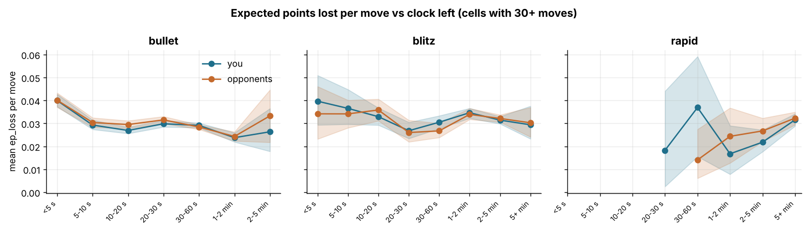
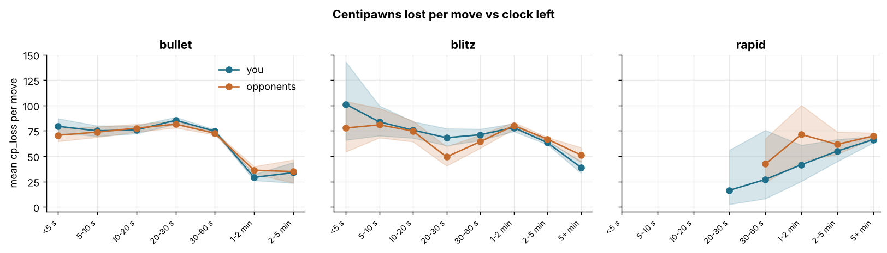
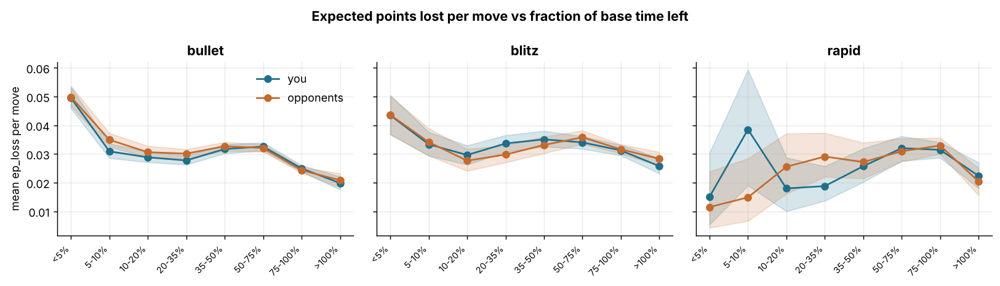
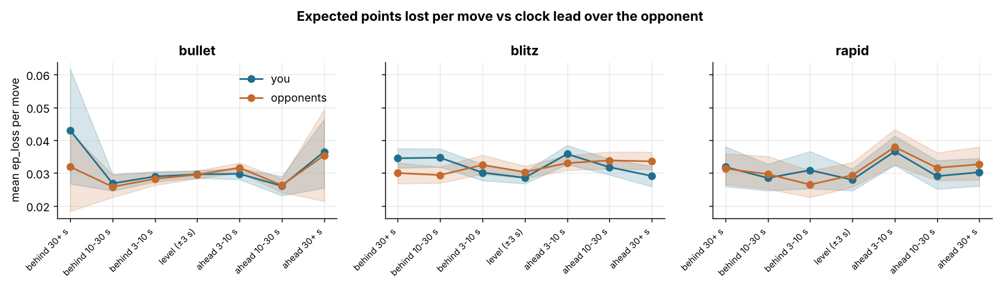
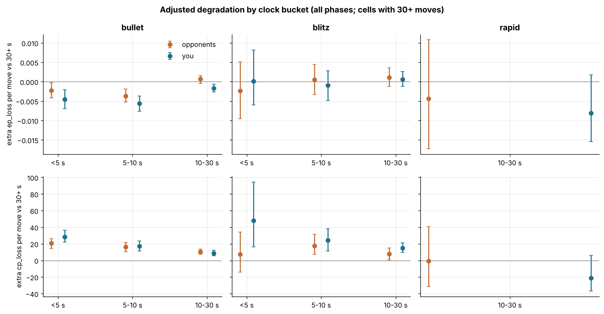

# Time pressure: how your play degrades on a low clock, vs others

6,029 standard live games (3,453 bullet, 1,987 blitz, 589 rapid), 364,685 analysed moves (182,422 yours, 182,263 opponents'). Every estimate is shown as `estimate [lo, hi]`, a 95% interval from a bootstrap that resamples whole games. `ep_loss` (calibrated expected points lost by a move) is the main quality measure, `cp_loss` the secondary one. "Low clock" means under 10 s on the mover's clock before the move.

## 1. How often each side is short of time

| time_class | moves <10 s you | moves <10 s opp | moves <5 s you | moves <5 s opp | games you <10 s | games opp <10 s |
|---|---|---|---|---|---|---|
| bullet | 11.7% [11.2, 12.1] | 11.4% [10.9, 11.9] | 4.9% [4.6, 5.2] | 4.7% [4.4, 5.0] | 48.4% [46.5, 50.0] | 51.0% [49.0, 52.5] |
| blitz | 2.3% [1.9, 2.7] | 1.9% [1.6, 2.3] | 0.7% [0.5, 0.8] | 0.4% [0.3, 0.6] | 10.4% [9.2, 11.7] | 9.0% [7.8, 10.3] |
| rapid | 0.1% [0.0, 0.3] | 0.2% [0.1, 0.4] | 0.1% [0.0, 0.2] | 0.1% [0.0, 0.2] | 0.9% [0.3, 1.7] | 1.2% [0.5, 2.2] |

Share of each side's moves played with under 10 s (or 5 s) on the clock, and share of games (with at least one analysed move) in which the side ever dropped under 10 s before a move.

## 2. Error vs seconds left on the clock

*Mean ep_loss per move by seconds left before the move; bands are game-clustered 95% CIs. You in blue, opponents in orange.*

`ep_loss` per move (tables leave out cells with fewer than 30 moves on either side):

| clock_bucket | time_class | you | opponents | you - opp | moves you/opp |
|---|---|---|---|---|---|
| <5 s | blitz | 0.0397 [0.0293, 0.0509] | 0.0342 [0.0232, 0.0461] | 0.0055 [-0.0087, 0.0221] | 399/249 |
| 5-10 s | blitz | 0.0366 [0.0296, 0.0448] | 0.0342 [0.0281, 0.0401] | 0.0024 [-0.0081, 0.0117] | 969/868 |
| 10-20 s | blitz | 0.0329 [0.0293, 0.0368] | 0.0359 [0.0312, 0.0406] | -0.0029 [-0.0084, 0.0017] | 3205/2238 |
| 20-30 s | blitz | 0.0268 [0.0235, 0.0305] | 0.0260 [0.0220, 0.0314] | 0.0008 [-0.0046, 0.0064] | 2284/1774 |
| 30-60 s | blitz | 0.0305 [0.0278, 0.0334] | 0.0268 [0.0239, 0.0301] | 0.0038 [-0.0001, 0.0074] | 4796/4192 |
| 1-2 min | blitz | 0.0347 [0.0323, 0.0366] | 0.0339 [0.0318, 0.0366] | 0.0007 [-0.0014, 0.0030] | 12602/12021 |
| 2-5 min | blitz | 0.0314 [0.0298, 0.0330] | 0.0322 [0.0306, 0.0338] | -0.0007 [-0.0015, 0.0000] | 32926/35441 |
| 5+ min | blitz | 0.0294 [0.0233, 0.0376] | 0.0303 [0.0241, 0.0370] | -0.0009 [-0.0048, 0.0030] | 1615/1972 |
| <5 s | bullet | 0.0400 [0.0373, 0.0427] | 0.0401 [0.0371, 0.0433] | -0.0001 [-0.0034, 0.0030] | 5255/5064 |
| 5-10 s | bullet | 0.0293 [0.0274, 0.0315] | 0.0304 [0.0283, 0.0325] | -0.0011 [-0.0035, 0.0011] | 7312/7152 |
| 10-20 s | bullet | 0.0269 [0.0256, 0.0284] | 0.0295 [0.0278, 0.0312] | -0.0026 [-0.0040, -0.0011] | 14882/14471 |
| 20-30 s | bullet | 0.0299 [0.0285, 0.0313] | 0.0315 [0.0300, 0.0331] | -0.0017 [-0.0030, -0.0004] | 14609/13981 |
| 30-60 s | bullet | 0.0291 [0.0281, 0.0302] | 0.0285 [0.0274, 0.0294] | 0.0007 [0.0002, 0.0012] | 57457/58357 |
| 1-2 min | bullet | 0.0238 [0.0219, 0.0260] | 0.0243 [0.0224, 0.0264] | -0.0005 [-0.0015, 0.0005] | 7745/8129 |
| 2-5 min | bullet | 0.0264 [0.0178, 0.0365] | 0.0333 [0.0218, 0.0447] | -0.0069 [-0.0170, 0.0018] | 234/260 |
| 30-60 s | rapid | 0.0369 [0.0156, 0.0592] | 0.0141 [0.0061, 0.0274] | 0.0228 [0.0008, 0.0449] | 81/81 |
| 1-2 min | rapid | 0.0168 [0.0079, 0.0290] | 0.0244 [0.0128, 0.0368] | -0.0076 [-0.0223, 0.0067] | 180/167 |
| 2-5 min | rapid | 0.0218 [0.0177, 0.0272] | 0.0267 [0.0221, 0.0323] | -0.0049 [-0.0109, 0.0013] | 1498/1603 |
| 5+ min | rapid | 0.0316 [0.0289, 0.0342] | 0.0323 [0.0294, 0.0350] | -0.0007 [-0.0018, 0.0003] | 14295/14159 |

*Mean cp_loss per move by seconds left.*

`cp_loss` per move (centipawns), same cells:

| clock_bucket | time_class | you | opponents | you - opp | moves you/opp |
|---|---|---|---|---|---|
| <5 s | blitz | 101.2 [65.9, 143.0] | 77.8 [54.4, 104.1] | 23.4 [-19.6, 72.8] | 399/249 |
| 5-10 s | blitz | 83.9 [70.2, 99.8] | 80.9 [68.2, 97.3] | 2.9 [-16.9, 22.1] | 969/868 |
| 10-20 s | blitz | 75.7 [67.9, 84.2] | 74.8 [64.4, 84.9] | 0.9 [-11.2, 12.4] | 3205/2238 |
| 20-30 s | blitz | 68.2 [60.5, 77.3] | 49.3 [40.5, 59.5] | 19.0 [6.8, 29.8] | 2284/1774 |
| 30-60 s | blitz | 71.2 [65.5, 76.7] | 64.3 [58.0, 71.1] | 6.9 [-2.1, 14.3] | 4796/4192 |
| 1-2 min | blitz | 78.2 [74.4, 82.2] | 80.1 [76.6, 83.5] | -1.9 [-6.4, 2.9] | 12602/12021 |
| 2-5 min | blitz | 63.4 [61.5, 65.1] | 66.9 [65.2, 68.6] | -3.5 [-5.3, -1.9] | 32926/35441 |
| 5+ min | blitz | 39.0 [33.4, 45.1] | 51.2 [44.1, 58.6] | -12.2 [-19.9, -3.9] | 1615/1972 |
| <5 s | bullet | 79.4 [73.2, 87.1] | 70.7 [64.7, 77.0] | 8.8 [1.9, 15.7] | 5255/5064 |
| 5-10 s | bullet | 75.0 [69.6, 80.1] | 73.8 [68.7, 79.2] | 1.3 [-4.5, 7.5] | 7312/7152 |
| 10-20 s | bullet | 75.9 [72.3, 80.0] | 77.7 [73.9, 81.6] | -1.8 [-5.3, 2.4] | 14882/14471 |
| 20-30 s | bullet | 85.5 [81.7, 88.6] | 81.6 [78.0, 84.9] | 3.9 [0.3, 7.6] | 14609/13981 |
| 30-60 s | bullet | 74.6 [73.3, 76.0] | 72.6 [71.1, 73.9] | 2.1 [0.8, 3.4] | 57457/58357 |
| 1-2 min | bullet | 29.1 [26.2, 32.2] | 36.2 [32.7, 39.9] | -7.1 [-9.8, -4.8] | 7745/8129 |
| 2-5 min | bullet | 33.8 [23.5, 43.9] | 34.8 [23.7, 46.5] | -1.0 [-13.0, 9.7] | 234/260 |
| 30-60 s | rapid | 27.1 [8.2, 75.7] | 42.3 [24.1, 67.2] | -15.2 [-43.3, 34.3] | 81/81 |
| 1-2 min | rapid | 41.6 [25.2, 60.9] | 71.4 [44.6, 100.3] | -29.9 [-63.9, 3.7] | 180/167 |
| 2-5 min | rapid | 55.0 [44.8, 66.6] | 61.6 [51.9, 74.0] | -6.6 [-18.5, 5.4] | 1498/1603 |
| 5+ min | rapid | 66.3 [63.2, 69.3] | 69.9 [67.0, 73.0] | -3.5 [-6.3, -1.2] | 14295/14159 |

Raw curves. Note the confounding: moves made on a low clock are almost all late endgame moves in sharper positions (see section 5), so part of the rise is the position, not the clock. Section 6 adjusts for that.

## 3. Error vs clock left as a fraction of the base time

*Mean ep_loss per move by clock left as a fraction of the base time (10% of base is 6 s in 1+0 bullet, 18 s in 3+2 blitz, 60 s in 10+0 rapid).*

| clock_fraction_bucket | time_class | you | opponents | you - opp | moves you/opp |
|---|---|---|---|---|---|
| <5% | blitz | 0.0435 [0.0368, 0.0505] | 0.0436 [0.0368, 0.0502] | -0.0001 [-0.0102, 0.0088] | 1407/1215 |
| 5-10% | blitz | 0.0334 [0.0294, 0.0377] | 0.0341 [0.0294, 0.0389] | -0.0008 [-0.0057, 0.0049] | 2829/2169 |
| 10-20% | blitz | 0.0296 [0.0263, 0.0330] | 0.0277 [0.0241, 0.0317] | 0.0020 [-0.0026, 0.0058] | 4315/3420 |
| 20-35% | blitz | 0.0336 [0.0308, 0.0365] | 0.0298 [0.0270, 0.0330] | 0.0039 [0.0004, 0.0076] | 4974/4304 |
| 35-50% | blitz | 0.0351 [0.0325, 0.0380] | 0.0331 [0.0303, 0.0360] | 0.0020 [-0.0012, 0.0051] | 5980/5338 |
| 50-75% | blitz | 0.0340 [0.0318, 0.0362] | 0.0358 [0.0335, 0.0382] | -0.0018 [-0.0039, 0.0003] | 12243/12029 |
| 75-100% | blitz | 0.0312 [0.0295, 0.0331] | 0.0316 [0.0301, 0.0334] | -0.0004 [-0.0016, 0.0008] | 20130/21196 |
| >100% | blitz | 0.0258 [0.0232, 0.0286] | 0.0283 [0.0259, 0.0307] | -0.0026 [-0.0045, -0.0007] | 6918/9084 |
| <5% | bullet | 0.0495 [0.0459, 0.0532] | 0.0499 [0.0465, 0.0537] | -0.0003 [-0.0046, 0.0041] | 3721/3721 |
| 5-10% | bullet | 0.0309 [0.0286, 0.0336] | 0.0349 [0.0326, 0.0372] | -0.0040 [-0.0071, -0.0011] | 4395/4303 |
| 10-20% | bullet | 0.0288 [0.0271, 0.0308] | 0.0306 [0.0287, 0.0328] | -0.0018 [-0.0038, 0.0002] | 9426/9111 |
| 20-35% | bullet | 0.0277 [0.0263, 0.0294] | 0.0301 [0.0284, 0.0316] | -0.0024 [-0.0039, -0.0009] | 14004/13550 |
| 35-50% | bullet | 0.0317 [0.0302, 0.0333] | 0.0327 [0.0311, 0.0341] | -0.0010 [-0.0024, 0.0005] | 13511/12883 |
| 50-75% | bullet | 0.0326 [0.0312, 0.0340] | 0.0321 [0.0308, 0.0334] | 0.0005 [-0.0005, 0.0014] | 23252/22368 |
| 75-100% | bullet | 0.0250 [0.0239, 0.0261] | 0.0243 [0.0234, 0.0254] | 0.0007 [0.0002, 0.0011] | 35749/37711 |
| >100% | bullet | 0.0198 [0.0176, 0.0221] | 0.0209 [0.0184, 0.0232] | -0.0010 [-0.0026, 0.0005] | 3436/3767 |
| <5% | rapid | 0.0150 [0.0054, 0.0304] | 0.0115 [0.0042, 0.0239] | 0.0035 [-0.0113, 0.0196] | 88/96 |
| 5-10% | rapid | 0.0385 [0.0190, 0.0593] | 0.0149 [0.0067, 0.0284] | 0.0237 [0.0039, 0.0448] | 85/84 |
| 10-20% | rapid | 0.0180 [0.0100, 0.0287] | 0.0255 [0.0161, 0.0371] | -0.0076 [-0.0221, 0.0070] | 191/182 |
| 20-35% | rapid | 0.0188 [0.0137, 0.0257] | 0.0291 [0.0220, 0.0373] | -0.0103 [-0.0204, -0.0015] | 471/614 |
| 35-50% | rapid | 0.0257 [0.0202, 0.0319] | 0.0272 [0.0215, 0.0339] | -0.0015 [-0.0075, 0.0051] | 1130/1090 |
| 50-75% | rapid | 0.0320 [0.0276, 0.0362] | 0.0309 [0.0273, 0.0354] | 0.0011 [-0.0025, 0.0044] | 4128/3984 |
| 75-100% | rapid | 0.0314 [0.0287, 0.0341] | 0.0329 [0.0300, 0.0356] | -0.0015 [-0.0030, -0.0000] | 9762/9849 |
| >100% | rapid | 0.0224 [0.0181, 0.0270] | 0.0204 [0.0156, 0.0251] | 0.0020 [-0.0023, 0.0062] | 277/195 |

## 4. Error vs clock relative to the opponent

*Mean ep_loss per move by the mover's clock minus the opponent's clock.*

| clock_diff_bucket | time_class | you | opponents | you - opp | moves you/opp |
|---|---|---|---|---|---|
| behind 30+ s | blitz | 0.0345 [0.0315, 0.0374] | 0.0300 [0.0268, 0.0331] | 0.0045 [-0.0000, 0.0098] | 11738/5837 |
| behind 10-30 s | blitz | 0.0347 [0.0319, 0.0374] | 0.0294 [0.0270, 0.0319] | 0.0053 [0.0021, 0.0090] | 9588/5612 |
| behind 3-10 s | blitz | 0.0301 [0.0277, 0.0327] | 0.0325 [0.0297, 0.0355] | -0.0023 [-0.0055, 0.0009] | 6504/4794 |
| level (±3 s) | blitz | 0.0286 [0.0268, 0.0304] | 0.0303 [0.0285, 0.0321] | -0.0017 [-0.0029, -0.0006] | 11695/11354 |
| ahead 3-10 s | blitz | 0.0358 [0.0327, 0.0385] | 0.0330 [0.0308, 0.0354] | 0.0028 [0.0000, 0.0056] | 5592/6930 |
| ahead 10-30 s | blitz | 0.0318 [0.0295, 0.0343] | 0.0338 [0.0313, 0.0365] | -0.0020 [-0.0058, 0.0013] | 6741/10818 |
| ahead 30+ s | blitz | 0.0291 [0.0259, 0.0321] | 0.0336 [0.0311, 0.0364] | -0.0045 [-0.0084, -0.0006] | 6938/13410 |
| behind 30+ s | bullet | 0.0430 [0.0267, 0.0617] | 0.0319 [0.0184, 0.0424] | 0.0111 [-0.0081, 0.0341] | 272/194 |
| behind 10-30 s | bullet | 0.0268 [0.0246, 0.0296] | 0.0258 [0.0226, 0.0295] | 0.0010 [-0.0033, 0.0053] | 7703/5868 |
| behind 3-10 s | bullet | 0.0290 [0.0274, 0.0305] | 0.0282 [0.0263, 0.0303] | 0.0007 [-0.0017, 0.0031] | 20989/14615 |
| level (±3 s) | bullet | 0.0296 [0.0285, 0.0308] | 0.0295 [0.0283, 0.0307] | 0.0001 [-0.0005, 0.0007] | 50314/47599 |
| ahead 3-10 s | bullet | 0.0298 [0.0281, 0.0314] | 0.0316 [0.0301, 0.0332] | -0.0019 [-0.0041, 0.0005] | 19550/27862 |
| ahead 10-30 s | bullet | 0.0261 [0.0231, 0.0290] | 0.0263 [0.0241, 0.0283] | -0.0002 [-0.0030, 0.0030] | 8362/10904 |
| ahead 30+ s | bullet | 0.0365 [0.0255, 0.0464] | 0.0353 [0.0215, 0.0494] | 0.0011 [-0.0179, 0.0164] | 304/372 |
| behind 30+ s | rapid | 0.0319 [0.0259, 0.0380] | 0.0313 [0.0265, 0.0359] | 0.0005 [-0.0066, 0.0090] | 3246/2974 |
| behind 10-30 s | rapid | 0.0285 [0.0247, 0.0328] | 0.0297 [0.0252, 0.0351] | -0.0012 [-0.0067, 0.0050] | 1945/1689 |
| behind 3-10 s | rapid | 0.0309 [0.0253, 0.0366] | 0.0265 [0.0226, 0.0307] | 0.0044 [-0.0013, 0.0101] | 1076/1107 |
| level (±3 s) | rapid | 0.0279 [0.0247, 0.0313] | 0.0293 [0.0258, 0.0333] | -0.0014 [-0.0039, 0.0011] | 2617/2675 |
| ahead 3-10 s | rapid | 0.0366 [0.0324, 0.0413] | 0.0379 [0.0326, 0.0433] | -0.0014 [-0.0065, 0.0041] | 1484/1441 |
| ahead 10-30 s | rapid | 0.0290 [0.0251, 0.0338] | 0.0316 [0.0277, 0.0362] | -0.0025 [-0.0077, 0.0029] | 2181/2337 |
| ahead 30+ s | rapid | 0.0302 [0.0261, 0.0345] | 0.0327 [0.0280, 0.0380] | -0.0024 [-0.0096, 0.0042] | 3583/3871 |

## 5. Low clock is mostly an endgame problem: by phase

What low-clock moves look like (both sides): share of endgame moves, mean ply and mean stakes (`ep_criticality`, the expected-points gap between the best and second-best move).

| time_class | clock | endgame_share | mean_ply | mean_ep_criticality |
|---|---|---|---|---|
| blitz | <5 s | 92% | 86.1 | 0.045 |
| blitz | 5-10 s | 90% | 83.4 | 0.039 |
| blitz | 10-30 s | 89% | 84.8 | 0.031 |
| blitz | 30+ s | 31% | 35.6 | 0.032 |
| bullet | <5 s | 94% | 79.2 | 0.047 |
| bullet | 5-10 s | 89% | 72.3 | 0.034 |
| bullet | 10-30 s | 71% | 56.5 | 0.028 |
| bullet | 30+ s | 11% | 21.9 | 0.026 |
| rapid | <5 s | 100% | 115.9 | 0.008 |
| rapid | 5-10 s | 96% | 108.6 | 0.010 |
| rapid | 10-30 s | 92% | 107.7 | 0.022 |
| rapid | 30+ s | 33% | 39.1 | 0.032 |

`ep_loss` by clock bucket, endgame vs earlier phases:

| clock_bucket_coarse | time_class | phase2 | you | opponents | you - opp | moves you/opp |
|---|---|---|---|---|---|---|
| <5 s | blitz | endgame | 0.0376 [0.0276, 0.0481] | 0.0368 [0.0253, 0.0487] | 0.0007 [-0.0156, 0.0172] | 378/219 |
| 5-10 s | blitz | endgame | 0.0351 [0.0266, 0.0432] | 0.0343 [0.0286, 0.0416] | 0.0008 [-0.0106, 0.0104] | 872/790 |
| 10-30 s | blitz | endgame | 0.0281 [0.0247, 0.0316] | 0.0305 [0.0269, 0.0345] | -0.0023 [-0.0066, 0.0014] | 4836/3596 |
| 30+ s | blitz | endgame | 0.0295 [0.0271, 0.0318] | 0.0294 [0.0272, 0.0315] | 0.0001 [-0.0013, 0.0013] | 15483/16920 |
| 5-10 s | blitz | opening/middlegame | 0.0497 [0.0334, 0.0655] | 0.0324 [0.0176, 0.0513] | 0.0172 [-0.0093, 0.0413] | 97/78 |
| 10-30 s | blitz | opening/middlegame | 0.0470 [0.0369, 0.0587] | 0.0407 [0.0287, 0.0563] | 0.0063 [-0.0071, 0.0199] | 653/416 |
| 30+ s | blitz | opening/middlegame | 0.0332 [0.0317, 0.0346] | 0.0333 [0.0319, 0.0348] | -0.0001 [-0.0007, 0.0004] | 36456/36706 |
| <5 s | bullet | endgame | 0.0396 [0.0367, 0.0429] | 0.0395 [0.0367, 0.0422] | 0.0001 [-0.0031, 0.0035] | 4984/4724 |
| 5-10 s | bullet | endgame | 0.0286 [0.0264, 0.0307] | 0.0294 [0.0272, 0.0317] | -0.0008 [-0.0032, 0.0016] | 6547/6301 |
| 10-30 s | bullet | endgame | 0.0257 [0.0242, 0.0272] | 0.0281 [0.0265, 0.0295] | -0.0025 [-0.0035, -0.0013] | 20757/20191 |
| 30+ s | bullet | endgame | 0.0291 [0.0264, 0.0317] | 0.0270 [0.0245, 0.0294] | 0.0021 [0.0001, 0.0039] | 6457/7436 |
| <5 s | bullet | opening/middlegame | 0.0469 [0.0365, 0.0600] | 0.0488 [0.0386, 0.0588] | -0.0019 [-0.0151, 0.0116] | 271/340 |
| 5-10 s | bullet | opening/middlegame | 0.0353 [0.0293, 0.0418] | 0.0380 [0.0324, 0.0436] | -0.0027 [-0.0099, 0.0038] | 765/851 |
| 10-30 s | bullet | opening/middlegame | 0.0349 [0.0328, 0.0370] | 0.0364 [0.0341, 0.0384] | -0.0015 [-0.0033, 0.0005] | 8734/8261 |
| 30+ s | bullet | opening/middlegame | 0.0284 [0.0274, 0.0295] | 0.0281 [0.0270, 0.0292] | 0.0003 [-0.0001, 0.0007] | 58979/59310 |
| 10-30 s | rapid | endgame | 0.0129 [0.0021, 0.0312] | 0.0120 [0.0021, 0.0310] | 0.0008 [-0.0227, 0.0238] | 54/42 |
| 30+ s | rapid | endgame | 0.0255 [0.0220, 0.0294] | 0.0270 [0.0233, 0.0311] | -0.0015 [-0.0029, -0.0002] | 5352/5314 |
| 30+ s | rapid | opening/middlegame | 0.0331 [0.0302, 0.0358] | 0.0338 [0.0308, 0.0365] | -0.0008 [-0.0018, 0.0002] | 10702/10696 |

## 6. Susceptibility: do you degrade more than your opponents? (adjusted)

Linear model per time class: `ep_loss ~ clock bucket × side + phase + stakes + ply bucket + material (pieces bucket) + opponent's clock bucket`, moves of both sides, CIs from a bootstrap over games. Stakes are the gap between the best and second-best move in the outcome's own currency (`ep_criticality` buckets for ep_loss, `criticality` in centipawns for cp_loss). Reference bucket is 30+ s. `opponents` is the opponents' extra ep_loss per move in that bucket relative to 30+ s after the controls; `you` the same for you; `you - opp` is the side × clock interaction, i.e. the susceptibility test (positive: you degrade more than opponents do under the same clock). Rows are also fitted within endgame and non-endgame moves only.

### Adjusted degradation in ep_loss relative to 30+ s

| clock | time_class | stratum | you | opponents | you - opp | moves you/opp |
|---|---|---|---|---|---|---|
| <5 s | bullet | all | -0.0045 [-0.0069, -0.0021] | -0.0023 [-0.0042, -0.0002] | -0.0022 [-0.0048, 0.0004] | 5255/5064 |
| 5-10 s | bullet | all | -0.0056 [-0.0076, -0.0037] | -0.0036 [-0.0052, -0.0019] | -0.0020 [-0.0043, 0.0001] | 7312/7152 |
| 10-30 s | bullet | all | -0.0017 [-0.0026, -0.0006] | 0.0007 [-0.0004, 0.0016] | -0.0024 [-0.0033, -0.0013] | 29491/28452 |
| <5 s | bullet | endgame | -0.0050 [-0.0074, -0.0026] | -0.0026 [-0.0049, -0.0003] | -0.0024 [-0.0052, 0.0005] | 4984/4724 |
| 5-10 s | bullet | endgame | -0.0067 [-0.0087, -0.0045] | -0.0046 [-0.0067, -0.0026] | -0.0021 [-0.0048, 0.0007] | 6547/6301 |
| 10-30 s | bullet | endgame | -0.0036 [-0.0054, -0.0021] | 0.0002 [-0.0014, 0.0016] | -0.0038 [-0.0057, -0.0020] | 20757/20191 |
| <5 s | bullet | opening/middlegame | 0.0029 [-0.0043, 0.0105] | 0.0034 [-0.0017, 0.0094] | -0.0005 [-0.0099, 0.0084] | 271/340 |
| 5-10 s | bullet | opening/middlegame | -0.0039 [-0.0073, -0.0003] | -0.0000 [-0.0038, 0.0035] | -0.0038 [-0.0085, 0.0012] | 765/851 |
| 10-30 s | bullet | opening/middlegame | 0.0004 [-0.0010, 0.0019] | 0.0001 [-0.0013, 0.0016] | 0.0003 [-0.0015, 0.0022] | 8734/8261 |
| <5 s | blitz | all | 0.0001 [-0.0060, 0.0081] | -0.0023 [-0.0095, 0.0051] | 0.0025 [-0.0072, 0.0126] | 399/249 |
| 5-10 s | blitz | all | -0.0009 [-0.0048, 0.0028] | 0.0005 [-0.0033, 0.0044] | -0.0014 [-0.0072, 0.0036] | 969/868 |
| 10-30 s | blitz | all | 0.0006 [-0.0012, 0.0026] | 0.0011 [-0.0012, 0.0035] | -0.0005 [-0.0033, 0.0023] | 5489/4012 |
| <5 s | blitz | endgame | 0.0004 [-0.0056, 0.0070] | 0.0000 [-0.0094, 0.0091] | 0.0004 [-0.0099, 0.0112] | 378/219 |
| 5-10 s | blitz | endgame | -0.0006 [-0.0045, 0.0040] | 0.0007 [-0.0034, 0.0053] | -0.0013 [-0.0074, 0.0047] | 872/790 |
| 10-30 s | blitz | endgame | -0.0001 [-0.0023, 0.0019] | 0.0007 [-0.0017, 0.0033] | -0.0008 [-0.0041, 0.0024] | 4836/3596 |
| 5-10 s | blitz | opening/middlegame | -0.0003 [-0.0128, 0.0123] | -0.0019 [-0.0147, 0.0127] | 0.0016 [-0.0171, 0.0229] | 97/78 |
| 10-30 s | blitz | opening/middlegame | 0.0060 [-0.0009, 0.0134] | 0.0032 [-0.0035, 0.0135] | 0.0027 [-0.0052, 0.0116] | 653/416 |
| 10-30 s | rapid | all | -0.0081 [-0.0154, 0.0018] | -0.0044 [-0.0172, 0.0108] | -0.0037 [-0.0202, 0.0113] | 57/47 |
| 10-30 s | rapid | endgame | -0.0097 [-0.0158, -0.0025] | -0.0034 [-0.0160, 0.0120] | -0.0063 [-0.0208, 0.0109] | 54/42 |

### Adjusted degradation in cp_loss relative to 30+ s

| clock | time_class | stratum | you | opponents | you - opp | moves you/opp |
|---|---|---|---|---|---|---|
| <5 s | bullet | all | 28.5 [22.2, 36.4] | 20.6 [14.6, 26.3] | 7.9 [2.3, 15.6] | 5255/5064 |
| 5-10 s | bullet | all | 17.2 [11.5, 23.2] | 16.2 [10.7, 21.7] | 1.0 [-4.1, 7.0] | 7312/7152 |
| 10-30 s | bullet | all | 8.8 [5.7, 12.5] | 10.4 [7.5, 13.7] | -1.5 [-4.2, 1.5] | 29491/28452 |
| <5 s | bullet | endgame | 19.9 [12.8, 27.1] | 15.5 [8.6, 22.6] | 4.4 [-3.4, 12.7] | 4984/4724 |
| 5-10 s | bullet | endgame | 9.9 [3.3, 16.0] | 10.4 [4.4, 15.6] | -0.5 [-8.4, 7.3] | 6547/6301 |
| 10-30 s | bullet | endgame | 1.1 [-3.5, 5.2] | 7.2 [2.7, 11.8] | -6.2 [-12.2, -1.0] | 20757/20191 |
| <5 s | bullet | opening/middlegame | 66.7 [26.3, 108.0] | 35.2 [12.3, 61.3] | 31.6 [-11.5, 73.0] | 271/340 |
| 5-10 s | bullet | opening/middlegame | 25.6 [9.6, 41.1] | 29.5 [12.3, 47.5] | -3.9 [-25.0, 15.9] | 765/851 |
| 10-30 s | bullet | opening/middlegame | 15.3 [9.8, 21.8] | 10.5 [5.9, 15.9] | 4.8 [-1.2, 11.1] | 8734/8261 |
| <5 s | blitz | all | 47.8 [16.4, 94.4] | 7.4 [-13.9, 34.2] | 40.4 [-6.1, 86.6] | 399/249 |
| 5-10 s | blitz | all | 24.1 [11.4, 38.0] | 17.8 [7.4, 31.6] | 6.3 [-10.5, 23.3] | 969/868 |
| 10-30 s | blitz | all | 14.9 [9.6, 21.3] | 7.8 [0.9, 14.9] | 7.1 [-0.6, 14.6] | 5489/4012 |
| <5 s | blitz | endgame | 45.3 [15.7, 85.1] | 9.2 [-14.6, 36.3] | 36.1 [-5.1, 87.2] | 378/219 |
| 5-10 s | blitz | endgame | 18.4 [6.1, 30.0] | 13.9 [1.9, 25.9] | 4.5 [-11.4, 20.2] | 872/790 |
| 10-30 s | blitz | endgame | 10.8 [4.9, 16.5] | 6.0 [-0.3, 12.8] | 4.8 [-3.7, 12.9] | 4836/3596 |
| 5-10 s | blitz | opening/middlegame | 69.4 [0.9, 144.0] | 43.4 [-5.5, 100.3] | 26.0 [-67.1, 114.4] | 97/78 |
| 10-30 s | blitz | opening/middlegame | 45.6 [21.5, 73.5] | 13.2 [-15.7, 49.3] | 32.4 [2.4, 63.3] | 653/416 |
| 10-30 s | rapid | all | -21.3 [-36.8, 6.2] | -0.6 [-31.6, 41.0] | -20.7 [-66.7, 32.3] | 57/47 |
| 10-30 s | rapid | endgame | -25.2 [-43.0, 0.6] | 4.0 [-28.8, 47.5] | -29.2 [-72.9, 27.0] | 54/42 |

### The same model without the stakes control

Most of the raw rise in `ep_loss` on a low clock is carried by the stakes of the positions reached, not by the clock: dropping the stakes control (keeping phase, ply, material and the opponent's clock) brings the low-clock coefficients back up. Bullet and blitz, all phases.

`ep_loss`, without the stakes control:

| clock | time_class | you | opponents | you - opp | moves you/opp |
|---|---|---|---|---|---|
| <5 s | bullet | 0.0115 [0.0084, 0.0150] | 0.0120 [0.0090, 0.0150] | -0.0005 [-0.0034, 0.0031] | 5255/5064 |
| 5-10 s | bullet | 0.0009 [-0.0014, 0.0033] | 0.0024 [-0.0001, 0.0049] | -0.0015 [-0.0037, 0.0008] | 7312/7152 |
| 10-30 s | bullet | -0.0007 [-0.0022, 0.0006] | 0.0020 [0.0007, 0.0034] | -0.0028 [-0.0039, -0.0017] | 29491/28452 |
| <5 s | blitz | 0.0106 [0.0000, 0.0214] | 0.0028 [-0.0081, 0.0151] | 0.0078 [-0.0061, 0.0228] | 399/249 |
| 5-10 s | blitz | 0.0068 [-0.0007, 0.0142] | 0.0039 [-0.0020, 0.0102] | 0.0029 [-0.0065, 0.0123] | 969/868 |
| 10-30 s | blitz | 0.0012 [-0.0019, 0.0042] | 0.0028 [-0.0006, 0.0064] | -0.0016 [-0.0055, 0.0024] | 5489/4012 |

`cp_loss`, without the stakes control:

| clock | time_class | you | opponents | you - opp | moves you/opp |
|---|---|---|---|---|---|
| <5 s | bullet | 30.7 [23.6, 38.7] | 19.8 [13.7, 26.3] | 10.9 [4.3, 19.5] | 5255/5064 |
| 5-10 s | bullet | 18.3 [12.1, 24.5] | 16.9 [11.0, 22.9] | 1.4 [-4.0, 7.7] | 7312/7152 |
| 10-30 s | bullet | 10.0 [6.8, 13.6] | 11.3 [8.4, 14.8] | -1.3 [-3.8, 1.6] | 29491/28452 |
| <5 s | blitz | 47.4 [15.7, 96.3] | 11.4 [-12.0, 41.4] | 36.0 [-9.8, 85.6] | 399/249 |
| 5-10 s | blitz | 26.4 [12.4, 42.3] | 18.6 [5.7, 32.4] | 7.9 [-9.3, 26.1] | 969/868 |
| 10-30 s | blitz | 15.7 [9.4, 23.0] | 5.8 [-1.6, 13.4] | 9.9 [1.1, 18.1] | 5489/4012 |

*Adjusted extra ep_loss (top) and cp_loss (bottom) per move relative to 30+ s, after controlling for phase, stakes, ply, material and the opponent's clock; you vs opponents.*

## 7. What low-clock moves cost per game

Expected points lost per game on moves made with under 10 s (zero for games where the side never got that low), you vs opponents, all games of the class with at least one analysed move (two bullet/rapid games have none, hence 6,027 games here against 6,029 in the header).

| time_class | you | opponents | you - opp | games |
|---|---|---|---|---|
| blitz | 0.0258 [0.0193, 0.0331] | 0.0192 [0.0143, 0.0253] | 0.0066 [-0.0019, 0.0144] | 1987 |
| bullet | 0.1229 [0.1139, 0.1315] | 0.1220 [0.1128, 0.1305] | 0.0009 [-0.0067, 0.0089] | 3452 |
| rapid | 0.0004 [0.0000, 0.0013] | 0.0003 [0.0000, 0.0008] | 0.0001 [-0.0006, 0.0011] | 588 |

Share of each side's total `ep_loss` (and of its blunders) that occurred on moves under 10 s, with game-resampled CIs:

| time_class | side | share of ep_loss under 10 s | share of blunders (ep_loss>=0.1) under 10 s |
|---|---|---|---|
| bullet | you | 13.6% [12.7, 14.4] | 14.9% [13.7, 16.1] |
| bullet | opponents | 13.3% [12.6, 14.1] | 14.3% [13.3, 15.3] |
| blitz | you | 2.7% [2.0, 3.5] | 3.1% [2.1, 4.3] |
| blitz | opponents | 2.0% [1.5, 2.6] | 2.2% [1.5, 3.0] |
| rapid | you | 0.1% [0.0, 0.2] | 0.1% [0.0, 0.2] |
| rapid | opponents | 0.0% [0.0, 0.1] | 0.1% [0.0, 0.2] |

## 8. What rating your low-clock play resembles

The calibrated `ep_loss` is built conditional on the players' ratings, so it is nearly flat across the rating range (its slope is reported below for completeness) and cannot map play to a rating. The mapping therefore uses `cp_loss` (and, as a second currency, the share of moves losing 300+ cp, the `blunder` label), which do fall with rating. Curve: opponents' moves in the class, mean per move vs the opponent's pre-game rating (move-weighted linear fit); the player's low-clock mean is read off it. The data hold only post-game ratings, so the opponent's pre-game rating is reconstructed as `opponent_rating_after + my_rating_change` in rated games (the two sides' rating changes are approximately equal and opposite) and as the post-game rating in unrated games (where ratings do not move); this removes the result's effect on the x variable (the convention is never to use post-game ratings as predictors), at the cost of a few points of noise where the two players' rating deviations differ. Games whose rating change is unknown (the first rated game in a pool) or whose opponent is rated under 100 are left out of the curve. Equivalents are shown only where the slope's CI excludes zero, and are clipped to [0, 2500] (marked with `*`); `ep_loss` rows are marked `not used` whatever their slope, since a slope of a few thousandths of a point per 100 rating points is calibration residue, not a rating signal. Rows: all moves, and endgame moves only for cp_loss (nearly all low-clock moves are endgame moves, so the endgame-only row would compare like with like, but opponents' endgame cp_loss turns out not to vary with rating in bullet and rapid, and in blitz the slope is so shallow that its equivalents span hundreds of points). Cells with fewer than 30 of your moves are left out.

**bullet**

| stratum | currency | your moves | your mean | curve slope per 100 pts | rating equivalent | your actual mean rating | moves |
|---|---|---|---|---|---|---|---|
| all | ep_loss | <10 s | 0.0338 [0.0319, 0.0359] | -0.0009 [-0.0013, -0.0004] | not used (flat by construction) | 932 | 12567 |
| all | ep_loss | 30+ s | 0.0285 [0.0273, 0.0295] | -0.0009 [-0.0013, -0.0004] | not used (flat by construction) | 932 | 65436 |
| all | ep_loss | all your moves | 0.0291 [0.0280, 0.0300] | -0.0009 [-0.0013, -0.0004] | not used (flat by construction) | 932 | 107494 |
| all | cp_loss | <10 s | 76.9 [72.6, 81.6] | -2.8 [-3.5, -2.2] | 775 [606, 907] | 932 | 12567 |
| all | cp_loss | 30+ s | 69.1 [67.7, 70.3] | -2.8 [-3.5, -2.1] | 1050 [1005, 1107] | 932 | 65436 |
| all | cp_loss | all your moves | 73.2 [71.8, 74.5] | -2.8 [-3.5, -2.1] | 905 [861, 936] | 932 | 107494 |
| all | blunder | <10 s | 0.074 [0.069, 0.080] | -0.003 [-0.004, -0.002] | 501 [248, 695] | 932 | 12567 |
| all | blunder | 30+ s | 0.054 [0.052, 0.056] | -0.003 [-0.004, -0.002] | 1146 [1078, 1239] | 932 | 65436 |
| all | blunder | all your moves | 0.062 [0.060, 0.063] | -0.003 [-0.004, -0.002] | 911 [852, 954] | 932 | 107494 |
| endgame | cp_loss | <10 s | 71.3 [67.2, 75.6] | -0.1 [-1.5, 1.1] | not identified | 932 | 11531 |
| endgame | cp_loss | 30+ s | 68.0 [64.0, 72.3] | -0.1 [-1.4, 1.0] | not identified | 932 | 6457 |
| endgame | cp_loss | all your moves | 68.5 [66.1, 70.8] | -0.1 [-1.3, 1.2] | not identified | 932 | 38745 |

**blitz**

| stratum | currency | your moves | your mean | curve slope per 100 pts | rating equivalent | your actual mean rating | moves |
|---|---|---|---|---|---|---|---|
| all | ep_loss | <10 s | 0.0375 [0.0297, 0.0449] | -0.0003 [-0.0011, 0.0004] | not used (flat by construction) | 706 | 1368 |
| all | ep_loss | 30+ s | 0.0321 [0.0306, 0.0336] | -0.0003 [-0.0010, 0.0004] | not used (flat by construction) | 706 | 51939 |
| all | ep_loss | all your moves | 0.0320 [0.0307, 0.0336] | -0.0003 [-0.0010, 0.0004] | not used (flat by construction) | 706 | 58796 |
| all | cp_loss | <10 s | 88.9 [73.3, 107.5] | -4.1 [-4.8, -3.3] | 230 [0*, 615] | 706 | 1368 |
| all | cp_loss | 30+ s | 66.9 [65.4, 68.6] | -4.1 [-4.8, -3.3] | 773 [737, 808] | 706 | 51939 |
| all | cp_loss | all your moves | 68.0 [66.3, 69.4] | -4.1 [-4.8, -3.3] | 747 [717, 776] | 706 | 58796 |
| all | blunder | <10 s | 0.098 [0.076, 0.121] | -0.005 [-0.006, -0.004] | 0* [0*, 345] | 706 | 1368 |
| all | blunder | 30+ s | 0.055 [0.052, 0.057] | -0.005 [-0.006, -0.004] | 809 [764, 864] | 706 | 51939 |
| all | blunder | all your moves | 0.057 [0.055, 0.059] | -0.005 [-0.006, -0.004] | 755 [716, 800] | 706 | 58796 |
| endgame | cp_loss | <10 s | 79.9 [63.6, 97.2] | -1.4 [-3.0, 0.0] | not identified | 706 | 1250 |
| endgame | cp_loss | 30+ s | 59.9 [57.0, 62.6] | -1.4 [-3.0, -0.1] | 916 [632, 1845] | 706 | 15483 |
| endgame | cp_loss | all your moves | 61.4 [58.5, 64.4] | -1.4 [-3.0, -0.1] | 809 [610, 1401] | 706 | 21569 |

**rapid**

| stratum | currency | your moves | your mean | curve slope per 100 pts | rating equivalent | your actual mean rating | moves |
|---|---|---|---|---|---|---|---|
| all | ep_loss | 30+ s | 0.0305 [0.0281, 0.0331] | 0.0006 [-0.0005, 0.0017] | not used (flat by construction) | 961 | 16054 |
| all | ep_loss | all your moves | 0.0305 [0.0280, 0.0331] | 0.0006 [-0.0005, 0.0017] | not used (flat by construction) | 961 | 16132 |
| all | cp_loss | 30+ s | 64.8 [62.1, 67.9] | -2.4 [-3.9, -1.1] | 1143 [1042, 1374] | 961 | 16054 |
| all | cp_loss | all your moves | 64.6 [62.0, 67.7] | -2.4 [-3.9, -1.1] | 1151 [1052, 1407] | 961 | 16132 |
| all | blunder | 30+ s | 0.055 [0.051, 0.060] | -0.002 [-0.004, 0.000] | not identified | 961 | 16054 |
| all | blunder | all your moves | 0.055 [0.051, 0.059] | -0.002 [-0.004, 0.000] | not identified | 961 | 16132 |
| endgame | cp_loss | 30+ s | 54.9 [49.7, 59.9] | 1.4 [-1.2, 3.8] | not identified | 961 | 5352 |
| endgame | cp_loss | all your moves | 54.4 [49.3, 59.2] | 1.4 [-1.2, 3.8] | not identified | 961 | 5427 |

*Opponents' mean cp_loss by pre-game rating band (point size = moves) with the move-weighted linear fit; dashed/dotted lines are your cp_loss under 10 s and at 30+ s, triangles mark the rating equivalents where identified (the band means are noisy; the fit uses every move).*

## What this means for the player

Time pressure is a bullet phenomenon in these games: you play 11.7% [11.2, 12.1] of your bullet moves with under 10 s (opponents 11.4% [10.9, 11.9]) and drop under 10 s in 48.4% [46.5, 50.0] of bullet games; in blitz it is 2.3% [1.9, 2.7] of moves, in rapid almost never. Your raw bullet error rate under 5 s is 0.0400 [0.0373, 0.0427] expected points per move against 0.0291 [0.0281, 0.0302] at 30-60 s, the same rise as your opponents show, and in expected points you are not more susceptible than they are: the adjusted you-minus-opponents gap under 5 s is -0.0022 [-0.0048, +0.0004] in bullet and +0.0025 [-0.0072, +0.0126] in blitz. Once the stakes of the position are held fixed, a low clock does not make either side lose more *expected points* per move (bullet, <5 s: you -0.0045 [-0.0069, -0.0021], opponents -0.0023 [-0.0042, -0.0002] relative to 30+ s), because the calibration already discounts a position whose owner is about to flag; what does rise is the positional damage in centipawns, and there you degrade more than your opponents in bullet under 5 s (you +28.5 [+22.2, +36.4] cp vs opponents +20.6 [+14.6, +26.3] cp, gap +7.9 [+2.3, +15.6]), with a weaker hint of the same in blitz with 10-30 s left (gap +7.1 [-0.6, +14.6] cp) but not in bullet at 10-30 s (-1.5 [-4.2, +1.5]). Moves under 10 s cost you 0.123 [0.114, 0.131] expected points per bullet game (0.122 [0.113, 0.131] for opponents) and 0.026 [0.019, 0.033] per blitz game (0.019 [0.014, 0.025]), about one seventh of all the expected points you give away in bullet. On the opponents' all-moves cp_loss curve your bullet play under 10 s resembles a 775 [606, 907] player and your play at 30+ s a 1050 [1005, 1107] player (actual mean rating 932); indicative only. The practical reading: your low-clock move quality is ordinary for the field, so the lever is exposure rather than composure: get under 10 s less often, and convert the centipawn sloppiness in bullet scrambles (where you shed more material than your opponents do) into fewer flagged or thrown endgames. Q4 (clock allocation) takes up where the seconds go.

## Caveats

- Time pressure is confounded with position type: moves under 10 s are ~90% endgame moves, late in the game and at higher stakes. The raw curves (sections 2-4) carry that; section 6 adjusts for phase, stakes, ply, material and the opponent's clock, but the adjustment is linear and cannot remove residual selection (who gets low on the clock, and in which games, is not random).
- `ep_loss` is calibrated with both clocks as features, so part of a low-clock move's `ep_loss` can reflect the clock situation after the move, not only the quality of the move, and a blunder made with 2 s left costs fewer expected points than the same blunder with 30 s because the game was already likely to be decided by the clock. The expected points lost *by getting into* time pressure are attributed to the earlier moves that spent the time (Q4), not to the low-clock moves. `cp_loss` is clock-free and is reported alongside.
- The stakes control (`ep_criticality` / `criticality` buckets) is strong: it absorbs the sharper positions that time pressure produces. Section 6 shows the model with and without it; the truth about "the clock's own effect" lies between the two.
- Rapid has very few moves under 10 s (tens, not thousands); its low-clock cells and regression rows are wide and should not be over-read. The fraction-of-base curves (section 3) are the better view for rapid.
- The rating mapping uses a reconstructed pre-game rating for opponents (`opponent_rating_after + my_rating_change` in rated games; exact only if both players' rating changes were equal and opposite, which Glicko guarantees only when their rating deviations match, so provisional-era games add noise), a linear fit over a 200-1300 range where the `cp_loss`-rating slope is shallow (around -3 to -4 cp per 100 points), and compares the player's low-clock moves (nearly all endgame moves) to opponents' moves at all clocks and phases; restricted to endgame moves the opponents' curve has no slope in bullet and rapid and a barely identified one in blitz, so the like-for-like mapping is not usable. Equivalents are indicative; their intervals are wide by construction (a small slope in the denominator). The calibrated `ep_loss` cannot be mapped to a rating.
- Ratings under ~400 in early blitz games are provisional-era ratings and add noise to the curve.
- Everything is per move; a side that plays more moves under time pressure has more chances to lose points even at the same per-move rate (section 7 gives the per-game totals).
