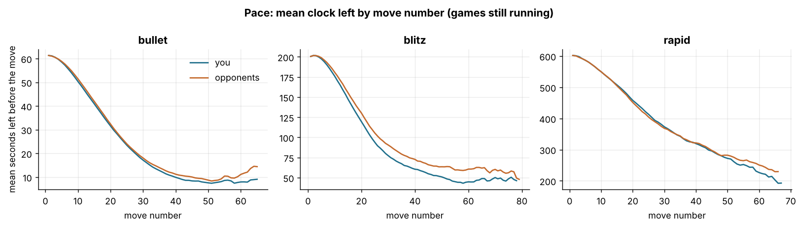
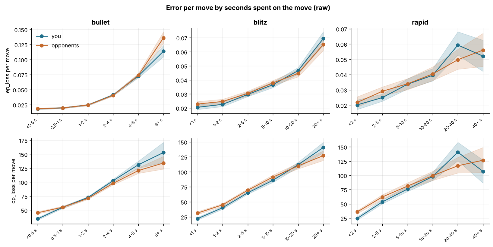
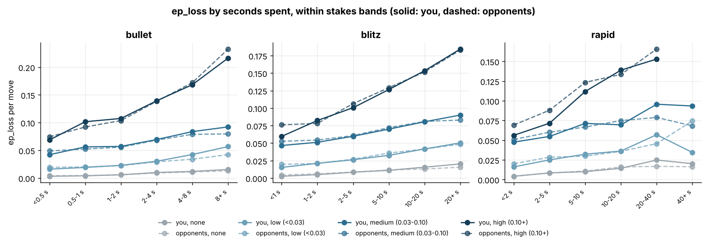
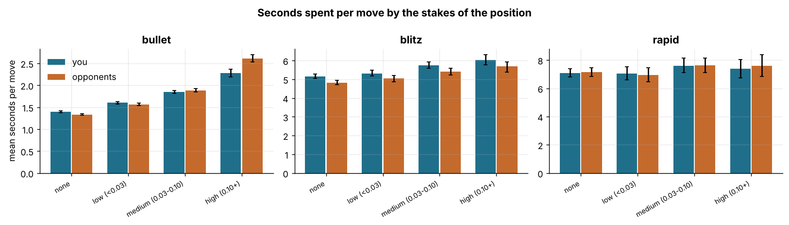
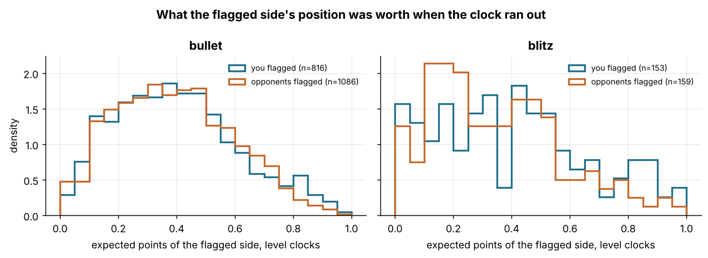

# Clock allocation and losses on time

6,029 standard live games (3,453 bullet, 1,987 blitz, 589 rapid), 364,685 analysed moves (182,422 yours, 182,263 opponents'), 6,027 games with at least one analysed move. Every estimate is `estimate [lo, hi]`, a 95% interval from a bootstrap that resamples whole games. `ep_loss` (calibrated expected points lost by a move) is the main quality measure, `cp_loss` the secondary one. Time spent on a move is the mover's clock before the move minus the clock after it plus the increment; buckets of seconds spent are defined per time class (bullet <0.5 s, 0.5-1 s, 1-2 s, 2-4 s, 4-8 s, 8+ s; blitz <1 s, 1-2 s, 2-5 s, 5-10 s, 10-20 s, 20+ s; rapid <2 s, 2-5 s, 5-10 s, 10-20 s, 20-40 s, 40+ s). "Stakes" of a position is `ep_criticality`, the expected-points gap between the best and the second-best move: none (the two best moves are equally good, or only one legal move), low (<0.03), medium (0.03-0.10), high (0.10+). F6's calibrated win model is refitted inside this script (deterministic; it reproduces the stored `ep_after` of every move to within 0.0000) so that positions can be re-valued under counterfactual clocks (sections 2c and 5).

## 1. Where the seconds go

Seconds spent per move by phase, you vs opponents in the same games:

| phase | time_class | you | opponents | you - opp | moves you/opp |
|---|---|---|---|---|---|
| opening | bullet | 1.50 [1.47, 1.53] | 1.39 [1.36, 1.42] | 0.11 [0.09, 0.14] | 36660/36742 |
| middlegame | bullet | 2.06 [2.03, 2.10] | 2.13 [2.10, 2.16] | -0.07 [-0.10, -0.04] | 32089/32020 |
| endgame | bullet | 1.29 [1.27, 1.31] | 1.34 [1.31, 1.36] | -0.05 [-0.07, -0.03] | 38745/38652 |
| opening | blitz | 5.18 [5.06, 5.30] | 4.60 [4.47, 4.72] | 0.58 [0.46, 0.70] | 20866/20884 |
| middlegame | blitz | 7.54 [7.40, 7.69] | 7.12 [6.96, 7.28] | 0.43 [0.29, 0.59] | 16361/16346 |
| endgame | blitz | 3.96 [3.84, 4.06] | 3.92 [3.80, 4.03] | 0.04 [-0.05, 0.12] | 21569/21525 |
| opening | rapid | 6.36 [6.11, 6.62] | 6.33 [6.02, 6.66] | 0.03 [-0.26, 0.32] | 6088/6095 |
| middlegame | rapid | 9.78 [9.35, 10.31] | 10.25 [9.71, 10.69] | -0.47 [-0.93, 0.04] | 4617/4607 |
| endgame | rapid | 6.00 [5.65, 6.32] | 5.77 [5.41, 6.11] | 0.23 [-0.07, 0.52] | 5427/5392 |

Share of each side's total thinking time that goes to each phase, and the total seconds used per game:

| time_class | side | opening | middlegame | endgame | seconds used per game |
|---|---|---|---|---|---|
| bullet | you | 32.2% [31.6, 32.8] | 38.7% [38.0, 39.4] | 29.2% [28.3, 30.0] | 50 [49, 50] |
| bullet | opponents | 29.8% [29.2, 30.5] | 40.0% [39.2, 40.6] | 30.2% [29.3, 31.1] | 50 [49, 50] |
| blitz | you | 34.1% [33.2, 35.1] | 39.0% [38.0, 40.0] | 27.0% [25.8, 28.3] | 159 [155, 163] |
| blitz | opponents | 32.3% [31.5, 33.3] | 39.2% [38.3, 40.2] | 28.4% [27.2, 29.7] | 149 [145, 153] |
| rapid | you | 33.3% [31.3, 35.5] | 38.8% [36.6, 40.9] | 27.9% [25.2, 30.6] | 199 [187, 210] |
| rapid | opponents | 33.0% [31.4, 35.3] | 40.4% [38.3, 42.3] | 26.6% [24.0, 28.8] | 199 [187, 210] |

The clock situation at fixed points of the game, read off your own moves: your clock minus the opponent's (seconds, positive = you are ahead) and the share of games in which you are behind or ahead by more than 3 s, at move 10, 20, 30. Only games that reached the move count.

| time_class | move | games | your clock - opponent's (s) | behind by 3+ s | ahead by 3+ s |
|---|---|---|---|---|---|
| bullet | 10 | 3257 | -0.2 [-0.4, 0.1] | 26.9% [25.4, 28.5] | 21.8% [20.4, 23.3] |
| bullet | 20 | 2725 | 0.2 [-0.1, 0.6] | 35.0% [33.3, 36.7] | 35.2% [33.4, 36.9] |
| bullet | 30 | 1906 | -0.0 [-0.5, 0.4] | 36.7% [34.6, 38.9] | 36.8% [34.6, 38.9] |
| blitz | 10 | 1798 | -2.4 [-3.5, -1.3] | 48.9% [46.6, 51.2] | 35.5% [33.0, 37.8] |
| blitz | 20 | 1317 | -7.8 [-10.0, -5.5] | 54.4% [51.6, 57.1] | 38.3% [35.7, 41.0] |
| blitz | 30 | 855 | -11.4 [-14.8, -8.0] | 57.1% [53.7, 60.4] | 37.1% [33.9, 40.4] |
| rapid | 10 | 513 | 4.8 [2.2, 7.5] | 40.4% [36.1, 44.4] | 49.9% [45.8, 54.2] |
| rapid | 20 | 348 | 11.6 [5.2, 18.4] | 43.7% [38.8, 48.9] | 53.4% [48.3, 58.6] |
| rapid | 30 | 221 | 8.9 [-3.4, 20.4] | 46.2% [39.8, 52.9] | 51.1% [44.3, 57.5] |

*Mean clock left before each move, you vs opponents, over the games that reached that move (at least 20 games per point).*

## 2. Does spending time buy accuracy?

Error per move by the seconds spent on it, you vs opponents. Two things make these curves rise with time: harder positions get more time (selection), and `ep_loss` charges a move for the clock it consumes (the position after the move is valued with the clock *after* the move; section 2c measures that charge). `cp_loss` is clock-free and measures board accuracy only. The clean evidence that time matters is Q3's clock-pressure result (board accuracy falls when a side is *forced* to move fast); what the time-spent curves can show is how your fast and slow moves compare with your opponents' fast and slow moves.

*Mean ep_loss (top) and cp_loss (bottom) per move by seconds spent on the move; bands are game-clustered 95% CIs.*

`ep_loss` per move by seconds spent (cells with fewer than 30 moves on either side are left out):

| time_bucket | time_class | you | opponents | you - opp | moves you/opp |
|---|---|---|---|---|---|
| <0.5 s | bullet | 0.0180 [0.0170, 0.0192] | 0.0185 [0.0175, 0.0195] | -0.0005 [-0.0015, 0.0004] | 15660/18600 |
| 0.5-1 s | bullet | 0.0197 [0.0187, 0.0207] | 0.0197 [0.0186, 0.0207] | 0.0001 [-0.0007, 0.0008] | 20663/23163 |
| 1-2 s | bullet | 0.0246 [0.0235, 0.0256] | 0.0245 [0.0233, 0.0256] | 0.0000 [-0.0006, 0.0006] | 43339/38309 |
| 2-4 s | bullet | 0.0413 [0.0400, 0.0427] | 0.0406 [0.0392, 0.0420] | 0.0007 [-0.0004, 0.0018] | 21827/20157 |
| 4-8 s | bullet | 0.0726 [0.0697, 0.0760] | 0.0739 [0.0713, 0.0770] | -0.0012 [-0.0045, 0.0016] | 5173/6088 |
| 8+ s | bullet | 0.1139 [0.1046, 0.1237] | 0.1362 [0.1271, 0.1463] | -0.0223 [-0.0330, -0.0114] | 832/1097 |
| <1 s | blitz | 0.0205 [0.0190, 0.0223] | 0.0228 [0.0210, 0.0246] | -0.0023 [-0.0038, -0.0009] | 6332/7760 |
| 1-2 s | blitz | 0.0226 [0.0210, 0.0243] | 0.0247 [0.0231, 0.0263] | -0.0021 [-0.0031, -0.0010] | 11027/13498 |
| 2-5 s | blitz | 0.0297 [0.0282, 0.0314] | 0.0304 [0.0287, 0.0321] | -0.0007 [-0.0017, 0.0002] | 20080/18592 |
| 5-10 s | blitz | 0.0366 [0.0345, 0.0385] | 0.0379 [0.0360, 0.0397] | -0.0013 [-0.0029, 0.0002] | 13013/10972 |
| 10-20 s | blitz | 0.0466 [0.0442, 0.0489] | 0.0446 [0.0422, 0.0472] | 0.0020 [-0.0008, 0.0044] | 6419/5998 |
| 20+ s | blitz | 0.0694 [0.0647, 0.0743] | 0.0652 [0.0609, 0.0699] | 0.0042 [-0.0010, 0.0097] | 1925/1935 |
| <2 s | rapid | 0.0202 [0.0171, 0.0234] | 0.0218 [0.0187, 0.0255] | -0.0016 [-0.0033, -0.0001] | 3724/4332 |
| 2-5 s | rapid | 0.0249 [0.0226, 0.0273] | 0.0291 [0.0261, 0.0319] | -0.0042 [-0.0060, -0.0022] | 4881/4776 |
| 5-10 s | rapid | 0.0337 [0.0305, 0.0373] | 0.0340 [0.0301, 0.0374] | -0.0003 [-0.0029, 0.0022] | 3932/3402 |
| 10-20 s | rapid | 0.0395 [0.0359, 0.0439] | 0.0404 [0.0361, 0.0451] | -0.0009 [-0.0046, 0.0024] | 2523/2398 |
| 20-40 s | rapid | 0.0593 [0.0529, 0.0681] | 0.0497 [0.0435, 0.0566] | 0.0096 [0.0009, 0.0189] | 887/952 |
| 40+ s | rapid | 0.0521 [0.0421, 0.0625] | 0.0560 [0.0453, 0.0671] | -0.0040 [-0.0179, 0.0094] | 185/234 |

`cp_loss` per move by seconds spent:

| time_bucket | time_class | you | opponents | you - opp | moves you/opp |
|---|---|---|---|---|---|
| <0.5 s | bullet | 34.3 [32.1, 36.6] | 45.1 [43.3, 47.2] | -10.8 [-13.4, -8.3] | 15660/18600 |
| 0.5-1 s | bullet | 55.0 [53.1, 56.9] | 55.2 [52.8, 57.0] | -0.2 [-2.4, 2.1] | 20663/23163 |
| 1-2 s | bullet | 72.6 [71.0, 74.1] | 70.9 [69.2, 72.5] | 1.7 [0.0, 3.6] | 43339/38309 |
| 2-4 s | bullet | 102.7 [100.1, 105.5] | 97.8 [95.2, 100.6] | 4.8 [1.7, 7.9] | 21827/20157 |
| 4-8 s | bullet | 131.1 [125.0, 137.6] | 120.7 [115.7, 125.8] | 10.4 [2.5, 17.4] | 5173/6088 |
| 8+ s | bullet | 153.0 [135.2, 171.3] | 134.2 [123.4, 146.2] | 18.8 [0.1, 38.9] | 832/1097 |
| <1 s | blitz | 21.9 [19.6, 24.2] | 31.3 [28.9, 33.7] | -9.4 [-12.4, -6.4] | 6332/7760 |
| 1-2 s | blitz | 40.2 [37.7, 42.7] | 45.0 [42.7, 47.2] | -4.9 [-7.7, -1.9] | 11027/13498 |
| 2-5 s | blitz | 65.1 [62.8, 67.4] | 69.4 [67.0, 72.0] | -4.3 [-6.7, -1.9] | 20080/18592 |
| 5-10 s | blitz | 86.0 [82.5, 89.1] | 91.3 [88.3, 94.9] | -5.4 [-9.6, -2.0] | 13013/10972 |
| 10-20 s | blitz | 111.9 [107.3, 116.1] | 109.9 [105.0, 114.6] | 2.0 [-3.7, 8.2] | 6419/5998 |
| 20+ s | blitz | 140.7 [131.7, 149.4] | 127.1 [119.0, 135.1] | 13.6 [1.6, 24.8] | 1925/1935 |
| <2 s | rapid | 24.4 [21.5, 27.3] | 35.8 [32.8, 38.4] | -11.4 [-14.8, -7.6] | 3724/4332 |
| 2-5 s | rapid | 53.4 [50.1, 57.5] | 62.1 [57.5, 66.1] | -8.6 [-13.1, -3.0] | 4881/4776 |
| 5-10 s | rapid | 75.9 [71.8, 80.9] | 81.2 [75.9, 87.0] | -5.3 [-11.8, 0.7] | 3932/3402 |
| 10-20 s | rapid | 98.0 [91.1, 105.5] | 99.4 [91.1, 107.3] | -1.4 [-10.0, 6.3] | 2523/2398 |
| 20-40 s | rapid | 140.7 [125.6, 158.1] | 116.9 [104.3, 131.7] | 23.9 [4.5, 43.0] | 887/952 |
| 40+ s | rapid | 106.9 [86.4, 126.8] | 126.6 [104.8, 149.1] | -19.6 [-48.9, 8.5] | 185/234 |

### 2a. Within stakes bands

The same `ep_loss` curves within stakes bands. The table shows the medium and high bands, where there is something to find.

*ep_loss per move by seconds spent, one line per stakes band; solid lines you, dashed opponents. Points with fewer than 30 moves on either side are omitted.*

| time_bucket | time_class | stakes | you | opponents | you - opp | moves you/opp |
|---|---|---|---|---|---|---|
| <0.5 s | bullet | high (0.10+) | 0.0687 [0.0629, 0.0741] | 0.0743 [0.0688, 0.0814] | -0.0056 [-0.0125, 0.0009] | 1570/1311 |
| 0.5-1 s | bullet | high (0.10+) | 0.1016 [0.0958, 0.1086] | 0.0920 [0.0866, 0.0982] | 0.0095 [0.0024, 0.0172] | 1108/1453 |
| 1-2 s | bullet | high (0.10+) | 0.1074 [0.1028, 0.1117] | 0.1036 [0.0987, 0.1084] | 0.0038 [-0.0011, 0.0087] | 2887/2848 |
| 2-4 s | bullet | high (0.10+) | 0.1393 [0.1356, 0.1438] | 0.1384 [0.1344, 0.1429] | 0.0010 [-0.0043, 0.0063] | 2173/2118 |
| 4-8 s | bullet | high (0.10+) | 0.1684 [0.1640, 0.1740] | 0.1721 [0.1672, 0.1772] | -0.0037 [-0.0109, 0.0026] | 1142/1483 |
| 8+ s | bullet | high (0.10+) | 0.2164 [0.2054, 0.2264] | 0.2326 [0.2209, 0.2435] | -0.0162 [-0.0329, -0.0011] | 313/529 |
| <0.5 s | bullet | medium (0.03-0.10) | 0.0421 [0.0403, 0.0439] | 0.0489 [0.0468, 0.0511] | -0.0068 [-0.0092, -0.0042] | 2582/2998 |
| 0.5-1 s | bullet | medium (0.03-0.10) | 0.0561 [0.0544, 0.0579] | 0.0523 [0.0506, 0.0542] | 0.0038 [0.0016, 0.0064] | 3282/3587 |
| 1-2 s | bullet | medium (0.03-0.10) | 0.0570 [0.0557, 0.0583] | 0.0556 [0.0543, 0.0567] | 0.0015 [-0.0001, 0.0031] | 7736/6852 |
| 2-4 s | bullet | medium (0.03-0.10) | 0.0694 [0.0680, 0.0710] | 0.0683 [0.0669, 0.0700] | 0.0012 [-0.0009, 0.0031] | 5434/4925 |
| 4-8 s | bullet | medium (0.03-0.10) | 0.0837 [0.0810, 0.0865] | 0.0789 [0.0765, 0.0811] | 0.0048 [0.0016, 0.0088] | 1582/1839 |
| 8+ s | bullet | medium (0.03-0.10) | 0.0922 [0.0829, 0.1018] | 0.0796 [0.0733, 0.0858] | 0.0126 [0.0031, 0.0276] | 193/250 |
| <1 s | blitz | high (0.10+) | 0.0596 [0.0524, 0.0655] | 0.0762 [0.0685, 0.0834] | -0.0166 [-0.0239, -0.0084] | 825/781 |
| 1-2 s | blitz | high (0.10+) | 0.0823 [0.0756, 0.0891] | 0.0781 [0.0715, 0.0847] | 0.0042 [-0.0028, 0.0109] | 990/1409 |
| 2-5 s | blitz | high (0.10+) | 0.1005 [0.0941, 0.1065] | 0.1063 [0.1002, 0.1127] | -0.0058 [-0.0130, 0.0016] | 1898/1672 |
| 5-10 s | blitz | high (0.10+) | 0.1265 [0.1204, 0.1330] | 0.1291 [0.1221, 0.1362] | -0.0026 [-0.0109, 0.0054] | 1238/984 |
| 10-20 s | blitz | high (0.10+) | 0.1534 [0.1430, 0.1632] | 0.1517 [0.1421, 0.1607] | 0.0017 [-0.0114, 0.0132] | 623/576 |
| 20+ s | blitz | high (0.10+) | 0.1843 [0.1738, 0.1965] | 0.1830 [0.1713, 0.1948] | 0.0014 [-0.0135, 0.0190] | 315/325 |
| <1 s | blitz | medium (0.03-0.10) | 0.0465 [0.0444, 0.0487] | 0.0526 [0.0501, 0.0549] | -0.0060 [-0.0088, -0.0032] | 1227/1398 |
| 1-2 s | blitz | medium (0.03-0.10) | 0.0511 [0.0487, 0.0536] | 0.0543 [0.0523, 0.0568] | -0.0032 [-0.0063, -0.0004] | 1957/2483 |
| 2-5 s | blitz | medium (0.03-0.10) | 0.0598 [0.0581, 0.0616] | 0.0607 [0.0589, 0.0625] | -0.0009 [-0.0035, 0.0019] | 3862/3670 |
| 5-10 s | blitz | medium (0.03-0.10) | 0.0700 [0.0672, 0.0725] | 0.0720 [0.0693, 0.0751] | -0.0021 [-0.0055, 0.0013] | 2528/2167 |
| 10-20 s | blitz | medium (0.03-0.10) | 0.0805 [0.0762, 0.0840] | 0.0810 [0.0764, 0.0854] | -0.0005 [-0.0066, 0.0054] | 1345/1237 |
| 20+ s | blitz | medium (0.03-0.10) | 0.0901 [0.0841, 0.0970] | 0.0829 [0.0765, 0.0893] | 0.0071 [-0.0025, 0.0175] | 486/463 |
| <2 s | rapid | high (0.10+) | 0.0562 [0.0449, 0.0685] | 0.0693 [0.0553, 0.0820] | -0.0131 [-0.0229, -0.0029] | 461/456 |
| 2-5 s | rapid | high (0.10+) | 0.0715 [0.0614, 0.0815] | 0.0881 [0.0768, 0.0993] | -0.0165 [-0.0277, -0.0036] | 414/469 |
| 5-10 s | rapid | high (0.10+) | 0.1119 [0.0992, 0.1248] | 0.1235 [0.1060, 0.1361] | -0.0116 [-0.0299, 0.0054] | 335/292 |
| 10-20 s | rapid | high (0.10+) | 0.1390 [0.1243, 0.1535] | 0.1335 [0.1139, 0.1517] | 0.0054 [-0.0168, 0.0261] | 236/206 |
| 20-40 s | rapid | high (0.10+) | 0.1530 [0.1319, 0.1783] | 0.1657 [0.1374, 0.1944] | -0.0127 [-0.0409, 0.0205] | 102/102 |
| <2 s | rapid | medium (0.03-0.10) | 0.0475 [0.0441, 0.0506] | 0.0509 [0.0472, 0.0543] | -0.0033 [-0.0081, 0.0007] | 668/765 |
| 2-5 s | rapid | medium (0.03-0.10) | 0.0548 [0.0506, 0.0588] | 0.0601 [0.0564, 0.0638] | -0.0053 [-0.0100, -0.0006] | 913/913 |
| 5-10 s | rapid | medium (0.03-0.10) | 0.0713 [0.0654, 0.0763] | 0.0667 [0.0616, 0.0713] | 0.0046 [-0.0013, 0.0117] | 744/649 |
| 10-20 s | rapid | medium (0.03-0.10) | 0.0695 [0.0636, 0.0761] | 0.0749 [0.0687, 0.0822] | -0.0054 [-0.0142, 0.0023] | 483/472 |
| 20-40 s | rapid | medium (0.03-0.10) | 0.0957 [0.0835, 0.1123] | 0.0789 [0.0703, 0.0897] | 0.0168 [0.0016, 0.0328] | 192/204 |
| 40+ s | rapid | medium (0.03-0.10) | 0.0934 [0.0695, 0.1200] | 0.0682 [0.0533, 0.0885] | 0.0253 [-0.0017, 0.0584] | 38/46 |

### 2b. Adjusted: your error-vs-time gradient against your opponents'

Linear model per time class: `outcome ~ seconds-spent bucket x side + stakes (in the outcome's currency) + phase + ply + material + mover's and opponent's clock bucket + number of legal moves + in check + |eval| bucket`, all moves of both sides, CIs from a bootstrap over games. The reference is the fastest bucket, so each coefficient is the extra error on moves that got that much time rather than a snap, holding those position features fixed. Positive coefficients for both sides mean the controls do not capture difficulty: time still goes to the moves that turn out hard, so **the coefficients are not the causal value of a second**. The informative column is `you - opp` (the side x time interaction): it compares the two sides' gradients under the same controls and says whether your long thinks end better or worse than your opponents' long thinks, relative to each side's snap moves. The `ep_loss` gradient also contains the clock charge of section 2c (steeper in bullet for that reason); the `cp_loss` gradient is board accuracy only.

Adjusted extra `ep_loss` relative to the fastest bucket:

| time spent | time_class | you | opponents | you - opp | moves you/opp |
|---|---|---|---|---|---|
| 0.5-1 s | bullet | 0.0077 [0.0068, 0.0084] | 0.0025 [0.0018, 0.0032] | 0.0052 [0.0039, 0.0062] | 20663/23163 |
| 1-2 s | bullet | 0.0101 [0.0093, 0.0108] | 0.0051 [0.0043, 0.0060] | 0.0050 [0.0037, 0.0061] | 43339/38309 |
| 2-4 s | bullet | 0.0197 [0.0186, 0.0205] | 0.0143 [0.0132, 0.0153] | 0.0054 [0.0040, 0.0067] | 21827/20157 |
| 4-8 s | bullet | 0.0355 [0.0333, 0.0374] | 0.0300 [0.0280, 0.0320] | 0.0055 [0.0032, 0.0078] | 5173/6088 |
| 8+ s | bullet | 0.0638 [0.0572, 0.0715] | 0.0712 [0.0650, 0.0773] | -0.0074 [-0.0151, 0.0013] | 832/1097 |
| 1-2 s | blitz | 0.0062 [0.0048, 0.0074] | 0.0013 [0.0001, 0.0026] | 0.0049 [0.0029, 0.0065] | 11027/13498 |
| 2-5 s | blitz | 0.0124 [0.0113, 0.0135] | 0.0077 [0.0065, 0.0092] | 0.0047 [0.0031, 0.0064] | 20080/18592 |
| 5-10 s | blitz | 0.0194 [0.0180, 0.0206] | 0.0150 [0.0136, 0.0169] | 0.0043 [0.0025, 0.0061] | 13013/10972 |
| 10-20 s | blitz | 0.0278 [0.0259, 0.0299] | 0.0205 [0.0187, 0.0225] | 0.0074 [0.0051, 0.0098] | 6419/5998 |
| 20+ s | blitz | 0.0412 [0.0372, 0.0451] | 0.0316 [0.0283, 0.0353] | 0.0097 [0.0042, 0.0147] | 1925/1935 |
| 2-5 s | rapid | 0.0074 [0.0053, 0.0097] | 0.0069 [0.0048, 0.0089] | 0.0004 [-0.0023, 0.0035] | 4881/4776 |
| 5-10 s | rapid | 0.0156 [0.0131, 0.0181] | 0.0124 [0.0101, 0.0151] | 0.0032 [-0.0006, 0.0065] | 3932/3402 |
| 10-20 s | rapid | 0.0203 [0.0173, 0.0234] | 0.0184 [0.0152, 0.0220] | 0.0018 [-0.0023, 0.0050] | 2523/2398 |
| 20-40 s | rapid | 0.0361 [0.0298, 0.0417] | 0.0244 [0.0190, 0.0306] | 0.0117 [0.0033, 0.0194] | 887/952 |
| 40+ s | rapid | 0.0271 [0.0187, 0.0355] | 0.0279 [0.0197, 0.0368] | -0.0008 [-0.0134, 0.0104] | 185/234 |

Adjusted extra `cp_loss` relative to the fastest bucket:

| time spent | time_class | you | opponents | you - opp | moves you/opp |
|---|---|---|---|---|---|
| 0.5-1 s | bullet | 25.1 [22.4, 27.6] | 4.3 [1.8, 7.0] | 20.9 [17.2, 24.3] | 20663/23163 |
| 1-2 s | bullet | 31.6 [28.7, 34.2] | 12.1 [9.6, 14.7] | 19.6 [15.7, 23.1] | 43339/38309 |
| 2-4 s | bullet | 59.2 [56.1, 62.4] | 36.9 [33.6, 40.1] | 22.3 [18.2, 26.3] | 21827/20157 |
| 4-8 s | bullet | 84.0 [78.2, 89.4] | 57.6 [52.1, 63.4] | 26.4 [18.9, 33.9] | 5173/6088 |
| 8+ s | bullet | 106.3 [91.6, 124.1] | 70.3 [60.4, 80.0] | 36.1 [18.8, 54.7] | 832/1097 |
| 1-2 s | blitz | 14.8 [11.7, 17.6] | 3.8 [0.7, 6.5] | 11.0 [6.9, 14.7] | 11027/13498 |
| 2-5 s | blitz | 33.1 [30.5, 35.8] | 25.1 [22.4, 27.9] | 8.0 [3.9, 11.6] | 20080/18592 |
| 5-10 s | blitz | 52.2 [48.5, 55.9] | 44.2 [40.4, 47.8] | 7.9 [2.8, 12.2] | 13013/10972 |
| 10-20 s | blitz | 76.0 [70.7, 80.9] | 60.5 [55.7, 65.4] | 15.5 [9.3, 21.9] | 6419/5998 |
| 20+ s | blitz | 99.5 [89.7, 108.4] | 74.0 [66.7, 83.2] | 25.5 [11.9, 37.7] | 1925/1935 |
| 2-5 s | rapid | 21.5 [16.7, 26.9] | 19.7 [14.8, 24.6] | 1.8 [-6.0, 8.6] | 4881/4776 |
| 5-10 s | rapid | 41.7 [35.8, 47.6] | 34.8 [28.9, 41.2] | 6.9 [-0.5, 13.4] | 3932/3402 |
| 10-20 s | rapid | 59.6 [51.8, 68.5] | 50.9 [43.5, 59.0] | 8.7 [-1.1, 17.9] | 2523/2398 |
| 20-40 s | rapid | 98.3 [82.8, 113.1] | 63.6 [50.4, 78.5] | 34.7 [15.0, 51.7] | 887/952 |
| 40+ s | rapid | 60.7 [42.2, 80.0] | 73.2 [55.4, 90.8] | -12.5 [-39.2, 12.4] | 185/234 |

### 2c. What the seconds themselves cost: the clock charge

`ep_loss` values the position after a move with the mover's clock after the move. Re-valuing the same position with the clock the mover would have had if the move had taken no time gives the **clock charge**: the expected points the seconds themselves cost, as the calibrated model prices them (it has learnt from these games how much being behind on the clock lowers the score). The charge is not an additive slice of `ep_loss`: the model's value of a position before the move already assumes the mover will spend a typical amount of time on it, so the unfloored change `ep_before - ep_after` averages close to zero per move (bullet +0.0006, blitz +0.0012, rapid -0.0009) and `ep_loss` is its positive part. What the charge shows is how much of a move's `ep_loss` can come from the clock alone, and how the price of a second depends on the time class and on the time left. Mean clock charge per move by seconds spent, you vs opponents:

| time_bucket | time_class | you | opponents | you - opp | moves you/opp |
|---|---|---|---|---|---|
| <0.5 s | bullet | 0.0036 [0.0034, 0.0038] | 0.0035 [0.0033, 0.0038] | 0.0001 [-0.0002, 0.0004] | 15660/18600 |
| 0.5-1 s | bullet | 0.0150 [0.0145, 0.0154] | 0.0143 [0.0139, 0.0148] | 0.0007 [0.0001, 0.0012] | 20663/23163 |
| 1-2 s | bullet | 0.0288 [0.0282, 0.0294] | 0.0283 [0.0277, 0.0290] | 0.0005 [-0.0000, 0.0011] | 43339/38309 |
| 2-4 s | bullet | 0.0504 [0.0492, 0.0515] | 0.0517 [0.0505, 0.0529] | -0.0014 [-0.0025, -0.0005] | 21827/20157 |
| 4-8 s | bullet | 0.0798 [0.0768, 0.0831] | 0.0869 [0.0843, 0.0896] | -0.0071 [-0.0100, -0.0042] | 5173/6088 |
| 8+ s | bullet | 0.1178 [0.1092, 0.1267] | 0.1459 [0.1370, 0.1550] | -0.0281 [-0.0366, -0.0188] | 832/1097 |
| <1 s | blitz | 0.0007 [0.0005, 0.0009] | 0.0007 [0.0005, 0.0009] | -0.0000 [-0.0003, 0.0002] | 6332/7760 |
| 1-2 s | blitz | 0.0032 [0.0028, 0.0038] | 0.0026 [0.0022, 0.0029] | 0.0007 [0.0002, 0.0012] | 11027/13498 |
| 2-5 s | blitz | 0.0059 [0.0054, 0.0064] | 0.0053 [0.0048, 0.0059] | 0.0007 [0.0000, 0.0012] | 20080/18592 |
| 5-10 s | blitz | 0.0105 [0.0096, 0.0112] | 0.0095 [0.0087, 0.0103] | 0.0010 [0.0001, 0.0019] | 13013/10972 |
| 10-20 s | blitz | 0.0188 [0.0176, 0.0200] | 0.0167 [0.0155, 0.0180] | 0.0021 [0.0004, 0.0037] | 6419/5998 |
| 20+ s | blitz | 0.0401 [0.0365, 0.0434] | 0.0394 [0.0361, 0.0424] | 0.0007 [-0.0026, 0.0044] | 1925/1935 |
| <2 s | rapid | 0.0008 [0.0004, 0.0012] | 0.0009 [0.0005, 0.0014] | -0.0001 [-0.0007, 0.0004] | 3724/4332 |
| 2-5 s | rapid | 0.0029 [0.0024, 0.0034] | 0.0028 [0.0022, 0.0034] | 0.0000 [-0.0006, 0.0008] | 4881/4776 |
| 5-10 s | rapid | 0.0049 [0.0040, 0.0058] | 0.0047 [0.0038, 0.0058] | 0.0002 [-0.0009, 0.0011] | 3932/3402 |
| 10-20 s | rapid | 0.0080 [0.0064, 0.0095] | 0.0091 [0.0076, 0.0107] | -0.0011 [-0.0026, 0.0003] | 2523/2398 |
| 20-40 s | rapid | 0.0136 [0.0108, 0.0172] | 0.0143 [0.0113, 0.0179] | -0.0007 [-0.0041, 0.0030] | 887/952 |
| 40+ s | rapid | 0.0229 [0.0144, 0.0325] | 0.0232 [0.0167, 0.0291] | -0.0003 [-0.0128, 0.0102] | 185/234 |

The same charge depends on how much time is left: mean clock charge per move (both sides pooled) by the mover's clock before the move and the seconds spent, bullet and blitz. Blank: fewer than 30 moves.

| bullet: clock before | <0.5 s | 0.5-1 s | 1-2 s | 2-4 s | 4-8 s | 8+ s |
|---|---|---|---|---|---|---|
| <5 s | 0.0105 [0.0096, 0.0115] | 0.0440 [0.0418, 0.0462] | 0.0740 [0.0699, 0.0778] | 0.1112 [0.1015, 0.1202] |  |  |
| 5-10 s | 0.0053 [0.0048, 0.0058] | 0.0240 [0.0229, 0.0252] | 0.0459 [0.0440, 0.0478] | 0.0839 [0.0795, 0.0883] | 0.1411 [0.1227, 0.1584] |  |
| 10-30 s | 0.0030 [0.0027, 0.0032] | 0.0138 [0.0133, 0.0144] | 0.0285 [0.0276, 0.0294] | 0.0563 [0.0549, 0.0577] | 0.0980 [0.0936, 0.1020] | 0.1805 [0.1632, 0.1973] |
| 30+ s | 0.0021 [0.0020, 0.0022] | 0.0107 [0.0104, 0.0110] | 0.0238 [0.0234, 0.0242] | 0.0454 [0.0444, 0.0463] | 0.0773 [0.0750, 0.0796] | 0.1248 [0.1176, 0.1322] |

| blitz: clock before | <1 s | 1-2 s | 2-5 s | 5-10 s | 10-20 s | 20+ s |
|---|---|---|---|---|---|---|
| <5 s | 0.0072 [0.0047, 0.0104] | 0.0230 [0.0182, 0.0286] | 0.0391 [0.0295, 0.0477] |  |  |  |
| 5-10 s | 0.0062 [0.0048, 0.0078] | 0.0188 [0.0160, 0.0222] | 0.0375 [0.0333, 0.0420] | 0.0876 [0.0706, 0.1085] |  |  |
| 10-30 s | 0.0012 [0.0006, 0.0019] | 0.0042 [0.0032, 0.0054] | 0.0127 [0.0113, 0.0145] | 0.0337 [0.0297, 0.0377] | 0.0596 [0.0508, 0.0693] |  |
| 30+ s | 0.0004 [0.0003, 0.0005] | 0.0018 [0.0016, 0.0021] | 0.0040 [0.0037, 0.0043] | 0.0086 [0.0080, 0.0092] | 0.0171 [0.0161, 0.0183] | 0.0396 [0.0369, 0.0423] |

Per game: the clock charge each side pays over a whole game (the sum over its moves), and the paired difference. In bullet a side's whole clock is worth about a point, and both sides spend it, so the totals are similar and largely cancel in the game's outcome; the difference between the sides is the price of one side's slower pace.

| time_class | clock charge per game, you | clock charge per game, opponents | you - opp | ep_loss per game, you / opp |
|---|---|---|---|---|
| bullet | 0.935 [0.915, 0.955] | 0.932 [0.910, 0.956] | 0.004 [-0.013, 0.020] | 0.906 / 0.915 |
| blitz | 0.248 [0.232, 0.264] | 0.211 [0.195, 0.226] | 0.038 [0.023, 0.053] | 0.948 / 0.949 |
| rapid | 0.124 [0.107, 0.143] | 0.126 [0.107, 0.146] | -0.003 [-0.022, 0.015] | 0.838 / 0.861 |

## 3. The where-to-spend-time map: phase x stakes

For each phase x stakes cell: the seconds you and your opponents spend per move, and the raw difference in error between the slow and the quick moves of that cell (slow = at or above the class's median seconds per move: bullet 1.2 s, blitz 3.2 s, rapid 4.3 s; quick = below). Within a cell the slow moves are still the harder ones, so `slow - quick` is positive almost everywhere and is not the benefit of time; read it side by side: where your gap is larger than the opponents', your slow moves in that kind of position end relatively worse than theirs. `ep` is `ep_loss`, `cp` is `cp_loss`. Cells with fewer than 30 moves in any group are blank.

**bullet**

| phase | stakes | seconds you | ep slow-quick you | cp slow-quick you | seconds opponents | ep slow-quick opponents | cp slow-quick opponents | moves you/opp |
|---|---|---|---|---|---|---|---|---|
| opening | none | 1.29 [1.26, 1.32] | 0.0040 [0.0035, 0.0045] | 37.0 [33.8, 39.8] | 1.15 [1.12, 1.18] | 0.0036 [0.0030, 0.0044] | 29.7 [26.6, 33.0] | 20169/20504 |
| opening | low (<0.03) | 1.44 [1.40, 1.47] | 0.0092 [0.0077, 0.0105] | 43.8 [39.1, 49.3] | 1.30 [1.25, 1.34] | 0.0082 [0.0067, 0.0097] | 38.0 [32.0, 43.7] | 6726/6376 |
| opening | medium (0.03-0.10) | 1.73 [1.68, 1.79] | 0.0129 [0.0111, 0.0149] | 58.3 [52.8, 63.8] | 1.65 [1.60, 1.71] | 0.0108 [0.0089, 0.0129] | 43.4 [37.9, 50.3] | 7369/7237 |
| opening | high (0.10+) | 2.76 [2.58, 2.94] | 0.0298 [0.0222, 0.0369] | 98.3 [85.1, 112.9] | 2.74 [2.60, 2.96] | 0.0407 [0.0341, 0.0481] | 76.6 [64.0, 91.7] | 2396/2625 |
| middlegame | none | 1.78 [1.75, 1.81] | 0.0037 [0.0028, 0.0045] | 20.4 [15.9, 25.2] | 1.76 [1.73, 1.78] | 0.0030 [0.0021, 0.0038] | 15.3 [10.6, 19.3] | 18010/17858 |
| middlegame | low (<0.03) | 2.10 [2.05, 2.14] | 0.0101 [0.0075, 0.0124] | 34.6 [25.6, 44.6] | 2.13 [2.08, 2.18] | 0.0078 [0.0056, 0.0098] | 18.1 [8.8, 26.9] | 4932/4618 |
| middlegame | medium (0.03-0.10) | 2.41 [2.36, 2.46] | 0.0213 [0.0180, 0.0243] | 44.5 [32.7, 53.5] | 2.52 [2.46, 2.59] | 0.0208 [0.0183, 0.0240] | 41.2 [33.9, 49.2] | 6308/6271 |
| middlegame | high (0.10+) | 3.02 [2.91, 3.15] | 0.0779 [0.0707, 0.0852] | 104.0 [82.1, 124.9] | 3.46 [3.33, 3.59] | 0.0822 [0.0734, 0.0905] | 80.0 [56.4, 98.8] | 2839/3273 |
| endgame | none | 1.18 [1.16, 1.20] | 0.0030 [0.0023, 0.0037] | 12.8 [8.7, 16.7] | 1.17 [1.15, 1.20] | 0.0015 [0.0005, 0.0025] | 14.8 [10.2, 19.5] | 21964/22384 |
| endgame | low (<0.03) | 1.37 [1.34, 1.41] | 0.0051 [0.0030, 0.0070] | 17.5 [9.5, 24.5] | 1.41 [1.36, 1.45] | 0.0038 [0.0016, 0.0059] | 22.4 [15.6, 31.0] | 5691/5481 |
| endgame | medium (0.03-0.10) | 1.47 [1.43, 1.51] | 0.0144 [0.0120, 0.0169] | 30.0 [22.3, 37.2] | 1.55 [1.51, 1.60] | 0.0128 [0.0103, 0.0154] | 24.7 [17.3, 32.9] | 7132/6943 |
| endgame | high (0.10+) | 1.45 [1.39, 1.53] | 0.0466 [0.0400, 0.0528] | 67.1 [50.5, 86.8] | 1.81 [1.71, 1.90] | 0.0589 [0.0518, 0.0653] | 62.4 [45.5, 82.0] | 3958/3844 |

**blitz**

| phase | stakes | seconds you | ep slow-quick you | cp slow-quick you | seconds opponents | ep slow-quick opponents | cp slow-quick opponents | moves you/opp |
|---|---|---|---|---|---|---|---|---|
| opening | none | 4.81 [4.66, 4.97] | 0.0076 [0.0065, 0.0087] | 46.2 [42.5, 50.5] | 4.32 [4.16, 4.46] | 0.0059 [0.0048, 0.0072] | 37.3 [33.3, 41.4] | 11206/11111 |
| opening | low (<0.03) | 5.10 [4.86, 5.38] | 0.0163 [0.0139, 0.0188] | 48.7 [42.5, 55.0] | 4.49 [4.26, 4.72] | 0.0155 [0.0127, 0.0184] | 48.9 [41.5, 56.0] | 3485/3554 |
| opening | medium (0.03-0.10) | 5.64 [5.40, 5.87] | 0.0187 [0.0159, 0.0216] | 59.9 [53.8, 66.1] | 5.08 [4.79, 5.34] | 0.0157 [0.0123, 0.0190] | 54.3 [46.7, 62.3] | 4333/4306 |
| opening | high (0.10+) | 6.44 [5.92, 6.93] | 0.0328 [0.0250, 0.0401] | 71.4 [60.2, 83.9] | 5.34 [4.89, 5.76] | 0.0361 [0.0275, 0.0448] | 92.3 [72.9, 109.9] | 1842/1913 |
| middlegame | none | 7.27 [7.06, 7.43] | 0.0072 [0.0056, 0.0087] | 32.7 [27.3, 38.8] | 6.83 [6.63, 7.02] | 0.0042 [0.0024, 0.0058] | 28.1 [21.8, 32.8] | 9043/9097 |
| middlegame | low (<0.03) | 7.93 [7.60, 8.24] | 0.0149 [0.0108, 0.0192] | 44.1 [32.5, 56.7] | 7.44 [7.13, 7.71] | 0.0176 [0.0132, 0.0221] | 46.7 [34.8, 58.2] | 2208/2179 |
| middlegame | medium (0.03-0.10) | 7.91 [7.61, 8.22] | 0.0230 [0.0187, 0.0276] | 45.6 [32.7, 56.8] | 7.42 [7.11, 7.71] | 0.0211 [0.0168, 0.0261] | 41.3 [31.5, 52.2] | 3169/3181 |
| middlegame | high (0.10+) | 7.79 [7.35, 8.27] | 0.0742 [0.0644, 0.0834] | 106.9 [84.6, 126.8] | 7.62 [7.11, 8.14] | 0.0644 [0.0552, 0.0745] | 99.1 [77.6, 119.2] | 1941/1889 |
| endgame | none | 3.92 [3.79, 4.05] | 0.0044 [0.0031, 0.0059] | 28.2 [24.3, 33.4] | 3.78 [3.65, 3.93] | 0.0037 [0.0020, 0.0053] | 28.5 [23.5, 34.0] | 12302/12371 |
| endgame | low (<0.03) | 3.80 [3.62, 4.02] | 0.0068 [0.0037, 0.0099] | 26.7 [17.7, 34.1] | 4.05 [3.86, 4.28] | 0.0098 [0.0068, 0.0132] | 37.0 [27.9, 47.7] | 3258/3278 |
| endgame | medium (0.03-0.10) | 4.14 [3.97, 4.33] | 0.0168 [0.0128, 0.0205] | 38.9 [26.9, 50.4] | 4.15 [3.93, 4.37] | 0.0138 [0.0097, 0.0180] | 33.1 [23.7, 42.8] | 3903/3931 |
| endgame | high (0.10+) | 4.09 [3.82, 4.40] | 0.0551 [0.0441, 0.0644] | 65.1 [37.9, 91.8] | 4.14 [3.84, 4.42] | 0.0640 [0.0532, 0.0775] | 94.2 [70.3, 124.6] | 2106/1945 |

**rapid**

| phase | stakes | seconds you | ep slow-quick you | cp slow-quick you | seconds opponents | ep slow-quick opponents | cp slow-quick opponents | moves you/opp |
|---|---|---|---|---|---|---|---|---|
| opening | none | 6.04 [5.73, 6.35] | 0.0064 [0.0043, 0.0086] | 44.2 [37.5, 51.3] | 6.04 [5.74, 6.41] | 0.0087 [0.0064, 0.0107] | 45.2 [37.6, 52.2] | 3276/3278 |
| opening | low (<0.03) | 6.09 [5.60, 6.68] | 0.0208 [0.0141, 0.0282] | 53.7 [39.7, 68.4] | 6.03 [5.50, 6.59] | 0.0145 [0.0092, 0.0203] | 44.2 [30.4, 57.7] | 984/961 |
| opening | medium (0.03-0.10) | 6.94 [6.37, 7.61] | 0.0205 [0.0140, 0.0263] | 51.9 [39.9, 63.2] | 6.73 [6.23, 7.31] | 0.0179 [0.0124, 0.0236] | 52.3 [39.7, 66.7] | 1280/1292 |
| opening | high (0.10+) | 7.48 [6.71, 8.38] | 0.0489 [0.0338, 0.0635] | 93.8 [67.3, 120.5] | 7.64 [6.59, 8.67] | 0.0399 [0.0258, 0.0521] | 70.3 [46.0, 94.5] | 548/564 |
| middlegame | none | 9.80 [9.32, 10.33] | 0.0053 [0.0004, 0.0092] | 30.3 [16.6, 42.0] | 10.55 [10.03, 11.15] | 0.0028 [-0.0008, 0.0066] | 23.8 [11.5, 35.7] | 2626/2562 |
| middlegame | low (<0.03) | 9.99 [8.98, 11.13] | 0.0180 [0.0108, 0.0260] | 46.3 [27.5, 65.3] | 9.91 [8.94, 11.14] | 0.0097 [0.0012, 0.0170] | 26.9 [6.9, 46.8] | 608/622 |
| middlegame | medium (0.03-0.10) | 9.84 [9.00, 10.72] | 0.0252 [0.0158, 0.0342] | 55.9 [31.7, 76.1] | 10.49 [9.49, 11.47] | 0.0177 [0.0083, 0.0284] | 38.0 [17.8, 64.7] | 846/870 |
| middlegame | high (0.10+) | 9.32 [8.18, 10.66] | 0.0916 [0.0760, 0.1090] | 148.0 [113.1, 191.8] | 8.87 [7.68, 10.24] | 0.0750 [0.0556, 0.0959] | 143.8 [89.2, 212.7] | 537/553 |
| endgame | none | 5.99 [5.63, 6.45] | 0.0051 [0.0020, 0.0080] | 28.9 [19.4, 38.1] | 5.64 [5.30, 6.10] | 0.0074 [0.0043, 0.0107] | 33.4 [23.5, 44.0] | 3232/3264 |
| endgame | low (<0.03) | 5.99 [5.28, 6.69] | 0.0090 [0.0024, 0.0164] | 40.8 [24.7, 60.9] | 5.77 [5.16, 6.40] | 0.0063 [-0.0005, 0.0139] | 15.5 [-0.1, 32.1] | 794/801 |
| endgame | medium (0.03-0.10) | 6.49 [5.79, 7.24] | 0.0251 [0.0157, 0.0343] | 50.9 [32.9, 71.9] | 6.16 [5.45, 6.99] | 0.0072 [-0.0009, 0.0143] | 28.4 [12.4, 45.3] | 912/887 |
| endgame | high (0.10+) | 5.16 [4.32, 5.93] | 0.0533 [0.0304, 0.0774] | 105.6 [58.5, 152.4] | 5.95 [4.76, 7.16] | 0.0579 [0.0292, 0.0867] | 92.2 [36.6, 170.5] | 489/440 |

### 3a. The price of having no time, by position type

A cleaner view of where seconds matter: the extra error on moves made with under 10 s on the clock compared with moves made with 30+ s, in the same phase x stakes cell, you vs opponents (bullet and blitz; rapid has too few low-clock moves). Here the shortage of time is imposed by the game rather than chosen move by move, so this is closer to what a second is worth in each kind of position. `cp_loss` is the clock-free currency; `ep_loss` is shown second because, as Q3 found, the calibration discounts positional damage when the mover is about to flag. Where a cell is clearly positive, moves of that kind suffer when the clock is short; where it straddles zero or is negative, the shortage of time is not what separates those moves from the same kind of move at 30+ s (the 30+ s moves of a bullet endgame are the early, material-rich endgames). Blank: fewer than 30 moves in either group.

| time_class | phase | stakes | cp <10 s - 30+ s you | ep <10 s - 30+ s you | cp <10 s - 30+ s opponents | ep <10 s - 30+ s opponents | moves <10 s/30+ s you; opp |
|---|---|---|---|---|---|---|---|
| bullet | opening/middlegame | none | 62.1 [44.9, 78.4] | 0.0011 [-0.0008, 0.0031] | 52.3 [32.3, 74.8] | 0.0026 [0.0000, 0.0055] | 606/32465; 662/33047 |
| bullet | opening/middlegame | low (<0.03) | 33.4 [8.5, 61.7] | -0.0028 [-0.0074, 0.0025] | 69.5 [28.1, 118.5] | 0.0070 [-0.0015, 0.0161] | 126/10338; 140/9784 |
| bullet | opening/middlegame | medium (0.03-0.10) | 61.2 [25.6, 98.0] | 0.0054 [-0.0029, 0.0142] | 57.8 [32.8, 88.7] | 0.0026 [-0.0043, 0.0096] | 155/11940; 226/11717 |
| bullet | opening/middlegame | high (0.10+) | 117.8 [45.8, 196.5] | 0.0275 [0.0117, 0.0443] | 72.8 [20.1, 133.6] | 0.0346 [0.0177, 0.0534] | 149/4236; 163/4762 |
| bullet | endgame | none | 5.6 [-1.0, 12.1] | -0.0004 [-0.0018, 0.0010] | 3.7 [-3.2, 10.2] | -0.0001 [-0.0014, 0.0012] | 5993/3682; 5853/4334 |
| bullet | endgame | low (<0.03) | 1.8 [-12.0, 15.4] | -0.0030 [-0.0066, 0.0005] | -0.1 [-12.4, 11.4] | -0.0027 [-0.0059, 0.0000] | 1570/966; 1495/1134 |
| bullet | endgame | medium (0.03-0.10) | -6.8 [-21.0, 6.2] | -0.0066 [-0.0110, -0.0024] | -3.9 [-15.8, 7.7] | -0.0025 [-0.0068, 0.0010] | 2250/1238; 2112/1348 |
| bullet | endgame | high (0.10+) | -6.4 [-29.3, 18.3] | 0.0010 [-0.0120, 0.0138] | -13.6 [-40.5, 15.3] | 0.0102 [-0.0021, 0.0232] | 1718/571; 1565/620 |
| blitz | opening/middlegame | none | 140.0 [29.8, 279.6] | 0.0025 [-0.0070, 0.0165] | 95.3 [40.7, 158.6] | 0.0062 [-0.0012, 0.0176] | 48/19851; 76/19877 |
| blitz | endgame | none | 7.7 [-5.0, 19.6] | -0.0033 [-0.0057, -0.0010] | 12.9 [-1.8, 28.0] | 0.0023 [-0.0011, 0.0063] | 621/8892; 523/9885 |
| blitz | endgame | low (<0.03) | 25.9 [-5.6, 59.2] | -0.0060 [-0.0134, 0.0029] | -11.0 [-29.6, 12.7] | -0.0067 [-0.0138, 0.0010] | 169/2343; 146/2529 |
| blitz | endgame | medium (0.03-0.10) | 28.7 [-6.9, 83.0] | -0.0014 [-0.0088, 0.0061] | -1.2 [-21.4, 22.4] | -0.0070 [-0.0147, 0.0019] | 272/2748; 223/2977 |
| blitz | endgame | high (0.10+) | 15.2 [-37.5, 93.1] | 0.0169 [-0.0025, 0.0336] | 22.8 [-30.7, 99.6] | 0.0195 [-0.0028, 0.0416] | 188/1500; 117/1529 |

## 4. Allocation: do the seconds follow the stakes?

Seconds spent per move by stakes band, you vs opponents, and the allocation ratio: seconds on high-stakes positions divided by seconds on no-stakes positions (1.0 = the same time whatever the stakes).

| stakes | time_class | you | opponents | you - opp | moves you/opp |
|---|---|---|---|---|---|
| none | bullet | 1.40 [1.38, 1.42] | 1.34 [1.32, 1.36] | 0.06 [0.05, 0.07] | 60143/60746 |
| low (<0.03) | bullet | 1.60 [1.58, 1.63] | 1.57 [1.54, 1.60] | 0.04 [0.01, 0.06] | 17349/16475 |
| medium (0.03-0.10) | bullet | 1.85 [1.81, 1.88] | 1.89 [1.85, 1.93] | -0.04 [-0.07, -0.01] | 20809/20451 |
| high (0.10+) | bullet | 2.28 [2.20, 2.37] | 2.61 [2.54, 2.70] | -0.33 [-0.42, -0.25] | 9193/9742 |
| none | blitz | 5.16 [5.06, 5.28] | 4.81 [4.71, 4.95] | 0.34 [0.26, 0.42] | 32551/32579 |
| low (<0.03) | blitz | 5.32 [5.18, 5.50] | 5.04 [4.88, 5.21] | 0.28 [0.10, 0.44] | 8951/9011 |
| medium (0.03-0.10) | blitz | 5.76 [5.58, 5.92] | 5.41 [5.24, 5.60] | 0.35 [0.19, 0.52] | 11405/11418 |
| high (0.10+) | blitz | 6.05 [5.78, 6.32] | 5.68 [5.39, 5.93] | 0.36 [0.05, 0.68] | 5889/5747 |
| none | rapid | 7.10 [6.80, 7.40] | 7.17 [6.84, 7.47] | -0.07 [-0.37, 0.23] | 9134/9104 |
| low (<0.03) | rapid | 7.05 [6.60, 7.54] | 6.95 [6.45, 7.45] | 0.10 [-0.37, 0.63] | 2386/2384 |
| medium (0.03-0.10) | rapid | 7.61 [7.12, 8.16] | 7.64 [7.13, 8.16] | -0.03 [-0.50, 0.47] | 3038/3049 |
| high (0.10+) | rapid | 7.39 [6.74, 8.05] | 7.60 [6.84, 8.39] | -0.21 [-0.95, 0.63] | 1574/1557 |

| time_class | ratio you | ratio opponents | ratio you - opp |
|---|---|---|---|
| bullet | 1.63 [1.58, 1.69] | 1.96 [1.89, 2.03] | -0.32 [-0.40, -0.25] |
| blitz | 1.17 [1.12, 1.22] | 1.18 [1.11, 1.25] | -0.01 [-0.07, 0.06] |
| rapid | 1.04 [0.95, 1.14] | 1.06 [0.96, 1.20] | -0.02 [-0.15, 0.11] |

*Mean seconds spent per move by stakes band (ep_criticality), you vs opponents; error bars are game-clustered 95% CIs.*

Misallocation, two kinds. A **long think** is a move above the class's 90th percentile of seconds spent (both sides pooled: bullet 3.2 s, blitz 12.0 s, rapid 16.6 s); a **snap move** is below the 25th percentile (bullet 0.7 s, blitz 1.6 s, rapid 2.0 s). Wasted thinks: long thinks on positions with nothing at stake, and the share of all thinking time that goes to such positions. Rushed decisions: high-stakes positions (0.10+ expected points between the best and second-best move) played as snap moves, and the error on those snapped moves against the other high-stakes moves.

| time_class | side | long thinks per game | long thinks on no-stakes positions | share of thinking time on no-stakes positions | high-stakes positions snapped | ep_loss snapped high-stakes | ep_loss other high-stakes |
|---|---|---|---|---|---|---|---|
| bullet | you | 3.02 | 35.5% [34.0, 37.0] | 49.1% [48.1, 50.1] | 21.1% [19.9, 22.3] | 0.076 [0.070, 0.081] | 0.130 [0.127, 0.134] |
| bullet | opponents | 3.39 | 33.6% [32.3, 35.0] | 47.5% [46.5, 48.4] | 18.9% [17.6, 20.1] | 0.080 [0.074, 0.087] | 0.133 [0.130, 0.136] |
| blitz | you | 3.04 | 49.3% [47.3, 51.3] | 53.0% [51.3, 54.5] | 23.8% [22.4, 25.3] | 0.068 [0.062, 0.072] | 0.120 [0.115, 0.124] |
| blitz | opponents | 2.92 | 50.4% [48.4, 52.2] | 52.9% [51.3, 54.3] | 29.3% [27.9, 30.9] | 0.076 [0.070, 0.083] | 0.121 [0.117, 0.126] |
| rapid | you | 2.70 | 53.7% [49.3, 57.0] | 55.7% [52.7, 58.3] | 29.3% [26.8, 32.0] | 0.056 [0.045, 0.068] | 0.107 [0.098, 0.115] |
| rapid | opponents | 2.85 | 55.6% [51.6, 59.4] | 55.8% [52.8, 58.7] | 29.3% [25.9, 32.4] | 0.069 [0.056, 0.084] | 0.115 [0.108, 0.124] |

Pre-moves (moves charged 0.1 s or less): how often each side pre-moves and what those moves cost.

| time_class | side | share of moves | ep_loss on pre-moves | cp_loss on pre-moves | share of pre-moves on no-stakes positions | moves |
|---|---|---|---|---|---|---|
| bullet | you | 8.4% [8.2, 8.7] | 0.0166 [0.0153, 0.0178] | 35.0 [32.6, 37.5] | 59.1% [57.6, 60.6] | 9075 |
| bullet | opponents | 10.0% [9.6, 10.3] | 0.0184 [0.0172, 0.0196] | 43.7 [41.2, 46.0] | 62.3% [60.6, 63.9] | 10693 |
| blitz | you | 5.3% [5.1, 5.5] | 0.0202 [0.0185, 0.0223] | 18.6 [16.3, 21.4] | 46.9% [44.3, 49.2] | 3097 |
| blitz | opponents | 4.2% [4.0, 4.5] | 0.0228 [0.0204, 0.0253] | 23.1 [19.8, 26.6] | 51.4% [48.9, 54.1] | 2488 |
| rapid | you | 5.7% [5.3, 6.1] | 0.0197 [0.0162, 0.0230] | 15.0 [10.4, 20.3] | 45.5% [41.4, 49.6] | 919 |
| rapid | opponents | 2.9% [2.5, 3.3] | 0.0246 [0.0177, 0.0324] | 20.4 [15.1, 25.4] | 52.9% [47.2, 58.7] | 467 |

Forced moves (one legal move): seconds spent on them per move and per game. Time spent here buys nothing.

| time_class | side | forced moves | seconds per forced move | seconds per game |
|---|---|---|---|---|
| bullet | you | 1214 | 1.53 [1.47, 1.59] | 0.54 [0.50, 0.58] |
| bullet | opponents | 1111 | 1.42 [1.32, 1.51] | 0.46 [0.41, 0.50] |
| blitz | you | 869 | 3.18 [2.93, 3.55] | 1.39 [1.22, 1.58] |
| blitz | opponents | 828 | 2.52 [2.28, 2.80] | 1.05 [0.91, 1.18] |
| rapid | you | 175 | 4.05 [3.45, 4.74] | 1.21 [0.95, 1.48] |
| rapid | opponents | 234 | 4.21 [3.48, 5.10] | 1.68 [1.28, 2.14] |

## 5. Losses on time: what the clock cost

| time_class | games | your losses on time | share of your losses | opponents' losses on time | share of their losses | flag draws (you / they flagged) |
|---|---|---|---|---|---|---|
| bullet | 3453 | 772 | 47.9% | 1049 | 61.8% | 44 / 37 |
| blitz | 1987 | 151 | 16.8% | 158 | 16.3% | 2 / 1 |
| rapid | 589 | 5 | 2.0% | 11 | 3.6% | 0 / 0 |

The position valued is the one on the board when the clock ran out: after the winner's last recorded move, with the flagged side to move (in all 2,230 games decided or drawn by the clock the last recorded move was the other side's, so this is unambiguous; a flag draw is a timeout against insufficient mating material). Three valuations of that position from the flagged side's view, all in expected points (1 = certain win):

- **as played**: the calibrated model with the clocks as they were. The model knows the mover has (almost) no time, so this is low by construction and is a floor;
- **level clocks**: the same model on the same board, with the flagged side's clock set equal to the winner's. This is what the position was worth had the clock not decided it, and is the headline;
- **board only**: Stockfish's own win/draw/loss model of the eval, with no clocks, ratings or phase (over-confident at the extremes), a ceiling.

Points lost to the clock = valuation minus the actual score (0 for a loss on time, 0.5 for a flag draw), summed over the flagged games.

| time_class | flagged | games | as played: per flagged game | as played: total points | level clocks: per flagged game | level clocks: total points | board only: per flagged game | board only: total points |
|---|---|---|---|---|---|---|---|---|
| bullet | you | 816 | 0.141 [0.127, 0.154] | 115.1 [103.6, 125.6] | 0.375 [0.361, 0.388] | 305.7 [294.8, 316.9] | 0.431 [0.401, 0.461] | 351.8 [327.1, 376.4] |
| bullet | opponents | 1086 | 0.144 [0.133, 0.155] | 156.8 [144.9, 168.9] | 0.378 [0.367, 0.389] | 410.2 [398.1, 421.9] | 0.433 [0.406, 0.462] | 470.7 [441.3, 502.3] |
| blitz | you | 153 | 0.197 [0.167, 0.230] | 30.1 [25.5, 35.1] | 0.393 [0.352, 0.434] | 60.1 [53.9, 66.4] | 0.416 [0.349, 0.485] | 63.7 [53.4, 74.2] |
| blitz | opponents | 159 | 0.184 [0.154, 0.214] | 29.3 [24.4, 34.1] | 0.345 [0.309, 0.380] | 54.8 [49.1, 60.3] | 0.315 [0.246, 0.384] | 50.1 [39.1, 61.0] |

Spread over every game of the class (zero in games that did not end on the clock), the level-clock valuation gives the expected points per game that the clock took from each side; next to it, for scale, the expected points per game each side lost on moves played with under 10 s (Q3's measure of what low-clock *moves* cost, recomputed here).

| time_class | games | clock cost per game, you | clock cost per game, opponents | <10 s move cost per game, you | <10 s move cost per game, opponents |
|---|---|---|---|---|---|
| bullet | 3453 | 0.0885 [0.0826, 0.0945] | 0.1188 [0.1125, 0.1260] | 0.1229 [0.1134, 0.1317] | 0.1218 [0.1136, 0.1302] |
| blitz | 1987 | 0.0303 [0.0248, 0.0359] | 0.0276 [0.0227, 0.0324] | 0.0258 [0.0189, 0.0334] | 0.0192 [0.0145, 0.0245] |
| rapid | 589 | 0.0027 [0.0001, 0.0060] | 0.0039 [0.0013, 0.0070] | 0.0004 [0.0000, 0.0013] | 0.0003 [0.0000, 0.0009] |

What the board looked like when the clock ran out (level-clock valuation): the share of flagged games in which the flagged side was winning (expected points >= 0.8), level (0.2-0.8) or lost (<= 0.2) on the board, and how much time the winner had left.

| time_class | flagged | games | winning on the board | level | lost on the board | points lost from winning boards | winner's clock: median s | winner had 30+ s | endgame |
|---|---|---|---|---|---|---|---|---|---|
| bullet | you | 816 | 5.5% [4.0, 7.2] | 75.6% [72.5, 78.6] | 18.9% [16.4, 21.7] | 26.3 | 7.1 | 4.5% [3.2, 6.1] | 86.2% [83.7, 88.5] |
| bullet | opponents | 1086 | 2.4% [1.5, 3.3] | 78.7% [76.3, 81.1] | 18.9% [16.7, 21.3] | 16.9 | 8.1 | 5.2% [3.9, 6.5] | 82.1% [79.9, 84.4] |
| blitz | you | 153 | 11.1% [6.5, 15.7] | 61.4% [52.9, 68.6] | 27.5% [20.9, 34.0] | 13.9 | 57.8 | 78.4% [72.5, 84.3] | 72.5% [66.0, 79.1] |
| blitz | opponents | 159 | 3.8% [1.3, 6.9] | 64.8% [56.6, 71.7] | 31.4% [25.1, 39.0] | 4.9 | 49.2 | 61.6% [54.7, 68.6] | 67.3% [59.7, 74.8] |

*Distribution of the level-clock expected points of the flagged side at the moment the clock ran out, games you flagged vs games the opponent flagged.*

Was the flag decided early? Each side's clock before its move 10, 20, 30, in games that side lost on time against games it won on time and all other games that reached that move (seconds, mean with CI). A gap that is already there at move 10 means the time was spent in the opening, not in the scramble.

| time_class | side | move | lost on time | won on time | other |
|---|---|---|---|---|---|
| bullet | you | 10 | 48.4 [47.7, 49.1] (n=771) | 49.6 [49.1, 50.0] (n=1046) | 51.9 [51.4, 52.5] (n=1440) |
| bullet | you | 20 | 27.4 [26.6, 28.2] (n=726) | 31.6 [31.1, 32.1] (n=978) | 34.5 [33.9, 35.0] (n=1021) |
| bullet | you | 30 | 13.0 [12.5, 13.6] (n=587) | 17.5 [17.0, 18.0] (n=724) | 20.8 [20.1, 21.5] (n=595) |
| bullet | opponents | 10 | 48.4 [47.8, 48.9] (n=1046) | 51.7 [51.0, 52.3] (n=771) | 53.5 [53.0, 54.1] (n=1439) |
| bullet | opponents | 20 | 27.4 [26.8, 28.0] (n=973) | 33.6 [32.9, 34.3] (n=732) | 36.2 [35.6, 36.9] (n=1026) |
| bullet | opponents | 30 | 12.8 [12.2, 13.3] (n=702) | 19.8 [19.1, 20.4] (n=599) | 22.6 [21.7, 23.4] (n=592) |
| blitz | you | 10 | 165.2 [158.4, 171.7] (n=151) | 163.4 [158.3, 168.3] (n=158) | 178.4 [175.8, 180.8] (n=1489) |
| blitz | you | 20 | 85.8 [77.9, 93.1] (n=139) | 105.1 [98.2, 112.8] (n=138) | 125.8 [122.7, 129.0] (n=1040) |
| blitz | you | 30 | 37.5 [31.6, 42.5] (n=98) | 64.4 [55.9, 73.7] (n=91) | 85.0 [81.0, 89.5] (n=666) |
| blitz | opponents | 10 | 153.7 [147.8, 159.3] (n=158) | 180.3 [173.7, 186.8] (n=151) | 183.6 [181.3, 185.9] (n=1488) |
| blitz | opponents | 20 | 86.3 [78.6, 94.4] (n=134) | 126.3 [119.5, 133.1] (n=139) | 136.3 [133.2, 139.2] (n=1041) |
| blitz | opponents | 30 | 40.7 [33.9, 48.2] (n=88) | 85.7 [77.7, 94.6] (n=102) | 97.9 [93.5, 102.2] (n=664) |

The clock's net balance in your games (level-clock valuation): expected points you lost by flagging against expected points your opponents handed you by flagging.

| time_class | points you lost by flagging | points opponents lost by flagging | net to you | per 100 games |
|---|---|---|---|---|
| bullet | 305.7 | 410.2 | +104.5 | +3.0 |
| blitz | 60.1 | 54.8 | -5.3 | -0.3 |
| rapid | 1.6 | 2.3 | +0.7 | +0.1 |

## What this means for the player

You lost 772 bullet and 151 blitz games on time (47.9% and 16.8% of your losses there); opponents lost 1049 bullet and 158 blitz games on time to you. Valued at the board when the clock ran out, with the clocks levelled, a bullet flag cost you 0.375 [0.361, 0.388] expected points (theirs cost them 0.378 [0.367, 0.389]): 305.7 [294.8, 316.9] points in bullet and 60.1 [53.9, 66.4] in blitz, 0.0885 [0.0826, 0.0945] per bullet game against the 0.1229 [0.1134, 0.1317] you lose on all moves played under 10 s; the clock is a net +104.5 points to you in bullet only because opponents flag more often. The flags are a pace problem, not a scramble problem: in blitz the opponent still had 30+ s in 78.4% [72.5, 84.3] of the games you flagged, and the gap is there early (bullet clock at move 20: 27.4 [26.6, 28.2] s in games you went on to flag vs 34.5 [33.9, 35.0] s in the others; blitz: 85.8 [77.9, 93.1] vs 125.8 [122.7, 129.0] s, and across all blitz games you are -7.8 [-10.0, -5.5] s relative to the opponent at move 20). The time goes early: 1.50 [1.47, 1.53] s per bullet opening move against the opponents' 1.39 [1.36, 1.42] s, blitz 5.18 [5.06, 5.30] vs 4.60 [4.47, 4.72] in the opening and 7.54 [7.40, 7.69] vs 7.12 [6.96, 7.28] in the middlegame, which in the model's own price of time costs you 0.038 [0.023, 0.053] expected points per blitz game more than your opponents pay (bullet 0.004 [-0.013, 0.020]). In bullet your time also follows the stakes less than theirs (1.63 [1.58, 1.69] times as long on a high-stakes position as on a no-stakes one, opponents 1.96 [1.89, 2.03]) and you snap 21.1% [19.9, 22.3] of your high-stakes positions (opponents 18.9% [17.6, 20.1]); in blitz it is the other way round (23.8% [22.4, 25.3] vs 29.3% [27.9, 30.9]). The time-spent data cannot show seconds buying accuracy directly (for both sides the moves that got more time were worse, because time goes to hard positions), but your fast moves are cleaner than your opponents' (34.3 [32.1, 36.6] vs 45.1 [43.3, 47.2] cp on <0.5 s bullet moves) while your longest thinks end worse than theirs (153.0 [135.2, 171.3] vs 134.2 [123.4, 146.2] cp at 8+ s in bullet, 140.7 [131.7, 149.4] vs 127.1 [119.0, 135.1] at 20+ s in blitz; adjusted gradient steeper by 36.1 [18.8, 54.7] and 25.5 [11.9, 37.7] cp). Directionally: play the opening and the positions where nothing is at stake at your snap pace, cap the long thinks (they are your least productive seconds), and keep the time for the high-stakes moments and for mating quickly in won endings; in bullet the flag itself costs you nearly as much per game as every under-10-second move put together.

## Caveats

- Time spent is confounded with difficulty: harder positions get more time, so raw error rises with seconds spent, and even within a stakes band and with the controls of 2b the slower moves are the harder ones. None of the time-spent coefficients is the causal value of a second; the you-vs-opponents comparisons within the same cells, and the clock-imposed comparison of 3a, are the robust parts.
- `ep_loss` charges a move for the clock it consumes (the position after the move is valued with the clock after the move), so in expected points a long think can "lose" points even when it finds the best move; `cp_loss` is clock-free. Section 2c prices that charge with the refitted calibrated model; it is the model's price of time, learnt from these games, so it inherits the model's limits (gradient boosting, not monotone in the clocks; small negative charges occur). It is not an additive component of `ep_loss`: the value of a position before a move already assumes typical time use, so the unfloored change in expected points averages about zero per move and `ep_loss` is its positive part; subtracting the charge from `ep_loss` would mechanically favour long thinks, which is why no such "board-only ep_loss" is reported.
- "Stakes" (`ep_criticality`) is the gap between the engine's best and second-best move. "None" means those two are equally good, not that every move is safe; a position with two good moves and twenty blunders counts as no-stakes. It is an engine-side measure of where thinking could pay, not what the player could see.
- Long-think and snap thresholds are percentiles of the class (both sides pooled), so "misallocation" rates are relative to how the field in these games plays, not to an absolute standard. "Optimal" allocation is directional, not a policy.
- The level-clock valuation sets the flagged side's clock equal to the winner's; in a bullet scramble that is often a few seconds for both, so it values the position as a fair scramble, not as a position with ample time. The calibrated model is under-confident at the extremes (Q1), so winning positions are valued below their true worth and the totals are, if anything, low; the Stockfish board-only valuation brackets them from above.
- The winner's remaining time is read after their last move. Lag is not observable: some flags with a few tenths of a second left are lag, not thinking.
- Rapid has 5 losses on time by you and 11 by opponents; its clock-cost rows are hidden or wide and should not be read. Rapid also has too few low-clock moves for section 3a.
- The clock-at-move-N comparisons condition on the game reaching that move and on how it ended; they describe the games that flagged, they do not estimate what spending less time would have done.
- Abandoned games (a side disconnected) are not counted as losses on time; the 'other' category of section 5 includes them. The plan's count of 935 timeouts also includes daily and variant games, which are outside this analysis.
