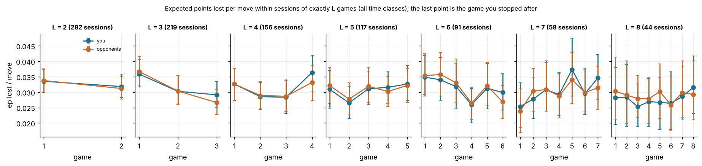
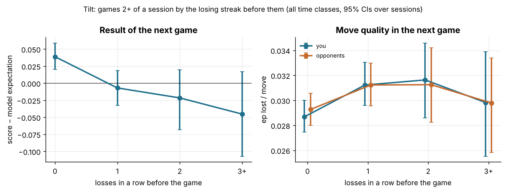

# Sessions: fatigue, warm-up and tilt

Data: 6,027 standard live games with at least one move (3,452 bullet, 1,987 blitz, 588 rapid) in 1,500 sessions (30-minute gap), 364,685 analysed moves, player zakihussa1n. Per-game quality comes from Q1's `games_decomposed.parquet` (`my_ep_lost`, `opp_ep_lost`, moves, error counts). Numbers are estimate [95% CI]; CIs are bootstrapped by game, or by session where games of the same session are compared or conditioned on (500 resamples). `ep_loss` (calibrated expected points lost per move) is the main quality measure, `cp_loss` secondary. Every number about you is next to the opponents' number from the same games where the question allows it.

## 1. What a session looks like

A session is a run of games with no gap longer than 30 minutes between one game's end and the next game's start, recomputed here over the standard live games only (the stored `session` column also counts daily and variant games; 53 games change their position). Each game is classified by its own time class; a session can mix classes.

| sessions (by main class) | n sessions | games | median games / session | mean | 1 game | ≥5 games | ≥10 games | median minutes | ≥60 min | mixed classes |
|---|---|---|---|---|---|---|---|---|---|---|
| all | 1500 | 6027 | 3 | 4.0 | 25% | 31% | 7% | 13 | 4% | 7% |
| bullet | 680 | 3452 | 4 | 5.1 | 20% | 44% | 14% | 9 | 3% | 8% |
| blitz | 634 | 1987 | 2 | 3.1 | 30% | 19% | 2% | 15 | 5% | 7% |
| rapid | 186 | 588 | 2 | 3.0 | 31% | 20% | 1% | 17 | 6% | 6% |

14% of games sit in a session that mixes time classes. The per-game view below always keeps the game's own time class; `game_in_session` counts every game of the session whatever its class.

## 2. The stopping rule: when do you quit?

Whether a game is the last of its session, by its result. This is the selection that every naive curve by game number has to be corrected for: if sessions end on losses, late games are over-represented by losses and look like fatigue.

| time class | games | P(stop | win) | P(stop | draw) | P(stop | loss) | loss − win | P(stop | after LL) | P(stop | after WW) |
|---|---|---|---|---|---|---|---|
| all | 6027 | 0.173 [0.160, 0.187] | 0.264 [0.214, 0.311] | 0.329 [0.310, 0.347] | 0.156 [0.137, 0.179] | 0.353 [0.325, 0.385] | 0.143 [0.123, 0.160] |
| bullet | 3452 | 0.114 [0.099, 0.129] | 0.139 [0.090, 0.198] | 0.290 [0.267, 0.313] | 0.176 [0.148, 0.202] | 0.325 [0.288, 0.362] | 0.090 [0.070, 0.111] |
| blitz | 1987 | 0.254 [0.226, 0.282] | 0.364 [0.280, 0.454] | 0.376 [0.343, 0.406] | 0.122 [0.079, 0.162] | 0.375 [0.318, 0.428] | 0.224 [0.188, 0.267] |
| rapid | 588 | 0.243 [0.194, 0.293] | 0.432 [0.270, 0.568] | 0.417 [0.360, 0.486] | 0.174 [0.107, 0.247] | 0.493 [0.380, 0.606] | 0.224 [0.152, 0.296] |

The same by game number (all time classes): the hazard of stopping is roughly flat for both results (after a win it stays between 0.09 and 0.21, highest at game 2; after a loss between 0.30 and 0.43), while the loss − win gap persists at every game number (smallest 0.08, largest 0.33).

| game in session | games | P(stop | win) | P(stop | loss) |
|---|---|---|---|
| 1 | 1500 | 0.19 [0.17, 0.22] | 0.31 [0.28, 0.35] |
| 2 | 1118 | 0.21 [0.18, 0.25] | 0.30 [0.26, 0.34] |
| 3 | 836 | 0.16 [0.12, 0.20] | 0.36 [0.31, 0.41] |
| 4 | 617 | 0.16 [0.12, 0.20] | 0.34 [0.29, 0.39] |
| 5 | 461 | 0.18 [0.13, 0.23] | 0.32 [0.26, 0.39] |
| 6 | 344 | 0.18 [0.12, 0.25] | 0.35 [0.27, 0.42] |
| 7 | 253 | 0.09 [0.04, 0.14] | 0.42 [0.31, 0.50] |
| 8 | 195 | 0.11 [0.06, 0.18] | 0.38 [0.26, 0.47] |
| 9 | 151 | 0.19 [0.12, 0.28] | 0.43 [0.31, 0.57] |
| 10+ | 552 | 0.12 [0.09, 0.15] | 0.30 [0.24, 0.35] |

Consequence: the last game of a session scores -0.199 [-0.226, -0.172] less than the other games (score − model expectation: -0.183 [-0.208, -0.157]), and you lose 0.0013 [-0.0007, 0.0033] more expected points per move in it (opponents: -0.0014 [-0.0033, 0.0006]). Part of that is the rule itself (a loss makes you stop), so the sections below exclude last games or compare within equal-length sessions.

## 3. Fatigue and warm-up: play by game number in the session

Three views of the same question. **Naive**: every game by its number in the session. **Corrected A**: game k compared with game 1 of the *same* session, using only sessions that went on to at least game k+1 (so neither game is the one you stopped after); the difference is paired per session with CIs bootstrapped over sessions. **Corrected B**: within sessions of exactly L games. Quality is expected points lost per move (`ep_loss`, ratio of sums with game-bootstrap CIs); results are score minus the calibration model's expectation at move 1 (pre-game ratings and time control). Opponents' numbers are from the same games.

### bullet: naive curve

| game in session | games | score − model expectation | your ep lost / move | their ep lost / move | your moves losing ≥0.2 ep / 100 | your cp lost / move |
|---|---|---|---|---|---|---|
| 1 | 657 | 0.014 [-0.020, 0.054] | 0.0298 [0.0274, 0.0319] | 0.0300 [0.0276, 0.0323] | 2.08 [1.84, 2.34] | 74.2 [71.2, 77.1] |
| 2 | 532 | -0.016 [-0.060, 0.024] | 0.0286 [0.0262, 0.0314] | 0.0286 [0.0261, 0.0314] | 1.86 [1.56, 2.14] | 73.7 [70.8, 77.0] |
| 3 | 438 | -0.012 [-0.052, 0.031] | 0.0277 [0.0252, 0.0305] | 0.0276 [0.0249, 0.0304] | 1.96 [1.58, 2.40] | 72.3 [68.5, 75.9] |
| 4 | 369 | -0.049 [-0.092, 0.003] | 0.0292 [0.0266, 0.0322] | 0.0282 [0.0256, 0.0313] | 2.10 [1.78, 2.48] | 70.5 [66.6, 74.4] |
| 5 | 307 | 0.011 [-0.044, 0.058] | 0.0304 [0.0270, 0.0345] | 0.0310 [0.0278, 0.0346] | 2.39 [1.83, 3.12] | 73.2 [69.1, 77.3] |
| 6 | 243 | -0.012 [-0.066, 0.040] | 0.0271 [0.0237, 0.0305] | 0.0272 [0.0239, 0.0304] | 1.73 [1.39, 2.10] | 73.1 [68.2, 77.9] |
| 7 | 185 | 0.051 [-0.014, 0.120] | 0.0286 [0.0249, 0.0320] | 0.0294 [0.0254, 0.0331] | 1.67 [1.29, 2.07] | 71.1 [66.5, 75.4] |
| 8 | 146 | 0.056 [-0.016, 0.128] | 0.0329 [0.0262, 0.0393] | 0.0341 [0.0276, 0.0406] | 2.50 [1.55, 3.49] | 73.9 [67.7, 80.1] |
| 9 | 114 | 0.099 [0.014, 0.172] | 0.0304 [0.0252, 0.0367] | 0.0326 [0.0270, 0.0391] | 1.75 [1.12, 2.46] | 69.5 [63.4, 76.8] |
| 10+ | 461 | 0.047 [0.005, 0.089] | 0.0287 [0.0261, 0.0313] | 0.0298 [0.0271, 0.0324] | 1.68 [1.36, 2.09] | 75.7 [71.9, 79.9] |

### bullet: corrected A, game k minus game 1 of the same session (non-last games only)

| game k | sessions | score − model exp. | your ep / move | their ep / move | your ≥0.2 errors / 100 | your cp / move |
|---|---|---|---|---|---|---|
| 2 | 415 | -0.031 [-0.096, 0.032] | -0.0008 [-0.0052, 0.0036] | -0.0014 [-0.0055, 0.0024] | -0.30 [-0.97, 0.38] | -1.5 [-8.4, 4.7] |
| 3 | 341 | -0.025 [-0.084, 0.043] | -0.0023 [-0.0070, 0.0023] | -0.0032 [-0.0073, 0.0008] | -0.38 [-1.12, 0.37] | -1.5 [-8.7, 6.2] |
| 4 | 281 | -0.071 [-0.149, 0.001] | -0.0002 [-0.0049, 0.0043] | -0.0009 [-0.0057, 0.0036] | 0.22 [-0.54, 1.08] | -4.5 [-11.0, 1.6] |
| 5 | 218 | 0.016 [-0.077, 0.093] | 0.0041 [-0.0024, 0.0115] | 0.0047 [-0.0014, 0.0113] | 0.40 [-0.90, 1.99] | -6.0 [-15.0, 2.6] |
| 6 | 170 | -0.045 [-0.130, 0.052] | -0.0003 [-0.0065, 0.0051] | 0.0005 [-0.0056, 0.0063] | -1.03 [-2.08, -0.09] | -7.3 [-17.0, 2.4] |
| 7-9 | 133 | 0.046 [-0.051, 0.127] | 0.0007 [-0.0064, 0.0070] | 0.0021 [-0.0044, 0.0084] | -1.10 [-2.28, 0.04] | -11.0 [-19.3, -2.3] |
| 10+ | 56 | -0.015 [-0.148, 0.135] | 0.0064 [-0.0027, 0.0153] | 0.0056 [-0.0041, 0.0149] | -0.67 [-1.97, 0.65] | -9.9 [-24.7, 3.2] |

### blitz: naive curve

| game in session | games | score − model expectation | your ep lost / move | their ep lost / move | your moves losing ≥0.2 ep / 100 | your cp lost / move |
|---|---|---|---|---|---|---|
| 1 | 645 | -0.004 [-0.038, 0.034] | 0.0337 [0.0316, 0.0363] | 0.0334 [0.0312, 0.0360] | 2.83 [2.53, 3.17] | 70.2 [67.4, 73.5] |
| 2 | 454 | 0.045 [0.001, 0.085] | 0.0320 [0.0292, 0.0354] | 0.0327 [0.0297, 0.0360] | 2.64 [2.26, 3.08] | 69.1 [65.4, 72.9] |
| 3 | 304 | 0.016 [-0.037, 0.067] | 0.0316 [0.0280, 0.0355] | 0.0316 [0.0280, 0.0359] | 2.48 [2.08, 2.97] | 65.5 [61.7, 69.5] |
| 4 | 191 | -0.002 [-0.062, 0.063] | 0.0302 [0.0258, 0.0345] | 0.0294 [0.0254, 0.0336] | 2.75 [2.20, 3.28] | 70.8 [65.3, 75.7] |
| 5 | 117 | 0.036 [-0.041, 0.124] | 0.0326 [0.0276, 0.0382] | 0.0332 [0.0279, 0.0389] | 2.21 [1.64, 2.89] | 66.7 [61.2, 73.5] |
| 6 | 77 | 0.038 [-0.064, 0.146] | 0.0318 [0.0226, 0.0402] | 0.0319 [0.0230, 0.0399] | 2.54 [1.35, 3.77] | 61.9 [55.0, 68.3] |
| 7 | 51 | 0.001 [-0.112, 0.114] | 0.0250 [0.0195, 0.0307] | 0.0247 [0.0196, 0.0299] | 1.98 [1.23, 2.76] | 63.5 [54.7, 72.7] |
| 8 | 36 | 0.095 [-0.048, 0.233] | 0.0265 [0.0191, 0.0347] | 0.0270 [0.0196, 0.0345] | 1.19 [0.68, 1.79] | 62.9 [53.6, 72.4] |
| 9 | 29 | -0.009 [-0.148, 0.132] | 0.0303 [0.0184, 0.0450] | 0.0308 [0.0195, 0.0455] | 2.76 [1.12, 4.87] | 66.4 [51.7, 84.7] |
| 10+ | 83 | 0.074 [-0.026, 0.171] | 0.0317 [0.0257, 0.0413] | 0.0320 [0.0259, 0.0406] | 2.57 [1.89, 3.60] | 60.6 [53.1, 69.2] |

### blitz: corrected A, game k minus game 1 of the same session (non-last games only)

| game k | sessions | score − model exp. | your ep / move | their ep / move | your ≥0.2 errors / 100 | your cp / move |
|---|---|---|---|---|---|---|
| 2 | 302 | 0.030 [-0.038, 0.097] | -0.0026 [-0.0077, 0.0022] | -0.0003 [-0.0055, 0.0045] | -0.29 [-1.05, 0.52] | 0.2 [-5.7, 6.0] |
| 3 | 192 | 0.030 [-0.054, 0.109] | 0.0026 [-0.0032, 0.0090] | 0.0037 [-0.0020, 0.0103] | 0.26 [-0.78, 1.31] | 0.3 [-9.1, 9.1] |
| 4 | 114 | 0.062 [-0.046, 0.172] | -0.0021 [-0.0102, 0.0051] | -0.0015 [-0.0095, 0.0052] | -0.27 [-1.73, 0.99] | -3.1 [-18.4, 9.1] |
| 5 | 75 | -0.047 [-0.167, 0.088] | 0.0034 [-0.0055, 0.0126] | 0.0015 [-0.0078, 0.0109] | 0.19 [-1.41, 1.78] | 4.4 [-8.6, 16.3] |
| 6 | 48 | 0.002 [-0.177, 0.183] | -0.0014 [-0.0151, 0.0124] | 0.0021 [-0.0106, 0.0178] | -1.08 [-3.43, 1.18] | -11.9 [-22.1, 0.2] |
| 7-9 | 33 | -0.030 [-0.215, 0.162] | -0.0010 [-0.0108, 0.0085] | -0.0015 [-0.0116, 0.0083] | -0.38 [-1.81, 0.90] | -6.4 [-25.1, 9.4] |
| 10+ | 13 |  |  |  |  |  |

### rapid: naive curve

| game in session | games | score − model expectation | your ep lost / move | their ep lost / move | your moves losing ≥0.2 ep / 100 | your cp lost / move |
|---|---|---|---|---|---|---|
| 1 | 198 | 0.039 [-0.024, 0.095] | 0.0309 [0.0267, 0.0357] | 0.0323 [0.0282, 0.0373] | 2.66 [2.18, 3.32] | 65.2 [60.5, 70.8] |
| 2 | 132 | 0.032 [-0.051, 0.116] | 0.0300 [0.0249, 0.0363] | 0.0310 [0.0258, 0.0374] | 2.16 [1.63, 2.76] | 67.0 [59.7, 75.2] |
| 3 | 94 | -0.017 [-0.110, 0.074] | 0.0305 [0.0243, 0.0385] | 0.0313 [0.0250, 0.0392] | 2.17 [1.52, 2.81] | 60.0 [53.9, 67.1] |
| 4 | 57 | 0.100 [-0.011, 0.219] | 0.0353 [0.0258, 0.0444] | 0.0357 [0.0267, 0.0443] | 3.15 [1.97, 4.28] | 62.5 [54.5, 70.8] |
| 5 | 37 | 0.136 [0.010, 0.267] | 0.0249 [0.0180, 0.0339] | 0.0261 [0.0196, 0.0347] | 2.47 [1.57, 3.38] | 63.8 [54.5, 73.0] |
| 6 | 24 | 0.029 [-0.128, 0.196] | 0.0257 [0.0187, 0.0342] | 0.0243 [0.0162, 0.0341] | 2.39 [1.26, 3.55] | 67.8 [54.8, 78.9] |
| 7 | 17 |  |  |  |  |  |
| 8 | 13 |  |  |  |  |  |
| 9 | 8 |  |  |  |  |  |
| 10+ | 8 |  |  |  |  |  |

### rapid: corrected A, game k minus game 1 of the same session (non-last games only)

| game k | sessions | score − model exp. | your ep / move | their ep / move | your ≥0.2 errors / 100 | your cp / move |
|---|---|---|---|---|---|---|
| 2 | 90 | -0.051 [-0.188, 0.065] | 0.0021 [-0.0076, 0.0118] | 0.0025 [-0.0088, 0.0123] | -0.84 [-2.54, 0.71] | 3.6 [-9.8, 18.4] |
| 3 | 54 | -0.060 [-0.196, 0.066] | 0.0031 [-0.0078, 0.0157] | 0.0027 [-0.0100, 0.0173] | 0.42 [-1.23, 2.27] | 6.7 [-5.3, 19.3] |
| 4 | 36 | -0.060 [-0.248, 0.129] | -0.0057 [-0.0168, 0.0051] | -0.0110 [-0.0228, 0.0014] | 0.13 [-1.41, 1.70] | 5.5 [-10.1, 19.0] |
| 5 | 22 | -0.060 [-0.261, 0.142] | -0.0078 [-0.0253, 0.0088] | -0.0082 [-0.0280, 0.0096] | 0.18 [-2.19, 2.37] | 2.6 [-10.6, 17.4] |
| 6 | 14 |  |  |  |  |  |
| 7-9 | 10 |  |  |  |  |  |
| 10+ | 1 |  |  |  |  |  |

### All time classes: corrected A

| game k | sessions | score − model exp. | your ep / move | their ep / move | your ≥0.2 errors / 100 | your cp / move |
|---|---|---|---|---|---|---|
| 2 | 836 | -0.013 [-0.051, 0.032] | -0.0011 [-0.0043, 0.0018] | -0.0005 [-0.0036, 0.0028] | -0.33 [-0.80, 0.15] | -0.3 [-4.1, 4.1] |
| 3 | 617 | -0.014 [-0.062, 0.034] | 0.0003 [-0.0029, 0.0038] | 0.0001 [-0.0033, 0.0032] | 0.07 [-0.45, 0.67] | 0.6 [-4.6, 5.9] |
| 4 | 461 | -0.042 [-0.095, 0.016] | -0.0012 [-0.0049, 0.0025] | -0.0023 [-0.0058, 0.0011] | 0.12 [-0.55, 0.87] | -1.9 [-7.4, 3.8] |
| 5 | 344 | -0.004 [-0.067, 0.059] | 0.0020 [-0.0031, 0.0075] | 0.0024 [-0.0023, 0.0069] | 0.27 [-0.66, 1.34] | -0.9 [-8.4, 6.3] |
| 6 | 253 | -0.044 [-0.115, 0.026] | -0.0014 [-0.0067, 0.0036] | 0.0000 [-0.0055, 0.0050] | -0.99 [-1.82, -0.18] | -4.8 [-12.5, 2.7] |
| 7-9 | 195 | 0.013 [-0.062, 0.089] | 0.0013 [-0.0040, 0.0072] | 0.0020 [-0.0035, 0.0080] | -0.58 [-1.66, 0.39] | -6.1 [-13.6, 1.0] |
| 10+ | 80 | 0.018 [-0.103, 0.126] | 0.0015 [-0.0085, 0.0098] | 0.0027 [-0.0072, 0.0104] | -0.66 [-1.94, 0.43] | -6.8 [-17.6, 4.2] |

*Top: expected points lost per move relative to game 1 (naive) and the paired game-k-minus-game-1 difference in sessions that reached k+1 (corrected A), you and opponents. Bottom: score minus the model's pre-game expectation, same two views. The corrected-A group 'games 7-9' is drawn at the x position of game 8. Error bars are 95% CIs over sessions.*

### Corrected B: within sessions of equal length

Every game of a session of exactly L games, by position. All games of such sessions were played whatever their result, except that the last one is the one you stopped after; it is kept and marked so the stop effect is visible. Bullet dominates the long sessions.

| session length | position | games | your ep lost / move | their ep lost / move | your − their ep / move | score − model expectation |
|---|---|---|---|---|---|---|
| 2 | 1 | 282 | 0.0335 [0.0298, 0.0374] | 0.0338 [0.0299, 0.0379] | -0.0002 [-0.0014, 0.0008] | 0.018 [-0.036, 0.071] |
| 2 | 2 (last) | 282 | 0.0318 [0.0283, 0.0359] | 0.0312 [0.0278, 0.0350] | 0.0006 [-0.0004, 0.0017] | -0.062 [-0.114, -0.005] |
| 3 | 1 | 219 | 0.0359 [0.0316, 0.0405] | 0.0367 [0.0323, 0.0416] | -0.0008 [-0.0022, 0.0006] | 0.008 [-0.054, 0.071] |
| 3 | 2 | 219 | 0.0303 [0.0261, 0.0354] | 0.0304 [0.0260, 0.0354] | -0.0001 [-0.0014, 0.0012] | -0.027 [-0.091, 0.033] |
| 3 | 3 (last) | 219 | 0.0291 [0.0250, 0.0336] | 0.0266 [0.0227, 0.0310] | 0.0025 [0.0015, 0.0037] | -0.162 [-0.217, -0.112] |
| 4 | 1 | 156 | 0.0326 [0.0274, 0.0379] | 0.0327 [0.0271, 0.0376] | -0.0000 [-0.0014, 0.0013] | 0.043 [-0.027, 0.113] |
| 4 | 2 | 156 | 0.0286 [0.0244, 0.0331] | 0.0289 [0.0249, 0.0335] | -0.0004 [-0.0017, 0.0010] | -0.001 [-0.077, 0.070] |
| 4 | 3 | 156 | 0.0284 [0.0231, 0.0339] | 0.0287 [0.0238, 0.0343] | -0.0003 [-0.0017, 0.0010] | -0.012 [-0.079, 0.064] |
| 4 | 4 (last) | 156 | 0.0364 [0.0301, 0.0420] | 0.0331 [0.0273, 0.0385] | 0.0032 [0.0018, 0.0045] | -0.183 [-0.250, -0.116] |
| 5 | 1 | 117 | 0.0309 [0.0249, 0.0371] | 0.0322 [0.0263, 0.0381] | -0.0012 [-0.0031, 0.0005] | 0.082 [0.001, 0.168] |
| 5 | 2 | 117 | 0.0265 [0.0215, 0.0319] | 0.0277 [0.0227, 0.0330] | -0.0012 [-0.0029, 0.0005] | 0.065 [-0.022, 0.147] |
| 5 | 3 | 117 | 0.0311 [0.0259, 0.0369] | 0.0319 [0.0267, 0.0380] | -0.0008 [-0.0025, 0.0009] | 0.027 [-0.052, 0.104] |
| 5 | 4 | 117 | 0.0316 [0.0264, 0.0368] | 0.0302 [0.0254, 0.0350] | 0.0014 [-0.0005, 0.0032] | -0.023 [-0.105, 0.062] |
| 5 | 5 (last) | 117 | 0.0326 [0.0273, 0.0387] | 0.0322 [0.0267, 0.0377] | 0.0005 [-0.0011, 0.0020] | -0.102 [-0.187, -0.029] |
| 6 | 1 | 91 | 0.0349 [0.0288, 0.0418] | 0.0354 [0.0292, 0.0424] | -0.0005 [-0.0025, 0.0014] | 0.019 [-0.066, 0.116] |
| 6 | 2 | 91 | 0.0340 [0.0274, 0.0413] | 0.0357 [0.0287, 0.0429] | -0.0017 [-0.0037, 0.0001] | 0.151 [0.049, 0.243] |
| 6 | 3 | 91 | 0.0318 [0.0246, 0.0394] | 0.0331 [0.0265, 0.0408] | -0.0012 [-0.0033, 0.0005] | 0.089 [-0.006, 0.178] |
| 6 | 4 | 91 | 0.0260 [0.0201, 0.0312] | 0.0264 [0.0212, 0.0315] | -0.0005 [-0.0025, 0.0013] | 0.041 [-0.048, 0.135] |
| 6 | 5 | 91 | 0.0312 [0.0246, 0.0393] | 0.0321 [0.0258, 0.0397] | -0.0009 [-0.0026, 0.0007] | 0.029 [-0.055, 0.129] |
| 6 | 6 (last) | 91 | 0.0299 [0.0242, 0.0360] | 0.0269 [0.0214, 0.0321] | 0.0030 [0.0015, 0.0048] | -0.136 [-0.222, -0.047] |
| 7 | 1 | 58 | 0.0253 [0.0185, 0.0330] | 0.0238 [0.0170, 0.0313] | 0.0015 [-0.0007, 0.0039] | 0.022 [-0.109, 0.130] |
| 7 | 2 | 58 | 0.0277 [0.0215, 0.0349] | 0.0304 [0.0238, 0.0377] | -0.0026 [-0.0051, 0.0001] | 0.125 [-0.001, 0.247] |
| 7 | 3 | 58 | 0.0308 [0.0238, 0.0402] | 0.0309 [0.0238, 0.0397] | -0.0000 [-0.0024, 0.0025] | 0.065 [-0.059, 0.180] |
| 7 | 4 | 58 | 0.0292 [0.0224, 0.0365] | 0.0288 [0.0216, 0.0362] | 0.0004 [-0.0017, 0.0025] | 0.019 [-0.085, 0.140] |
| 7 | 5 | 58 | 0.0373 [0.0288, 0.0475] | 0.0341 [0.0263, 0.0428] | 0.0033 [0.0007, 0.0062] | -0.093 [-0.210, 0.020] |
| 7 | 6 | 58 | 0.0296 [0.0227, 0.0378] | 0.0299 [0.0236, 0.0372] | -0.0003 [-0.0025, 0.0016] | 0.006 [-0.105, 0.119] |
| 7 | 7 (last) | 58 | 0.0346 [0.0276, 0.0422] | 0.0314 [0.0245, 0.0385] | 0.0032 [0.0012, 0.0054] | -0.256 [-0.350, -0.164] |
| 8 | 1 | 44 | 0.0282 [0.0196, 0.0379] | 0.0303 [0.0210, 0.0414] | -0.0021 [-0.0049, 0.0010] | 0.130 [0.002, 0.268] |
| 8 | 2 | 44 | 0.0283 [0.0189, 0.0389] | 0.0291 [0.0199, 0.0401] | -0.0007 [-0.0036, 0.0021] | 0.065 [-0.079, 0.200] |
| 8 | 3 | 44 | 0.0253 [0.0189, 0.0327] | 0.0279 [0.0218, 0.0354] | -0.0026 [-0.0053, 0.0000] | 0.171 [0.050, 0.286] |
| 8 | 4 | 44 | 0.0269 [0.0190, 0.0344] | 0.0279 [0.0199, 0.0349] | -0.0009 [-0.0032, 0.0013] | 0.048 [-0.090, 0.185] |
| 8 | 5 | 44 | 0.0267 [0.0178, 0.0349] | 0.0302 [0.0214, 0.0391] | -0.0035 [-0.0060, -0.0009] | 0.139 [-0.004, 0.252] |
| 8 | 6 | 44 | 0.0264 [0.0179, 0.0368] | 0.0258 [0.0174, 0.0353] | 0.0006 [-0.0020, 0.0033] | -0.078 [-0.199, 0.053] |
| 8 | 7 | 44 | 0.0286 [0.0212, 0.0382] | 0.0299 [0.0219, 0.0401] | -0.0013 [-0.0039, 0.0011] | 0.080 [-0.053, 0.206] |
| 8 | 8 (last) | 44 | 0.0315 [0.0231, 0.0418] | 0.0293 [0.0210, 0.0401] | 0.0023 [-0.0005, 0.0048] | -0.187 [-0.312, -0.048] |

The opponents' curve follows yours position by position (the 'your − their' column stays near zero): whatever shape the within-session curve has is a property of the games (which time class, how long they run), not of you.

*Within sessions of exactly L games, ep lost per move by position, you (blue) and opponents (orange), 95% CIs over games.*

### Minutes into the session

The same quality measures by minutes since the session's first game started. Naive: all games. Corrected: non-last games of sessions that lasted at least 60 minutes in total (so every bin is drawn from the same sessions and no game is the one you stopped after); only 4% of sessions last that long, so the corrected columns are thin.

#### bullet

| minutes into session | games | score − model expectation | your ep lost / move | their ep lost / move | games (corrected) | score − model expectation (corrected) | your ep lost / move (corrected) | their ep lost / move (corrected) |
|---|---|---|---|---|---|---|---|---|
| 0-10 | 2088 | 0.002 [-0.018, 0.024] | 0.0282 [0.0270, 0.0294] | 0.0283 [0.0271, 0.0295] | 43 | -0.020 [-0.168, 0.120] | 0.0354 [0.0260, 0.0460] | 0.0353 [0.0263, 0.0454] |
| 10-20 | 621 | 0.029 [-0.012, 0.064] | 0.0303 [0.0276, 0.0326] | 0.0308 [0.0282, 0.0333] | 22 | 0.077 [-0.123, 0.254] | 0.0297 [0.0190, 0.0425] | 0.0298 [0.0185, 0.0418] |
| 20-40 | 475 | 0.000 [-0.040, 0.039] | 0.0314 [0.0283, 0.0345] | 0.0316 [0.0286, 0.0348] | 68 | 0.054 [-0.054, 0.153] | 0.0258 [0.0205, 0.0316] | 0.0277 [0.0224, 0.0335] |
| 40-60 | 166 | 0.021 [-0.052, 0.081] | 0.0284 [0.0249, 0.0328] | 0.0295 [0.0262, 0.0344] | 67 | 0.022 [-0.093, 0.122] | 0.0305 [0.0237, 0.0386] | 0.0313 [0.0244, 0.0394] |
| 60-120 | 100 | 0.016 [-0.079, 0.111] | 0.0318 [0.0258, 0.0377] | 0.0330 [0.0271, 0.0394] | 84 | 0.067 [-0.022, 0.158] | 0.0326 [0.0263, 0.0397] | 0.0344 [0.0279, 0.0422] |
| 120+ | 2 |  |  |  | 2 |  |  |  |

#### blitz

| minutes into session | games | score − model expectation | your ep lost / move | their ep lost / move | games (corrected) | score − model expectation (corrected) | your ep lost / move (corrected) | their ep lost / move (corrected) |
|---|---|---|---|---|---|---|---|---|
| 0-10 | 1168 | 0.016 [-0.008, 0.040] | 0.0330 [0.0313, 0.0347] | 0.0330 [0.0312, 0.0348] | 75 | 0.051 [-0.051, 0.152] | 0.0254 [0.0200, 0.0311] | 0.0255 [0.0203, 0.0312] |
| 10-20 | 349 | 0.038 [-0.008, 0.084] | 0.0310 [0.0275, 0.0349] | 0.0318 [0.0283, 0.0355] | 37 | 0.179 [0.040, 0.303] | 0.0349 [0.0252, 0.0455] | 0.0358 [0.0260, 0.0464] |
| 20-40 | 284 | 0.021 [-0.026, 0.080] | 0.0298 [0.0258, 0.0335] | 0.0297 [0.0259, 0.0332] | 57 | 0.114 [-0.007, 0.229] | 0.0270 [0.0181, 0.0380] | 0.0284 [0.0197, 0.0393] |
| 40-60 | 118 | -0.027 [-0.105, 0.058] | 0.0334 [0.0270, 0.0400] | 0.0319 [0.0258, 0.0381] | 73 | 0.007 [-0.090, 0.109] | 0.0324 [0.0251, 0.0412] | 0.0315 [0.0245, 0.0399] |
| 60-120 | 64 | 0.064 [-0.051, 0.159] | 0.0266 [0.0209, 0.0330] | 0.0269 [0.0211, 0.0328] | 40 | 0.121 [-0.011, 0.239] | 0.0301 [0.0226, 0.0389] | 0.0312 [0.0237, 0.0400] |
| 120+ | 4 |  |  |  | 3 |  |  |  |

#### rapid

| minutes into session | games | score − model expectation | your ep lost / move | their ep lost / move | games (corrected) | score − model expectation (corrected) | your ep lost / move (corrected) | their ep lost / move (corrected) |
|---|---|---|---|---|---|---|---|---|
| 0-10 | 328 | 0.038 [-0.013, 0.085] | 0.0305 [0.0273, 0.0342] | 0.0318 [0.0287, 0.0354] | 24 | 0.151 [-0.046, 0.312] | 0.0370 [0.0223, 0.0525] | 0.0416 [0.0254, 0.0582] |
| 10-20 | 101 | 0.046 [-0.038, 0.139] | 0.0277 [0.0226, 0.0343] | 0.0289 [0.0237, 0.0359] | 10 |  |  |  |
| 20-40 | 87 | 0.048 [-0.044, 0.150] | 0.0339 [0.0277, 0.0415] | 0.0344 [0.0281, 0.0421] | 19 |  |  |  |
| 40-60 | 47 | 0.142 [0.030, 0.243] | 0.0295 [0.0198, 0.0409] | 0.0309 [0.0212, 0.0428] | 29 | 0.219 [0.078, 0.347] | 0.0158 [0.0116, 0.0212] | 0.0180 [0.0126, 0.0250] |
| 60-120 | 24 | -0.105 [-0.271, 0.067] | 0.0294 [0.0200, 0.0413] | 0.0270 [0.0157, 0.0383] | 13 |  |  |  |
| 120+ | 1 |  |  |  | 0 |  |  |  |

### A pooled regression, between and within sessions

Per-game OLS on non-last games of multi-game sessions, CIs bootstrapped by session: outcome ~ log2(game number) + minutes/30 + previous game lost + previous game won + time class + year, so fatigue (game number, minutes) and tilt (previous result) are estimated together. Reference: previous game drawn or first game of the session, bullet, 2024. **Pooled** compares games across sessions as well as within them, so a long session that went well contributes many late, good games (the stopping rule again); **within** demeans every variable inside its session and so only uses how a game differs from the other games of the same session. 'your − their ep / move' is the per-game difference, the paired control for the pool and the kind of game.

**Pooled** (year dummies not shown)

| term | score − model exp. | your ep / move | their ep / move | your − their ep / move | your ≥0.2 errors / 100 |
|---|---|---|---|---|---|
| intercept | 0.004 [-0.048, 0.060] | 0.0324 [0.0288, 0.0363] | 0.0306 [0.0268, 0.0343] | 0.0018 [0.0001, 0.0036] | 2.75 [2.20, 3.33] |
| log2(game number) | 0.044 [0.021, 0.070] | -0.0022 [-0.0041, -0.0007] | -0.0009 [-0.0026, 0.0007] | -0.0012 [-0.0019, -0.0006] | -0.35 [-0.61, -0.15] |
| minutes / 30 | -0.036 [-0.084, 0.004] | 0.0023 [-0.0002, 0.0056] | 0.0017 [-0.0008, 0.0049] | 0.0006 [-0.0005, 0.0019] | 0.36 [-0.02, 0.83] |
| previous game lost | -0.058 [-0.098, -0.010] | 0.0029 [-0.0001, 0.0061] | 0.0012 [-0.0019, 0.0041] | 0.0018 [0.0004, 0.0032] | 0.48 [0.00, 0.99] |
| previous game won | -0.012 [-0.055, 0.028] | -0.0008 [-0.0037, 0.0024] | -0.0009 [-0.0040, 0.0019] | 0.0002 [-0.0011, 0.0017] | 0.00 [-0.45, 0.51] |
| blitz | 0.046 [0.003, 0.086] | 0.0003 [-0.0026, 0.0031] | 0.0028 [-0.0002, 0.0055] | -0.0025 [-0.0037, -0.0012] | -0.15 [-0.63, 0.29] |
| rapid | 0.077 [0.024, 0.133] | -0.0020 [-0.0058, 0.0020] | 0.0000 [-0.0036, 0.0036] | -0.0019 [-0.0042, 0.0007] | -0.16 [-0.79, 0.47] |

**Within** (session-demeaned; intercept, time class and year drop out, and the previous-result terms are left out because a demeaned lagged outcome in panels of 2-10 games is badly biased)

| term | score − model exp. | your ep / move | their ep / move | your − their ep / move | your ≥0.2 errors / 100 |
|---|---|---|---|---|---|
| log2(game number) | -0.002 [-0.024, 0.024] | -0.0010 [-0.0028, 0.0005] | -0.0008 [-0.0025, 0.0006] | -0.0002 [-0.0010, 0.0007] | -0.29 [-0.57, 0.00] |
| minutes / 30 | -0.029 [-0.089, 0.026] | 0.0023 [-0.0013, 0.0055] | 0.0022 [-0.0011, 0.0054] | 0.0001 [-0.0017, 0.0017] | 0.47 [-0.13, 1.03] |

4,527 games in 1,118 sessions.

## 4. Tilt: the game after a loss

Games 2+ of a session by the result of the previous game in the session. 'Score − model expectation' uses the calibration model's expectation at move 1 (it knows both pre-game ratings, so a lower rating after a loss and the slightly weaker opponent that follows are already priced in); 'score − Elo expectation' uses your pre-game rating and the opponent's approximate pre-game rating (post-game rating + your rating change). Opponents' error rates come from the same games. CIs are bootstrapped over sessions. The game after a loss exists only if you kept playing, so these are the games you chose to play on tilt, if tilt there is.

### all: by the previous game's result

| previous game | games | score − model expectation | score − Elo expectation | your ep lost / move | their ep lost / move | your − their ep / move | your moves losing ≥0.2 ep / 100 | your cp lost / move | you lost on time | resignations / your losses | your seconds / move | their seconds / move |
|---|---|---|---|---|---|---|---|---|---|---|---|---|
| win | 2457 | 0.041 [0.019, 0.061] | 0.042 [0.019, 0.062] | 0.0288 [0.0276, 0.0300] | 0.0294 [0.0282, 0.0306] | -0.0006 [-0.0010, -0.0002] | 2.02 [1.85, 2.19] | 69.4 [67.6, 71.1] | 0.160 [0.145, 0.177] | 0.217 [0.192, 0.241] | 3.25 [3.08, 3.44] | 3.18 [3.01, 3.37] |
| draw | 220 | 0.011 [-0.048, 0.070] | 0.013 [-0.051, 0.076] | 0.0274 [0.0234, 0.0320] | 0.0278 [0.0238, 0.0322] | -0.0003 [-0.0014, 0.0007] | 2.22 [1.65, 2.86] | 69.9 [64.8, 76.4] | 0.100 [0.065, 0.137] | 0.402 [0.307, 0.505] | 3.32 [2.98, 3.71] | 3.34 [2.96, 3.78] |
| loss | 1850 | -0.014 [-0.035, 0.006] | -0.011 [-0.032, 0.012] | 0.0312 [0.0297, 0.0326] | 0.0311 [0.0296, 0.0325] | 0.0001 [-0.0003, 0.0005] | 2.29 [2.10, 2.51] | 72.2 [70.3, 74.0] | 0.177 [0.160, 0.194] | 0.300 [0.270, 0.334] | 3.41 [3.23, 3.61] | 3.19 [3.04, 3.35] |
| loss − win | 4307 | -0.055 [-0.084, -0.028] | -0.053 [-0.083, -0.025] | 0.0024 [0.0005, 0.0043] | 0.0017 [-0.0001, 0.0035] | 0.0007 [0.0002, 0.0012] | 0.27 [0.01, 0.52] | 2.8 [0.3, 5.4] | 0.017 [-0.005, 0.039] | 0.084 [0.046, 0.122] | 0.16 [-0.04, 0.34] | 0.01 [-0.16, 0.18] |

### bullet: by the previous game's result

| previous game | games | score − model expectation | score − Elo expectation | your ep lost / move | their ep lost / move | your − their ep / move | your moves losing ≥0.2 ep / 100 | your cp lost / move | you lost on time | resignations / your losses | your seconds / move | their seconds / move |
|---|---|---|---|---|---|---|---|---|---|---|---|---|
| win | 1517 | 0.030 [0.004, 0.058] | 0.031 [0.003, 0.059] | 0.0280 [0.0264, 0.0296] | 0.0286 [0.0268, 0.0303] | -0.0006 [-0.0011, -0.0002] | 1.78 [1.58, 2.00] | 71.9 [69.8, 73.9] | 0.229 [0.207, 0.251] | 0.093 [0.070, 0.118] | 1.67 [1.62, 1.73] | 1.69 [1.64, 1.75] |
| draw | 128 | -0.014 [-0.094, 0.076] | -0.009 [-0.093, 0.086] | 0.0237 [0.0198, 0.0286] | 0.0235 [0.0200, 0.0283] | 0.0002 [-0.0012, 0.0016] | 1.64 [1.14, 2.23] | 71.1 [63.8, 78.8] | 0.141 [0.083, 0.195] | 0.213 [0.110, 0.316] | 1.60 [1.49, 1.75] | 1.53 [1.43, 1.64] |
| loss | 1150 | -0.022 [-0.051, 0.007] | -0.020 [-0.052, 0.009] | 0.0308 [0.0290, 0.0326] | 0.0308 [0.0288, 0.0326] | 0.0000 [-0.0005, 0.0006] | 2.19 [1.92, 2.46] | 74.6 [72.4, 76.8] | 0.239 [0.213, 0.264] | 0.166 [0.131, 0.200] | 1.77 [1.70, 1.84] | 1.71 [1.65, 1.78] |
| loss − win | 2667 | -0.052 [-0.087, -0.013] | -0.051 [-0.088, -0.010] | 0.0028 [0.0004, 0.0055] | 0.0022 [-0.0002, 0.0049] | 0.0006 [-0.0001, 0.0013] | 0.41 [0.03, 0.79] | 2.6 [-0.2, 5.7] | 0.010 [-0.025, 0.043] | 0.073 [0.038, 0.114] | 0.10 [0.03, 0.16] | 0.02 [-0.05, 0.09] |

### blitz: by the previous game's result

| previous game | games | score − model expectation | score − Elo expectation | your ep lost / move | their ep lost / move | your − their ep / move | your moves losing ≥0.2 ep / 100 | your cp lost / move | you lost on time | resignations / your losses | your seconds / move | their seconds / move |
|---|---|---|---|---|---|---|---|---|---|---|---|---|
| win | 717 | 0.050 [0.019, 0.081] | 0.050 [0.017, 0.083] | 0.0306 [0.0282, 0.0328] | 0.0310 [0.0285, 0.0332] | -0.0004 [-0.0011, 0.0002] | 2.43 [2.13, 2.78] | 65.2 [62.7, 67.9] | 0.061 [0.044, 0.081] | 0.383 [0.334, 0.434] | 5.41 [5.18, 5.62] | 5.12 [4.92, 5.31] |
| draw | 72 | 0.048 [-0.052, 0.142] | 0.045 [-0.056, 0.148] | 0.0356 [0.0260, 0.0463] | 0.0367 [0.0272, 0.0470] | -0.0012 [-0.0034, 0.0009] | 3.57 [2.32, 5.14] | 70.2 [62.0, 79.0] | 0.056 [0.014, 0.111] | 0.625 [0.458, 0.790] | 5.49 [5.02, 5.98] | 5.57 [4.90, 6.22] |
| loss | 553 | 0.003 [-0.030, 0.040] | 0.009 [-0.029, 0.049] | 0.0315 [0.0288, 0.0346] | 0.0313 [0.0286, 0.0343] | 0.0002 [-0.0006, 0.0009] | 2.47 [2.14, 2.82] | 68.7 [65.1, 72.3] | 0.090 [0.068, 0.117] | 0.504 [0.439, 0.569] | 5.79 [5.58, 6.01] | 5.27 [5.06, 5.51] |
| loss − win | 1270 | -0.047 [-0.093, -0.002] | -0.042 [-0.091, 0.004] | 0.0009 [-0.0026, 0.0047] | 0.0003 [-0.0032, 0.0040] | 0.0006 [-0.0003, 0.0015] | 0.05 [-0.39, 0.50] | 3.5 [-0.4, 7.6] | 0.029 [-0.002, 0.059] | 0.121 [0.039, 0.198] | 0.38 [0.12, 0.67] | 0.14 [-0.14, 0.45] |

### rapid: by the previous game's result

| previous game | games | score − model expectation | score − Elo expectation | your ep lost / move | their ep lost / move | your − their ep / move | your moves losing ≥0.2 ep / 100 | your cp lost / move | you lost on time | resignations / your losses | your seconds / move | their seconds / move |
|---|---|---|---|---|---|---|---|---|---|---|---|---|
| win | 223 | 0.088 [0.036, 0.141] | 0.091 [0.034, 0.146] | 0.0288 [0.0251, 0.0329] | 0.0302 [0.0266, 0.0342] | -0.0014 [-0.0028, -0.0000] | 2.54 [2.08, 3.03] | 64.1 [59.7, 69.9] | 0.004 [0.000, 0.015] | 0.630 [0.519, 0.725] | 7.06 [6.61, 7.52] | 7.05 [6.56, 7.55] |
| draw | 20 | 0.038 [-0.151, 0.230] | 0.042 [-0.166, 0.244] | 0.0228 [0.0148, 0.0332] | 0.0240 [0.0151, 0.0350] | -0.0012 [-0.0053, 0.0030] | 1.11 [0.40, 2.03] | 59.9 [49.3, 70.7] | 0.000 [0.000, 0.000] | 0.889 [0.667, 1.000] | 6.53 [5.53, 7.77] | 6.91 [5.59, 8.53] |
| loss | 147 | -0.018 [-0.092, 0.068] | -0.009 [-0.095, 0.080] | 0.0333 [0.0286, 0.0393] | 0.0331 [0.0285, 0.0395] | 0.0002 [-0.0016, 0.0018] | 2.52 [2.03, 3.11] | 65.1 [60.7, 70.6] | 0.020 [0.000, 0.046] | 0.634 [0.519, 0.754] | 7.37 [6.82, 7.94] | 6.92 [6.41, 7.56] |
| loss − win | 370 | -0.106 [-0.200, -0.000] | -0.100 [-0.202, 0.013] | 0.0045 [-0.0016, 0.0108] | 0.0029 [-0.0035, 0.0097] | 0.0016 [-0.0011, 0.0039] | -0.01 [-0.77, 0.79] | 1.0 [-5.9, 8.2] | 0.016 [-0.008, 0.040] | 0.004 [-0.131, 0.166] | 0.31 [-0.41, 1.09] | -0.13 [-0.86, 0.66] |

### By the losing streak before the game (all time classes)

Consecutive losses immediately before the game, within the session (0 = the previous game was a win or a draw).

| losses in a row before | games | score − model expectation | score − Elo expectation | your ep lost / move | their ep lost / move | your − their ep / move | your moves losing ≥0.2 ep / 100 | you lost on time |
|---|---|---|---|---|---|---|---|---|
| 0 | 2677 | 0.039 [0.020, 0.059] | 0.040 [0.020, 0.061] | 0.0287 [0.0275, 0.0300] | 0.0293 [0.0280, 0.0306] | -0.0006 [-0.0009, -0.0003] | 2.04 [1.88, 2.21] | 0.155 [0.141, 0.170] |
| 1 | 1259 | -0.007 [-0.032, 0.019] | -0.005 [-0.031, 0.021] | 0.0312 [0.0296, 0.0330] | 0.0312 [0.0296, 0.0330] | -0.0000 [-0.0005, 0.0005] | 2.33 [2.09, 2.59] | 0.175 [0.155, 0.195] |
| 2 | 414 | -0.022 [-0.068, 0.020] | -0.012 [-0.057, 0.037] | 0.0316 [0.0286, 0.0346] | 0.0313 [0.0283, 0.0342] | 0.0004 [-0.0005, 0.0013] | 2.26 [1.89, 2.59] | 0.179 [0.143, 0.217] |
| 3+ | 177 | -0.045 [-0.107, 0.017] | -0.049 [-0.113, 0.021] | 0.0298 [0.0255, 0.0339] | 0.0298 [0.0258, 0.0334] | 0.0000 [-0.0014, 0.0014] | 2.16 [1.67, 2.72] | 0.192 [0.135, 0.254] |
| 3+ − 0 | 2854 | -0.084 [-0.154, -0.020] | -0.088 [-0.165, -0.016] | 0.0011 [-0.0032, 0.0059] | 0.0005 [-0.0038, 0.0048] | 0.0006 [-0.0006, 0.0020] | 0.12 [-0.38, 0.71] | 0.037 [-0.022, 0.100] |

### By the previous two results (all time classes)

Games 3+ of a session by the results of the two games before (draws dropped). If only the last result mattered (tilt proper), WL and LL would look alike and WW and LW would look alike; if form over several games is what shows, LL would be worse than WL.

| two games before (older first) | games | score − model expectation | score − Elo expectation | your ep lost / move | their ep lost / move | your − their ep / move | your moves losing ≥0.2 ep / 100 | you lost on time |
|---|---|---|---|---|---|---|---|---|
| WW | 1111 | 0.068 [0.038, 0.094] | 0.068 [0.036, 0.095] | 0.0291 [0.0274, 0.0311] | 0.0300 [0.0284, 0.0321] | -0.0009 [-0.0015, -0.0004] | 2.00 [1.79, 2.28] | 0.163 [0.141, 0.184] |
| LW | 685 | 0.003 [-0.028, 0.038] | 0.002 [-0.032, 0.038] | 0.0279 [0.0254, 0.0305] | 0.0277 [0.0252, 0.0303] | 0.0002 [-0.0004, 0.0008] | 2.06 [1.76, 2.41] | 0.180 [0.152, 0.210] |
| WL | 720 | -0.001 [-0.033, 0.033] | 0.000 [-0.034, 0.037] | 0.0313 [0.0291, 0.0336] | 0.0315 [0.0293, 0.0339] | -0.0002 [-0.0008, 0.0004] | 2.41 [2.06, 2.79] | 0.178 [0.151, 0.209] |
| LL | 591 | -0.029 [-0.067, 0.009] | -0.023 [-0.060, 0.019] | 0.0311 [0.0289, 0.0336] | 0.0308 [0.0285, 0.0330] | 0.0003 [-0.0005, 0.0011] | 2.23 [1.94, 2.51] | 0.183 [0.152, 0.218] |
| LL − WL | 1311 | -0.028 [-0.073, 0.019] | -0.024 [-0.077, 0.030] | -0.0002 [-0.0039, 0.0031] | -0.0006 [-0.0039, 0.0026] | 0.0005 [-0.0005, 0.0014] | -0.18 [-0.68, 0.30] | 0.005 [-0.039, 0.048] |

### By the winning streak before the game (all time classes)

| wins in a row before | games | score − model expectation | score − Elo expectation | your ep lost / move | their ep lost / move | your − their ep / move | your moves losing ≥0.2 ep / 100 | you lost on time |
|---|---|---|---|---|---|---|---|---|
| 0 | 2070 | -0.011 [-0.032, 0.007] | -0.008 [-0.030, 0.011] | 0.0308 [0.0293, 0.0322] | 0.0307 [0.0293, 0.0322] | 0.0000 [-0.0003, 0.0004] | 2.29 [2.09, 2.47] | 0.169 [0.153, 0.186] |
| 1 | 1346 | 0.019 [-0.005, 0.044] | 0.021 [-0.005, 0.047] | 0.0286 [0.0269, 0.0303] | 0.0289 [0.0273, 0.0305] | -0.0003 [-0.0008, 0.0001] | 2.04 [1.85, 2.27] | 0.158 [0.138, 0.177] |
| 2 | 549 | 0.054 [0.015, 0.089] | 0.055 [0.016, 0.094] | 0.0290 [0.0265, 0.0317] | 0.0298 [0.0273, 0.0324] | -0.0007 [-0.0014, -0.0000] | 2.11 [1.79, 2.48] | 0.169 [0.140, 0.200] |
| 3+ | 562 | 0.081 [0.041, 0.118] | 0.080 [0.037, 0.121] | 0.0291 [0.0268, 0.0317] | 0.0303 [0.0279, 0.0330] | -0.0011 [-0.0018, -0.0005] | 1.89 [1.60, 2.23] | 0.157 [0.128, 0.188] |
| 3+ − 0 | 2632 | 0.093 [0.043, 0.136] | 0.088 [0.035, 0.133] | -0.0016 [-0.0045, 0.0011] | -0.0004 [-0.0033, 0.0024] | -0.0012 [-0.0019, -0.0003] | -0.39 [-0.77, -0.03] | -0.012 [-0.046, 0.022] |

### By how the previous game was lost (all time classes)

Among games following a loss: whether that loss came after you had been winning (your P(win) reached ≥ 0.8: a blown win), and how it ended.

| previous loss | games | score − model expectation | score − Elo expectation | your ep lost / move | their ep lost / move | your − their ep / move | your moves losing ≥0.2 ep / 100 | you lost on time |
|---|---|---|---|---|---|---|---|---|
| ordinary loss | 1727 | -0.017 [-0.039, 0.005] | -0.013 [-0.037, 0.009] | 0.0313 [0.0297, 0.0330] | 0.0311 [0.0296, 0.0329] | 0.0001 [-0.0002, 0.0005] | 2.29 [2.10, 2.53] | 0.180 [0.160, 0.202] |
| blown win | 123 | 0.030 [-0.046, 0.114] | 0.023 [-0.063, 0.110] | 0.0302 [0.0258, 0.0350] | 0.0306 [0.0261, 0.0355] | -0.0005 [-0.0023, 0.0015] | 2.31 [1.77, 2.91] | 0.138 [0.083, 0.200] |
| blown win − ordinary loss | 1850 | 0.047 [-0.040, 0.129] | 0.036 [-0.055, 0.124] | -0.0011 [-0.0056, 0.0043] | -0.0005 [-0.0054, 0.0050] | -0.0006 [-0.0024, 0.0014] | 0.02 [-0.59, 0.65] | -0.042 [-0.098, 0.014] |

| previous loss ended by | games | score − model expectation | score − Elo expectation | your ep lost / move | their ep lost / move | your − their ep / move | your moves losing ≥0.2 ep / 100 | you lost on time |
|---|---|---|---|---|---|---|---|---|
| checkmated | 696 | -0.012 [-0.049, 0.021] | -0.008 [-0.047, 0.027] | 0.0312 [0.0289, 0.0336] | 0.0311 [0.0288, 0.0336] | 0.0001 [-0.0006, 0.0008] | 2.29 [2.00, 2.63] | 0.154 [0.127, 0.183] |
| resigned | 490 | -0.015 [-0.053, 0.025] | -0.011 [-0.051, 0.032] | 0.0329 [0.0299, 0.0364] | 0.0323 [0.0296, 0.0355] | 0.0005 [-0.0004, 0.0015] | 2.52 [2.15, 2.95] | 0.116 [0.089, 0.144] |
| timeout | 655 | -0.017 [-0.053, 0.019] | -0.016 [-0.054, 0.018] | 0.0301 [0.0280, 0.0327] | 0.0303 [0.0281, 0.0328] | -0.0002 [-0.0009, 0.0005] | 2.16 [1.86, 2.54] | 0.250 [0.214, 0.286] |
| other | 9 |  |  |  |  |  |  |  |

### How fast you start the next game

| time class | median gap after win (s) | started within 30 s after win | median gap after draw (s) | started within 30 s after draw | median gap after loss (s) | started within 30 s after loss |
|---|---|---|---|---|---|---|
| all | 7 | 0.81 [0.79, 0.83] | 8 | 0.79 [0.73, 0.84] | 8 | 0.77 [0.75, 0.79] |
| bullet | 6 | 0.88 [0.86, 0.90] | 5 | 0.87 [0.80, 0.92] | 6 | 0.81 [0.78, 0.83] |
| blitz | 13 | 0.69 [0.65, 0.73] | 19 | 0.65 [0.55, 0.76] | 13 | 0.70 [0.66, 0.74] |
| rapid | 15 | 0.68 [0.61, 0.75] | 14 | 0.75 [0.55, 0.95] | 12 | 0.73 [0.66, 0.79] |

*Left: score minus the model's pre-game expectation in the next game by the number of consecutive losses just before it. Right: expected points lost per move in that game, you and opponents.*

## 5. Session length and results

Games by the length of the session they belong to. Short sessions are short partly *because* they went badly (section 2), so this is descriptive; the 'excluding the last game' columns remove the direct stop effect.

| time class | session length | games | score − model exp. | your ep / move | their ep / move | score − model exp. (excl. last) | your ep / move (excl. last) | their ep / move (excl. last) |
|---|---|---|---|---|---|---|---|---|
| all | 1 | 382 | -0.091 [-0.136, -0.050] | 0.0304 [0.0276, 0.0334] | 0.0291 [0.0264, 0.0319] |  |  |  |
| all | 2-3 | 1221 | -0.043 [-0.064, -0.018] | 0.0321 [0.0304, 0.0338] | 0.0317 [0.0300, 0.0334] | 0.001 [-0.034, 0.037] | 0.0332 [0.0309, 0.0357] | 0.0336 [0.0313, 0.0361] |
| all | 4-6 | 1755 | -0.000 [-0.021, 0.020] | 0.0311 [0.0297, 0.0328] | 0.0311 [0.0295, 0.0328] | 0.038 [0.012, 0.061] | 0.0305 [0.0288, 0.0323] | 0.0310 [0.0294, 0.0328] |
| all | 7-10 | 1424 | 0.048 [0.025, 0.070] | 0.0286 [0.0273, 0.0301] | 0.0293 [0.0278, 0.0309] | 0.080 [0.056, 0.107] | 0.0282 [0.0266, 0.0299] | 0.0293 [0.0277, 0.0311] |
| all | 11+ | 1245 | 0.090 [0.067, 0.116] | 0.0286 [0.0269, 0.0302] | 0.0300 [0.0283, 0.0317] | 0.105 [0.083, 0.129] | 0.0288 [0.0271, 0.0306] | 0.0304 [0.0287, 0.0322] |
| bullet | 1 | 136 | -0.106 [-0.175, -0.031] | 0.0310 [0.0265, 0.0358] | 0.0297 [0.0250, 0.0344] |  |  |  |
| bullet | 2-3 | 433 | -0.093 [-0.132, -0.051] | 0.0297 [0.0266, 0.0325] | 0.0288 [0.0259, 0.0317] | -0.022 [-0.079, 0.035] | 0.0301 [0.0263, 0.0343] | 0.0305 [0.0269, 0.0346] |
| bullet | 4-6 | 897 | -0.039 [-0.068, -0.008] | 0.0300 [0.0279, 0.0319] | 0.0294 [0.0275, 0.0314] | 0.011 [-0.022, 0.044] | 0.0294 [0.0273, 0.0317] | 0.0295 [0.0274, 0.0317] |
| bullet | 7-10 | 974 | 0.032 [0.004, 0.058] | 0.0285 [0.0269, 0.0303] | 0.0291 [0.0273, 0.0308] | 0.069 [0.040, 0.100] | 0.0283 [0.0263, 0.0303] | 0.0292 [0.0273, 0.0311] |
| bullet | 11+ | 1012 | 0.086 [0.054, 0.114] | 0.0283 [0.0265, 0.0301] | 0.0298 [0.0279, 0.0316] | 0.102 [0.074, 0.129] | 0.0285 [0.0266, 0.0302] | 0.0302 [0.0284, 0.0320] |
| blitz | 1 | 188 | -0.086 [-0.156, -0.018] | 0.0315 [0.0273, 0.0368] | 0.0297 [0.0258, 0.0346] |  |  |  |
| blitz | 2-3 | 596 | -0.009 [-0.044, 0.028] | 0.0335 [0.0308, 0.0364] | 0.0333 [0.0307, 0.0362] | 0.018 [-0.027, 0.063] | 0.0348 [0.0316, 0.0385] | 0.0353 [0.0318, 0.0389] |
| blitz | 4-6 | 662 | 0.032 [-0.004, 0.066] | 0.0328 [0.0302, 0.0356] | 0.0332 [0.0308, 0.0358] | 0.058 [0.021, 0.097] | 0.0329 [0.0302, 0.0356] | 0.0336 [0.0309, 0.0364] |
| blitz | 7-10 | 333 | 0.055 [0.007, 0.103] | 0.0291 [0.0262, 0.0323] | 0.0298 [0.0267, 0.0330] | 0.074 [0.024, 0.127] | 0.0290 [0.0251, 0.0325] | 0.0301 [0.0261, 0.0337] |
| blitz | 11+ | 208 | 0.101 [0.043, 0.166] | 0.0305 [0.0264, 0.0355] | 0.0312 [0.0273, 0.0358] | 0.113 [0.052, 0.171] | 0.0312 [0.0268, 0.0368] | 0.0322 [0.0277, 0.0372] |
| rapid | 1 | 58 | -0.071 [-0.190, 0.036] | 0.0259 [0.0207, 0.0319] | 0.0258 [0.0204, 0.0325] |  |  |  |
| rapid | 2-3 | 192 | -0.034 [-0.096, 0.032] | 0.0339 [0.0288, 0.0396] | 0.0338 [0.0287, 0.0394] | 0.002 [-0.082, 0.076] | 0.0361 [0.0295, 0.0436] | 0.0364 [0.0296, 0.0436] |
| rapid | 4-6 | 196 | 0.069 [0.006, 0.130] | 0.0310 [0.0265, 0.0366] | 0.0325 [0.0283, 0.0378] | 0.094 [0.025, 0.156] | 0.0276 [0.0234, 0.0321] | 0.0302 [0.0257, 0.0345] |
| rapid | 7-10 | 117 | 0.161 [0.077, 0.244] | 0.0282 [0.0227, 0.0338] | 0.0306 [0.0246, 0.0367] | 0.190 [0.104, 0.268] | 0.0249 [0.0196, 0.0299] | 0.0278 [0.0221, 0.0339] |
| rapid | 11+ | 25 | 0.159 [0.017, 0.292] | 0.0251 [0.0168, 0.0353] | 0.0273 [0.0188, 0.0379] | 0.184 [0.034, 0.342] | 0.0227 [0.0138, 0.0345] | 0.0250 [0.0163, 0.0358] |

Per session (rated games only): the summed rating change and the share of sessions that ended above where they started. Long sessions gain rating because you keep playing while winning and stop when losing (section 2), not because long sessions make you play better.

| session length (rated games) | sessions | mean rating change per session | P(session gained rating) |
|---|---|---|---|
| 1 | 392 | -1.6 [-2.5, -0.8] | 0.380 [0.335, 0.430] |
| 2-3 | 487 | -1.6 [-3.1, -0.0] | 0.417 [0.375, 0.462] |
| 4-6 | 338 | -2.7 [-6.9, 0.5] | 0.441 [0.392, 0.494] |
| 7-10 | 157 | 8.5 [4.1, 13.1] | 0.592 [0.516, 0.669] |
| 11+ | 75 | 25.3 [14.4, 36.3] | 0.733 [0.620, 0.834] |

### Is there a game number after which play is worse?

For each N: non-last games numbered N+1 or more versus non-last games numbered 1..N in the *same* sessions (sessions that reached at least N+2 games), paired per session, all time classes. A 'stop after N' rule would need the later games to be clearly worse.

| N | sessions | games after N | score − model exp.: after N − up to N | your ep / move: after N − up to N | their ep / move: after N − up to N |
|---|---|---|---|---|---|
| 2 | 617 | 2573 | -0.030 [-0.063, 0.002] | -0.0001 [-0.0025, 0.0025] | -0.0003 [-0.0028, 0.0022] |
| 3 | 461 | 1956 | -0.041 [-0.075, -0.008] | -0.0002 [-0.0028, 0.0027] | -0.0006 [-0.0030, 0.0018] |
| 4 | 344 | 1495 | -0.021 [-0.060, 0.018] | 0.0010 [-0.0019, 0.0035] | 0.0020 [-0.0009, 0.0046] |
| 5 | 253 | 1151 | -0.012 [-0.056, 0.029] | -0.0003 [-0.0032, 0.0028] | 0.0012 [-0.0017, 0.0042] |
| 6 | 195 | 898 | 0.022 [-0.025, 0.070] | 0.0010 [-0.0029, 0.0051] | 0.0021 [-0.0016, 0.0062] |
| 8 | 107 | 552 | -0.014 [-0.076, 0.043] | 0.0026 [-0.0022, 0.0073] | 0.0033 [-0.0011, 0.0077] |
| 10 | 63 | 365 | -0.092 [-0.175, -0.008] | 0.0009 [-0.0048, 0.0065] | -0.0001 [-0.0057, 0.0059] |

## 6. Does the session definition matter? 15 / 30 / 60-minute gaps

The headline numbers recomputed with the session gap set to 15, 30 (the project default) and 60 minutes, all time classes. 'Fatigue' is corrected A for games 5+ vs game 1 (your ep per move) and 'tilt' is the loss − win contrast in the game after.

| gap (min) | sessions | games in multi-game sessions | median games / session | fatigue: your ep/move, game 5+ − game 1 | fatigue: their ep/move | fatigue: score − exp. | tilt: score − exp., after loss − after win | tilt: your ep/move | tilt: their ep/move | P(stop | loss) − P(stop | win) |
|---|---|---|---|---|---|---|---|---|---|---|
| 15 | 1638 | 5572 | 3 | 0.0019 [-0.0023, 0.0056] | 0.0021 [-0.0017, 0.0058] | -0.011 [-0.068, 0.049] | -0.054 [-0.083, -0.023] | 0.0022 [0.0003, 0.0041] | 0.0016 [-0.0003, 0.0035] | 0.169 [0.150, 0.193] |
| 30 | 1500 | 5645 | 3 | 0.0014 [-0.0026, 0.0053] | 0.0022 [-0.0021, 0.0061] | -0.017 [-0.069, 0.039] | -0.055 [-0.084, -0.028] | 0.0024 [0.0005, 0.0043] | 0.0017 [-0.0001, 0.0035] | 0.156 [0.137, 0.179] |
| 60 | 1288 | 5737 | 3 | -0.0008 [-0.0043, 0.0028] | 0.0001 [-0.0036, 0.0035] | -0.005 [-0.059, 0.047] | -0.054 [-0.082, -0.024] | 0.0025 [0.0007, 0.0043] | 0.0019 [0.0000, 0.0037] | 0.127 [0.108, 0.148] |

## What this means for the player

The dominant session effect is the stopping rule: a loss ends the session 33% of the time, a win 17% (difference 0.156 [0.137, 0.179]), so the last game of every session is a bad one by construction and any naive curve by game number is bent by it. Fatigue: in bullet, where sessions are long, the naive curve goes from 0.0298 ep lost per move in game 1 to 0.0287 in game 10+ (score − expectation +0.014 to +0.047); paired with game 1 of the same session and excluding the game you stopped after, game 10+ differs by 0.0064 [-0.0027, 0.0153] ep per move (opponents 0.0056 [-0.0041, 0.0149]) and -0.015 [-0.148, 0.135] in score − expectation. Within sessions, a doubling of the game number changes your ep per move by -0.0010 [-0.0028, 0.0005] and your gap to the opponents by -0.0002 [-0.0010, 0.0007]; the pooled slope in score − expectation (0.044 [0.021, 0.070] per doubling) shrinks to -0.002 [-0.024, 0.024] within sessions, which is the signature of selection (long sessions are the ones that went well), not of late-session strength. No corrected cell in any time class shows you clearly worse than in game 1: no fatigue is measurable. Warm-up: game 2 vs game 1 of the same session is -0.0011 [-0.0043, 0.0018] ep per move, and the opponents' curve follows yours position by position, so there is no first-game effect of your own either. Tilt is the one real within-session signal, and it is about results more than moves: after a loss the next game scores -0.055 [-0.084, -0.028] relative to the model's expectation compared with after a win, you lose 0.0024 [0.0005, 0.0043] more ep per move but the opponents in those games also lose 0.0017 [-0.0001, 0.0035] more, and your gap to them widens by 0.0007 [0.0002, 0.0012]; you resign a larger share of the losses that follow a loss (0.084 [0.046, 0.122]). After three or more losses in a row score − expectation is -0.045 [-0.107, 0.017] against 0.039 [0.020, 0.059] after a win or draw, but whether the game before last adds anything is unresolved: LL before a game (-0.029 [-0.067, 0.009]) looks worse than WL (-0.001 [-0.033, 0.033]), yet the LL − WL contrast is -0.028 [-0.073, 0.019], so the data cannot separate 'the last result' from 'several-game form'. A fixed 'stop after N games' is not supported: play after game 3 versus games 1–3 of the same sessions differs by -0.041 [-0.075, -0.008] in score − expectation with no change in move quality; if a stopping rule is to be drawn from this it is about the previous result, not game numbers: the score deficit after 3+ losses versus none is -0.084 [-0.154, -0.020], but the step from one loss to three or more (relative to none: -0.046 [-0.075, -0.015] after one loss, -0.084 [-0.154, -0.020] after 3+; 3+ vs 1 directly: -0.038 [-0.101, 0.034]) is within noise, so the resolved part is 'after a loss vs after a win', not a dose-response in the streak length, while nothing grows with the game number, and you already stop more often after two losses than after one (section 2). The 15/30/60-minute session definitions give the same picture (section 6).

## Caveats

- You choose when to stop, and you stop after losses: every curve by game number is selected. The corrections (non-last games, pairing with game 1 of the same session, equal-length sessions) remove the direct effect of the last game but not a subtler one: continuing after game 8 is a stronger selection on going well than continuing after game 1, which biases late non-last games slightly in your favour. Treat small negative late-session differences as 'no fatigue', not as improvement.
- Tilt is measured on the games you chose to play after a loss; games you would have lost had you played them are not observed, and a common cause (a bad day, a stronger pool at that hour) can produce autocorrelation that looks like tilt. The opponents' numbers in the same games are the control for the pool.
- 'Score − model expectation' uses the calibration model's move-1 expectation, which includes pre-game ratings and time control; the Elo version uses an approximate pre-game opponent rating (post-game rating + your rating change in rated games). Both are flat near zero overall; the player beats the model slightly (Q1).
- Sessions are defined by a clock gap over standard live games only; daily and variant games are ignored, so a few sessions differ from the stored `session` column. Sessions mixing time classes are kept; the per-game time class is the game's own.
- Per-game quality is the sum of `ep_loss` over the side's moves divided by moves, from Q1; it inherits Q1's caveats (engine-perfect baseline, pooled P(win) model, clipping at zero).
- Cells with fewer than 20 games (or 20 sessions for paired differences) are left blank; rapid late-session cells are small and mostly blank.
