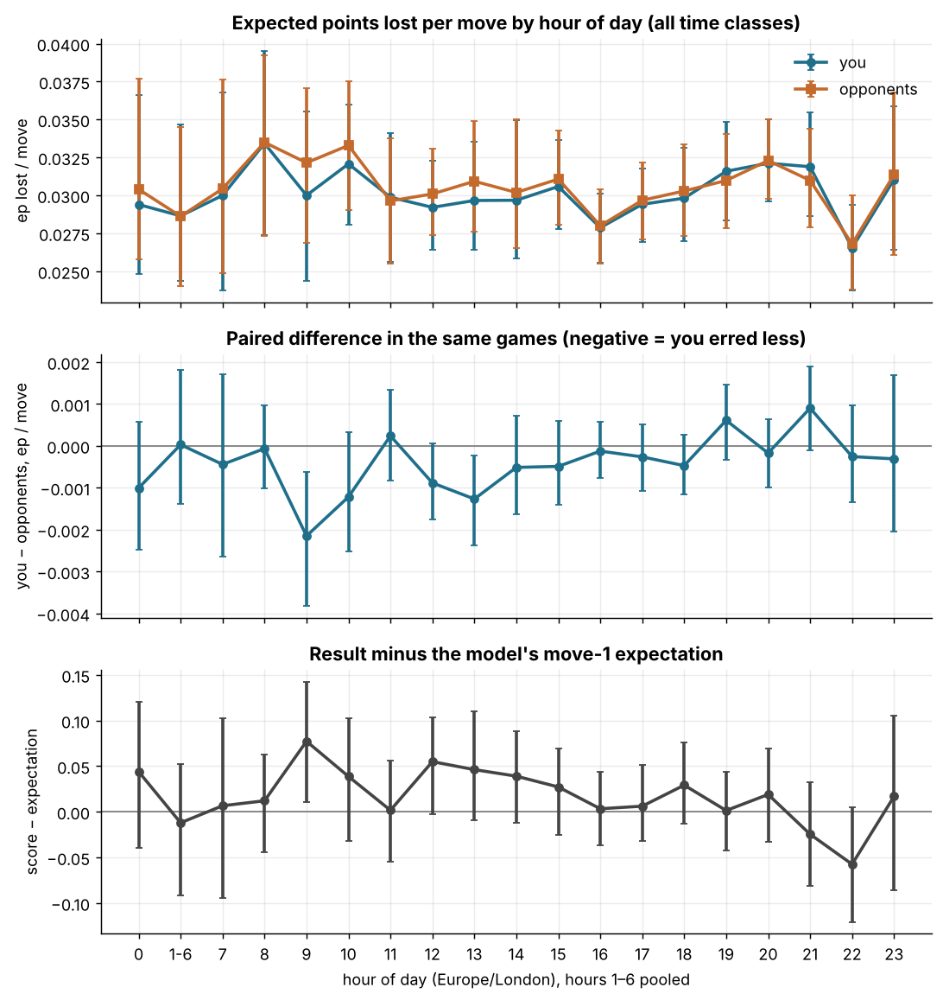
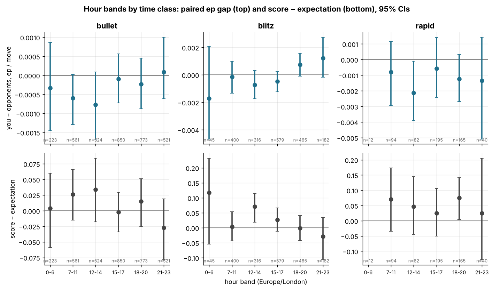
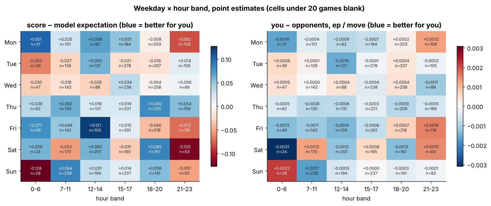
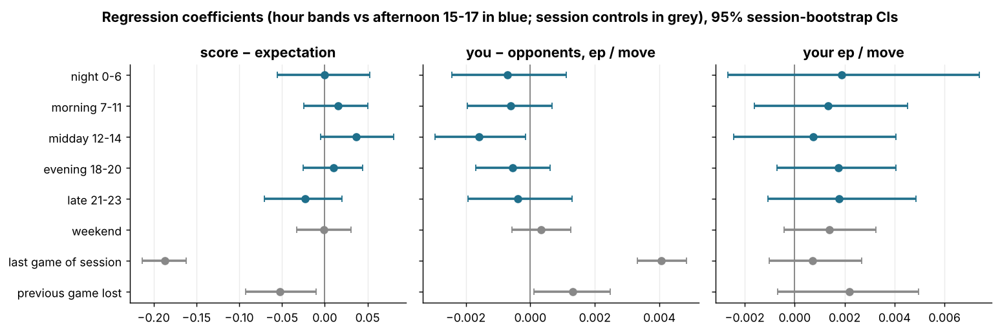

# Time of day and day of week

Data: 6,027 standard live games with at least one move (3,452 bullet, 1,987 blitz, 588 rapid) in 1,500 sessions (Q5's 30-minute gap over standard live games), 364,685 analysed moves, player zakihussa1n, 2021-08-27 to 2026-10-31. Hours and weekdays are local (Europe/London). Per-game quality comes from Q1's `games_decomposed.parquet`; session variables and the metric machinery are Q5's. Numbers are estimate [95% CI], CIs bootstrapped by session (500 resamples), since the games of a session share the hour. `ep_loss` (calibrated expected points lost per move) is the main quality measure, `cp_loss` secondary, and every number about you sits next to the opponents' number from the same games.

## 1. When you play, and what differs between the hours

Hours are the local start time in Europe/London (`local_hour`), the configured timezone; the six bands merge the thin night hours (hours 1–6 hold 165 games together). Before comparing play across the hours it matters what else differs between them: the time-class mix, your rating (an era proxy), where in a session the game falls, and whether the previous game was lost — the things Q5 showed carry score effects of their own (last game of a session −0.2, after a loss −0.05). These are the controls of section 5.

| band | games | sessions | share of games | bullet | blitz | rapid | mean rating before | median game in session | last of session | after a loss | 2022–23 | 2025–26 |
|---|---|---|---|---|---|---|---|---|---|---|---|---|
| night 0-6 | 280 | 63 | 5% | 80% | 16% | 4% | 936 | 4 | 22% | 27% | 28% | 52% |
| morning 7-11 | 1055 | 286 | 18% | 53% | 38% | 9% | 834 | 3 | 25% | 30% | 67% | 23% |
| midday 12-14 | 922 | 254 | 15% | 57% | 34% | 9% | 877 | 3 | 25% | 27% | 63% | 28% |
| afternoon 15-17 | 1624 | 414 | 27% | 52% | 36% | 12% | 835 | 3 | 24% | 32% | 65% | 26% |
| evening 18-20 | 1403 | 390 | 23% | 55% | 33% | 12% | 861 | 3 | 26% | 30% | 59% | 31% |
| late 21-23 | 743 | 202 | 12% | 70% | 24% | 5% | 903 | 3 | 27% | 35% | 48% | 36% |

109 of 1,500 sessions span more than one band (817 games); every game is assigned to the band of its own start time. The 165 games started between 01:00 and 06:59 are concentrated in a few episodes — by month: 2025-12 (90), 2023-04 (45), 2024-04 (15) — and on those days you also played at ordinary hours (busiest night date: 2023-04-13 with 19 night games), so they look like late nights rather than a trip to another timezone; a sensitivity check without the largest episode is in section 6. If you did travel, the hour labels of those games are wrong.

Games by weekday: Mon 709, Tue 876, Wed 863, Thu 927, Fri 931, Sat 790, Sun 931 (weekend share 29%).

## 2. Hour by hour, all time classes pooled

Per-game metrics by the hour the game started (hours 1–6 pooled), CIs bootstrapped by session. `your ep lost / move` and `their ep lost / move` are move-weighted ratios of sums over the games of the hour; `your − their ep / move` is the paired difference within the same games (negative = you erred less than your opponents at that hour) and is the comparison that survives a changing pool; `score − model expectation` is the result minus the calibration model's move-1 expectation (it knows both pre-game ratings and the time control); `flags / your losses` is the share of your losses that were on time.

| hour | games | sessions | score − model expectation | your ep lost / move | their ep lost / move | your − their ep / move | flags / your losses |
|---|---|---|---|---|---|---|---|
| 0 | 115 | 27 | 0.044 [-0.039, 0.121] | 0.0294 [0.0248, 0.0366] | 0.0304 [0.0258, 0.0377] | -0.0010 [-0.0025, 0.0006] | 0.468 [0.263, 0.656] |
| 1-6 | 165 | 41 | -0.012 [-0.091, 0.052] | 0.0287 [0.0244, 0.0347] | 0.0286 [0.0240, 0.0345] | 0.0000 [-0.0014, 0.0018] | 0.370 [0.213, 0.495] |
| 7 | 67 | 49 | 0.007 [-0.095, 0.102] | 0.0300 [0.0238, 0.0368] | 0.0304 [0.0249, 0.0376] | -0.0004 [-0.0026, 0.0017] | 0.257 [0.101, 0.403] |
| 8 | 252 | 94 | 0.012 [-0.044, 0.063] | 0.0334 [0.0274, 0.0395] | 0.0335 [0.0273, 0.0392] | -0.0001 [-0.0010, 0.0010] | 0.379 [0.284, 0.475] |
| 9 | 123 | 34 | 0.077 [0.010, 0.142] | 0.0300 [0.0243, 0.0355] | 0.0322 [0.0269, 0.0371] | -0.0021 [-0.0038, -0.0006] | 0.256 [0.139, 0.400] |
| 10 | 236 | 70 | 0.039 [-0.032, 0.103] | 0.0321 [0.0280, 0.0360] | 0.0333 [0.0290, 0.0375] | -0.0012 [-0.0025, 0.0003] | 0.337 [0.235, 0.443] |
| 11 | 377 | 106 | 0.002 [-0.055, 0.056] | 0.0299 [0.0256, 0.0341] | 0.0296 [0.0255, 0.0337] | 0.0002 [-0.0008, 0.0013] | 0.314 [0.243, 0.386] |
| 12 | 358 | 103 | 0.055 [-0.003, 0.103] | 0.0292 [0.0264, 0.0323] | 0.0301 [0.0274, 0.0331] | -0.0009 [-0.0017, 0.0001] | 0.336 [0.248, 0.435] |
| 13 | 276 | 94 | 0.046 [-0.010, 0.110] | 0.0297 [0.0264, 0.0335] | 0.0309 [0.0276, 0.0349] | -0.0013 [-0.0024, -0.0002] | 0.345 [0.234, 0.443] |
| 14 | 288 | 91 | 0.039 [-0.012, 0.088] | 0.0297 [0.0259, 0.0350] | 0.0302 [0.0265, 0.0350] | -0.0005 [-0.0016, 0.0007] | 0.282 [0.197, 0.368] |
| 15 | 465 | 172 | 0.027 [-0.025, 0.069] | 0.0306 [0.0278, 0.0337] | 0.0311 [0.0281, 0.0343] | -0.0005 [-0.0014, 0.0006] | 0.329 [0.261, 0.392] |
| 16 | 549 | 177 | 0.003 [-0.037, 0.044] | 0.0279 [0.0256, 0.0301] | 0.0280 [0.0255, 0.0304] | -0.0001 [-0.0008, 0.0006] | 0.332 [0.271, 0.391] |
| 17 | 610 | 168 | 0.006 [-0.032, 0.051] | 0.0294 [0.0269, 0.0318] | 0.0297 [0.0271, 0.0322] | -0.0003 [-0.0011, 0.0005] | 0.304 [0.247, 0.363] |
| 18 | 488 | 144 | 0.029 [-0.013, 0.076] | 0.0298 [0.0270, 0.0331] | 0.0303 [0.0273, 0.0333] | -0.0005 [-0.0012, 0.0003] | 0.329 [0.260, 0.398] |
| 19 | 475 | 147 | 0.001 [-0.043, 0.044] | 0.0316 [0.0284, 0.0348] | 0.0310 [0.0278, 0.0340] | 0.0006 [-0.0003, 0.0015] | 0.304 [0.235, 0.367] |
| 20 | 440 | 154 | 0.019 [-0.033, 0.070] | 0.0321 [0.0296, 0.0350] | 0.0323 [0.0298, 0.0350] | -0.0002 [-0.0010, 0.0006] | 0.387 [0.291, 0.464] |
| 21 | 375 | 113 | -0.025 [-0.081, 0.033] | 0.0319 [0.0286, 0.0355] | 0.0310 [0.0279, 0.0344] | 0.0009 [-0.0001, 0.0019] | 0.411 [0.329, 0.503] |
| 22 | 207 | 66 | -0.057 [-0.121, 0.005] | 0.0265 [0.0237, 0.0294] | 0.0268 [0.0238, 0.0300] | -0.0003 [-0.0013, 0.0010] | 0.333 [0.244, 0.429] |
| 23 | 161 | 42 | 0.017 [-0.086, 0.106] | 0.0311 [0.0264, 0.0359] | 0.0314 [0.0261, 0.0368] | -0.0003 [-0.0020, 0.0017] | 0.329 [0.174, 0.485] |

*Hour-by-hour curves with 95% CIs (sessions resampled); thin night hours pooled.*

Across the 19 hour buckets the score − expectation ranges from -0.057 (hour 22) to 0.077 (hour 9), a spread of 0.135; its CI excludes zero at 1 bucket(s): 9. The paired you − opponents ep gap excludes zero at 2 bucket(s) (9: -0.0021, 13: -0.0013); with 19 buckets, about one such cell is expected by chance. Your ep per move and the opponents' move together hour by hour (correlation across buckets 0.91): the hour changes the games, not you alone.

## 3. Hour bands by time class

The same metrics in six bands, separately by time class, plus cp per move, the opponents' flag share, your resignation share of losses and seconds per move for both sides. Cells with fewer than 20 games are blank. The 'band − other bands' rows give the contrast of each band against all other games of the time class with a CI on the difference (sessions resampled jointly).

### all

| band | games | sessions | score − model expectation | your ep lost / move | their ep lost / move | your − their ep / move | your cp lost / move | their cp lost / move | flags / your losses | their flags / their losses | resignations / your losses | your seconds / move | their seconds / move |
|---|---|---|---|---|---|---|---|---|---|---|---|---|---|
| night 0-6 | 280 | 63 | 0.011 [-0.046, 0.064] | 0.0290 [0.0255, 0.0329] | 0.0294 [0.0258, 0.0335] | -0.0004 [-0.0016, 0.0007] | 65.4 [60.4, 70.9] | 65.1 [60.9, 68.9] | 0.406 [0.269, 0.521] | 0.453 [0.319, 0.562] | 0.203 [0.124, 0.311] | 2.55 [2.19, 3.05] | 2.50 [2.12, 2.99] |
| morning 7-11 | 1055 | 286 | 0.022 [-0.008, 0.056] | 0.0313 [0.0289, 0.0337] | 0.0318 [0.0295, 0.0340] | -0.0005 [-0.0010, 0.0002] | 71.3 [69.0, 73.8] | 70.6 [68.3, 72.9] | 0.325 [0.282, 0.370] | 0.442 [0.383, 0.507] | 0.317 [0.267, 0.377] | 3.78 [3.45, 4.14] | 3.64 [3.33, 3.96] |
| midday 12-14 | 922 | 254 | 0.047 [0.013, 0.083] | 0.0295 [0.0274, 0.0319] | 0.0304 [0.0282, 0.0326] | -0.0009 [-0.0015, -0.0001] | 71.0 [68.3, 73.5] | 71.3 [68.5, 74.2] | 0.321 [0.267, 0.385] | 0.421 [0.356, 0.481] | 0.288 [0.235, 0.342] | 3.41 [3.09, 3.81] | 3.30 [3.00, 3.64] |
| afternoon 15-17 | 1624 | 414 | 0.011 [-0.015, 0.034] | 0.0292 [0.0276, 0.0309] | 0.0295 [0.0279, 0.0311] | -0.0003 [-0.0007, 0.0003] | 69.8 [67.8, 72.1] | 70.7 [68.4, 72.9] | 0.320 [0.283, 0.357] | 0.369 [0.317, 0.415] | 0.304 [0.264, 0.349] | 3.85 [3.54, 4.16] | 3.58 [3.30, 3.85] |
| evening 18-20 | 1403 | 390 | 0.017 [-0.015, 0.042] | 0.0311 [0.0292, 0.0328] | 0.0311 [0.0293, 0.0327] | -0.0000 [-0.0005, 0.0005] | 70.8 [68.5, 73.0] | 70.6 [68.1, 72.6] | 0.338 [0.297, 0.384] | 0.369 [0.325, 0.418] | 0.307 [0.267, 0.346] | 3.68 [3.35, 3.99] | 3.62 [3.32, 3.92] |
| late 21-23 | 743 | 202 | -0.025 [-0.064, 0.011] | 0.0301 [0.0280, 0.0324] | 0.0298 [0.0277, 0.0321] | 0.0003 [-0.0004, 0.0009] | 73.6 [70.6, 76.9] | 70.7 [67.7, 74.2] | 0.371 [0.312, 0.433] | 0.509 [0.427, 0.579] | 0.199 [0.155, 0.250] | 2.87 [2.56, 3.20] | 2.72 [2.43, 3.02] |

| band − other bands | games | score − model expectation | your − their ep / move | your ep lost / move | their ep lost / move | flags / your losses | your seconds / move |
|---|---|---|---|---|---|---|---|
| night 0-6 | 280 | -0.005 [-0.066, 0.051] | -0.0001 [-0.0012, 0.0011] | -0.0012 [-0.0050, 0.0026] | -0.0011 [-0.0050, 0.0031] | 0.073 [-0.050, 0.188] | -1.04 [-1.44, -0.54] |
| morning 7-11 | 1055 | 0.008 [-0.027, 0.047] | -0.0002 [-0.0009, 0.0004] | 0.0014 [-0.0010, 0.0041] | 0.0016 [-0.0007, 0.0042] | -0.013 [-0.065, 0.045] | 0.28 [-0.09, 0.69] |
| midday 12-14 | 922 | 0.038 [0.001, 0.077] | -0.0007 [-0.0014, 0.0000] | -0.0008 [-0.0033, 0.0014] | -0.0001 [-0.0025, 0.0021] | -0.018 [-0.079, 0.044] | -0.16 [-0.55, 0.30] |
| afternoon 15-17 | 1624 | -0.006 [-0.037, 0.023] | -0.0000 [-0.0005, 0.0006] | -0.0013 [-0.0032, 0.0007] | -0.0013 [-0.0031, 0.0007] | -0.022 [-0.064, 0.022] | 0.41 [0.07, 0.76] |
| evening 18-20 | 1403 | 0.002 [-0.031, 0.034] | 0.0003 [-0.0002, 0.0009] | 0.0012 [-0.0010, 0.0034] | 0.0009 [-0.0013, 0.0031] | 0.002 [-0.044, 0.051] | 0.17 [-0.18, 0.48] |
| late 21-23 | 743 | -0.046 [-0.086, 0.001] | 0.0007 [-0.0001, 0.0014] | -0.0001 [-0.0022, 0.0021] | -0.0007 [-0.0028, 0.0014] | 0.040 [-0.014, 0.104] | -0.78 [-1.10, -0.36] |

### bullet

| band | games | sessions | score − model expectation | your ep lost / move | their ep lost / move | your − their ep / move | your cp lost / move | their cp lost / move | flags / your losses | their flags / their losses | resignations / your losses | your seconds / move | their seconds / move |
|---|---|---|---|---|---|---|---|---|---|---|---|---|---|
| night 0-6 | 223 | 45 | 0.004 [-0.059, 0.060] | 0.0285 [0.0246, 0.0325] | 0.0288 [0.0249, 0.0330] | -0.0003 [-0.0015, 0.0009] | 68.8 [63.8, 75.3] | 67.6 [63.5, 71.8] | 0.457 [0.329, 0.581] | 0.542 [0.430, 0.656] | 0.152 [0.075, 0.251] | 1.85 [1.69, 2.05] | 1.77 [1.63, 1.96] |
| morning 7-11 | 561 | 125 | 0.026 [-0.015, 0.066] | 0.0297 [0.0269, 0.0328] | 0.0303 [0.0276, 0.0331] | -0.0006 [-0.0013, 0.0000] | 73.5 [70.5, 76.9] | 71.5 [68.3, 74.7] | 0.498 [0.437, 0.567] | 0.663 [0.586, 0.726] | 0.143 [0.091, 0.199] | 1.69 [1.56, 1.83] | 1.72 [1.63, 1.83] |
| midday 12-14 | 524 | 116 | 0.034 [-0.018, 0.084] | 0.0280 [0.0255, 0.0308] | 0.0288 [0.0263, 0.0315] | -0.0008 [-0.0017, 0.0001] | 75.1 [71.6, 78.9] | 73.1 [69.3, 77.3] | 0.446 [0.368, 0.522] | 0.659 [0.593, 0.727] | 0.165 [0.109, 0.228] | 1.61 [1.50, 1.70] | 1.70 [1.58, 1.83] |
| afternoon 15-17 | 850 | 176 | -0.002 [-0.034, 0.030] | 0.0291 [0.0269, 0.0314] | 0.0292 [0.0270, 0.0316] | -0.0001 [-0.0007, 0.0006] | 71.8 [68.8, 74.5] | 71.8 [68.0, 75.2] | 0.475 [0.430, 0.529] | 0.595 [0.532, 0.652] | 0.142 [0.095, 0.191] | 1.75 [1.63, 1.87] | 1.65 [1.57, 1.74] |
| evening 18-20 | 773 | 179 | 0.015 [-0.026, 0.051] | 0.0298 [0.0271, 0.0322] | 0.0301 [0.0276, 0.0325] | -0.0002 [-0.0009, 0.0004] | 73.0 [69.9, 76.4] | 71.1 [68.1, 73.8] | 0.504 [0.446, 0.558] | 0.577 [0.527, 0.631] | 0.143 [0.107, 0.178] | 1.74 [1.63, 1.84] | 1.73 [1.63, 1.83] |
| late 21-23 | 521 | 121 | -0.027 [-0.079, 0.019] | 0.0286 [0.0260, 0.0313] | 0.0285 [0.0260, 0.0310] | 0.0001 [-0.0006, 0.0010] | 75.2 [72.0, 79.0] | 72.1 [68.8, 76.0] | 0.470 [0.400, 0.539] | 0.661 [0.585, 0.735] | 0.105 [0.071, 0.146] | 1.66 [1.57, 1.75] | 1.64 [1.55, 1.73] |

| band − other bands | games | score − model expectation | your − their ep / move | your ep lost / move | their ep lost / move | flags / your losses | your seconds / move |
|---|---|---|---|---|---|---|---|
| night 0-6 | 223 | -0.004 [-0.067, 0.051] | -0.0000 [-0.0012, 0.0012] | -0.0006 [-0.0047, 0.0039] | -0.0006 [-0.0045, 0.0040] | -0.023 [-0.156, 0.100] | 0.15 [-0.02, 0.35] |
| morning 7-11 | 561 | 0.021 [-0.023, 0.067] | -0.0004 [-0.0011, 0.0004] | 0.0007 [-0.0022, 0.0037] | 0.0011 [-0.0017, 0.0041] | 0.022 [-0.043, 0.089] | -0.02 [-0.16, 0.13] |
| midday 12-14 | 524 | 0.030 [-0.030, 0.080] | -0.0006 [-0.0014, 0.0004] | -0.0012 [-0.0041, 0.0020] | -0.0007 [-0.0037, 0.0025] | -0.039 [-0.129, 0.048] | -0.12 [-0.23, 0.01] |
| afternoon 15-17 | 850 | -0.014 [-0.055, 0.026] | 0.0003 [-0.0005, 0.0010] | 0.0000 [-0.0026, 0.0025] | -0.0003 [-0.0028, 0.0023] | -0.005 [-0.070, 0.054] | 0.05 [-0.08, 0.19] |
| evening 18-20 | 773 | 0.008 [-0.036, 0.055] | 0.0001 [-0.0007, 0.0008] | 0.0010 [-0.0016, 0.0036] | 0.0009 [-0.0018, 0.0034] | 0.033 [-0.031, 0.095] | 0.04 [-0.07, 0.16] |
| late 21-23 | 521 | -0.042 [-0.098, 0.010] | 0.0005 [-0.0004, 0.0014] | -0.0005 [-0.0032, 0.0023] | -0.0010 [-0.0037, 0.0018] | -0.011 [-0.083, 0.068] | -0.06 [-0.16, 0.05] |

### blitz

| band | games | sessions | score − model expectation | your ep lost / move | their ep lost / move | your − their ep / move | your cp lost / move | their cp lost / move | flags / your losses | their flags / their losses | resignations / your losses | your seconds / move | their seconds / move |
|---|---|---|---|---|---|---|---|---|---|---|---|---|---|
| night 0-6 | 45 | 11 | 0.118 [-0.055, 0.232] | 0.0290 [0.0226, 0.0385] | 0.0307 [0.0223, 0.0421] | -0.0017 [-0.0047, 0.0021] | 49.5 [45.0, 54.3] | 55.1 [48.7, 63.2] | 0.286 [0.095, 0.429] | 0.148 [0.059, 0.213] | 0.286 [0.080, 0.564] | 4.73 [4.22, 5.44] | 4.65 [4.15, 5.45] |
| morning 7-11 | 400 | 154 | 0.004 [-0.044, 0.053] | 0.0335 [0.0299, 0.0378] | 0.0337 [0.0301, 0.0374] | -0.0002 [-0.0013, 0.0010] | 68.7 [64.8, 72.6] | 69.3 [65.4, 72.8] | 0.153 [0.098, 0.204] | 0.203 [0.151, 0.260] | 0.475 [0.380, 0.555] | 5.91 [5.64, 6.18] | 5.52 [5.20, 5.83] |
| midday 12-14 | 316 | 113 | 0.070 [0.019, 0.114] | 0.0323 [0.0286, 0.0363] | 0.0330 [0.0290, 0.0376] | -0.0007 [-0.0017, 0.0003] | 66.7 [62.5, 70.7] | 69.4 [65.3, 73.8] | 0.176 [0.108, 0.244] | 0.149 [0.095, 0.206] | 0.416 [0.336, 0.511] | 5.50 [5.17, 5.84] | 4.95 [4.64, 5.27] |
| afternoon 15-17 | 579 | 204 | 0.026 [-0.012, 0.066] | 0.0287 [0.0261, 0.0312] | 0.0292 [0.0265, 0.0318] | -0.0005 [-0.0012, 0.0002] | 67.5 [64.1, 70.7] | 69.3 [66.1, 72.5] | 0.183 [0.137, 0.233] | 0.160 [0.124, 0.200] | 0.454 [0.381, 0.519] | 5.84 [5.49, 6.18] | 5.27 [5.05, 5.52] |
| evening 18-20 | 465 | 171 | -0.001 [-0.043, 0.041] | 0.0341 [0.0310, 0.0372] | 0.0333 [0.0304, 0.0364] | 0.0007 [-0.0001, 0.0016] | 68.9 [66.0, 71.5] | 69.3 [65.8, 72.4] | 0.153 [0.108, 0.196] | 0.138 [0.096, 0.179] | 0.455 [0.386, 0.523] | 5.48 [5.24, 5.73] | 5.28 [5.01, 5.53] |
| late 21-23 | 182 | 74 | -0.029 [-0.107, 0.035] | 0.0348 [0.0306, 0.0392] | 0.0336 [0.0295, 0.0380] | 0.0012 [-0.0002, 0.0027] | 72.7 [66.6, 80.5] | 69.0 [63.3, 75.3] | 0.161 [0.082, 0.244] | 0.182 [0.104, 0.263] | 0.398 [0.318, 0.480] | 5.35 [4.89, 5.83] | 4.80 [4.38, 5.22] |

| band − other bands | games | score − model expectation | your − their ep / move | your ep lost / move | their ep lost / move | flags / your losses | your seconds / move |
|---|---|---|---|---|---|---|---|
| night 0-6 | 45 | 0.100 [-0.081, 0.219] | -0.0017 [-0.0050, 0.0024] | -0.0032 [-0.0101, 0.0074] | -0.0014 [-0.0112, 0.0113] | 0.120 [-0.165, 0.278] | -0.93 [-1.53, -0.19] |
| morning 7-11 | 400 | -0.019 [-0.070, 0.037] | -0.0001 [-0.0014, 0.0010] | 0.0018 [-0.0026, 0.0061] | 0.0020 [-0.0022, 0.0062] | -0.019 [-0.076, 0.051] | 0.33 [0.01, 0.66] |
| midday 12-14 | 316 | 0.061 [0.006, 0.112] | -0.0008 [-0.0019, 0.0003] | 0.0003 [-0.0037, 0.0045] | 0.0011 [-0.0029, 0.0053] | 0.009 [-0.061, 0.078] | -0.17 [-0.54, 0.19] |
| afternoon 15-17 | 579 | 0.010 [-0.035, 0.052] | -0.0006 [-0.0015, 0.0003] | -0.0047 [-0.0078, -0.0017] | -0.0041 [-0.0072, -0.0011] | 0.022 [-0.038, 0.082] | 0.27 [-0.10, 0.65] |
| evening 18-20 | 465 | -0.027 [-0.083, 0.019] | 0.0010 [0.0001, 0.0021] | 0.0026 [-0.0006, 0.0065] | 0.0016 [-0.0016, 0.0054] | -0.020 [-0.078, 0.036] | -0.21 [-0.53, 0.08] |
| late 21-23 | 182 | -0.053 [-0.139, 0.019] | 0.0014 [-0.0001, 0.0030] | 0.0031 [-0.0013, 0.0079] | 0.0017 [-0.0025, 0.0059] | -0.007 [-0.090, 0.068] | -0.33 [-0.81, 0.23] |

### rapid

| band | games | sessions | score − model expectation | your ep lost / move | their ep lost / move | your − their ep / move | your cp lost / move | their cp lost / move | flags / your losses | their flags / their losses | resignations / your losses | your seconds / move | their seconds / move |
|---|---|---|---|---|---|---|---|---|---|---|---|---|---|
| night 0-6 | 12 | 7 |  |  |  |  |  |  |  |  |  |  |  |
| morning 7-11 | 94 | 43 | 0.070 [-0.035, 0.173] | 0.0328 [0.0240, 0.0440] | 0.0337 [0.0251, 0.0452] | -0.0008 [-0.0030, 0.0012] | 66.9 [57.9, 75.6] | 70.1 [61.0, 79.1] | 0.051 [0.000, 0.127] | 0.059 [0.000, 0.137] | 0.667 [0.528, 0.800] | 7.19 [6.38, 8.02] | 7.13 [6.34, 8.07] |
| midday 12-14 | 82 | 34 | 0.047 [-0.045, 0.144] | 0.0290 [0.0221, 0.0381] | 0.0311 [0.0238, 0.0395] | -0.0021 [-0.0039, -0.0001] | 59.8 [54.5, 65.0] | 66.3 [59.1, 73.0] | 0.000 [0.000, 0.000] | 0.023 [0.000, 0.074] | 0.667 [0.500, 0.814] | 6.92 [6.40, 7.51] | 7.16 [6.43, 7.88] |
| afternoon 15-17 | 195 | 76 | 0.025 [-0.050, 0.106] | 0.0316 [0.0273, 0.0354] | 0.0321 [0.0274, 0.0361] | -0.0006 [-0.0024, 0.0014] | 66.9 [62.1, 72.0] | 69.7 [65.3, 74.8] | 0.012 [0.000, 0.041] | 0.031 [0.000, 0.063] | 0.612 [0.513, 0.718] | 7.12 [6.58, 7.64] | 6.95 [6.48, 7.36] |
| evening 18-20 | 165 | 62 | 0.075 [0.004, 0.142] | 0.0291 [0.0248, 0.0340] | 0.0303 [0.0263, 0.0355] | -0.0012 [-0.0027, 0.0003] | 65.1 [59.3, 72.0] | 71.5 [65.4, 78.8] | 0.032 [0.000, 0.081] | 0.044 [0.009, 0.090] | 0.730 [0.622, 0.826] | 7.72 [7.00, 8.41] | 7.72 [6.96, 8.51] |
| late 21-23 | 40 | 16 | 0.025 [-0.128, 0.206] | 0.0265 [0.0200, 0.0392] | 0.0279 [0.0197, 0.0426] | -0.0013 [-0.0051, 0.0014] | 56.3 [49.6, 64.6] | 59.3 [51.4, 70.7] | 0.000 [0.000, 0.000] | 0.000 [0.000, 0.000] | 0.556 [0.333, 0.917] | 7.32 [6.44, 8.61] | 7.34 [6.53, 8.44] |

| band − other bands | games | score − model expectation | your − their ep / move | your ep lost / move | their ep lost / move | flags / your losses | your seconds / move |
|---|---|---|---|---|---|---|---|
| night 0-6 | 12 |  |  |  |  |  |  |
| morning 7-11 | 94 | 0.031 [-0.101, 0.137] | 0.0002 [-0.0024, 0.0027] | 0.0028 [-0.0062, 0.0130] | 0.0026 [-0.0058, 0.0125] | 0.037 [-0.022, 0.112] | -0.12 [-0.99, 0.82] |
| midday 12-14 | 82 | 0.004 [-0.107, 0.123] | -0.0013 [-0.0034, 0.0012] | -0.0017 [-0.0093, 0.0088] | -0.0004 [-0.0072, 0.0092] | -0.023 [-0.047, -0.005] | -0.43 [-1.06, 0.26] |
| afternoon 15-17 | 195 | -0.027 [-0.123, 0.064] | 0.0006 [-0.0014, 0.0028] | 0.0016 [-0.0039, 0.0073] | 0.0010 [-0.0044, 0.0065] | -0.013 [-0.043, 0.020] | -0.26 [-0.89, 0.48] |
| evening 18-20 | 165 | 0.044 [-0.041, 0.133] | -0.0003 [-0.0023, 0.0017] | -0.0019 [-0.0073, 0.0042] | -0.0015 [-0.0073, 0.0044] | 0.015 [-0.025, 0.065] | 0.59 [-0.19, 1.31] |
| late 21-23 | 40 | -0.020 [-0.194, 0.165] | -0.0004 [-0.0042, 0.0027] | -0.0043 [-0.0131, 0.0092] | -0.0039 [-0.0135, 0.0115] | -0.022 [-0.043, -0.004] | 0.04 [-1.05, 1.50] |

*Six hour bands by time class; cell sizes under each point.*

Of the 46 band-vs-rest contrasts on score − expectation and the paired ep gap, 3 exclude zero (about 2 expected by chance): all midday 12-14, score − model expectation 0.038 [0.001, 0.077]; blitz midday 12-14, score − model expectation 0.061 [0.006, 0.112]; blitz evening 18-20, your − their ep / move 0.0010 [0.0001, 0.0021].

## 4. Day of the week, and weekday × hour band

By weekday (all time classes, then the headline metrics per time class), CIs by session.

| weekday | games | sessions | score − model expectation | your ep lost / move | their ep lost / move | your − their ep / move | flags / your losses |
|---|---|---|---|---|---|---|---|
| Monday | 709 | 200 | 0.014 [-0.028, 0.050] | 0.0286 [0.0262, 0.0311] | 0.0287 [0.0264, 0.0311] | -0.0002 [-0.0008, 0.0005] | 0.341 [0.283, 0.397] |
| Tuesday | 876 | 210 | -0.008 [-0.047, 0.021] | 0.0283 [0.0265, 0.0301] | 0.0285 [0.0265, 0.0305] | -0.0001 [-0.0007, 0.0005] | 0.350 [0.296, 0.401] |
| Wednesday | 863 | 225 | 0.001 [-0.035, 0.036] | 0.0326 [0.0301, 0.0356] | 0.0326 [0.0299, 0.0353] | -0.0000 [-0.0006, 0.0006] | 0.350 [0.293, 0.401] |
| Thursday | 927 | 231 | 0.047 [0.014, 0.076] | 0.0294 [0.0270, 0.0323] | 0.0300 [0.0278, 0.0328] | -0.0006 [-0.0012, -0.0000] | 0.324 [0.264, 0.383] |
| Friday | 931 | 213 | 0.011 [-0.026, 0.049] | 0.0303 [0.0279, 0.0328] | 0.0306 [0.0281, 0.0333] | -0.0003 [-0.0010, 0.0004] | 0.346 [0.294, 0.393] |
| Saturday | 790 | 214 | 0.008 [-0.031, 0.046] | 0.0310 [0.0289, 0.0334] | 0.0312 [0.0290, 0.0337] | -0.0002 [-0.0009, 0.0005] | 0.292 [0.241, 0.341] |
| Sunday | 931 | 211 | 0.031 [-0.009, 0.070] | 0.0307 [0.0289, 0.0327] | 0.0312 [0.0295, 0.0330] | -0.0005 [-0.0011, 0.0002] | 0.349 [0.288, 0.407] |

### bullet

| weekday | games | sessions | score − model expectation | your − their ep / move | flags / your losses |
|---|---|---|---|---|---|
| Monday | 395 | 90 | 0.006 [-0.050, 0.057] | 0.0000 [-0.0007, 0.0008] | 0.462 [0.392, 0.533] |
| Tuesday | 514 | 104 | -0.012 [-0.049, 0.023] | -0.0004 [-0.0011, 0.0002] | 0.500 [0.444, 0.565] |
| Wednesday | 475 | 105 | -0.015 [-0.062, 0.033] | 0.0002 [-0.0006, 0.0012] | 0.515 [0.438, 0.587] |
| Thursday | 513 | 105 | 0.040 [-0.007, 0.089] | -0.0007 [-0.0014, -0.0000] | 0.489 [0.402, 0.575] |
| Friday | 581 | 114 | 0.028 [-0.023, 0.076] | -0.0006 [-0.0014, 0.0002] | 0.473 [0.405, 0.541] |
| Saturday | 418 | 88 | 0.019 [-0.035, 0.071] | -0.0006 [-0.0015, 0.0003] | 0.466 [0.400, 0.541] |
| Sunday | 556 | 113 | -0.011 [-0.060, 0.037] | 0.0001 [-0.0007, 0.0010] | 0.446 [0.381, 0.526] |

### blitz

| weekday | games | sessions | score − model expectation | your − their ep / move | flags / your losses |
|---|---|---|---|---|---|
| Monday | 242 | 98 | 0.000 [-0.066, 0.058] | -0.0000 [-0.0011, 0.0012] | 0.205 [0.134, 0.293] |
| Tuesday | 300 | 102 | -0.001 [-0.064, 0.055] | 0.0003 [-0.0008, 0.0015] | 0.166 [0.113, 0.223] |
| Wednesday | 312 | 109 | 0.019 [-0.040, 0.070] | -0.0002 [-0.0012, 0.0009] | 0.137 [0.085, 0.205] |
| Thursday | 311 | 110 | 0.047 [0.003, 0.090] | -0.0002 [-0.0013, 0.0008] | 0.149 [0.089, 0.207] |
| Friday | 267 | 83 | -0.016 [-0.075, 0.035] | 0.0003 [-0.0008, 0.0013] | 0.194 [0.133, 0.271] |
| Saturday | 274 | 98 | 0.015 [-0.039, 0.069] | 0.0004 [-0.0009, 0.0016] | 0.136 [0.064, 0.212] |
| Sunday | 281 | 86 | 0.066 [0.010, 0.123] | -0.0008 [-0.0018, 0.0003] | 0.200 [0.124, 0.279] |

### rapid

| weekday | games | sessions | score − model expectation | your − their ep / move | flags / your losses |
|---|---|---|---|---|---|
| Monday | 72 | 28 | 0.106 [-0.001, 0.217] | -0.0015 [-0.0040, 0.0006] | 0.040 [0.000, 0.136] |
| Tuesday | 62 | 21 | -0.010 [-0.189, 0.122] | 0.0004 [-0.0018, 0.0045] | 0.000 [0.000, 0.000] |
| Wednesday | 76 | 32 | 0.031 [-0.066, 0.117] | -0.0013 [-0.0034, 0.0006] | 0.062 [0.000, 0.170] |
| Thursday | 103 | 39 | 0.077 [-0.025, 0.165] | -0.0014 [-0.0031, 0.0005] | 0.000 [0.000, 0.000] |
| Friday | 83 | 34 | -0.018 [-0.130, 0.076] | 0.0009 [-0.0014, 0.0037] | 0.024 [0.000, 0.079] |
| Saturday | 98 | 39 | -0.065 [-0.155, 0.014] | 0.0005 [-0.0013, 0.0024] | 0.019 [0.000, 0.051] |
| Sunday | 94 | 26 | 0.172 [0.065, 0.259] | -0.0039 [-0.0065, -0.0014] | 0.000 [0.000, 0.000] |

| weekend − weekday (all classes) | estimate |
|---|---|
| score − model expectation | 0.007 [-0.025, 0.037] |
| your − their ep / move | -0.0001 [-0.0007, 0.0005] |
| your ep lost / move | 0.0010 [-0.0008, 0.0029] |
| their ep lost / move | 0.0011 [-0.0006, 0.0029] |
| flags / your losses | -0.020 [-0.067, 0.022] |
| your seconds / move | 0.03 [-0.27, 0.38] |

### Weekday × hour band

Cells are weekday (Mon–Fri) or weekend (Sat–Sun) by hour band; the full 7 × 6 grid is in the figure with cell counts. Cells under 20 games are blank.

| day type | band | games | sessions | score − model expectation | your ep lost / move | their ep lost / move | your − their ep / move | flags / your losses |
|---|---|---|---|---|---|---|---|---|
| weekday | night 0-6 | 228 | 47 | 0.023 [-0.038, 0.073] | 0.0285 [0.0246, 0.0331] | 0.0290 [0.0252, 0.0335] | -0.0005 [-0.0016, 0.0008] | 0.396 [0.254, 0.510] |
| weekday | morning 7-11 | 647 | 199 | 0.018 [-0.015, 0.051] | 0.0317 [0.0283, 0.0352] | 0.0322 [0.0287, 0.0355] | -0.0004 [-0.0011, 0.0002] | 0.346 [0.290, 0.404] |
| weekday | midday 12-14 | 527 | 148 | 0.048 [-0.009, 0.094] | 0.0290 [0.0263, 0.0320] | 0.0299 [0.0271, 0.0330] | -0.0009 [-0.0017, 0.0000] | 0.329 [0.256, 0.403] |
| weekday | afternoon 15-17 | 1222 | 299 | 0.016 [-0.013, 0.044] | 0.0286 [0.0268, 0.0306] | 0.0290 [0.0272, 0.0311] | -0.0004 [-0.0010, 0.0001] | 0.335 [0.297, 0.374] |
| weekday | evening 18-20 | 1095 | 304 | 0.001 [-0.030, 0.030] | 0.0311 [0.0290, 0.0330] | 0.0309 [0.0289, 0.0328] | 0.0002 [-0.0003, 0.0008] | 0.330 [0.281, 0.376] |
| weekday | late 21-23 | 587 | 150 | -0.010 [-0.050, 0.030] | 0.0296 [0.0272, 0.0319] | 0.0294 [0.0272, 0.0316] | 0.0002 [-0.0005, 0.0010] | 0.367 [0.302, 0.440] |
| weekend | night 0-6 | 52 | 16 | -0.042 [-0.160, 0.085] | 0.0311 [0.0243, 0.0377] | 0.0312 [0.0220, 0.0399] | -0.0001 [-0.0033, 0.0029] | 0.444 [0.162, 0.701] |
| weekend | morning 7-11 | 408 | 87 | 0.027 [-0.039, 0.088] | 0.0306 [0.0273, 0.0339] | 0.0311 [0.0281, 0.0341] | -0.0005 [-0.0017, 0.0009] | 0.293 [0.216, 0.372] |
| weekend | midday 12-14 | 395 | 106 | 0.046 [0.006, 0.091] | 0.0301 [0.0267, 0.0336] | 0.0310 [0.0276, 0.0345] | -0.0009 [-0.0018, -0.0000] | 0.311 [0.230, 0.398] |
| weekend | afternoon 15-17 | 402 | 115 | -0.005 [-0.058, 0.048] | 0.0311 [0.0281, 0.0343] | 0.0309 [0.0279, 0.0339] | 0.0002 [-0.0009, 0.0013] | 0.277 [0.202, 0.351] |
| weekend | evening 18-20 | 308 | 86 | 0.072 [0.012, 0.134] | 0.0313 [0.0270, 0.0352] | 0.0322 [0.0283, 0.0360] | -0.0009 [-0.0020, 0.0003] | 0.373 [0.257, 0.477] |
| weekend | late 21-23 | 156 | 52 | -0.079 [-0.164, 0.004] | 0.0318 [0.0279, 0.0356] | 0.0312 [0.0272, 0.0351] | 0.0006 [-0.0008, 0.0019] | 0.386 [0.283, 0.478] |

| metric | weekend evening 18–23 (464 games) | weekday night 21–06 (815 games) | difference |
|---|---|---|---|
| score − model expectation | 0.021 [-0.034, 0.074] | -0.001 [-0.037, 0.033] | 0.022 [-0.044, 0.084] |
| your − their ep / move | -0.0003 [-0.0013, 0.0006] | 0.0000 [-0.0006, 0.0007] | -0.0004 [-0.0015, 0.0007] |
| your ep lost / move | 0.0315 [0.0290, 0.0344] | 0.0293 [0.0272, 0.0316] | 0.0022 [-0.0016, 0.0058] |
| their ep lost / move | 0.0318 [0.0290, 0.0345] | 0.0293 [0.0270, 0.0316] | 0.0025 [-0.0010, 0.0058] |
| flags / your losses | 0.379 [0.293, 0.460] | 0.374 [0.309, 0.436] | 0.004 [-0.096, 0.109] |
| your seconds / move | 3.05 [2.62, 3.51] | 2.73 [2.43, 3.05] | 0.33 [-0.15, 0.82] |

*Weekday × hour band grid; cell counts shown; blue is better for you in both panels.*

Weekdays: score − expectation runs from -0.008 (Tuesday) to 0.047 (Thursday); CI excludes zero on Thursday. The paired ep gap excludes zero on Thursday. Weekend − weekday: score − expectation 0.007 [-0.025, 0.037], ep gap -0.0001 [-0.0007, 0.0005]. Weekend evenings vs weekday nights: score − expectation 0.022 [-0.044, 0.084], ep gap -0.0004 [-0.0015, 0.0007].

## 5. Regression with session, time-class and era controls

Per-game OLS, CIs bootstrapped by session (500 resamples): outcome ~ hour band (reference afternoon 15-17) + weekend + last game of the session + previous game lost + previous game won + log2(game number) + minutes into the session / 30 + time class + pre-game rating / 100 + year dummies (reference 2024, not shown). This is the pooled, between-session model Q5 recommends for anything involving the previous result (a within-session model cannot identify the hour: sessions rarely cross a band). The outcomes: score − model expectation, your and their ep per move, their paired difference, whether you lost on time (all games), your seconds per move and your cp per move. The joint test below asks whether the five band coefficients are larger than they would be if the hour carried no information: the band labels are shuffled across sessions (whole sessions keep their games) 300 times and the largest absolute band coefficient and the sum of their squares are compared with the observed ones.

| term | score − model exp. | your ep / move | their ep / move | your − their ep / move | you lost on time | your s / move | your cp / move |
|---|---|---|---|---|---|---|---|
| intercept | 0.069 [-0.038, 0.173] | 0.0475 [0.0375, 0.0577] | 0.0434 [0.0339, 0.0525] | 0.0042 [0.0004, 0.0084] | 0.295 [0.206, 0.381] | 4.02 [3.54, 4.51] | 101.1 [89.1, 113.0] |
| night 0-6 | -0.001 [-0.056, 0.052] | 0.0019 [-0.0027, 0.0074] | 0.0025 [-0.0019, 0.0078] | -0.0007 [-0.0024, 0.0011] | -0.004 [-0.065, 0.068] | 0.09 [-0.13, 0.32] | -4.2 [-9.4, 0.9] |
| morning 7-11 | 0.015 [-0.024, 0.050] | 0.0013 [-0.0016, 0.0045] | 0.0019 [-0.0010, 0.0049] | -0.0006 [-0.0020, 0.0007] | -0.006 [-0.029, 0.023] | 0.01 [-0.16, 0.20] | -0.3 [-3.9, 3.4] |
| midday 12-14 | 0.037 [-0.005, 0.080] | 0.0007 [-0.0024, 0.0041] | 0.0023 [-0.0005, 0.0052] | -0.0016 [-0.0029, -0.0001] | -0.015 [-0.043, 0.017] | -0.09 [-0.27, 0.09] | -0.0 [-3.6, 3.4] |
| evening 18-20 | 0.011 [-0.025, 0.044] | 0.0017 [-0.0007, 0.0040] | 0.0023 [0.0000, 0.0044] | -0.0006 [-0.0017, 0.0006] | 0.002 [-0.026, 0.028] | -0.02 [-0.17, 0.15] | -0.2 [-3.4, 3.0] |
| late 21-23 | -0.023 [-0.071, 0.020] | 0.0018 [-0.0011, 0.0049] | 0.0022 [-0.0006, 0.0052] | -0.0004 [-0.0019, 0.0013] | 0.009 [-0.024, 0.046] | -0.09 [-0.28, 0.12] | 3.7 [-0.7, 8.1] |
| weekend | -0.001 [-0.033, 0.030] | 0.0014 [-0.0004, 0.0033] | 0.0010 [-0.0009, 0.0028] | 0.0003 [-0.0006, 0.0013] | -0.006 [-0.026, 0.018] | -0.09 [-0.21, 0.05] | -1.6 [-4.0, 1.2] |
| last game of session | -0.187 [-0.213, -0.162] | 0.0007 [-0.0010, 0.0027] | -0.0034 [-0.0050, -0.0013] | 0.0041 [0.0033, 0.0048] | 0.068 [0.046, 0.090] | 0.17 [0.06, 0.27] | 4.5 [2.2, 6.8] |
| previous game lost | -0.053 [-0.093, -0.010] | 0.0022 [-0.0007, 0.0050] | 0.0009 [-0.0017, 0.0037] | 0.0013 [0.0001, 0.0025] | 0.048 [0.015, 0.076] | 0.24 [0.08, 0.37] | 1.3 [-2.8, 5.0] |
| previous game won | -0.013 [-0.050, 0.022] | -0.0014 [-0.0039, 0.0013] | -0.0012 [-0.0037, 0.0014] | -0.0002 [-0.0014, 0.0011] | 0.043 [0.013, 0.070] | 0.17 [0.03, 0.30] | -1.4 [-5.3, 2.1] |
| log2(game number) | 0.031 [0.009, 0.051] | -0.0014 [-0.0031, 0.0001] | -0.0005 [-0.0022, 0.0011] | -0.0008 [-0.0014, -0.0002] | -0.015 [-0.030, 0.001] | -0.23 [-0.31, -0.14] | -2.2 [-4.1, -0.2] |
| minutes / 30 | -0.027 [-0.063, 0.004] | 0.0017 [-0.0007, 0.0045] | 0.0012 [-0.0012, 0.0042] | 0.0005 [-0.0005, 0.0015] | -0.002 [-0.027, 0.021] | 0.05 [-0.09, 0.20] | 1.0 [-2.1, 4.3] |
| blitz | 0.046 [0.016, 0.076] | -0.0001 [-0.0028, 0.0025] | 0.0022 [-0.0002, 0.0047] | -0.0022 [-0.0034, -0.0012] | -0.182 [-0.208, -0.153] | 3.22 [3.07, 3.38] | -17.3 [-20.8, -14.1] |
| rapid | 0.082 [0.036, 0.128] | 0.0014 [-0.0019, 0.0049] | 0.0029 [-0.0000, 0.0061] | -0.0014 [-0.0030, 0.0005] | -0.214 [-0.238, -0.190] | 5.45 [5.17, 5.76] | -14.6 [-19.1, -9.7] |
| rating before / 100 | -0.006 [-0.015, 0.004] | -0.0016 [-0.0025, -0.0008] | -0.0014 [-0.0022, -0.0006] | -0.0002 [-0.0006, 0.0001] | -0.009 [-0.017, -0.002] | -0.22 [-0.26, -0.18] | -2.1 [-3.2, -1.1] |

6,023 games in 1,499 sessions (4 games without a pre-game rating dropped).

Joint test of the five hour-band terms (session-level permutation of the band labels):

| outcome | largest |band coef.| | permutation p (max) | permutation p (sum of squares) |
|---|---|---|---|
| score − model exp. | 0.037 | 0.46 | 0.50 |
| your ep / move | 0.0019 | 0.74 | 0.48 |
| their ep / move | 0.0025 | 0.47 | 0.10 |
| your − their ep / move | 0.0016 | 0.19 | 0.23 |
| you lost on time | 0.015 | 0.90 | 0.92 |
| your s / move | 0.09 | 0.90 | 0.78 |
| your cp / move | 4.2 | 0.22 | 0.21 |

*Hour-band coefficients next to the session controls they are estimated with.*

With the controls, the hour-band coefficients on score − expectation run from -0.023 to +0.037 relative to afternoon 15-17; CIs exclude zero for: ep_rate_gap × midday 12-14. The permutation p-values for the band block are 0.46 (score), 0.19 (paired ep gap) and 0.74 (your ep per move). For scale, the session controls in the same model: last game of the session -0.187 [-0.213, -0.162], previous game lost -0.053 [-0.093, -0.010], previous game won -0.013 [-0.050, 0.022] on score − expectation.

## 6. Stability checks

A real time-of-day effect should show the same sign in both halves of the history and should not hinge on one episode of late nights. Left: score − expectation and the paired ep gap by band for 2021–2023 and 2024–2026. Right: the night band without its largest episode.

| band | games 2021–2023 | score − exp. 2021–2023 | ep gap 2021–2023 | games 2024–2026 | score − exp. 2024–2026 | ep gap 2024–2026 |
|---|---|---|---|---|---|---|
| night 0-6 | 79 | -0.042 [-0.196, 0.054] | -0.0001 [-0.0019, 0.0036] | 201 | 0.032 [-0.025, 0.088] | -0.0005 [-0.0016, 0.0006] |
| morning 7-11 | 710 | 0.022 [-0.018, 0.073] | -0.0005 [-0.0013, 0.0003] | 345 | 0.020 [-0.033, 0.065] | -0.0003 [-0.0010, 0.0005] |
| midday 12-14 | 585 | 0.082 [0.038, 0.124] | -0.0015 [-0.0023, -0.0007] | 337 | -0.012 [-0.066, 0.038] | 0.0000 [-0.0008, 0.0008] |
| afternoon 15-17 | 1062 | -0.001 [-0.032, 0.029] | -0.0002 [-0.0008, 0.0005] | 562 | 0.035 [-0.004, 0.077] | -0.0004 [-0.0010, 0.0002] |
| evening 18-20 | 827 | 0.036 [0.000, 0.077] | -0.0002 [-0.0010, 0.0005] | 576 | -0.012 [-0.055, 0.033] | 0.0002 [-0.0006, 0.0009] |
| late 21-23 | 353 | -0.011 [-0.087, 0.043] | 0.0001 [-0.0010, 0.0014] | 390 | -0.037 [-0.086, 0.011] | 0.0005 [-0.0003, 0.0013] |

| games | n | score − model expectation | your ep lost / move | their ep lost / move | your − their ep / move | flags / your losses |
|---|---|---|---|---|---|---|
| night 0-6, all | 280 | 0.011 [-0.046, 0.064] | 0.0290 [0.0255, 0.0329] | 0.0294 [0.0258, 0.0335] | -0.0004 [-0.0016, 0.0007] | 0.406 [0.269, 0.521] |
| night 0-6 without 2025-12 | 157 | -0.003 [-0.091, 0.062] | 0.0268 [0.0230, 0.0323] | 0.0273 [0.0234, 0.0327] | -0.0004 [-0.0020, 0.0015] | 0.397 [0.233, 0.529] |
| other bands | 5747 | 0.016 [0.003, 0.030] | 0.0302 [0.0293, 0.0311] | 0.0305 [0.0296, 0.0314] | -0.0003 [-0.0005, -0.0000] | 0.333 [0.314, 0.353] |

The sign of score − expectation agrees between the two halves in 2 of 6 bands with enough games in both.

## What this means for the player

The hour of the day is not where your points go. Raw late-evening games (21–23) score -0.046 [-0.086, 0.001] relative to the rest and night games -0.005 [-0.066, 0.051], midday games 0.038 [0.001, 0.077], but once the session controls, time class, rating and year are in the model no band differs from the afternoon beyond its CI (range -0.023 to +0.037; permutation p 0.46 on score, 0.19 on the paired ep gap), and your opponents' error moves with yours hour by hour (late 21–23 paired ep gap 0.0007 [-0.0001, 0.0014], flags / your losses 0.040 [-0.014, 0.104] vs the rest). The one band coefficient whose CI excludes zero (midday 12-14, paired ep gap: -0.0016 [-0.0029, -0.0001]) is not stable: -0.0015 [-0.0023, -0.0007] in 2021–2023 vs 0.0000 [-0.0008, 0.0008] in 2024–2026, so it is best read as one of the chance hits a 46-contrast table produces. The sign of the raw band effects on score agrees between the two halves of the history in only 2 of 6 bands. Weekend − weekday is 0.007 [-0.025, 0.037] in score − expectation and -0.0001 [-0.0007, 0.0005] in the paired ep gap; weekend evenings vs weekday nights 0.022 [-0.044, 0.084]. The session effects dwarf anything the clock on the wall does: last game of the session -0.187 [-0.213, -0.162], previous game lost -0.053 [-0.093, -0.010]. Pick the hour you like; what matters is stopping after a loss, not the time it happens.

## Caveats

- Hours are Europe/London from UTC start times; travel breaks the labels. The 01:00–06:59 games cluster in a few episodes (2025-12: 90 games); the night band without that episode has 157 games (section 6).
- You choose when to play. Hours are not assigned at random: the night band is 80% bullet and 52% from 2025–26, the morning band is 67% from 2022–23, and the sessions that run late are the ones that were going well (or badly) enough to continue. Time class, rating, year and the session position are controlled; the reason you were still playing at 23:00 is not.
- Score − expectation in late-session games is positively selected between sessions (Q5); the regression includes the last-game and previous-result dummies but is a pooled, between-session model. The paired you − opponents ep gap is the measure least exposed to this and to the pool changing by hour.
- Many cells: 19 hourly buckets, 6 bands × 4 classes, 7 weekdays, 42 weekday × band cells; a few CIs excluding zero are expected by chance, which is why the permutation test of the band block is the headline test. Cells under 20 games are blank; the heat-map shows point estimates only.
- Sessions can span bands (109 of 1,500 do); each game carries the band of its own start. CIs are clustered by session, which is conservative for between-band comparisons.
- The opponents' approximate pre-game rating and the model's move-1 expectation inherit Q1's caveats (pooled calibration, under-confident at the extremes); `my_ep_start` already prices in the pre-game ratings and the time control, so a weaker night-time pool is not mistaken for better play.
- Seconds per move pool time controls within a class; compare within a time class only.
