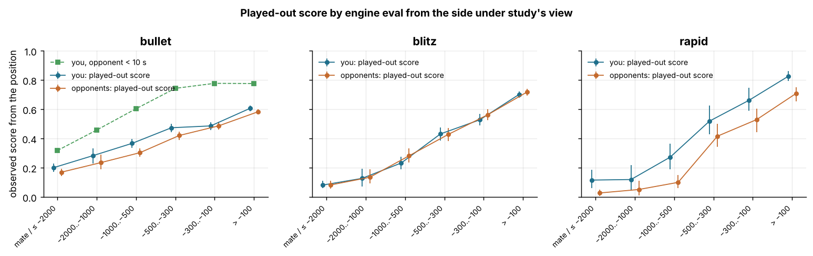

# Expected value of not resigning

Data: 6,029 standard live games (3,453 bullet, 1,987 blitz, 589 rapid) and 364,685 analysed moves, player zakihussa1n. You resigned 788 of them and your opponents resigned 810; 2 game(s) ended before the first move and are excluded from position-based numbers (that leaves 788 of your resignations and 809 of theirs). The resignation position is the position after the last move of the game; P(win), P(draw) and EV = P(win) + ½P(draw) are the calibrated model's values from the resigner's view (cross-validated expected-points Brier 0.179, see `reports/calibration.md`). Numbers are estimate [95% CI], bootstrapped over games (500 resamples; position-level rates clustered by game). Every number about you is paired with the opponents' number from the same games. Per-game Q1 columns are joined from `games_decomposed.parquet`.

## 1. How often each side resigns, and from what

Resignations as a share of each side's losses, by time class, with game-bootstrap CIs; then the resignation position from the resigner's view: the calibrated model's P(win), P(draw) and expected value EV = P(win) + ½P(draw) at the position after the last move of the game (flipped to the resigner's view when the opponent moved last), and how often the resigner still had model P(win) ≥ 0.2 ('still playable') or ≥ 0.1. 'Opponents' are the same quantities for the opponents' resignations in the same pool of games. Model probabilities are model-relative (see section 3 for the empirical check).

| time class | games | you: resigned / losses | opponents: resigned / losses | resign share, you − them |
|---|---|---|---|---|
| bullet | 3453 | 0.140 [0.124, 0.158] (n=1612) | 0.128 [0.113, 0.145] (n=1697) | 0.012 [-0.010, 0.035] |
| blitz | 1987 | 0.445 [0.411, 0.478] (n=899) | 0.447 [0.417, 0.478] (n=970) | -0.002 [-0.050, 0.042] |
| rapid | 589 | 0.656 [0.591, 0.712] (n=247) | 0.521 [0.467, 0.579] (n=305) | 0.135 [0.050, 0.213] |

Where the resignations happened (resigner's view, model probabilities):

| time class | you: median EV | opponents: median EV | you: P(win) ≥ 0.2 | opponents: P(win) ≥ 0.2 | you: P(win) ≥ 0.1 | opponents: P(win) ≥ 0.1 |
|---|---|---|---|---|---|---|
| bullet | 0.152 | 0.136 | 0.30 [0.24, 0.36] | 0.33 [0.28, 0.40] | 0.60 [0.53, 0.67] | 0.57 [0.50, 0.64] |
| blitz | 0.118 | 0.099 | 0.23 [0.20, 0.27] | 0.18 [0.14, 0.21] | 0.51 [0.45, 0.56] | 0.39 [0.35, 0.44] |
| rapid | 0.116 | 0.060 | 0.27 [0.20, 0.33] | 0.11 [0.07, 0.16] | 0.50 [0.43, 0.58] | 0.26 [0.19, 0.31] |

You moved last in 21% of your resignations (i.e. you resigned during the opponent's turn, usually straight after your own move); opponents moved last in 13% of theirs. Median engine eval at your resignations: -638 cp from your side (opponents: -767); 7.6% of yours were better than −300 cp (opponents 8.5%) and 22 of yours (2.8%) were level or better on the board (opponents 30).

## 2. Expected points given away by resigning, model view

For every resigned game, EV at the resignation position (resigner's view) is what a perfectly played-out continuation from that position would score according to the calibrated P(win) model. Mean per resigned game with a bootstrap CI over resigned games, and the total (mean × number of resignations). Your total is what you gave away; the opponents' total is what they handed to you. 'Per 100 games' spreads the cost over every game of the time class (resigned or not), and the Elo column converts that into the rating difference that would produce the same change in expected score (slope ln(10)/1600 ≈ 0.00144 points per Elo at equal ratings; indicative only). Caveat: the model is under-confident at the extremes and was fitted on all games including the resigned ones, so section 3's played-out comparison is the robust estimate.

| time class | side | resignations | mean EV / resignation | total points | per 100 games | ≈ Elo |
|---|---|---|---|---|---|---|
| bullet | you | 226 | 0.184 [0.164, 0.203] | 41.5 [37.1, 45.8] | 1.20 | 8 |
| bullet | opponents | 216 | 0.211 [0.187, 0.236] | 45.6 [40.5, 51.1] | 1.32 | 9 |
| blitz | you | 400 | 0.159 [0.146, 0.171] | 63.5 [58.5, 68.5] | 3.19 | 22 |
| blitz | opponents | 434 | 0.142 [0.129, 0.156] | 61.6 [56.0, 67.7] | 3.10 | 22 |
| rapid | you | 162 | 0.170 [0.147, 0.194] | 27.5 [23.8, 31.4] | 4.67 | 32 |
| rapid | opponents | 159 | 0.109 [0.092, 0.128] | 17.4 [14.6, 20.4] | 2.95 | 21 |

## 3. The empirical check: how played-out games from the same positions actually ended

The model's P(win) is model-relative (Q1: under-confident at the extremes, and you out-perform it in every bin). The robust counterfactual is empirical: take every position after a move in games the side under study did **not** resign or abandon (its 'played-out' games), bin it by the model EV from that side's view, and look at how those games actually ended for that side (score = win 1, draw ½, loss 0; CIs clustered by game). The table shows those rates for your positions and for the opponents' positions, with the number of your / their resignations falling in each bin. A resignation is then valued at the played-out score of its bin (same side, same time class).

**bullet**

| model EV bin | you: played-out score | you: positions (games) | you: resignations | opponents: played-out score | opponents: positions (games) | opponents: resignations |
|---|---|---|---|---|---|---|
| <0.02 | 0.001 [0.000, 0.002] | 2,874 (402) | 8 | 0.000 [0.000, 0.000] | 2,938 (478) | 8 |
| 0.02–0.05 | 0.007 [0.003, 0.011] | 5,477 (706) | 22 | 0.005 [0.001, 0.010] | 5,295 (800) | 24 |
| 0.05–0.10 | 0.033 [0.022, 0.046] | 7,414 (1015) | 49 | 0.016 [0.010, 0.025] | 7,494 (1039) | 38 |
| 0.10–0.15 | 0.086 [0.068, 0.104] | 6,501 (1197) | 32 | 0.042 [0.031, 0.054] | 6,709 (1171) | 43 |
| 0.15–0.20 | 0.134 [0.114, 0.157] | 6,521 (1298) | 36 | 0.094 [0.078, 0.109] | 6,259 (1288) | 17 |
| 0.20–0.30 | 0.210 [0.189, 0.231] | 15,234 (1783) | 38 | 0.147 [0.129, 0.164] | 13,575 (1685) | 25 |
| 0.30–0.50 | 0.407 [0.386, 0.425] | 59,839 (2827) | 33 | 0.353 [0.335, 0.371] | 55,209 (2799) | 45 |
| ≥0.50 | 0.798 [0.783, 0.812] | 102,535 (2912) | 8 | 0.752 [0.737, 0.768] | 106,750 (2900) | 16 |

**blitz**

| model EV bin | you: played-out score | you: positions (games) | you: resignations | opponents: played-out score | opponents: positions (games) | opponents: resignations |
|---|---|---|---|---|---|---|
| <0.02 | 0.000 [0.000, 0.000] | 1,733 (121) | 16 | 0.000 [0.000, 0.000] | 1,559 (93) | 21 |
| 0.02–0.05 | 0.001 [0.000, 0.003] | 2,943 (242) | 43 | 0.000 [0.000, 0.000] | 2,421 (209) | 78 |
| 0.05–0.10 | 0.013 [0.007, 0.020] | 3,507 (382) | 102 | 0.015 [0.005, 0.029] | 3,311 (342) | 121 |
| 0.10–0.15 | 0.083 [0.061, 0.105] | 2,775 (461) | 88 | 0.057 [0.034, 0.080] | 2,521 (432) | 85 |
| 0.15–0.20 | 0.161 [0.126, 0.193] | 2,489 (497) | 40 | 0.131 [0.098, 0.166] | 2,315 (451) | 38 |
| 0.20–0.30 | 0.251 [0.216, 0.291] | 5,670 (679) | 58 | 0.229 [0.191, 0.262] | 5,005 (606) | 44 |
| 0.30–0.50 | 0.463 [0.435, 0.491] | 25,173 (1343) | 44 | 0.473 [0.442, 0.503] | 24,594 (1241) | 33 |
| ≥0.50 | 0.828 [0.809, 0.845] | 56,470 (1470) | 9 | 0.835 [0.815, 0.851] | 51,651 (1378) | 14 |

**rapid**

| model EV bin | you: played-out score | you: positions (games) | you: resignations | opponents: played-out score | opponents: positions (games) | opponents: resignations |
|---|---|---|---|---|---|---|
| <0.02 | 0.000 [0.000, 0.000] | 611 (26) | 2 | 0.000 [0.000, 0.000] | 925 (55) | 17 |
| 0.02–0.05 | 0.006 [0.000, 0.017] | 594 (43) | 23 | 0.000 [0.000, 0.000] | 1,090 (75) | 52 |
| 0.05–0.10 | 0.059 [0.021, 0.109] | 565 (79) | 46 | 0.010 [0.003, 0.021] | 1,102 (112) | 39 |
| 0.10–0.15 | 0.191 [0.125, 0.275] | 427 (97) | 24 | 0.038 [0.017, 0.065] | 660 (110) | 16 |
| 0.15–0.20 | 0.286 [0.196, 0.374] | 418 (96) | 20 | 0.100 [0.060, 0.148] | 525 (114) | 8 |
| 0.20–0.30 | 0.343 [0.269, 0.425] | 1,021 (135) | 23 | 0.221 [0.161, 0.297] | 1,139 (171) | 14 |
| 0.30–0.50 | 0.551 [0.495, 0.614] | 4,886 (328) | 18 | 0.452 [0.392, 0.510] | 5,975 (337) | 10 |
| ≥0.50 | 0.910 [0.883, 0.931] | 17,395 (397) | 6 | 0.841 [0.800, 0.874] | 11,763 (369) | 3 |

Both valuations side by side. The model column is section 2; the played-out column values each resignation at the observed score of its EV bin (joint bootstrap over comparison games and resigned games). 'All-positions' repeats the empirical valuation with the comparison set extended to every game, resigned ones included (their positions count as losses): a lower bound that needs no model calibration.

| time class | side | resignations | model EV / resignation | model total | played-out EV / resignation | played-out total | all-positions total | per 100 games (played-out) | ≈ Elo |
|---|---|---|---|---|---|---|---|---|---|
| bullet | you | 226 | 0.184 [0.164, 0.203] | 41.5 [37.1, 45.8] | 0.164 [0.138, 0.191] | 37.2 [31.2, 43.1] | 35.4 | 1.08 [0.90, 1.25] | 7 |
| bullet | opponents | 216 | 0.211 [0.187, 0.236] | 45.6 [40.5, 51.1] | 0.165 [0.136, 0.193] | 35.7 [29.4, 41.7] | 33.8 | 1.04 [0.85, 1.21] | 7 |
| blitz | you | 400 | 0.159 [0.146, 0.171] | 63.5 [58.5, 68.5] | 0.144 [0.122, 0.167] | 57.5 [48.9, 66.7] | 44.8 | 2.89 [2.46, 3.36] | 20 |
| blitz | opponents | 434 | 0.142 [0.129, 0.156] | 61.6 [56.0, 67.7] | 0.113 [0.091, 0.136] | 49.0 [39.6, 59.1] | 35.9 | 2.46 [2.00, 2.98] | 17 |
| rapid | you | 162 | 0.170 [0.147, 0.194] | 27.5 [23.8, 31.4] | 0.225 [0.171, 0.284] | 36.4 [27.7, 46.0] | 23.9 | 6.19 [4.71, 7.81] | 43 |
| rapid | opponents | 159 | 0.109 [0.092, 0.128] | 17.4 [14.6, 20.4] | 0.075 [0.047, 0.103] | 11.9 [7.5, 16.3] | 7.7 | 2.02 [1.27, 2.77] | 14 |

Across all three time classes your 788 resignations gave away about **131 expected points** on the played-out valuation (132 on the model valuation), i.e. 0.166 per resignation; the opponents' 809 resignations handed you about 97 (125 model), 0.119 per resignation. Net, resignations are worth -34 points to you over 6,029 games.

*Top: observed score (win 1, draw ½) of positions in played-out games, by the model's EV bin from the side's view, you vs opponents, with game-clustered 95% CIs; dashed = the model's own value. Bottom: number of resignations in each bin (yours and the opponents').*

## 4. The clock: when a lost position is still worth playing on

The same played-out scores, split by the **other side's** clock at the position (the player who is ahead has to finish the game before flagging). Bullet and blitz only (rapid positions are almost never under 30 s; rapid rows are the ≥30 s column of section 3). Resignation counts per cell show where each side actually resigned. Cells with fewer than 20 games are blank.

**bullet, your positions and resignations**

| model EV bin | other side <10 s: score | other side <10 s: resignations | other side 10–30 s: score | other side 10–30 s: resignations | other side ≥30 s: score | other side ≥30 s: resignations |
|---|---|---|---|---|---|---|
| <0.02 | 0.001 [0.000, 0.004] | 0 | 0.001 [0.000, 0.003] | 5 | 0.000 [0.000, 0.000] | 3 |
| 0.02–0.05 | 0.006 [0.001, 0.013] | 1 | 0.006 [0.003, 0.012] | 6 | 0.008 [0.000, 0.020] | 15 |
| 0.05–0.10 | 0.029 [0.014, 0.048] | 0 | 0.038 [0.023, 0.055] | 12 | 0.027 [0.015, 0.043] | 37 |
| 0.10–0.15 | 0.087 [0.053, 0.123] | 0 | 0.090 [0.068, 0.112] | 7 | 0.081 [0.060, 0.105] | 25 |
| 0.15–0.20 | 0.127 [0.091, 0.167] | 0 | 0.144 [0.119, 0.173] | 5 | 0.127 [0.102, 0.158] | 31 |
| 0.20–0.30 | 0.210 [0.172, 0.253] | 0 | 0.243 [0.211, 0.276] | 1 | 0.193 [0.171, 0.215] | 37 |

**bullet, opponents' positions and resignations**

| model EV bin | other side <10 s: score | other side <10 s: resignations | other side 10–30 s: score | other side 10–30 s: resignations | other side ≥30 s: score | other side ≥30 s: resignations |
|---|---|---|---|---|---|---|
| <0.02 | 0.000 [0.000, 0.000] | 1 | 0.000 [0.000, 0.000] | 6 | 0.000 [0.000, 0.000] | 1 |
| 0.02–0.05 | 0.003 [0.000, 0.008] | 2 | 0.006 [0.002, 0.014] | 13 | 0.002 [0.000, 0.006] | 9 |
| 0.05–0.10 | 0.009 [0.001, 0.020] | 1 | 0.019 [0.010, 0.030] | 17 | 0.016 [0.005, 0.029] | 20 |
| 0.10–0.15 | 0.033 [0.018, 0.052] | 3 | 0.050 [0.036, 0.067] | 11 | 0.035 [0.023, 0.051] | 29 |
| 0.15–0.20 | 0.084 [0.054, 0.116] | 0 | 0.107 [0.084, 0.130] | 4 | 0.085 [0.064, 0.109] | 13 |
| 0.20–0.30 | 0.134 [0.106, 0.169] | 3 | 0.154 [0.130, 0.180] | 8 | 0.146 [0.125, 0.170] | 14 |

**blitz, your positions and resignations**

| model EV bin | other side <10 s: score | other side <10 s: resignations | other side 10–30 s: score | other side 10–30 s: resignations | other side ≥30 s: score | other side ≥30 s: resignations |
|---|---|---|---|---|---|---|
| <0.02 | – | 0 | 0.000 [0.000, 0.000] | 0 | 0.000 [0.000, 0.000] | 16 |
| 0.02–0.05 | – | 0 | 0.000 [0.000, 0.000] | 3 | 0.001 [0.000, 0.002] | 40 |
| 0.05–0.10 | – | 0 | 0.016 [0.000, 0.040] | 3 | 0.012 [0.006, 0.021] | 99 |
| 0.10–0.15 | – | 0 | 0.066 [0.025, 0.117] | 0 | 0.087 [0.061, 0.114] | 88 |
| 0.15–0.20 | 0.098 [0.011, 0.220] | 0 | 0.177 [0.061, 0.300] | 0 | 0.161 [0.123, 0.203] | 40 |
| 0.20–0.30 | 0.168 [0.062, 0.319] | 1 | 0.217 [0.134, 0.297] | 4 | 0.255 [0.215, 0.293] | 53 |

**blitz, opponents' positions and resignations**

| model EV bin | other side <10 s: score | other side <10 s: resignations | other side 10–30 s: score | other side 10–30 s: resignations | other side ≥30 s: score | other side ≥30 s: resignations |
|---|---|---|---|---|---|---|
| <0.02 | – | 0 | 0.000 [0.000, 0.000] | 1 | 0.000 [0.000, 0.000] | 20 |
| 0.02–0.05 | – | 0 | 0.000 [0.000, 0.000] | 3 | 0.000 [0.000, 0.000] | 75 |
| 0.05–0.10 | 0.000 [0.000, 0.000] | 1 | 0.001 [0.000, 0.002] | 7 | 0.021 [0.008, 0.039] | 113 |
| 0.10–0.15 | 0.000 [0.000, 0.000] | 1 | 0.016 [0.005, 0.029] | 6 | 0.070 [0.041, 0.098] | 78 |
| 0.15–0.20 | 0.054 [0.000, 0.146] | 0 | 0.116 [0.047, 0.185] | 1 | 0.138 [0.102, 0.179] | 37 |
| 0.20–0.30 | 0.104 [0.012, 0.221] | 1 | 0.244 [0.158, 0.320] | 2 | 0.230 [0.193, 0.269] | 41 |

Share of resignations by the other side's clock and by the resigner's own clock at the moment of resigning:

| time class | side | resignations | other side <10 s | other side 10–30 s | other side ≥30 s | resigner <10 s | resigner 10–30 s | resigner ≥30 s |
|---|---|---|---|---|---|---|---|---|
| bullet | you | 226 | 1% | 17% | 82% | 3% | 32% | 65% |
| bullet | opponents | 216 | 6% | 32% | 62% | 9% | 35% | 56% |
| blitz | you | 400 | 0% | 3% | 97% | 2% | 6% | 93% |
| blitz | opponents | 434 | 1% | 5% | 94% | 2% | 6% | 92% |

## 5. 'Had to go' vs 'gave up': what kind of resignations cost the points

Each resignation is classed by the model P(win) from the resigner's view: **clearly lost** (< 0.05), **nearly lost** (0.05–0.2) and **still playable** (≥ 0.2). Within each class: the resigner's clock as a fraction of the base time, whether the resigner's last own move was quick (at or below their own median move time in that game), whether that last own move was a blunder (ep_loss ≥ 0.2: 'resigned on the spot after a blunder'), and, for your games only, whether it was the last game of your session (the direct 'had to go' marker; opponents' sessions are unknown). The cost column is the played-out valuation (section 3) summed over the resignations of the class. A 'had to go' resignation is defined as still playable + resigner's clock ≥ 25% of base + quick last own move.

| side | class | resignations | share | played-out cost (points) | clock left (frac of base) | quick last move | blunder then resign | last game of session |
|---|---|---|---|---|---|---|---|---|
| you | clearly lost (<0.05) | 206 | 26% | 3.5 | 0.47 [0.43, 0.51] | 0.68 [0.62, 0.75] | 0.02 [0.00, 0.04] | 0.39 [0.33, 0.46] |
| you | nearly lost (0.05–0.2) | 379 | 48% | 42.8 | 0.66 [0.64, 0.69] | 0.42 [0.36, 0.47] | 0.19 [0.16, 0.23] | 0.32 [0.28, 0.37] |
| you | still playable (≥0.2) | 203 | 26% | 84.8 | 0.78 [0.75, 0.81] | 0.33 [0.26, 0.39] | 0.14 [0.09, 0.19] | 0.46 [0.39, 0.52] |
| opponents | clearly lost (<0.05) | 320 | 40% | 2.8 | 0.52 [0.49, 0.55] | 0.62 [0.57, 0.67] | 0.07 [0.04, 0.09] | n/a |
| opponents | nearly lost (0.05–0.2) | 322 | 40% | 22.2 | 0.65 [0.62, 0.67] | 0.35 [0.30, 0.40] | 0.24 [0.19, 0.28] | n/a |
| opponents | still playable (≥0.2) | 167 | 21% | 71.6 | 0.80 [0.76, 0.83] | 0.33 [0.26, 0.42] | 0.17 [0.11, 0.23] | n/a |

**Your 'had to go' resignations** (still playable, ≥ 25% of the clock, quick last move): 65 of 788 (8%), worth 28.7 points on the played-out valuation; 49% [37%, 62%] of them were the last game of a session, against 35% [31%, 39%] of your clearly/nearly lost resignations (difference +0.14 [+0.01, +0.27]) and 38% of all your resignations. The other 138 still-playable resignations (low clock or a slow last move: a real decision to stop) cost 56.1 points. All still-playable resignations together are 65% of the 131 points your resignations cost; the clearly lost ones are 3%.

'Resigned on the spot after a blunder' (the resigner's last own move cost ≥ 0.2 expected points, i.e. the position was decided by that move and the resignation followed at once or after the reply), by time class:

| time class | side | resignations | last own move lost ≥ 0.2 ep | their median EV at resignation | others' median EV | median ply |
|---|---|---|---|---|---|---|
| bullet | you | 226 | 0.13 [0.09, 0.18] | 0.189 | 0.142 | 29 |
| blitz | you | 400 | 0.14 [0.10, 0.17] | 0.143 | 0.113 | 33 |
| rapid | you | 162 | 0.14 [0.08, 0.19] | 0.105 | 0.117 | 32 |
| bullet | opponents | 216 | 0.15 [0.11, 0.20] | 0.201 | 0.130 | 34 |
| blitz | opponents | 434 | 0.16 [0.13, 0.19] | 0.140 | 0.093 | 44 |
| rapid | opponents | 159 | 0.14 [0.09, 0.20] | 0.096 | 0.053 | 47 |

## 6. Rule of thumb in engine terms

The model EV is not visible at the board; the engine eval (or material) is closer to what a player feels. Played-out score by the engine eval from the resigner's side (cp after the last move, mates counted as ≤ −2000), per time class, you vs opponents, with the number of resignations per cell. Cells with fewer than 20 games are blank. For bullet, the score is also split by the other side's clock.

**bullet**

| eval (resigner's side) | you: played-out score | you: positions (games) | you: resignations | opponents: played-out score | opponents: positions (games) | opponents: resignations |
|---|---|---|---|---|---|---|
| mate / ≤ −2000 | 0.201 [0.173, 0.230] | 10,884 (1199) | 30 | 0.170 [0.144, 0.195] | 10,751 (953) | 51 |
| −2000..−1000 | 0.283 [0.231, 0.332] | 1,138 (466) | 10 | 0.235 [0.189, 0.289] | 1,494 (481) | 11 |
| −1000..−500 | 0.367 [0.337, 0.398] | 21,882 (1627) | 138 | 0.304 [0.276, 0.331] | 25,195 (1596) | 112 |
| −500..−300 | 0.474 [0.444, 0.503] | 15,626 (1898) | 34 | 0.421 [0.390, 0.447] | 16,230 (1846) | 16 |
| −300..−100 | 0.487 [0.458, 0.513] | 16,755 (2235) | 7 | 0.487 [0.461, 0.514] | 17,055 (2303) | 10 |
| > −100 | 0.607 [0.587, 0.627] | 140,110 (3205) | 7 | 0.583 [0.564, 0.602] | 133,504 (3188) | 16 |

**blitz**

| eval (resigner's side) | you: played-out score | you: positions (games) | you: resignations | opponents: played-out score | opponents: positions (games) | opponents: resignations |
|---|---|---|---|---|---|---|
| mate / ≤ −2000 | 0.082 [0.060, 0.110] | 5,717 (470) | 49 | 0.082 [0.056, 0.110] | 5,263 (415) | 115 |
| −2000..−1000 | 0.127 [0.072, 0.193] | 416 (152) | 6 | 0.135 [0.093, 0.191] | 455 (147) | 17 |
| −1000..−500 | 0.233 [0.191, 0.274] | 7,129 (568) | 237 | 0.282 [0.237, 0.332] | 8,504 (562) | 236 |
| −500..−300 | 0.432 [0.387, 0.475] | 6,596 (779) | 82 | 0.429 [0.385, 0.472] | 7,165 (754) | 36 |
| −300..−100 | 0.528 [0.490, 0.570] | 7,622 (1011) | 16 | 0.562 [0.524, 0.600] | 8,188 (1038) | 13 |
| > −100 | 0.702 [0.680, 0.724] | 73,280 (1575) | 10 | 0.718 [0.692, 0.739] | 63,802 (1480) | 17 |

**rapid**

| eval (resigner's side) | you: played-out score | you: positions (games) | you: resignations | opponents: played-out score | opponents: positions (games) | opponents: resignations |
|---|---|---|---|---|---|---|
| mate / ≤ −2000 | 0.116 [0.060, 0.186] | 1,108 (101) | 18 | 0.028 [0.009, 0.052] | 1,515 (131) | 46 |
| −2000..−1000 | 0.120 [0.043, 0.219] | 71 (30) | 4 | 0.052 [0.012, 0.110] | 155 (52) | 5 |
| −1000..−500 | 0.273 [0.190, 0.366] | 1,297 (125) | 87 | 0.100 [0.063, 0.149] | 2,326 (149) | 80 |
| −500..−300 | 0.520 [0.428, 0.625] | 1,549 (170) | 33 | 0.416 [0.342, 0.501] | 1,807 (208) | 15 |
| −300..−100 | 0.661 [0.589, 0.746] | 1,591 (240) | 7 | 0.530 [0.445, 0.604] | 2,308 (286) | 3 |
| > −100 | 0.826 [0.793, 0.861] | 20,301 (419) | 13 | 0.708 [0.654, 0.751] | 15,068 (405) | 10 |

**bullet, your positions, by the opponent's clock** (played-out score):

| eval (your side) | opponent <10 s | opponent <10 s: games | opponent 10–30 s | opponent 10–30 s: games | opponent ≥30 s | opponent ≥30 s: games |
|---|---|---|---|---|---|---|
| mate / ≤ −2000 | 0.319 [0.271, 0.368] | 520 | 0.113 [0.090, 0.142] | 658 | 0.093 [0.064, 0.127] | 377 |
| −2000..−1000 | 0.459 [0.369, 0.540] | 195 | 0.183 [0.133, 0.236] | 252 | 0.123 [0.065, 0.191] | 80 |
| −1000..−500 | 0.604 [0.560, 0.648] | 665 | 0.325 [0.294, 0.356] | 1110 | 0.279 [0.244, 0.314] | 960 |
| −500..−300 | 0.744 [0.691, 0.791] | 395 | 0.454 [0.414, 0.494] | 1000 | 0.433 [0.401, 0.467] | 1484 |
| −300..−100 | 0.778 [0.713, 0.833] | 241 | 0.517 [0.474, 0.563] | 749 | 0.462 [0.432, 0.487] | 2028 |
| > −100 | 0.777 [0.750, 0.800] | 1283 | 0.645 [0.621, 0.668] | 2035 | 0.565 [0.549, 0.584] | 3197 |

*Observed score of positions in played-out games by the engine eval from the side under study's view, you vs opponents, per time class (game-clustered 95% CIs); bullet also shows your positions when the opponent was under 10 s.*

## 7. Rule of thumb

Reading the played-out tables for your own positions: the highest model-EV bin in which positions were still worth less than 0.02 and 0.05 points (upper CI bound), i.e. where resigning costs at most that much, per time class and (bullet/blitz) by the opponent's clock. 'none' means no bin with enough games was that hopeless.

| time class | opponent's clock | resign costs ≤ 0.02 below EV | ≤ 0.05 below EV |
|---|---|---|---|
| bullet | any | 0.02–0.05 | 0.05–0.10 |
| bullet | <10 s | 0.02–0.05 | 0.05–0.10 |
| bullet | 10–30 s | 0.02–0.05 | 0.02–0.05 |
| bullet | ≥30 s | 0.02–0.05 | 0.05–0.10 |
| blitz | any | 0.02–0.05 | 0.05–0.10 |
| blitz | <10 s | none | none |
| blitz | 10–30 s | 0.02–0.05 | 0.05–0.10 |
| blitz | ≥30 s | 0.02–0.05 | 0.05–0.10 |
| rapid | any | 0.02–0.05 | 0.02–0.05 |

## What this means for the player

Resigning has cost you about 131 expected points over 788 resignations (0.17 per resignation, 2.2 per 100 games, roughly 15 Elo of expected score) on the played-out valuation (lower bound 104 from all positions, model view 132); your opponents' resignations handed you about 97, so the exchange is a net cost of 34 points to you. The cost is uneven: bullet 1.1 per 100 games (≈ 7 Elo); blitz 2.9 per 100 games (≈ 20 Elo); rapid 6.2 per 100 games (≈ 43 Elo). Rapid is where the habit costs most: in rapid you resign more of your losses than opponents (0.66 vs 0.52, difference 0.135 [0.050, 0.213]); elsewhere the shares are equal within the CI, and 27% of your rapid resignations came from positions the model still rated ≥ 0.2 P(win), against 11% of the opponents'. Over all time classes the 26% of your resignations from such still-playable positions carry 65% of the cost (85 points) and the 26% from clearly lost positions (P(win) < 0.05) carry 3%: resigning dead positions is harmless, the question is only where the line is. From the played-out tables (sections 4, 6 and 7): in **bullet** the opponent's clock decides; with the opponent under 10 s even positions with mate against you or ≤ −2000 scored 0.32 when played out (vs 0.09 with the opponent at ≥ 30 s), so never resign a bullet game while the opponent is short of time; with the opponent at ≥ 30 s, resigning costs ≤ 0.05 only below model EV 0.05–0.10. In **blitz** resigning costs ≤ 0.05 only below model EV 0.05–0.10, in **rapid** below 0.02–0.05 (bins of P(win) + ½P(draw)). In engine terms no band is free: positions with mate against or ≤ −2000 scored 0.201 / 0.082 / 0.116 (bullet / blitz / rapid) when you played them out, and −1000..−500 (roughly a rook down) scored 0.37 / 0.23 / 0.27; so the practical rule is to resign only with mate or a hopeless material deficit on the board **and** an opponent with plenty of time, and to treat 'down a piece or a rook' as a position to play on in every time class. The 65 'had to go' resignations (playable, plenty of clock, quick last move; 29 points) are the group you can act on without changing how you judge positions: if they were real interruptions there is nothing to fix; if they were impatience, that is where the points are.

## Caveats

- The model P(win) is the pooled calibrated model (cross-validated expected-points Brier 0.179, see `reports/calibration.md`): under-confident at the extremes, model-relative, and fitted on all games including the resigned ones (positions in resigned games enter its training with the resigner's loss), so the section 2 totals are a model view only; section 3's played-out comparison is the robust estimate and is what the conclusions use.
- The played-out comparison set is positions in games the side under study did not resign or abandon. Those games are themselves selected (a player who did not resign from a hopeless position may have had a reason: the opponent's clock, a trick), so the bin rates are an upper-ish bound on what resigned positions would have scored; the model view is the lower-ish bound. Positions are weighted per position, not per game: long slides count more; CIs are clustered by game.
- Opponents who are ahead may play differently against someone who does not resign (the plan's caveat); the comparison set cannot separate that.
- The resignation position is the position after the last recorded move; the time between that move and the resignation is not recorded (wall-clock game length minus clock time used is dominated by lag and is not usable), so 'quick last move' is the resigner's last own move, not the resignation itself.
- 'Had to go' is a proxy (still playable, ≥ 25% of the clock left, quick last own move); the last-game-of-session marker only exists for you, and a session that ends because you resigned and quit in frustration looks the same as one ended by an interruption.
- Cells with fewer than 20 games are blanked; rapid has 589 games and 162 of your resignations, so its bin rates are wide. Bootstrap CIs use 500 resamples.
- The Elo conversion uses the Elo slope at equal ratings (ln 10 / 1600 points per rating point) applied to the per-game cost; it is an order-of-magnitude translation, not a rating prediction.
- 2 game(s) with no moves are excluded; abandoned games are treated as not played out but are not counted as resignations.
