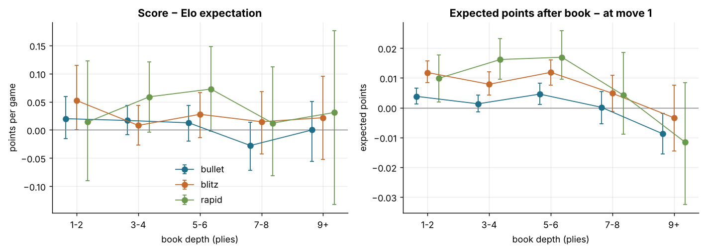
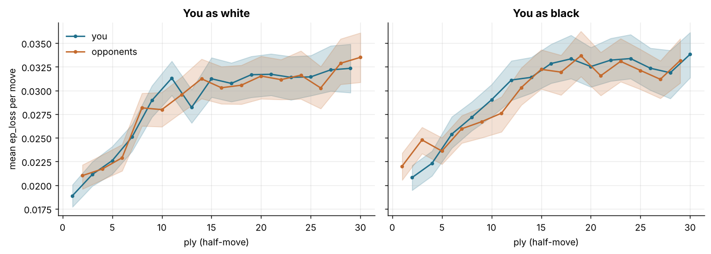

# Opening repertoire: where the score comes from, by colour

Data: 6,027 standard live games with at least one move (player zakihussa1n; bullet 3,452 = 1,737 white / 1,715 black, blitz 1,987 = 996 white / 991 black, rapid 588 = 295 white / 293 black) and 364,685 analysed moves; 2 game(s) without moves excluded. Every game with moves reached a named opening line (Lichess list); the deepest named line is `opening_name`, its depth `book_ply` (median 4 plies, 75th percentile 6). Names are grouped into 95 *families* (the text before the colon: 'Italian Game: Giuoco Piano' -> 'Italian Game'). Numbers are estimate [95% CI], CIs bootstrapped by game (500 resamples); each game is one cluster. *Score* is your points per game; *expected* is the Elo expectation from your pre-game rating and the opponent's pre-game rating reconstructed as their post-game rating plus your rating change (post-game rating in unrated games; an approximation, 4 game(s) without usable ratings are left out of expected-score columns); *over-performance* = score − expected. *Opening ep lost* is the sum of `ep_loss` over a side's moves in the material-heuristic opening phase (roughly the first 10–12 moves), *ep after book* is the calibrated expected points for you after the last book move, and *book gain* is that minus the model's expectation at move 1, so it measures what the known part of the opening did to your chances. *last 12 mo* counts the games since 2025-10-31 and *years* the span in which the line occurred (your repertoire changed: a line with no recent games is history, not a target). Cells with fewer than 20 games are left blank.

## 1. The shape of the repertoire: first moves

As White the line start is your first move; as Black it is the opponent's first move and your reply. Opening ep lost is per game for the opening phase, yours and the opponents' in the same games (theirs − yours positive = they gave away more).

### White (3,028 games)

| line start | games | last 12 mo | years | mix (b/bz/r) | score | expected | score − expected | your opening ep lost | theirs | theirs − yours | book gain (ep) | cp after book |
|---|---|---|---|---|---|---|---|---|---|---|---|---|
| 1.e4 | 2677 | 211 | 22–26 | 1666/736/275 | 0.53 [0.51, 0.55] | 0.50 | 0.027 [0.010, 0.045] | 0.294 [0.279, 0.309] | 0.291 [0.277, 0.306] | -0.003 [-0.008, 0.002] | 0.006 [0.005, 0.008] | 49 [47, 51] |
| 1.d4 | 346 | 1 | 21–25 | 67/259/20 | 0.55 [0.50, 0.61] | 0.51 | 0.045 [-0.002, 0.101] | 0.288 [0.250, 0.331] | 0.283 [0.246, 0.321] | -0.005 [-0.020, 0.009] | 0.016 [0.010, 0.021] | 56 [52, 60] |

Lines with ≥ 20 games cover 99.8% of your white games; the overall white over-performance is 0.030 [0.013, 0.047].

### Black (2,999 games)

| line start | games | last 12 mo | years | mix (b/bz/r) | score | expected | score − expected | your opening ep lost | theirs | theirs − yours | book gain (ep) | cp after book |
|---|---|---|---|---|---|---|---|---|---|---|---|---|
| 1.e4 e5 | 1679 | 115 | 21–26 | 928/578/173 | 0.50 [0.48, 0.53] | 0.50 | 0.005 [-0.017, 0.028] | 0.307 [0.290, 0.323] | 0.305 [0.287, 0.321] | -0.002 [-0.010, 0.005] | 0.004 [0.001, 0.007] | -18 [-20, -16] |
| 1.d4 d5 | 654 | 57 | 22–26 | 363/218/73 | 0.52 [0.48, 0.55] | 0.51 | 0.005 [-0.031, 0.038] | 0.306 [0.276, 0.336] | 0.315 [0.286, 0.343] | 0.009 [-0.001, 0.018] | -0.005 [-0.009, -0.001] | -26 [-27, -24] |
| 1.e3 e5 | 103 | 3 | 22–25 | 74/19/10 | 0.53 [0.44, 0.62] | 0.51 | 0.022 [-0.065, 0.104] | 0.332 [0.261, 0.417] | 0.332 [0.259, 0.414] | 0.000 [-0.027, 0.026] | 0.002 [-0.009, 0.015] | -12 [-13, -11] |
| 1.e4 c5 | 87 | 0 | 22 | 35/42/10 | 0.33 [0.24, 0.43] | 0.44 | -0.116 [-0.207, -0.017] | 0.341 [0.271, 0.419] | 0.308 [0.240, 0.385] | -0.032 [-0.065, -0.001] | -0.017 [-0.031, -0.006] | -31 [-35, -26] |
| 1.g3 e5 | 63 | 6 | 22–26 | 50/11/2 | 0.53 [0.42, 0.65] | 0.51 | 0.023 [-0.095, 0.136] | 0.310 [0.225, 0.408] | 0.334 [0.242, 0.438] | 0.023 [-0.005, 0.051] | -0.004 [-0.020, 0.012] | -22 [-23, -21] |
| 1.d4 e5 | 44 | 2 | 22–25 | 40/3/1 | 0.57 [0.43, 0.70] | 0.52 | 0.051 [-0.088, 0.184] | 0.245 [0.153, 0.342] | 0.245 [0.160, 0.346] | 0.001 [-0.031, 0.039] | -0.001 [-0.012, 0.009] | -90 [-112, -69] |
| 1.b3 e5 | 43 | 6 | 22–26 | 36/7/0 | 0.53 [0.38, 0.67] | 0.49 | 0.043 [-0.105, 0.189] | 0.234 [0.162, 0.312] | 0.231 [0.160, 0.315] | -0.003 [-0.032, 0.027] | 0.011 [0.000, 0.020] | 15 [12, 18] |
| 1.Nf3 d5 | 39 | 5 | 22–26 | 21/13/5 | 0.38 [0.25, 0.55] | 0.50 | -0.117 [-0.248, 0.044] | 0.329 [0.223, 0.447] | 0.294 [0.200, 0.399] | -0.035 [-0.074, 0.010] | 0.008 [-0.004, 0.020] | -11 [-24, 6] |
| 1.e4 d5 | 36 | 0 | 22–25 | 10/25/1 | 0.47 [0.31, 0.63] | 0.43 | 0.045 [-0.118, 0.200] | 0.403 [0.254, 0.573] | 0.382 [0.228, 0.558] | -0.020 [-0.066, 0.031] | 0.001 [-0.014, 0.017] | -42 [-58, -22] |
| 1.d3 e5 | 35 | 2 | 22–25 | 34/0/1 | 0.40 [0.24, 0.56] | 0.49 | -0.090 [-0.251, 0.068] | 0.306 [0.185, 0.431] | 0.276 [0.167, 0.395] | -0.030 [-0.068, 0.008] | 0.013 [0.003, 0.024] | 2 [-3, 6] |
| 1.Nf3 e5 | 23 | 4 | 22–25 | 21/2/0 | 0.39 [0.22, 0.57] | 0.51 | -0.122 [-0.296, 0.026] | 0.198 [0.076, 0.384] | 0.181 [0.071, 0.347] | -0.017 [-0.053, 0.011] | -0.001 [-0.017, 0.019] | -89 [-114, -64] |
| 1.Nc3 e5 | 22 | 0 | 22–25 | 12/9/1 | 0.70 [0.50, 0.86] | 0.55 | 0.159 [-0.013, 0.336] | 0.313 [0.178, 0.463] | 0.369 [0.237, 0.507] | 0.056 [-0.011, 0.110] | 0.005 [-0.009, 0.021] | -20 [-25, -15] |
| 1.c4 e5 | 21 | 1 | 22–25 | 14/5/2 | 0.60 [0.39, 0.79] | 0.48 | 0.112 [-0.093, 0.307] | 0.227 [0.117, 0.386] | 0.268 [0.131, 0.478] | 0.041 [-0.040, 0.112] | 0.010 [-0.013, 0.040] | -15 [-23, -7] |

Lines with ≥ 20 games cover 95.0% of your black games; the overall black over-performance is 0.005 [-0.014, 0.023].

## 2. Repertoire table by opening family and colour

Families with ≥ 20 games, all time classes pooled (the mix column gives bullet/blitz/rapid counts), sorted by frequency. `score − expected` is the paired per-game mean of your score minus the Elo expectation. `book gain` is your expected points after the last book move minus the model's expectation at move 1 (positive = the known part of the line left you better off than the ratings predicted).

### White: 21 families covering 93% of 3,028 games

| family | games | last 12 mo | years | mix (b/bz/r) | score | expected | score − expected | your opening ep lost | theirs | theirs − yours | book gain (ep) | cp after book |
|---|---|---|---|---|---|---|---|---|---|---|---|---|
| Italian Game | 689 | 58 | 22–26 | 376/227/86 | 0.53 [0.49, 0.57] | 0.50 | 0.028 [-0.008, 0.063] | 0.311 [0.283, 0.339] | 0.315 [0.288, 0.342] | 0.003 [-0.007, 0.015] | 0.011 [0.007, 0.014] | 49 [46, 52] |
| Scandinavian Defense | 363 | 20 | 22–26 | 237/93/33 | 0.53 [0.48, 0.59] | 0.50 | 0.030 [-0.019, 0.083] | 0.248 [0.216, 0.281] | 0.231 [0.202, 0.263] | -0.017 [-0.028, -0.002] | 0.005 [0.002, 0.007] | 71 [70, 72] |
| Sicilian Defense | 224 | 23 | 22–26 | 151/60/13 | 0.49 [0.43, 0.55] | 0.48 | 0.006 [-0.055, 0.066] | 0.306 [0.252, 0.365] | 0.305 [0.255, 0.362] | -0.001 [-0.017, 0.016] | 0.002 [-0.003, 0.007] | 43 [40, 47] |
| French Defense | 200 | 18 | 22–26 | 139/43/18 | 0.51 [0.44, 0.58] | 0.50 | 0.010 [-0.058, 0.078] | 0.302 [0.248, 0.363] | 0.296 [0.242, 0.354] | -0.006 [-0.023, 0.012] | 0.000 [-0.009, 0.009] | 28 [25, 31] |
| Caro-Kann Defense | 183 | 19 | 21–26 | 104/67/12 | 0.49 [0.42, 0.56] | 0.49 | -0.001 [-0.068, 0.065] | 0.298 [0.241, 0.361] | 0.282 [0.230, 0.338] | -0.015 [-0.030, 0.003] | 0.003 [-0.002, 0.007] | 40 [38, 41] |
| King's Pawn Game | 171 | 13 | 22–26 | 103/39/29 | 0.56 [0.48, 0.63] | 0.50 | 0.054 [-0.013, 0.126] | 0.322 [0.268, 0.389] | 0.315 [0.262, 0.380] | -0.007 [-0.030, 0.018] | 0.019 [0.011, 0.025] | 118 [106, 129] |
| Philidor Defense | 161 | 11 | 22–25 | 94/41/26 | 0.56 [0.48, 0.64] | 0.50 | 0.055 [-0.020, 0.132] | 0.281 [0.234, 0.331] | 0.272 [0.228, 0.315] | -0.008 [-0.033, 0.014] | 0.015 [0.005, 0.024] | 33 [30, 38] |
| Modern Defense | 115 | 15 | 22–26 | 87/20/8 | 0.48 [0.40, 0.58] | 0.50 | -0.018 [-0.101, 0.083] | 0.242 [0.184, 0.306] | 0.245 [0.187, 0.307] | 0.003 [-0.017, 0.024] | 0.005 [0.001, 0.009] | 71 [70, 71] |
| Petrov's Defense | 95 | 5 | 22–25 | 59/23/13 | 0.54 [0.44, 0.64] | 0.50 | 0.039 [-0.054, 0.129] | 0.351 [0.290, 0.416] | 0.342 [0.285, 0.411] | -0.009 [-0.042, 0.021] | -0.008 [-0.022, 0.007] | 5 [-8, 16] |
| Zukertort Opening | 85 | 6 | 22–25 | 84/1/0 | 0.66 [0.56, 0.75] | 0.51 | 0.147 [0.049, 0.243] | 0.295 [0.218, 0.382] | 0.316 [0.226, 0.408] | 0.021 [-0.006, 0.049] | -0.017 [-0.031, -0.003] | -89 [-101, -72] |
| Pirc Defense | 82 | 6 | 22–26 | 64/14/4 | 0.52 [0.41, 0.63] | 0.50 | 0.024 [-0.087, 0.136] | 0.289 [0.212, 0.368] | 0.287 [0.216, 0.362] | -0.001 [-0.031, 0.028] | -0.000 [-0.005, 0.004] | 51 [48, 53] |
| Owen Defense | 78 | 11 | 22–25 | 60/10/8 | 0.58 [0.47, 0.68] | 0.50 | 0.079 [-0.026, 0.183] | 0.297 [0.227, 0.379] | 0.297 [0.229, 0.378] | -0.001 [-0.023, 0.023] | 0.006 [0.000, 0.011] | 93 [88, 97] |
| Queen's Gambit Accepted | 75 | 1 | 22–25 | 9/60/6 | 0.55 [0.44, 0.65] | 0.52 | 0.026 [-0.085, 0.126] | 0.280 [0.203, 0.368] | 0.285 [0.209, 0.369] | 0.005 [-0.025, 0.033] | 0.027 [0.015, 0.039] | 50 [47, 52] |
| Queen's Gambit Declined | 73 | 0 | 22–24 | 14/55/4 | 0.65 [0.54, 0.76] | 0.51 | 0.137 [0.027, 0.245] | 0.258 [0.183, 0.340] | 0.265 [0.194, 0.348] | 0.007 [-0.020, 0.040] | 0.016 [0.003, 0.030] | 52 [45, 58] |
| Englund Gambit | 41 | 0 | 22 | 8/31/2 | 0.56 [0.39, 0.71] | 0.51 | 0.056 [-0.104, 0.205] | 0.247 [0.166, 0.354] | 0.252 [0.175, 0.358] | 0.005 [-0.037, 0.046] | 0.010 [-0.000, 0.020] | 138 [130, 144] |
| Nimzowitsch Defense | 37 | 0 | 22–25 | 26/10/1 | 0.55 [0.41, 0.70] | 0.58 | -0.023 [-0.166, 0.117] | 0.186 [0.119, 0.274] | 0.196 [0.137, 0.267] | 0.011 [-0.014, 0.036] | 0.033 [0.015, 0.051] | 54 [44, 65] |
| Slav Defense | 31 | 0 | 22 | 2/29/0 | 0.47 [0.29, 0.61] | 0.51 | -0.038 [-0.203, 0.116] | 0.295 [0.169, 0.408] | 0.274 [0.165, 0.372] | -0.020 [-0.072, 0.027] | 0.009 [-0.009, 0.027] | 30 [29, 33] |
| Queen's Pawn Game | 29 | 0 | 21–22 | 5/23/1 | 0.50 [0.31, 0.67] | 0.54 | -0.017 [-0.199, 0.163] | 0.246 [0.134, 0.392] | 0.222 [0.132, 0.330] | -0.024 [-0.077, 0.030] | 0.002 [-0.022, 0.025] | 37 [29, 47] |
| Alekhine Defense | 28 | 3 | 22–25 | 12/14/2 | 0.61 [0.45, 0.77] | 0.52 | 0.083 [-0.086, 0.243] | 0.250 [0.140, 0.417] | 0.277 [0.162, 0.437] | 0.027 [-0.016, 0.070] | 0.017 [0.008, 0.027] | 77 [67, 88] |
| Elephant Gambit | 28 | 2 | 22–26 | 11/15/2 | 0.50 [0.30, 0.69] | 0.45 | 0.046 [-0.138, 0.220] | 0.297 [0.180, 0.431] | 0.273 [0.176, 0.388] | -0.024 [-0.094, 0.044] | 0.021 [0.008, 0.035] | 96 [96, 97] |
| Four Knights Game | 22 | 0 | 22–24 | 11/6/5 | 0.39 [0.20, 0.57] | 0.47 | -0.080 [-0.252, 0.103] | 0.262 [0.160, 0.407] | 0.283 [0.176, 0.436] | 0.021 [-0.040, 0.078] | 0.009 [-0.009, 0.031] | 12 [8, 15] |

### Black: 30 families covering 93% of 2,999 games

| family | games | last 12 mo | years | mix (b/bz/r) | score | expected | score − expected | your opening ep lost | theirs | theirs − yours | book gain (ep) | cp after book |
|---|---|---|---|---|---|---|---|---|---|---|---|---|
| Queen's Pawn Game | 414 | 34 | 22–26 | 216/143/55 | 0.50 [0.45, 0.55] | 0.51 | -0.014 [-0.062, 0.035] | 0.308 [0.273, 0.347] | 0.310 [0.274, 0.350] | 0.001 [-0.009, 0.013] | 0.000 [-0.005, 0.006] | -21 [-23, -19] |
| Italian Game | 373 | 20 | 22–26 | 209/135/29 | 0.46 [0.41, 0.50] | 0.49 | -0.033 [-0.084, 0.016] | 0.329 [0.288, 0.375] | 0.325 [0.283, 0.374] | -0.004 [-0.021, 0.012] | -0.002 [-0.009, 0.004] | -44 [-49, -39] |
| King's Pawn Game | 264 | 11 | 21–25 | 151/80/33 | 0.49 [0.42, 0.54] | 0.50 | -0.016 [-0.078, 0.042] | 0.290 [0.245, 0.331] | 0.287 [0.245, 0.330] | -0.002 [-0.020, 0.017] | 0.018 [0.011, 0.026] | 18 [12, 23] |
| Scotch Game | 226 | 18 | 22–25 | 128/80/18 | 0.46 [0.40, 0.52] | 0.50 | -0.045 [-0.101, 0.018] | 0.299 [0.250, 0.358] | 0.281 [0.232, 0.342] | -0.019 [-0.039, 0.002] | -0.016 [-0.026, -0.008] | -43 [-46, -40] |
| Four Knights Game | 185 | 14 | 21–26 | 102/66/17 | 0.48 [0.41, 0.54] | 0.50 | -0.021 [-0.090, 0.046] | 0.245 [0.207, 0.289] | 0.237 [0.201, 0.278] | -0.007 [-0.023, 0.010] | 0.002 [-0.005, 0.010] | -7 [-10, -2] |
| Queen's Gambit Declined | 150 | 13 | 22–26 | 95/45/10 | 0.60 [0.52, 0.67] | 0.50 | 0.093 [0.018, 0.165] | 0.305 [0.252, 0.371] | 0.343 [0.285, 0.416] | 0.038 [0.016, 0.059] | -0.008 [-0.013, -0.004] | -45 [-46, -44] |
| Bishop's Opening | 148 | 13 | 22–26 | 96/35/17 | 0.60 [0.53, 0.67] | 0.51 | 0.095 [0.020, 0.161] | 0.303 [0.248, 0.366] | 0.311 [0.256, 0.370] | 0.009 [-0.015, 0.031] | 0.003 [-0.006, 0.012] | -13 [-16, -11] |
| Ruy Lopez | 143 | 13 | 21–26 | 61/63/19 | 0.56 [0.48, 0.64] | 0.50 | 0.063 [-0.017, 0.140] | 0.288 [0.229, 0.346] | 0.302 [0.240, 0.357] | 0.014 [-0.007, 0.032] | 0.004 [-0.004, 0.013] | -26 [-31, -21] |
| Sicilian Defense | 89 | 0 | 22 | 36/43/10 | 0.34 [0.25, 0.44] | 0.44 | -0.101 [-0.195, -0.005] | 0.335 [0.265, 0.407] | 0.307 [0.240, 0.381] | -0.028 [-0.063, 0.002] | -0.016 [-0.028, -0.003] | -31 [-35, -26] |
| Van't Kruijs Opening | 79 | 3 | 22–25 | 57/14/8 | 0.53 [0.41, 0.64] | 0.51 | 0.019 [-0.089, 0.135] | 0.349 [0.272, 0.426] | 0.344 [0.267, 0.424] | -0.004 [-0.035, 0.027] | -0.001 [-0.013, 0.010] | -11 [-11, -11] |
| Hungarian Opening | 64 | 6 | 22–26 | 50/11/3 | 0.52 [0.42, 0.64] | 0.51 | 0.015 [-0.088, 0.133] | 0.315 [0.228, 0.405] | 0.334 [0.244, 0.429] | 0.019 [-0.011, 0.049] | -0.004 [-0.020, 0.012] | -22 [-23, -21] |
| Center Game | 58 | 3 | 22–25 | 26/25/7 | 0.58 [0.45, 0.70] | 0.49 | 0.085 [-0.036, 0.205] | 0.337 [0.260, 0.405] | 0.334 [0.251, 0.411] | -0.002 [-0.044, 0.035] | 0.025 [0.010, 0.039] | 20 [17, 22] |
| Nimzo-Larsen Attack | 50 | 5 | 22–26 | 38/11/1 | 0.56 [0.42, 0.70] | 0.49 | 0.070 [-0.068, 0.205] | 0.259 [0.187, 0.351] | 0.257 [0.178, 0.357] | -0.002 [-0.027, 0.022] | 0.014 [0.003, 0.026] | 11 [8, 13] |
| Vienna Game | 50 | 2 | 22–25 | 30/14/6 | 0.52 [0.39, 0.67] | 0.53 | -0.011 [-0.133, 0.129] | 0.333 [0.228, 0.462] | 0.360 [0.251, 0.488] | 0.027 [-0.014, 0.069] | 0.024 [0.008, 0.038] | -1 [-6, 4] |
| Caro-Kann Defense | 48 | 10 | 22–25 | 34/11/3 | 0.46 [0.32, 0.58] | 0.53 | -0.069 [-0.205, 0.054] | 0.363 [0.254, 0.493] | 0.323 [0.215, 0.442] | -0.040 [-0.076, -0.003] | -0.025 [-0.042, -0.005] | -21 [-24, -18] |
| Ponziani Opening | 40 | 7 | 22–25 | 26/12/2 | 0.47 [0.33, 0.63] | 0.50 | -0.022 [-0.169, 0.137] | 0.377 [0.253, 0.520] | 0.359 [0.224, 0.502] | -0.017 [-0.065, 0.034] | 0.023 [0.008, 0.041] | 25 [20, 32] |
| Zukertort Opening | 38 | 6 | 22–26 | 26/9/3 | 0.29 [0.17, 0.43] | 0.50 | -0.209 [-0.314, -0.089] | 0.276 [0.153, 0.408] | 0.253 [0.139, 0.387] | -0.024 [-0.062, 0.012] | 0.012 [-0.003, 0.029] | -33 [-65, -5] |
| King's Knight Opening | 38 | 1 | 22–25 | 14/17/7 | 0.53 [0.37, 0.68] | 0.51 | 0.016 [-0.124, 0.158] | 0.235 [0.153, 0.331] | 0.275 [0.176, 0.385] | 0.040 [0.006, 0.083] | 0.000 [-0.009, 0.009] | -31 [-35, -25] |
| English Opening | 37 | 2 | 22–25 | 21/12/4 | 0.55 [0.41, 0.70] | 0.51 | 0.048 [-0.110, 0.204] | 0.265 [0.168, 0.401] | 0.286 [0.178, 0.437] | 0.021 [-0.031, 0.082] | 0.007 [-0.010, 0.027] | -24 [-33, -15] |
| Mieses Opening | 37 | 2 | 22–25 | 35/1/1 | 0.53 [0.35, 0.68] | 0.49 | 0.042 [-0.130, 0.192] | 0.283 [0.165, 0.412] | 0.271 [0.171, 0.386] | -0.012 [-0.057, 0.033] | 0.012 [0.002, 0.022] | 0 [-3, 4] |
| Englund Gambit Declined | 32 | 1 | 22–25 | 28/3/1 | 0.61 [0.43, 0.77] | 0.52 | 0.085 [-0.081, 0.237] | 0.193 [0.117, 0.288] | 0.186 [0.109, 0.280] | -0.007 [-0.031, 0.019] | -0.005 [-0.025, 0.017] | 1 [-8, 10] |
| King's Gambit Accepted | 32 | 5 | 22–26 | 21/6/5 | 0.52 [0.35, 0.69] | 0.52 | -0.009 [-0.165, 0.168] | 0.392 [0.258, 0.528] | 0.383 [0.254, 0.535] | -0.009 [-0.071, 0.051] | 0.022 [0.005, 0.039] | 19 [5, 36] |
| Queen's Gambit Accepted | 31 | 0 | 22–24 | 15/13/3 | 0.55 [0.39, 0.73] | 0.49 | 0.059 [-0.104, 0.240] | 0.317 [0.194, 0.456] | 0.328 [0.209, 0.457] | 0.011 [-0.045, 0.067] | -0.030 [-0.050, -0.011] | -39 [-43, -34] |
| Englund Gambit | 31 | 1 | 22–25 | 27/3/1 | 0.55 [0.37, 0.72] | 0.51 | 0.039 [-0.137, 0.208] | 0.271 [0.170, 0.399] | 0.278 [0.180, 0.399] | 0.007 [-0.041, 0.050] | -0.000 [-0.009, 0.009] | -138 [-145, -132] |
| Nimzowitsch Defense | 28 | 5 | 22–25 | 23/5/0 | 0.50 [0.32, 0.71] | 0.49 | 0.005 [-0.166, 0.208] | 0.220 [0.140, 0.304] | 0.220 [0.131, 0.313] | 0.000 [-0.038, 0.044] | -0.019 [-0.039, -0.001] | -62 [-65, -57] |
| Scandinavian Defense | 26 | 0 | 22–23 | 6/19/1 | 0.62 [0.46, 0.77] | 0.43 | 0.181 [0.002, 0.364] | 0.366 [0.203, 0.527] | 0.350 [0.179, 0.534] | -0.015 [-0.065, 0.039] | -0.004 [-0.016, 0.009] | -66 [-67, -65] |
| Three Knights Opening | 26 | 0 | 22–25 | 16/9/1 | 0.75 [0.62, 0.90] | 0.49 | 0.261 [0.126, 0.398] | 0.179 [0.091, 0.299] | 0.185 [0.086, 0.310] | 0.006 [-0.047, 0.059] | -0.021 [-0.047, 0.004] | -36 [-53, -23] |
| Danish Gambit Accepted | 23 | 1 | 22–25 | 11/11/1 | 0.61 [0.39, 0.83] | 0.47 | 0.134 [-0.094, 0.356] | 0.374 [0.193, 0.583] | 0.405 [0.206, 0.633] | 0.031 [-0.012, 0.083] | 0.025 [0.006, 0.045] | 12 [4, 21] |
| King's Gambit Declined | 23 | 0 | 22–25 | 13/8/2 | 0.52 [0.35, 0.74] | 0.48 | 0.039 [-0.138, 0.242] | 0.346 [0.231, 0.466] | 0.401 [0.286, 0.509] | 0.054 [-0.013, 0.121] | 0.008 [-0.002, 0.019] | -24 [-29, -18] |
| Bird Opening | 21 | 1 | 22–25 | 17/2/2 | 0.45 [0.26, 0.64] | 0.48 | -0.032 [-0.222, 0.170] | 0.210 [0.126, 0.313] | 0.174 [0.099, 0.261] | -0.036 [-0.082, 0.011] | 0.022 [0.012, 0.034] | 21 [5, 40] |

### By time class: score − expected per family

Same families, one column per time class; a cell needs ≥ 20 games. Opening ep lost difference (theirs − yours) in the second block.

**White, score − expected:**

| family | bullet (n) | blitz (n) | rapid (n) |
|---|---|---|---|
| Italian Game | 0.003 [-0.051, 0.054] (376) | 0.051 [-0.009, 0.119] (227) | 0.075 [-0.021, 0.178] (86) |
| Scandinavian Defense | -0.008 [-0.069, 0.052] (237) | 0.094 [-0.006, 0.195] (93) | 0.122 [-0.051, 0.274] (33) |
| Sicilian Defense | 0.022 [-0.052, 0.100] (151) | -0.009 [-0.122, 0.115] (60) |  |
| French Defense | 0.016 [-0.064, 0.089] (139) | -0.017 [-0.157, 0.128] (43) |  |
| Caro-Kann Defense | 0.025 [-0.063, 0.121] (104) | -0.083 [-0.194, 0.022] (67) |  |
| King's Pawn Game | 0.035 [-0.062, 0.119] (103) | 0.008 [-0.130, 0.141] (39) | 0.182 [0.021, 0.329] (29) |
| Philidor Defense | 0.027 [-0.085, 0.132] (94) | 0.053 [-0.091, 0.193] (41) | 0.158 [-0.020, 0.339] (26) |
| Modern Defense | -0.041 [-0.151, 0.066] (87) | 0.164 [-0.049, 0.383] (20) |  |
| Petrov's Defense | 0.002 [-0.115, 0.130] (59) | 0.171 [0.011, 0.343] (23) |  |
| Zukertort Opening | 0.145 [0.056, 0.236] (84) |  |  |
| Pirc Defense | 0.031 [-0.087, 0.162] (64) |  |  |
| Owen Defense | 0.103 [-0.007, 0.222] (60) |  |  |
| Queen's Gambit Accepted |  | -0.033 [-0.148, 0.087] (60) |  |
| Queen's Gambit Declined |  | 0.127 [0.004, 0.232] (55) |  |
| Englund Gambit |  | 0.051 [-0.112, 0.229] (31) |  |
| Nimzowitsch Defense | -0.053 [-0.224, 0.112] (26) |  |  |
| Slav Defense |  | -0.070 [-0.243, 0.117] (29) |  |
| Queen's Pawn Game |  | -0.061 [-0.261, 0.143] (23) |  |

**White, opening ep lost, theirs − yours:**

| family | bullet (n) | blitz (n) | rapid (n) |
|---|---|---|---|
| Italian Game | -0.002 [-0.016, 0.011] (376) | 0.009 [-0.013, 0.031] (227) | 0.014 [-0.019, 0.044] (86) |
| Scandinavian Defense | -0.033 [-0.048, -0.018] (237) | 0.022 [-0.005, 0.047] (93) | -0.008 [-0.074, 0.051] (33) |
| Sicilian Defense | 0.011 [-0.009, 0.029] (151) | -0.023 [-0.053, 0.009] (60) |  |
| French Defense | -0.001 [-0.019, 0.016] (139) | -0.021 [-0.067, 0.018] (43) |  |
| Caro-Kann Defense | -0.006 [-0.027, 0.015] (104) | -0.043 [-0.069, -0.016] (67) |  |
| King's Pawn Game | -0.021 [-0.049, 0.008] (103) | -0.016 [-0.053, 0.020] (39) | 0.055 [-0.014, 0.116] (29) |
| Philidor Defense | -0.020 [-0.051, 0.008] (94) | 0.020 [-0.032, 0.061] (41) | -0.012 [-0.070, 0.044] (26) |
| Modern Defense | -0.009 [-0.030, 0.014] (87) | 0.056 [-0.005, 0.132] (20) |  |
| Petrov's Defense | -0.011 [-0.051, 0.034] (59) | 0.027 [-0.037, 0.086] (23) |  |
| Zukertort Opening | 0.020 [-0.009, 0.048] (84) |  |  |
| Pirc Defense | -0.009 [-0.036, 0.019] (64) |  |  |
| Owen Defense | -0.002 [-0.026, 0.024] (60) |  |  |
| Queen's Gambit Accepted |  | 0.002 [-0.031, 0.033] (60) |  |
| Queen's Gambit Declined |  | 0.013 [-0.017, 0.051] (55) |  |
| Englund Gambit |  | 0.005 [-0.043, 0.050] (31) |  |
| Nimzowitsch Defense | 0.018 [-0.010, 0.046] (26) |  |  |
| Slav Defense |  | -0.025 [-0.078, 0.026] (29) |  |
| Queen's Pawn Game |  | -0.049 [-0.119, 0.018] (23) |  |

**Black, score − expected:**

| family | bullet (n) | blitz (n) | rapid (n) |
|---|---|---|---|
| Queen's Pawn Game | -0.018 [-0.079, 0.047] (216) | -0.009 [-0.087, 0.074] (143) | -0.013 [-0.146, 0.132] (55) |
| Italian Game | -0.072 [-0.141, -0.007] (209) | 0.016 [-0.065, 0.090] (135) | 0.026 [-0.149, 0.181] (29) |
| King's Pawn Game | -0.057 [-0.145, 0.021] (151) | -0.018 [-0.121, 0.100] (80) | 0.175 [0.024, 0.321] (33) |
| Scotch Game | -0.006 [-0.098, 0.084] (128) | -0.102 [-0.223, 0.014] (80) |  |
| Four Knights Game | -0.030 [-0.129, 0.068] (102) | -0.002 [-0.115, 0.114] (66) |  |
| Queen's Gambit Declined | 0.092 [-0.013, 0.188] (95) | 0.092 [-0.045, 0.232] (45) |  |
| Bishop's Opening | 0.110 [0.018, 0.197] (96) | 0.050 [-0.132, 0.202] (35) |  |
| Ruy Lopez | 0.032 [-0.102, 0.145] (61) | 0.085 [-0.033, 0.196] (63) |  |
| Sicilian Defense | -0.136 [-0.263, 0.004] (36) | -0.085 [-0.226, 0.063] (43) |  |
| Van't Kruijs Opening | 0.048 [-0.068, 0.161] (57) |  |  |
| Hungarian Opening | -0.020 [-0.155, 0.125] (50) |  |  |
| Center Game | 0.116 [-0.076, 0.281] (26) | 0.042 [-0.171, 0.248] (25) |  |
| Nimzo-Larsen Attack | 0.093 [-0.058, 0.233] (38) |  |  |
| Vienna Game | -0.042 [-0.207, 0.125] (30) |  |  |
| Caro-Kann Defense | -0.068 [-0.228, 0.092] (34) |  |  |
| Ponziani Opening | -0.043 [-0.222, 0.138] (26) |  |  |
| Zukertort Opening | -0.299 [-0.410, -0.167] (26) |  |  |
| English Opening | 0.001 [-0.216, 0.225] (21) |  |  |
| Mieses Opening | 0.045 [-0.127, 0.195] (35) |  |  |
| Englund Gambit Declined | 0.062 [-0.079, 0.202] (28) |  |  |
| King's Gambit Accepted | 0.054 [-0.149, 0.258] (21) |  |  |
| Englund Gambit | 0.115 [-0.067, 0.279] (27) |  |  |
| Nimzowitsch Defense | -0.015 [-0.231, 0.175] (23) |  |  |

**Black, opening ep lost, theirs − yours:**

| family | bullet (n) | blitz (n) | rapid (n) |
|---|---|---|---|
| Queen's Pawn Game | 0.003 [-0.014, 0.019] (216) | -0.004 [-0.024, 0.018] (143) | 0.010 [-0.022, 0.041] (55) |
| Italian Game | -0.022 [-0.043, -0.003] (209) | 0.022 [-0.014, 0.053] (135) | 0.009 [-0.052, 0.071] (29) |
| King's Pawn Game | -0.009 [-0.035, 0.019] (151) | -0.018 [-0.047, 0.013] (80) | 0.063 [0.012, 0.108] (33) |
| Scotch Game | -0.016 [-0.043, 0.008] (128) | -0.027 [-0.061, 0.010] (80) |  |
| Four Knights Game | -0.013 [-0.034, 0.008] (102) | 0.004 [-0.031, 0.041] (66) |  |
| Queen's Gambit Declined | 0.016 [-0.004, 0.036] (95) | 0.090 [0.047, 0.132] (45) |  |
| Bishop's Opening | -0.004 [-0.032, 0.025] (96) | 0.052 [0.007, 0.097] (35) |  |
| Ruy Lopez | 0.016 [-0.015, 0.048] (61) | 0.013 [-0.012, 0.044] (63) |  |
| Sicilian Defense | -0.020 [-0.069, 0.029] (36) | -0.029 [-0.075, 0.015] (43) |  |
| Van't Kruijs Opening | 0.006 [-0.026, 0.035] (57) |  |  |
| Hungarian Opening | 0.012 [-0.018, 0.040] (50) |  |  |
| Center Game | -0.002 [-0.056, 0.049] (26) | -0.005 [-0.082, 0.060] (25) |  |
| Nimzo-Larsen Attack | -0.007 [-0.037, 0.024] (38) |  |  |
| Vienna Game | 0.004 [-0.047, 0.056] (30) |  |  |
| Caro-Kann Defense | -0.030 [-0.061, 0.002] (34) |  |  |
| Ponziani Opening | -0.034 [-0.089, 0.018] (26) |  |  |
| Zukertort Opening | -0.034 [-0.069, 0.004] (26) |  |  |
| English Opening | -0.001 [-0.072, 0.071] (21) |  |  |
| Mieses Opening | -0.008 [-0.055, 0.036] (35) |  |  |
| Englund Gambit Declined | -0.006 [-0.033, 0.024] (28) |  |  |
| King's Gambit Accepted | -0.007 [-0.088, 0.075] (21) |  |  |
| Englund Gambit | 0.009 [-0.039, 0.065] (27) |  |  |
| Nimzowitsch Defense | -0.005 [-0.048, 0.041] (23) |  |  |

*Each bubble is an opening family with ≥ 20 games: vertical = how far your score exceeds the rating expectation, horizontal = how much more the opponents give away than you in the opening phase. Bars are 95% CIs; labelled: families with ≥ 200 games or a CI that excludes zero.*

## 3. Does staying in book longer help?

Games binned by `book_ply`, the depth of the deepest named line reached (a joint property of both players: a game leaves the list when either side plays something unnamed). Per bin: your score vs expectation, the opening-phase ep lost by each side, and the expected points after the last book move minus the move-1 expectation (`book gain`).

| time class | book plies | games | white share | score | expected | score − expected | your opening ep lost | theirs | theirs − yours | book gain (ep) | you left book first |
|---|---|---|---|---|---|---|---|---|---|---|---|
| bullet | 1-2 | 618 | 0.59 | 0.52 | 0.50 | 0.020 [-0.015, 0.059] | 0.275 [0.247, 0.306] | 0.264 [0.238, 0.294] | -0.012 [-0.021, -0.002] | 0.004 [0.001, 0.007] | 0.80 |
| bullet | 3-4 | 1254 | 0.47 | 0.52 | 0.51 | 0.017 [-0.009, 0.043] | 0.283 [0.262, 0.304] | 0.283 [0.263, 0.304] | 0.000 [-0.007, 0.008] | 0.001 [-0.001, 0.004] | 0.58 |
| bullet | 5-6 | 809 | 0.64 | 0.51 | 0.50 | 0.013 [-0.020, 0.044] | 0.277 [0.256, 0.301] | 0.269 [0.247, 0.291] | -0.009 [-0.017, 0.002] | 0.005 [0.001, 0.008] | 0.56 |
| bullet | 7-8 | 436 | 0.43 | 0.47 | 0.50 | -0.028 [-0.072, 0.014] | 0.291 [0.257, 0.325] | 0.284 [0.250, 0.316] | -0.007 [-0.018, 0.003] | 0.000 [-0.005, 0.005] | 0.59 |
| bullet | 9+ | 335 | 0.25 | 0.50 | 0.50 | -0.000 [-0.056, 0.051] | 0.297 [0.261, 0.339] | 0.278 [0.243, 0.315] | -0.019 [-0.034, -0.004] | -0.009 [-0.016, -0.002] | 0.78 |
| blitz | 1-2 | 285 | 0.65 | 0.54 | 0.49 | 0.052 [0.000, 0.114] | 0.307 [0.264, 0.350] | 0.314 [0.272, 0.357] | 0.007 [-0.008, 0.022] | 0.012 [0.008, 0.016] | 0.78 |
| blitz | 3-4 | 632 | 0.41 | 0.51 | 0.50 | 0.008 [-0.027, 0.044] | 0.336 [0.306, 0.366] | 0.339 [0.310, 0.369] | 0.003 [-0.009, 0.015] | 0.008 [0.004, 0.012] | 0.62 |
| blitz | 5-6 | 575 | 0.66 | 0.53 | 0.50 | 0.028 [-0.014, 0.066] | 0.313 [0.280, 0.345] | 0.317 [0.284, 0.351] | 0.004 [-0.008, 0.016] | 0.012 [0.008, 0.016] | 0.59 |
| blitz | 7-8 | 311 | 0.42 | 0.51 | 0.49 | 0.015 [-0.042, 0.068] | 0.310 [0.272, 0.356] | 0.302 [0.263, 0.340] | -0.008 [-0.025, 0.010] | 0.005 [-0.001, 0.011] | 0.61 |
| blitz | 9+ | 184 | 0.23 | 0.51 | 0.49 | 0.022 [-0.052, 0.095] | 0.340 [0.278, 0.404] | 0.370 [0.309, 0.444] | 0.030 [0.005, 0.055] | -0.003 [-0.015, 0.008] | 0.78 |
| rapid | 1-2 | 85 | 0.55 | 0.55 | 0.53 | 0.014 [-0.090, 0.123] | 0.244 [0.184, 0.312] | 0.254 [0.190, 0.319] | 0.010 [-0.022, 0.046] | 0.010 [0.002, 0.018] | 0.69 |
| rapid | 3-4 | 215 | 0.41 | 0.55 | 0.49 | 0.059 [-0.004, 0.121] | 0.332 [0.278, 0.380] | 0.349 [0.295, 0.398] | 0.017 [-0.007, 0.039] | 0.016 [0.010, 0.023] | 0.59 |
| rapid | 5-6 | 164 | 0.72 | 0.57 | 0.50 | 0.073 [-0.002, 0.148] | 0.349 [0.299, 0.402] | 0.346 [0.294, 0.396] | -0.003 [-0.026, 0.019] | 0.017 [0.009, 0.026] | 0.54 |
| rapid | 7-8 | 87 | 0.43 | 0.51 | 0.49 | 0.012 [-0.081, 0.112] | 0.334 [0.252, 0.419] | 0.336 [0.260, 0.421] | 0.003 [-0.034, 0.035] | 0.004 [-0.009, 0.019] | 0.76 |
| rapid | 9+ | 37 | 0.14 | 0.54 | 0.51 | 0.031 [-0.132, 0.176] | 0.262 [0.159, 0.365] | 0.259 [0.162, 0.352] | -0.003 [-0.053, 0.044] | -0.012 [-0.032, 0.008] | 0.78 |

### Who leaves the book first, and what it costs

The first move after the last book move is the *deviation*. Below, per time class: how often you were the one to deviate, the ep_loss of the deviating move for each side (game-bootstrap CIs; the two sets of games are disjoint, so the difference is an independent bootstrap), and your score vs expectation in the games where you deviated vs where the opponent did.

| time class | games | you deviated first | your deviation ep_loss | their deviation ep_loss | yours − theirs | your deviation cp_loss | their deviation cp_loss | score − expected when you deviate | when they deviate | difference |
|---|---|---|---|---|---|---|---|---|---|---|
| bullet | 3446 | 0.637 [0.620, 0.652] | 0.023 [0.021, 0.024] | 0.026 [0.024, 0.029] | -0.004 [-0.006, -0.001] | 39 [36, 42] | 57 [53, 62] | 0.008 [-0.012, 0.030] | 0.010 [-0.017, 0.040] | -0.002 [-0.035, 0.032] |
| blitz | 1978 | 0.651 [0.631, 0.673] | 0.030 [0.028, 0.033] | 0.031 [0.028, 0.035] | -0.001 [-0.005, 0.003] | 46 [42, 50] | 56 [51, 62] | 0.025 [-0.003, 0.049] | 0.018 [-0.020, 0.053] | 0.007 [-0.036, 0.050] |
| rapid | 582 | 0.634 [0.598, 0.672] | 0.030 [0.025, 0.035] | 0.036 [0.030, 0.043] | -0.006 [-0.014, 0.002] | 39 [33, 46] | 62 [52, 73] | 0.044 [-0.009, 0.093] | 0.049 [-0.018, 0.113] | -0.005 [-0.084, 0.070] |

*Your result relative to expectation (left) and the model's view of the position after the book moves (right) by how deep the game stayed in named theory, per time class. 95% CIs by game.*

## 4. Move quality in the opening phase, you vs opponents

Opening-phase moves (material heuristic) by colour and time class: mean `ep_loss` per move (main), the share of moves losing ≥ 0.1 ep, and `cp_loss` (secondary). The difference is you − opponents within the same games (negative = you lose less).

| time class | colour | games | moves | your ep_loss | their ep_loss | you − them | your share ≥ 0.1 | their share ≥ 0.1 | your cp_loss | their cp_loss | cp you − them |
|---|---|---|---|---|---|---|---|---|---|---|---|
| bullet | white | 1737 | 36967 | 0.0258 [0.0244, 0.0272] | 0.0256 [0.0242, 0.0272] | 0.0002 [-0.0004, 0.0007] | 0.072 [0.065, 0.079] | 0.073 [0.066, 0.081] | 56.1 [54.2, 58.1] | 60.7 [58.5, 62.9] | -4.6 [-6.3, -3.0] |
| bullet | black | 1715 | 36435 | 0.0275 [0.0259, 0.0290] | 0.0262 [0.0247, 0.0278] | 0.0013 [0.0007, 0.0018] | 0.080 [0.073, 0.089] | 0.078 [0.071, 0.085] | 59.2 [57.2, 61.3] | 56.7 [54.8, 58.7] | 2.5 [0.8, 4.0] |
| blitz | white | 996 | 20927 | 0.0288 [0.0269, 0.0313] | 0.0296 [0.0277, 0.0318] | -0.0007 [-0.0016, 0.0002] | 0.089 [0.079, 0.100] | 0.091 [0.081, 0.102] | 53.7 [51.2, 56.1] | 60.4 [57.6, 62.9] | -6.7 [-9.1, -4.2] |
| blitz | black | 991 | 20823 | 0.0324 [0.0300, 0.0347] | 0.0325 [0.0303, 0.0347] | -0.0000 [-0.0009, 0.0009] | 0.105 [0.093, 0.116] | 0.105 [0.093, 0.116] | 55.6 [53.1, 58.1] | 54.7 [52.3, 57.2] | 0.9 [-1.4, 3.0] |
| rapid | white | 295 | 6129 | 0.0329 [0.0289, 0.0366] | 0.0348 [0.0309, 0.0387] | -0.0019 [-0.0037, 0.0001] | 0.107 [0.088, 0.127] | 0.115 [0.095, 0.135] | 55.0 [51.2, 59.2] | 66.1 [61.6, 70.9] | -11.1 [-15.6, -6.5] |
| rapid | black | 293 | 6054 | 0.0288 [0.0248, 0.0325] | 0.0283 [0.0245, 0.0321] | 0.0004 [-0.0012, 0.0021] | 0.088 [0.071, 0.106] | 0.082 [0.064, 0.100] | 54.0 [49.5, 57.9] | 53.3 [49.0, 57.2] | 0.7 [-3.6, 5.3] |

*Mean ep_loss per move over the first 30 plies, you vs opponents, by your colour (all time classes pooled; shaded 95% CIs by game). Each side's moves sit on alternate plies.*

The same comparison by ply bin (each side's own moves in that bin), per colour and time class; `you − them` in ep per move:

| colour | time class | plies 1-10: you / them | plies 1-10: you − them | plies 11-20: you / them | plies 11-20: you − them | plies 21-30: you / them | plies 21-30: you − them |
|---|---|---|---|---|---|---|---|
| white | bullet | 0.0222 / 0.0230 | -0.0007 [-0.0013, -0.0001] | 0.0284 / 0.0278 | 0.0006 [-0.0004, 0.0016] | 0.0294 / 0.0298 | -0.0005 [-0.0015, 0.0007] |
| white | blitz | 0.0236 / 0.0244 | -0.0008 [-0.0016, 0.0000] | 0.0326 / 0.0337 | -0.0011 [-0.0027, 0.0003] | 0.0360 / 0.0348 | 0.0012 [-0.0007, 0.0034] |
| white | rapid | 0.0286 / 0.0320 | -0.0034 [-0.0053, -0.0015] | 0.0371 / 0.0371 | -0.0000 [-0.0033, 0.0035] | 0.0332 / 0.0353 | -0.0021 [-0.0053, 0.0012] |
| black | bullet | 0.0235 / 0.0232 | 0.0004 [-0.0002, 0.0009] | 0.0296 / 0.0278 | 0.0018 [0.0007, 0.0028] | 0.0319 / 0.0304 | 0.0015 [0.0004, 0.0028] |
| black | blitz | 0.0274 / 0.0272 | 0.0002 [-0.0005, 0.0010] | 0.0368 / 0.0365 | 0.0004 [-0.0013, 0.0021] | 0.0352 / 0.0362 | -0.0010 [-0.0028, 0.0011] |
| black | rapid | 0.0247 / 0.0242 | 0.0005 [-0.0010, 0.0021] | 0.0327 / 0.0329 | -0.0002 [-0.0036, 0.0026] | 0.0314 / 0.0302 | 0.0012 [-0.0027, 0.0046] |

## 5. Fix these lines

Named lines (`opening_name`, the deepest named line reached) with ≥ 20 games, per colour. *Deficit* is the total points below rating expectation accumulated in that line (games × (expected − score)); lines are ranked by it, and the per-game `score − expected` CI says how sure the deficit is. The opening ep columns show whether the problem is in the opening phase itself (you give away more than the opponents in the same games) or later. The best lines by surplus follow for contrast.

### White: 34 lines with ≥ 20 games; the 8 with the largest deficit

| line | games | deficit (points) | last 12 mo | years | mix (b/bz/r) | score | expected | score − expected | your opening ep lost | theirs | theirs − yours | book gain (ep) | cp after book |
|---|---|---|---|---|---|---|---|---|---|---|---|---|---|
| Scandinavian Defense: Main Line | 36 | +5.3 | 4 | 22–25 | 24/9/3 | 0.36 [0.19, 0.51] | 0.51 | -0.148 [-0.311, 0.004] | 0.254 [0.156, 0.350] | 0.210 [0.131, 0.316] | -0.043 [-0.089, 0.001] | -0.000 [-0.008, 0.008] | 89 [89, 89] |
| Italian Game: Giuoco Piano | 145 | +4.5 | 24 | 22–26 | 84/51/10 | 0.48 [0.40, 0.56] | 0.50 | -0.031 [-0.106, 0.047] | 0.329 [0.276, 0.398] | 0.311 [0.258, 0.388] | -0.017 [-0.044, 0.004] | 0.006 [0.000, 0.012] | 28 [28, 28] |
| Italian Game: Blackburne-Kostić Gambit | 40 | +3.4 | 2 | 22–25 | 19/14/7 | 0.45 [0.30, 0.60] | 0.54 | -0.085 [-0.238, 0.067] | 0.324 [0.236, 0.424] | 0.297 [0.207, 0.407] | -0.027 [-0.088, 0.038] | 0.016 [0.004, 0.025] | 116 [116, 116] |
| Modern Defense | 113 | +2.1 | 14 | 22–26 | 86/19/8 | 0.48 [0.39, 0.58] | 0.50 | -0.019 [-0.110, 0.077] | 0.238 [0.180, 0.306] | 0.240 [0.175, 0.307] | 0.001 [-0.022, 0.025] | 0.005 [0.000, 0.009] | 71 [70, 71] |
| Petrov's Defense: Italian Variation | 51 | +2.0 | 5 | 22–25 | 37/8/6 | 0.45 [0.33, 0.59] | 0.49 | -0.039 [-0.158, 0.102] | 0.384 [0.311, 0.459] | 0.334 [0.264, 0.415] | -0.051 [-0.087, -0.015] | -0.032 [-0.046, -0.018] | -45 [-45, -45] |
| Italian Game: Two Knights Defense, Polerio Defense, Bishop Check Line | 36 | +1.7 | 7 | 22–25 | 22/12/2 | 0.46 [0.29, 0.61] | 0.50 | -0.046 [-0.213, 0.103] | 0.293 [0.208, 0.407] | 0.299 [0.207, 0.417] | 0.005 [-0.030, 0.044] | 0.012 [-0.007, 0.027] | 18 [18, 18] |
| Sicilian Defense: Old Sicilian | 87 | +1.4 | 13 | 22–25 | 64/21/2 | 0.48 [0.37, 0.58] | 0.49 | -0.016 [-0.120, 0.091] | 0.388 [0.280, 0.528] | 0.393 [0.287, 0.518] | 0.005 [-0.021, 0.034] | -0.004 [-0.010, 0.002] | 38 [38, 38] |
| Scandinavian Defense | 95 | +1.2 | 0 | 22–25 | 46/36/13 | 0.47 [0.37, 0.56] | 0.48 | -0.013 [-0.106, 0.089] | 0.266 [0.208, 0.330] | 0.219 [0.164, 0.277] | -0.047 [-0.078, -0.020] | 0.016 [0.011, 0.020] | 67 [67, 67] |

**White: the 5 lines with the largest surplus**

| line | games | deficit (points) | last 12 mo | years | mix (b/bz/r) | score | expected | score − expected | your opening ep lost | theirs | theirs − yours | book gain (ep) | cp after book |
|---|---|---|---|---|---|---|---|---|---|---|---|---|---|
| Italian Game: Anti-Fried Liver Defense | 86 | -9.0 | 4 | 22–25 | 26/38/22 | 0.62 [0.52, 0.71] | 0.51 | 0.105 [0.008, 0.203] | 0.306 [0.240, 0.398] | 0.321 [0.257, 0.411] | 0.015 [-0.012, 0.041] | 0.017 [0.007, 0.026] | 74 [74, 74] |
| Zukertort Opening: Tennison Gambit | 61 | -8.7 | 4 | 22–25 | 61/0/0 | 0.66 [0.54, 0.76] | 0.51 | 0.143 [0.025, 0.247] | 0.301 [0.215, 0.416] | 0.313 [0.218, 0.436] | 0.013 [-0.017, 0.043] | -0.020 [-0.037, -0.006] | -114 [-114, -114] |
| Italian Game: Two Knights Defense, Knight Attack, Normal Variation | 86 | -8.5 | 1 | 22–25 | 40/31/15 | 0.60 [0.51, 0.69] | 0.50 | 0.099 [0.009, 0.194] | 0.279 [0.223, 0.338] | 0.338 [0.277, 0.405] | 0.059 [0.031, 0.089] | 0.011 [0.002, 0.019] | 22 [22, 22] |
| Italian Game | 50 | -7.8 | 5 | 22–25 | 20/17/13 | 0.68 [0.55, 0.80] | 0.52 | 0.156 [0.034, 0.281] | 0.257 [0.186, 0.332] | 0.323 [0.239, 0.409] | 0.066 [0.026, 0.103] | 0.011 [-0.002, 0.025] | 27 [27, 27] |
| Scandinavian Defense: Mieses-Kotroc Variation | 103 | -7.8 | 5 | 22–25 | 71/21/11 | 0.60 [0.51, 0.70] | 0.53 | 0.075 [-0.008, 0.164] | 0.257 [0.204, 0.315] | 0.261 [0.209, 0.322] | 0.004 [-0.019, 0.026] | 0.002 [-0.003, 0.006] | 63 [63, 63] |

**White: the recurring move inside each deficit line.** For each of the 8 lines above, your repeated (position, move) pair in the opening phase with the largest total ep_loss (played ≥ 3 times, mean ep_loss ≥ 0.05); blank if none.

| line | games | move | best | times | years | mean ep_loss | mean cp_loss |
|---|---|---|---|---|---|---|---|
| Scandinavian Defense: Main Line | 36 |  |  |  |  |  |  |
| Italian Game: Giuoco Piano | 145 | 4. Ng5 | c3 | 11 | 22–25 | 0.116 | 447 |
| Italian Game: Blackburne-Kostić Gambit | 40 | 4. Nxe5 | Nxd4 | 15 | 22–24 | 0.056 | 182 |
| Modern Defense | 113 | 3. Nc3 | d4 | 3 | 23 | 0.067 | 34 |
| Petrov's Defense: Italian Variation | 51 | 5. Nxe5 | Qxe5+ | 3 | 23–25 | 0.100 | 28 |
| Italian Game: Two Knights Defense, Polerio Defense, Bishop Check Line | 36 | 8. Ba4 | Bd3 | 19 | 22–25 | 0.062 | 194 |
| Sicilian Defense: Old Sicilian | 87 | 4. O-O | c3 | 12 | 23–25 | 0.063 | 12 |
| Scandinavian Defense | 95 | 2. f3 | exd5 | 31 | 22 | 0.060 | 136 |

### Black: 37 lines with ≥ 20 games; the 8 with the largest deficit

| line | games | deficit (points) | last 12 mo | years | mix (b/bz/r) | score | expected | score − expected | your opening ep lost | theirs | theirs − yours | book gain (ep) | cp after book |
|---|---|---|---|---|---|---|---|---|---|---|---|---|---|
| Scotch Game | 62 | +7.8 | 7 | 22–25 | 31/27/4 | 0.37 [0.26, 0.49] | 0.50 | -0.126 [-0.248, 0.001] | 0.352 [0.258, 0.476] | 0.294 [0.191, 0.428] | -0.058 [-0.103, -0.018] | 0.011 [-0.003, 0.028] | -23 [-24, -23] |
| Italian Game: Two Knights Defense, Modern Bishop's Opening | 35 | +7.2 | 0 | 22–25 | 13/16/6 | 0.30 [0.13, 0.44] | 0.50 | -0.205 [-0.366, -0.065] | 0.329 [0.201, 0.482] | 0.343 [0.208, 0.505] | 0.014 [-0.034, 0.068] | -0.014 [-0.037, 0.011] | -21 [-21, -21] |
| Queen's Pawn Game: Chigorin Variation | 40 | +5.7 | 1 | 22–26 | 20/15/5 | 0.36 [0.23, 0.51] | 0.50 | -0.142 [-0.273, 0.011] | 0.270 [0.177, 0.369] | 0.266 [0.176, 0.355] | -0.005 [-0.049, 0.040] | -0.020 [-0.030, -0.009] | -37 [-44, -29] |
| Four Knights Game: Scotch Variation Accepted | 34 | +4.9 | 1 | 22–25 | 23/11/0 | 0.38 [0.24, 0.53] | 0.53 | -0.144 [-0.282, 0.012] | 0.199 [0.119, 0.280] | 0.173 [0.106, 0.237] | -0.026 [-0.062, 0.010] | -0.006 [-0.018, 0.006] | -16 [-16, -16] |
| Italian Game: Giuoco Pianissimo, Normal | 40 | +4.6 | 4 | 22–25 | 19/16/5 | 0.36 [0.24, 0.51] | 0.48 | -0.116 [-0.248, 0.035] | 0.338 [0.213, 0.480] | 0.317 [0.199, 0.460] | -0.021 [-0.054, 0.012] | 0.009 [-0.001, 0.019] | -20 [-20, -20] |
| Sicilian Defense: Smith-Morra Gambit | 22 | +4.0 | 0 | 22 | 9/9/4 | 0.23 [0.05, 0.41] | 0.41 | -0.181 [-0.347, -0.022] | 0.230 [0.129, 0.350] | 0.171 [0.082, 0.276] | -0.059 [-0.102, -0.016] | -0.031 [-0.060, -0.002] | -13 [-13, -13] |
| Italian Game: Two Knights Defense, Traxler Counterattack, Bishop Sacrifice Line | 20 | +3.2 | 2 | 23–25 | 12/7/1 | 0.35 [0.15, 0.55] | 0.51 | -0.161 [-0.363, 0.037] | 0.345 [0.238, 0.493] | 0.333 [0.186, 0.531] | -0.012 [-0.093, 0.081] | -0.010 [-0.028, 0.010] | -103 [-103, -103] |
| King's Pawn Game: Napoleon Attack | 47 | +3.2 | 2 | 22–25 | 34/10/3 | 0.43 [0.28, 0.56] | 0.49 | -0.067 [-0.218, 0.078] | 0.350 [0.233, 0.491] | 0.348 [0.223, 0.503] | -0.002 [-0.061, 0.063] | 0.025 [0.006, 0.048] | 32 [32, 32] |

**Black: the 5 lines with the largest surplus**

| line | games | deficit (points) | last 12 mo | years | mix (b/bz/r) | score | expected | score − expected | your opening ep lost | theirs | theirs − yours | book gain (ep) | cp after book |
|---|---|---|---|---|---|---|---|---|---|---|---|---|---|
| Queen's Gambit Declined: Austrian Defense | 138 | -11.7 | 11 | 22–26 | 91/37/10 | 0.59 [0.52, 0.66] | 0.51 | 0.085 [0.009, 0.153] | 0.284 [0.233, 0.339] | 0.316 [0.265, 0.376] | 0.033 [0.014, 0.054] | -0.007 [-0.011, -0.003] | -45 [-45, -45] |
| Bishop's Opening | 84 | -10.8 | 7 | 22–25 | 62/15/7 | 0.63 [0.53, 0.73] | 0.50 | 0.129 [0.020, 0.221] | 0.292 [0.221, 0.371] | 0.299 [0.228, 0.370] | 0.006 [-0.024, 0.040] | 0.002 [-0.012, 0.017] | -9 [-9, -9] |
| Center Game: Normal Variation | 29 | -7.0 | 1 | 22–25 | 16/10/3 | 0.76 [0.62, 0.91] | 0.52 | 0.242 [0.098, 0.384] | 0.287 [0.198, 0.391] | 0.315 [0.216, 0.439] | 0.028 [-0.009, 0.070] | 0.031 [0.019, 0.041] | 22 [22, 22] |
| Three Knights Opening | 24 | -6.4 | 0 | 22–25 | 16/7/1 | 0.75 [0.59, 0.92] | 0.48 | 0.266 [0.118, 0.413] | 0.185 [0.089, 0.301] | 0.195 [0.097, 0.315] | 0.009 [-0.051, 0.065] | -0.019 [-0.047, 0.007] | -25 [-29, -21] |
| Queen's Pawn Game | 130 | -5.2 | 8 | 22–25 | 65/46/19 | 0.55 [0.47, 0.63] | 0.51 | 0.040 [-0.046, 0.125] | 0.346 [0.273, 0.426] | 0.365 [0.293, 0.441] | 0.019 [-0.003, 0.041] | 0.007 [-0.004, 0.018] | -20 [-21, -18] |

**Black: the recurring move inside each deficit line.** For each of the 8 lines above, your repeated (position, move) pair in the opening phase with the largest total ep_loss (played ≥ 3 times, mean ep_loss ≥ 0.05); blank if none.

| line | games | move | best | times | years | mean ep_loss | mean cp_loss |
|---|---|---|---|---|---|---|---|
| Scotch Game | 62 | 6... Ke8 | d5 | 8 | 23–25 | 0.414 | 1304 |
| Italian Game: Two Knights Defense, Modern Bishop's Opening | 35 |  |  |  |  |  |  |
| Queen's Pawn Game: Chigorin Variation | 40 |  |  |  |  |  |  |
| Four Knights Game: Scotch Variation Accepted | 34 |  |  |  |  |  |  |
| Italian Game: Giuoco Pianissimo, Normal | 40 | 5... d5 | O-O | 4 | 22–23 | 0.057 | 89 |
| Sicilian Defense: Smith-Morra Gambit | 22 |  |  |  |  |  |  |
| Italian Game: Two Knights Defense, Traxler Counterattack, Bishop Sacrifice Line | 20 | 6... h6 | Qe7 | 8 | 23–25 | 0.063 | 163 |
| King's Pawn Game: Napoleon Attack | 47 | 4... Bc5 | Na5 | 6 | 22–25 | 0.088 | 11 |

## 6. Recurring opening mistakes

Across all games: the (position, move) pairs you have played at least 5 times in the opening phase with mean `ep_loss` ≥ 0.05, ranked by total expected points lost. `best` is Stockfish's move in that position; `eval before` is the engine's view (centipawns, from your side) before the move; the last two columns are your score and rating expectation in the games where the position arose. The second table is the mirror image: the opponents' most expensive repeated moves against you, i.e. the traps and inaccuracies your repertoire keeps provoking.

**Yours:**

| colour | family | move | best | times | years | total ep lost | ep_loss per occurrence | cp_loss | eval before (cp, mover) | score in those games | expected |
|---|---|---|---|---|---|---|---|---|---|---|---|
| white | Italian Game | 6. Qf3 | Nxf7 | 66 | 22–25 | 4.140 | 0.063 [0.048, 0.077] | 200 | +107 | 0.62 | 0.51 |
| black | Scotch Game | 6... Ke8 | d5 | 8 | 23–25 | 3.310 | 0.414 [0.367, 0.472] | 1304 | +304 | 0.00 | 0.50 |
| black | Bishop's Opening | 3... Nf6 | g6 | 6 | 22–25 | 2.350 | 0.391 [0.312, 0.489] | 1026 | +26 | 0.25 | 0.51 |
| white | Scandinavian Defense | 2. f3 | exd5 | 31 | 22 | 1.870 | 0.060 [0.040, 0.081] | 136 | +67 | 0.44 | 0.43 |
| white | Italian Game | 5. Bxd5 | exd5 | 11 | 22–24 | 1.450 | 0.132 [0.108, 0.153] | 424 | +22 | 0.64 | 0.45 |
| white | Italian Game | 5. Nxe4 | Bxf7+ | 9 | 23–25 | 1.320 | 0.147 [0.110, 0.189] | 370 | +235 | 0.33 | 0.50 |
| black | Italian Game | 7... Nxe4 | d5 | 14 | 23–25 | 1.300 | 0.093 [0.070, 0.118] | 295 | -132 | 0.25 | 0.48 |
| white | Italian Game | 4. Ng5 | c3 | 11 | 22–25 | 1.280 | 0.116 [0.086, 0.142] | 447 | +28 | 0.45 | 0.47 |
| white | Italian Game | 8. Ba4 | Bd3 | 19 | 22–25 | 1.170 | 0.062 [0.045, 0.081] | 194 | +17 | 0.55 | 0.50 |
| white | Italian Game | 4. Nxe5 | Nxd4 | 15 | 22–24 | 0.840 | 0.056 [0.036, 0.077] | 182 | +116 | 0.20 | 0.54 |
| white | Sicilian Defense | 4. O-O | c3 | 12 | 23–25 | 0.760 | 0.063 [0.018, 0.123] | 12 | +43 | 0.46 | 0.48 |
| white | Italian Game | 7. Nxf7 | d3 | 6 | 22–26 | 0.750 | 0.125 [0.077, 0.169] | 386 | +30 | 0.17 | 0.49 |
| white | Italian Game | 7. Nxe6 | Nxe6 | 12 | 23–25 | 0.740 | 0.061 [0.028, 0.096] | 2 | +66 | 0.42 | 0.51 |
| black | Italian Game | 7... Qf6 | Qh4 | 9 | 23–25 | 0.730 | 0.081 [0.057, 0.113] | 283 | +0 | 0.72 | 0.50 |
| black | Bishop's Opening | 4... Bc5 | Na5 | 14 | 22–25 | 0.720 | 0.052 [0.013, 0.092] | 11 | +49 | 0.29 | 0.53 |

**Opponents' (same filters):**

| colour | family | move | best | times | years | total ep lost | ep_loss per occurrence | cp_loss | eval before (cp, mover) | score in those games | expected |
|---|---|---|---|---|---|---|---|---|---|---|---|
| black | Italian Game | 7. Ke1 | Ke3 | 16 | 23–25 | 4.150 | 0.260 [0.216, 0.298] | 654 | +17 | 0.94 | 0.50 |
| white | Italian Game | 7... Be6 | Nd4 | 8 | 23–25 | 1.730 | 0.216 [0.161, 0.279] | 541 | +88 | 1.00 | 0.50 |
| white | Italian Game | 7... fxg5 | Nd4 | 6 | 23–25 | 1.660 | 0.277 [0.244, 0.319] | 979 | -21 | 0.50 | 0.54 |
| white | Italian Game | 4... Nxe4 | d5 | 18 | 23–25 | 1.560 | 0.087 [0.058, 0.120] | 235 | +0 | 0.31 | 0.50 |
| white | Italian Game | 6... Be6 | Qxg5 | 14 | 23–25 | 1.320 | 0.094 [0.071, 0.115] | 159 | +93 | 0.43 | 0.51 |
| white | Italian Game | 6... f6 | Qxg5 | 15 | 23–25 | 1.160 | 0.077 [0.043, 0.108] | 174 | +93 | 0.47 | 0.52 |
| white | Italian Game | 7... f6 | Nd4 | 7 | 22–25 | 0.980 | 0.140 [0.090, 0.197] | 507 | +88 | 0.86 | 0.52 |
| white | Italian Game | 4... Qe7 | d5 | 14 | 22–25 | 0.940 | 0.067 [0.036, 0.105] | 197 | +0 | 0.68 | 0.57 |
| white | Sicilian Defense | 3... g6 | e6 | 14 | 22–25 | 0.880 | 0.063 [0.022, 0.121] | 32 | -11 | 0.46 | 0.47 |
| black | Queen's Gambit Declined | 4. Nc3 | Nf3 | 15 | 22–25 | 0.800 | 0.053 [0.024, 0.083] | 45 | +52 | 0.30 | 0.47 |
| white | Petrov's Defense | 3... Bc5 | Nxe4 | 15 | 22–25 | 0.760 | 0.051 [0.030, 0.073] | 197 | +45 | 0.37 | 0.47 |
| black | Hungarian Opening | 3. e3 | c4 | 13 | 22–25 | 0.750 | 0.058 [0.026, 0.092] | 89 | +29 | 0.58 | 0.50 |
| white | Sicilian Defense | 4... Bg7 | Bg7 | 11 | 23–25 | 0.730 | 0.066 [0.022, 0.135] | 14 | -31 | 0.50 | 0.48 |
| white | Italian Game | 4... Nh6 | Qxg5 | 6 | 22 | 0.720 | 0.120 [0.061, 0.191] | 436 | +419 | 0.33 | 0.49 |
| black | Grob Opening | 1. g4 | e4 | 12 | 22–25 | 0.720 | 0.060 [0.026, 0.101] | 148 | +35 | 0.42 | 0.54 |

## What this means for the player

Your repertoire is narrow and that is fine: 1.e4 as White (88% of white games) and 1...e5 / 1...d5 as Black. Over all games you score above the rating expectation as White (0.030 [0.013, 0.047]) and as Black (0.005 [-0.014, 0.023]); the openings rarely explain much of that: the per-family over-performance CIs mostly straddle zero. Families where the CI is clearly positive: Zukertort Opening as white (0.15 [0.05, 0.24], 85 games, 6 in the last 12 months); Queen's Gambit Declined as white (0.14 [0.03, 0.24], 73 games, 0 in the last 12 months); Queen's Gambit Declined as black (0.09 [0.02, 0.17], 150 games, 13 in the last 12 months); Bishop's Opening as black (0.09 [0.02, 0.16], 148 games, 13 in the last 12 months); Scandinavian Defense as black (0.18 [0.00, 0.36], 26 games, 0 in the last 12 months); Three Knights Opening as black (0.26 [0.13, 0.40], 26 games, 0 in the last 12 months). Clearly negative: Sicilian Defense as black (-0.10 [-0.20, -0.00], 89 games, 0 in the last 12 months); Zukertort Opening as black (-0.21 [-0.31, -0.09], 38 games, 6 in the last 12 months). In the opening phase itself you give away about as much as the opponents (you − them per move, bullet/white: +0.0002 [-0.0004, +0.0007]; bullet/black: +0.0013 [+0.0007, +0.0018]; blitz/white: -0.0007 [-0.0016, +0.0002]; blitz/black: -0.0000 [-0.0009, +0.0009]; rapid/white: -0.0019 [-0.0037, +0.0001]; rapid/black: +0.0004 [-0.0012, +0.0021]); cells where you are measurably worse: bullet black; measurably better: none. Staying in book longer is not a lever: score − expectation by book depth (bullet: 1-2 plies 0.02 [-0.02, 0.06] vs 9+ plies -0.00 [-0.06, 0.05]; blitz: 1-2 plies 0.05 [0.00, 0.11] vs 9+ plies 0.02 [-0.05, 0.09]; rapid: 1-2 plies 0.01 [-0.09, 0.12] vs 9+ plies 0.03 [-0.13, 0.18]), and you are the one who leaves the book first in 64% / 65% / 63% of bullet / blitz / rapid games, and your deviating move is not the worse one: its ep_loss minus that of the opponents' deviations is -0.004 [-0.006, -0.001] in bullet (-0.001 blitz, -0.006 rapid), i.e. you leave the named lines by choice, not by blundering. The actionable part is section 5 and 6: the lines with the largest deficits (White: Scandinavian Defense: Main Line, Italian Game: Giuoco Piano, Italian Game: Blackburne-Kostić Gambit; Black: Scotch Game, Italian Game: Two Knights Defense, Modern Bishop's Opening, Queen's Pawn Game: Chigorin Variation) and a handful of repeated moves still in use, led by 6. Qf3 in the Italian Game as white (66 times over 22–25, 0.063 [0.048, 0.077] ep each; the engine prefers Nxf7). Check the years column before working on a line: of the deficit lines above, Italian Game: Two Knights Defense, Modern Bishop's Opening (Black), Scandinavian Defense (White), Sicilian Defense: Smith-Morra Gambit (Black) had no game in the last 12 months and belong to an earlier repertoire. Learning the engine's reply in the few recurring positions is the cheapest opening work available; the rest of the result is decided after the opening.

## Caveats

- Opening names come from the Lichess list and at this level describe the first 2–4 moves (median book depth 4 plies); 'family' is the text before the colon. Treat the tables as repertoire shape, not theory.
- Names are assigned by position, so transpositions carry labels that do not match the move order: 'Zukertort Opening' as white (85 games) mostly began e4 d5 Nf3 dxe4.
- Expected score is the Elo formula on chess.com ratings, with the opponent's pre-game rating reconstructed as post-game rating + your rating change (4 game(s) with unusable ratings dropped from those columns). Chess.com uses Glicko, so the expectation is approximate; the over-performance baseline over all games is positive (Q1), so compare families with each other and with the colour's overall value, not with zero.
- Book depth is a joint property of both players and correlates with the opening family and with the opponents' knowledge; a deep book line is not something you can choose unilaterally. No rating adjustment beyond the expected-score control is made.
- The opening phase is the material heuristic (roughly the first 10–12 moves), which extends well beyond book; `ep_loss` is relative to Stockfish 17.1 at 1M nodes, so some 'losses' are moves no human would avoid.
- `ep after book` and `book gain` come from the pooled calibrated model (cross-validated Brier 0.179), which knows ratings, clocks and the time control; it is under-confident at the extremes and both players are judged by the same model.
- Per-line and per-cell numbers rest on 20–200 games; CIs are wide and many comparisons are made, so expect a few CIs to exclude zero by chance. Rank by deficit is descriptive.
- Recurring mistakes are identified by exact position (`fen_before`) and move; transpositions into the same position are counted together, slightly different positions separately. The engine's best move is one line, not the only good move.
- Opponents are matched by rating, so 'their' numbers describe the field at your level in the same games, not an absolute standard.
- Bootstrap CIs use 500 resamples by game (300 for the per-ply figure); each game is one cluster.
