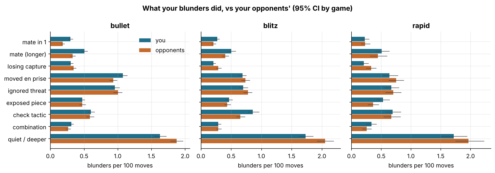
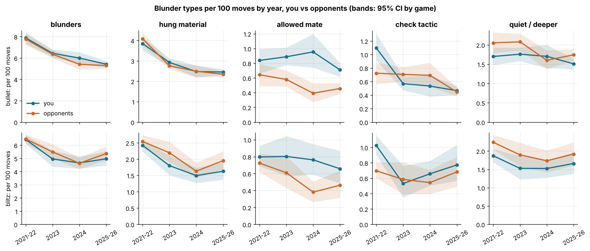

# Blunder anatomy: what kinds of mistakes you make and miss

Data: 6,027 standard live games (3,452 bullet, 1,987 blitz, 588 rapid), 364,685 analysed moves (182,422 yours), player zakihussa1n. A **blunder** here is a move with `cp_loss` ≥ 300 (the `label` used throughout the project): 10,867 of yours and 10,801 by your opponents. Each blunder was classified by replaying the position with python-chess (the played move, the engine's best move, and the engine's best reply, i.e. the stored best move of the next position) with a static exchange evaluation (SEE, piece values 1/3/3/5/9) to decide whether material was free. Rates are per 100 moves of the side in question; numbers are estimate [95% CI] with CIs bootstrapped by game (500 resamples); every number about you sits beside the opponents' number from the same games (you − them: negative = you do it less). `ep_loss` (calibrated expected points lost) is the cost measure; `cp_loss` defines the set.

## 1. Blunders: how often, and how much of the damage they are

Blunders per 100 moves, the mean expected points one blunder costs, and the share of each side's total `ep_loss` (over all its moves) that comes from blunders. The alternative, ep-based definition (`ep_loss` ≥ 0.2) is shown beside it.

| time_class | games | your blunders /100 | their blunders /100 | you − them (/100) | ep per blunder, you | ep per blunder, them | share of ep lost, you | share of ep lost, them | ep≥0.2 /100, you | ep≥0.2 /100, them |
|---|---|---|---|---|---|---|---|---|---|---|
| bullet | 3452 | 6.16 [5.97, 6.35] | 6.00 [5.80, 6.18] | 0.16 [0.02, 0.32] | 0.130 [0.127, 0.133] | 0.130 [0.126, 0.134] | 0.28 | 0.27 | 1.96 [1.84, 2.09] | 2.12 [2.00, 2.26] |
| blitz | 1987 | 5.70 [5.46, 5.95] | 5.85 [5.64, 6.09] | -0.15 [-0.35, 0.06] | 0.178 [0.172, 0.185] | 0.179 [0.174, 0.185] | 0.32 | 0.33 | 2.61 [2.41, 2.80] | 2.62 [2.44, 2.79] |
| rapid | 588 | 5.53 [5.15, 5.96] | 5.72 [5.31, 6.12] | -0.19 [-0.60, 0.19] | 0.185 [0.174, 0.195] | 0.189 [0.179, 0.198] | 0.34 | 0.34 | 2.53 [2.23, 2.81] | 2.72 [2.42, 3.04] |

## 2. What the blunder did: taxonomy of the played move

Each blunder gets exactly one category, in this order of precedence. **Allowed mate** (the opponent has a forced mate after the move; split by mate in 1 vs longer). **Hung material** — the engine's best reply is a capture that wins material by SEE, or a piece (≥ 3 pawns' worth) is simply free — split into: *losing capture* (the played move captured something defended, so the capturing piece is lost), *moved piece en prise* (a non-capture move to a square where the piece can be taken for free), *ignored a threatened piece* (a piece was already attacked before the move and was left there), *exposed another piece* (the move removed a defender, opened a line, or walked into a pin). **Allowed a check tactic** (no material is immediately free but the best reply is a check: forks, skewers, mating attacks). **Allowed a combination** (the best reply is a capture that does not win material by SEE: a sacrifice or exchange tactic). **Quiet refutation / deeper** (the best reply is a quiet move: a deeper threat, a positional punishment, or an error the one-move rules cannot see; this also catches missed mates where nothing material is lost). Rates per 100 moves of that side.

### bullet: 3,452 games

| what the move did | you | opponents | you − them | share of your blunders | share of theirs |
|---|---|---|---|---|---|
| allowed mate in 1 | 0.30 [0.26, 0.34] | 0.18 [0.15, 0.21] | 0.11 [0.07, 0.16] | 0.05 | 0.03 |
| allowed mate (longer) | 0.51 [0.46, 0.55] | 0.33 [0.29, 0.37] | 0.18 [0.11, 0.24] | 0.08 | 0.06 |
| losing capture | 0.30 [0.27, 0.34] | 0.34 [0.31, 0.38] | -0.04 [-0.09, 0.01] | 0.05 | 0.06 |
| moved piece en prise | 1.08 [1.02, 1.14] | 0.93 [0.88, 0.99] | 0.14 [0.06, 0.23] | 0.17 | 0.16 |
| ignored a threatened piece | 0.96 [0.90, 1.03] | 1.00 [0.94, 1.07] | -0.04 [-0.12, 0.05] | 0.16 | 0.17 |
| exposed another piece | 0.47 [0.43, 0.51] | 0.47 [0.43, 0.53] | -0.00 [-0.06, 0.06] | 0.08 | 0.08 |
| allowed a check tactic | 0.60 [0.55, 0.66] | 0.59 [0.54, 0.65] | 0.02 [-0.06, 0.08] | 0.10 | 0.10 |
| allowed a combination | 0.31 [0.27, 0.35] | 0.27 [0.23, 0.30] | 0.04 [-0.01, 0.10] | 0.05 | 0.04 |
| quiet refutation / deeper | 1.63 [1.54, 1.72] | 1.87 [1.78, 1.97] | -0.24 [-0.35, -0.13] | 0.26 | 0.31 |

### blitz: 1,987 games

| what the move did | you | opponents | you − them | share of your blunders | share of theirs |
|---|---|---|---|---|---|
| allowed mate in 1 | 0.27 [0.23, 0.31] | 0.21 [0.17, 0.25] | 0.06 [0.00, 0.12] | 0.05 | 0.04 |
| allowed mate (longer) | 0.50 [0.43, 0.58] | 0.40 [0.35, 0.46] | 0.10 [-0.01, 0.20] | 0.09 | 0.07 |
| losing capture | 0.21 [0.17, 0.25] | 0.29 [0.24, 0.34] | -0.08 [-0.13, -0.03] | 0.04 | 0.05 |
| moved piece en prise | 0.69 [0.62, 0.75] | 0.74 [0.67, 0.81] | -0.05 [-0.16, 0.04] | 0.12 | 0.13 |
| ignored a threatened piece | 0.70 [0.63, 0.78] | 0.78 [0.71, 0.85] | -0.08 [-0.17, 0.01] | 0.12 | 0.13 |
| exposed another piece | 0.46 [0.41, 0.52] | 0.44 [0.39, 0.49] | 0.03 [-0.05, 0.11] | 0.08 | 0.07 |
| allowed a check tactic | 0.86 [0.78, 0.96] | 0.65 [0.58, 0.73] | 0.21 [0.10, 0.33] | 0.15 | 0.11 |
| allowed a combination | 0.29 [0.25, 0.34] | 0.29 [0.25, 0.34] | -0.00 [-0.06, 0.06] | 0.05 | 0.05 |
| quiet refutation / deeper | 1.73 [1.62, 1.86] | 2.06 [1.92, 2.20] | -0.32 [-0.46, -0.18] | 0.30 | 0.35 |

### rapid: 588 games

| what the move did | you | opponents | you − them | share of your blunders | share of theirs |
|---|---|---|---|---|---|
| allowed mate in 1 | 0.22 [0.16, 0.30] | 0.23 [0.16, 0.31] | -0.01 [-0.12, 0.10] | 0.04 | 0.04 |
| allowed mate (longer) | 0.51 [0.40, 0.64] | 0.45 [0.31, 0.60] | 0.06 [-0.13, 0.23] | 0.09 | 0.08 |
| losing capture | 0.21 [0.14, 0.29] | 0.33 [0.25, 0.42] | -0.12 [-0.23, -0.00] | 0.04 | 0.06 |
| moved piece en prise | 0.64 [0.52, 0.78] | 0.75 [0.62, 0.88] | -0.11 [-0.29, 0.07] | 0.12 | 0.13 |
| ignored a threatened piece | 0.67 [0.54, 0.80] | 0.70 [0.57, 0.84] | -0.03 [-0.23, 0.14] | 0.12 | 0.12 |
| exposed another piece | 0.53 [0.42, 0.64] | 0.37 [0.27, 0.46] | 0.17 [0.03, 0.30] | 0.10 | 0.06 |
| allowed a check tactic | 0.69 [0.57, 0.83] | 0.67 [0.54, 0.82] | 0.02 [-0.18, 0.23] | 0.13 | 0.12 |
| allowed a combination | 0.33 [0.24, 0.42] | 0.25 [0.18, 0.34] | 0.08 [-0.04, 0.20] | 0.06 | 0.04 |
| quiet refutation / deeper | 1.72 [1.50, 1.94] | 1.96 [1.75, 2.23] | -0.25 [-0.53, 0.03] | 0.31 | 0.34 |

*Blunders per 100 moves by what the played move did, you vs opponents, by time class.*

The residual 'quiet refutation / deeper' is the largest single category for both sides, so here is what is in it: the share of those blunders played from an already-won position (giving back part of a win, which costs little in expected points), the share where a mate was missed, the share in the endgame (where king and pawn moves lose without any material changing hands for several moves), and the share where the engine's best move would have won free material (a missed capture, with no immediate loss). It costs less per blunder than the other categories.

| side | n | already winning (cp_before > 500) | a mate was missed | in the endgame | best move won free material | mean ep_loss |
|---|---|---|---|---|---|---|
| you | 3046 | 0.289 | 0.108 | 0.396 | 0.197 | 0.131 |
| opponents | 3535 | 0.324 | 0.134 | 0.389 | 0.252 | 0.133 |

### Mates allowed and missed, net of exposure

Allowing a mate depends on how often you are in a position where one can be allowed, so the allowed-mate rate is shown per 100 moves **within bands of the evaluation before the move** (mover's view, cp clipped to ±1000: losing < −300, balanced, winning > 300), and the share of each side's moves spent in each band. Missing a mate is conditioned the same way: among moves where the mover had a forced mate (`mate_before` > 0), the share that let it slip (`missed_mate`, corrected here so that a delivered mate does not count as missed: the stored flag is True for the 1,801 mating moves because the terminal position has no mate distance), and among mates in 1, the share not played.

| time_class | eval_band | allowed mate /100, you | allowed mate /100, them | you − them | share of your moves | share of their moves |
|---|---|---|---|---|---|---|
| bullet | losing | 2.05 [1.82, 2.26] | 1.37 [1.20, 1.55] | 0.68 [0.39, 0.97] | 0.214 | 0.238 |
| bullet | balanced | 0.49 [0.42, 0.56] | 0.22 [0.18, 0.26] | 0.27 [0.19, 0.35] | 0.502 | 0.502 |
| bullet | winning | 0.42 [0.34, 0.50] | 0.30 [0.23, 0.37] | 0.12 [0.02, 0.21] | 0.283 | 0.260 |
| blitz | losing | 2.22 [1.90, 2.52] | 1.61 [1.39, 1.88] | 0.60 [0.13, 1.03] | 0.184 | 0.231 |
| blitz | balanced | 0.46 [0.38, 0.54] | 0.32 [0.26, 0.39] | 0.14 [0.03, 0.24] | 0.540 | 0.539 |
| blitz | winning | 0.42 [0.31, 0.53] | 0.27 [0.19, 0.36] | 0.14 [0.01, 0.28] | 0.277 | 0.230 |
| rapid | losing | 3.01 [2.30, 4.02] | 1.53 [1.16, 1.94] | 1.48 [0.60, 2.39] | 0.150 | 0.267 |
| rapid | balanced | 0.37 [0.25, 0.52] | 0.38 [0.27, 0.52] | -0.01 [-0.21, 0.20] | 0.534 | 0.539 |
| rapid | winning | 0.25 [0.09, 0.47] | 0.32 [0.10, 0.63] | -0.07 [-0.30, 0.15] | 0.316 | 0.194 |

| time_class | mate slipped, you | mate slipped, them | you − them (any mate) | moves with a mate | mate in 1 missed, you | mate in 1 missed, them | moves with mate in 1 |
|---|---|---|---|---|---|---|---|
| bullet | 0.181 [0.166, 0.198] | 0.175 [0.162, 0.187] | 0.006 [-0.016, 0.026] | 12204 | 0.188 [0.160, 0.217] | 0.178 [0.150, 0.204] | 1805 |
| blitz | 0.139 [0.121, 0.157] | 0.135 [0.120, 0.153] | 0.004 [-0.017, 0.025] | 6707 | 0.122 [0.089, 0.162] | 0.134 [0.100, 0.169] | 1017 |
| rapid | 0.142 [0.114, 0.173] | 0.142 [0.108, 0.181] | 0.000 [-0.049, 0.048] | 1726 | 0.075 [0.031, 0.120] | 0.125 [0.065, 0.197] | 258 |

## 3. What the blunder missed: taxonomy of the engine's best move

The same blunders classified by what the best move was, in order of precedence: a **mate** was available (mate in 1 vs longer); the best move won **free material** (a capture with positive SEE); the best move was **saving a threatened piece** (a piece of yours could be taken for a gain before the move, and after the best move the opponent's best capture gains less); another **capture** (even trade or sacrifice); a **check**; you were **in check** and the best move was a different reply; or a **quiet move** (the engine wanted something the rules cannot name: a retreat, a prophylactic move, a pawn move, a deeper tactic).

### bullet

| what the best move was | you | opponents | you − them | share of your blunders | share of theirs |
|---|---|---|---|---|---|
| mate in 1 | 0.09 [0.07, 0.11] | 0.12 [0.10, 0.15] | -0.03 [-0.07, -0.00] | 0.01 | 0.02 |
| mate (longer) | 0.24 [0.20, 0.28] | 0.31 [0.27, 0.36] | -0.07 [-0.13, -0.02] | 0.04 | 0.05 |
| free material | 1.12 [1.04, 1.19] | 1.34 [1.26, 1.41] | -0.22 [-0.31, -0.12] | 0.18 | 0.22 |
| saving a threatened piece | 1.49 [1.41, 1.57] | 1.39 [1.32, 1.46] | 0.10 [0.00, 0.22] | 0.24 | 0.23 |
| capture (even or sacrifice) | 0.33 [0.30, 0.38] | 0.41 [0.37, 0.45] | -0.08 [-0.13, -0.02] | 0.05 | 0.07 |
| check | 0.28 [0.24, 0.31] | 0.26 [0.22, 0.29] | 0.02 [-0.02, 0.06] | 0.04 | 0.04 |
| in check: another reply | 0.26 [0.23, 0.29] | 0.23 [0.19, 0.26] | 0.03 [-0.02, 0.08] | 0.04 | 0.04 |
| quiet move | 2.35 [2.26, 2.46] | 1.94 [1.84, 2.03] | 0.41 [0.30, 0.54] | 0.38 | 0.32 |

### blitz

| what the best move was | you | opponents | you − them | share of your blunders | share of theirs |
|---|---|---|---|---|---|
| mate in 1 | 0.07 [0.05, 0.10] | 0.10 [0.07, 0.13] | -0.03 [-0.06, 0.01] | 0.01 | 0.02 |
| mate (longer) | 0.26 [0.22, 0.31] | 0.31 [0.26, 0.37] | -0.05 [-0.13, 0.03] | 0.05 | 0.05 |
| free material | 0.66 [0.60, 0.74] | 1.00 [0.92, 1.09] | -0.34 [-0.45, -0.24] | 0.12 | 0.17 |
| saving a threatened piece | 1.30 [1.21, 1.40] | 1.36 [1.28, 1.46] | -0.06 [-0.19, 0.05] | 0.23 | 0.23 |
| capture (even or sacrifice) | 0.35 [0.30, 0.41] | 0.45 [0.39, 0.51] | -0.10 [-0.17, -0.03] | 0.06 | 0.08 |
| check | 0.25 [0.21, 0.30] | 0.32 [0.27, 0.37] | -0.07 [-0.14, -0.01] | 0.04 | 0.05 |
| in check: another reply | 0.38 [0.33, 0.45] | 0.25 [0.21, 0.30] | 0.14 [0.07, 0.20] | 0.07 | 0.04 |
| quiet move | 2.43 [2.29, 2.58] | 2.06 [1.94, 2.20] | 0.37 [0.19, 0.55] | 0.43 | 0.35 |

### rapid

| what the best move was | you | opponents | you − them | share of your blunders | share of theirs |
|---|---|---|---|---|---|
| mate in 1 | 0.04 [0.01, 0.07] | 0.05 [0.02, 0.09] | -0.01 [-0.05, 0.04] | 0.01 | 0.01 |
| mate (longer) | 0.33 [0.22, 0.46] | 0.34 [0.24, 0.47] | -0.01 [-0.17, 0.15] | 0.06 | 0.06 |
| free material | 0.58 [0.45, 0.71] | 0.80 [0.66, 0.93] | -0.22 [-0.40, -0.04] | 0.10 | 0.14 |
| saving a threatened piece | 1.33 [1.15, 1.50] | 1.45 [1.27, 1.66] | -0.13 [-0.37, 0.12] | 0.24 | 0.25 |
| capture (even or sacrifice) | 0.37 [0.27, 0.48] | 0.49 [0.37, 0.61] | -0.13 [-0.26, 0.01] | 0.07 | 0.09 |
| check | 0.20 [0.13, 0.29] | 0.25 [0.18, 0.34] | -0.05 [-0.15, 0.05] | 0.04 | 0.04 |
| in check: another reply | 0.40 [0.30, 0.50] | 0.34 [0.23, 0.44] | 0.06 [-0.08, 0.21] | 0.07 | 0.06 |
| quiet move | 2.29 [2.07, 2.57] | 1.99 [1.77, 2.23] | 0.29 [-0.02, 0.62] | 0.41 | 0.35 |

## 4. What gets hung, and the most common patterns

Among blunders that hung material (section 2's four 'hung' categories), the piece that could be taken for free (per the engine's reply, else the SEE victim), as a count per 100 games of each side, all time classes pooled. Queens and rooks are the expensive ones.

| piece hung | you: per 100 games | you: n | you: mean ep_loss | opponents: per 100 games | opponents: n | opponents: mean ep_loss |
|---|---|---|---|---|---|---|
| pawn | 17.2 [16.2, 18.4] | 1037 | 0.134 | 16.6 [15.5, 17.7] | 1002 | 0.137 |
| knight | 18.3 [17.1, 19.5] | 1105 | 0.132 | 17.0 [16.0, 18.0] | 1023 | 0.140 |
| bishop | 15.3 [14.3, 16.4] | 924 | 0.138 | 15.1 [14.3, 16.1] | 912 | 0.144 |
| rook | 12.8 [11.8, 13.8] | 772 | 0.151 | 14.3 [13.2, 15.3] | 862 | 0.167 |
| queen | 12.0 [11.2, 13.0] | 726 | 0.203 | 13.7 [12.8, 14.7] | 827 | 0.201 |

The ten most common (what the move did × what was missed) combinations among **your** blunders, all time classes pooled, with the share of your blunders, the opponents' share of theirs, and the mean `ep_loss` of such a blunder for you.

| what the move did | what the best move was | your n | share of your blunders | share of theirs | your mean ep_loss |
|---|---|---|---|---|---|
| quiet refutation / deeper | quiet move | 1218 | 0.112 | 0.110 | 0.122 |
| ignored a threatened piece | saving a threatened piece | 893 | 0.082 | 0.084 | 0.135 |
| moved piece en prise | quiet move | 809 | 0.074 | 0.061 | 0.136 |
| quiet refutation / deeper | free material | 599 | 0.055 | 0.083 | 0.131 |
| allowed a check tactic | quiet move | 584 | 0.054 | 0.044 | 0.155 |
| quiet refutation / deeper | saving a threatened piece | 446 | 0.041 | 0.040 | 0.122 |
| allowed mate (longer) | quiet move | 435 | 0.040 | 0.027 | 0.166 |
| moved piece en prise | saving a threatened piece | 389 | 0.036 | 0.035 | 0.152 |
| exposed another piece | quiet move | 346 | 0.032 | 0.026 | 0.135 |
| allowed a combination | quiet move | 289 | 0.027 | 0.017 | 0.112 |

## 5. One-move or deeper? Refutation depth and how often blunders are punished

No engine was run for this question, so the depth of the refutation is read off the game itself: following the actual continuation **only while the punishing side played the engine's best move**, how many of its moves passed before the material balance (1/3/3/5/9) moved against the blunderer by at least a pawn, or the game ended in mate. 'Immediate' = material lost on the very next move; 'within 2–3 moves' = after a check, a fork or an in-between move; 'not within 3 moves' = the refutation was positional, a longer mating attack, or the punishing side left the engine line (in which case the depth is unknown and the blunder is counted under 'line left / unknown'). Shares of each side's blunders, all time classes pooled, then per time class the share of blunders that were **punished** (the opponent's reply lost less than 100 cp of the gift, i.e. kept most of the advantage) and the share where the opponent found the engine's best reply.

| refutation depth | your blunders: share | your blunders: n | your blunders: share of resolved | their blunders: share | their blunders: n | their blunders: share of resolved |
|---|---|---|---|---|---|---|
| immediate | 0.222 | 2411 | 0.645 | 0.247 | 2670 | 0.704 |
| within 2–3 moves | 0.071 | 770 | 0.206 | 0.066 | 715 | 0.188 |
| mate within 3 moves | 0.040 | 431 | 0.115 | 0.026 | 283 | 0.075 |
| not within 3 moves | 0.012 | 125 | 0.033 | 0.012 | 127 | 0.033 |
| line left / unknown | 0.656 | 7130 |  | 0.649 | 7006 |  |

'Share of resolved' conditions on the blunders whose refutation could be followed (the punisher stayed on the engine line until material or mate decided it, or for three moves). Read it as: of the blunders that were refuted on the board, roughly two thirds lost material on the very next move; genuinely deep refutations are rare in this pool.

| time_class | your blunders punished | their blunders punished (by you) | best reply found vs you | best reply found by you |
|---|---|---|---|---|
| bullet | 0.553 [0.540, 0.566] | 0.551 [0.537, 0.563] | 0.450 [0.437, 0.465] | 0.445 [0.433, 0.458] |
| blitz | 0.573 [0.554, 0.590] | 0.616 [0.598, 0.634] | 0.481 [0.463, 0.501] | 0.509 [0.493, 0.526] |
| rapid | 0.582 [0.548, 0.619] | 0.647 [0.619, 0.680] | 0.490 [0.455, 0.526] | 0.544 [0.513, 0.578] |

Punishment by category (share of blunders where the reply kept most of the advantage), all time classes pooled: which of your gifts your opponents actually take, and which of theirs you take.

| what the move did | your blunders punished | n_you | their blunders punished by you | n_opponents |
|---|---|---|---|---|
| allowed mate in 1 | 0.681 [0.636, 0.727] | 508 | 0.671 [0.615, 0.723] | 353 |
| allowed mate (longer) | 0.560 [0.525, 0.596] | 907 | 0.509 [0.470, 0.552] | 650 |
| losing capture | 0.752 [0.711, 0.792] | 463 | 0.787 [0.756, 0.819] | 588 |
| moved piece en prise | 0.637 [0.615, 0.660] | 1633 | 0.674 [0.648, 0.700] | 1535 |
| ignored a threatened piece | 0.651 [0.624, 0.675] | 1534 | 0.720 [0.699, 0.742] | 1633 |
| exposed another piece | 0.588 [0.555, 0.622] | 860 | 0.627 [0.592, 0.660] | 820 |
| allowed a check tactic | 0.455 [0.425, 0.485] | 1265 | 0.452 [0.424, 0.484] | 1123 |
| allowed a combination | 0.545 [0.502, 0.587] | 556 | 0.624 [0.580, 0.671] | 497 |
| quiet refutation / deeper | 0.464 [0.446, 0.484] | 2953 | 0.463 [0.446, 0.482] | 3435 |

## 6. By piece moved and by phase

Blunder rate per 100 moves **of that piece** (so the rows are comparable: a queen move is more likely to be a blunder than a pawn move), you vs opponents, per time class, and the hung-material and allowed-mate rates per 100 moves by phase.

| time_class | piece | you | opponents | you − them | moves |
|---|---|---|---|---|---|
| bullet | pawn | 4.92 [4.67, 5.19] | 4.64 [4.41, 4.93] | 0.28 [-0.05, 0.59] | 61198 |
| bullet | knight | 6.33 [5.92, 6.68] | 6.39 [5.99, 6.84] | -0.06 [-0.58, 0.42] | 36747 |
| bullet | bishop | 6.07 [5.66, 6.47] | 6.19 [5.77, 6.56] | -0.11 [-0.60, 0.42] | 31735 |
| bullet | rook | 7.65 [7.11, 8.13] | 7.44 [6.95, 7.92] | 0.22 [-0.35, 0.85] | 31126 |
| bullet | queen | 9.19 [8.61, 9.73] | 8.16 [7.66, 8.68] | 1.03 [0.33, 1.79] | 24045 |
| bullet | king | 4.77 [4.33, 5.19] | 4.70 [4.28, 5.12] | 0.07 [-0.50, 0.60] | 30057 |
| blitz | pawn | 4.66 [4.30, 5.02] | 4.16 [3.79, 4.52] | 0.51 [0.10, 0.92] | 33044 |
| blitz | knight | 5.47 [5.01, 5.91] | 6.45 [5.98, 6.96] | -0.98 [-1.65, -0.36] | 19662 |
| blitz | bishop | 5.98 [5.46, 6.54] | 5.83 [5.32, 6.30] | 0.15 [-0.58, 0.83] | 16952 |
| blitz | rook | 6.90 [6.29, 7.53] | 7.57 [6.96, 8.22] | -0.67 [-1.44, 0.23] | 16504 |
| blitz | queen | 8.12 [7.45, 8.84] | 8.37 [7.64, 9.02] | -0.25 [-1.22, 0.74] | 13318 |
| blitz | king | 4.93 [4.41, 5.49] | 4.62 [4.19, 5.15] | 0.30 [-0.30, 0.96] | 18071 |
| rapid | pawn | 4.23 [3.57, 4.92] | 4.53 [3.91, 5.26] | -0.30 [-1.10, 0.50] | 8700 |
| rapid | knight | 5.59 [4.71, 6.48] | 6.07 [5.20, 7.01] | -0.48 [-1.78, 0.72] | 5547 |
| rapid | bishop | 5.59 [4.70, 6.51] | 5.77 [4.82, 6.65] | -0.18 [-1.47, 0.92] | 4647 |
| rapid | rook | 5.88 [4.98, 6.78] | 6.52 [5.45, 7.75] | -0.64 [-2.05, 0.69] | 4520 |
| rapid | queen | 8.07 [6.90, 9.43] | 8.80 [7.44, 10.11] | -0.73 [-2.53, 1.02] | 4045 |
| rapid | king | 5.11 [3.95, 6.24] | 4.35 [3.50, 5.30] | 0.76 [-0.50, 2.06] | 4767 |

### By phase

| time_class | phase | blunders /100, you | blunders /100, them | hung material /100, you | hung material /100, them | allowed mate /100, you | allowed mate /100, them |
|---|---|---|---|---|---|---|---|
| bullet | opening | 4.11 [3.91, 4.36] | 4.30 [4.08, 4.53] | 2.18 [2.04, 2.35] | 2.21 [2.05, 2.38] | 0.27 [0.21, 0.33] | 0.21 [0.16, 0.27] |
| bullet | middlegame | 8.74 [8.37, 9.09] | 8.20 [7.85, 8.58] | 4.04 [3.81, 4.26] | 3.99 [3.77, 4.23] | 1.17 [1.03, 1.32] | 0.68 [0.58, 0.79] |
| bullet | endgame | 5.96 [5.62, 6.31] | 5.78 [5.52, 6.11] | 2.39 [2.21, 2.57] | 2.26 [2.10, 2.42] | 1.00 [0.88, 1.12] | 0.66 [0.57, 0.76] |
| blitz | opening | 3.65 [3.36, 3.93] | 4.11 [3.85, 4.39] | 1.77 [1.58, 1.97] | 2.08 [1.89, 2.30] | 0.20 [0.14, 0.26] | 0.25 [0.18, 0.33] |
| blitz | middlegame | 8.44 [7.88, 8.96] | 8.39 [7.91, 8.87] | 3.32 [3.02, 3.61] | 3.47 [3.19, 3.74] | 1.20 [1.01, 1.41] | 0.79 [0.64, 0.94] |
| blitz | endgame | 5.61 [5.19, 6.05] | 5.61 [5.21, 6.03] | 1.37 [1.21, 1.55] | 1.48 [1.31, 1.67] | 0.99 [0.85, 1.15] | 0.82 [0.68, 0.96] |
| rapid | opening | 3.98 [3.45, 4.45] | 4.36 [3.86, 4.88] | 1.94 [1.62, 2.30] | 2.12 [1.78, 2.48] | 0.23 [0.11, 0.35] | 0.31 [0.18, 0.46] |
| rapid | middlegame | 8.25 [7.33, 9.13] | 8.03 [7.25, 8.94] | 3.27 [2.77, 3.87] | 3.23 [2.75, 3.73] | 1.21 [0.84, 1.64] | 0.80 [0.50, 1.11] |
| rapid | endgame | 4.96 [4.25, 5.61] | 5.27 [4.49, 5.94] | 1.14 [0.87, 1.43] | 1.26 [0.94, 1.63] | 0.88 [0.64, 1.16] | 0.98 [0.70, 1.32] |

## 7. Which kinds of blunder changed over the years

Rates per 100 moves by year (2021 is folded into 2022 and 2026 into 2025; a few games each), per time class, for the overall blunder rate and the three big families. The opponents' rate in the same games is the control: the opponent pool is matched to your rating, so a type of blunder that fell for you but not for them is a real change in your play; one that fell for both reflects a change in the games (rating level, time control, opponents). Rapid has no games in 2024 and 35 in 2025.

### bullet

| year | games | blunders, you | blunders, them | hung material, you | hung material, them | allowed mate, you | allowed mate, them |
|---|---|---|---|---|---|---|---|
| 2021-22 | 707 | 7.88 [7.34, 8.40] | 7.76 [7.21, 8.28] | 3.85 [3.51, 4.16] | 4.08 [3.73, 4.38] | 0.84 [0.66, 1.00] | 0.64 [0.49, 0.80] |
| 2023 | 956 | 6.44 [6.09, 6.79] | 6.35 [5.99, 6.73] | 2.92 [2.73, 3.13] | 2.76 [2.58, 2.95] | 0.89 [0.77, 1.01] | 0.58 [0.48, 0.70] |
| 2024 | 312 | 5.99 [5.44, 6.55] | 5.41 [4.91, 5.89] | 2.48 [2.19, 2.77] | 2.49 [2.19, 2.78] | 0.95 [0.74, 1.20] | 0.39 [0.27, 0.53] |
| 2025-26 | 1477 | 5.42 [5.13, 5.71] | 5.29 [5.03, 5.53] | 2.45 [2.32, 2.60] | 2.34 [2.21, 2.50] | 0.71 [0.62, 0.80] | 0.46 [0.38, 0.53] |

### blitz

| year | games | blunders, you | blunders, them | hung material, you | hung material, them | allowed mate, you | allowed mate, them |
|---|---|---|---|---|---|---|---|
| 2021-22 | 1120 | 6.43 [6.10, 6.77] | 6.47 [6.13, 6.81] | 2.42 [2.23, 2.58] | 2.54 [2.36, 2.73] | 0.80 [0.69, 0.93] | 0.72 [0.62, 0.83] |
| 2023 | 280 | 4.96 [4.37, 5.57] | 5.49 [4.99, 6.07] | 1.80 [1.51, 2.10] | 2.19 [1.92, 2.53] | 0.80 [0.57, 1.04] | 0.61 [0.43, 0.81] |
| 2024 | 327 | 4.66 [4.23, 5.16] | 4.63 [4.20, 5.05] | 1.50 [1.27, 1.74] | 1.63 [1.42, 1.89] | 0.76 [0.59, 0.95] | 0.38 [0.26, 0.51] |
| 2025-26 | 260 | 4.97 [4.45, 5.52] | 5.37 [4.86, 5.90] | 1.63 [1.37, 1.90] | 1.95 [1.69, 2.24] | 0.66 [0.49, 0.87] | 0.46 [0.32, 0.64] |

### rapid

| year | games | blunders, you | blunders, them | hung material, you | hung material, them | allowed mate, you | allowed mate, them |
|---|---|---|---|---|---|---|---|
| 2021-22 | 219 | 5.81 [5.06, 6.49] | 5.80 [5.16, 6.49] | 2.55 [2.17, 2.95] | 2.55 [2.18, 2.94] | 0.69 [0.45, 0.94] | 0.71 [0.47, 0.96] |
| 2023 | 334 | 5.29 [4.78, 5.80] | 5.59 [5.01, 6.14] | 1.82 [1.59, 2.10] | 1.97 [1.67, 2.28] | 0.67 [0.47, 0.85] | 0.66 [0.49, 0.85] |
| 2025-26 | 35 | 6.20 [4.76, 8.00] | 6.31 [4.71, 8.53] | 1.74 [1.13, 2.38] | 1.83 [1.16, 2.68] | 1.40 [0.67, 2.42] | 0.66 [0.13, 1.38] |

*Blunder families per 100 moves by year, bullet (top) and blitz (bottom); shaded bands are 95% CIs.*

## 8. Robustness: the same taxonomy on `ep_loss` ≥ 0.2 errors

Moves with `ep_loss` ≥ 0.2 (a fifth of a point given away): 4,055 of yours, 4,260 of the opponents'; 76% of yours are also cp-blunders (the rest are mostly `mistake`-labelled moves in balanced positions, where 100–300 cp is a lot of expected points). Shares of each side's big errors by what the move did, all time classes pooled, to check the taxonomy is not an artefact of the cp threshold.

| what the move did | you: share (ep≥0.2) | you: share (cp blunders) | opponents: share (ep≥0.2) | opponents: share (cp blunders) |
|---|---|---|---|---|
| allowed mate in 1 | 0.067 | 0.047 | 0.047 | 0.033 |
| allowed mate (longer) | 0.100 | 0.085 | 0.072 | 0.061 |
| losing capture | 0.040 | 0.044 | 0.046 | 0.055 |
| moved piece en prise | 0.138 | 0.153 | 0.138 | 0.144 |
| ignored a threatened piece | 0.122 | 0.143 | 0.138 | 0.153 |
| exposed another piece | 0.081 | 0.080 | 0.073 | 0.076 |
| allowed a check tactic | 0.119 | 0.116 | 0.098 | 0.104 |
| allowed a combination | 0.036 | 0.051 | 0.037 | 0.046 |
| quiet refutation / deeper | 0.298 | 0.280 | 0.351 | 0.327 |

## What this means for the player

You blunder about as often as the opponents matched to your rating (bullet 6.16 [5.97, 6.35] vs 6.00 [5.80, 6.18], blitz 5.70 [5.46, 5.95] vs 5.85 [5.64, 6.09], rapid 5.53 [5.15, 5.96] vs 5.72 [5.31, 6.12] per 100 moves) and your blunders are the same kinds as theirs: 42% of yours simply hand over material (a piece left en prise, moved en prise, or a capture of a defended piece), 13% allow a mate, 12% walk into a check-based tactic, and 28% are refuted by a quiet move (a third of those from positions you had already won). You hung your queen 726 times and a rook 772 times. Two differences from your opponents survive the confidence intervals. First, you **allow mates more often** at every level of the evaluation, not because you are in lost positions more (you are in them less): you − them per 100 moves is bullet 0.18 [0.11, 0.24] (longer) and 0.11 [0.07, 0.16] (in 1); blitz 0.10 [-0.01, 0.20] (longer) and 0.06 [0.00, 0.12] (in 1); rapid 0.06 [-0.13, 0.23] (longer) and -0.01 [-0.12, 0.10] (in 1); mate-in-1 allowed is the most expensive blunder there is, and the one a half-second 'what does this reply threaten?' check removes. Second, your blunders are **less often a missed free capture** than theirs (bullet -0.22 [-0.31, -0.12]; blitz -0.34 [-0.45, -0.24]; rapid -0.22 [-0.40, -0.04] per 100 moves; 16% of your blunders missed free material vs 24% that missed saving a threatened piece) and more often a missed quiet move (bullet 0.41 [0.30, 0.54]; blitz 0.37 [0.19, 0.55]; rapid 0.29 [-0.02, 0.62]): you see what is on offer, you under-see what the opponent is about to do. The useful habit is therefore the defensive one: before moving, name the opponent's best reply, check whether anything of yours (the moved piece first) can be taken for free, and whether that reply is a check or a mate threat.

## Caveats

- The taxonomy is rule-based and coarse: a static exchange evaluation ignores pins beyond legality, promotions other than to a queen, and any tactic longer than one capture sequence; 'quiet refutation / deeper' is a residual, not a diagnosis.
- A blunder is defined by `cp_loss` ≥ 300 on evals clipped at ±1000, so errors in already-decided positions are under-counted and the missed mates that keep a winning position are mostly labelled 'good' (section 8 checks the taxonomy under the ep-based definition instead).
- The engine's best reply is the stored best move of the next position; it is missing when the blunder was the last move of the game (about 1.6% of blunders), where the SEE threat is used alone.
- Refutation depth is read off the game continuation while the punishing side stayed on the engine's best move, not from an engine line; no Stockfish re-search was run (the optional step in the plan was skipped). The depth distribution is therefore conditional on the opponent finding the line, and 'line left / unknown' is large.
- 'Punished' uses the next move's `cp_loss` < 100, a cp criterion; one-move punishment only, not conversion of the game.
- Years mix rating levels and time controls (2022 was blitz-heavy, 2025 bullet-heavy); the opponents' rate in the same games is the control, but the comparison across years is descriptive, not causal.
- All evaluations are Stockfish 17.1 at 1M nodes; at that depth the 'best move' in sharp positions is sometimes not the only good move, so 'what was missed' is the engine's preference, not a unique truth.
- An earlier `moves_analysed` table flagged the 1,801 moves that delivered mate as `missed_mate` (5,144 flags instead of 3,339); `analysed.py` was fixed and the script guards against stale tables anyway. The blunder taxonomy is unaffected (a delivered mate has `cp_loss` 0).
- Opponent ratings are post-game and are not used anywhere here except through the matched-opponent design.
