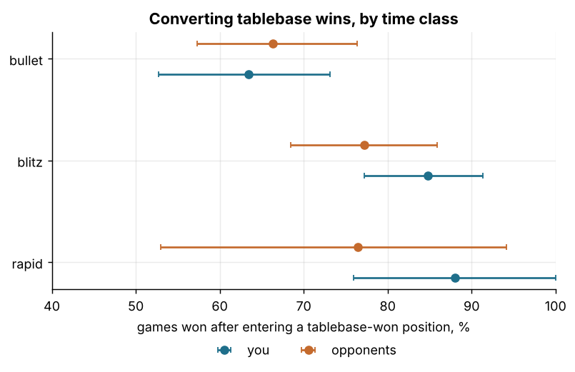
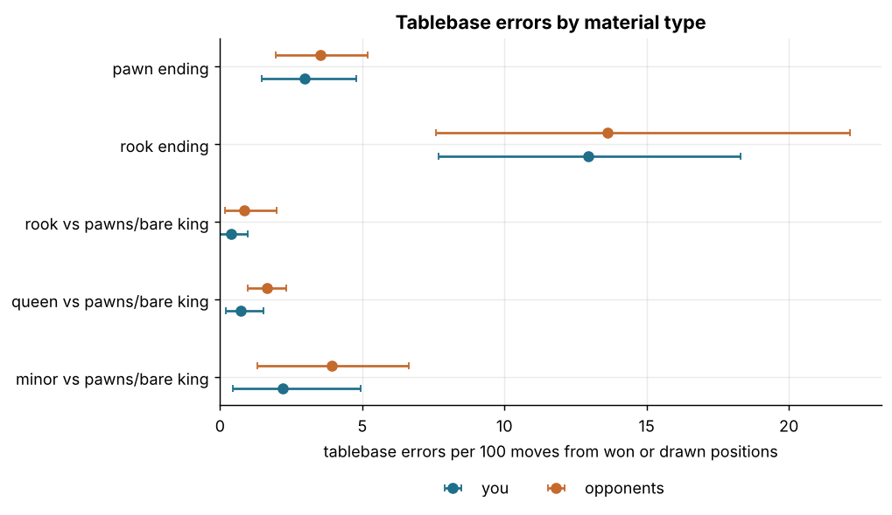
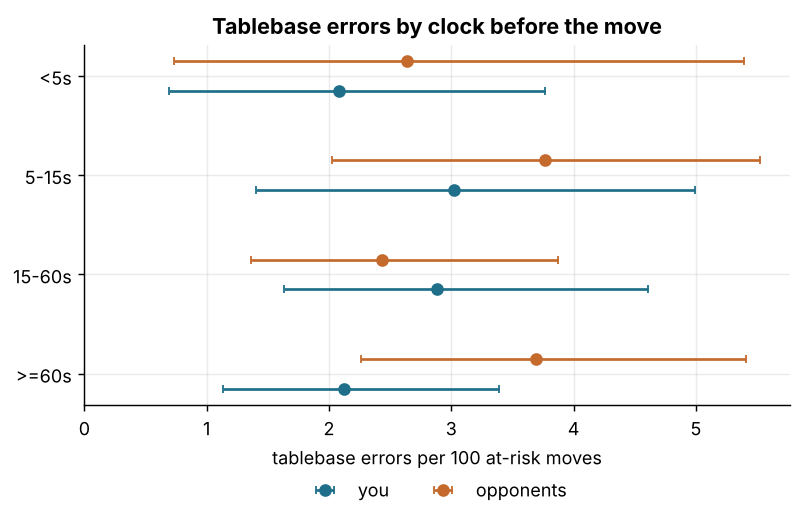
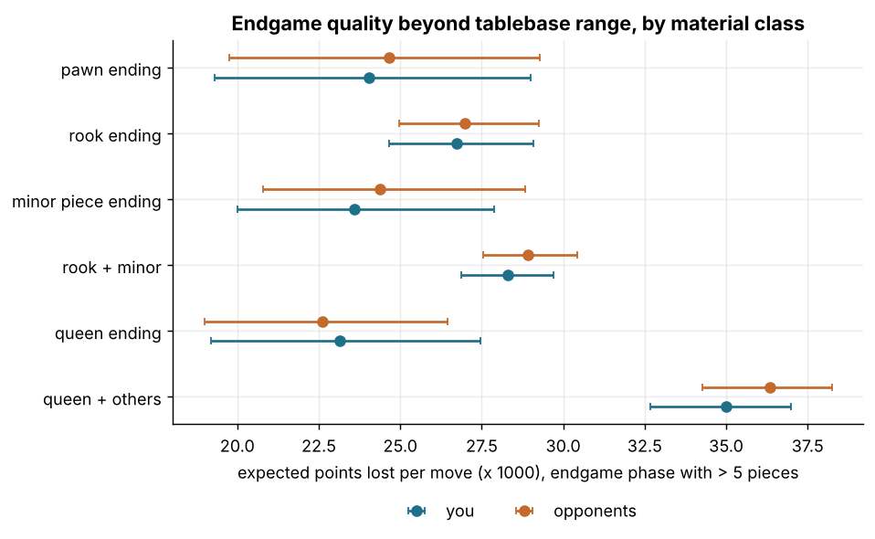

# Q10. Endgame technique: converting wins, holding draws, and which endgames go wrong

Data: 6,029 standard live games, 364,685 analysed moves. **Tablebase layer:** 9,898 moves in 469 games reached a position with at most 5 pieces, where Syzygy gives the exact result before and after every move (160 tablebase errors in total, 72 by you and 88 by opponents). **Beyond 5 pieces:** 121,412 endgame-phase moves in 3,768 games, judged by calibrated expected points lost (`ep_loss`) and centipawn loss. Every estimate is shown as estimate [95% CI], bootstrapped by game; every number about you is paired with the opponents' number from the same games.

## 1. Did you convert tablebase wins and hold tablebase draws?

For each game, the first position with at most 5 pieces fixes the theoretical result for the rest of the game (pieces can only leave the board). A **conversion** is a tablebase win that ended as a win on the scoreboard; a **hold** is a tablebase draw that did not end as a loss. Your conversion rate is compared with the opponents' conversion rate in the games where *they* had the tablebase win against you, and likewise for holds. Entry states from your side: won 210 games, drawn 61, lost 198.

| time class | your conversion % (n) | opponents' conversion % (n) | difference (pts) | your hold % (n drawn) | opponents' hold % |
|---|---|---|---|---|---|
| all | 75.7 [69.5, 81.9] (210) | 72.2 [65.7, 77.8] (198) | 3.5 [-5.2, 12.2] | 80.3 [70.5, 90.2] (61) | 86.9 [78.7, 93.4] |
| bullet | 63.4 [52.7, 73.1] (93) | 66.3 [57.3, 76.4] (89) | -2.9 [-17.3, 11.4] | 62.5 [37.5, 81.4] (16) | 87.5 [68.8, 100.0] |
| blitz | 84.8 [77.2, 91.3] (92) | 77.2 [68.5, 85.9] (92) | 7.6 [-4.3, 19.6] | 83.3 [69.4, 94.4] (36) | 83.3 [69.4, 94.4] |
| rapid | 88.0 [75.9, 100.0] (25) | 76.5 [52.9, 94.1] (17) | 11.5 [-12.2, 35.1] | 100.0 [100.0, 100.0] (9) | 100.0 [100.0, 100.0] |

Hold rates use the same drawn games for both sides (a draw you failed to hold is a draw they converted), so they are not independent of each other: both are shown because a drawn tablebase position that ends decisively is somebody's failure and somebody's swindle.

*Share of tablebase-won endings (<= 5 pieces) that ended as a win, you vs opponents, with 95% game-bootstrap CIs.*

### How the failed conversions and failed holds ended

Failed conversions: 51 of yours, 55 of the opponents'. 'Tablebase error' means the winning side made at least one move that changed the theoretical result; 'no tablebase error' means the win was never thrown away over the board and the game ended otherwise (timeout, repetition, agreement). 'Timeout vs insufficient material' is the chess.com rule that a flag fall against a bare king (or king and minor piece) is a draw.

| how it ended | you (bullet) | you (blitz) | you (rapid) | you (all) | opponents (bullet) | opponents (blitz) | opponents (rapid) | opponents (all) |
|---|---|---|---|---|---|---|---|---|
| no tablebase error: timeout vs insufficient | 21 | 2 | 0 | 23 | 14 | 1 | 0 | 15 |
| tablebase error by the winner | 5 | 10 | 3 | 18 | 12 | 18 | 3 | 33 |
| no tablebase error: timeout | 8 | 2 | 0 | 10 | 4 | 0 | 0 | 4 |
| no tablebase error: agreement | 0 | 0 | 0 | 0 | 0 | 1 | 0 | 1 |
| no tablebase error: repetition | 0 | 0 | 0 | 0 | 0 | 1 | 1 | 2 |

Clock: 35 of your tablebase wins ended lost or drawn on the clock (with or without an earlier tablebase error), against 21 of the opponents'.

## 2. Tablebase errors per move

A tablebase error is a move that turns a won position into a drawn or lost one, or a drawn position into a lost one. The denominator is moves played from won or drawn positions (a lost position cannot be made worse in tablebase terms). Rates are per 100 such moves.

| time class | you: errors / 100 moves | your errors / moves | opponents: errors / 100 moves | their errors / moves | games |
|---|---|---|---|---|---|
| all | 2.6 [1.8, 3.4] | 72 / 2810 | 3.2 [2.5, 4.0] | 88 / 2769 | 464 |
| bullet | 2.5 [1.2, 4.2] | 22 / 878 | 3.0 [1.7, 4.4] | 28 / 920 | 194 |
| blitz | 2.6 [1.7, 3.7] | 39 / 1505 | 3.2 [2.3, 4.6] | 50 / 1542 | 219 |
| rapid | 2.6 [1.0, 4.6] | 11 / 427 | 3.3 [1.2, 6.0] | 10 / 307 | 51 |

By kind of error (denominator: moves from won positions for the first two rows, from drawn positions for the third):

| kind | you: % of such positions | your errors / moves | opponents: % | their errors / moves |
|---|---|---|---|---|
| win -> draw | 1.4 [0.9, 2.0] | 32 / 2281 | 2.8 [2.0, 3.8] | 63 / 2245 |
| win -> loss | 0.1 [0.0, 0.2] | 2 / 2281 | 0.1 [0.0, 0.3] | 3 / 2245 |
| draw -> loss | 7.2 [4.0, 10.2] | 38 / 529 | 4.2 [2.0, 6.9] | 22 / 524 |

Calibrated expected points lost per move inside tablebase range (all positions, both sides; the engine and the tablebase never disagree on the result class here):

| time class | ep_loss you | ep_loss opponents | ep_loss diff | cp_loss you | cp_loss opponents | games |
|---|---|---|---|---|---|---|
| bullet | 0.0272 [0.0225, 0.0327] | 0.0282 [0.0231, 0.0338] | -0.0010 [-0.0028, 0.0008] | 25.1 [17.5, 34.2] | 27.7 [19.9, 35.7] | 198 |
| blitz | 0.0205 [0.0175, 0.0243] | 0.0228 [0.0188, 0.0266] | -0.0023 [-0.0039, -0.0008] | 19.3 [14.6, 23.7] | 23.0 [18.1, 27.9] | 220 |
| rapid | 0.0141 [0.0094, 0.0190] | 0.0145 [0.0102, 0.0189] | -0.0004 [-0.0031, 0.0021] | 19.5 [10.5, 27.9] | 21.7 [12.0, 31.4] | 51 |

## 3. Which endgame types go wrong (<= 5 pieces)

Error rate per 100 moves from won-or-drawn positions, by coarse material class (classes with fewer than 30 such moves dropped):

| material | you: errors / 100 moves | yours | opponents: errors / 100 moves | theirs | games |
|---|---|---|---|---|---|
| pawn ending | 3.0 [1.5, 4.8] | 15 / 505 | 3.5 [2.0, 5.2] | 21 / 595 | 164 |
| rook ending | 12.9 [7.7, 18.3] | 29 / 224 | 13.6 [7.6, 22.1] | 27 / 198 | 52 |
| rook vs pawns/bare king | 0.4 [0.0, 1.0] | 3 / 748 | 0.9 [0.2, 2.0] | 4 / 467 | 157 |
| queen ending | 10.0 [0.0, 25.5] | 5 / 50 | 8.2 [0.0, 20.9] | 4 / 49 | 13 |
| queen vs pawns/bare king | 0.7 [0.2, 1.5] | 7 / 949 | 1.6 [1.0, 2.3] | 19 / 1160 | 263 |
| queen vs rook/minor | 2.1 [0.0, 5.5] | 1 / 48 | 3.4 [0.0, 16.2] | 1 / 29 | 21 |
| rook vs minor | 24.0 [0.0, 41.1] | 6 / 25 | 10.5 [0.0, 22.2] | 4 / 38 | 15 |
| minor vs minor | 3.0 [0.0, 9.5] | 1 / 33 | 0.0 [0.0, 0.0] | 0 / 30 | 11 |
| minor vs pawns/bare king | 2.2 [0.4, 5.0] | 5 / 228 | 3.9 [1.3, 6.6] | 8 / 203 | 73 |

*Tablebase error rate per 100 at-risk moves by material class (classes with at least 100 such moves per side), you vs opponents, 95% game-bootstrap CIs.*

The exact material balances with the most errors (counts, no CIs: these cells are too small for them to mean much; 'KRvKRP' is the mover with a bare rook against rook and pawn, i.e. the defender):

| material (mover first) | your errors / moves | opponents' errors / moves |
|---|---|---|
| KRvKRP | 13 / 54 | 16 / 60 |
| KRPvKR | 12 / 114 | 10 / 81 |
| KPvK | 4 / 163 | 9 / 224 |
| KvKP | 7 / 114 | 2 / 27 |
| KPPvKP | 1 / 57 | 7 / 67 |
| KQvK | 1 / 385 | 6 / 398 |
| KBvKR | 5 / 15 | 0 / 0 |
| KQvKP | 3 / 84 | 2 / 18 |
| KQvKQP | 4 / 16 | 0 / 12 |
| KRvKB | 0 / 0 | 3 / 18 |
| KQPvKQ | 0 / 12 | 3 / 15 |
| KPPvK | 1 / 74 | 2 / 130 |

Conversion errors only (moves from *won* positions):

| material | winning side, you: errors / 100 | yours | winning side, opponents | theirs |
|---|---|---|---|---|
| minor vs pawns/bare king | 2.1 [0.0, 5.2] | 3 / 145 | 5.0 [1.5, 9.3] | 6 / 121 |
| pawn ending | 1.6 [0.4, 2.9] | 5 / 315 | 4.6 [2.2, 7.7] | 19 / 415 |
| queen vs pawns/bare king | 0.6 [0.1, 1.2] | 6 / 940 | 1.6 [0.9, 2.2] | 18 / 1150 |
| queen vs rook/minor | 2.2 [0.0, 5.8] | 1 / 46 | 0.0 [0.0, 0.0] | 0 / 24 |
| rook ending | 17.1 [9.1, 27.4] | 14 / 82 | 21.8 [9.6, 44.0] | 12 / 55 |
| rook vs minor | 11.1 [0.0, 37.5] | 1 / 9 | 15.4 [0.0, 42.9] | 4 / 26 |
| rook vs pawns/bare king | 0.1 [0.0, 0.4] | 1 / 732 | 0.9 [0.2, 1.9] | 4 / 448 |

Holding errors only (moves from *drawn* positions):

| material | drawn position, you: errors / 100 | yours | drawn position, opponents | theirs |
|---|---|---|---|---|
| minor vs minor | 0.0 [0.0, 0.0] | 0 / 28 | 0.0 [0.0, 0.0] | 0 / 29 |
| minor vs pawns/bare king | 2.4 [0.0, 8.3] | 2 / 83 | 2.4 [0.0, 6.7] | 2 / 82 |
| pawn ending | 5.3 [2.1, 10.0] | 10 / 190 | 1.1 [0.0, 3.2] | 2 / 180 |
| queen ending | 7.0 [0.0, 18.3] | 3 / 43 | 2.3 [0.0, 10.9] | 1 / 44 |
| rook ending | 10.6 [4.6, 17.7] | 15 / 142 | 10.5 [4.4, 19.3] | 15 / 143 |
| rook vs pawns/bare king | 12.5 [0.0, 40.0] | 2 / 16 | 0.0 [0.0, 0.0] | 0 / 19 |

## 4. Clock, distance to conversion, and time spent

Error rate by the mover's clock before the move (all time classes pooled; tablebase positions are mostly reached late in the game, so the clock is usually low):

| clock before move | you: errors / 100 moves | yours | opponents: errors / 100 moves | theirs | games |
|---|---|---|---|---|---|
| <5s | 2.1 [0.7, 3.8] | 8 / 384 | 2.6 [0.7, 5.4] | 7 / 265 | 127 |
| 5-15s | 3.0 [1.4, 5.0] | 19 / 629 | 3.8 [2.0, 5.5] | 21 / 558 | 183 |
| 15-60s | 2.9 [1.6, 4.6] | 26 / 903 | 2.4 [1.4, 3.9] | 23 / 945 | 187 |
| >=60s | 2.1 [1.1, 3.4] | 19 / 894 | 3.7 [2.3, 5.4] | 37 / 1001 | 160 |

Split by time class, below and above 15 seconds (cells with fewer than 30 moves on either side dropped):

| time class | clock | you: errors / 100 moves | yours | opponents: errors / 100 moves | theirs |
|---|---|---|---|---|---|
| bullet | <15s | 2.4 [1.0, 4.5] | 18 / 736 | 2.9 [1.6, 4.5] | 19 / 654 |
| bullet | >=15s | 2.8 [0.6, 5.7] | 4 / 142 | 3.4 [1.1, 6.7] | 9 / 266 |
| blitz | <15s | 3.4 [1.1, 5.8] | 9 / 268 | 5.3 [2.3, 9.8] | 9 / 169 |
| blitz | >=15s | 2.4 [1.3, 3.6] | 30 / 1237 | 3.0 [1.8, 4.2] | 41 / 1373 |
| rapid | >=15s | 2.6 [1.0, 4.7] | 11 / 418 | 3.3 [1.2, 6.0] | 10 / 307 |

*Tablebase error rate by the mover's remaining clock, you vs opponents, 95% game-bootstrap CIs.*

Won positions only, by DTZ (Syzygy distance-to-zeroing: how many moves of best play until a capture or pawn move that keeps the win; longer means a harder, more technical win). Error rate and the time spent on the move:

| DTZ (moves to a capture/pawn move keeping the win) | you: errors / 100 won-position moves | yours | opponents: errors / 100 | theirs | seconds spent, you | seconds spent, opponents |
|---|---|---|---|---|---|---|
| 1-2 | 0.7 [0.3, 1.3] | 9 / 1235 | 1.9 [1.1, 2.9] | 25 / 1305 | 1.29 [1.13, 1.49] | 1.41 [1.18, 1.65] |
| 3-5 | 3.6 [1.9, 5.4] | 17 / 476 | 5.7 [3.5, 8.6] | 26 / 455 | 1.86 [1.47, 2.21] | 2.57 [2.12, 2.98] |
| 6-10 | 1.2 [0.0, 2.9] | 3 / 252 | 4.4 [2.0, 7.6] | 9 / 205 | 1.27 [1.04, 1.55] | 2.27 [1.71, 2.79] |
| 11-20 | 1.6 [0.4, 3.3] | 4 / 253 | 2.7 [0.9, 5.6] | 6 / 223 | 1.63 [1.29, 2.03] | 1.75 [1.23, 2.25] |
| 21+ | 1.5 [0.0, 4.6] | 1 / 65 | 0.0 [0.0, 0.0] | 0 / 57 | 1.96 [1.33, 3.01] | 1.98 [1.34, 2.77] |

Time spent per move while winning in tablebase range, by time class:

| time class | seconds per move, you | seconds per move, opponents | share of remaining clock, you | share of remaining clock, opponents | games |
|---|---|---|---|---|---|
| bullet | 0.61 [0.55, 0.67] | 0.62 [0.54, 0.71] | 0.129 [0.112, 0.148] | 0.099 [0.081, 0.116] | 182 |
| blitz | 1.75 [1.54, 1.96] | 2.27 [2.00, 2.56] | 0.060 [0.050, 0.070] | 0.057 [0.046, 0.070] | 195 |
| rapid | 2.36 [1.84, 2.98] | 3.15 [2.56, 3.60] | 0.020 [0.011, 0.032] | 0.012 [0.009, 0.016] | 45 |

## 5. Beyond tablebase range: endgame-phase quality by material class (> 5 pieces)

The endgame phase (material heuristic from the enrichment) with more than 5 pieces on the board, judged by calibrated expected points lost per move (`ep_loss`, main measure) and centipawn loss (`cp_loss`, secondary). The material class is from the piece types on the board regardless of side.

Cells with fewer than 200 moves are dropped.

| time class | material | ep_loss you | ep_loss opponents | ep_loss diff (you - opp) | cp_loss you | cp_loss opponents | moves | games |
|---|---|---|---|---|---|---|---|---|
| bullet | pawn ending | 0.0207 [0.0152, 0.0264] | 0.0225 [0.0169, 0.0288] | -0.0018 [-0.0048, 0.0014] | 64 [52, 77] | 66 [53, 80] | 1670 | 135 |
| bullet | rook ending | 0.0259 [0.0231, 0.0287] | 0.0262 [0.0234, 0.0292] | -0.0003 [-0.0014, 0.0009] | 62 [58, 66] | 58 [54, 62] | 12723 | 578 |
| bullet | minor piece ending | 0.0230 [0.0181, 0.0280] | 0.0235 [0.0185, 0.0283] | -0.0006 [-0.0023, 0.0011] | 58 [51, 66] | 59 [50, 67] | 4250 | 224 |
| bullet | rook + minor | 0.0269 [0.0253, 0.0286] | 0.0279 [0.0262, 0.0297] | -0.0011 [-0.0017, -0.0004] | 75 [72, 78] | 74 [71, 77] | 34511 | 1549 |
| bullet | queen ending | 0.0273 [0.0222, 0.0331] | 0.0257 [0.0209, 0.0320] | 0.0016 [-0.0018, 0.0051] | 35 [22, 48] | 30 [19, 42] | 1756 | 145 |
| bullet | queen + others | 0.0355 [0.0330, 0.0382] | 0.0370 [0.0346, 0.0394] | -0.0015 [-0.0028, -0.0003] | 74 [69, 80] | 72 [66, 77] | 19186 | 1327 |
| blitz | pawn ending | 0.0316 [0.0222, 0.0409] | 0.0309 [0.0225, 0.0401] | 0.0007 [-0.0055, 0.0068] | 64 [45, 82] | 56 [41, 75] | 778 | 67 |
| blitz | rook ending | 0.0299 [0.0256, 0.0342] | 0.0300 [0.0259, 0.0346] | -0.0001 [-0.0018, 0.0016] | 64 [57, 72] | 66 [59, 73] | 6369 | 261 |
| blitz | minor piece ending | 0.0238 [0.0178, 0.0306] | 0.0243 [0.0182, 0.0310] | -0.0005 [-0.0026, 0.0015] | 58 [49, 67] | 58 [48, 68] | 3109 | 116 |
| blitz | rook + minor | 0.0306 [0.0278, 0.0333] | 0.0305 [0.0278, 0.0329] | 0.0002 [-0.0010, 0.0012] | 69 [66, 73] | 70 [66, 73] | 18333 | 756 |
| blitz | queen ending | 0.0184 [0.0125, 0.0250] | 0.0183 [0.0128, 0.0248] | 0.0002 [-0.0040, 0.0048] | 30 [17, 46] | 32 [17, 54] | 978 | 62 |
| blitz | queen + others | 0.0359 [0.0317, 0.0400] | 0.0361 [0.0322, 0.0401] | -0.0003 [-0.0026, 0.0017] | 74 [66, 82] | 76 [68, 83] | 8222 | 591 |
| rapid | rook ending | 0.0206 [0.0137, 0.0276] | 0.0212 [0.0146, 0.0288] | -0.0006 [-0.0036, 0.0029] | 58 [47, 70] | 57 [48, 69] | 1629 | 58 |
| rapid | minor piece ending | 0.0264 [0.0111, 0.0474] | 0.0299 [0.0142, 0.0503] | -0.0035 [-0.0076, 0.0007] | 41 [28, 54] | 44 [32, 58] | 685 | 33 |
| rapid | rook + minor | 0.0295 [0.0243, 0.0355] | 0.0301 [0.0244, 0.0358] | -0.0007 [-0.0026, 0.0015] | 61 [54, 67] | 64 [58, 70] | 4820 | 188 |
| rapid | queen + others | 0.0275 [0.0221, 0.0343] | 0.0312 [0.0254, 0.0376] | -0.0037 [-0.0077, 0.0002] | 67 [55, 81] | 80 [65, 95] | 2162 | 151 |

*Mean ep_loss per endgame-phase move with more than 5 pieces by material class (all time classes), you vs opponents, 95% game-bootstrap CIs.*

Share of endgame-phase moves (> 5 pieces) that lost at least 0.10 expected points:

| time class | you: moves losing >= 0.10 expected points, % | opponents: % | difference (pts) | games |
|---|---|---|---|---|
| bullet | 9.0 [8.5, 9.7] | 9.3 [8.8, 9.9] | -0.3 [-0.6, -0.0] | 2376 |
| blitz | 9.3 [8.4, 10.2] | 9.4 [8.6, 10.3] | -0.1 [-0.5, 0.3] | 1108 |
| rapid | 7.6 [6.0, 9.7] | 8.1 [6.6, 9.9] | -0.5 [-1.1, 0.2] | 284 |

## What this means for the player

Over the board, your technique in the simplest endings is at least as good as rating-matched opponents': you convert tablebase-won endings 76% of the time [70, 82] against their 72% [66, 78], and you throw away a win or draw on 2.6 moves per 100 [1.8, 3.4] against their 3.2 [2.5, 4.0]. The split by kind is the useful part: you spoil *won* positions less often than they do (1.4 [0.9, 2.0] vs 2.8 [2.0, 3.8] per 100 moves) but lose *drawn* positions more often (7.2 [4.0, 10.2] vs 4.2 [2.0, 6.9]), mostly in pawn endings and rook endings, so defending drawn endings (Philidor, the opposition) is the technique gap. The material class that costs most, for both sides, is the **rook ending** (12.9 errors per 100 at-risk moves in your hands [7.7, 18.3], 29 of 224; opponents 13.6 [7.6, 22.1]), driven by rook and pawn versus rook from either side. The biggest single leak, though, is not technique but the clock: 33 of your 51 failed conversions ended by timeout or 'timeout vs insufficient material' without any tablebase error, 29 of them in bullet, where your conversion rate is only 63% [53, 73]. In a trivially won bullet ending the job is to mate fast and safely, not to play the tablebase-best move; keeping a pawn or a second piece on the board also stops the insufficient-material draw when the flag falls.

## Caveats

- Only 9,898 moves in 469 games reach tablebase range, and only 160 of them are errors (72 yours); every material or clock cell is small and the CIs say so. Treat differences whose CIs include zero as unresolved.
- Game-level conversion compares different games for you and for the opponents (the games where you were winning vs the games where they were); the difference CI treats them as independent samples. Opponents are rating-matched (within about 27 points) but are many different people.
- The tablebase columns hold only win/draw/loss (no 'cursed win' distinction for the 50-move rule); repetition, 50-move and agreed draws without any tablebase error are counted as failed conversions by the rules, not as technique errors.
- Tablebase positions arrive late in the game, so clock effects are confounded with the time class and with how long the game has lasted; the clock table pools time classes and the split table is coarse for that reason.
- Beyond 5 pieces, 'endgame' is the material heuristic from the enrichment, and material classes are coarse (piece types present, regardless of which side has what); `ep_loss` is calibrated on these games with pre-game ratings and is the main measure, `cp_loss` secondary.
- Time spent per move is from the clock comments and undercounts lag and pre-move time; DTZ is from the side to move and binned coarsely.
- Bootstrap CIs are clustered by game with fixed seeds (n_boot 1000 for small tables, 500 for cells).
