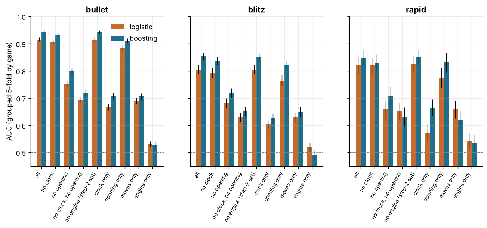
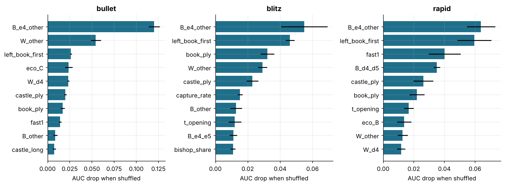
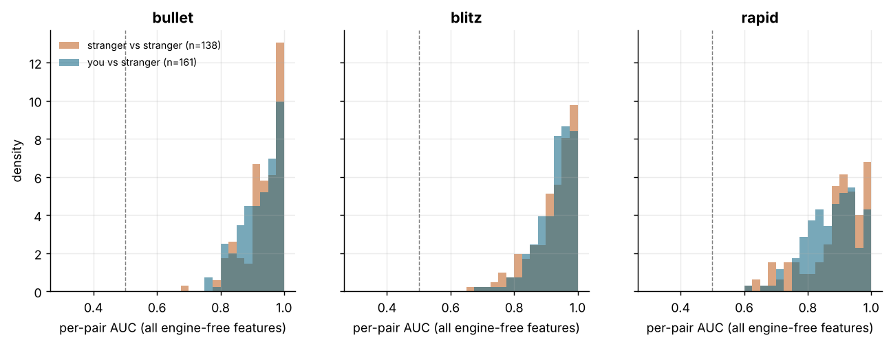
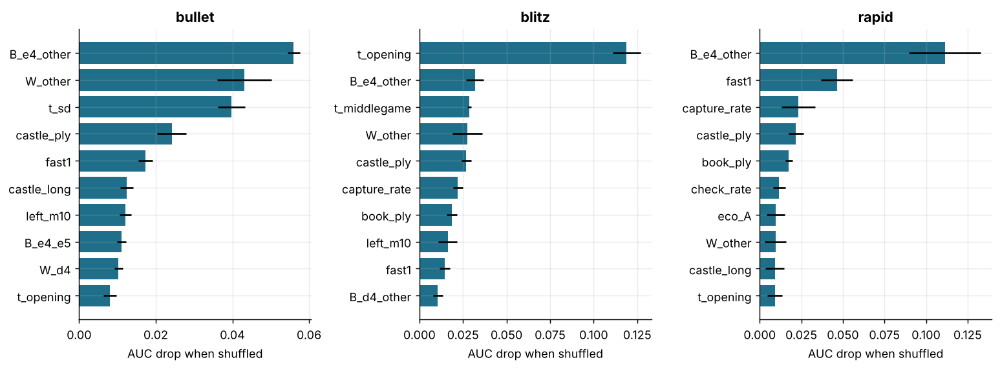

# Style fingerprint: can a classifier pick your games out?

6,029 standard live games and 364,685 analysed moves from `load_data()`, bullet 3,453, blitz 1,987, rapid 589. Every number is estimate [95% CI], bootstrapped over games unless stated. Context: this is the behavioural-stylometry question of McIlroy-Young et al. (2021) and the Maia project, asked of one club player with features that need no engine (plus the engine-based error profile in step 1).

## 1. Features

One row per player-game (both sides of each of your games): 51 features in four groups. **clock** (11): time spent per move as a fraction of the base time by phase, its spread and maximum, fraction of base left after your 10th / 20th / 40th / last move, share of moves started under 10 s, share of moves under 1 s. **moves** (16): number of own moves, game length in plies, capture and check rates, whether / when (own move number) / which side you castled, share of moves by piece (king moves exclude castling), promotions, en-passant captures, queen moves in the first 10. **opening** (18): first move as White (e4 / d4 / other) or reply as Black (to e4: e5 / c5 / other; to d4: d5 / Nf6 / other; other), ECO letter of the deepest named line, book depth (plies), whether you were the one to leave the named lines. **engine** (6; step 1 only): mean `ep_loss`, share of moves losing >= 0.1 and >= 0.2 ep, mean `cp_loss`, share >= 300 cp, share of engine-best moves. Excluded on purpose: result, ratings, names, colour, time control, termination, final position evaluation. Games where a side made fewer than 8 moves are dropped; step 1 keeps 5,715 games (11,430 rows). Clock fractions of the base time are clipped at 1.5 (a handful of strangers' games in odd time controls carry clock glitches; none of yours is affected). Two reading notes: the `B_*` opening features on a Black row encode the opponent's first move as well as the reply (`B_other` means 'White opened with neither e4 nor d4', not a choice of the Black player); and `game_plies`, `eco_*`, `book_ply` describe the game, so in step 1 they are identical for both rows of a game and can only matter through interactions with the other features.

## 2. Step 1: you vs your opponent in the same games

Both rows of a game sit in the same cross-validation fold (5-fold grouped by game), so the model never sees the other half of a test game. AUC is the probability that a random row of yours scores above a random opponent row; accuracy is at a 0.5 threshold; 'pairwise' is the share of games in which your row scores above the opponent's (the paired design's natural test; chance 0.5). Logistic regression: median imputation, standardisation, L2 (C = 0.5). Boosting: scikit-learn HistGradientBoosting (200 trees, 15 leaves), missing values handled natively.

### bullet: 3,313 games

| features | model | AUC | accuracy | pairwise |
|---|---|---|---|---|
| all | logistic | 0.915 [0.908, 0.924] | 0.833 [0.824, 0.843] | 0.867 [0.856, 0.879] |
| all | boosting | 0.944 [0.938, 0.951] | 0.865 [0.857, 0.874] | 0.900 [0.891, 0.911] |
| no clock | logistic | 0.907 [0.899, 0.915] | 0.812 [0.802, 0.824] | 0.848 [0.837, 0.861] |
| no clock | boosting | 0.933 [0.926, 0.940] | 0.841 [0.832, 0.851] | 0.881 [0.871, 0.892] |
| no opening | logistic | 0.752 [0.742, 0.762] | 0.693 [0.683, 0.704] | 0.763 [0.750, 0.778] |
| no opening | boosting | 0.800 [0.790, 0.809] | 0.722 [0.712, 0.733] | 0.800 [0.786, 0.811] |
| no clock, no opening | logistic | 0.694 [0.683, 0.705] | 0.639 [0.628, 0.649] | 0.699 [0.684, 0.716] |
| no clock, no opening | boosting | 0.720 [0.708, 0.731] | 0.654 [0.644, 0.665] | 0.725 [0.710, 0.738] |
| no engine (step-2 set) | logistic | 0.915 [0.907, 0.923] | 0.831 [0.822, 0.842] | 0.862 [0.851, 0.873] |
| no engine (step-2 set) | boosting | 0.943 [0.938, 0.949] | 0.860 [0.852, 0.869] | 0.900 [0.891, 0.911] |
| clock only | logistic | 0.668 [0.656, 0.680] | 0.632 [0.622, 0.643] | 0.691 [0.675, 0.706] |
| clock only | boosting | 0.707 [0.695, 0.719] | 0.652 [0.641, 0.662] | 0.717 [0.702, 0.732] |
| opening only | logistic | 0.883 [0.873, 0.894] | 0.783 [0.771, 0.797] | 0.808 [0.797, 0.822] |
| opening only | boosting | 0.911 [0.902, 0.920] | 0.820 [0.807, 0.832] | 0.839 [0.827, 0.851] |
| moves only | logistic | 0.689 [0.679, 0.700] | 0.633 [0.622, 0.644] | 0.693 [0.677, 0.709] |
| moves only | boosting | 0.706 [0.694, 0.718] | 0.648 [0.637, 0.659] | 0.711 [0.696, 0.725] |
| engine only | logistic | 0.531 [0.520, 0.541] | 0.527 [0.517, 0.537] | 0.538 [0.521, 0.554] |
| engine only | boosting | 0.528 [0.514, 0.542] | 0.521 [0.509, 0.533] | 0.538 [0.521, 0.555] |

### blitz: 1,867 games

| features | model | AUC | accuracy | pairwise |
|---|---|---|---|---|
| all | logistic | 0.805 [0.790, 0.822] | 0.724 [0.709, 0.741] | 0.755 [0.735, 0.773] |
| all | boosting | 0.853 [0.839, 0.866] | 0.766 [0.751, 0.780] | 0.814 [0.796, 0.830] |
| no clock | logistic | 0.792 [0.775, 0.810] | 0.712 [0.696, 0.731] | 0.744 [0.725, 0.765] |
| no clock | boosting | 0.836 [0.821, 0.852] | 0.760 [0.744, 0.775] | 0.796 [0.779, 0.814] |
| no opening | logistic | 0.681 [0.666, 0.699] | 0.636 [0.621, 0.654] | 0.695 [0.674, 0.715] |
| no opening | boosting | 0.720 [0.703, 0.736] | 0.659 [0.644, 0.674] | 0.732 [0.712, 0.753] |
| no clock, no opening | logistic | 0.631 [0.612, 0.647] | 0.596 [0.579, 0.611] | 0.633 [0.612, 0.655] |
| no clock, no opening | boosting | 0.651 [0.634, 0.670] | 0.606 [0.590, 0.622] | 0.633 [0.611, 0.656] |
| no engine (step-2 set) | logistic | 0.806 [0.790, 0.822] | 0.727 [0.711, 0.743] | 0.757 [0.738, 0.776] |
| no engine (step-2 set) | boosting | 0.850 [0.837, 0.864] | 0.762 [0.746, 0.775] | 0.807 [0.789, 0.823] |
| clock only | logistic | 0.604 [0.590, 0.618] | 0.576 [0.562, 0.589] | 0.642 [0.620, 0.664] |
| clock only | boosting | 0.625 [0.607, 0.642] | 0.586 [0.570, 0.599] | 0.641 [0.618, 0.661] |
| opening only | logistic | 0.764 [0.745, 0.785] | 0.690 [0.671, 0.711] | 0.690 [0.668, 0.712] |
| opening only | boosting | 0.822 [0.805, 0.839] | 0.743 [0.724, 0.761] | 0.754 [0.735, 0.773] |
| moves only | logistic | 0.631 [0.612, 0.647] | 0.603 [0.587, 0.617] | 0.640 [0.617, 0.662] |
| moves only | boosting | 0.650 [0.632, 0.669] | 0.606 [0.589, 0.623] | 0.653 [0.630, 0.675] |
| engine only | logistic | 0.519 [0.504, 0.536] | 0.517 [0.503, 0.533] | 0.519 [0.497, 0.542] |
| engine only | boosting | 0.492 [0.475, 0.510] | 0.492 [0.478, 0.508] | 0.493 [0.471, 0.514] |

### rapid: 535 games

| features | model | AUC | accuracy | pairwise |
|---|---|---|---|---|
| all | logistic | 0.822 [0.789, 0.851] | 0.732 [0.700, 0.761] | 0.787 [0.750, 0.821] |
| all | boosting | 0.850 [0.821, 0.876] | 0.768 [0.738, 0.798] | 0.815 [0.777, 0.850] |
| no clock | logistic | 0.821 [0.789, 0.850] | 0.743 [0.713, 0.772] | 0.783 [0.747, 0.815] |
| no clock | boosting | 0.830 [0.800, 0.861] | 0.736 [0.705, 0.770] | 0.787 [0.749, 0.822] |
| no opening | logistic | 0.659 [0.624, 0.691] | 0.609 [0.578, 0.637] | 0.660 [0.619, 0.703] |
| no opening | boosting | 0.708 [0.674, 0.740] | 0.646 [0.611, 0.675] | 0.693 [0.654, 0.733] |
| no clock, no opening | logistic | 0.653 [0.621, 0.684] | 0.604 [0.573, 0.631] | 0.641 [0.598, 0.678] |
| no clock, no opening | boosting | 0.631 [0.597, 0.666] | 0.588 [0.560, 0.621] | 0.615 [0.577, 0.653] |
| no engine (step-2 set) | logistic | 0.825 [0.792, 0.853] | 0.736 [0.702, 0.764] | 0.783 [0.748, 0.817] |
| no engine (step-2 set) | boosting | 0.850 [0.820, 0.877] | 0.772 [0.742, 0.802] | 0.815 [0.778, 0.849] |
| clock only | logistic | 0.572 [0.541, 0.603] | 0.552 [0.527, 0.581] | 0.581 [0.539, 0.626] |
| clock only | boosting | 0.665 [0.635, 0.695] | 0.616 [0.586, 0.643] | 0.658 [0.616, 0.699] |
| opening only | logistic | 0.774 [0.738, 0.812] | 0.721 [0.684, 0.757] | 0.736 [0.697, 0.776] |
| opening only | boosting | 0.832 [0.796, 0.866] | 0.760 [0.725, 0.798] | 0.772 [0.735, 0.812] |
| moves only | logistic | 0.659 [0.625, 0.691] | 0.609 [0.579, 0.637] | 0.634 [0.592, 0.671] |
| moves only | boosting | 0.619 [0.588, 0.652] | 0.558 [0.531, 0.585] | 0.604 [0.565, 0.647] |
| engine only | logistic | 0.543 [0.511, 0.572] | 0.538 [0.513, 0.564] | 0.559 [0.512, 0.601] |
| engine only | boosting | 0.534 [0.498, 0.565] | 0.514 [0.484, 0.542] | 0.563 [0.514, 0.602] |

Headline: with everything, boosting separates you from your opponents with AUC bullet 0.944 [0.938, 0.951]; blitz 0.853 [0.839, 0.866]; rapid 0.850 [0.821, 0.876] (logistic regression 0.915 / 0.805 / 0.822; the best single number is bullet boosting). Dropping the clock group costs +0.011, +0.017, +0.019 AUC (bullet / blitz / rapid), dropping the opening group +0.144, +0.133, +0.141; with neither (moves + engine only) AUC is 0.720, 0.651, 0.631. The engine error profile alone gives 0.528, 0.492, 0.534 and the clock profile alone 0.707, 0.625, 0.665.

*Step 1: you vs your opponents in the same games, AUC by feature set and model, 95% game-bootstrap CIs. Dashed line = chance.*

### Train on other years, test on one year

Full feature set; a year is a test year when it has at least 100 games in the time class. 'all held-out' pools the held-out predictions. Pairwise = share of games where your row scores higher.

| time_class | test year | games | logistic AUC | boosting AUC | pairwise (logistic) | pairwise (boosting) |
|---|---|---|---|---|---|---|
| bullet | 2022 | 640 | 0.703 [0.668, 0.737] | 0.740 [0.703, 0.773] | 0.670 [0.634, 0.706] | 0.694 [0.657, 0.730] |
| bullet | 2023 | 923 | 0.938 [0.926, 0.949] | 0.957 [0.949, 0.967] | 0.883 [0.861, 0.902] | 0.924 [0.908, 0.941] |
| bullet | 2024 | 307 | 0.954 [0.936, 0.969] | 0.973 [0.958, 0.984] | 0.899 [0.866, 0.935] | 0.945 [0.915, 0.969] |
| bullet | 2025 | 1417 | 0.932 [0.920, 0.943] | 0.948 [0.939, 0.957] | 0.877 [0.858, 0.894] | 0.907 [0.892, 0.921] |
| bullet | all held-out | 3287 | 0.882 [0.871, 0.893] | 0.908 [0.899, 0.917] | 0.841 [0.828, 0.853] | 0.874 [0.863, 0.885] |
| blitz | 2022 | 1032 | 0.545 [0.513, 0.582] | 0.600 [0.571, 0.636] | 0.543 [0.513, 0.573] | 0.570 [0.539, 0.600] |
| blitz | 2023 | 260 | 0.825 [0.783, 0.864] | 0.879 [0.842, 0.910] | 0.769 [0.717, 0.819] | 0.831 [0.783, 0.873] |
| blitz | 2024 | 318 | 0.835 [0.794, 0.871] | 0.874 [0.839, 0.905] | 0.789 [0.745, 0.830] | 0.849 [0.808, 0.890] |
| blitz | 2025 | 254 | 0.855 [0.814, 0.891] | 0.901 [0.866, 0.927] | 0.807 [0.764, 0.856] | 0.862 [0.819, 0.898] |
| blitz | all held-out | 1864 | 0.644 [0.623, 0.666] | 0.695 [0.675, 0.717] | 0.652 [0.634, 0.675] | 0.694 [0.675, 0.715] |
| rapid | 2022 | 184 | 0.706 [0.633, 0.766] | 0.716 [0.662, 0.772] | 0.679 [0.609, 0.745] | 0.685 [0.620, 0.750] |
| rapid | 2023 | 318 | 0.804 [0.757, 0.841] | 0.777 [0.739, 0.815] | 0.755 [0.706, 0.799] | 0.726 [0.681, 0.777] |
| rapid | all held-out | 502 | 0.754 [0.718, 0.792] | 0.748 [0.712, 0.781] | 0.727 [0.688, 0.763] | 0.711 [0.673, 0.752] |

Year-out AUC (boosting): bullet 0.908 [0.899, 0.917], blitz 0.695 [0.675, 0.717], rapid 0.748 [0.712, 0.781] vs the game-grouped 0.944, 0.853, 0.850: the fingerprint transfers across years where the two are close (bullet); the gap is how much of it is year-specific (rating level, time-control mix, repertoire of the time), and it is large in blitz, rapid.

### Which features carry it

Left: the 12 largest standardised logistic coefficients (positive = more of it marks your row; fit on all games). Right: boosting permutation importance (AUC drop when the feature is shuffled in a held-out fold, mean of 5 shuffles). Below each: your per-game mean vs the opponents' in the same games for the top features, paired difference bootstrapped by game. Game-level features (`game_plies`, `eco_*`, `book_ply`) are identical for both rows of a game, so their difference is exactly zero: they rank only through interactions (e.g. 'a C-code game *and* this castling timing'). The `B_*` features on your Black rows also encode what the opponent opened with (`B_other` = White played neither e4 nor d4), not only your reply.

#### bullet

Logistic coefficients (standardised):

| feature | coef |
|---|---|
| B_e4_other | -1.58 |
| W_other | -1.21 |
| B_other | 0.81 |
| B_e4_e5 | 0.78 |
| B_d4_d5 | 0.77 |
| pawn_share | 0.64 |
| W_e4 | 0.64 |
| eco_C | -0.60 |
| eco_A | 0.54 |
| W_d4 | -0.52 |
| left_book_first | 0.51 |
| fast1 | -0.51 |

Boosting permutation importance (AUC drop):

| feature | auc_drop | sd |
|---|---|---|
| B_e4_other | 0.120 | 0.006 |
| W_other | 0.054 | 0.006 |
| left_book_first | 0.026 | 0.001 |
| eco_C | 0.024 | 0.004 |
| W_d4 | 0.023 | 0.001 |
| castle_ply | 0.020 | 0.001 |
| book_ply | 0.017 | 0.002 |
| fast1 | 0.014 | 0.002 |
| B_other | 0.009 | 0.002 |
| castle_long | 0.008 | 0.002 |
| eco_B | 0.007 | 0.001 |
| B_e4_c5 | 0.007 | 0.000 |

Per-game means, you vs opponents in the same games:

| feature | you | opponents | you − opp | games |
|---|---|---|---|---|
| B_e4_other | 0.004 [0.002, 0.006] | 0.257 [0.243, 0.273] | -0.253 [-0.270, -0.240] | 3313 |
| W_other | 0.001 [0.000, 0.003] | 0.099 [0.088, 0.109] | -0.097 [-0.108, -0.087] | 3313 |
| left_book_first | 0.638 [0.623, 0.656] | 0.362 [0.344, 0.377] | 0.277 [0.245, 0.312] | 3313 |
| eco_C | 0.507 [0.490, 0.524] | 0.507 [0.490, 0.524] | 0.000 [0.000, 0.000] | 3313 |
| W_d4 | 0.020 [0.015, 0.024] | 0.119 [0.108, 0.129] | -0.099 [-0.111, -0.087] | 3313 |
| castle_ply | 8.686 [8.502, 8.895] | 11.015 [10.822, 11.209] | -2.330 [-2.578, -2.096] | 1778 |
| B_other | 0.099 [0.088, 0.109] | 0.001 [0.000, 0.003] | 0.097 [0.087, 0.108] | 3313 |
| B_e4_e5 | 0.272 [0.257, 0.288] | 0.184 [0.168, 0.195] | 0.089 [0.067, 0.112] | 3313 |
| B_d4_d5 | 0.107 [0.098, 0.118] | 0.007 [0.004, 0.010] | 0.101 [0.091, 0.112] | 3313 |
| pawn_share | 0.305 [0.302, 0.308] | 0.278 [0.274, 0.281] | 0.027 [0.023, 0.031] | 3313 |

#### blitz

Logistic coefficients (standardised):

| feature | coef |
|---|---|
| W_other | -0.81 |
| B_e4_other | -0.74 |
| t_sd | -0.73 |
| B_other | 0.65 |
| B_d4_other | -0.50 |
| left_book_first | 0.47 |
| t_max | 0.35 |
| t_opening | 0.35 |
| B_e4_e5 | 0.35 |
| eco_B | 0.33 |
| B_d4_d5 | 0.33 |
| left_end | -0.30 |

Boosting permutation importance (AUC drop):

| feature | auc_drop | sd |
|---|---|---|
| B_e4_other | 0.055 | 0.014 |
| left_book_first | 0.046 | 0.003 |
| book_ply | 0.032 | 0.004 |
| W_other | 0.029 | 0.003 |
| castle_ply | 0.023 | 0.004 |
| capture_rate | 0.015 | 0.002 |
| B_other | 0.013 | 0.004 |
| t_opening | 0.012 | 0.004 |
| B_e4_e5 | 0.011 | 0.002 |
| bishop_share | 0.011 | 0.001 |
| B_d4_other | 0.011 | 0.003 |
| pawn_share | 0.010 | 0.003 |

Per-game means, you vs opponents in the same games:

| feature | you | opponents | you − opp | games |
|---|---|---|---|---|
| B_e4_other | 0.014 [0.009, 0.020] | 0.145 [0.130, 0.161] | -0.131 [-0.147, -0.115] | 1867 |
| left_book_first | 0.646 [0.625, 0.668] | 0.354 [0.332, 0.375] | 0.293 [0.250, 0.335] | 1867 |
| book_ply | 5.142 [5.037, 5.265] | 5.142 [5.037, 5.265] | 0.000 [0.000, 0.000] | 1867 |
| W_other | 0.001 [0.000, 0.002] | 0.055 [0.044, 0.065] | -0.054 [-0.064, -0.044] | 1867 |
| castle_ply | 9.656 [9.345, 9.985] | 10.801 [10.523, 11.047] | -1.146 [-1.483, -0.744] | 851 |
| capture_rate | 0.279 [0.276, 0.283] | 0.268 [0.265, 0.271] | 0.011 [0.007, 0.015] | 1867 |
| t_sd | 0.028 [0.028, 0.029] | 0.028 [0.027, 0.028] | 0.001 [-0.000, 0.001] | 1867 |
| B_other | 0.055 [0.044, 0.065] | 0.001 [0.000, 0.002] | 0.054 [0.044, 0.064] | 1867 |
| B_d4_other | 0.002 [0.001, 0.005] | 0.044 [0.036, 0.054] | -0.042 [-0.052, -0.033] | 1867 |

#### rapid

Logistic coefficients (standardised):

| feature | coef |
|---|---|
| W_other | -1.04 |
| B_e4_other | -0.99 |
| B_d4_d5 | 0.64 |
| B_other | 0.63 |
| left_book_first | 0.51 |
| t_sd | -0.47 |
| eco_A | 0.43 |
| castled | 0.43 |
| capture_rate | 0.41 |
| W_d4 | -0.40 |
| castle_long | -0.40 |
| B_e4_e5 | 0.38 |

Boosting permutation importance (AUC drop):

| feature | auc_drop | sd |
|---|---|---|
| B_e4_other | 0.064 | 0.009 |
| left_book_first | 0.060 | 0.011 |
| fast1 | 0.040 | 0.010 |
| B_d4_d5 | 0.035 | 0.002 |
| castle_ply | 0.026 | 0.007 |
| book_ply | 0.022 | 0.005 |
| t_opening | 0.017 | 0.003 |
| eco_B | 0.014 | 0.005 |
| W_other | 0.013 | 0.003 |
| W_d4 | 0.012 | 0.003 |
| check_rate | 0.010 | 0.005 |
| castle_long | 0.008 | 0.002 |

Per-game means, you vs opponents in the same games:

| feature | you | opponents | you − opp | games |
|---|---|---|---|---|
| B_e4_other | 0.004 [0.000, 0.009] | 0.151 [0.123, 0.185] | -0.148 [-0.179, -0.120] | 535 |
| left_book_first | 0.639 [0.596, 0.680] | 0.361 [0.320, 0.404] | 0.279 [0.193, 0.361] | 535 |
| fast1 | 0.100 [0.094, 0.107] | 0.085 [0.077, 0.093] | 0.015 [0.007, 0.024] | 535 |
| B_d4_d5 | 0.129 [0.100, 0.159] | 0.022 [0.011, 0.036] | 0.107 [0.073, 0.138] | 535 |
| castle_ply | 9.229 [8.638, 9.820] | 11.131 [10.561, 11.741] | -1.902 [-2.659, -1.245] | 214 |
| book_ply | 4.867 [4.700, 5.049] | 4.867 [4.700, 5.049] | 0.000 [0.000, 0.000] | 535 |
| W_other | 0.000 [0.000, 0.000] | 0.049 [0.030, 0.068] | -0.049 [-0.068, -0.030] | 535 |
| B_other | 0.049 [0.030, 0.068] | 0.000 [0.000, 0.000] | 0.049 [0.030, 0.068] | 535 |
| t_sd | 0.013 [0.012, 0.013] | 0.013 [0.013, 0.014] | -0.000 [-0.001, 0.000] | 535 |

*Step 1: boosting permutation importance of the ten most important features (held-out fold, 5 shuffles, bars = SD).*

## 3. Step 2: you vs same-rated strangers (opponents' games against third parties)

Features from `data/opponents/fingerprint_features.parquet`, built from every opponent whose archive download completed (`--rebuild-features` recomputes it from the raw archives under `data/opponents/<name>/raw/`, which are not committed). 200 opponents, 56,221 of their games against third parties (standard rules, bullet / blitz / rapid, games against you excluded), up to 120 per time class per opponent (a deterministic random sample seeded by the name from their whole archive) and 5,715 of your games. Everyone's features are the engine-free set (45 features); the engine group is dropped for you too. The strangers' games are replayed with a light python-chess pass (no legal-move counts, no engine) that reproduces the stored enrichment exactly on your own games (check below).

Self-check on 578 of your player-game rows: largest |light replay − stored enrichment| per feature: t_opening 0.0000, t_middlegame 0.0000, t_endgame 0.0000.

### Who went in

| time_class | opponents with games | stranger games | your games | opponents capped |
|---|---|---|---|---|
| bullet | 184 | 18410 | 3313 | 149 |
| blitz | 199 | 20778 | 1867 | 172 |
| rapid | 197 | 17033 | 535 | 135 |

All opponents: sampled/available games per time class

- 20_100r: bullet 115/2163, blitz 118/2227, rapid 115/1009
- 5kajs: bullet 61/63, blitz 110/132, rapid 112/390
- abd_94: bullet 119/6201, blitz 119/450, rapid 119/1508
- abhishekgrd: bullet 118/47024, blitz 116/1861, rapid 118/842
- adalfiere: bullet 114/890, blitz 113/837, rapid 111/319
- aetel: bullet 0/0, blitz 105/939, rapid 98/107
- ag1577: bullet 119/3019, blitz 117/1033, rapid 116/1626
- akash4pro: bullet 118/11968, blitz 116/12012, rapid 110/11226
- akuku21: bullet 118/30083, blitz 120/298, rapid 4/4
- alexanderamsterdamnl: bullet 118/5271, blitz 119/3181, rapid 9/9
- alphacon001: bullet 120/106828, blitz 117/12615, rapid 1/1
- althaf0014: bullet 1/1, blitz 116/4232, rapid 110/1113
- aminvalipoor: bullet 0/0, blitz 115/1391, rapid 104/208
- andrew98967: bullet 116/5541, blitz 117/4930, rapid 116/210
- anton93anton: bullet 114/33003, blitz 102/471, rapid 101/1238
- apollogys: bullet 117/4723, blitz 115/4909, rapid 116/1240
- ashbeiklou: bullet 110/28959, blitz 113/8161, rapid 111/624
- askhanbi: bullet 116/263, blitz 117/135, rapid 117/211
- aspasep: bullet 115/12349, blitz 113/3517, rapid 119/137
- asuryan: bullet 113/7502, blitz 115/444, rapid 24/26
- baletomos4: bullet 120/1739, blitz 117/1064, rapid 51/52
- benjii1111: bullet 55/60, blitz 77/82, rapid 112/216
- berens7: bullet 108/158, blitz 107/523, rapid 108/315
- berkeleywhiz: bullet 1/1, blitz 3/3, rapid 114/20244
- black_leopard_007: bullet 118/13326, blitz 117/12274, rapid 120/2590
- blansy123: bullet 1/1, blitz 96/393, rapid 60/71
- blueedis: bullet 103/198, blitz 75/82, rapid 13/30
- blueskygreensun: bullet 0/0, blitz 97/100, rapid 114/1545
- bluewop07: bullet 120/30057, blitz 112/194, rapid 4/7
- bot19823: bullet 94/102, blitz 103/1166, rapid 106/288
- c4t4clysm: bullet 117/1167, blitz 2/2, rapid 2/2
- cangrie: bullet 119/80228, blitz 115/1324, rapid 4/4
- catalka: bullet 8/8, blitz 112/3334, rapid 116/1884
- chess_ninja_420: bullet 117/10517, blitz 116/8296, rapid 117/3625
- chessocheesemaster: bullet 19/20, blitz 113/3662, rapid 16/16
- chouaib-aissaoui: bullet 111/5564, blitz 114/5634, rapid 117/1060
- crespo777: bullet 108/123253, blitz 105/619, rapid 92/3125
- cyberloo: bullet 119/97411, blitz 118/245, rapid 19/22
- dandy280715: bullet 118/10494, blitz 119/5194, rapid 74/75
- danyachessaksenov: bullet 118/801, blitz 112/425, rapid 117/170
- davigostoso157: bullet 108/1280, blitz 107/1731, rapid 97/1428
- deewanapan: bullet 119/21083, blitz 115/5522, rapid 113/2390
- dexterous_dave: bullet 119/58518, blitz 119/15171, rapid 110/210
- dhruvnair06: bullet 0/0, blitz 1/1, rapid 5/8
- dhruvnair2006: bullet 111/406, blitz 112/562, rapid 38/41
- dhulpribumi: bullet 115/357, blitz 112/7863, rapid 105/2033
- djx_from_brasil: bullet 119/44265, blitz 115/973, rapid 115/1123
- dontloseyourqueen: bullet 116/867, blitz 113/940, rapid 111/346
- downloadthepdf: bullet 9/9, blitz 67/72, rapid 83/100
- eg-pharaoh: bullet 118/491, blitz 119/10561, rapid 107/961
- elfassir: bullet 119/11382, blitz 118/6511, rapid 119/2233
- elhady75: bullet 0/0, blitz 2/2, rapid 114/3955
- ellom34: bullet 116/1835, blitz 114/1077, rapid 114/602
- elmoo22: bullet 3/3, blitz 91/92, rapid 116/629
- ericblade0: bullet 113/1519, blitz 113/1360, rapid 109/1469
- essay121: bullet 61/64, blitz 114/666, rapid 108/160
- f3rnan_omg: bullet 115/3246, blitz 111/359, rapid 114/577
- feathertoemunroe: bullet 115/2198, blitz 111/7829, rapid 117/6490
- fenharion: bullet 6/6, blitz 13/16, rapid 47/53
- fianimal: bullet 119/12358, blitz 116/1433, rapid 110/404
- fiedorson: bullet 11/11, blitz 113/1095, rapid 110/842
- forkman2016: bullet 118/24067, blitz 119/2079, rapid 116/205
- franiu70: bullet 104/914, blitz 116/658, rapid 112/709
- frank_play: bullet 6/7, blitz 109/17136, rapid 108/786
- fredluhde: bullet 33/35, blitz 24/26, rapid 113/803
- frncsn: bullet 118/24934, blitz 117/2586, rapid 99/99
- g_aalves: bullet 116/4266, blitz 115/2579, rapid 115/605
- garret2020: bullet 103/9664, blitz 105/831, rapid 26/33
- gubipp: bullet 105/1356, blitz 113/1315, rapid 11/12
- guycom: bullet 111/117, blitz 114/26230, rapid 112/4467
- halahha: bullet 0/0, blitz 90/96, rapid 113/147
- hamiltanonian: bullet 118/1435, blitz 117/596, rapid 36/36
- hamroush_we: bullet 17/18, blitz 116/28620, rapid 0/0
- harraball: bullet 118/53330, blitz 111/5489, rapid 70/82
- hatchware: bullet 114/1571, blitz 111/701, rapid 117/4077
- hilakerakhdenge: bullet 116/236, blitz 115/7767, rapid 104/1804
- horusamsterdam: bullet 12/14, blitz 99/19490, rapid 20/25
- hussain12322: bullet 110/269, blitz 114/231, rapid 85/93
- iamfriedbasil: bullet 83/91, blitz 113/2001, rapid 104/137
- ibonaz97: bullet 119/12683, blitz 119/2494, rapid 119/973
- indigloo: bullet 115/1201, blitz 115/8523, rapid 115/1767
- indigo_c: bullet 115/1081, blitz 113/2088, rapid 109/194
- infidhell: bullet 119/3633, blitz 111/4727, rapid 113/847
- isaacurdad: bullet 116/1066, blitz 91/92, rapid 106/134
- isabella_morris1995: bullet 110/15242, blitz 113/3148, rapid 111/3065
- ivhega10: bullet 0/0, blitz 103/276, rapid 14/18
- ivicatod99: bullet 115/43179, blitz 117/552, rapid 117/1498
- jaaf2021: bullet 119/79149, blitz 119/216, rapid 36/41
- jeeyash: bullet 118/9226, blitz 117/14633, rapid 110/1642
- jeff31860: bullet 0/0, blitz 72/78, rapid 114/6848
- jmb-relax: bullet 118/7874, blitz 4/6, rapid 0/0
- joe_ma08: bullet 120/17020, blitz 117/11168, rapid 34/35
- jvdattani: bullet 118/14456, blitz 114/2063, rapid 116/1389
- kamaljeetc: bullet 113/102672, blitz 113/2940, rapid 110/297
- kan3ni: bullet 114/678, blitz 117/3160, rapid 110/1615
- ketelin_tikson: bullet 116/1382, blitz 116/1539, rapid 112/2368
- kryxz: bullet 109/631, blitz 115/4318, rapid 106/764
- ladycath: bullet 115/79174, blitz 116/29390, rapid 114/420
- lorenzobecht: bullet 118/3014, blitz 119/3108, rapid 113/2842
- luckyl14: bullet 0/0, blitz 111/554, rapid 45/45
- ma7it: bullet 114/1445, blitz 112/8448, rapid 120/2310
- madamadasakamata: bullet 111/851, blitz 51/56, rapid 109/197
- magnusvishy07: bullet 114/13347, blitz 113/199, rapid 118/680
- mahrez_baller1: bullet 119/6988, blitz 118/875, rapid 114/279
- mani_siva: bullet 1/1, blitz 113/2199, rapid 23/26
- manoleke: bullet 118/32967, blitz 112/8149, rapid 105/135
- marcomancilla: bullet 116/24767, blitz 110/1160, rapid 9/15
- mark302: bullet 116/13499, blitz 120/10976, rapid 119/1028
- markoppc: bullet 91/93, blitz 116/1514, rapid 116/753
- mary_playgirl: bullet 116/1871, blitz 117/9956, rapid 112/815
- matiaszon: bullet 120/5334, blitz 112/4611, rapid 20/20
- michael_505: bullet 117/660, blitz 116/7084, rapid 115/166
- migueldiablo: bullet 115/5184, blitz 49/51, rapid 62/65
- mikhail_tal_nekhemyevich: bullet 118/16366, blitz 118/4096, rapid 118/489
- mikimachine: bullet 117/17730, blitz 114/438, rapid 2/4
- misurata73: bullet 115/28021, blitz 114/16693, rapid 119/669
- mkdeptrainhattg: bullet 116/1637, blitz 14/15, rapid 115/367
- mmoscardini: bullet 115/1875, blitz 111/1884, rapid 111/589
- moeenbhuiyan: bullet 15/15, blitz 116/235, rapid 113/872
- mshane327: bullet 117/3994, blitz 117/883, rapid 114/2600
- msramesh: bullet 61/61, blitz 118/12820, rapid 117/1135
- muratalptekin35: bullet 0/0, blitz 118/1638, rapid 9/11
- mvladg33: bullet 114/23828, blitz 120/15122, rapid 119/9105
- nandyxi: bullet 35/35, blitz 116/21583, rapid 6/7
- nicorola01: bullet 118/1105, blitz 120/6871, rapid 118/2054
- nivlek03: bullet 114/7585, blitz 119/3568, rapid 118/940
- noiceeyespheres: bullet 111/10010, blitz 116/557, rapid 115/545
- nokia5800red: bullet 118/1974, blitz 118/2178, rapid 116/150
- noobbotwa: bullet 0/0, blitz 119/2583, rapid 1/1
- noooooooooooooooooo7: bullet 119/41204, blitz 1/1, rapid 1/1
- norxy: bullet 115/1056, blitz 116/865, rapid 14/15
- notcalledjack: bullet 110/44100, blitz 102/35944, rapid 12/13
- note5_mp3: bullet 120/3328, blitz 116/1297, rapid 116/595
- numberfre: bullet 119/62932, blitz 119/19833, rapid 76/79
- obsidian1111: bullet 102/360, blitz 104/1376, rapid 104/7488
- odi78: bullet 112/21385, blitz 109/1225, rapid 73/82
- okipatis: bullet 72/74, blitz 115/298, rapid 116/7471
- ooooo000000ooooo: bullet 113/14771, blitz 114/16362, rapid 112/1596
- opolyk: bullet 118/29992, blitz 119/14554, rapid 25/25
- orangecelery: bullet 110/112, blitz 119/12945, rapid 107/1260
- pablocalquin: bullet 117/30388, blitz 62/72, rapid 3/5
- padilla_cmw: bullet 114/242, blitz 116/4727, rapid 112/946
- pedestrian666: bullet 16/16, blitz 114/1526, rapid 74/79
- philippemedvedev: bullet 0/0, blitz 116/1706, rapid 1/1
- pokkana2: bullet 0/0, blitz 117/1945, rapid 116/760
- predator1_1_1970: bullet 114/16577, blitz 113/3100, rapid 114/543
- prepod_abu: bullet 108/8909, blitz 95/98, rapid 114/239
- provetrix: bullet 0/0, blitz 0/0, rapid 15/22
- prowster: bullet 116/9877, blitz 117/310, rapid 107/202
- qj028: bullet 118/7684, blitz 117/144, rapid 35/37
- rafmonte: bullet 0/0, blitz 115/13830, rapid 117/5649
- ramonwienkie: bullet 115/9908, blitz 118/1573, rapid 120/812
- ras0l1361: bullet 114/72361, blitz 116/2012, rapid 114/538
- raskatal: bullet 108/555, blitz 102/134, rapid 105/758
- raytellis: bullet 114/1159, blitz 116/822, rapid 106/582
- razasahan: bullet 115/93089, blitz 115/5081, rapid 109/310
- renegadogarcia: bullet 117/507, blitz 110/1524, rapid 78/80
- repcusiek: bullet 111/625, blitz 99/612, rapid 108/763
- reysan77: bullet 118/57217, blitz 116/4238, rapid 110/795
- ryanmccrea: bullet 31/31, blitz 116/11999, rapid 111/1835
- sadegh121: bullet 118/57893, blitz 116/14444, rapid 10/11
- santiagoeguia: bullet 119/16627, blitz 118/1920, rapid 117/317
- sauravshah123: bullet 0/0, blitz 115/5006, rapid 114/210
- seda75: bullet 118/8019, blitz 114/2386, rapid 105/469
- shaadowwm: bullet 115/6025, blitz 117/1637, rapid 117/1059
- signormueller1: bullet 116/194867, blitz 115/5829, rapid 6/8
- silprado: bullet 102/3445, blitz 106/470, rapid 34/43
- simon_simon: bullet 7/7, blitz 113/623, rapid 112/184
- sirmansur: bullet 119/1242, blitz 116/4359, rapid 111/1023
- skakwaves: bullet 118/80699, blitz 119/35707, rapid 1/2
- smccarthy1213: bullet 15/17, blitz 106/4262, rapid 111/601
- sototh68: bullet 119/724, blitz 118/28060, rapid 119/3680
- sparrow781: bullet 119/24944, blitz 119/3057, rapid 34/34
- syndicateorange: bullet 119/39763, blitz 116/31323, rapid 116/4164
- szach_mati: bullet 117/5946, blitz 115/1288, rapid 114/545
- tadeuszsoltyk: bullet 117/13278, blitz 111/5439, rapid 6/6
- tammegeit: bullet 104/106, blitz 119/1941, rapid 118/318
- thewizardofsquares: bullet 110/151, blitz 114/6519, rapid 109/1662
- trumptheking64: bullet 119/35059, blitz 120/3114, rapid 119/1382
- tusnup41: bullet 111/13052, blitz 116/9180, rapid 114/384
- tylerryan1988: bullet 119/25276, blitz 118/2071, rapid 118/165
- tyskie_pl: bullet 118/65693, blitz 118/18047, rapid 119/269
- vivo14: bullet 115/1000, blitz 109/428, rapid 116/2266
- wero: bullet 115/4885, blitz 118/18185, rapid 119/1433
- wesleylu: bullet 118/1014, blitz 112/2577, rapid 116/503
- williiiiam000: bullet 119/7603, blitz 119/3449, rapid 108/369
- willsgotskillz: bullet 16/16, blitz 8/9, rapid 43/57
- x-2201565635: bullet 118/14254, blitz 118/2965, rapid 118/1886
- x-4717340747: bullet 117/8912, blitz 81/86, rapid 0/0
- x-6757508993: bullet 20/21, blitz 97/190, rapid 92/157
- x-8859271876: bullet 39/40, blitz 116/6844, rapid 115/706
- x0skltn: bullet 113/569, blitz 113/869, rapid 109/942
- xpz99: bullet 117/52912, blitz 116/6510, rapid 66/69
- yashganeshgudi: bullet 111/335, blitz 61/78, rapid 28/34
- yashh0707: bullet 113/126, blitz 10/11, rapid 4/5
- yg_07: bullet 99/294, blitz 97/245, rapid 97/367
- yishka: bullet 117/20747, blitz 113/30255, rapid 113/2327
- yoshberg: bullet 119/29052, blitz 10/10, rapid 6/6
- yusufhussain1: bullet 5/5, blitz 3/4, rapid 4/4
- zabulon1968: bullet 115/68768, blitz 118/4355, rapid 23/27

### (a) You vs each stranger, (b) stranger vs stranger

For every stranger with at least 30 games in the time class, your games and theirs are matched band by band (100-point bands; per band the same number from each side, random draws with a fixed seed), then a logistic regression is cross-validated 5-fold by game (each game is one row here). The same is done for pairs of strangers (2 random partners per stranger). Reported: the distribution of per-pair AUCs; the honest comparison is you-vs-stranger against stranger-vs-stranger under identical sample sizes and procedure.

| time_class | features | you vs stranger: mean (IQR) | stranger vs stranger: mean (IQR) | share AUC > 0.7 (you / strangers) | you − strangers (paired by stranger) |
|---|---|---|---|---|---|
| bullet | all (engine-free) | 0.923 (0.879–0.974), n=161 | 0.933 (0.906–0.984), n=138 | 1.00 / 0.99 | -0.013 [-0.028, -0.003] |
| bullet | no clock | 0.894 (0.839–0.963), n=161 | 0.887 (0.829–0.963), n=138 | 0.99 / 0.96 | 0.000 [-0.021, 0.019] |
| bullet | no opening | 0.869 (0.828–0.920), n=161 | 0.898 (0.849–0.960), n=138 | 0.98 / 0.97 | -0.036 [-0.054, -0.021] |
| bullet | no clock, no opening | 0.791 (0.745–0.847), n=161 | 0.801 (0.710–0.881), n=138 | 0.85 / 0.80 | -0.019 [-0.043, 0.004] |
| blitz | all (engine-free) | 0.927 (0.894–0.968), n=162 | 0.920 (0.890–0.975), n=164 | 0.99 / 0.99 | 0.009 [-0.003, 0.024] |
| blitz | no clock | 0.857 (0.805–0.915), n=162 | 0.849 (0.795–0.926), n=164 | 0.98 / 0.91 | 0.011 [-0.006, 0.030] |
| blitz | no opening | 0.890 (0.850–0.954), n=162 | 0.885 (0.842–0.956), n=164 | 0.96 / 0.96 | 0.002 [-0.016, 0.022] |
| blitz | no clock, no opening | 0.738 (0.681–0.799), n=162 | 0.746 (0.663–0.837), n=164 | 0.66 / 0.63 | -0.014 [-0.034, 0.007] |
| rapid | all (engine-free) | 0.875 (0.823–0.929), n=139 | 0.888 (0.853–0.957), n=130 | 0.98 / 0.93 | -0.011 [-0.028, 0.007] |
| rapid | no clock | 0.834 (0.771–0.896), n=139 | 0.834 (0.778–0.919), n=130 | 0.95 / 0.87 | -0.001 [-0.021, 0.019] |
| rapid | no opening | 0.814 (0.755–0.876), n=139 | 0.832 (0.753–0.918), n=130 | 0.89 / 0.85 | -0.022 [-0.042, 0.002] |
| rapid | no clock, no opening | 0.734 (0.681–0.786), n=139 | 0.721 (0.641–0.809), n=130 | 0.65 / 0.57 | 0.009 [-0.014, 0.032] |

Headline: bullet: you vs a same-rated stranger AUC 0.923 on average (n = 161 strangers) vs 0.933 between two strangers, paired difference -0.013 [-0.028, -0.003]; without clock features 0.000 [-0.021, 0.019], without opening features -0.036 [-0.054, -0.021], with neither -0.019 [-0.043, 0.004]. blitz: you vs a same-rated stranger AUC 0.927 on average (n = 162 strangers) vs 0.920 between two strangers, paired difference 0.009 [-0.003, 0.024]; without clock features 0.011 [-0.006, 0.030], without opening features 0.002 [-0.016, 0.022], with neither -0.014 [-0.034, 0.007]. rapid: you vs a same-rated stranger AUC 0.875 on average (n = 139 strangers) vs 0.888 between two strangers, paired difference -0.011 [-0.028, 0.007]; without clock features -0.001 [-0.021, 0.019], without opening features -0.022 [-0.042, 0.002], with neither 0.009 [-0.014, 0.032].

*Step 2: distribution of per-pair AUCs, you vs each same-rated stranger (blue) and stranger vs stranger (orange), identical sizes and procedure.*

### Pooled: you vs all strangers at once

All your games vs all strangers' games in the time class, band-matched collectively (equal band histograms), folds that keep every stranger's games together (a test stranger is never seen in training) and split yours at random; AUC CIs resample strangers as clusters and your games individually. Because a stranger has at most 120 games per class and you have thousands, the fair baseline is: (i) each stranger vs the rest (band-matched, up to 3:1) and (ii) 20 random 120-game subsamples of you vs the rest, both logistic regression, all engine-free features.

| time_class | features | model | AUC | accuracy | games (you / strangers) |
|---|---|---|---|---|---|
| bullet | all (engine-free) | logistic | 0.874 [0.855, 0.890] | 0.795 [0.774, 0.815] | 3,312 / 3,312 (176 people) |
| bullet | all (engine-free) | boosting | 0.907 [0.892, 0.920] | 0.823 [0.806, 0.839] | 3,312 / 3,312 (176 people) |
| bullet | no clock | logistic | 0.853 [0.832, 0.873] | 0.779 [0.756, 0.801] | 3,312 / 3,312 (176 people) |
| bullet | no clock | boosting | 0.875 [0.857, 0.892] | 0.786 [0.767, 0.805] | 3,312 / 3,312 (176 people) |
| bullet | no opening | logistic | 0.766 [0.745, 0.787] | 0.704 [0.686, 0.723] | 3,312 / 3,312 (176 people) |
| bullet | no opening | boosting | 0.830 [0.812, 0.847] | 0.747 [0.731, 0.764] | 3,312 / 3,312 (176 people) |
| bullet | no clock, no opening | logistic | 0.706 [0.683, 0.728] | 0.645 [0.626, 0.663] | 3,312 / 3,312 (176 people) |
| bullet | no clock, no opening | boosting | 0.731 [0.711, 0.749] | 0.663 [0.647, 0.677] | 3,312 / 3,312 (176 people) |
| blitz | all (engine-free) | logistic | 0.853 [0.831, 0.873] | 0.781 [0.761, 0.802] | 1,865 / 1,865 (177 people) |
| blitz | all (engine-free) | boosting | 0.883 [0.866, 0.898] | 0.810 [0.792, 0.827] | 1,865 / 1,865 (177 people) |
| blitz | no clock | logistic | 0.786 [0.768, 0.806] | 0.715 [0.695, 0.735] | 1,865 / 1,865 (177 people) |
| blitz | no clock | boosting | 0.812 [0.795, 0.828] | 0.735 [0.718, 0.752] | 1,865 / 1,865 (177 people) |
| blitz | no opening | logistic | 0.796 [0.768, 0.821] | 0.734 [0.711, 0.756] | 1,865 / 1,865 (177 people) |
| blitz | no opening | boosting | 0.831 [0.808, 0.851] | 0.758 [0.734, 0.778] | 1,865 / 1,865 (177 people) |
| blitz | no clock, no opening | logistic | 0.653 [0.632, 0.674] | 0.615 [0.598, 0.634] | 1,865 / 1,865 (177 people) |
| blitz | no clock, no opening | boosting | 0.677 [0.657, 0.701] | 0.627 [0.609, 0.646] | 1,865 / 1,865 (177 people) |
| rapid | all (engine-free) | logistic | 0.781 [0.746, 0.813] | 0.720 [0.688, 0.751] | 535 / 535 (143 people) |
| rapid | all (engine-free) | boosting | 0.808 [0.778, 0.837] | 0.735 [0.705, 0.765] | 535 / 535 (143 people) |
| rapid | no clock | logistic | 0.783 [0.748, 0.814] | 0.728 [0.696, 0.759] | 535 / 535 (143 people) |
| rapid | no clock | boosting | 0.774 [0.737, 0.807] | 0.694 [0.664, 0.726] | 535 / 535 (143 people) |
| rapid | no opening | logistic | 0.672 [0.633, 0.707] | 0.621 [0.589, 0.649] | 535 / 535 (143 people) |
| rapid | no opening | boosting | 0.718 [0.685, 0.754] | 0.655 [0.625, 0.689] | 535 / 535 (143 people) |
| rapid | no clock, no opening | logistic | 0.668 [0.631, 0.699] | 0.621 [0.589, 0.652] | 535 / 535 (143 people) |
| rapid | no clock, no opening | boosting | 0.646 [0.611, 0.683] | 0.602 [0.574, 0.633] | 535 / 535 (143 people) |

Fair baseline at equal sample size (logistic regression, all engine-free features). The CI of the mean resamples strangers (one AUC each) or your draws (the 20 draws overlap slightly, more so in rapid, so that CI is the spread between draws, not fresh samples):

| time_class | who vs the rest | n | mean AUC | median | q25 | q75 | share > 0.7 |
|---|---|---|---|---|---|---|---|
| bullet | you (subsample) vs rest | 20 | 0.842 [0.835, 0.849] | 0.842 | 0.830 | 0.852 | 1.000 |
| bullet | stranger vs rest | 164 | 0.873 [0.863, 0.884] | 0.876 | 0.832 | 0.924 | 0.982 |
| blitz | you (subsample) vs rest | 20 | 0.812 [0.805, 0.821] | 0.809 | 0.804 | 0.816 | 1.000 |
| blitz | stranger vs rest | 185 | 0.862 [0.853, 0.870] | 0.867 | 0.826 | 0.902 | 0.984 |
| rapid | you (subsample) vs rest | 20 | 0.762 [0.750, 0.773] | 0.769 | 0.747 | 0.779 | 0.950 |
| rapid | stranger vs rest | 159 | 0.829 [0.816, 0.842] | 0.825 | 0.786 | 0.878 | 0.950 |

Your 120-game subsamples are picked out of the pool with mean AUC bullet 0.842 (stranger mean 0.873; 29% [21%, 37%] of the 164 strangers are *less* distinctive than you), blitz 0.812 (stranger mean 0.862; 21% [15%, 27%] of the 185 strangers are *less* distinctive than you), rapid 0.762 (stranger mean 0.829; 20% [13%, 27%] of the 159 strangers are *less* distinctive than you) (percentile CIs bootstrap strangers and your draws). This and the per-pair test above answer different questions, which is why they can disagree: the per-pair test matches you to one stranger's rating bands and asks whether that one person and you can be told apart, and almost any two people can; 'vs the rest' asks how unusual a player is against the whole pool, where common ingredients (the most popular first moves and replies, the usual pacing) are harder to pick out than rare ones even when they are held with unusual consistency. A fingerprint made of common ingredients, held consistently, is what puts you below the stranger mean in every class here.

#### Which engine-free features carry it (pooled fit)

**bullet** — logistic coefficients (standardised):

| feature | coef |
|---|---|
| W_other | -1.08 |
| B_e4_other | -0.94 |
| B_e4_e5 | 0.71 |
| W_e4 | 0.59 |
| B_d4_d5 | 0.46 |
| castle_long | -0.46 |
| t_sd | -0.39 |
| B_d4_Nf6 | -0.39 |
| pawn_share | 0.38 |
| left_m10 | -0.35 |
| capture_rate | 0.33 |
| book_ply | 0.32 |

**bullet** — boosting permutation importance (AUC drop):

| feature | auc_drop | sd |
|---|---|---|
| B_e4_other | 0.056 | 0.002 |
| W_other | 0.043 | 0.007 |
| t_sd | 0.040 | 0.004 |
| castle_ply | 0.024 | 0.004 |
| fast1 | 0.017 | 0.002 |
| castle_long | 0.012 | 0.002 |
| left_m10 | 0.012 | 0.001 |
| B_e4_e5 | 0.011 | 0.001 |
| W_d4 | 0.010 | 0.001 |
| t_opening | 0.008 | 0.002 |
| capture_rate | 0.008 | 0.001 |
| W_e4 | 0.008 | 0.002 |

**bullet** — per-game means, you vs the band-matched strangers (CIs: your games / strangers as clusters):

| feature | you | strangers (same bands) |
|---|---|---|
| B_e4_other | 0.004 [0.002, 0.006] | 0.191 [0.166, 0.214] |
| W_other | 0.001 [0.000, 0.002] | 0.152 [0.113, 0.195] |
| t_sd | 0.022 [0.021, 0.022] | 0.027 [0.025, 0.028] |
| castle_ply | 9.009 [8.818, 9.187] | 10.821 [10.337, 11.326] |
| fast1 | 0.320 [0.316, 0.324] | 0.346 [0.325, 0.363] |
| castle_long | 0.027 [0.022, 0.034] | 0.131 [0.109, 0.156] |
| B_e4_e5 | 0.272 [0.258, 0.288] | 0.076 [0.058, 0.096] |
| W_e4 | 0.478 [0.461, 0.494] | 0.251 [0.208, 0.291] |
| B_d4_d5 | 0.107 [0.097, 0.117] | 0.039 [0.028, 0.052] |

Time-control mix in this matched sample: you 1|0 86%, 1|1 11%, 2|1 2% (14% of games with an increment); strangers 1|0 78%, 1|1 14%, 2|1 7% (21% with an increment); the mix is nearly the same on both sides, so the clock tells here (`t_sd`, `fast1`) are pacing, not time control; the check matched on time control is below.

**blitz** — logistic coefficients (standardised):

| feature | coef |
|---|---|
| t_opening | 1.37 |
| W_other | -0.83 |
| left_m10 | 0.71 |
| t_middlegame | 0.64 |
| left_end | 0.63 |
| B_e4_other | -0.55 |
| book_ply | 0.50 |
| capture_rate | 0.48 |
| t_sd | -0.48 |
| B_d4_other | -0.42 |
| B_d4_d5 | 0.32 |
| castle_long | -0.32 |

**blitz** — boosting permutation importance (AUC drop):

| feature | auc_drop | sd |
|---|---|---|
| t_opening | 0.119 | 0.008 |
| B_e4_other | 0.032 | 0.005 |
| t_middlegame | 0.029 | 0.001 |
| W_other | 0.027 | 0.008 |
| castle_ply | 0.027 | 0.003 |
| capture_rate | 0.022 | 0.003 |
| book_ply | 0.019 | 0.003 |
| left_m10 | 0.016 | 0.005 |
| fast1 | 0.015 | 0.003 |
| B_d4_other | 0.011 | 0.003 |
| W_e4 | 0.008 | 0.002 |
| left_end | 0.007 | 0.004 |

**blitz** — per-game means, you vs the band-matched strangers (CIs: your games / strangers as clusters):

| feature | you | strangers (same bands) |
|---|---|---|
| t_opening | 0.026 [0.025, 0.026] | 0.020 [0.018, 0.021] |
| B_e4_other | 0.014 [0.009, 0.020] | 0.144 [0.124, 0.169] |
| t_middlegame | 0.038 [0.037, 0.039] | 0.031 [0.029, 0.032] |
| W_other | 0.001 [0.000, 0.002] | 0.107 [0.080, 0.137] |
| castle_ply | 9.950 [9.654, 10.230] | 11.012 [10.578, 11.437] |
| capture_rate | 0.280 [0.276, 0.283] | 0.253 [0.248, 0.258] |
| left_m10 | 0.851 [0.845, 0.857] | 0.855 [0.844, 0.866] |
| left_end | 0.441 [0.428, 0.453] | 0.414 [0.388, 0.438] |

Time-control mix in this matched sample: you 3|2 72%, 3|0 11%, 5|5 7% (85% of games with an increment); strangers 3|0 37%, 3|2 29%, 5|0 28% (33% with an increment); time spent per move includes the increment and the clock features are fractions of the base time, so the clock tells here (`t_opening`, `t_middlegame`, `left_m10`, `left_end`) are partly the time-control mix, not only pacing; the check matched on time control is below.

**rapid** — logistic coefficients (standardised):

| feature | coef |
|---|---|
| B_e4_other | -0.87 |
| W_other | -0.72 |
| t_sd | -0.58 |
| left_end | -0.49 |
| B_e4_e5 | 0.43 |
| queen_share | -0.36 |
| B_d4_d5 | 0.36 |
| n_moves | -0.35 |
| left_m10 | -0.34 |
| t_max | 0.33 |
| castle_long | -0.32 |
| book_ply | 0.31 |

**rapid** — boosting permutation importance (AUC drop):

| feature | auc_drop | sd |
|---|---|---|
| B_e4_other | 0.111 | 0.021 |
| fast1 | 0.046 | 0.009 |
| capture_rate | 0.023 | 0.010 |
| castle_ply | 0.022 | 0.005 |
| book_ply | 0.018 | 0.002 |
| check_rate | 0.012 | 0.004 |
| eco_A | 0.010 | 0.005 |
| W_other | 0.010 | 0.006 |
| castle_long | 0.009 | 0.006 |
| t_opening | 0.009 | 0.004 |
| B_e4_e5 | 0.009 | 0.004 |
| W_d4 | 0.007 | 0.002 |

**rapid** — per-game means, you vs the band-matched strangers (CIs: your games / strangers as clusters):

| feature | you | strangers (same bands) |
|---|---|---|
| B_e4_other | 0.004 [0.000, 0.009] | 0.170 [0.134, 0.211] |
| fast1 | 0.100 [0.094, 0.107] | 0.081 [0.071, 0.091] |
| capture_rate | 0.282 [0.275, 0.288] | 0.256 [0.248, 0.265] |
| castle_ply | 9.812 [9.307, 10.356] | 11.971 [11.365, 12.580] |
| book_ply | 4.867 [4.700, 5.049] | 3.856 [3.627, 4.061] |
| check_rate | 0.104 [0.097, 0.112] | 0.094 [0.087, 0.102] |
| W_other | 0.000 [0.000, 0.000] | 0.071 [0.046, 0.100] |
| t_sd | 0.013 [0.012, 0.013] | 0.014 [0.013, 0.016] |
| left_end | 0.642 [0.625, 0.662] | 0.591 [0.564, 0.620] |
| B_e4_e5 | 0.303 [0.262, 0.343] | 0.142 [0.107, 0.176] |
| queen_share | 0.144 [0.134, 0.155] | 0.144 [0.135, 0.155] |

Time-control mix in this matched sample: you 10|0 100% (0% of games with an increment); strangers 10|0 89%, 15|10 5%, 30|0 2% (7% with an increment); the mix is nearly the same on both sides, so the clock tells here (`fast1`, `t_sd`, `left_end`) are pacing, not time control; the check matched on time control is below.

*Step 2 pooled fit (you vs all band-matched strangers): boosting permutation importance of the ten most important engine-free features.*

#### Matched on rating band and time control

The same pooled design, but each of your games is matched to a stranger's game in the same 100-point band *and* the same time control (3|2 with 3|2, 1|0 with 1|0), so increments cannot explain a clock tell. Where the strangers mostly play other controls than you (blitz: 3|0 and 5|0 against your 3|2) fewer games survive; bullet and rapid lose almost none.

| time_class | features | model | AUC | games (you / strangers) |
|---|---|---|---|---|
| bullet | all (engine-free) | logistic | 0.878 [0.860, 0.895] | 3,306 / 3,306 (168 people) |
| bullet | all (engine-free) | boosting | 0.902 [0.887, 0.917] | 3,306 / 3,306 (168 people) |
| bullet | no clock | logistic | 0.860 [0.842, 0.878] | 3,306 / 3,306 (168 people) |
| bullet | no clock | boosting | 0.879 [0.862, 0.895] | 3,306 / 3,306 (168 people) |
| blitz | all (engine-free) | logistic | 0.780 [0.755, 0.807] | 1,763 / 1,763 (155 people) |
| blitz | all (engine-free) | boosting | 0.820 [0.800, 0.843] | 1,763 / 1,763 (155 people) |
| blitz | no clock | logistic | 0.767 [0.743, 0.792] | 1,763 / 1,763 (155 people) |
| blitz | no clock | boosting | 0.792 [0.770, 0.815] | 1,763 / 1,763 (155 people) |
| rapid | all (engine-free) | logistic | 0.774 [0.740, 0.808] | 535 / 535 (140 people) |
| rapid | all (engine-free) | boosting | 0.762 [0.729, 0.797] | 535 / 535 (140 people) |
| rapid | no clock | logistic | 0.780 [0.746, 0.812] | 535 / 535 (140 people) |
| rapid | no clock | boosting | 0.751 [0.717, 0.785] | 535 / 535 (140 people) |

The clock tells from the band-matched tables, re-measured in this sample (CIs: your games / strangers as clusters):

| time_class | feature | you | strangers (same band and time control) |
|---|---|---|---|
| bullet | t_sd | 0.022 [0.021, 0.022] | 0.026 [0.025, 0.027] |
| bullet | fast1 | 0.320 [0.316, 0.324] | 0.358 [0.341, 0.375] |
| blitz | t_opening | 0.026 [0.025, 0.027] | 0.023 [0.022, 0.024] |
| blitz | t_middlegame | 0.038 [0.038, 0.039] | 0.037 [0.035, 0.039] |
| blitz | left_m10 | 0.849 [0.843, 0.855] | 0.884 [0.871, 0.899] |
| blitz | left_end | 0.434 [0.421, 0.450] | 0.452 [0.418, 0.481] |
| rapid | fast1 | 0.100 [0.094, 0.107] | 0.087 [0.075, 0.099] |
| rapid | t_sd | 0.013 [0.012, 0.013] | 0.014 [0.013, 0.015] |
| rapid | left_end | 0.642 [0.625, 0.662] | 0.592 [0.561, 0.619] |

Boosting AUC matched on time control as well: bullet 0.902 [0.887, 0.917] (band-only 0.907; without clock features 0.879), blitz 0.820 [0.800, 0.843] (band-only 0.883; without clock features 0.792), rapid 0.762 [0.729, 0.797] (band-only 0.808; without clock features 0.751).

## What this means for the player

Against the people you actually played, your games are recognisable: boosting AUC 0.94 / 0.85 / 0.85 (bullet / blitz / rapid) and 0.91 / 0.69 / 0.75 when the test year was never seen; the opening group is the biggest single tell (dropping it costs 0.14 / 0.13 / 0.14 AUC, dropping the clock group 0.01 / 0.02 / 0.02), while the engine error profile alone is near chance: at this level your mistakes look like everyone else's, your habits do not. The honest test against 200 same-rated strangers' own games says how special that is: a same-sized classifier separates you from a stranger with mean AUC bullet 0.92 vs 0.93 (difference -0.01 [-0.03, -0.00]); blitz 0.93 vs 0.92 (difference 0.01 [-0.00, 0.02]); rapid 0.88 vs 0.89 (difference -0.01 [-0.03, 0.01]). The paired difference's CI excludes zero in bullet (less distinctive); elsewhere you are as recognisable as an average stranger of your rating. Everybody has a fingerprint; without clock and opening features the per-pair AUCs fall to 0.79 / 0.74 / 0.73 for you and 0.80 / 0.75 / 0.72 between strangers: opening choice and clock pacing carry most of anyone's fingerprint at this level, move-kind habits (castling, captures, piece use) the rest, and the engine sees nothing. The pooled 'vs the rest' comparison at equal sample size asks a different question, how unusual you are against the whole pool rather than against one person, and there 29% [21%, 37%] of strangers are less distinctive than you in bullet, 21% [15%, 27%] of strangers are less distinctive than you in blitz, 20% [13%, 27%] of strangers are less distinctive than you in rapid: your fingerprint is made of common ingredients held consistently, so one stranger can be told from you but you are not an outlier in the pool. Your own tells (bullet, pooled fit): `B_e4_other` 0.004 vs 0.191 for strangers; `W_other` 0.001 vs 0.152 for strangers; `t_sd` 0.022 vs 0.027 for strangers; `castle_ply` 9.009 vs 10.821 for strangers. These are habits a regular opponent can learn (one first move as White, one reply to e4 and to d4, an early short castle); they are not a leak in your results, since Q8 found the repertoire neither gains nor loses against expectation. The clock tells are partly the time-control mix in blitz (you play mostly with an increment there, the strangers mostly without, and time per move includes the increment); in bullet and rapid both sides play similar controls, so the clock tells there are pacing. Matched on time control as well, the pooled boosting AUC is 0.90 / 0.82 / 0.76 and dropping the clock group costs +0.02 / +0.03 / +0.01 AUC against +0.03 / +0.07 / +0.03 in the band-only pooled fit, so the clock group is a smaller tell than the band-only tables suggest.

## Caveats

- Step 1 is not the honest test: your opponent in a game is one specific other person, and the two rows share the game (same length, same opening line), so the classifier learns 'you vs the people you happened to play' and the position features are partly shared. Step 2 is the test that matters.
- One opponent (dhruvnair2006, 205 games) is over-represented in step 1's opponent class; the classifier may partly learn that one person.
- Engine features exist only for your own games (step 1); step 2 is engine-free for everyone, including you, so the two steps are not directly comparable in level.
- Step 2 uses the strangers' post-game rating in their third-party games as the matching variable (pre-game ratings are not in the archive); it is a matching variable, never a predictor, and the +/- 10 points of result noise are small against 100-point bands. Your own games are matched on `my_rating_before`.
- Strangers are sampled from their whole chess.com history (a deterministic random sample per time class), so a stranger's games span years and ratings, while yours are matched to their bands only; time controls within a time class differ between players (60 vs 60+1, 180 vs 180+2), which fraction-of-base normalisation only partly removes.
- Time-control mix is a confound for the clock features in step 2's band-matched fits: bullet: you 1|0 86%, 1|1 11%, 2|1 2%, strangers 1|0 78%, 1|1 14%, 2|1 7% (similar mix); blitz: you 3|2 72%, 3|0 11%, 5|5 7%, strangers 3|0 37%, 3|2 29%, 5|0 28% (confounded); rapid: you 10|0 100%, strangers 10|0 89%, 15|10 5%, 30|0 2% (similar mix). Time spent per move includes the increment, so where the increment shares differ `t_*`, `left_*` and `fast1` differences partly measure who plays with an increment. The fit matched on rating band and time control (section 3) is the check; its clock-feature means are the ones to quote as pacing habits.
- The 'you (subsample) vs rest' baseline uses 20 random 120-game draws from your games; the draws overlap (most in rapid, where you have the fewest games), so their mean's CI is the spread between draws, not between independent samples. The percentile CIs bootstrap strangers and draws together.
- A stranger's sampled games span their whole chess.com history (often 5-10 years), so stranger-vs-stranger pairs may be separable partly by era (time-control fashions, premove habits, site changes) rather than by style; your games span 2021-2026. Both sides of the comparison carry this, but not necessarily equally.
- The opponent pool is your most frequent opponents, i.e. people who played in your rating range at the time, not a random sample of chess.com; some may be friends with their own idiosyncrasies.
- AUC bootstrap CIs resample games; in the pooled step-2 fit stranger rows are resampled by player (a stranger's games are not independent of each other). Per-pair AUCs rest on 30-120 games per side and are individually noisy; only their distribution is interpreted.
- Logistic regression needs imputation of missing phase / clock features (median); boosting handles them natively. 'Permutation importance' spreads credit across correlated features (the clock features are highly correlated).
- Nothing here says the features are *causes* of results; a fingerprint is a description of habits.
